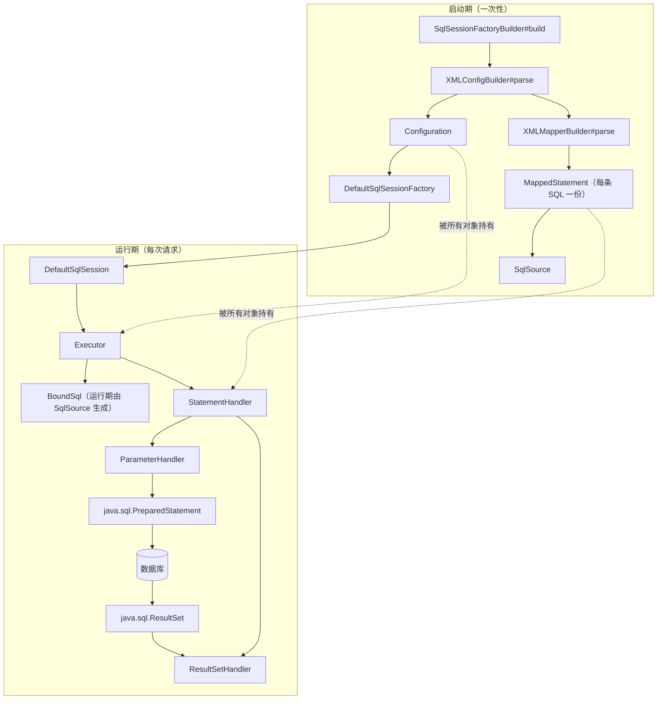
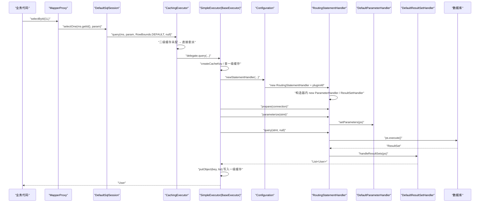

# MyBatis 源码精读 01：整体架构与四大核心对象、七大组件

> 一句话结论：MyBatis 运行期只玩四个对象——`SqlSessionFactory`（造会话）、`SqlSession`（会话门面）、`Executor`（真正的执行器）、`StatementHandler`（JDBC 语句的操作者）；它们共享同一份 `Configuration`，而 `Configuration` 里躺着每条 SQL 的"档案"`MappedStatement`。
> 阅读前置：会写 JDBC；读完本页前不必看 XML 解析细节（那是下一篇的事）
> 预计阅读 40 分钟 ｜ 源码：`org.mybatis:mybatis:3.6.0`

---

## 0. 先看现象

先用最小代码跑通"启动期 + 运行期"两段，同时把四大对象的**数量关系**打出来：

```java
// 启动期：整个应用只做一次
String resource = "mybatis-config.xml";
try (InputStream in = Resources.getResourceAsStream(resource)) {
    SqlSessionFactory factory = new SqlSessionFactoryBuilder().build(in);   // ① 全局唯一

    // 运行期：每个请求一次
    try (SqlSession session = factory.openSession()) {                      // ② 每次新建
        System.out.println(session.getExecutor().getClass().getSimpleName()); // CachingExecutor
        UserMapper mapper = session.getMapper(UserMapper.class);            // ③ 动态代理
        System.out.println(mapper.getClass().getName());                    // jdk.proxy2.$Proxy12
        User u = mapper.selectById(1L);                                     // ④ 一路向下
    }
}
```

你能观察到的三件事，就是本文的主线：

1. `factory` 只有一个，`session` 每次都是新的 → **`SqlSessionFactory` 是单例，`SqlSession` 是一次性的**。
2. `session.getExecutor()` 打印出 `CachingExecutor` 而不是 `SimpleExecutor` → **执行器被装饰过**（第 2.1 节解释 `newExecutor` 里的装饰顺序）。
3. `mapper.getClass()` 是 `jdk.proxy2.$Proxy12` → **Mapper 接口背后是 JDK 动态代理**，而不是任何实现类。

## 1. 整体地图



**读图说明**：

- 上半部分是**启动期**：`Configuration` 是唯一产物容器，`MappedStatement` 全部在此时注册完毕；`DefaultSqlSessionFactory` 只是"抱着 `Configuration` 的工厂"。
- 下半部分是**运行期**：注意 `SqlSession` **不在** `Executor` 之上"做业务"，它只做参数包装（`wrapCollection`）、脏标记（`dirty`）、异常包装，真正的执行从 `Executor` 开始。
- `BoundSql` 出现在运行期、由 `SqlSource` 生成，说明 **`BoundSql` 是"每次调用一份"的临时对象**，千万不要把它缓存起来跨请求复用（里面有 `additionalParameters` 可变状态）。
- 虚线表示"持有关系"：`Configuration` 贯穿全程，`MappedStatement` 被传给 `StatementHandler`，所以插件可以在这两处拿到全部元信息。

### 1.1 四大核心对象一览

| 对象 | 一句话职责 | 谁创建 | 生命周期 | 所在包 |
| --- | --- | --- | --- | --- |
| `SqlSessionFactory` | 造 `SqlSession` 的工厂，持有 `Configuration` | `SqlSessionFactoryBuilder#build` | 应用级单例 | `org.apache.ibatis.session` |
| `SqlSession` | 面向用户的会话门面（`selectOne`/`update`/`getMapper`/`commit`） | `SqlSessionFactory#openSession` | 一次请求/一个事务，**非线程安全** | `org.apache.ibatis.session` |
| `Executor` | 真正执行 SQL、管理事务与两级缓存 | `Configuration#newExecutor` | 跟 `SqlSession` 同生共死 | `org.apache.ibatis.executor` |
| `StatementHandler` | 创建并操作 JDBC `Statement`（预编译、绑参、执行、取结果） | `Configuration#newStatementHandler` | **每次 SQL 执行新建** | `org.apache.ibatis.executor.statement` |

### 1.2 七大组件一览

| 组件 | 负责什么 | 谁创建它 | 在哪个包 |
| --- | --- | --- | --- |
| `Executor` | 执行 `update`/`query`，管一级缓存、延迟加载、事务提交 | `Configuration#newExecutor`（可被 `CachingExecutor` 装饰，再经插件） | `org.apache.ibatis.executor` |
| `StatementHandler` | `prepare`（拿 `PreparedStatement`）、`parameterize`、`query`、`update` | `Configuration#newStatementHandler` → `RoutingStatementHandler` | `org.apache.ibatis.executor.statement` |
| `ParameterHandler` | 把 `#{}` 解析出的参数逐个 `ps.setXxx(i, value)` | `Configuration#newParameterHandler` → `XMLLanguageDriver#createParameterHandler` | `org.apache.ibatis.executor.parameter` |
| `ResultSetHandler` | 遍历 `ResultSet`，按 `ResultMap` 组装对象 | `Configuration#newResultSetHandler` → `DefaultResultSetHandler` | `org.apache.ibatis.executor.resultset` |
| `MappedStatement` | 一条 SQL 的完整档案（id、命令类型、`SqlSource`、`ResultMap`、缓存开关…） | 启动期 `XMLStatementBuilder` → `MapperBuilderAssistant#addMappedStatement` | `org.apache.ibatis.mapping` |
| `SqlSource` | "参数 → `BoundSql`"的策略（动态 SQL 或静态 SQL） | 启动期 `XMLLanguageDriver#createSqlSource` | `org.apache.ibatis.mapping`（实现在 `scripting.xmltags` / `scripting.defaults` / `builder`） |
| `BoundSql` | 真正要发给数据库的 SQL + 参数映射清单（一次调用一份） | 运行期 `SqlSource#getBoundSql` | `org.apache.ibatis.mapping` |

> 记忆口诀：**"厂-会-执-句"是对象，"映-源-界"是元数据**（`MappedStatement`-`SqlSource`-`BoundSql`）。前四个跑起来会变，后三个基本是"启动期造好、运行期读"。

## 2. 关键类逐个拆

### 2.1 `SqlSessionFactory`：只干一件事的工厂

```java (src: SqlSessionFactory.java#L25-L45)
public interface SqlSessionFactory {

  SqlSession openSession();

  SqlSession openSession(boolean autoCommit);

  SqlSession openSession(Connection connection);

  SqlSession openSession(TransactionIsolationLevel level);

  SqlSession openSession(ExecutorType execType);

  SqlSession openSession(ExecutorType execType, boolean autoCommit);

  SqlSession openSession(ExecutorType execType, TransactionIsolationLevel level);

  SqlSession openSession(ExecutorType execType, Connection connection);

  Configuration getConfiguration();

}
```

- **在干什么**：8 个 `openSession` 重载 + 1 个 `getConfiguration()`。所有重载最终都汇到 `DefaultSqlSessionFactory#openSessionFromDataSource`（见 `02-SqlSession与执行器/01-...`）。
- **为什么这么设计**：`openSession(ExecutorType)` 让你能"同一个工厂开不同执行器的会话"（例如批量导入用 `BATCH`，普通查询用 `SIMPLE`），不用重建工厂。
- **如果只有一个无参 `openSession()`**：批量场景只能全局改 `defaultExecutorType`，影响所有会话。
- **常见坑**：`factory.openSession()` 默认 `autoCommit=false`，**不 `commit()` 就 `close()` 会静默回滚**。

### 2.2 `SqlSession`：门面，不是执行者

`DefaultSqlSession` 的字段只有 5 个，说明它"薄"得可以：

```java (src: DefaultSqlSession.java#L46-L60)
public class DefaultSqlSession implements SqlSession {

  private final Configuration configuration;
  private final Executor executor;

  private final boolean autoCommit;
  private boolean dirty;
  private List<Cursor<?>> cursorList;

  public DefaultSqlSession(Configuration configuration, Executor executor, boolean autoCommit) {
    this.configuration = configuration;
    this.executor = executor;
    this.dirty = false;
    this.autoCommit = autoCommit;
  }
```

- **在干什么**：持有 `configuration`、`executor`、`autoCommit`，以及两个状态位：`dirty`（本会话是否发生过写操作）、`cursorList`（未关闭的游标）。
- **为什么这么写**：`dirty` 与 `autoCommit` 一起决定 `close()` 时是否自动提交/回滚——`isCommitOrRollbackRequired(false)` 的实现是 `return !autoCommit && dirty || force;`。
- **如果没有 `dirty`**：无法做到"只读会话直接关闭、写会话必须提交"的语义，`close()` 只能无脑回滚，会把只读场景也卷进事务。
- **常见坑**：`dirty` 只由 `update`/`dirtySelect` 置位；如果你用 `SqlSession#getConnection()` 直接 JDBC 写入，`dirty` 不会被置位，`close()` 时不会提交（详见第 6 节坑 3）。

### 2.3 `Executor`：真正的执行者（接口只有 15 个方法）

```java (src: Executor.java#L33-L35)
public interface Executor {

  ResultHandler NO_RESULT_HANDLER = null;
```

- **在干什么**：定义 `update`、两个 `query`、`queryCursor`、`flushStatements`、`commit`、`rollback`、`createCacheKey`、`clearLocalCache`、`deferLoad`、`getTransaction`、`close` 等。
- **`NO_RESULT_HANDLER = null` 的妙处**：`query(ms, param, rowBounds, null)` 与"带 `ResultHandler` 的查询"共用同一套重载，`null` 表示"一次性收集成 `List` 返回"。
- **谁创建**：`Configuration#newExecutor(Transaction, ExecutorType)`，内部先选 `Simple/Reuse/Batch`，再可选套上 `CachingExecutor`，最后过 `interceptorChain.pluginAll`。

### 2.4 `StatementHandler`：JDBC 语句的"操作者"

```java (src: StatementHandler.java#L31-L49)
public interface StatementHandler {

  Statement prepare(Connection connection, Integer transactionTimeout) throws SQLException;

  void parameterize(Statement statement) throws SQLException;

  void batch(Statement statement) throws SQLException;

  int update(Statement statement) throws SQLException;

  <E> List<E> query(Statement statement, ResultHandler resultHandler) throws SQLException;

  <E> Cursor<E> queryCursor(Statement statement) throws SQLException;

  BoundSql getBoundSql();

  ParameterHandler getParameterHandler();

}
```

- **在干什么**：`prepare` 把 `Connection` 变成 `Statement`；`parameterize` 绑参；`query`/`update` 执行并处理结果。
- **为什么要把"取语句"与"绑参"拆成两步**：这是 JDBC 的硬约束——`PreparedStatement` 必须先 `prepareStatement(sql)` 拿到，再 `setXxx`；而且 `ReuseExecutor` 需要"SQL 相同就复用同一条 `Statement`"，所以 `prepare` 必须独立出来被缓存。
- **常见坑**：插件若拦截 `StatementHandler#prepare` 的**返回值**做替换（例如改写 SQL 后重新 `prepareStatement`），一定要同步替换 `BoundSql`，否则 `parameterize` 会按旧 SQL 的参数个数绑参，报 `SQLException: 参数索引超出范围`。

`BaseStatementHandler` 的构造器说明了三者的组装关系：

```java (src: BaseStatementHandler.java#L53-L73)
  protected BaseStatementHandler(Executor executor, MappedStatement mappedStatement, Object parameterObject,
      RowBounds rowBounds, ResultHandler resultHandler, BoundSql boundSql) {
    this.configuration = mappedStatement.getConfiguration();
    this.executor = executor;
    this.mappedStatement = mappedStatement;
    this.rowBounds = rowBounds;

    this.typeHandlerRegistry = configuration.getTypeHandlerRegistry();
    this.objectFactory = configuration.getObjectFactory();

    if (boundSql == null) { // issue #435, get the key before calculating the statement
      generateKeys(parameterObject);
      boundSql = mappedStatement.getBoundSql(parameterObject);
    }

    this.boundSql = boundSql;

    this.parameterHandler = configuration.newParameterHandler(mappedStatement, parameterObject, boundSql);
    this.resultSetHandler = configuration.newResultSetHandler(executor, mappedStatement, rowBounds, parameterHandler,
        resultHandler, boundSql);
  }
```

- **在干什么**：`StatementHandler` 构造时**顺手**创建 `ParameterHandler` 和 `ResultSetHandler`，并把 `boundSql` 传下去；如果调用方没传 `boundSql`（`update` 路径就是传 `null`），就现算一份。
- **为什么这么写**：三者共享同一份 `BoundSql`（参数个数、参数名、`additionalParameters` 必须一致），让 `StatementHandler` 做"组合根"最省事。
- **如果让 `Executor` 自己 new**：`ReuseExecutor`/`BatchExecutor` 会重复创建，且插件无法统一拦截（因为 `newParameterHandler` 内部才有 `pluginAll`）。
- **常见坑**：`generateKeys(parameterObject)` 在 `getBoundSql` **之前**执行——这是 `issue #435` 的修复点。如果你写了自定义 `KeyGenerator` 且依赖 `BoundSql`，要注意这个顺序。

### 2.5 `ParameterHandler` 与 `ResultSetHandler`：一对"进/出"处理器

```java (src: ParameterHandler.java#L26-L30)
public interface ParameterHandler {

  Object getParameterObject();

  void setParameters(PreparedStatement ps) throws SQLException;
```

```java (src: ResultSetHandler.java#L28-L34)
public interface ResultSetHandler {

  <E> List<E> handleResultSets(Statement stmt) throws SQLException;

  <E> Cursor<E> handleCursorResultSets(Statement stmt) throws SQLException;

  void handleOutputParameters(CallableStatement cs) throws SQLException;
```
```

- **`ParameterHandler` 负责"进"**：把 `#{}`（已经变成 `?`）与 `ParameterMapping` 逐个对应，调 `ps.setLong(1, 1L)`。默认实现 `DefaultParameterHandler`。
- **`ResultSetHandler` 负责"出"**：`while(rs.next())` + 按 `ResultMap`/自动映射填对象；`handleOutputParameters` 专门处理存储过程 OUT 参数。默认实现 `DefaultResultSetHandler`。
- **谁创建**：`Configuration#newParameterHandler` / `newResultSetHandler`，两者在 `return` 前都经过 `interceptorChain.pluginAll`——这就是"插件能改写参数/改写结果"的入口。
- **常见坑**：`setParameters` 抛的异常信息里会带 `parameterMapping`（`Could not set parameters for mapping: ...`），排查参数问题时**先看这条日志里的 `property`**，多半是 `@Param` 名字写错。

### 2.6 `MappedStatement`：一条 SQL 的"档案袋"

```java (src: MappedStatement.java#L328-L347)
  public BoundSql getBoundSql(Object parameterObject) {
    BoundSql boundSql = sqlSource.getBoundSql(parameterObject);
    List<ParameterMapping> parameterMappings = boundSql.getParameterMappings();
    if (parameterMappings == null || parameterMappings.isEmpty()) {
      boundSql = new BoundSql(configuration, boundSql.getSql(), parameterMap.getParameterMappings(), parameterObject);
    }

    // check for nested result maps in parameter mappings (issue #30)
    for (ParameterMapping pm : boundSql.getParameterMappings()) {
      String rmId = pm.getResultMapId();
      if (rmId != null) {
        ResultMap rm = configuration.getResultMap(rmId);
        if (rm != null) {
          hasNestedResultMaps |= rm.hasNestedResultMaps();
        }
      }
    }

    return boundSql;
  }
```

- **在干什么**：`getBoundSql` 是 `MappedStatement` **唯一**的"活"方法——委托给 `sqlSource`，再补两件事：① 参数映射为空时用 `parameterMap` 兜底（兼容 `parameterMap` 老写法）；② 顺手扫描嵌套 `ResultMap` 标记（`issue #30`）。
- **为什么 `MappedStatement` 是 `final` 且构造器私有**：它必须靠 `MappedStatement.Builder` 构建，保证 `sqlCommandType`、`sqlSource`、`resultMaps` 这些字段"要么全有要么构建失败"（`build()` 里有 4 个 `assert`）。
- **如果 `SqlSource` 直接在 `MappedStatement` 里实现**：动态 SQL 与静态 SQL 的差异会污染这个"档案类"，也失去"启动期预编译"的优化机会。
- **常见坑**：`hasNestedResultMaps` 是**运行期被 `|=` 修改的**，所以 `MappedStatement` 并非完全不可变；并发下它只是个布尔标记，最坏情况是多算一次嵌套映射，不会出错。

### 2.7 `SqlSource` 与 `BoundSql`：一个"生产"，一个"被生产"

```java (src: SqlSource.java#L24-L28)
public interface SqlSource {

  BoundSql getBoundSql(Object parameterObject);

}
```

```java (src: BoundSql.java#L35-L50)
public class BoundSql {

  private final String sql;
  private final List<ParameterMapping> parameterMappings;
  private final Object parameterObject;
  private final Map<String, Object> additionalParameters;
  private final MetaObject metaParameters;

  public BoundSql(Configuration configuration, String sql, List<ParameterMapping> parameterMappings,
      Object parameterObject) {
    this.sql = sql;
    this.parameterMappings = parameterMappings;
    this.parameterObject = parameterObject;
    this.additionalParameters = new HashMap<>();
    this.metaParameters = configuration.newMetaObject(additionalParameters);
  }
```

- **`SqlSource` 是策略接口**：`DynamicSqlSource`（每次调都跑一遍 `SqlNode` 树）、`RawSqlSource`（启动期就算好）、`ProviderSqlSource`（`@SelectProvider` 反射调用）。判断依据见 `01-初始化与配置解析/02-...`。
- **`BoundSql` 是"数据袋"**：`sql` 里已经是 `?` 占位符；`parameterMappings` 与 `?` 一一对应；`additionalParameters` 是 `<foreach>` 的 `__frch_item_0`、`<bind>` 变量这类"动态语言自己造的变量"。
- **如果 `BoundSql` 被复用**：`additionalParameters` 是新 `HashMap`，复用会串参数；而且 `SqlSource#getBoundSql` 本来就是"每次一调"。
- **常见坑**：`BoundSql#getSql()` 在动态 SQL 下**每次调用都不同**，所以"用 `boundSql.getSql()` 做缓存 key"必须放在一次执行内（这正是 `BaseExecutor#createCacheKey` 做的事）。

## 3. 源码逐段精读：`Configuration` 如何把四个对象"组装"起来

### 3.1 四大处理器工厂方法：插件在这里"套壳"

```java (src: Configuration.java#L710-L729)
  public ParameterHandler newParameterHandler(MappedStatement mappedStatement, Object parameterObject,
      BoundSql boundSql) {
    ParameterHandler parameterHandler = mappedStatement.getLang().createParameterHandler(mappedStatement,
        parameterObject, boundSql);
    return (ParameterHandler) interceptorChain.pluginAll(parameterHandler);
  }

  public ResultSetHandler newResultSetHandler(Executor executor, MappedStatement mappedStatement, RowBounds rowBounds,
      ParameterHandler parameterHandler, ResultHandler resultHandler, BoundSql boundSql) {
    ResultSetHandler resultSetHandler = new DefaultResultSetHandler(executor, mappedStatement, parameterHandler,
        resultHandler, boundSql, rowBounds);
    return (ResultSetHandler) interceptorChain.pluginAll(resultSetHandler);
  }

  public StatementHandler newStatementHandler(Executor executor, MappedStatement mappedStatement,
      Object parameterObject, RowBounds rowBounds, ResultHandler resultHandler, BoundSql boundSql) {
    StatementHandler statementHandler = new RoutingStatementHandler(executor, mappedStatement, parameterObject,
        rowBounds, resultHandler, boundSql);
    return (StatementHandler) interceptorChain.pluginAll(statementHandler);
  }
```

- **在干什么**：三个 `newXxxHandler` 都是"**new 真的实现 → `pluginAll` 包一层代理 → 返回**"。
- **为什么这么写**：把"扩展点"收敛在 `Configuration` 里，插件作者只需在 `@Intercepts` 上写接口方法签名，不需要改任何 `new` 语句。
- **如果把 `pluginAll` 写在 `SimpleExecutor` 里**：`BatchExecutor`、`ReuseExecutor` 各要写一遍，`CallableStatementHandler` 又漏一次；而且用户自定义 `Configuration` 子类无法覆盖。
- **常见坑**：`ParameterHandler` 是**语言驱动**创建的（`mappedStatement.getLang()`），所以自定义 `LanguageDriver` 会同时改掉 `ParameterHandler` 与 `SqlSource`；只想要自定义参数处理时不要动 `language`，直接用插件。

### 3.2 `newExecutor`：装饰顺序决定了"缓存最外层"

```java (src: Configuration.java#L735-L749)
  public Executor newExecutor(Transaction transaction, ExecutorType executorType) {
    executorType = executorType == null ? defaultExecutorType : executorType;
    Executor executor;
    if (ExecutorType.BATCH == executorType) {
      executor = new BatchExecutor(this, transaction);
    } else if (ExecutorType.REUSE == executorType) {
      executor = new ReuseExecutor(this, transaction);
    } else {
      executor = new SimpleExecutor(this, transaction);
    }
    if (cacheEnabled) {
      executor = new CachingExecutor(executor);
    }
    return (Executor) interceptorChain.pluginAll(executor);
  }
```

- **在干什么**：先选"基础执行器"（`BATCH`/`REUSE`/默认 `SIMPLE`），再按 `cacheEnabled`（默认 `true`）套上 `CachingExecutor`，最后过插件链。
- **为什么 `CachingExecutor` 在外面**：二级缓存要在"一级缓存之前"判断（命中二级缓存就根本不进 `SimpleExecutor`）；如果把 `CachingExecutor` 套在里面，二级缓存命中后仍会白跑一遍 `BaseExecutor#query`。
- **为什么默认 `cacheEnabled=true` 但"二级缓存默认不生效"**：`CachingExecutor` 生效只代表"框架允许用二级缓存"，真正是否走缓存看 `ms.getCache() != null`——只有 mapper 里写了 `<cache/>` 才有 `Cache` 对象。
- **常见坑**：`ExecutorType.BATCH` 下 `select` 仍然走 `doQuery`，容易得到与刚才批量写入不一致的结果；`flushStatements()` 之前不要读。

### 3.3 `RoutingStatementHandler`：按 `statementType` 选"真身"

```java (src: RoutingStatementHandler.java#L39-L56)
  public RoutingStatementHandler(Executor executor, MappedStatement ms, Object parameter, RowBounds rowBounds,
      ResultHandler resultHandler, BoundSql boundSql) {

    switch (ms.getStatementType()) {
      case STATEMENT:
        delegate = new SimpleStatementHandler(executor, ms, parameter, rowBounds, resultHandler, boundSql);
        break;
      case PREPARED:
        delegate = new PreparedStatementHandler(executor, ms, parameter, rowBounds, resultHandler, boundSql);
        break;
      case CALLABLE:
        delegate = new CallableStatementHandler(executor, ms, parameter, rowBounds, resultHandler, boundSql);
        break;
      default:
        throw new ExecutorException("Unknown statement type: " + ms.getStatementType());
    }

  }
```

- **在干什么**：`RoutingStatementHandler` 自己不做 JDBC 操作（第 58-96 行全是 `delegate.xxx()`），只负责按 `MappedStatement#getStatementType()` 选 `Simple/Prepared/Callable` 三种实现。
- **为什么保留 `SimpleStatementHandler`**：`statementType="STATEMENT"` 时 SQL 里的 `${}` 是唯一参数方式（因为 `Statement` 不支持 `?`），用于某些 DDL/动态表名场景；缺点是没有预编译、有注入风险。
- **如果只留 `PreparedStatementHandler`**：存储过程（`CALLABLE`）无法拿到 `CallableStatement` 的 OUT 参数注册能力。
- **常见坑**：`default` 分支的异常信息是 `Unknown statement type: `，如果日志里出现它，说明 XML 里 `statementType` 拼错了（合法值只有 `STATEMENT`/`PREPARED`/`CALLABLE`）。

### 3.4 `InterceptorChain#pluginAll`：四层对象为什么都能被拦

```java (src: InterceptorChain.java#L28-L33)
  public Object pluginAll(Object target) {
    for (Interceptor interceptor : interceptors) {
      target = interceptor.plugin(target);
    }
    return target;
  }
```

- **在干什么**：对 `target` 依次套上每个插件的动态代理，返回"最外层"的代理对象。
- **为什么用动态代理而不是继承**：`Executor`/`StatementHandler` 有 4 个家族实现（`Simple`/`Reuse`/`Batch`/`Caching`、`Simple`/`Prepared`/`Callable`/`Routing`），用代理一份代码就能覆盖全部。
- **注意顺序**：先注册的插件在最外层；`pluginAll` 是**逐个包裹**，所以多个插件对同一方法的拦截顺序与 `addInterceptor` 顺序相反（最外层先进）。
- **常见坑**：动态代理只对**接口方法**生效，`Interceptor#plugin` 默认用 `Plugin.wrap`，它只会拦 `@Intercepts` 声明过的接口；如果你拦截的是 `BaseExecutor` 的非接口方法，永远不会进代理。

## 4. 一个查询请求穿过哪些对象（简化时序）



**读图说明**：

- 第一段 `U->>P->>S` 是**代理 + 门面**两跳，不做任何 SQL 操作，只做"方法 → `MappedStatement` id + 参数"的翻译。
- 中间 `E->>BE` 说明 `CachingExecutor` 是**装饰器**：二级缓存没命中（或没配）就原样委派给 `SimpleExecutor`。
- `BE->>CFG: newStatementHandler` 是**每执行一条 SQL 都发生一次**的 `new`——这就是"三级缓存"之外最大的对象创建开销来源，也是插件套壳的时机。
- 注意 `SH->>SH` 自调用：`ParameterHandler`/`ResultSetHandler` 是在 `RoutingStatementHandler` **构造时**（父类 `BaseStatementHandler`）创建的，不是执行时。
- 最后 `BE->>BE: putObject` 是**一级缓存写入**，发生在 `doQuery` 返回之后、`query` 返回之前；所以同一 `SqlSession` 内第二次相同查询才命中。

## 5. 设计模式与取舍

| 模式 | 体现 | 学到什么 |
| --- | --- | --- |
| 工厂方法 | `SqlSessionFactory#openSession`、`Configuration#newExecutor`/`newStatementHandler` | 把"选择实现类"的判断集中到一处 |
| 建造者 | `MappedStatement.Builder`、`Environment.Builder`、`SqlSessionFactoryBuilder` | 一个对象有 20+ 字段时，用 Builder 保证构建顺序与校验 |
| 门面 | `DefaultSqlSession` | 对外 20 个便捷方法，对内只调 `Executor` |
| 装饰器 | `CachingExecutor` 包 `SimpleExecutor`、`Plugin` 包四层对象 | 在不改实现的前提下叠加"缓存""拦截" |
| 模板方法 | `BaseExecutor` 把 `query/update` 固定，留 `doQuery/doUpdate` 给子类 | 缓存、事务、延迟加载这些"公共步骤"只写一次 |
| 策略 | `ExecutorType`（`SIMPLE`/`REUSE`/`BATCH`）、`StatementType`、`SqlSource` 三实现 | 运行期可替换算法族 |
| 动态代理 | `MapperProxyFactory`、`Plugin` | 无实现类也能调用；不改源码也能拦截 |

**取舍**：MyBatis 选择"每层一个接口 + 动态代理"而不是"一个大类 if-else"，代价是**调用链深、栈难读**；换来的是**任意一层可插拔**，这也是它能成为"分页插件/脱敏插件/多租户插件"生态的根源。

## 6. 实际开发中的坑

1. **`SqlSession` / `Executor` / `StatementHandler` 都不是线程安全的**：`DefaultSqlSession` 源码注释就写着 `Note that this class is not Thread-Safe.`；把 `SqlSession` 存成 `static` 或注入到单例 Bean 字段里，必然出现"结果串号、`Executor was closed`"。
2. **忘记 `commit()`**：`openSession()` 默认 `autoCommit=false`，`dirty=true` 时 `close()` 会**回滚**；MyBatis 不打日志提醒，表现为"插入没报错但库里没有"。
3. **`StatementHandler` 每个查询都新建**：如果你的插件在 `newStatementHandler` 上做重量级操作（反射扫注解、查库），QPS 会被直接砍半；这类逻辑要放进"启动期"或用 `ConcurrentHashMap` 缓存。
4. **误以为 `CacheKey` 可以跨请求复用**：`BoundSql#getSql()` 在动态 SQL 下每次可能不同，自己手写缓存 key 时漏掉 `environment.getId()`、`RowBounds` 会串数据（源码里 `issue #176` 就是补 `environment.getId()`）。
5. **`Mapper` 接口上的重载方法小心**：`MapperMethod` 按"方法名 → `MappedStatement` id"绑定，同名重载会命中同一个 id，参数语义却可能不同；MyBatis 允许，但极易踩坑。
6. **`Configuration` 不要多份**：一个应用多份 `Configuration` 会导致 `MappedStatement` 重复注册（`StrictMap#put` 抛 `already contains key`），或二级缓存互相看不见。
7. **`ExecutorType.BATCH` 混用 `select`**：批量模式下写操作只是入队，`select` 看到的是库里旧数据；要读必须 `flushStatements()`。
8. **在 `StatementHandler#prepare` 插件里替换 `Statement`**：`parameterize` 用的仍是原 `BoundSql` 的参数个数，SQL 改了参数个数没改就会 `列索引无效`。

## 7. 调试手法（怎么"看"这四个对象）

- **断点顺序**：`MapperProxy#invoke` → `DefaultSqlSession#selectList` → `BaseExecutor#query` → `SimpleExecutor#doQuery` → `PreparedStatementHandler#query` → `DefaultResultSetHandler#handleResultSets`。这 6 个断点打通，任何 MyBatis 问题都能定位到层。
- **看 SQL 真身**：在 `SimpleExecutor#doQuery` 的 `prepareStatement` 之前 `Evaluate Expression` 看 `boundSql.getSql()`，与日志里的 `Preparing:` 对比。
- **看缓存 key**：`BaseExecutor#createCacheKey` 返回后看 `key.toString()`（格式是 `id:offset:limit:sql:参数:environmentId`）。
- **看一级缓存命中**：`localCache.getObject(key)` 的返回值是否 `!= null`；`queryStack` 是否 `> 0`（嵌套查询时不读缓存）。
- **开日志**：`logImpl=SLF4J`，把 `mapper 所在包` 打到 `DEBUG`，能看到 `==>  Preparing:` / `<==    Columns:` 全链路。

## 8. 面试验证点（12 问）

1. MyBatis 的四大核心对象是哪四个？各自生命周期？
2. `SqlSession` 为什么不是线程安全的？`ThreadLocal` 在 Spring 里由谁维护？
3. `Configuration`、`MappedStatement`、`SqlSource`、`BoundSql` 四者关系？
4. `SqlSessionFactory` 为什么是单例？重复构建有什么代价？
5. `Executor` 有哪几种实现？`CachingExecutor` 为什么在最外层？
6. `StatementHandler` 的三种实现与 `statementType` 如何对应？
7. `ParameterHandler` 默认实现是谁？它怎么知道每个 `?` 该绑什么？
8. `ResultSetHandler` 默认实现是谁？自动映射与 `ResultMap` 谁优先？
9. 插件能拦截哪些对象？为什么是这四层？
10. 为什么不建议把 `BoundSql` 缓存起来跨请求用？
11. `SqlSession#getMapper` 与 `Configuration#getMapper` 有什么区别？
12. 一个 `select * from t_user where id = #{id}` 从调用到返回，经过哪些对象？

## 9. 动手练习

1. 打印四大对象的实现类名（`session.getExecutor().getClass()`、断点看 `statementHandler`），并解释为什么 `getExecutor()` 返回的是 `CachingExecutor`。（验收：能说出 `newExecutor` 的两步装饰）
2. 写一个 `@Intercepts(@Signature(type = StatementHandler.class, method = "prepare", args = {Connection.class, Integer.class}))` 插件，打印 `boundSql.getSql()`，并用 `mybatis-config.xml` 的 `<plugins>` 注册。（验收：控制台能看到 SQL，且 `ParameterHandler` 仍正常绑参）
3. 把 `localCacheScope` 改成 `STATEMENT`，在同一次 `SqlSession` 里连续查两次同一 id，观察第二次是否还打 SQL。（验收：两次都打 SQL，说明 `STATEMENT` 级缓存在 `queryStack==0` 时被清空）
4. 故意把 `statementType` 写成 `PREPAR`，看异常消息是哪一条。（验收：`Unknown statement type: PREPAR`）

## 小结

- 四大对象"厂-会-执-句"：`SqlSessionFactory` 单例造会话，`SqlSession` 门面，`Executor` 执行 + 缓存 + 事务，`StatementHandler` 管 JDBC 语句。
- 七大组件里 `MappedStatement`/`SqlSource`/`BoundSql` 是"元数据"，前两个启动期造好，`BoundSql` 每次执行现造。
- 四层对象全部由 `Configuration` 的 `newXxx` 工厂创建，且都过 `interceptorChain.pluginAll` —— 这是插件机制的全部秘密。

## 自测题

1. `SqlSessionFactory` 与 `SqlSession` 的生命周期差别？
2. `DefaultSqlSession` 的 `dirty` 字段作用是什么？
3. `Executor#NO_RESULT_HANDLER` 为什么是 `null`？
4. `BaseStatementHandler` 为什么在构造器里就创建 `ParameterHandler`/`ResultSetHandler`？
5. `BoundSql` 里的 `additionalParameters` 是给谁用的？
6. `MappedStatement#getBoundSql` 里那段"参数映射为空就用 `parameterMap`"是为什么？
7. `RoutingStatementHandler` 为什么要有"路由"这一层，不能直接 `new PreparedStatementHandler`？
8. `pluginAll` 中多个插件对同一方法的拦截顺序是怎样的？
9. `newExecutor` 里 `cacheEnabled` 为 `true` 就等于"二级缓存生效"吗？
10. 如果让你实现一个"慢 SQL 打印"功能，断点/插件应该放在哪一层？为什么？
11. `SqlSource` 的三个实现分别适用什么场景？
12. 一次查询里 `PreparedStatement` 的 `setXxx` 是谁调的、按什么顺序调的？

<details><summary>参考答案要点</summary>

1. `SqlSessionFactory` 应用级单例（构建贵、线程安全）；`SqlSession` 一次请求/一个事务，非线程安全，用完即关。
2. 标记本会话是否发生过"写或脏读"，与 `autoCommit` 一起决定 `close()` 时是否自动提交/回滚：`!autoCommit && dirty || force`。
3. `ResultHandler` 参数为 `null` 表示"不要回调，直接收集成 `List` 返回"；用常量表达语义比到处传 `null` 清晰。
4. 三者必须共享同一份 `BoundSql`（参数个数/参数名一致），由 `StatementHandler` 做组合根最不容易漏；同时 `Configuration#newXxx` 内部还会 `pluginAll`。
5. 给动态 SQL 造的临时变量用：`<foreach>` 的 `__frch_item_0`、`<bind>` 的变量，`DefaultParameterHandler` 会优先从 `additionalParameters` 取值（`issue #448`）。
6. 兼容老式 `<parameterMap>` 声明（`parameterMap` 的映射与 `#{}` 都不写时），保证仍能绑参；`MappedStatement.Builder` 默认给一个 `defaultParameterMap`。
7. 因为 `statementType` 可以在 XML 里配置（`STATEMENT`/`PREPARED`/`CALLABLE`），且存储过程需要 `CallableStatement`；路由层让 `Executor` 只依赖 `StatementHandler` 接口。
8. 后注册的插件先被"包"进去（在内层），先注册的插件在最外层，所以**执行顺序与注册顺序相反**（最外层先执行）。
9. 不等于。`cacheEnabled=true` 只是允许套 `CachingExecutor`；真正生效要求 `ms.getCache() != null`（mapper 里写了 `<cache/>`）且 `useCache=true`。
10. 放在 `StatementHandler#prepare`/`Executor#query` 的插件里（能拿到 `BoundSql#getSql()` 与耗时）；`ResultSetHandler` 里统计也行，但拿不到耗时起点，需要额外 `ThreadLocal`。
11. `DynamicSqlSource`（含 `<if>`/`${}` 等动态内容）、`RawSqlSource`（纯静态 SQL，启动期就解析好更快）、`ProviderSqlSource`（`@SelectProvider` 反射生成 SQL）。
12. 由 `ParameterHandler`（`DefaultParameterHandler#setParameters`）按 `BoundSql#getParameterMappings()` 的**顺序**逐个 `setXxx(i+1, value, jdbcType)`，索引从 1 开始。
</details>
