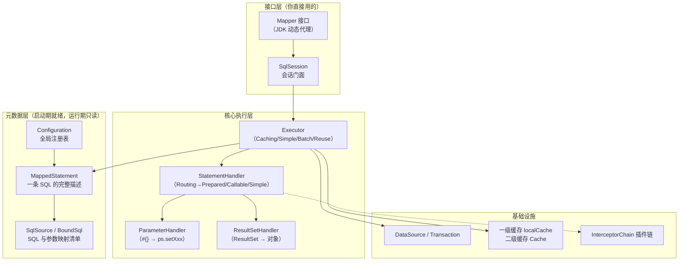

# 03 MyBatis · 00 总览（从 JDBC 到"MyBatis 六大构件"）

> 一句话结论：MyBatis 只做四件事——**读配置、把 SQL 编译成 `MappedStatement`、用 `Executor` 执行并处理参数、把 `ResultSet` 映射成对象**；其余全交给 `Configuration` 这个大容器。
> 阅读前置：会写 JDBC（`Connection`/`PreparedStatement`/`ResultSet`）、知道 Spring 的 `DataSource` 是什么
> 预计阅读 20 分钟 ｜ 源码：`org.mybatis:mybatis:3.6.0`

---

## 0. 先看现象

先用纯 JDBC 写一个查询，感受一下"没有框架"的样子：

```java
// 纯 JDBC：一个查询要写的全部代码（示意，无框架）
Connection conn = dataSource.getConnection();
PreparedStatement ps = conn.prepareStatement("select id, user_name from t_user where id = ?");
ps.setLong(1, 1L);                  // ① 手工绑参数
ResultSet rs = ps.executeQuery();
if (rs.next()) {                    // ② 手工遍历结果集
    User u = new User();
    u.setId(rs.getLong("id"));      // ③ 手工取列并映射字段
    u.setUserName(rs.getString("user_name"));
}
```

用 MyBatis，上面 ① ② ③ 三段全部消失：

```java
// 换用 MyBatis：上面 ①②③ 全部消失（示意）
UserMapper mapper = sqlSession.getMapper(UserMapper.class);
User u = mapper.selectById(1L);
```

你可能会问的三个问题，就是本组文档要回答的：

1. `mapper.selectById(1L)` 的 `UserMapper` **没有实现类**，为什么能直接调？（→ `02-SqlSession与执行器/01-sqlsession-与-mapper-代理.md`）
2. XML 里的 `<select>` 是什么时候、被谁读进内存的？读成了什么？（→ `01-初始化与配置解析/`）
3. 一次 `selectById` 到底经过几个对象？缓存命中的是"哪一层"？（→ `02-SqlSession与执行器/02-executor-执行器与一级缓存.md`）

## 1. 整体地图

### 1.1 一句话定位

| 框架 | 你写什么 | 谁生成 SQL | 上手/可控性 | 典型场景 |
| --- | --- | --- | --- | --- |
| 纯 JDBC | `Connection`/`PreparedStatement`/`ResultSet` 全套 | 你 | 最麻烦但最可控 | 学习、极简工具 |
| `JdbcTemplate` | SQL 字符串 + `RowMapper` | 你（字符串拼在 Java 里） | 简单，但 SQL 与 Java 混在一起 | 报表、轻量 DAO |
| **MyBatis** | **SQL 写在 XML/注解 + 参数占位符** | **你写 SQL，MyBatis 负责编译、绑参、映射、缓存、插件** | SQL 与代码分离，可插件化 | 互联网业务、SQL 复杂可调 |
| JPA / Hibernate | 实体 + 方法名/JPQL | 框架生成 | 不用写 SQL，但复杂查询难以调优 | 领域模型驱动的系统 |

> 一句话对比：**JPA 是"你描述实体，框架生成 SQL"；MyBatis 是"你写 SQL，框架帮你执行和映射"。** 云南这类电信 BSS 系统的报表与批量查询 SQL 往往手写调优，所以 MyBatis 更常见。

### 1.2 分层架构图



**读图说明**：

- 左边 `Mapper 接口` 与 `SqlSession` 都属于"接口层"：`Mapper 接口 → JDK 代理 → SqlSession` 是一条单向箭头，说明 **Mapper 自己不做任何事，它只是把方法调用翻译成 `SqlSession.xxx("namespace.id", args)`**。
- 中间 `Executor → StatementHandler → ParameterHandler / ResultSetHandler` 是**每次查询都要走的四层**，其中 `StatementHandler` 负责"拿到 `PreparedStatement`"，`ParameterHandler` 负责 `ps.setLong(1, ...)`，`ResultSetHandler` 负责 `rs.next()` + 塞进对象——正好对应第 0 节里被删掉的三段代码。
- 下半部分 `Configuration / MappedStatement / SqlSource` 是**启动期一次性建好、运行期只读**的元数据；所以"改 XML 不重启不生效"是设计使然，不是 bug。
- 虚线 `SH -.-> PLUG` 表示插件（`InterceptorChain`）是在 `Configuration#newStatementHandler` 等处**用动态代理包住这四层对象**，而不是"插在中间执行"。

### 1.3 启动期与运行期分界

| 阶段 | 入口 | 产物 |
| --- | --- | --- |
| 启动期（一次性） | `SqlSessionFactoryBuilder#build` → `XMLConfigBuilder` / `XMLMapperBuilder` | `Configuration`（含全部 `MappedStatement`）+ `SqlSessionFactory` |
| 运行期（每次请求） | `SqlSessionFactory#openSession` → `getMapper` → 方法调用 | `Executor`、`Statement`、`ResultSet`、结果对象 |

## 2. 文档导航

| 篇目 | 讲什么 | 读完能做到 |
| --- | --- | --- |
| 本页 `README.md` | MyBatis 定位、分层架构、与 JPA/JdbcTemplate 的对比 | 建立整体心智模型 |
| [01-mybatis-整体架构与四大对象.md](./01-mybatis-整体架构与四大对象.md) | 四大核心对象 + 七大组件（`Executor`/`StatementHandler`/`ParameterHandler`/`ResultSetHandler`/`MappedStatement`/`SqlSource`/`BoundSql`） | 说清每个组件"负责什么、谁创建它、在哪个包" |
| [../01-初始化与配置解析/README.md](../01-初始化与配置解析/README.md) | `SqlSessionFactoryBuilder` → `XMLConfigBuilder` → `Configuration` | 解释 `mybatis-config.xml` 每一项是怎么进内存的 |
| [../01-初始化与配置解析/01-sqlsessionfactory-构建过程.md](../01-初始化与配置解析/01-sqlsessionfactory-构建过程.md) | `parse` / `parseConfiguration` / 各 `XxxElement` | 画出配置解析的完整调用链 |
| [../01-初始化与配置解析/02-mapperxml-解析与-mappedstatement.md](../01-初始化与配置解析/02-mapperxml-解析与-mappedstatement.md) | `XMLMapperBuilder` / `XMLStatementBuilder` / `XMLScriptBuilder` | 解释 `#{}`、`${}`、`<if>`、`<sql>` 在解析期的差异 |
| [../02-SqlSession与执行器/README.md](../02-SqlSession与执行器/README.md) | `SqlSession`、`MapperProxy`、`Executor`、一级/二级缓存 | 讲清"一次查询走哪 6 层、缓存在哪层失效" |

> 后续篇目（`03-动态SQL与参数映射`、`04-结果映射与插件`、`05-Spring集成与Boot自动配置`）由同一套教程的其他分册覆盖，本页只做入口指引。

## 3. 学习检查点

读完本页，你应该能回答：

- [ ] 为什么说 MyBatis 是"SQL Mapper 框架"而不是 ORM 框架？（提示：`MappedStatement` 里存的是"一条 SQL + 映射规则"，不是实体元模型）
- [ ] `Configuration` 里至少有哪些"注册表"？（`mappedStatements`、`resultMaps`、`sqlFragments`、`typeHandlerRegistry`、`interceptorChain`…）
- [ ] 启动期与运行期的分界线是哪个类？（`SqlSessionFactory`）
- [ ] Mapper 接口方法调用最终落到哪个接口？（`SqlSession`，再往下是 `Executor`）

## 小结

- MyBatis = **配置解析器** + **元数据容器（`Configuration` / `MappedStatement`）** + **四层执行链（`Executor` → `StatementHandler` → `ParameterHandler` / `ResultSetHandler`）**。
- 它替代的是 JDBC 的"绑参、执行、映射、缓存、扩展"这五件重复劳动，而不是替你写 SQL。
- 启动期与运行期严格分离：XML 只在 `SqlSessionFactory` 构建时读一次，运行期所有查询都是"按 `namespace.id` 查表 + 执行"。

## 自测题

1. MyBatis 与 JPA 的本质差别是什么？
2. `Configuration` 是什么生命周期？为什么不建议每个请求 `new Configuration()`？
3. 一次查询中，"绑参数"发生在哪一层？
4. `MappedStatement` 与 `SqlSource` 的关系是什么？
5. 为什么 `Mapper` 接口不需要实现类？
6. 一级缓存挂在哪个对象上？跨 `SqlSession` 能命中吗？
7. 插件机制为什么能拦截"四层"对象？
8. 若把 SQL 写在注解里（`@Select`），启动期解析入口还是 `XMLMapperBuilder` 吗？

<details><summary>参考答案要点</summary>

1. JPA 由框架生成 SQL（实体元模型驱动），MyBatis 由开发者写 SQL（`MappedStatement` 驱动），只负责编译、绑参、映射、缓存。
2. `Configuration` 是"一个 `SqlSessionFactory` 一份"的全局注册表，构建代价高（解析全部 XML）；每次 `new` 会重复解析且缓存互相隔离。
3. `ParameterHandler`（`DefaultParameterHandler#setParameters`）——它把 `ParameterMapping` 逐个 `ps.setXxx(index, value)`。
4. `MappedStatement` 是"一条 SQL 的完整描述"（id、命令类型、`SqlSource`、`ResultMap`、缓存标志…），`SqlSource` 负责把参数对象变成 `BoundSql`（真实 SQL + 参数映射清单）。
5. `MapperProxyFactory` 用 `Proxy.newProxyInstance` 生成 JDK 动态代理，`MapperProxy#invoke` 把方法调用翻译成 `MapperMethod#execute`，最终调 `SqlSession`。
6. 挂在 `BaseExecutor#localCache`（`PerpetualCache`），属于 `SqlSession` 级；跨 `SqlSession` 不共享（要共享得开二级缓存）。
7. 因为 `Configuration#newExecutor`、`newStatementHandler`、`newParameterHandler`、`newResultSetHandler` 四处在 `return` 前都调用了 `interceptorChain.pluginAll(...)`，用动态代理包装后返回。
8. 不是。注解解析走 `MapperAnnotationBuilder#parse`，但最终仍然登记到同一个 `Configuration`；XML 与注解是两条入口、同一个注册表。
</details>
