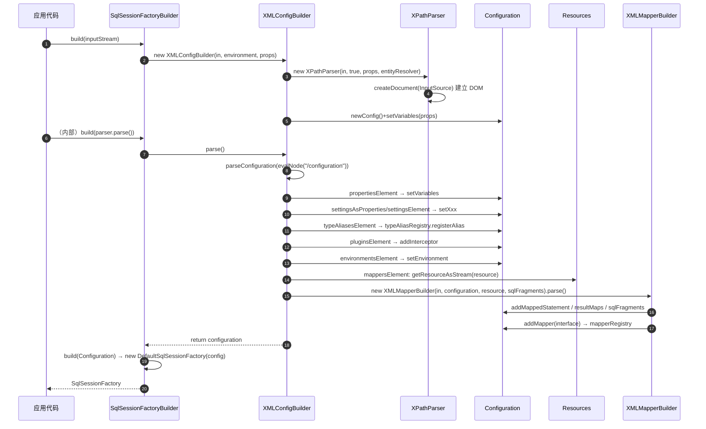

# SqlSessionFactory 构建过程：从一份 XML 到一个 Configuration

> 一句话结论：`SqlSessionFactoryBuilder#build(InputStream)` 的全部工作是「造一个 `XMLConfigBuilder`，让它解析 `/configuration` 节点，再用解析出来的 `Configuration` 造 `DefaultSqlSessionFactory`」——`Configuration` 是**唯一真正的产物**，工厂只是它的持有者。
> 阅读前置：读完本目录 `README.md`；知道"XML 文件""DOM""XPath"这三个词即可（本文第 3 节会用 20 行代码把 DOM/XPath 讲清）
> 预计阅读 40 分钟 ｜ 源码：`org.mybatis:mybatis:3.6.0`

---

## 0. 先看现象

不用 Spring、不用任何框架，手写一个"最小可运行"的 MyBatis 启动程序：

```java
// Step 1：准备 mybatis-config.xml（放在 classpath 下）
// <?xml version="1.0" encoding="UTF-8" ?>
// <!DOCTYPE configuration PUBLIC "-//mybatis.org//DTD Config 3.0//EN"
//         "https://mybatis.org/dtd/mybatis-3-config.dtd">
// <configuration>
//   <properties resource="jdbc.properties"/>
//   <settings>
//     <setting name="mapUnderscoreToCamelCase" value="true"/>
//     <setting name="localCacheScope" value="STATEMENT"/>
//   </settings>
//   <typeAliases>
//     <package name="com.example.domain"/>
//   </typeAliases>
//   <environments default="dev">
//     <environment id="dev">
//       <transactionManager type="JDBC"/>
//       <dataSource type="POOLED">
//         <property name="driver" value="${jdbc.driver}"/>
//         <property name="url" value="${jdbc.url}"/>
//         <property name="username" value="${jdbc.username}"/>
//         <property name="password" value="${jdbc.password}"/>
//       </dataSource>
//     </environment>
//   </environments>
//   <mappers>
//     <mapper resource="mapper/UserMapper.xml"/>
//   </mappers>
// </configuration>

// Step 2：三行代码启动
String resource = "mybatis-config.xml";
try (InputStream inputStream = Resources.getResourceAsStream(resource)) {
    SqlSessionFactory sqlSessionFactory = new SqlSessionFactoryBuilder().build(inputStream);
    Configuration configuration = sqlSessionFactory.getConfiguration();
    // Step 3：验证"XML 真的变成了内存对象"
    System.out.println(configuration.getEnvironment().getId());               // dev
    System.out.println(configuration.getMappedStatementNames().size());        // 所有 SQL 的条数
    System.out.println(configuration.getSqlFragments().keySet());              // 所有 <sql> 片段
}
```

运行后你会看到三件"反直觉"的事：

1. `build(inputStream)` 只传了一个输入流，却把 `mapper/UserMapper.xml` 也读了；
2. `inputStream` 在 `build` 返回后**已经被关掉**了（后面再读会抛 `Stream Closed`）；
3. `<properties>` 里的 `${jdbc.driver}` 在 `<dataSource>` 中被替换了——说明**解析顺序本身有语义**。

本文要把这三件事全部落到源码上。

## 1. 整体地图



**读图说明**：

- **只有一次 `new`**：`SqlSessionFactory` 的唯一实现 `DefaultSqlSessionFactory` 在最后一步才被 `new` 出来，它的构造器只做一件事——保存 `configuration` 引用（见 3.1）。所以"工厂"本身没有状态，状态全在 `Configuration` 里。
- **DOM 只建一次**：`XPathParser` 在构造器里就把整个 `mybatis-config.xml` 解成 `Document`（第 4 步），后面所有 `evalNode("/configuration")`、`evalNode("settings")` 都是在这棵树上做 XPath 查询，而不是反复读流。
- **"读 Mapper XML"发生在 `mappersElement` 里**：图上 `XC -> R` 和 `XC -> XM` 两步就是"配置解析"与"Mapper 解析"的分界线。`XMLConfigBuilder` 自己不认识任何 `<select>`。
- **`XM -> Conf` 有两条箭头**：一条是写 `MappedStatement`（来自 XML），另一条是 `addMapper(interface)`（注册接口、准备动态代理）。两条都指同一个 `Configuration`，这就是"XML 与注解共用一套元数据"的实现方式。
- 注意 `finally` 里的 `inputStream.close()`：`parse()` 返回后流就被关了，所以**不要**在外部复用这个流。

| 参与者 | 职责 | 是否可复用 |
| --- | --- | --- |
| `SqlSessionFactoryBuilder` | 编排 + 异常包装 + 关流 | 用完即弃（无状态，可复用于多次 build） |
| `XMLConfigBuilder` | 解析 `mybatis-config.xml` | **不可复用**（`parsed` 标志，第二次抛异常） |
| `XPathParser` | DOM + XPath 查询 + 变量替换 | 跟着 builder 一起丢 |
| `Configuration` | 全部元数据 + 全部运行时全局配置 | 全局唯一，随 factory 长期存活 |
| `XMLMapperBuilder` | 解析单个 Mapper XML | 每个 XML 一个实例 |

## 2. 关键类逐个拆

### 2.1 `SqlSessionFactoryBuilder`：只做 3 件事的门面

- **职责**：把 `InputStream`/`Reader`/`Configuration` 变成 `SqlSessionFactory`；把受检异常统一包成运行时异常；保证流被关闭、`ErrorContext` 被重置。
- **关键字段**：**没有字段**。这是它"可以用完就丢"的根本原因。
- **设计意图**：构造 `SqlSessionFactory` 是一锤子买卖，不需要"建造过程"的状态，所以用 Builder 模式但**不保存状态**。

### 2.2 `XMLConfigBuilder`：`mybatis-config.xml` 的唯一解析者

- **职责**：按固定顺序把 13 类节点搬进 `Configuration`。
- **关键字段**：`parsed`（一次性开关）、`environment`（命令行/显式指定的环境 id）、`parser`（`XPathParser`）、`configuration`（继承自 `BaseBuilder`）。
- **继承关系**：`XMLConfigBuilder extends BaseBuilder`，`BaseBuilder` 持有 `configuration`、`typeAliasRegistry`、`typeHandlerRegistry`，并提供 `resolveClass`/`resolveTypeHandler` 等工具方法。
- **设计意图**：**顺序即语义**。`properties` 必须最先（后面节点要用 `${}` 变量），`settings` 要先"读成 `Properties` 校验"，再在 `objectFactory` 之后才真正生效（`issue #631`）。

### 2.3 `XPathParser` / `XNode`：把 XML 变成"能点属性的对象"

零基础补一句：**DOM** 是把整个 XML 读成一棵树（`Document` → 元素节点 → 文本节点），**XPath** 是在这棵树上"找节点"的表达式语言（`/configuration/settings`、`select|insert|update|delete` 里的 `|` 表示"或"）。

- **`XPathParser`**：持有 `Document` + `XPath` + `variables`（用于 `${}` 替换）+ `entityResolver`（离线 DTD）。
- **`XNode`**：包住一个 `org.w3c.dom.Node`，提供 `getStringAttribute(name, def)`、`getChildren()`、`getChildrenAsProperties()`、`evalNode(...)` 等"顺手"方法。
- **设计意图**：把"XPath 求值可能为 `null`"和"属性取不到给默认值"这类琐碎逻辑集中到两个类里，业务代码里就不会到处判空。

### 2.4 `Resources` / `VFS`：资源到底从哪读

- **`Resources`**：静态工具类，把"相对路径"交给 `ClassLoaderWrapper`，依次尝试 **TCCL（线程上下文类加载器）→ 本类加载器 → 系统类加载器** 等；找不到直接抛 `IOException("Could not find resource ...")`。
- **`VFS`**（Virtual File System）：只在**扫描包**（`<package name="..."/>`、`@MapperScan`）时用到——它负责把"一个包下的所有 `.class`"列出来（jar 内 / 目录 / 甚至容器内的 war 各不相同），所以它有 `JarFileSystem`/`DefaultVFS` 等实现。
- **设计意图**：**读单个文件用 `Resources`，列一批文件用 `VFS`**。两者混用是新手常见错误。

### 2.5 `Configuration`：真正的"内存数据库结构"

`Configuration` 有 100+ 个字段，但只需记住 5 张表 + 3 个注册表（完整速查见本目录 `README.md`）：

```java (src: Configuration.java#L152-L172)
  protected final MapperRegistry mapperRegistry = new MapperRegistry(this);
  protected final InterceptorChain interceptorChain = new InterceptorChain();
  protected final TypeHandlerRegistry typeHandlerRegistry = new TypeHandlerRegistry(this);
  protected final TypeAliasRegistry typeAliasRegistry = new TypeAliasRegistry();
  protected final LanguageDriverRegistry languageRegistry = new LanguageDriverRegistry();

  protected final Map<String, MappedStatement> mappedStatements = new StrictMap<MappedStatement>(
      "Mapped Statements collection")
          .conflictMessageProducer((savedValue, targetValue) -> ". please check " + savedValue.getResource() + " and "
              + targetValue.getResource());
  protected final Map<String, Cache> caches = new StrictMap<>("Caches collection");
  protected final Map<String, ResultMap> resultMaps = new StrictMap<>("Result Maps collection");
  protected final Map<String, ParameterMap> parameterMaps = new StrictMap<>("Parameter Maps collection");
  protected final Map<String, KeyGenerator> keyGenerators = new StrictMap<>("Key Generators collection");

  protected final Set<String> loadedResources = new HashSet<>();
  protected final Map<String, XNode> sqlFragments = new StrictMap<>("XML fragments parsed from previous mappers");
  protected final Collection<XMLStatementBuilder> incompleteStatements = new LinkedList<>();
  protected final Collection<CacheRefResolver> incompleteCacheRefs = new LinkedList<>();
  protected final Collection<ResultMapResolver> incompleteResultMaps = new LinkedList<>();
  protected final Collection<MethodResolver> incompleteMethods = new LinkedList<>();
```

- **在干什么**：声明 5 个 `final` 组件 + 5 个 `StrictMap` + `loadedResources` + 4 个"待补全"集合。
- **为什么用 `StrictMap`**：`StrictMap extends ConcurrentHashMap`，但覆写了 `put`/`get`，**重复 key 直接抛异常**并指出冲突的两个 XML 文件；`get` 不到时抛 `"Mapped Statements collection does not contain value for xxx"`。这是 MyBatis 把"配置错误"提前到启动期的核心手段。
- **为什么 `sqlFragments` 存 `XNode`**：`<sql>` 片段被 `<include>` 引用时才知道上下文（`databaseId`、`refid` 前缀），存原始节点可以延迟展开，还能被多个 namespace 复用。
- **为什么有 `incompleteXxx`**：解析是**流式**的——`<resultMap>` 可能引用还没解析的 `extends`，`<select>` 可能引用后面才定义的 `<sql>`。遇到这种情况先挂起，等全部 XML 读完再 `parsePendingXxx()` 重试，这就是"前向引用"能工作的原因。
- **常见坑**：`loadedResources` 里既有 XML 路径（`mapper/UserMapper.xml`）也有 `namespace:com.example.UserMapper`，后者用于防止"`<mapper resource>` 与 `@MapperScan` 重复注册同一接口"。

## 3. 源码逐段精读

### 3.1 `SqlSessionFactoryBuilder#build`：读流、解析、关流

```java (src: SqlSessionFactoryBuilder.java#L77-L93)
  public SqlSessionFactory build(InputStream inputStream, String environment, Properties properties) {
    try {
      XMLConfigBuilder parser = new XMLConfigBuilder(inputStream, environment, properties);
      return build(parser.parse());
    } catch (Exception e) {
      throw ExceptionFactory.wrapException("Error building SqlSession.", e);
    } finally {
      ErrorContext.instance().reset();
      try {
        if (inputStream != null) {
          inputStream.close();
        }
      } catch (IOException e) {
        // Intentionally ignore. Prefer previous error.
      }
    }
  }
```

- **在干什么**：`build(InputStream)` 先转调本方法（`environment`、`properties` 全为 `null`）；本方法里只有 2 行实质代码——造 `XMLConfigBuilder`、用 `parse()` 的结果继续 build；`finally` 里重置 `ErrorContext` 并关流。
- **为什么关流**：MyBatis 把流的所有权收归自己（`try-with-resources` 的替代写法），避免用户忘记关闭。代价是**你不能在 `build` 之后复用这个流**。
- **如果改成别的**：如果这里不关流，`jar` 包内资源会累积 `JarFile` 句柄导致 Windows 下无法覆盖 jar（经典"文件被占用"问题）。
- **常见坑**：`catch (Exception e)` 里的 `ExceptionFactory.wrapException` 会把 `IOException`/`BuilderException` 统一包成 `PersistenceException` 并**保留 cause**；排错时一定要**看最底层的 cause**，否则只能看到 `Error building SqlSession.`。

```java (src: SqlSessionFactoryBuilder.java#L95-L97)
  public SqlSessionFactory build(Configuration config) {
    return new DefaultSqlSessionFactory(config);
  }
```

- **在干什么**：最终产物——`DefaultSqlSessionFactory` 只包了 `Configuration`。
- **为什么单独暴露**：给 Spring 的 `SqlSessionFactoryBean`、以及"手写 `Configuration`"的高级用法（比如 MyBatis-Plus 的 `MybatisConfiguration`）留口子。
- **常见坑**：`build(Configuration)` **不会**校验 `configuration.environment` 是否为空，环境缺失的报错会推迟到第一次 `openSession()`。

### 3.2 `XMLConfigBuilder` 的构造器：DOM 在这里被建出来

```java (src: XMLConfigBuilder.java#L90-L112)
  public XMLConfigBuilder(Class<? extends Configuration> configClass, InputStream inputStream, String environment,
      Properties props) {
    this(configClass, new XPathParser(inputStream, true, props, new XMLMapperEntityResolver()), environment, props);
  }

  private XMLConfigBuilder(Class<? extends Configuration> configClass, XPathParser parser, String environment,
      Properties props) {
    super(newConfig(configClass));
    ErrorContext.instance().resource("SQL Mapper Configuration");
    this.configuration.setVariables(props);
    this.parsed = false;
    this.environment = environment;
    this.parser = parser;
  }

  public Configuration parse() {
    if (parsed) {
      throw new BuilderException("Each XMLConfigBuilder can only be used once.");
    }
    parsed = true;
    parseConfiguration(parser.evalNode("/configuration"));
    return configuration;
  }
```

- **在干什么**：三个重载一路收敛到私有构造器：**造 `Configuration`（`newConfig`）→ 记录 `ErrorContext` 资源名 → 把外部 `Properties` 塞进 `configuration.variables` → 保存 `environment`/`parser`**。`parse()` 是幂等保护 + 真正的解析入口。
- **为什么 `XPathParser` 第 2 个参数是 `true`（validation）**：开启 DTD 校验，配置写错标签能立刻报错。`XMLMapperEntityResolver` 负责把 DTD 的 **public id 映射到本地 jar 里的 dtd 文件**，这样校验时**不需要联网**（离线/内网环境能启动的关键）。
- **为什么要 `parsed` 标志**：`Configuration.mappedStatements` 是 `StrictMap`，同一个 `namespace.id` 第二次 put 会抛 `already contains key`。与其让用户看到这种"看不懂"的异常，不如直接禁止重复解析。
- **如果改成别的**：如果把 `setVariables(props)` 放到 `parseConfiguration` 之后，那么 `<properties>` 里的值就无法在 `<settings>` 阶段被 `${}` 替换（`props` 传进来就是给外部兜底的，优先级最低）。
- **常见坑**：`parse()` 内部 `evalNode("/configuration")` **不会**因为根标签写成 `<config>` 而报"友好的错"——`evalNode` 返回 `null`，随后 `parseConfiguration(null)` 在 `propertiesElement` 里直接 `return`（`context == null`），最终得到一个**空 `Configuration`**，直到 `openSession()` 才炸。所以"启动不报错但什么都没注册"要先怀疑根标签拼错。

### 3.3 `parseConfiguration`：13 行调用 = 13 条规则

```java (src: XMLConfigBuilder.java#L114-L135)
  private void parseConfiguration(XNode root) {
    try {
      // issue #117 read properties first
      propertiesElement(root.evalNode("properties"));
      Properties settings = settingsAsProperties(root.evalNode("settings"));
      loadCustomVfsImpl(settings);
      loadCustomLogImpl(settings);
      typeAliasesElement(root.evalNode("typeAliases"));
      pluginsElement(root.evalNode("plugins"));
      objectFactoryElement(root.evalNode("objectFactory"));
      objectWrapperFactoryElement(root.evalNode("objectWrapperFactory"));
      reflectorFactoryElement(root.evalNode("reflectorFactory"));
      settingsElement(settings);
      // read it after objectFactory and objectWrapperFactory issue #631
      environmentsElement(root.evalNode("environments"));
      databaseIdProviderElement(root.evalNode("databaseIdProvider"));
      typeHandlersElement(root.evalNode("typeHandlers"));
      mappersElement(root.evalNode("mappers"));
    } catch (Exception e) {
      throw new BuilderException("Error parsing SQL Mapper Configuration. Cause: " + e, e);
    }
  }
```

- **在干什么**：按固定顺序调用 13 个 `XxxElement`。注释 `issue #117 read properties first` 和 `issue #631` 直接写明了顺序原因。
- **为什么 `settings` 被拆成两半**（`settingsAsProperties` + `settingsElement`）：因为 `vfsImpl` 和 `logImpl` 必须在 `typeAliases` 之前生效（它们影响后续所有类的加载），而 `objectFactory` 之类又必须在 `settingsElement` 之前建好。所以先"读成 `Properties` 挑出两个特殊项"（L118-120），再在 L126 统一 `setXxx`。
- **如果改成别的**：把 `mappersElement` 挪到 `environmentsElement` 之前，Mapper 里的 `<resultMap>` 若引用了 `<typeAlias>` 之外的动态数据源相关设置就会拿不到；更实际的问题是——**先解析 Mapper 意味着 `<databaseIdProvider>` 还没准备好**，`databaseId` 相关的 SQL 会被错误过滤。
- **常见坑**：这层 `catch` 会把任何异常（包括 `ClassNotFoundException`）都包成 `Error parsing SQL Mapper Configuration. Cause: ...`。看到这个前缀，说明**还没开始读 Mapper XML**，问题在 `mybatis-config.xml` 本身。

### 3.4 `settingsAsProperties`：拼错 setting 名第一时间炸

```java (src: XMLConfigBuilder.java#L137-L151)
  private Properties settingsAsProperties(XNode context) {
    if (context == null) {
      return new Properties();
    }
    Properties props = context.getChildrenAsProperties();
    // Check that all settings are known to the configuration class
    MetaClass metaConfig = MetaClass.forClass(Configuration.class, localReflectorFactory);
    for (Object key : props.keySet()) {
      if (!metaConfig.hasSetter(String.valueOf(key))) {
        throw new BuilderException(
            "The setting " + key + " is not known.  Make sure you spelled it correctly (case sensitive).");
      }
    }
    return props;
  }
```

- **在干什么**：把 `<settings>` 的每个 `<setting name value>` 读成 `Properties`，然后用 `MetaClass` 反射检查 `Configuration` 上是否有同名 setter。
- **为什么这么写**：`MetaClass#hasSetter` 是"按名字找 `setXxx`"的反射封装；这样可以做到**零硬编码白名单**——`Configuration` 新增一个 setter，`<setting>` 就自动支持。
- **如果改成别的**：如果只做 `props.getProperty("cacheEnabled")` 式的读取，拼错的名字会被静默忽略，出现"我明明配了 `mapUnderscoreToCamelCase` 却没生效"的经典疑难。
- **常见坑**：**大小写敏感**。`mapUnderscoreToCamelcase`（小写 c）会直接抛 `The setting mapUnderscoreToCamelcase is not known.`。

### 3.5 `propertiesElement`：`${}` 变量的来源与优先级

```java (src: XMLConfigBuilder.java#L237-L259)
  private void propertiesElement(XNode context) throws Exception {
    if (context == null) {
      return;
    }
    Properties defaults = context.getChildrenAsProperties();
    String resource = context.getStringAttribute("resource");
    String url = context.getStringAttribute("url");
    if (resource != null && url != null) {
      throw new BuilderException(
          "The properties element cannot specify both a URL and a resource based property file reference.  Please specify one or the other.");
    }
    if (resource != null) {
      defaults.putAll(Resources.getResourceAsProperties(resource));
    } else if (url != null) {
      defaults.putAll(Resources.getUrlAsProperties(url));
    }
    Properties vars = configuration.getVariables();
    if (vars != null) {
      defaults.putAll(vars);
    }
    parser.setVariables(defaults);
    configuration.setVariables(defaults);
  }
```

- **在干什么**：先取 `<properties>` 的子标签，再用 `resource`/`url` 指向的外部文件**覆盖**，最后用**外部传入**的 `Properties`（`configuration.getVariables()`，即构造器里 `setVariables(props)` 那一步）再覆盖一层。
- **为什么是这个顺序**：优先级 = **代码传入 > resource/url 文件 > 子标签内联**。这样"打包时写默认值，启动脚本里传 `-D` 覆盖"就能工作。
- **如果改成别的**：若 `defaults.putAll(vars)` 写成 `vars.putAll(defaults)`，配置文件就会覆盖代码传入的值，Spring Boot 的 `application.yml` 外部化配置就失效了。
- **常见坑**：`resource` 与 `url` 同时存在会直接抛异常，而不是"以 resource 为准"——不同版本都坚持这一点。另外，`parser.setVariables` 只影响**当前 builder 的 XPathParser**，Mapper XML 的变量替换靠 `XMLMapperBuilder` 构造器里的 `configuration.getVariables()`，所以两者必须都设置（源码里正是这么做的）。
- **注意行号提示**：上面第 246 行原文是一整行较长的异常消息，这里为可读性做了折行展示；引用原文时请以 `assets/source/XMLConfigBuilder.java.md` 的真实行为准。

### 3.6 `settingsElement`：默认值都写在这 35 行里

```java (src: XMLConfigBuilder.java#L261-L282)
  private void settingsElement(Properties props) {
    configuration
        .setAutoMappingBehavior(AutoMappingBehavior.valueOf(props.getProperty("autoMappingBehavior", "PARTIAL")));
    configuration.setAutoMappingUnknownColumnBehavior(
        AutoMappingUnknownColumnBehavior.valueOf(props.getProperty("autoMappingUnknownColumnBehavior", "NONE")));
    configuration.setCacheEnabled(booleanValueOf(props.getProperty("cacheEnabled"), true));
    configuration.setProxyFactory((ProxyFactory) createInstance(props.getProperty("proxyFactory")));
    configuration.setLazyLoadingEnabled(booleanValueOf(props.getProperty("lazyLoadingEnabled"), false));
    configuration.setAggressiveLazyLoading(booleanValueOf(props.getProperty("aggressiveLazyLoading"), false));
    configuration.setUseColumnLabel(booleanValueOf(props.getProperty("useColumnLabel"), true));
    configuration.setUseGeneratedKeys(booleanValueOf(props.getProperty("useGeneratedKeys"), false));
    configuration.setDefaultExecutorType(ExecutorType.valueOf(props.getProperty("defaultExecutorType", "SIMPLE")));
    configuration.setDefaultStatementTimeout(integerValueOf(props.getProperty("defaultStatementTimeout"), null));
    configuration.setDefaultFetchSize(integerValueOf(props.getProperty("defaultFetchSize"), null));
    configuration.setDefaultResultSetType(resolveResultSetType(props.getProperty("defaultResultSetType")));
    configuration.setMapUnderscoreToCamelCase(booleanValueOf(props.getProperty("mapUnderscoreToCamelCase"), false));
    configuration.setSafeRowBoundsEnabled(booleanValueOf(props.getProperty("safeRowBoundsEnabled"), false));
    configuration.setLocalCacheScope(LocalCacheScope.valueOf(props.getProperty("localCacheScope", "SESSION")));
    configuration.setJdbcTypeForNull(JdbcType.valueOf(props.getProperty("jdbcTypeForNull", "OTHER")));
    configuration.setLazyLoadTriggerMethods(
        stringSetValueOf(props.getProperty("lazyLoadTriggerMethods"), "equals,clone,hashCode,toString"));
    configuration.setSafeResultHandlerEnabled(booleanValueOf(props.getProperty("safeResultHandlerEnabled"), true));
```

- 我已按 3.6.0 源码逐行核对，块中省略了 `setCallSettersOnNulls` 到 `setNullableOnForEach` 等 12 行（L285-L294）。
- **在干什么**：每个 `setXxx` 都是 `props.getProperty("名字", 默认值)`。**这张表就是 MyBatis 全部"全局开关"的权威清单**。
- **为什么默认值写在这里而不是字段上**：`Configuration` 字段上也有默认值（比如 `cacheEnabled = true`），`settingsElement` 里对**未配置项**也用同一个默认值再设一次——好处是：无论你走 `XMLConfigBuilder` 还是自己 `new Configuration()`，行为一致；代价是**默认值写了两份**，升级时要小心（源码里两处必须同步）。
- **如果改成别的**：如果这里不设默认值，`props.getProperty` 返回 `null` 会让 `booleanValueOf(null, ...)` 走默认分支，其实也能工作；但像 `defaultExecutorType` 这种 `Enum.valueOf(null)` 会直接 NPE，所以显式给默认值是必须的。
- **常见坑**：`localCacheScope` 默认 `SESSION`（L278）——这就是"同一个 `SqlSession` 里两次相同查询只发一次 SQL"的原因，也是"数据被别的会话改了却读到旧值"的常见来源。

### 3.7 `environmentsElement`：`<environment>` 的选择与 `Environment` 的构建

```java (src: XMLConfigBuilder.java#L297-L316)
  private void environmentsElement(XNode context) throws Exception {
    if (context == null) {
      return;
    }
    if (environment == null) {
      environment = context.getStringAttribute("default");
    }
    for (XNode child : context.getChildren()) {
      String id = child.getStringAttribute("id");
      if (isSpecifiedEnvironment(id)) {
        TransactionFactory txFactory = transactionManagerElement(child.evalNode("transactionManager"));
        DataSourceFactory dsFactory = dataSourceElement(child.evalNode("dataSource"));
        DataSource dataSource = dsFactory.getDataSource();
        Environment.Builder environmentBuilder = new Environment.Builder(id).transactionFactory(txFactory)
            .dataSource(dataSource);
        configuration.setEnvironment(environmentBuilder.build());
        break;
      }
    }
  }
```

- **在干什么**：确定要用的环境 id（**显式传参优先，否则用 `<environments default>`**），遍历子节点，命中后构建 `Environment` 并 `break`——**只激活一个环境**。
- **为什么用 Builder**：`Environment` 的三个字段都是 `final` 且构造器做了非空校验（见 `Environment.java` L30-43），Builder 让"先选环境、再建工厂"的组装过程可读。
- **如果改成别的**：如果不用 `break`，多个同 id 环境会互相覆盖；如果不做 `isSpecifiedEnvironment` 校验，`environment == null` 时会抛 `No environment specified.`（`id == null` 时抛 `Environment requires an id attribute.`）。
- **常见坑**：**一个 `Configuration` 只有一个 `Environment`**。所以"多数据源"在原生 MyBatis 里做不到，必须多个 `SqlSessionFactory`（Spring 里就是多个 `SqlSessionFactoryBean`）。另外 `dataSourceElement` 若没有 `<dataSource>` 节点会抛 `Environment declaration requires a DataSourceFactory.`。

### 3.8 `mappersElement`：配置解析与 Mapper 解析的分界线

```java (src: XMLConfigBuilder.java#L388-L423)
  private void mappersElement(XNode context) throws Exception {
    if (context == null) {
      return;
    }
    for (XNode child : context.getChildren()) {
      if ("package".equals(child.getName())) {
        String mapperPackage = child.getStringAttribute("name");
        configuration.addMappers(mapperPackage);
      } else {
        String resource = child.getStringAttribute("resource");
        String url = child.getStringAttribute("url");
        String mapperClass = child.getStringAttribute("class");
        if (resource != null && url == null && mapperClass == null) {
          ErrorContext.instance().resource(resource);
          try (InputStream inputStream = Resources.getResourceAsStream(resource)) {
            XMLMapperBuilder mapperParser = new XMLMapperBuilder(inputStream, configuration, resource,
                configuration.getSqlFragments());
            mapperParser.parse();
          }
        } else if (resource == null && url != null && mapperClass == null) {
          ErrorContext.instance().resource(url);
          try (InputStream inputStream = Resources.getUrlAsStream(url)) {
            XMLMapperBuilder mapperParser = new XMLMapperBuilder(inputStream, configuration, url,
                configuration.getSqlFragments());
            mapperParser.parse();
          }
        } else if (resource == null && url == null && mapperClass != null) {
          Class<?> mapperInterface = Resources.classForName(mapperClass);
          configuration.addMapper(mapperInterface);
        } else {
          throw new BuilderException(
              "A mapper element may only specify a url, resource or class, but not more than one.");
        }
      }
    }
  }
```

- **在干什么**：`<mappers>` 下有 4 种写法：`package`（扫包，注解式）、`resource`（classpath 路径，XML）、`url`（绝对 URL，XML）、`class`（全限定名，注解式）。XML 两种都落到 `new XMLMapperBuilder(...).parse()`；注解两种都落到 `configuration.addMapper(...)`。
- **为什么 `addMappers(packageName)` 不需要 `VFS` 显式调用**：`MapperRegistry#addMappers` 内部通过 `ResolverUtil` 使用 `VFS` 列出包内所有类，再筛出接口。
- **如果改成别的**：如果把 `configuration.getSqlFragments()` 换成 `new HashMap<>()`，那么跨 Mapper XML 的 `<include refid="other.xxx"/>` 就失效——**`sqlFragments` 是全 `Configuration` 共享的**，这正是把 `Configuration` 传进去的原因。
- **常见坑**：`resource` 是**相对于 classpath 的路径**（如 `mapper/UserMapper.xml`），不是文件系统路径，也不带 `classpath:` 前缀（带了就会找不到）。多个属性同时写会抛 `A mapper element may only specify a url, resource or class, but not more than one.`

### 3.9 `Configuration#addMapper`：从 XML 反向注册接口

```java (src: Configuration.java#L942-L948)
  public <T> void addMapper(Class<T> type) {
    mapperRegistry.addMapper(type);
  }

  public <T> T getMapper(Class<T> type, SqlSession sqlSession) {
    return mapperRegistry.getMapper(type, sqlSession);
  }
```

- **在干什么**：`addMapper` 直接把活交给 `MapperRegistry`（内部会 `new MapperAnnotationBuilder(config, type).parse()`，即解析 `@Select` 等注解）；`getMapper` 则创建动态代理（见 `../02-SqlSession与执行器/01-sqlsession-与-mapper-代理.md`）。
- **为什么 Mapper XML 解析完要调它**：`XMLMapperBuilder#bindMapperForNamespace` 在读完 `/mapper` 后会尝试 `Resources.classForName(namespace)`，成功就 `addMapper`——这样"只写了 XML、没在 `<mappers>` 里写 `class`"也能 `getMapper`。**这是 MyBatis 的一个隐藏福利**，也是"同一接口被注册两次"报错的来源。
- **常见坑**：`MapperRegistry#addMapper` 对**非接口**是**静默跳过**的；对**已注册**的接口抛 `is already known to the MapperRegistry.`。混用 `@MapperScan` 与 `<mapper resource>` 时要确认不会重复。

## 4. `XPathParser` 与 `Resources`：XML 是怎么被读出来的

```java (src: XPathParser.java#L229-L243)
  private Document createDocument(InputSource inputSource) {
    // important: this must only be called AFTER common constructor
    try {
      DocumentBuilderFactory factory = DocumentBuilderFactory.newInstance();
      factory.setFeature(XMLConstants.FEATURE_SECURE_PROCESSING, true);
      factory.setValidating(validation);

      factory.setNamespaceAware(false);
      factory.setIgnoringComments(true);
      factory.setIgnoringElementContentWhitespace(false);
      factory.setCoalescing(false);
      factory.setExpandEntityReferences(false);

      DocumentBuilder builder = factory.newDocumentBuilder();
      builder.setEntityResolver(entityResolver);
```

- **在干什么**：用 JDK 自带 JAXP 建 `DocumentBuilderFactory`，逐项设定安全/行为开关，然后交给 `EntityResolver` 去解析 DTD。
- **为什么 `setNamespaceAware(false)`**：MyBatis 的 XML 不用命名空间，关掉能让 XPath 表达式（`/configuration/settings`）直接工作，不用加前缀。
- **为什么 `setExpandEntityReferences(false)` + `FEATURE_SECURE_PROCESSING`**：防 XXE（外部实体注入）。即使配置文件被篡改成恶意 DOCTYPE，也不会去读本地文件。
- **常见坑**：`setIgnoringElementContentWhitespace(false)` 意味着 `<sql>` 片段里的换行/缩进**会被保留**；`<include>` 拼接后 SQL 里出现多个换行是正常的，日志里看着乱不代表 SQL 有问题。

```java (src: Resources.java#L132-L138)
  public static InputStream getResourceAsStream(ClassLoader loader, String resource) throws IOException {
    InputStream in = classLoaderWrapper.getResourceAsStream(resource, loader);
    if (in == null) {
      throw new IOException("Could not find resource " + resource);
    }
    return in;
  }
```

- **在干什么**：`Resources` 的所有方法最终都走 `ClassLoaderWrapper`，它按"显式传入的 loader → TCCL → 本类 loader → 系统 loader"的顺序尝试，任一命中即返回。
- **为什么这么绕**：同一个类在 web 容器、Spring Boot fat jar、OSGi 里"能看见的资源"不同；多试几个 ClassLoader 是最省事的兼容方案。
- **常见坑（重点：`mapper-locations` 配错会怎样）**：
  1. **原生 MyBatis**：`<mapper resource="mapper/UserMapper.xml"/>` 写错 → `Resources.getResourceAsStream` 抛 `IOException: Could not find resource mapper/UserMapper.xml`，被包成 `BuilderException: Error parsing SQL Mapper Configuration. Cause: ...`，**启动失败**。
  2. **Spring Boot**：`mybatis.mapper-locations=classpath*:mapper/**/*.xml` 写错（比如少了 `*`，或写成 `classpath:mapper/*.xml` 而 XML 在 jar 内的子目录）→ `SqlSessionFactoryBean` 扫不到任何 XML。**注意：扫不到不会报错**，症状是 `org.apache.ibatis.binding.BindingException: Invalid bound statement (not found): com.example.UserMapper.selectById`——**运行期第一次调用才炸**。
  3. **Maven 资源过滤**：XML 放在 `src/main/java` 下但 `pom.xml` 没配 `<resources>` → 编译后 `target/classes` 里没有 XML，报错同第 2 条。
  4. **同一个 mapper 被加载两次**（`@MapperScan` + `<mappers>`）→ `Mapped Statements collection already contains key com.example.UserMapper.selectById`，异常信息里会指出两个 XML 的路径（这就是 `conflictMessageProducer` 的作用）。
- **排查口诀**：`Could not find resource` = **找不到文件**；`Invalid bound statement (not found)` = **找到了接口但没找到对应 SQL**（XML 没被解析 / `namespace` 或 `id` 不匹配）。

### 4.1 `VFS` 的角色

```java (src: VFS.java#L223-L223)
  protected abstract List<String> list(URL url, String forPath) throws IOException;
```

- **在干什么**：`VFS` 的唯一抽象方法——"给我一个 URL 和子路径，把它下面所有资源列出来"。`DefaultVFS`、`JBoss6VFS`、Spring 的 `SpringBootVFS` 各自实现。
- **谁在调用**：`getResources(path)`（公共入口）→ `list(...)`；上层是 `ResolverUtil`，服务于 `<package name>`、`@MapperScan`、以及 `<typeAliases><package>`。
- **为什么 Spring Boot 必须换 VFS**：fat jar 里类在 `BOOT-INF/classes/` 下，默认 VFS 用 `JarFile` 读会拿不到条目，于是 `SpringBootVFS` 改用 `PathMatchingResourcePatternResolver`。**症状**：不加 `SpringBootVFS` 时 `<typeAliases><package>` 扫不到任何类，`@MapperScan` 也扫不到。

## 5. 设计模式与可迁移经验

| 模式 | 出现位置 | 解决什么问题 | 可迁移到哪 |
| --- | --- | --- | --- |
| Builder（无状态） | `SqlSessionFactoryBuilder` | 把"多步构建"与"最终产品"解耦 | 任何"一次构建、长期使用"的对象 |
| 门面（Facade） | `SqlSessionFactoryBuilder#build` 三个重载 | 隐藏 `XMLConfigBuilder`/`DefaultSqlSessionFactory` | SDK 入口类 |
| 模板方法 | `parseConfiguration` 固定调用顺序 | 把"顺序即语义"固化 | 有依赖顺序的初始化流程 |
| 组合 + 委托 | `Configuration` 持有 5 个注册表 | 避免上帝类（虽然已经很大） | 大型配置聚合 |
| 严格容器（StrictMap） | `mappedStatements` 等 | 把配置错误提前到启动期 | 任何"key 唯一"的注册表 |
| 延迟补偿（incompleteXxx） | `<resultMap extends>` 前向引用 | 流式解析也能支持前向引用 | 编译器/解释器的符号表填充 |

## 6. 实际开发中的坑（7 条）

1. **`SqlSessionFactoryBuilder` 用完就丢，但别丢 `SqlSessionFactory`**。工厂要单例，且 `Configuration` 在运行期还会被"懒补全"（`buildAllStatements`），不要在多线程里改它。
2. **DTD 写错/漏写会走"不校验"路径**。`validation=true` 只在 DOCTYPE 存在时起作用；把 `<!DOCTYPE ...>` 删掉后标签拼错不再报错，症状变成"配置静默失效"。
3. **`<properties>` 的三种来源优先级记反**。正确顺序：`build(in, env, props)` 传入的 `props` > `resource`/`url` 文件 > `<properties>` 内联子标签。
4. **`<environments>` 只留一个**。多数据源必须多工厂；`<environment default>` 写错时抛 `No environment specified.`，看起来像"环境没配置"。
5. **`mapper-locations` 与 `@MapperScan` 二者混淆**。`@MapperScan` 只注册**接口**（注解 SQL 或有同名 XML 时生效），`mapper-locations` 只负责**读 XML**；两者都要有，缺一个就是 `Invalid bound statement`。
6. **同一个 XML 被 `<mapper resource>` 与 `<package>` 同时覆盖**。异常是 `already contains key`，靠 `conflictMessageProducer` 打印的两个路径定位。
7. **热部署时 `Configuration` 被复用**。`XMLConfigBuilder` 一次性 + `StrictMap` 禁止重复 put，导致 devtools 二次加载报 `already contains key`——解决办法是让 `SqlSessionFactory` 随 `ClassLoader` 重建（Spring Boot 里已处理）。

## 7. 版本差异（3.5 → 3.6）

- **`insert`/`update`/`delete` 的 `dirtySelect`**：3.6.0 新增 `affectData` 属性（`XMLStatementBuilder` L150），`Configuration#newExecutor`/`BaseExecutor#query` 据此决定是否需要清缓存（`DefaultSqlSession#selectList` 里的 `dirty |= ms.isDirtySelect()`）。
- **`nullableOnForEach`**：3.6.0 新增 setting（`settingsElement` L294），控制 `<foreach>` 遇到 `null` 集合时是否渲染 `(null)`；老版本直接抛异常。
- **`argNameBasedConstructorAutoMapping`**：3.6.0 新增，构造器自动映射可以按参数名（需 `-parameters` 编译）。
- **`shrinkWhitespacesInSql`**：3.6.0 新增，开启后在 `SqlSourceBuilder` 里压缩多余空白。
- **Java 版本**：3.6.0 要求 **Java 8+**，且已用 `List.copyOf`、`computeIfAbsent` 等 9/8 API（`MappedStatement#build`）。
- **`Configuration#setDefaultResultSetType`**：3.5 后期引入，3.6 在 `settingsElement` 里成为标准项。

## 8. 面试验证点（12 问）

1. `SqlSessionFactoryBuilder#build(InputStream)` 里为什么要在 `finally` 关流？
2. `XMLConfigBuilder` 为什么不能复用（第二次 `parse()` 会怎样）？
3. `<properties>` 的三种来源优先级是什么？为什么 `configuration.getVariables()` 要最后覆盖？
4. 为什么 `settings` 要分成 `settingsAsProperties` 与 `settingsElement` 两步？
5. `<settings>` 里键名拼错，什么时候报错、报什么异常？
6. `sqlFragments` 为什么存 `XNode` 而不是解析好的 `String`？
7. `incompleteStatements` / `incompleteResultMaps` 解决什么问题？什么时候被消费？
8. `loadedResources` 里 `namespace:xxx` 条目的作用是什么？
9. `<mappers>` 的 `resource`/`url`/`class`/`package` 四种写法各走哪条代码路径？
10. `mapper-locations` 配错在原生 MyBatis 和 Spring Boot 下分别表现为什么错误？
11. 为什么"多数据源"在原生 MyBatis 里必须多个 `SqlSessionFactory`？
12. `XMLMapperEntityResolver` 是干什么的？没有它会怎样？

<details><summary>参考答案要点</summary>

1. MyBatis 接管流的所有权，防止忘记关闭导致 jar 句柄泄漏（Windows 下会锁文件）；同时 `ErrorContext.instance().reset()` 清理排错上下文。
2. 抛 `BuilderException("Each XMLConfigBuilder can only be used once.")`；因为 `Configuration.mappedStatements` 是 `StrictMap`，重复注册会报 `already contains key`，不如提前禁止。
3. 传入 `props` > `resource`/`url` 文件 > 内联 `<property>`；最后覆盖保证"外部配置优先级最高"（12-factor / Spring Boot 外部化）。
4. `vfsImpl`、`logImpl` 必须在 `typeAliases` 之前生效，而其余 setting 要在 `objectFactory` 之后生效，所以先读成 `Properties` 挑出特殊项、再统一 `setXxx`（`issue #631`）。
5. 启动期，`settingsAsProperties` 里 `MetaClass#hasSetter` 校验失败抛 `The setting xxx is not known.  Make sure you spelled it correctly (case sensitive).`
6. 因为 `<sql>` 会被 `<include>` 在多处、可能在不同 `databaseId` 下展开；存 `XNode` 让展开时机推迟到 `XMLIncludeTransformer`，也支持跨 namespace 引用。
7. 流式解析下的**前向引用**：`<resultMap extends="未定义">`、`<select>` 引用后面定义的 `<sql>` 等；在 `XMLMapperBuilder#parse` 末尾 `parsePendingXxx()` 与 `Configuration#getMappedStatement` 的 `buildAllStatements()` 里被消费。
8. 标记"这个 namespace 对应的接口已注册过"，防止 `<mapper resource>` 与 `@MapperScan`/`<mapper class>` 重复 `addMapper`。
9. `package`→`Configuration#addMappers`（扫包，注解解析）；`class`→`Resources.classForName`+`Configuration#addMapper`；`resource`→`Resources.getResourceAsStream`+`XMLMapperBuilder#parse`；`url`→`Resources.getUrlAsStream`+`XMLMapperBuilder#parse`。
10. 原生：`IOException: Could not find resource ...` → `BuilderException: Error parsing SQL Mapper Configuration. Cause: ...`，启动失败；Spring Boot：扫不到不报错，运行期 `BindingException: Invalid bound statement (not found): ...`。
11. 因为 `Configuration.environment` 是单值字段，`environmentsElement` 命中一个就 `break`；数据源绑在 `Environment` 上。
12. 把 `mybatis-3-config.dtd` / `mybatis-3-mapper.dtd` 的 public id 映射到 jar 内本地文件，避免 DTD 校验时联网；内网/离线环境不加它会启动失败（`UnknownHostException` 或 DTD 无法加载）。
</details>

## 9. 动手练习

1. **打印全部元数据**：写一个 `main`，构建 `SqlSessionFactory` 后打印 `getMappedStatementNames()`、`getResultMapNames()`、`getSqlFragments().keySet()`，对照你的 XML 数一遍。
2. **制造 `already contains key`**：在 `<mappers>` 里同时写 `<mapper resource="mapper/UserMapper.xml"/>` 和 `<package name="com.example.mapper"/>`，观察异常文本里的两个文件路径。
3. **验证 properties 优先级**：`jdbc.properties` 里 `jdbc.url=A`，`<properties>` 内联写 `jdbc.url=B`，`build(in, null, props)` 传入 `jdbc.url=C`，打印 `configuration.getEnvironment().getDataSource()` 实际连接的 URL。
4. **验证默认值**：不写任何 `<settings>`，打印 `configuration.getLocalCacheScope()`、`getDefaultExecutorType()`、`isCacheEnabled()`。
5. **改写 `mapper-locations`**：在 Spring Boot 里把 `classpath*:mapper/**/*.xml` 改成 `classpath*:mapper/*.xml`（把 XML 放在子目录），观察 `Invalid bound statement` 报错。
6. **观察 DOM 只建一次**：给 `mybatis-config.xml` 加一个错的 XPath 表达式（改 `parse()` 里的 `/configuration` 为 `/config`），看是否静默成功、错误推迟到 `openSession()`。

## 小结

1. 启动链路只有 3 个关键节点：`SqlSessionFactoryBuilder#build` → `XMLConfigBuilder#parse` → `Configuration`；工厂本身无状态，状态全在 `Configuration` 的 5 张 `StrictMap` + 5 个注册表里。
2. `parseConfiguration` 的调用顺序是**语义的一部分**（`properties` 最先、`environments` 在 `objectFactory` 之后），`mappersElement` 是"配置解析"与"Mapper 解析"的分界线。
3. 所有"找不到资源 / 重复定义 / setting 拼错"的错误都在启动期被 `StrictMap` 和 `MetaClass` 提前拦住；`mapper-locations` 配错是唯一会拖到运行期的常见错误（`Invalid bound statement`）。

## 自测题

1. `SqlSessionFactoryBuilder` 有字段吗？为什么可以 `new` 完就扔？
2. `build(InputStream)` 内部把 `environment`、`properties` 传成了什么？
3. `XMLConfigBuilder` 的私有构造器里 `ErrorContext.instance().resource("...")` 设的是什么名字？
4. `parse()` 里 `parser.evalNode("/configuration")` 返回 `null` 时会发生什么？
5. `parseConfiguration` 中 `settingsAsProperties` 与 `settingsElement` 之间为什么夹着 `objectFactory` 等三类元素？
6. `loadCustomVfsImpl` 读的是哪个 setting？
7. `propertiesElement` 中 `resource` 与 `url` 同时存在会怎样？
8. `settingsElement` 里 `localCacheScope` 的默认值是什么？
9. `environmentsElement` 为什么在命中环境后立刻 `break`？
10. `mappersElement` 中 `resource` 分支传给 `XMLMapperBuilder` 的第 4 个参数是什么？为什么要共享它？
11. `XPathParser#createDocument` 里哪一行是防 XXE 的？
12. `Resources.getResourceAsStream` 找不到资源时抛的异常消息长什么样？
13. `VFS#list` 被谁调用？Spring Boot 为什么要换实现？
14. `Configuration#addMapper` 最终落到哪个类的哪个方法？

<details><summary>参考答案要点</summary>

1. 没有字段（方法内局部变量）。它是无状态的，构建过程的中间态都在 `XMLConfigBuilder`/`XPathParser` 里。
2. `build(inputStream, null, null)`——环境用 `<environments default>`、`Properties` 为空。
3. `"SQL Mapper Configuration"`，出现在 `ErrorContext` 里，异常链上能看到。
4. `parseConfiguration(null)` 的所有 `root.evalNode(...)` 都会 NPE —— 实际上 `evalNode` 是对 `document` 调用的，所以 `/config` 会返回 `null` 并导致 `NullPointerException` 被包成 `Error parsing SQL Mapper Configuration. Cause: ...`；如果整个 `configuration` 节点结构不对，则可能得到一个"空 `Configuration`"，错误推迟到 `openSession()`。
5. 因为 `vfsImpl`/`logImpl` 要在 `typeAliases` 前生效，其余 setting 要在 `objectFactory`/`objectWrapperFactory`/`reflectorFactory` 建好之后才生效（`issue #631`），所以要两次处理同一份 `Properties`。
6. `vfsImpl`。
7. 抛 `BuilderException("The properties element cannot specify both a URL and a resource based property file reference.  Please specify one or the other.")`。
8. `LocalCacheScope.SESSION`。
9. 一个 `Configuration` 只能有一个 `Environment`（`setEnvironment` 是单值），多环境互相覆盖没有意义。
10. `configuration.getSqlFragments()`——`<sql>` 片段是**全局共享**的，供跨 namespace 的 `<include refid="ns.id"/>` 使用。
11. `factory.setFeature(XMLConstants.FEATURE_SECURE_PROCESSING, true)` 与 `factory.setExpandEntityReferences(false)`。
12. `java.io.IOException: Could not find resource mapper/UserMapper.xml`。
13. 由 `getResources(path)` 调用，上层是 `ResolverUtil`（`<package>`、`@MapperScan`、`<typeAliases><package>`）；Spring Boot fat jar 的类在 `BOOT-INF/classes/` 下，默认 `JarFile` 方式读不到，所以用 `SpringBootVFS`。
14. `MapperRegistry#addMapper(Class)`（内部再 `new MapperAnnotationBuilder(config, type).parse()`）。
</details>
