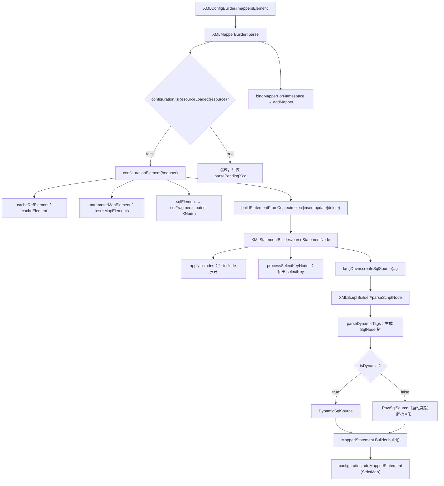

# Mapper XML 解析与 MappedStatement：一条 `<select>` 的一生

> 一句话结论：Mapper XML 的解析分三步——`XMLMapperBuilder` 拆整份文件（`<cache>`/`<resultMap>`/`<sql>`/增删改查语句）、`XMLStatementBuilder` 逐个语句读属性并**把 SQL 文本编译成 `SqlSource`**、`XMLScriptBuilder` 把 `<if>/<where>/<foreach>` 变成一棵 `SqlNode` 树；`${}` 在**解析期**就被字符串替换（注入风险），`#{}` 在**解析期**变成 `?` + `ParameterMapping`。
> 阅读前置：读完 `./01-sqlsessionfactory-构建过程.md`；知道 SQL 里 `?` 是"占位符"，`PreparedStatement` 会预编译
> 预计阅读 45 分钟 ｜ 源码：`org.mybatis:mybatis:3.6.0`

---

## 0. 先看现象

三段写法看起来差不多，行为差很多：

```xml
<!-- A. 最普通：静态 SQL，#{} 编译期变成 ? -->
<select id="findByName" resultType="User">
  select * from t_user where name = #{name}
</select>

<!-- B. 带动态标签：整条 SQL 变成一棵 SqlNode 树，每次调用重新拼装 -->
<select id="search" resultType="User">
  select * from t_user
  <where>
    <if test="name != null">and name = #{name}</if>
    <if test="age != null">and age &gt; #{age}</if>
  </where>
</select>

<!-- C. 表名/列名动态：${} 直接拼字符串 -->
<select id="findByTable" resultType="map">
  select * from ${tableName} where id = #{id}
</select>
```

现象：

1. A 和 C 在启动后**同一条 SQL 可以被复用**，但 A 的 `#{name}` 变成了 `?`，C 的 `${tableName}` **原封不动被替换成了你的入参字符串**；
2. B 的 SQL 文本**在启动时并不完整**——`<if>` 要看参数才决定是否拼接；
3. 如果你把 A 写成 `${name}`，`name` 传 `' or '1'='1`，`where name = '' or '1'='1'` 就成立了——**SQL 注入**。

这三件事的根因都在"解析阶段到底做了什么"。本文按 3 个阶段逐层拆开。

## 1. 整体地图



**读图说明**：

- **一个 XML 文件只被解析一次**：`isResourceLoaded(resource)` 是幂等开关（图中间的判断），第二次进入只会做 `parsePendingXxx`（补全前向引用）。
- **`<sql>` 与"语句"是平级的两条路**：左边的 `sqlElement` 只把 `XNode` 塞进 `sqlFragments`（**不求值**），右边的 `parseStatementNode` 在开头就调用 `applyIncludes` 把 `<include>` 替换成真实节点——**顺序在 `configurationElement` 里是固定的：先 `sqlElement`，后 `buildStatementFromContext`**，否则语句里的 `<include>` 找不到片段。
- **`createSqlSource` 是分叉点**：这里只知道"这份 SQL 文本要不要每次动态求值"，不知道参数（参数是运行期才知道的）。`isDynamic` 的真假决定了走 `DynamicSqlSource`（每次调用拼装）还是 `RawSqlSource`（启动期就编译好 `?` 与 `ParameterMapping`）。
- **终点只有一个**：`MappedStatement.Builder.build()` → `configuration.addMappedStatement`，进入 `StrictMap`（key = `namespace.id`）。
- 最右边 `bindMapperForNamespace` 是"XML → 接口"的桥：XML 读完后尝试把 `namespace` 当类名加载并注册进 `MapperRegistry`（供 `getMapper` 用动态代理）。

| 解析器 | 输入 | 产物 | 关键点 |
| --- | --- | --- | --- |
| `XMLMapperBuilder` | 一整个 `/mapper` 节点 | `ResultMap`/`Cache`/`sqlFragments`/一批 `MappedStatement` | `namespace` 必填，解析顺序固定 |
| `XMLStatementBuilder` | 单个 `<select>` 等节点 | 一次 `addMappedStatement` | 读属性 + 选语言驱动 + 抽 `selectKey` |
| `XMLScriptBuilder` | 语句节点的子节点 | `MixedSqlNode` 树 → `SqlSource` | `<if>/<where>/<foreach>` → `SqlNode` |
| `SqlSourceBuilder` | `?` 与 `#{...}` 的原始 SQL | `StaticSqlSource` | 最终产出 `BoundSql` |

## 2. 关键类逐个拆

零基础补一句：JDBC 里有三种"执行 SQL 的句柄"——`Statement`（直接执行字符串 SQL，不能带参数）、`PreparedStatement`（SQL 用 `?` 占位、可预编译、可安全传参）、`CallableStatement`（调存储过程）。MyBatis 默认用 `PreparedStatement`，所以 `#{}` 必须被翻译成 `?`。

### 2.1 `XMLMapperBuilder`：整份 Mapper XML 的"目录"

- **职责**：校验 `namespace`、按固定顺序解析 `<cache-ref>/<cache>/<parameterMap>/<resultMap>/<sql>/语句`、结束后绑定接口。
- **关键字段**：`builderAssistant`（`MapperBuilderAssistant`，负责 `applyCurrentNamespace`、`addMappedStatement`、`useNewCache`）、`sqlFragments`（`Configuration` 里那张全局表）。
- **设计意图**：MyBatis 允许"同一 namespace 的多个 XML 文件"（极少见），也允许"先定义 `<resultMap>` 后引用"，所以它把"解析"和"注册"分离，注册延迟到需要时。

### 2.2 `XMLStatementBuilder`：单个语句的"编译器前端"

- **职责**：读 `id`/`parameterType`/`resultType`/`resultMap`/`statementType`/`timeout`/`fetchSize`/`keyProperty`/`databaseId` 等属性，展开 `<include>`、抽走 `<selectKey>`、创建 `SqlSource`、组装 `MappedStatement`。
- **关键依赖**：`LanguageDriver`（默认 `XMLLanguageDriver`）、`MapperBuilderAssistant`、`ParamNameResolver`（3.5+ 用于"从接口方法参数名推断参数类型"）。
- **设计意图**：把"XML 属性 → `MappedStatement` 字段"的映射集中在一个类里，注解方式（`MapperAnnotationBuilder`）可以复刻同样的填充逻辑。

### 2.3 `XMLScriptBuilder`：动态 SQL 的"语法分析器"

- **职责**：把 XML 子节点递归编译成 `SqlNode` 树；`<if>`→`IfSqlNode`、`<where>`→`WhereSqlNode`、`<foreach>`→`ForEachSqlNode`、纯文本→`StaticTextSqlNode` 或 `TextSqlNode`（含 `${}` 时）。
- **关键字段**：`nodeHandlerMap`（9 个标签 → `NodeHandler`）、`isDynamic`（是否出现任何动态成分）、`emptyNodeCache`（空白文本节点复用，避免重复创建对象）。
- **设计意图**：**组合模式**（Composite）——每个 `SqlNode` 都能 `apply(DynamicContext)`，树在运行期被"求值"成最终 SQL。

### 2.4 `SqlSource` 家族与 `BoundSql`

| 实现 | 何时选它 | SQL 何时确定 | 参数映射何时确定 |
| --- | --- | --- | --- |
| `DynamicSqlSource` | SQL 里有 `${}` 或任意动态标签 | **每次调用**（`getBoundSql` 时用参数求值） | 每次调用 |
| `RawSqlSource` | 没有动态成分（纯文本 + `#{}`） | **启动期**（构造器里就编译成 `?`） | 启动期（`ParameterMapping` 列表固定） |
| `ProviderSqlSource` | 用 `@SelectProvider` 等注解由方法返回 SQL | 每次调用（先调你的 provider 方法） | 每次调用 |
| `StaticSqlSource` | 上面三者的"最终产物" | 构造时已知 | 构造时已知 |

- **`SqlSource` 接口只有一个方法**：`BoundSql getBoundSql(Object parameterObject)`。
- **`BoundSql`** 是"一次执行的 SQL 快照"：`sql`（含 `?`）、`parameterMappings`（有序！与 `?` 一一对应）、`parameterObject`、`additionalParameters`（`<bind>`/`<foreach>` 产生的变量）。
- **设计意图**：把"编译期"（`SqlSource`）与"执行期"（`BoundSql`）分开；静态 SQL 能在启动期就编译，省掉每次的字符串扫描与 OGNL 求值。

## 3. 源码逐段精读

### 3.1 `XMLMapperBuilder#parse`：幂等 + 前向引用补全

```java (src: XMLMapperBuilder.java#L103-L112)
  public void parse() {
    if (!configuration.isResourceLoaded(resource)) {
      configurationElement(parser.evalNode("/mapper"));
      configuration.addLoadedResource(resource);
      bindMapperForNamespace();
    }
    configuration.parsePendingResultMaps(false);
    configuration.parsePendingCacheRefs(false);
    configuration.parsePendingStatements(false);
  }
```

- **在干什么**：先判断该 XML 是否已解析过；没解析过就 `configurationElement` 解析全文 → 标记已加载 → 绑定接口；最后**无论是否解析过**都执行三行 `parsePendingXxx(false)`。
- **为什么"补全"要放在 `if` 外面**：一份 XML 里可能有前向引用（`<resultMap extends="后面才定义的">`），此刻无法完成，被塞进 `incompleteResultMaps`。别的 XML 可能正好补上它，所以每次读完一份都要重试一次全量待补项。
- **如果改成别的**：如果把 `addLoadedResource` 放在 `configurationElement` 之前，解析中途抛异常时该资源会被误标"已加载"，第二次就静默跳过——**症状是"改了 XML 重启后没生效"**。源码这里把它放在解析成功之后，是有意为之。
- **常见坑**：`bindMapperForNamespace` 里用 `namespace` 当类名加载，**namespace 拼错不会报错**（`ClassNotFoundException` 被忽略），代价是永远无法用 `getMapper`（只能用 `sqlSession.selectList("ns.id")` 字符串方式）。

### 3.2 `configurationElement`：顺序就是规则

```java (src: XMLMapperBuilder.java#L118-L134)
  private void configurationElement(XNode context) {
    try {
      String namespace = context.getStringAttribute("namespace");
      if (namespace == null || namespace.isEmpty()) {
        throw new BuilderException("Mapper's namespace cannot be empty");
      }
      builderAssistant.setCurrentNamespace(namespace);
      cacheRefElement(context.evalNode("cache-ref"));
      cacheElement(context.evalNode("cache"));
      parameterMapElement(context.evalNodes("/mapper/parameterMap"));
      resultMapElements(context.evalNodes("/mapper/resultMap"));
      sqlElement(context.evalNodes("/mapper/sql"));
      buildStatementFromContext(context.evalNodes("select|insert|update|delete"));
    } catch (Exception e) {
      throw new BuilderException("Error parsing Mapper XML. The XML location is '" + resource + "'. Cause: " + e, e);
    }
  }
```

- **在干什么**：`namespace` 校验 → 记录当前命名空间 → 依次解析缓存/参数映射/结果映射/`<sql>` → 最后才是四条 DML/SELECT 语句。
- **为什么 `<sql>` 必须在语句之前**：`XMLStatementBuilder#parseStatementNode` 第一步就是 `applyIncludes`，它要在 `sqlFragments` 里按 `refid` 找节点。**顺序反了会报 `Could not find SQL statement to include with refid 'xxx'`**。
- **为什么 `<resultMap>` 必须在语句之前**：`addMappedStatement` 里 `getStatementResultMaps(resultMap, ...)` 要按 id 查表；查不到抛 `IncompleteElementException`，语句会被挂起（`addIncompleteStatement`）。
- **常见坑**：异常消息带 `The XML location is 'xxx.xml'`——**这是定位的第一个线索**，再往下一层 `Cause` 才是真正原因。另外 `context.evalNodes("select|insert|update|delete")` 里**没有** `<selectKey>`，它是在 `parseStatementNode` 内部 `processSelectKeyNodes` 处理的。

### 3.3 `buildStatementFromContext`：`databaseId` 的双趟解析

```java (src: XMLMapperBuilder.java#L136-L153)
  private void buildStatementFromContext(List<XNode> list) {
    if (configuration.getDatabaseId() != null) {
      buildStatementFromContext(list, configuration.getDatabaseId());
    }
    buildStatementFromContext(list, null);
  }

  private void buildStatementFromContext(List<XNode> list, String requiredDatabaseId) {
    for (XNode context : list) {
      final XMLStatementBuilder statementParser = new XMLStatementBuilder(configuration, builderAssistant, context,
          requiredDatabaseId, mapperClass);
      try {
        statementParser.parseStatementNode();
      } catch (IncompleteElementException e) {
        configuration.addIncompleteStatement(statementParser);
      }
    }
  }
```

- **在干什么**：如果配置了 `databaseId`（通过 `<databaseIdProvider>`），**先按 databaseId 解析一遍**（只收 `databaseId` 匹配的语句），**再以 `null` 解析一遍**（收"没写 databaseId"的通用语句）。
- **为什么两趟**：这样"数据库专属版本"优先注册，通用版本补充剩下的；`StrictMap` 的重复 put 会抛异常，所以 `databaseIdMatchesCurrent` 内部必须保证同一 id 不会被第二次注册（它会检查"已存在则跳过"）。
- **如果改成别的**：只解析一趟（`requiredDatabaseId = null`），那么写了 `databaseId="mysql"` 的语句会被**直接丢弃**——因为 `databaseIdMatchesCurrent` 在 `requiredDatabaseId == null` 时会判 `databaseId != null` 为不匹配并返回 `false`。
- **常见坑**：`IncompleteElementException` 被吞掉放进 `incompleteStatements` 而**不报错**。如果补全始终失败（比如引用了不存在的 `<resultMap>`），真正的异常会在 `Configuration#getMappedStatement`/`buildAllStatements` 时抛出——也就是**启动不报，第一次调用才报**。

### 3.4 `sqlElement`：`<sql>` 片段只存不解析

```java (src: XMLMapperBuilder.java#L325-L334)
  private void sqlElement(List<XNode> list, String requiredDatabaseId) {
    for (XNode context : list) {
      String databaseId = context.getStringAttribute("databaseId");
      String id = context.getStringAttribute("id");
      id = builderAssistant.applyCurrentNamespace(id, false);
      if (databaseIdMatchesCurrent(id, databaseId, requiredDatabaseId)) {
        sqlFragments.put(id, context);
      }
    }
  }
```

- **在干什么**：把每个 `<sql>` 的 `id` 加上 namespace 前缀，然后**把整棵 `XNode` 塞进 `sqlFragments`**。
- **为什么存 `XNode`**：`<include refid="baseColumns"/>` 展开时要把子节点**原样插入**到语句节点里（还可能带 `<if>`），如果提前转成字符串就丢失结构。另外 `<sql>` 内部还可能含 `${}`/`#{}`，必须留给后续步骤处理。
- **如果改成别的**：如果这里就解析成 SQL 字符串，`<include>` 里套 `<if>` 的写法（`<sql id="x"><if test="...">...</if></sql>`）会失效。
- **常见坑**：`applyCurrentNamespace(id, false)` 对"已经带点号但不是本 namespace"的 id 会抛 `Dots are not allowed in element names, please remove it from xxx`。所以 `<sql id="a.b">` 是**非法**的。

```java (src: MapperBuilderAssistant.java#L90-L109)
  public String applyCurrentNamespace(String base, boolean isReference) {
    if (base == null) {
      return null;
    }
    if (isReference) {
      // is it qualified with any namespace yet?
      if (base.contains(".")) {
        return base;
      }
    } else {
      // is it qualified with this namespace yet?
      if (base.startsWith(currentNamespace + ".")) {
        return base;
      }
      if (base.contains(".")) {
        throw new BuilderException("Dots are not allowed in element names, please remove it from " + base);
      }
    }
    return currentNamespace + "." + base;
  }
```

- **在干什么**：`isReference=true`（引用方，如 `<include refid>`）时"带点号就用全名，不带则加本 namespace"；`isReference=false`（定义方，如 `id`）时"带点号直接报错"。
- **为什么区分**：定义 id 不允许跨命名空间（那是别人的地），引用 refid 允许跨命名空间（`<include refid="com.other.Mapper.cols"/>`）。
- **常见坑**：`<include refid="baseColumns"/>` 只能找到**同一 namespace** 的 `<sql id="baseColumns">`；跨文件复用必须写全限定 `refid`。

### 3.5 `XMLStatementBuilder#parseStatementNode`（上）：属性与默认值

```java (src: XMLStatementBuilder.java#L71-L88)
  public void parseStatementNode() {
    String id = context.getStringAttribute("id");
    String databaseId = context.getStringAttribute("databaseId");

    if (!databaseIdMatchesCurrent(id, databaseId, this.requiredDatabaseId)) {
      return;
    }

    String nodeName = context.getNode().getNodeName();
    SqlCommandType sqlCommandType = SqlCommandType.valueOf(nodeName.toUpperCase(Locale.ENGLISH));
    boolean isSelect = sqlCommandType == SqlCommandType.SELECT;
    boolean flushCache = context.getBooleanAttribute("flushCache", !isSelect);
    boolean useCache = context.getBooleanAttribute("useCache", isSelect);
    boolean resultOrdered = context.getBooleanAttribute("resultOrdered", false);

    // Include Fragments before parsing
    XMLIncludeTransformer includeParser = new XMLIncludeTransformer(configuration, builderAssistant);
    includeParser.applyIncludes(context.getNode());
```

- **在干什么**：`databaseId` 过滤 → **用标签名推断命令类型**（`<select>`→`SELECT`）→ 读三个默认值有讲究的布尔属性 → 立刻展开 `<include>`。
- **为什么 `flushCache` 默认 `!isSelect`**：写操作必须清缓存（否则读到旧数据）；查询默认不清（否则一级缓存形同虚设）。这行就是 `flushCache=true` 的默认值来源。
- **为什么 `useCache` 默认 `isSelect`**：只有查询才谈"用二级缓存"；写操作写 `useCache` 没有意义（框架按 `ms.getCache() != null && ms.isUseCache()` 判断）。
- **如果改成别的**：如果 `applyIncludes` 放在读属性之后很久（比如最后），`<include>` 里包含的 `<selectKey>` 就不会被 `processSelectKeyNodes` 看到（因为它按 `context.evalNodes("selectKey")` 查找子节点）。**"先展开 include，再抽 selectKey"是硬顺序**，源码注释也写明了。
- **常见坑**：`SqlCommandType.valueOf(nodeName.toUpperCase())` 意味着标签名只能是 `select/insert/update/delete`；写 `<SELECT>` 能过（`toUpperCase` 后一致），但 XPath 表达式 `select|insert|update|delete` 匹配不到，**直接不会被解析**。

### 3.6 `parseStatementNode`（下）：`parameterType` 推断、`selectKey`、`keyGenerator`

```java (src: XMLStatementBuilder.java#L90-L110)
    String parameterType = context.getStringAttribute("parameterType");
    Class<?> parameterTypeClass = resolveClass(parameterType);
    ParamNameResolver paramNameResolver = null;
    if (parameterTypeClass == null && mapperClass != null) {
      List<Method> mapperMethods = Arrays.stream(mapperClass.getMethods())
          .filter(m -> m.getName().equals(id) && !m.isDefault() && !m.isBridge()).collect(Collectors.toList());
      if (mapperMethods.size() == 1) {
        paramNameResolver = new ParamNameResolver(configuration, mapperMethods.get(0), mapperClass);
        if (paramNameResolver.isUseParamMap()) {
          parameterTypeClass = ParamMap.class;
        } else {
          String[] paramNames = paramNameResolver.getNames();
          if (paramNames.length == 1) {
            Type paramType = paramNameResolver.getType(paramNames[0]);
            if (paramType instanceof Class) {
              parameterTypeClass = (Class<?>) paramType;
            }
          }
        }
      }
    }
```

- **在干什么**：XML 没写 `parameterType` 时，**去 Mapper 接口里找同名方法**，用 `ParamNameResolver` 推断参数类型；单个参数直接得到类型，多参数（或用了 `@Param`）则退化成 `ParamMap`。
- **为什么这么设计（3.5+ 新增）**：`#{userName}` 这种写法原先必须写 `parameterType` 才能确定类型，从而确定 `TypeHandler`；有了推断，XML 可以完全不写 `parameterType`。
- **如果改成别的**：不推断就只能用 `Object.class`，`ParameterMapping` 的 `javaType` 为空，运行期靠值本身猜 `TypeHandler`——**值恰好是 `null` 时会走 `jdbcTypeForNull`（默认 `OTHER`）**，某些数据库（如 Oracle）会报"无效的列类型"。
- **常见坑**：重载方法（同名多个）会导致 `mapperMethods.size() != 1` 从而**放弃推断**——这就是"重载的 mapper 方法必须显式写 `parameterType`"的原因。

### 3.7 `parseStatementNode`（收尾）：创建 `SqlSource` 与 `MappedStatement`

```java (src: XMLStatementBuilder.java#L130-L154)
    SqlSource sqlSource = langDriver.createSqlSource(configuration, context, parameterTypeClass, paramNameResolver);
    StatementType statementType = StatementType
        .valueOf(context.getStringAttribute("statementType", StatementType.PREPARED.toString()));
    ...
    String resultMap = context.getStringAttribute("resultMap");
    if (resultTypeClass == null && resultMap == null) {
      resultTypeClass = MapperAnnotationBuilder.getMethodReturnType(builderAssistant.getCurrentNamespace(), id);
    }
    ...
    boolean dirtySelect = context.getBooleanAttribute("affectData", Boolean.FALSE);

    builderAssistant.addMappedStatement(id, sqlSource, statementType, sqlCommandType, fetchSize, timeout, parameterMap,
        parameterTypeClass, resultMap, resultTypeClass, resultSetTypeEnum, flushCache, useCache, resultOrdered,
        keyGenerator, keyProperty, keyColumn, databaseId, langDriver, resultSets, dirtySelect, paramNameResolver);
```

- **在干什么**：调语言驱动生成 `SqlSource`；读 `statementType`（默认 `PREPARED`）；**没写 `resultType`/`resultMap` 时从接口方法返回值反推**（`MapperAnnotationBuilder.getMethodReturnType`）；读 3.6 新增的 `affectData`；最后一口气交给 `MapperBuilderAssistant#addMappedStatement`。
- **为什么 `resultType` 能省略（3.5+）**：有了 `getMethodReturnType`，`List<User> selectAll()` 这样的方法签名就够用了。好处是少写重复配置，坏处是**改签名会悄悄改变映射**。
- **如果改成别的**：`statementType` 默认若是 `STATEMENT`，`#{}` 将无法工作（`Statement` 不支持 `?`），所有参数都得用 `${}`——这正是 `statementType="STATEMENT"` 的坑。
- **常见坑**：省略了 `resultType` **且**方法返回 `List<Map>`/`void`/`Long` 之外的类型时，`getMethodReturnType` 可能推不出 `Class`（泛型嵌套），结果是自动映射失效、返回 `Map`。

```java (src: MapperBuilderAssistant.java#L203-L231)
  public MappedStatement addMappedStatement(String id, SqlSource sqlSource, StatementType statementType,
      SqlCommandType sqlCommandType, Integer fetchSize, Integer timeout, String parameterMap, Class<?> parameterType,
      String resultMap, Class<?> resultType, ResultSetType resultSetType, boolean flushCache, boolean useCache,
      boolean resultOrdered, KeyGenerator keyGenerator, String keyProperty, String keyColumn, String databaseId,
      LanguageDriver lang, String resultSets, boolean dirtySelect, ParamNameResolver paramNameResolver) {

    if (unresolvedCacheRef) {
      throw new IncompleteElementException("Cache-ref not yet resolved");
    }

    id = applyCurrentNamespace(id, false);

    MappedStatement.Builder statementBuilder = new MappedStatement.Builder(configuration, id, sqlSource, sqlCommandType)
        .resource(resource).fetchSize(fetchSize).timeout(timeout).statementType(statementType)
        .keyGenerator(keyGenerator).keyProperty(keyProperty).keyColumn(keyColumn).databaseId(databaseId).lang(lang)
        .resultOrdered(resultOrdered).resultSets(resultSets)
        .resultMaps(getStatementResultMaps(resultMap, resultType, id)).resultSetType(resultSetType)
        .flushCacheRequired(flushCache).useCache(useCache).cache(currentCache).dirtySelect(dirtySelect)
        .paramNameResolver(paramNameResolver);

    ParameterMap statementParameterMap = getStatementParameterMap(parameterMap, parameterType, id);
    if (statementParameterMap != null) {
      statementBuilder.parameterMap(statementParameterMap);
    }

    MappedStatement statement = statementBuilder.build();
    configuration.addMappedStatement(statement);
    return statement;
  }
```

- **在干什么**：`cache-ref` 还没解析完就抛 `IncompleteElementException`（语句被挂起）→ 补齐全限定 id → 用 21 个 setter 组装 `MappedStatement.Builder` → `build()` → 注册进 `Configuration`。
- **为什么 `unresolvedCacheRef` 要在这个方法里检查**：`<cache-ref namespace="其他"/>` 引用的目标 XML 可能还没解析，此时 `currentCache` 是错的。挂起整条语句比"用错缓存"安全。
- **常见坑**：`.cache(currentCache)`——**`<cache/>` 必须在语句之前解析**（`configurationElement` 的顺序正是如此）。没写 `<cache/>` 时 `currentCache == null`，于是 `CachingExecutor#query` 里 `ms.getCache() != null` 为假，整个二级缓存被跳过。

### 3.8 `MappedStatement.Builder`：默认值都在这 20 行里

```java (src: MappedStatement.java#L66-L86)
  public static class Builder {
    private final MappedStatement mappedStatement = new MappedStatement();

    public Builder(Configuration configuration, String id, SqlSource sqlSource, SqlCommandType sqlCommandType) {
      mappedStatement.configuration = configuration;
      mappedStatement.id = id;
      mappedStatement.sqlSource = sqlSource;
      mappedStatement.statementType = StatementType.PREPARED;
      mappedStatement.resultSetType = ResultSetType.DEFAULT;
      mappedStatement.parameterMap = ParameterMap.buildEmpty("defaultParameterMap", null);
      mappedStatement.resultMaps = new ArrayList<>();
      mappedStatement.sqlCommandType = sqlCommandType;
      mappedStatement.keyGenerator = configuration.isUseGeneratedKeys() && SqlCommandType.INSERT.equals(sqlCommandType)
          ? Jdbc3KeyGenerator.INSTANCE : NoKeyGenerator.INSTANCE;
      String logId = id;
      if (configuration.getLogPrefix() != null) {
        logId = configuration.getLogPrefix() + id;
      }
      mappedStatement.statementLog = LogFactory.getLog(logId);
      mappedStatement.lang = configuration.getDefaultScriptingLanguageInstance();
    }
```

- **在干什么**：构造器就设好 5 个默认值（`PREPARED`、`ResultSetType.DEFAULT`、空 `ParameterMap`、`keyGenerator`、`lang`），并**用 `id` 创建日志对象**。
- **为什么日志对象在构造器里建**：MyBatis 的 SQL 日志是按 `MappedStatement#id` 打的（`==>  Preparing: select ...`），所以 `logPrefix` + `id` 决定了日志 logger 名字，可以给单个语句配置日志级别。
- **为什么 `keyGenerator` 的判断写在这里**：全局 `useGeneratedKeys=true` 且是 `INSERT` 时才默认 `Jdbc3KeyGenerator`；语句级 `useGeneratedKeys` 在 `parseStatementNode` 里已先行决定（L125-127）。
- **常见坑**：`parameterMap = ParameterMap.buildEmpty("defaultParameterMap", null)`——这是**空的**参数映射，`MappedStatement#getBoundSql` 里遇到"参数映射为空"时才会用它兜底重建 `BoundSql`（依赖 `<parameterMap>` 老写法）。

### 3.9 `XMLScriptBuilder#parseDynamicTags`：把标签变成 `SqlNode`

```java (src: XMLScriptBuilder.java#L63-L84)
  private void initNodeHandlerMap() {
    nodeHandlerMap.put("trim", new TrimHandler());
    nodeHandlerMap.put("where", new WhereHandler());
    nodeHandlerMap.put("set", new SetHandler());
    nodeHandlerMap.put("foreach", new ForEachHandler());
    nodeHandlerMap.put("if", new IfHandler());
    nodeHandlerMap.put("choose", new ChooseHandler());
    nodeHandlerMap.put("when", new IfHandler());
    nodeHandlerMap.put("otherwise", new OtherwiseHandler());
    nodeHandlerMap.put("bind", new BindHandler());
  }

  public SqlSource parseScriptNode() {
    MixedSqlNode rootSqlNode = parseDynamicTags(context);
    SqlSource sqlSource;
    if (isDynamic) {
      sqlSource = new DynamicSqlSource(configuration, rootSqlNode);
    } else {
      sqlSource = new RawSqlSource(configuration, rootSqlNode, parameterType, paramNameResolver);
    }
    return sqlSource;
  }
```

- **在干什么**：9 个标签各有处理器；`parseScriptNode` 先建树，再**按 `isDynamic` 决定 `SqlSource` 类型**。
- **为什么 `when` 复用 `IfHandler`**：`<when test="...">` 的语义与 `<if>` 完全一致，只是必须在 `<choose>` 里出现。
- **常见坑**：`<choose>` 里写 `<otherwise>` 之外的自定义标签会抛 `Unknown element <xxx> in SQL statement.`；`<when>` 直接写在 `<select>` 下也会这样（它只被 `ChooseHandler` 消费）。

```java (src: XMLScriptBuilder.java#L86-L115)
  protected MixedSqlNode parseDynamicTags(XNode node) {
    List<SqlNode> contents = new ArrayList<>();
    NodeList children = node.getNode().getChildNodes();
    for (int i = 0; i < children.getLength(); i++) {
      XNode child = node.newXNode(children.item(i));
      if (child.getNode().getNodeType() == Node.CDATA_SECTION_NODE || child.getNode().getNodeType() == Node.TEXT_NODE) {
        String data = child.getStringBody("");
        if (data.trim().isEmpty()) {
          contents.add(emptyNodeCache.computeIfAbsent(data, EmptySqlNode::new));
          continue;
        }
        TextSqlNode textSqlNode = new TextSqlNode(data);
        if (textSqlNode.isDynamic()) {
          contents.add(textSqlNode);
          isDynamic = true;
        } else {
          contents.add(new StaticTextSqlNode(data));
        }
      } else if (child.getNode().getNodeType() == Node.ELEMENT_NODE) { // issue #628
        String nodeName = child.getNode().getNodeName();
        NodeHandler handler = nodeHandlerMap.get(nodeName);
        if (handler == null) {
          throw new BuilderException("Unknown element <" + nodeName + "> in SQL statement.");
        }
        handler.handleNode(child, contents);
        isDynamic = true;
      }
    }
    return new MixedSqlNode(contents);
  }
```

- **在干什么**：遍历子节点：文本/CDATA → 空白则复用 `EmptySqlNode`，含 `${}`（`TextSqlNode#isDynamic()`）则标 `isDynamic = true`，否则 `StaticTextSqlNode`；元素节点 → 查表处理并**一律标 `isDynamic = true`**。
- **为什么"元素节点"一定算动态**：`<if>/<where>/<foreach>` 的取舍依赖参数，**SQL 文本在启动期不可能确定**，所以整个语句必须走 `DynamicSqlSource`。
- **为什么空白节点要缓存**：MyBatis 的 XML 里换行缩进极多，`computeIfAbsent` 让相同空白串共享一个 `EmptySqlNode`，减少对象数量（3.2.0 之后的优化）。
- **常见坑**：`TextSqlNode#isDynamic()` 只检查 `${}`（源码 `createParser` 用 `new GenericTokenParser("${", "}", handler)`），**不检查 `#{}`**。所以"纯 `#{}` 的语句"被判为静态 → 走 `RawSqlSource`；这也是 `RawSqlSource` 能把 `#{}` 编译成 `?` 的原因。

```java (src: XMLScriptBuilder.java#L199-L211)
  private class IfHandler implements NodeHandler {
    public IfHandler() {
      // Prevent Synthetic Access
    }

    @Override
    public void handleNode(XNode nodeToHandle, List<SqlNode> targetContents) {
      MixedSqlNode mixedSqlNode = parseDynamicTags(nodeToHandle);
      String test = nodeToHandle.getStringAttribute("test");
      IfSqlNode ifSqlNode = new IfSqlNode(mixedSqlNode, test);
      targetContents.add(ifSqlNode);
    }
  }
```

- **在干什么**：递归解析 `<if>` 的子节点得到子节点树，读 `test` 表达式，包装成 `IfSqlNode` 加入父列表。
- **典型坑**：`<if test="name != null and name != ''">` 里的 `name` 若不存在于参数对象，OGNL 会抛 `There is no getter for property named 'name' in 'class ...'`（3.5+ 对 `null` 判断有所放宽，但拼错属性名仍然报错）。

## 4. `#{}` vs `${}`：差异在解析期就产生了

零基础先讲清危险点：`PreparedStatement` 的 `?` 只能放**值**，不能放表名/列名，所以"动态表名"必然要用字符串拼接；而字符串拼接如果掺入用户输入，就变成 SQL 注入。

### 4.1 `${}`：`TextSqlNode` 直接替换，不产生 `ParameterMapping`

```java (src: TextSqlNode.java#L39-L48)
  @Override
  public boolean apply(DynamicContext context) {
    GenericTokenParser parser = createParser(new BindingTokenParser(context));
    context.appendSql(context.parseParam(parser.parse(text)));
    return true;
  }

  private GenericTokenParser createParser(TokenHandler handler) {
    return new GenericTokenParser("${", "}", handler);
  }
```

- **在干什么**：把 SQL 文本交给 `GenericTokenParser` 扫 `${...}`，命中就交给 `BindingTokenParser` 用 OGNL **取字符串值直接拼进 SQL**；返回的文本再 `parseParam`（处理 `${}` 后的二次转义）。
- **为什么危险**：`handleToken` 返回的是 `String.valueOf(value)`（`issue #274` 里 `null` 返回 `""`），**没有任何转义或引号包裹**。若值是 `1; drop table t_user`（`statementType=STATEMENT` 或部分驱动允许多语句），就是注入。
- **如果改成别的**：如果让 `${}` 也生成 `?`，动态表名/`order by ${column}` 就无法工作——所以 MyBatis 保留它是为了**必要的动态标识符**，责任在使用方。
- **常见坑**：`${}` 值来自用户输入（尤其 `order by ${sortColumn}`）是最常见的注入点；正确做法是**白名单校验**后再拼。

### 4.2 `#{}`：`ParameterMappingTokenHandler` 返回 `?` 并登记映射

```java (src: ParameterMappingTokenHandler.java#L73-L83)
  public List<ParameterMapping> getParameterMappings() {
    return parameterMappings;
  }

  @Override
  public String handleToken(String content) {
    genericType = null;
    typeHandler = null;
    parameterMappings.add(buildParameterMapping(content));
    return "?";
  }
```

- **在干什么**：每遇到一个 `#{...}`，就 `buildParameterMapping(content)` 解析出 `property`/`jdbcType`/`javaType`/`typeHandler`/`mode`/`numericScale` 等，加入有序列表，**返回值固定是 `"?"`**。
- **为什么必须有序**：`DefaultParameterHandler` 遍历 `parameterMappings` 时用下标 `i + 1` 调 `ps.setXxx(i + 1, value)`，顺序必须与 SQL 里 `?` 的顺序严格一致。
- **常见坑**：列表顺序 = `GenericTokenParser` 的扫描顺序 = SQL 文本顺序。**如果你在 `<foreach>` 里拼接 SQL 片段，`#{}` 出现的顺序就是最终顺序**；这也是 `ForEachSqlNode` 要给参数加 `__frch_item_0` 后缀的原因（同一 `#{item.id}` 在循环里出现多次，必须有不同的 key）。

### 4.3 `RawSqlSource`：启动期就编译好 `?`

```java (src: RawSqlSource.java#L61-L74)
  public RawSqlSource(Configuration configuration, String sql, Class<?> parameterType,
      ParamNameResolver paramNameResolver) {
    Class<?> clazz = parameterType == null ? Object.class : parameterType;
    List<ParameterMapping> parameterMappings = new ArrayList<>();
    ParameterMappingTokenHandler tokenHandler = new ParameterMappingTokenHandler(parameterMappings, configuration,
        clazz, new HashMap<>(), paramNameResolver);
    GenericTokenParser parser = new GenericTokenParser("#{", "}", tokenHandler);
    sqlSource = SqlSourceBuilder.buildSqlSource(configuration, parser.parse(sql), parameterMappings);
  }

  @Override
  public BoundSql getBoundSql(Object parameterObject) {
    return sqlSource.getBoundSql(parameterObject);
  }
```

- **在干什么**：构造器里就用 `GenericTokenParser("#{", "}")` 扫整条 SQL，把所有 `#{}` 换成 `?` 并收集 `ParameterMapping`，最后建 `StaticSqlSource`；`getBoundSql` 只是转发。
- **为什么快**：字符串扫描 + 映射构建只在启动期做一次；每次执行只做 `new BoundSql(...)`。
- **如果改成别的**：如果含 `${}` 的语句也走这里，`${}` 就不会被替换（这里只扫 `#{`），SQL 会带着 `${...}` 发给数据库直接语法错误。

### 4.4 `DynamicSqlSource`：每次调用都求值

```java (src: DynamicSqlSource.java#L43-L52)
  @Override
  public BoundSql getBoundSql(Object parameterObject) {
    DynamicContext context = new DynamicContext(configuration, parameterObject, null, paramNameResolver, true);
    rootSqlNode.apply(context);
    String sql = context.getSql();
    SqlSource sqlSource = SqlSourceBuilder.buildSqlSource(configuration, sql, context.getParameterMappings());
    BoundSql boundSql = sqlSource.getBoundSql(parameterObject);
    context.getBindings().forEach(boundSql::setAdditionalParameter);
    return boundSql;
  }
```

- **在干什么**：每次调用新建 `DynamicContext` → 用**当前参数**把 `SqlNode` 树求值成 SQL 字符串 → 再用 `SqlSourceBuilder` 把结果（此时含 `?`）包成 `StaticSqlSource` → 生产 `BoundSql` → 把 `<bind>`/`<foreach>` 产生的额外变量塞进 `additionalParameters`。
- **为什么要"两步"**：第一步（`apply`）处理 `<if>` 与 `${}`，第二步（`buildSqlSource`）处理 `#{}`→`?`。**顺序不能反**：先处理 `#{}` 的话，`<if>` 分支里的 `#{}` 就无法因为"分支没命中"而消失。
- **常见坑**：`DynamicSqlSource` 每执行一次都要遍历整棵 `SqlNode` 树并跑 OGNL，**高频调用下比 `RawSqlSource` 慢**；能用 `<if>` 之外的手段（比如 `ProviderSqlSource` 或拆语句）就不要滥用动态标签。

### 4.5 `ProviderSqlSource`：注解里由方法产 SQL

```java (src: ProviderSqlSource.java#L204-L205)
      Class<?> parameterType = parameterObject == null ? Object.class : parameterObject.getClass();
      return languageDriver.createSqlSource(configuration, sql, parameterType, paramNameResolver);
```

- **在干什么**：`@SelectProvider(type = X.class, method = "y")` 时，先反射调用 `X.y(参数)` 拿到 SQL 字符串，再交给 `LanguageDriver#createSqlSource(String, ...)`（即 `XMLLanguageDriver` 的 String 版本）。
- **为什么单独一类**：它既有动态成分（SQL 由代码产生），又不使用 `SqlNode` 树，所以 `SqlSource` 家族里必须单独一支。
- **常见坑**：provider 方法返回 `null` 或抛异常，会被包成 `BuilderException("Error invoking SqlProvider method ... Cause: ...")`；这个异常发生在**运行期**（每次查询），不是启动期。

### 4.6 三种 `SqlSource` 的选择依据（源码级）

| 入口 | 判断 | 结果 |
| --- | --- | --- |
| `XMLScriptBuilder#parseScriptNode`（XML 语句） | `isDynamic`（出现 `${}` 或任意动态标签） | `DynamicSqlSource` / `RawSqlSource` |
| `XMLLanguageDriver#createSqlSource(String)`（`@Select` 注解、`ProviderSqlSource`、`<script>` 之外的字符串） | `new TextSqlNode(script).isDynamic()` | `DynamicSqlSource` / `RawSqlSource` |
| `ProviderSqlSource#getBoundSql` | 无条件 | 每次调用 provider 生成 SQL 后再选上面两种之一 |
| `RawLanguageDriver` | `RawSqlSource.class.equals(source.getClass())` 否则抛错 | 强制静态 |

```java (src: XMLLanguageDriver.java#L60-L76)
  @Override
  public SqlSource createSqlSource(Configuration configuration, String script, Class<?> parameterType,
      ParamNameResolver paramNameResolver) {
    // issue #3
    if (script.startsWith("<script>")) {
      XPathParser parser = new XPathParser(script, false, configuration.getVariables(), new XMLMapperEntityResolver());
      return createSqlSource(configuration, parser.evalNode("/script"), parameterType);
    }
    // issue #127
    script = PropertyParser.parse(script, configuration.getVariables());
    TextSqlNode textSqlNode = new TextSqlNode(script);
    if (textSqlNode.isDynamic()) {
      return new DynamicSqlSource(configuration, textSqlNode);
    } else {
      return new RawSqlSource(configuration, script, parameterType, paramNameResolver);
    }
  }
```

- **在干什么**：注解里的 SQL 字符串如果是 `<script>...` 开头，就先当 XML 解析（可以写 `<if>`）；否则先做 `${}` 全局变量替换（`PropertyParser`，`issue #127`），再用 `TextSqlNode#isDynamic()` 判断。
- **为什么先 `PropertyParser.parse`**：注解里可以写 `${myGlobalVar}` 引用 `configuration.variables`，这一步在"判断是否动态"之前做，避免把已替换成常量的 SQL 误判为动态。
- **常见坑**：`@Select("select * from t where id = #{id}")` 走 `RawSqlSource`（静态），**每次执行不重新解析**；而 `@Select("select * from ${table}")` 走 `DynamicSqlSource`。

## 5. 设计模式与可迁移经验

| 模式 | 出现位置 | 解决什么问题 |
| --- | --- | --- |
| 组合（Composite） | `SqlNode` / `MixedSqlNode` | 树形求值，`<if>` 可嵌套任意层 |
| 解释器（Interpreter） | `SqlNode#apply(DynamicContext)` | SQL 片段即"表达式"，上下文即"环境" |
| 策略（Strategy） | `SqlSource` 的 4 个实现、`LanguageDriver` | 静态/动态/provider 可互换 |
| 模板方法 | `BaseBuilder` 提供 `resolveClass` 等 | XML 与注解两条路复用工具 |
| 访问者变体 | `NodeHandler`（`XMLScriptBuilder` 内部接口） | 新标签 → 新 handler，不改主循环 |
| 延迟计算 | `sqlFragments` 存 `XNode` | `<include>` 展开时机可控 |

## 6. 实际开发中的坑（8 条）

1. **`<sql>` 写在语句之后**：`Could not find SQL statement to include with refid 'xxx'`。`configurationElement` 里 `sqlElement` 在 `buildStatementFromContext` 之前，但**同一份 XML 内**若把 `<sql>` 放到文件末尾也没事（顺序由代码决定，不由文件位置决定）；**跨文件**时必须保证被引用的 XML 先解析。
2. **`<include refid>` 找不到**：同一 namespace 直接写 `refid="cols"`；跨 namespace 必须写全限定 `refid="com.other.Mapper.cols"`，并且那段 `<sql>` 的 id 会被 `applyCurrentNamespace` 加上前缀。
3. **`#{}` 与 `${}` 混用出错**：`order by #{column}` 会被当成"值为字符串 `column` 的参数"，SQL 变成 `order by ?`——**排序不生效且不报错**（有的库直接报语法错）。排序/表名必须用 `${}` + 白名单。
4. **`#{name}` 取不到值**：单参数且类型是 `String` 时，`#{name}` 在部分版本可用（`useActualParamName`），但多参数必须写 `#{param1}`/`#{arg0}` 或 `@Param("name")`。3.6 用 `ParamNameResolver` 推断，**但编译需 `-parameters`**。
5. **`resultType` 省了但方法签名变了**：`getMethodReturnType` 是"按方法签名推"，改返回类型会静默改变映射结果。
6. **`databaseId` 导致语句被静默丢弃**：写了 `databaseId="mysql"` 但没配 `<databaseIdProvider>`/`databaseId` 不匹配，`databaseIdMatchesCurrent` 返回 `false`，语句**不进 `mappedStatements`**，调用时报 `Invalid bound statement (not found)`。
7. **`IncompleteElementException` 吞掉真错误**：引用不存在的 `resultMap` 时启动不报错，`buildAllStatements` 在第一次 `getMappedStatement` 时才抛，堆栈指向调用方。
8. **`<if test>` 里 OGNL 写错**：`test="name == ''"` 对 `null` 安全，但 `test="name.length() > 0"` 在 `name == null` 时 NPE；正确写法 `test="name != null and name != ''"`。

## 7. 版本差异（3.5 → 3.6）

- **`affectData`（`dirtySelect`）**：3.6 新增（`XMLStatementBuilder` L150）。`<select affectData="true">` 表示"这条查询会改数据"（如调用函数写表），`DefaultSqlSession#selectList` 里 `dirty |= ms.isDirtySelect()` 会把它当写操作，触发提交/清缓存。
- **`paramNameResolver` 一路透传**：3.6 中 `createSqlSource`/`RawSqlSource`/`ParameterMappingTokenHandler` 都多了一个 `ParamNameResolver` 参数，用于"参数不存在"时给出更准确的报错（`paramExists`）。
- **`nullableOnForEach`**：3.6 新增，`foreach` 遇到 `null` 集合时是否输出 `(null)`。
- **`shrinkWhitespacesInSql`**：3.6 新增，`SqlSourceBuilder` 里用 `removeExtraWhitespaces`（`replaceAll("\\s+", " ")`）压缩空白。
- **`XMLMapperBuilder` 的 `mapperClass`**：3.6 构造器多带 `mapperClass`，用于 `parameterType` 推断（3.5 没有此能力）。
- **`ResultSetType.DEFAULT`**：3.5 起支持 `defaultResultSetType` 设置与 `ResultSetType.DEFAULT` 枚举。

## 8. 面试验证点（12 问）

1. `<sql>` 片段为什么在 `Configuration` 里存 `XNode` 而不是 `String`？
2. `configurationElement` 的解析顺序为什么是 cache → resultMap → sql → 语句？
3. `buildStatementFromContext` 为什么要按 `databaseId` 解析两趟？
4. `#{}` 变成 `?` 发生在哪个阶段？`${}` 的替换发生在哪个阶段？
5. 什么样的语句会用 `DynamicSqlSource`？判断 `isDynamic` 的源码依据是哪一行？
6. `${}` 的注入风险从哪行代码可以看出？如何防御？
7. `RawSqlSource` 为什么比 `DynamicSqlSource` 快？
8. `MappedStatement#getBoundSql` 里 `parameterMap` 兜底是干什么用的？
9. `<selectKey>` 与 `useGeneratedKeys` 有什么区别？分别在哪个类里处理？
10. `MappedStatement` 的日志 logger 名字是怎么来的？
11. `parameterType` 不写时 MyBatis 怎么猜？
12. `IncompleteElementException` 在 Mapper 解析中有哪两处会被抛出？

<details><summary>参考答案要点</summary>

1. `<include>` 展开时要把子节点原样插入（可能含 `<if>` 等结构），且展开时机推迟到 `XMLIncludeTransformer`；字符串会丢失结构。
2. 因为语句解析依赖前三者：`<cache>` 决定 `ms.getCache()`、`<resultMap>` 被 `resultMaps` 引用、`<sql>` 被 `applyIncludes` 引用。顺序反了会抛 `Could not find SQL statement to include` 或 `IncompleteElementException`。
3. 先按当前 `databaseId` 注册"专属语句"，再用 `null` 注册"通用语句"；`databaseIdMatchesCurrent` 保证同一 id 不重复注册（`StrictMap` 会抛重复）。
4. `#{}` 在**启动期**（`RawSqlSource` 构造器 / `ParameterMappingTokenHandler#handleToken` 返回 `"?"`）就完成，或动态语句在**每次调用**（`DynamicSqlSource#getBoundSql` → `SqlSourceBuilder.buildSqlSource`）；`${}` 在每次调用时由 `TextSqlNode#apply` 用 `GenericTokenParser("${", "}")` 替换。
5. 出现任意动态标签（`parseDynamicTags` 里元素节点分支 `isDynamic = true`）或文本含 `${}`（`TextSqlNode#isDynamic()`），源码在 `XMLScriptBuilder#parseScriptNode` L78-82。
6. `TextSqlNode.BindingTokenParser#handleToken` 直接 `String.valueOf(value)` 拼进 SQL，无引号无转义；防御用白名单校验动态标识符、绝不用 `${}` 接收用户输入。
7. 静态 SQL 在启动期就把 `#{}` 编译成 `?` 和固定的 `ParameterMapping` 列表，运行期只 `new BoundSql(...)`，没有字符串扫描与 OGNL 求值。
8. 老式 `<parameterMap>` 写法下 `ResultMap`/`ParameterMapping` 可能为空，需要用 `parameterMap.getParameterMappings()` 重建 `BoundSql`（源码注释 `issue #30`）。
9. `useGeneratedKeys` 用 JDBC 的 `RETURN_GENERATED_KEYS`（`Jdbc3KeyGenerator`）；`<selectKey>` 是独立 SQL（`SelectKeyGenerator`）。前者在 `XMLStatementBuilder` L125-127 决定，后者由 `processSelectKeyNodes`（L116）处理。
10. `id`（全限定）前缀 `configuration.getLogPrefix()`，在 `MappedStatement.Builder` 构造器里 `LogFactory.getLog(logId)`。
11. `parameterType` 为空且 `mapperClass != null` 时，用 `ParamNameResolver` 反射接口同名方法推断；单参得类型，多参退化为 `ParamMap`；重载方法放弃推断。
12. `MapperBuilderAssistant#addMappedStatement`（`unresolvedCacheRef`）与 `getStatementResultMaps`（resultMap 未就绪）里抛出，被 `buildStatementFromContext` 捕获后 `addIncompleteStatement`。
</details>

## 9. 动手练习

1. **打印 SQL 编译结果**：对一条纯 `#{}` 语句和一个含 `<if>` 的语句，分别在 `MappedStatement#getBoundSql(new HashMap<>())` 后打印 `boundSql.getSql()` 与 `boundSql.getParameterMappings()` 的 size，观察 `?` 个数。
2. **验证组件类型**：`configuration.getMappedStatement("ns.id").getSqlSource().getClass()`，对比静态 SQL 与动态 SQL 的差别。
3. **制造 `Unknown element`**：在 `<select>` 里写 `<when test="x">`，观察 `Unknown element <when> in SQL statement.`
4. **验证 `<include>` 顺序**：把 `<sql>` 放到另一个 XML 中并被先解析的 mapper 引用，再反过来，观察哪次成功。
5. **复现注入**：用 `${name}` 拼接 `' or '1'='1`，打印最终 SQL；再改成 `#{name}` 对比。
6. **观察 `databaseId` 静默丢弃**：语句写 `databaseId="postgresql"`，不配 provider，调用时看报错是 `Invalid bound statement` 还是 SQL 报错。

## 小结

1. Mapper XML 的解析链是 `XMLMapperBuilder#configurationElement` → `XMLStatementBuilder#parseStatementNode` → `XMLScriptBuilder#parseScriptNode` → `MappedStatement.Builder#build` → `Configuration#addMappedStatement`，顺序与幂等（`isResourceLoaded`）都有明确含义。
2. `SqlSource` 的三分法是"静态（`RawSqlSource`）/ 动态（`DynamicSqlSource`）/ provider（`ProviderSqlSource`）"，判断依据是 `isDynamic` 是否出现 `${}` 或任意动态标签；`BoundSql` 是每次执行的快照。
3. `#{}` 在解析期变成 `?` + 有序 `ParameterMapping`（安全），`${}` 是字符串直拼（灵活但可注入）；`<sql>` 存 `XNode` 只登记不解析，`<include>` 在语句解析第一步展开。

## 自测题

1. `XMLMapperBuilder#parse` 里 `addLoadedResource` 为什么放在 `configurationElement` 之后？
2. `configurationElement` 里 `namespace` 为空会抛什么？
3. 同一 id 的语句被解析两趟（databaseId 趟 + 通用趟），为什么 `StrictMap` 不报重复？
4. `<sql id="a.b">` 为什么会报错？
5. `applyCurrentNamespace(base, true)` 与 `(base, false)` 有什么区别？
6. `XMLScriptBuilder` 里哪些标签映射到同一个 `NodeHandler`？
7. `parseDynamicTags` 里空白文本节点为什么用 `emptyNodeCache`？
8. `TextSqlNode#isDynamic()` 检查的是 `#{}` 还是 `${}`？
9. `DynamicSqlSource#getBoundSql` 为什么必须"先 apply 树、再 buildSqlSource"？
10. `ParameterMappingTokenHandler#handleToken` 的返回值是什么？为什么？
11. `MapperBuilderAssistant#addMappedStatement` 第一行检查 `unresolvedCacheRef`，为什么？
12. `MappedStatement.Builder` 构造器里 `statementType` 的默认值是什么？改它会怎样？
13. `ProviderSqlSource` 的 SQL 什么时候才产生？
14. `resultType` 与 `resultMap` 都没写时会发生什么？

<details><summary>参考答案要点</summary>

1. 避免"解析中途失败但资源已标记加载"导致下次静默跳过（改了 XML 不生效）。
2. `BuilderException("Mapper's namespace cannot be empty")`。
3. 因为 `databaseIdMatchesCurrent` 内部会判断"该 id 是否已注册"，已存在时返回 `false` 跳过，不会重复 `put`。
4. `applyCurrentNamespace(id, false)` 对定义 id 不允许含点号，抛 `Dots are not allowed in element names, please remove it from a.b`。
5. `true`（引用/`refid`）允许带点号的跨 namespace 全名，不带点则加本 namespace；`false`（定义/`id`）带点号除本 namespace 前缀外直接报错。
6. `if` 与 `when` 都映射到 `IfHandler`。
7. XML 里换行缩进产生大量相同空白文本节点，复用 `EmptySqlNode` 减少对象创建。
8. 只检查 `${}`（`new GenericTokenParser("${", "}", ...)`），所以纯 `#{}` 被视为静态。
9. 因为 `<if>` 未命中时其内部 `#{}` 必须随之消失；先处理 `#{}` 会留下无法回收的 `ParameterMapping`。
10. 固定返回 `"?"`，同时把 `#{}` 解析成 `ParameterMapping` 加入有序列表（`DefaultParameterHandler` 按顺序 `ps.setXxx(i+1, ...)`）。
11. 因为 `currentCache` 可能还没解析（`<cache-ref>` 指向尚未加载的 XML），此时注册语句会绑定错误的 `Cache`，所以抛 `IncompleteElementException` 让语句挂起。
12. `StatementType.PREPARED`；改成 `STATEMENT` 会得到 `Statement`，`?` 无效，参数必须全部用 `${}`。
13. 运行期每次 `getBoundSql` 时反射调用 provider 方法产生，之后交给 `LanguageDriver#createSqlSource(String, ...)`。
14. 走 `MapperAnnotationBuilder.getMethodReturnType(namespace, id)` 从接口方法返回值反推 `resultType`；推不出时可能导致自动映射失效（返回 `Map`）。
</details>
