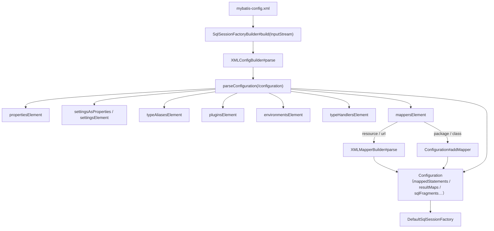

# 03 MyBatis · 01 初始化与配置解析

> 一句话结论：MyBatis 的"启动"= 一个 `SqlSessionFactoryBuilder` 带着一个 `XMLConfigBuilder` 读 `mybatis-config.xml`，读到 `<mappers>` 时再派生出 `XMLMapperBuilder` 去读每个 Mapper XML，最终把一切**登记进同一个 `Configuration`**——`Configuration` 就是 MyBatis 的内存数据库结构。
> 阅读前置：读完 `../00-总览/README.md`；知道 DOM/XPath 的基本概念（不知道也没关系，本文会讲）
> 预计阅读 15 分钟（导读）｜ 源码：`org.mybatis:mybatis:3.6.0`

---

## 0. 先看现象

启动阶段最典型的两个"神秘现象"：

```java
// 现象 1：builder.build 只调用一次却读了很多文件
try (InputStream in = Resources.getResourceAsStream("mybatis-config.xml")) {
    SqlSessionFactory factory = new SqlSessionFactoryBuilder().build(in);   // 一行代码，读了 N 个 XML
    System.out.println(factory.getConfiguration().getMappedStatementNames().size()); // 打印所有 SQL 条数
}
```

```text
// 现象 2：mapper-locations 写错时的报错（Spring Boot 环境）
org.apache.ibatis.builder.BuilderException: Error parsing SQL Mapper Configuration. Cause:
  java.io.IOException: Could not find resource mapper/UserMapper.xml
```

为什么会这样？答案在三个层次：

1. `SqlSessionFactoryBuilder#build` 只做"创建 `XMLConfigBuilder` + 调 `parse()`"，**真正读文件的是 XML 解析器**；
2. `mybatis-config.xml` 只负责"全局设置 + 数据源 + 告诉框架去哪找 Mapper"；
3. Mapper XML 是**被 `<mappers>` 间接触发**解析的，解析期间还会反向注册 Mapper 接口。

## 1. 整体地图



**读图说明**：

- 左侧 `mybatis-config.xml` 是**唯一入口**，`SqlSessionFactoryBuilder` 从来不解析 XML，它只做"装配 + 异常包装"。
- 中间 `parseConfiguration` 的 7 个 `XxxElement` 是**固定顺序**（图里只画了主要的 7 个），顺序有意义：`properties` 必须最先（`issue #117`），`environments` 必须在 `objectFactory`/`objectWrapperFactory` 之后（`issue #631`）。
- 右下两条分支是**解析分界线**：`resource`/`url` 走 `XMLMapperBuilder`（读 Mapper XML），`package`/`class` 走 `Configuration#addMapper`（走注解解析）。两者最终都写同一个 `Configuration`。
- 最下方 `DefaultSqlSessionFactory` 只是"抱着 `Configuration` 的空壳工厂"，启动期到此结束。

| 阶段 | 输入 | 主要产物 |
| --- | --- | --- |
| `build` | `InputStream` | `XPathParser` + `XMLConfigBuilder` |
| `parse` | `/configuration` 节点 | 逐步填充的 `Configuration` |
| `mappersElement` | `<mappers>` 子节点 | 每个 Mapper XML 一批 `MappedStatement` |
| `build(Configuration)` | 已填充的 `Configuration` | `DefaultSqlSessionFactory` |

## 2. 本组篇目导航

| 篇目 | 讲什么 | 读完能做到 |
| --- | --- | --- |
| 本页 `README.md` | 启动全流程骨架、`Configuration` 里有什么、`mapper-locations` 配错的后果 | 说清"配置文件是怎么变成内存对象的" |
| [01-sqlsessionfactory-构建过程.md](./01-sqlsessionfactory-构建过程.md) | `build` → `parse` → `parseConfiguration` → 各 `XxxElement`；`XPathParser`、`Resources`、`VFS` | 画出配置解析调用链，定位"setting 拼错/环境选错"问题 |
| [02-mapperxml-解析与-mappedstatement.md](./02-mapperxml-解析与-mappedstatement.md) | `XMLMapperBuilder` / `XMLStatementBuilder` / `XMLScriptBuilder`、三种 `SqlSource`、`#{}` vs `${}` | 解释一条 `<select>` 是怎么变成 `MappedStatement` 的 |

## 3. `Configuration` 里到底有什么（速查表）

| 字段 | 类型 | 作用 |
| --- | --- | --- |
| `mappedStatements` | `StrictMap<String, MappedStatement>` | **全库 SQL 索引**，key = `namespace.id` |
| `resultMaps` | `StrictMap<String, ResultMap>` | `<resultMap>` 索引 |
| `sqlFragments` | `StrictMap<String, XNode>` | `<sql>` 片段索引（**存的是 XNode 原始节点**，不是字符串） |
| `parameterMaps` / `keyGenerators` / `caches` | `StrictMap` | 老式 `parameterMap`、主键生成器、`<cache>` |
| `typeHandlerRegistry` | `TypeHandlerRegistry` | Java 类型 ↔ JDBC 类型 ↔ `setXxx/getXxx` |
| `typeAliasRegistry` | `TypeAliasRegistry` | `<typeAlias>` 与内置别名（`string`、`int`、`map`…） |
| `interceptorChain` | `InterceptorChain` | 插件链，`pluginAll` 套壳用 |
| `mapperRegistry` | `MapperRegistry` | Mapper 接口 → `MapperProxyFactory` |
| `languageRegistry` | `LanguageDriverRegistry` | `XML`/`RAW` 两种语言驱动 |
| `loadedResources` | `Set<String>` | 防止同一个 XML 被解析两次（含 `namespace:xxx` 标记） |
| `incompleteStatements` 等 4 个 | `Collection` | 解析顺序导致"引用了还没定义的 `resultMap`"时先挂起，稍后重试 |

> 关键词：**几乎所有"找不到/重复定义"的报错都来自这些 `StrictMap`**（重复 put 抛 `already contains key`，get 不到抛 `does not contain value for`）。

## 4. 学习检查点

- [ ] 能说出 `SqlSessionFactoryBuilder#build(InputStream)` 里那 3 行核心代码分别做什么。
- [ ] 能解释为什么 `properties` 必须最先解析、`environments` 必须在 `objectFactory` 之后解析。
- [ ] 能说出 `sqlFragments` 里存的是什么（提示：不是字符串）。
- [ ] 能解释 `mapper-locations` 配错时，报错来自编译期还是运行期、哪个类抛的。

## 小结

- 启动期的全部工作是"把 XML 变成 `Configuration`"，`SqlSessionFactory` 只是它的持有者。
- `mybatis-config.xml` 管全局，Mapper XML 管 SQL，两者由 `<mappers>` 连接；`package`/`class` 形式走注解解析，是另一条并行入口。
- `Configuration` 里的每个 `StrictMap` 都对应一类元素，报错信息里的 `"xxx collection"` 就是它的名字。

## 自测题

1. `SqlSessionFactoryBuilder` 是线程安全的吗？可以复用吗？
2. `XMLConfigBuilder#parse()` 为什么不能被调用两次？
3. `mybatis-config.xml` 里 `<settings>` 的键写错了，什么时候报错、报什么？
4. `<mappers>` 的 `resource` 与 `class` 两种写法，解析路径有什么区别？
5. `sqlFragments` 里为什么存 `XNode` 而不是解析后的 SQL 字符串？
6. `loadedResources` 里为什么会出现 `namespace:com.xxx.UserMapper` 这样的条目？
7. `mapper-locations` 配错时，报错信息里的 `Could not find resource` 是谁抛的？
8. 为什么 `Configuration` 里的 Map 都用 `StrictMap` 而不是普通 `HashMap`？

<details><summary>参考答案要点</summary>

1. 可以。`SqlSessionFactoryBuilder` 无状态（方法内局部变量），构建完即可丢弃；官方建议不要保存实例。
2. 因为内部有 `parsed` 标志，第二次调用抛 `Each XMLConfigBuilder can only be used once.`，防止重复注册 `MappedStatement`（`StrictMap#put` 会报重复）。
3. 启动期（`settingsAsProperties`）立刻报 `The setting xxx is not known.  Make sure you spelled it correctly (case sensitive).`，用 `MetaClass` 反射检查 `Configuration` 是否有对应 setter。
4. `resource`/`url` → `Resources.getResourceAsStream` + `new XMLMapperBuilder(...).parse()`（读 XML，末尾 `bindMapperForNamespace` 注册接口）；`class`/`package` → `Configuration#addMapper` → `MapperAnnotationBuilder#parse`（读注解）。
5. 因为 `<sql>` 片段可能被多处 `<include>` 引用，且可能在"被引用时"才知道 `databaseId`；存 `XNode` 让真正展开发生在 `XMLIncludeTransformer` 阶段，避免提前求值。
6. `bindMapperForNamespace` 里 `configuration.addLoadedResource("namespace:" + namespace)`，用于"同一 namespace 的 XML 又被 `<mapper class>` 注册时"避免重复解析/重复注册。
7. `Resources#getResourceURL` 抛的 `IOException("Could not find resource " + resource)`，被 `XMLConfigBuilder` 包成 `BuilderException("Error parsing SQL Mapper Configuration. Cause: ...")`。
8. 因为 `StrictMap` 会在**重复 key** 与**key 不存在**时给出带"集合名"的明确异常，能在启动期发现 `namespace.id` 冲突或拼写错误，普通 `HashMap` 只会静默覆盖/返回 `null`。
</details>
