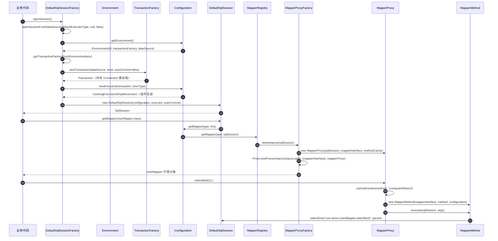
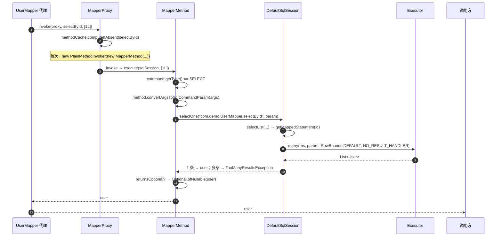

# SqlSession 与 Mapper 代理：从 openSession 到 MapperMethod#execute

> 一句话结论：`openSession()` 一行代码里创建了 `Transaction`、`Executor`、`SqlSession` 三件套；`getMapper()` 用 JDK 动态代理给接口"造"了实现类，代理把方法调用翻译成 `MapperMethod#execute` 的一个 switch，最终落到 `DefaultSqlSession` 的同名方法上。
> 阅读前置：会写 JDBC；知道 `Configuration` 里存着 `MappedStatement`（见 [../01-初始化与配置解析/02-mapperxml-解析与-mappedstatement.md](../01-初始化与配置解析/02-mapperxml-解析与-mappedstatement.md)）
> 预计阅读 45 分钟 ｜ 源码：`org.mybatis:mybatis:3.6.0`

---

## 0. 先看现象

先看一段谁都会写的代码：

```java
// 1) 启动期：整个应用只做一次
SqlSessionFactory factory = new SqlSessionFactoryBuilder()
    .build(Resources.getResourceAsStream("mybatis-config.xml"));

// 2) 运行期：每次请求一次会话
try (SqlSession session = factory.openSession()) {
  UserMapper mapper = session.getMapper(UserMapper.class);   // 接口 → 代理对象
  User user = mapper.selectById(1L);                         // 代理 → SqlSession → Executor
  session.commit();
}
```

这里有三个"反直觉"的点，正是本篇要解释的：

| 现象 | 你的疑惑 | 答案在哪 |
| --- | --- | --- |
| `openSession()` 只写了一行，怎么就有一条数据库连接了？ | 连接谁来管 | `DefaultSqlSessionFactory#openSessionFromDataSource` → `TransactionFactory#newTransaction` |
| `UserMapper` 只有接口没有实现类，为什么能 new 出来？ | 谁实现了它 | `MapperProxyFactory#newInstance` → `Proxy.newProxyInstance` |
| `session.getMapper(UserMapper.class)` 每次拿到的对象是同一个吗？ | 有没有缓存 | 每次新建代理，但 `MapperMethod` 缓存在 `Configuration` 级别的 `methodCache` 里 |

> 零基础提示：JDBC 里你要自己 `Connection conn = dataSource.getConnection(); PreparedStatement ps = conn.prepareStatement(sql); ps.setObject(1, 1L); ResultSet rs = ps.executeQuery();`。MyBatis 把你写的这四步拆进了 `Transaction`（管连接）、`ParameterHandler`（管 setObject）、`StatementHandler`（管 prepareStatement / execute）、`ResultSetHandler`（管 rs → 对象）。本篇先讲"怎么走到这四步"，下一篇讲"这四步内部怎么转"。

---

## 1. 整体地图



读图说明：

1. **上半段（1~11 步）都是 `openSession` 的开销**：环境 → 事务工厂 → 事务 → 执行器 → 会话。注意 `Configuration#getEnvironment()` 返回的 `Environment` 可能在启动期根本没配（纯注解 / 纯 Spring 场景），这时 `getTransactionFactoryFromEnvironment` 会退化成 `ManagedTransactionFactory`（第 4 段的源码会看到）。
2. `TransactionFactory#newTransaction` 返回的 `Transaction` **此时通常还没有真正打开连接**（`JdbcTransaction` 是懒加载），所以 `openSession()` 本身很轻。
3. **中段（12~19 步）是 `getMapper` 的开销**：一次 Map 查找 + 一次 `Proxy.newProxyInstance`。这个方法不查数据库。
4. **下段（20~23 步）才是真正调用**：代理 `invoke` → 取（或创建）`MapperMethod` → `execute`。`MapperMethod` 的创建是**懒**的，第一次调用某个方法时才创建，之后命中 `methodCache`。
5. 整条链路里 `SqlSession` 只出现一次（`SS`），它是所有语句的"总入口"，也是唯一持有 `Executor` 的对象。

---

## 2. 关键类逐个拆

### 2.1 `SqlSessionFactory`：只有两个职责

```java (src: SqlSessionFactory.java#L25-L45)
public interface SqlSessionFactory {

  SqlSession openSession();

  SqlSession openSession(boolean autoCommit);

  SqlSession openSession(Connection connection);

  SqlSession openSession(TransactionIsolationLevel level);

  SqlSession openSession(ExecutorType execType);

  SqlSession openSession(ExecutorType execType, boolean autoCommit);

  SqlSession openSession(ExecutorType execType, TransactionIsolationLevel level);

  SqlSession openSession(ExecutorType execType, Connection connection);

  Configuration getConfiguration();

}
```

- **负责什么**：造 `SqlSession`，以及把 `Configuration` 暴露出去。
- **谁创建它**：`SqlSessionFactoryBuilder#build(Configuration)`，或者 Spring 的 `SqlSessionFactoryBean`。
- **在哪个包**：`org.apache.ibatis.session`
- **设计意图**：工厂方法的重载把"三个可变维度"（`ExecutorType` / 隔离级别 / 是否自动提交 + 是否用外部连接）拆成 8 个签名，避免构造器参数爆炸。

### 2.2 `DefaultSqlSession`：会话门面，注意它明确写了"非线程安全"

```java (src: DefaultSqlSession.java#L41-L60)
/**
 * The default implementation for {@link SqlSession}. Note that this class is not Thread-Safe.
 *
 * @author Clinton Begin
 */
public class DefaultSqlSession implements SqlSession {

  private final Configuration configuration;
  private final Executor executor;

  private final boolean autoCommit;
  private boolean dirty;
  private List<Cursor<?>> cursorList;

  public DefaultSqlSession(Configuration configuration, Executor executor, boolean autoCommit) {
    this.configuration = configuration;
    this.executor = executor;
    this.dirty = false;
    this.autoCommit = autoCommit;
  }
```

- **负责什么**：对外暴露 `selectOne/selectList/insert/update/delete/commit/rollback/close/getMapper`，把调用转给 `Executor`。
- **谁创建它**：`DefaultSqlSessionFactory#createSqlSession`。
- **在哪个包**：`org.apache.ibatis.session.defaults`
- **为什么非线程安全**：两个可变字段——`dirty`（有没有写操作，决定 `close()` 时是否需要回滚）和 `cursorList`（打开的 `Cursor` 集合）。两个线程同时改 `dirty` 或同时往 `cursorList` 塞 `Cursor`，行为就没定义了。`executor` 本身也不安全（内部有 `localCache`、`queryStack`）。

### 2.3 `MapperRegistry`：`接口 → 代理工厂` 的注册表

- **负责什么**：维护 `knownMappers: Map<Class, MapperProxyFactory>`；`addMapper` 注册并触发注解解析；`getMapper` 造代理。
- **谁创建它**：`Configuration` 的字段（`new MapperRegistry(this)`），生命周期与 `Configuration` 相同。
- **在哪个包**：`org.apache.ibatis.binding`
- **设计意图**：接口的解析（注解上的 SQL）只做一次，放到启动期；运行期只做"查表 + new 代理"。

### 2.4 `MapperProxyFactory` / `MapperProxy`：JDK 动态代理两件套

- `MapperProxyFactory`：持有 `mapperInterface` 和一个 `ConcurrentHashMap<Method, MapperMethodInvoker> methodCache`（注意：这个 Map 是**工厂级共享**的，所以同一个 Mapper 接口的 `MapperMethod` 只创建一次）。
- `MapperProxy`：`InvocationHandler` 实现，持有 `sqlSession`（每次新建）。
- **在哪个包**：`org.apache.ibatis.binding`

### 2.5 `MapperMethod`：把"方法调用"翻译成"命令"的翻译官

- **负责什么**：`SqlCommand`（哪个语句 id、什么 `SqlCommandType`）+ `MethodSignature`（返回类型、参数名表），`execute` 里一个 switch 分派。
- **谁创建它**：`MapperProxy#cachedInvoker` 里的 `computeIfAbsent`。
- **在哪个包**：`org.apache.ibatis.binding`

---

## 3. 源码逐段精读

### 3.1 `DefaultSqlSessionFactory#openSession` 与 `openSessionFromDataSource`

```java
  @Override
  public SqlSession openSession() {
    return openSessionFromDataSource(configuration.getDefaultExecutorType(), null, false);
  }
```

- **在干什么**：无参 `openSession` 用**默认执行器类型**（`Configuration#defaultExecutorType`，默认 `SIMPLE`）、**默认隔离级别**（`null`，即数据库默认）、**不自动提交**。
- **为什么这么写**：`false` 这个 `autoCommit` 非常关键——它是 MyBatis "手动事务"模型的基石，也是"忘了 `commit` 数据不见了"的根因。
- **如果改成别的**：把第三个参数改 `true`，则 `DefaultSqlSession#close` 时不会回滚（`isCommitOrRollbackRequired` 依赖 `!autoCommit`）。
- **常见坑**：`openSession(true)` 在连接池 + 批量场景下会大量小事务，性能与一致性都糟糕。

```java (src: DefaultSqlSessionFactory.java#L94-L109)
  private SqlSession openSessionFromDataSource(ExecutorType execType, TransactionIsolationLevel level,
      boolean autoCommit) {
    Transaction tx = null;
    try {
      final Environment environment = configuration.getEnvironment();
      final TransactionFactory transactionFactory = getTransactionFactoryFromEnvironment(environment);
      tx = transactionFactory.newTransaction(environment.getDataSource(), level, autoCommit);
      final Executor executor = configuration.newExecutor(tx, execType);
      return createSqlSession(configuration, executor, autoCommit);
    } catch (Exception e) {
      closeTransaction(tx); // may have fetched a connection so lets call close()
      throw ExceptionFactory.wrapException("Error opening session.  Cause: " + e, e);
    } finally {
      ErrorContext.instance().reset();
    }
  }
```

- **在干什么**：`Environment` → `TransactionFactory` → `Transaction`（拿连接）→ `Configuration#newExecutor`（造执行器，内部可能再包 `CachingExecutor` 和插件）→ `new DefaultSqlSession`。
- **为什么这么写**：
  - `catch` 里 `closeTransaction(tx)` 是因为 `newTransaction` 可能已经打开连接了，异常时不能泄漏；
  - `finally` 里 `ErrorContext.instance().reset()` 是清掉"上次出错时挂的上下文"，防止错误信息串号；
  - 全部包成 `ExceptionFactory.wrapException("Error opening session.  Cause: ")`，是为了统一异常类型（`PersistenceException`）。
- **如果改成别的**：如果在 `catch` 里不关 `tx`，连接池很快就会耗尽——这是典型"偶发连接泄漏"。
- **常见坑**：这条链路里**没有**任何 `setAutoCommit` 之外的事务控制，所以 `openSession()` 之后必须自己 `commit()`/`rollback()`（`try-with-resources` 的 `close()` 在 `!autoCommit && dirty` 时会自动回滚）。

### 3.2 `Environment` 缺失时的兜底：`ManagedTransactionFactory`

```java
  private TransactionFactory getTransactionFactoryFromEnvironment(Environment environment) {
    if (environment == null || environment.getTransactionFactory() == null) {
      return new ManagedTransactionFactory();
    }
    return environment.getTransactionFactory();
  }
```

- **在干什么**：如果 `Configuration` 里没有 `Environment`（纯 Spring 场景很常见：`SqlSessionFactoryBean` 不解析 `<environments>`），就用 `ManagedTransactionFactory`。
- **为什么这么写**：让 MyBatis 可以"不带数据源也开局"——真正的连接交给外部（Spring 的 `DataSourceTransactionManager`）管理。
- **如果改成别的**：如果直接抛 "no environment"，那 Spring Boot 下用 `mybatis-spring-boot-starter` 就得额外配置 `<environments>`，毫无必要。
- **常见坑**：独立使用（非 Spring）时忘了配 `<environments>`，会在第一次执行 SQL 时报 `NPE`（`environment.getDataSource()` 为 null），而不是在启动期报错。

`Environment` 本身的构造器把三个字段都做了非空校验，这是"启动期就失败"的正确做法：

```java (src: Environment.java#L30-L43)
  public Environment(String id, TransactionFactory transactionFactory, DataSource dataSource) {
    if (id == null) {
      throw new IllegalArgumentException("Parameter 'id' must not be null");
    }
    if (transactionFactory == null) {
      throw new IllegalArgumentException("Parameter 'transactionFactory' must not be null");
    }
    this.id = id;
    if (dataSource == null) {
      throw new IllegalArgumentException("Parameter 'dataSource' must not be null");
    }
    this.transactionFactory = transactionFactory;
    this.dataSource = dataSource;
  }
```

- **在干什么**：`id`、`transactionFactory`、`dataSource` 三者都非空。
- **为什么这么写**：`id` 还会参与一级缓存的 key（`issue #176`），所以绝不能为空。
- **常见坑**：自己 `new Environment` 做单测时忘了传 `transactionFactory`，直接 `IllegalArgumentException`。

### 3.3 `DefaultSqlSession#getMapper`：一行转交给 `Configuration`

```java
  @Override
  public <T> T getMapper(Class<T> type) {
    return configuration.getMapper(type, this);
  }
```

- **在干什么**：把"我（当前会话）"作为参数传给 `Configuration`，让注册表用当前会话造代理。
- **为什么这么写**：代理必须绑定一个具体 `SqlSession`，否则 `execute` 时不知道往哪个会话发。
- **如果改成别的**：如果代理持有 `SqlSessionFactory` 而不是 `SqlSession`，就必须在每次调用时决定用哪个会话——这正是 `SqlSessionTemplate` 做的事（见 3.8）。
- **常见坑**：把 `mapper` 存成成员变量跨线程用，等于把一个 `SqlSession` 共享出去。

### 3.4 `MapperRegistry#getMapper`：查表 + 造代理

```java (src: MapperRegistry.java#L44-L54)
  public <T> T getMapper(Class<T> type, SqlSession sqlSession) {
    final MapperProxyFactory<T> mapperProxyFactory = (MapperProxyFactory<T>) knownMappers.get(type);
    if (mapperProxyFactory == null) {
      throw new BindingException("Type " + type + " is not known to the MapperRegistry.");
    }
    try {
      return mapperProxyFactory.newInstance(sqlSession);
    } catch (Exception e) {
      throw new BindingException("Error getting mapper instance. Cause: " + e, e);
    }
  }
```

- **在干什么**：从 `knownMappers` 拿到工厂，调 `newInstance(sqlSession)`；拿不到就抛 `BindingException`。
- **为什么这么写**：`knownMappers.get(type) == null` 是**最常见的一类启动错误**——接口没被扫描/注册。
- **常见坑**：`Type com.demo.UserMapper is not known to the MapperRegistry.` 三种典型原因：① `mybatis-config.xml` 的 `<mappers>` 没写这个接口/包；② `@Mapper`/`@MapperScan` 路径写错；③ 资源过滤把 `mapper/*.xml` 漏掉了（XML 与接口 namespace 不匹配时会在 `bindMapperForNamespace` 阶段失败，报的错类似但不完全一样）。

注册侧还有一段注释非常值得背下来：

```java (src: MapperRegistry.java#L61-L80)
    if (type.isInterface()) {
      if (hasMapper(type)) {
        throw new BindingException("Type " + type + " is already known to the MapperRegistry.");
      }
      boolean loadCompleted = false;
      try {
        knownMappers.put(type, new MapperProxyFactory<>(type));
        // It's important that the type is added before the parser is run
        // otherwise the binding may automatically be attempted by the
        // mapper parser. If the type is already known, it won't try.
        MapperAnnotationBuilder parser = new MapperAnnotationBuilder(config, type);
        parser.parse();
        loadCompleted = true;
      } finally {
        if (!loadCompleted) {
          knownMappers.remove(type);
        }
      }
    }
  }
```

- **在干什么**：**先注册、再解析注解**；解析失败就把注册撤掉。
- **为什么这个顺序**：XML 里 `<select>` 的 `id` 是 `namespace + "." + id`，解析注解时可能触发 `bindMapperForNamespace` 反向绑定接口；如果接口还没注册，就会出现"反复尝试绑定自己"的死循环 / 重复注册。注释里 `It's important that the type is added before the parser is run` 说的就是这件事。
- **如果改成别的**：先解析后注册，会遇到 `Type X is already known to the MapperRegistry.`（因为 XML 端已经绑过）。
- **常见坑**：**重复注册同一个 Mapper 会直接抛异常**，所以 Spring 里既写 `@MapperScan` 又在 XML 里 `<mapper class>` 配同一个接口，启动就会炸。

### 3.5 `MapperProxyFactory#newInstance`：JDK 动态代理

```java (src: MapperProxyFactory.java#L46-L53)
  protected T newInstance(MapperProxy<T> mapperProxy) {
    return (T) Proxy.newProxyInstance(mapperInterface.getClassLoader(), new Class[] { mapperInterface }, mapperProxy);
  }

  public T newInstance(SqlSession sqlSession) {
    final MapperProxy<T> mapperProxy = new MapperProxy<>(sqlSession, mapperInterface, methodCache);
    return newInstance(mapperProxy);
  }
```

- **在干什么**：`Proxy.newProxyInstance(类加载器, 接口数组, InvocationHandler)` 造一个实现了 `mapperInterface` 的代理对象。
- **为什么这么写**：
  - 类加载器用**接口自己的** `getClassLoader()`，保证代理类与接口在同一命名空间（否则可能 `ClassCastException` / `IllegalArgumentException: non-public interface`）；
  - 接口数组只有 `mapperInterface`，所以代理只实现 Mapper 接口，不实现 `SqlSession`；
  - `methodCache` 从工厂传进来，多个代理共享同一份方法缓存。
- **如果改成别的**：用 CGLIB 也能实现，但 Mapper 都是接口，JDK 代理足够且不引依赖；MyBatis 只在 `MyBatis` 的 `ProxyFactory`（旧版）里才考虑切换。
- **常见坑**：Mapper 接口如果是**非 public** 的（比如包级私有的嵌套接口），`Proxy.newProxyInstance` 会报 `IllegalArgumentException: non-public interface`。

### 3.6 `MapperProxy#invoke`：方法缓存 + default 方法

```java (src: MapperProxy.java#L58-L68)
  @Override
  public Object invoke(Object proxy, Method method, Object[] args) throws Throwable {
    try {
      if (Object.class.equals(method.getDeclaringClass())) {
        return method.invoke(this, args);
      }
      return cachedInvoker(method).invoke(proxy, method, args, sqlSession);
    } catch (Throwable t) {
      throw ExceptionUtil.unwrapThrowable(t);
    }
  }
```

- **在干什么**：`Object` 的方法（`toString/hashCode/equals`）直接反射调用自己；其余方法走 `cachedInvoker`。
- **为什么这么写**：见 0 节的表——避免日志里打印 Mapper 对象时炸掉。
- **如果改成别的**：不判 `Object`，`System.out.println(mapper)` 就会去 `Configuration` 查 `java.lang.Object.toString` 的 `MappedStatement`，抛 `BindingException`。
- **常见坑**：`equals` 被代理后比较的是**代理对象**，两个不同会话的 Mapper 代理 `equals` 为 false，别用它做缓存 key。

```java (src: MapperProxy.java#L70-L86)
  private MapperMethodInvoker cachedInvoker(Method method) throws Throwable {
    try {
      return methodCache.computeIfAbsent(method, m -> {
        if (!m.isDefault()) {
          return new PlainMethodInvoker(new MapperMethod(mapperInterface, method, sqlSession.getConfiguration()));
        }
        try {
          return new DefaultMethodInvoker(getMethodHandleJava9(method));
        } catch (NoSuchMethodException | IllegalAccessException | InvocationTargetException e) {
          throw new RuntimeException(e);
        }
      });
    } catch (RuntimeException re) {
      Throwable cause = re.getCause();
      throw cause == null ? re : cause;
    }
  }
```

- **在干什么**：`methodCache.computeIfAbsent` 保证每个 `Method` 只构建一次 `MapperMethodInvoker`；抽象方法用 `PlainMethodInvoker`，接口 default 方法用 `DefaultMethodInvoker`（`MethodHandle.findSpecial`）。
- **为什么这么写**：
  - `MapperMethod` 构造里要解析注解、拼 `statement id`（`SqlCommand` 的构造里会做"接口全名.方法名"的匹配与 `@Select` 等注解查找），属于**可以复用**的重活，绝不是每次调用都算；
  - `computeIfAbsent` 在 `ConcurrentHashMap` 上是原子的，天然线程安全；
  - `catch (RuntimeException re)` 里取 `re.getCause()` 再抛，是为了把 `computeIfAbsent` 包装层剥掉，让栈里直接看到真正的异常（比如 default 方法 `IllegalAccessException`）。
- **如果改成别的**：用 `HashMap + get/put`，多线程下会重复构建 `MapperMethod`（虽然结果一样，但浪费）。
- **常见坑**：Mapper 接口的 **default 方法不能写 SQL**，它只是普通 Java 方法，内部若调用接口的抽象方法则是可以的（会走代理）。

### 3.7 `MapperMethod#execute`：一个 switch 定输赢

```java (src: MapperMethod.java#L57-L104)
  public Object execute(SqlSession sqlSession, Object[] args) {
    Object result;
    switch (command.getType()) {
      case INSERT: {
        Object param = method.convertArgsToSqlCommandParam(args);
        result = rowCountResult(sqlSession.insert(command.getName(), param));
        break;
      }
      case UPDATE: {
        Object param = method.convertArgsToSqlCommandParam(args);
        result = rowCountResult(sqlSession.update(command.getName(), param));
        break;
      }
      case DELETE: {
        Object param = method.convertArgsToSqlCommandParam(args);
        result = rowCountResult(sqlSession.delete(command.getName(), param));
        break;
      }
      case SELECT:
        if (method.returnsVoid() && method.hasResultHandler()) {
          executeWithResultHandler(sqlSession, args);
          result = null;
        } else if (method.returnsMany()) {
          result = executeForMany(sqlSession, args);
        } else if (method.returnsMap()) {
          result = executeForMap(sqlSession, args);
        } else if (method.returnsCursor()) {
          result = executeForCursor(sqlSession, args);
        } else {
          Object param = method.convertArgsToSqlCommandParam(args);
          result = sqlSession.selectOne(command.getName(), param);
          if (method.returnsOptional() && (result == null || !method.getReturnType().equals(result.getClass()))) {
            result = Optional.ofNullable(result);
          }
        }
        break;
      case FLUSH:
        result = sqlSession.flushStatements();
        break;
      default:
        throw new BindingException("Unknown execution method for: " + command.getName());
    }
    if (result == null && method.getReturnType().isPrimitive() && !method.returnsVoid()) {
      throw new BindingException("Mapper method '" + command.getName()
          + "' attempted to return null from a method with a primitive return type (" + method.getReturnType() + ").");
    }
    return result;
  }
```

- **在干什么**：
  - `INSERT/UPDATE/DELETE` 都走 `rowCountResult(int)`，按返回类型（`void/int/long/boolean`）包装；
  - `SELECT` 按方法返回类型分五路：`void + ResultHandler`（流式消费）、`Collection/数组`（`executeForMany`）、`Map`（`executeForMap`）、`Cursor`（`executeForCursor`）、其它（`selectOne`，`Optional` 再包一层）；
  - `FLUSH` 只用于 `@Flush` 注解的方法；
  - 最后统一兜底：**基本类型返回值不能是 null**（否则拆箱 `NPE`）。
- **为什么这么写**：`SqlSession` 的 API 是固定的（`selectOne/selectList/selectMap/select`），而 Mapper 方法的签名是任意的，所以这层 `switch` 本质是"签名 → API"的适配器。
- **如果改成别的**：把 `selectOne` 替换成 `selectList` + 判空，就是自己手写 `MapperMethod` 的效果——MyBatis 选择 `selectOne` 是为了让 `TooManyResultsException` 有明确的抛出点。
- **常见坑**：
  - `int updateXxx()` 返回 0 是合法的，但如果查询方法声明 `int count()` 且 SQL 没返回行，就会命中最后那段 `BindingException`；
  - 返回 `Optional<T>` 时要注意 `returnsOptional` 判断，`Optional<Long>` 与 `Long` 的二选一逻辑在 `result == null || !returnType.equals(result.getClass())`。

### 3.8 为什么"接口没有实现类也能用"（一句话总结 + Spring 的做法）

`Proxy.newProxyInstance` 生成的类是 `$ProxyN implements UserMapper`，**方法体**全由 `MapperProxy#invoke` 决定；`invoke` 里的 `command.getName()` 就是 `namespace + "." + 方法名`，`Configuration#getMappedStatement(id)` 就能精确找到启动期注册的 `MappedStatement`。所以"实现类"其实一直存在，只是由 JDK 在运行期生成。

Spring 集成时，注入到你 Service 里的 `userMapper` 并不是 `MapperRegistry#getMapper` 造的代理，而是 `MapperFactoryBean` 造的"能自己找会话"的代理：每次调用都由 `SqlSessionTemplate` 通过 `SqlSessionUtils` 取**绑定到当前线程/当前事务**的 `SqlSession`，没有就临时开一个、用完关掉。所以 Mapper 可以放心做成单例——真正非线程安全的 `SqlSession` 被限制在单个调用内。细节见 05 分册（Spring 集成与 Boot 自动配置）。

`SqlSession` 非线程安全的直接证据在 `DefaultSqlSession` 的字段上（`dirty`、`cursorList`），而 `close()` 里这段逻辑说明了 `dirty` 为什么重要：

```java (src: DefaultSqlSession.java#L259-L268)
  @Override
  public void close() {
    try {
      executor.close(isCommitOrRollbackRequired(false));
      closeCursors();
      dirty = false;
    } finally {
      ErrorContext.instance().reset();
    }
  }
```

```java (src: DefaultSqlSession.java#L310-L312)
  private boolean isCommitOrRollbackRequired(boolean force) {
    return !autoCommit && dirty || force;
  }
```

- **在干什么**：`close()` 时如果"非自动提交 且 有过写操作"，就把 `forceRollback=true` 传给 `Executor#close`，让它在关闭前回滚。
- **为什么这么写**：这样 `try (SqlSession s = factory.openSession()) { ... }` 即使忘了 `commit`，也不会把半截事务留在连接池里；但**读操作不会回滚**（`dirty` 只有 `update/insert/delete` 或 `dirtySelect` 才置 true）。
- **常见坑**：`update` 成功但没 `commit`，`close()` 会静默回滚——数据"莫名其妙没写进去"，就是这里。

`selectList` 是"读 → Executor"的样板，也是 `dirtySelect` 的落点：

```java (src: DefaultSqlSession.java#L149-L159)
  private <E> List<E> selectList(String statement, Object parameter, RowBounds rowBounds, ResultHandler handler) {
    try {
      MappedStatement ms = configuration.getMappedStatement(statement);
      dirty |= ms.isDirtySelect();
      return executor.query(ms, wrapCollection(parameter), rowBounds, handler);
    } catch (Exception e) {
      throw ExceptionFactory.wrapException("Error querying database.  Cause: " + e, e);
    } finally {
      ErrorContext.instance().reset();
    }
  }
```

- **在干什么**：取 `MappedStatement` → 合并 `dirtySelect`（3.6 新增：带 `affectData="true"` 的查询也视为写）→ 委托 `Executor#query`。
- **为什么这么写**：`wrapCollection` 把 `List/数组` 参数包成 `Map`（`collection/list/array` 三个 key），这样 `<foreach collection="list">` 才有得取。
- **常见坑**：`clearCache()` 只是清一级缓存（`executor.clearLocalCache()`），不代表提交事务。

---

## 4. 一次 Mapper 调用的完整时序（含异常路径）



读图说明：

1. `MP -> MP` 这一格只在**第一次**出现；之后 `computeIfAbsent` 直接返回缓存的 `PlainMethodInvoker`。
2. `MM -> MM` 的 `convertArgsToSqlCommandParam` 是参数命名逻辑：多参数会变成 `ParamMap`（`param1`/`arg0`/`@Param` 名），单参数直接透传，集合再包一层——所以 `#{}` 里写什么名字，取决于这一步。
3. 异常路径有两条：`getMappedStatement` 找不到 → `StrictMap` 抛 `IllegalArgumentException ... does not contain value for ...`；`selectList` 内部任何异常 → 包成 `PersistenceException("Error querying database. Cause: ...")`。
4. `TooManyResultsException` 是 `selectOne` 内部抛的，不是 `Executor` 抛的——所以你在日志里看到它的栈顶通常是 `DefaultSqlSession.selectOne`。

---

## 5. 用到的设计模式

| 模式 | 体现 | 源码位置 |
| --- | --- | --- |
| 工厂方法 | `SqlSessionFactory#openSession` 8 个重载；`MapperProxyFactory#newInstance` | `DefaultSqlSessionFactory`、`MapperProxyFactory` |
| 动态代理 | `Proxy.newProxyInstance` + `InvocationHandler` | `MapperProxyFactory#newInstance`、`MapperProxy#invoke` |
| 门面（Facade） | `DefaultSqlSession` 把 `Executor` 的复杂度藏起来 | `DefaultSqlSession` |
| 命令（Command） | 一个 Mapper 方法 = 一条 `MappedStatement` 命令 | `MapperMethod.SqlCommand` |
| 注册表（Registry） | `MapperRegistry.knownMappers`、`Configuration.mappedStatements` | `MapperRegistry`、`Configuration` |
| 适配器 | `MapperMethod#execute` 把任意方法签名适配到 `SqlSession` 固定 API | `MapperMethod` |
| 模板方法 | `BaseExecutor#query` 定义流程，`doQuery` 交给子类 | `BaseExecutor`（见下一篇） |

---

## 6. 实际开发中的坑与调试手法

### 6.1 坑

1. **`Type xxx is not known to the MapperRegistry.`**：`@MapperScan` 包路径写错、`<mappers>` 漏配、或被 `spring-boot` 的 `mapper-locations` 干扰（XML 找到了但接口没注册也会报别的错）。先在启动日志里搜 `MapperRegistry` 注册的类名。
2. **重复注册**：`@MapperScan` + `<mapper class="...">` 配同一接口 → `already known to the MapperRegistry.`。两种注册方式只能留一种。
3. **忘了 `commit`**：非 Spring 场景下 `insert` 后不 `commit`，`close()` 自动回滚，数据消失且不报错。开启 `logging.level.com.demo=DEBUG` 能看到 `JDBC Connection [..] will not be managed by Spring` 这类线索（Spring 场景）或 `Rolling back JDBC Connection`。
4. **Mapper 当成员变量跨线程**：单例 Service 里 `private UserMapper mapper = sqlSession.getMapper(...)`，多线程下会串会话甚至 `IllegalStateException: Executor was closed`。
5. **非 public 接口**：包私有 Mapper 接口在 JDK17+ 上 `Proxy.newProxyInstance` 报 `non-public interface`，改成 `public`。
6. **`Object` 方法被代理**：日志框架打印 Mapper 代理时触发 `toString` 是安全的（3.6 已判断），但自己写的 `equals` 判等逻辑千万别用 Mapper 代理做 key。
7. **default 方法里调抽象方法**：可以，但 **default 方法本身不能挂 `@Select`**，注解会被忽略（`MapperAnnotationBuilder` 不处理 default 方法）。
8. **`selectOne` 但 SQL 返回多行**：抛 `TooManyResultsException`，而不是静默取第一条——这是特性不是 bug。

### 6.2 调试手法

| 现象 | 先看哪里 | 手段 |
| --- | --- | --- |
| Mapper 注入失败 / 找不到语句 | `Configuration.mappedStatements` 的 key | `configuration.getMappedStatementNames()` 打印全部 id |
| 运行期 NPE / 会话已关闭 | `DefaultSqlSession` 是否跨线程 | 在 `close()` 处打断点，看调用栈 |
| 参数名对不上（`Parameter 'x' not found`） | `MapperMethod.convertArgsToSqlCommandParam` | 加 `-parameters` 编译参数，或显式 `@Param` |
| 代理对象打印异常 | `MapperProxy#invoke` 的 `Object` 分支 | 断点看 `method.getDeclaringClass()` |

---

## 7. 版本差异（3.4 → 3.6）

| 版本 | 变化 | 影响 |
| --- | --- | --- |
| 3.4.x | `MapperProxy` 用 `Map<Method, MapperMethod>` 直接缓存 `MapperMethod` | 为 default 方法支持埋下重构点 |
| 3.5.0 | 引入 `MapperMethodInvoker` 抽象，拆出 `PlainMethodInvoker` / `DefaultMethodInvoker`；default 方法用 `MethodHandle.findSpecial` 调用 | 接口可以写 default 方法并调用其它抽象方法 |
| 3.5.5 | `DefaultSqlSession.StrictMap` 标记 `@Deprecated`（参数 Map 改用 `ParamMap`） | 参数缺失报错信息改由 `ParamMap#get` 抛出 |
| 3.5.10+ | `MapperProxy` 的 `privateLookupIn` 静态初始化，缺方法时抛 `IllegalStateException` | JDK8 需要额外兼容（MyBatis 官方已要求 JDK8+，实际用 JDK9+ 才走 default 方法路径） |
| 3.6.0 | `MapperMethod#execute` 的 SELECT 分支增加 `returnsCursor` / `returnsOptional` 判断；`MappedStatement` 新增 `dirtySelect`（`affectData`） | `Optional` 声明更友好；带副作用的查询能触发提交语义 |

> 提示：`MapperProxy` 的 `static` 块要求 `MethodHandles.privateLookupIn`，这是 **JDK9+** 才有的方法。在 JDK8 上加载 `MapperProxy` 会直接 `IllegalStateException`——这也是 3.6 要求 JDK8 但建议 JDK17 的原因之一。

---

## 8. 面试验证点

1. **`openSession()` 内部做了什么？** → `getEnvironment` → `getTransactionFactoryFromEnvironment`（null 兜底 `ManagedTransactionFactory`）→ `newTransaction` → `Configuration#newExecutor` → `new DefaultSqlSession`。
2. **`Transaction` 是在 `openSession` 时就打开连接吗？** → 不一定。`JdbcTransaction` 懒加载，真正取连接在 `getConnection()`（即第一次执行 SQL / `BaseExecutor#getConnection`）。
3. **Mapper 接口为什么不需要实现类？** → `Proxy.newProxyInstance` 生成实现该接口的代理类，方法体由 `MapperProxy#invoke` 统一处理。
4. **`MapperProxy#invoke` 里为什么判断 `Object.class`？** → `toString/hashCode/equals` 不是 SQL 方法，直接反射到 `MapperProxy` 自身。
5. **`methodCache` 缓存的是什么？key 是什么？** → `Map<Method, MapperMethodInvoker>`，key 是 `java.lang.reflect.Method`（`Method` 的 `equals` 按"声明类 + 名称 + 参数类型"比较）；缓存在 `MapperProxyFactory` 上，多个代理共享。
6. **default 方法怎么被调用的？** → `DefaultMethodInvoker` 持有 `MethodHandle`，`bindTo(proxy).invokeWithArguments(args)`；`MethodHandle` 由 `MethodHandles.privateLookupIn(...).findSpecial(...)` 得到。
7. **`@Param` 与多参数时参数名怎么定？** → `MapperMethod.MethodSignature` 用 `ParamNameResolver`：单参数透传；多参数成 `ParamMap`，key 为 `paramN`、`argN`、以及 `@Param` 值 / 编译期 `-parameters` 得到的真实名。
8. **`MapperMethod#execute` 里 `FLUSH` 分支干什么？** → `sqlSession.flushStatements()`，对应 `@Flush` 注解方法，通常用于 `BatchExecutor` 手动提交批。
9. **为什么 `int` 返回类型方法可能抛 `BindingException`？** → `execute` 末尾判断 `result == null && 返回类型是基本类型`，防止自动拆箱 NPE，转成可读异常。
10. **`SqlSession` 为什么不能线程共享？** → `dirty`、`cursorList` 是可变状态，`Executor` 内部的 `localCache`、`queryStack` 也不是线程安全的。
11. **Spring 里注入的 Mapper 为什么能并发用？** → `SqlSessionTemplate` + `SqlSessionUtils` 按线程/事务借还 `SqlSession`，Mapper 本身只是"带会话解析能力的代理"。
12. **`getMapper` 会不会触发数据库访问？** → 不会。只做 `Map.get` + `Proxy.newProxyInstance`（外加首次调用时构建 `MapperMethod`）。
13. **`close()` 时忘记 commit 会发生什么？** → `isCommitOrRollbackRequired(false)` 为 true（非自动提交且有写操作），`Executor#close(true)` 回滚。

---

## 9. 动手练习

1. **打印所有注册的 Mapper**：写一段代码把 `Configuration#getMapperRegistry().getMappers()` 全打印出来，再把你项目里 `@MapperScan` 的包对比一下，找出漏注册的接口。
2. **验证 `methodCache` 共享**：在 `MapperProxy#cachedInvoker` 打条件断点，同一会话内 `getMapper` 两次，观察 `MapperMethod` 只构造一次；再换一个 `SqlSession` 观察仍然只有一次（因为缓存在工厂上）。
3. **观察自动回滚**：`openSession()` 后执行 `insert` 不 `commit`，直接 `close()`，用 `SHOW ENGINE INNODB STATUS` 或日志确认回滚发生。
4. **写一个 default 方法**：在 Mapper 接口里加 `default String greet() { return "hi " + selectById(1L).getName(); }`，验证它能调到抽象方法而不报错。
5. **断点走查一次 SELECT**：在 `MapperMethod#execute`、`DefaultSqlSession#selectOne`、`BaseExecutor#query` 三处打断点，画一张你自己的调用栈图，和本篇第 4 节的时序图对照。

---

## 小结

1. `openSession()` 一次性造出 `Transaction + Executor + SqlSession`，其中 `Executor` 由 `Configuration#newExecutor` 决定类型并可能被 `CachingExecutor` 与插件包装；`Environment` 缺失时用 `ManagedTransactionFactory` 兜底。
2. Mapper 接口的"实现类"是 `Proxy.newProxyInstance` 生成的动态代理，`MapperProxy#invoke` 通过 `methodCache` 复用 `MapperMethod`，再由 `MapperMethod#execute` 的 switch 把方法签名适配到 `SqlSession` 的固定 API。
3. 非线程安全的根源是 `SqlSession`（`dirty`/`cursorList`）和 `Executor`（`localCache`/`queryStack`）里的可变状态；Spring 用 `SqlSessionTemplate` 的"按线程借还"把风险限制在单次调用内。

---

## 自测题

**1. `openSession()` 的 `autoCommit` 参数传 `false` 会带来哪些行为？**

<details><summary>参考答案要点</summary>

`DefaultSqlSession.autoCommit=false` 后：① 每次写操作 `dirty=true`；② `commit()` 时 `isCommitOrRollbackRequired(false)` 为 true → `executor.commit(true)`；③ `close()` 时若有写操作则 `executor.close(true)` 回滚。所以"不 commit 就 close"会静默回滚。

</details>

**2. 为什么 `getTransactionFactoryFromEnvironment` 要容忍 `environment == null`？**

<details><summary>参考答案要点</summary>

因为 Spring 集成时 `<environments>` 常被省略（数据源由 Spring 注入），`Configuration.environment` 可能为 null。这时用 `ManagedTransactionFactory`，即"事务不由 MyBatis 管"，交给外部容器。

</details>

**3. `MapperRegistry#addMapper` 为什么必须先 `put` 再 `parse`？**

<details><summary>参考答案要点</summary>

`MapperAnnotationBuilder.parse()` 解析 `@Select` 等注解时，可能需要把接口与已有 XML 的 namespace 绑定（`bindMapperForNamespace`）。若接口尚未在 `knownMappers` 中，解析器会尝试"自动注册"造成重复注册或无限递归。源码注释原话：`It's important that the type is added before the parser is run`。

</details>

**4. `MapperProxyFactory` 的 `methodCache` 为什么放在工厂而不是代理里？**

<details><summary>参考答案要点</summary>

工厂是 `MapperRegistry.knownMappers` 里的**每个接口一份**，与 `Configuration` 同生命周期；代理是每次 `getMapper` 新建。把 `MapperMethod` 放在工厂上，一次构建、全局复用，避免每次 `getMapper` 都重新解析注解。

</details>

**5. `MapperProxy#invoke` 捕获 `Throwable` 后为什么调 `ExceptionUtil.unwrapThrowable`？**

<details><summary>参考答案要点</summary>

动态代理会把目标方法的受检异常通过 `InvocationTargetException` 包装，MyBatis 还额外包了 `PersistenceException`。`unwrapThrowable` 剥掉代理层包装，让调用方看到原始异常类型（例如 `SQLIntegrityConstraintViolationException`），便于业务捕获。

</details>

**6. `MapperMethod#execute` 的 SELECT 分支有哪五个出口？**

<details><summary>参考答案要点</summary>

① `returnsVoid() && hasResultHandler()` → `executeWithResultHandler`；② `returnsMany()` → `executeForMany`（`selectList`，并处理集合/数组类型转换，issue #510）；③ `returnsMap()` → `executeForMap`（`selectMap`）；④ `returnsCursor()` → `executeForCursor`；⑤ 其它 → `selectOne`，若 `returnsOptional` 再 `Optional.ofNullable`。

</details>

**7. 为什么 `List<User>` 返回值时 MyBatis 不会抛 `TooManyResultsException`？**

<details><summary>参考答案要点</summary>

因为 `MethodSignature.returnsMany()` 为 true，走 `executeForMany` → `sqlSession.selectList`；`TooManyResultsException` 只在 `selectOne` 里对 size>1 抛出。

</details>

**8. 一个 Mapper 方法返回 `Optional<User>`，但 SQL 查到 2 行，会怎样？**

<details><summary>参考答案要点</summary>

依然走 `selectOne`（`returnsOptional` 不等于 `returnsMany`），因此抛 `TooManyResultsException`，`Optional` 无法掩盖它。

</details>

**9. `session.getMapper(X.class)` 抛 `BindingException: Type X is not known to the MapperRegistry`，排查顺序是什么？**

<details><summary>参考答案要点</summary>

① 打印 `configuration.getMapperRegistry().getMappers()` 看是否包含 X；② 检查 `@MapperScan` / `<mappers><package>` / `<mapper class>`；③ 检查是否被 `mapper-locations` 的 XML 命名空间绑定失败导致注册被回滚（`addMapper` 的 finally remove）；④ 检查模块是否被组件扫描（Spring Boot 多模块常见）。

</details>

**10. 手动模式下 `insert` 后既没 `commit` 也没 `rollback`，直接 `close()`，DBA 侧看到什么？**

<details><summary>参考答案要点</summary>

连接被归还池前回滚（`executor.close(true)` → `Transaction#rollback`），DBA 侧看不到这条记录（除非隔离级别/日志上有痕迹）。程序不报错。

</details>

**11. 为什么 `DefaultSqlSession#selectList` 里要 `dirty |= ms.isDirtySelect()`？**

<details><summary>参考答案要点</summary>

3.6 新增 `affectData` 属性，用于"查询但其实改了数据"的语句（如带 `nextval` 的 `SELECT`）。这类语句也应触发提交/回滚语义，所以把它并入 `dirty`。

</details>

**12. `DefaultSqlSession` 里的 `wrapCollection` 做了什么？**

<details><summary>参考答案要点</summary>

调 `ParamNameResolver.wrapToMapIfCollection(object, null)`：若参数是 `Collection` 包成 `{collection: x, list: x}`，数组包成 `{array: x}`，这样 `<foreach collection="list">` 才能取到。

</details>
