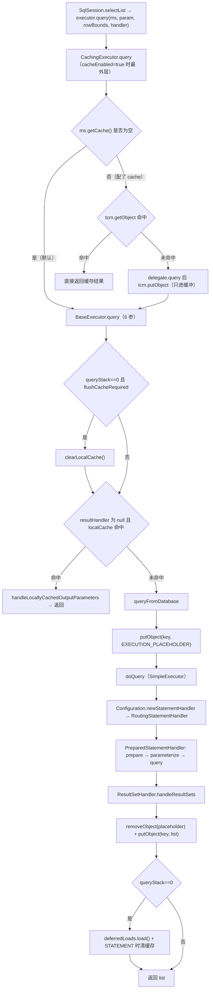
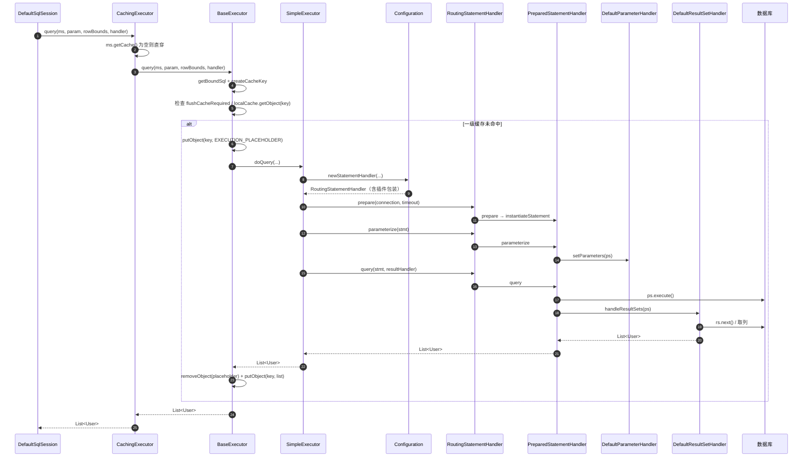

# Executor 执行器与一级缓存：从 query 到 ResultSet

> 一句话结论：`Executor` 才是 MyBatis 真正"干活"的那一层。它被拆成三件事——`CachingExecutor`（二级缓存的装饰器）、`BaseExecutor`（一级缓存 + `queryStack` 的模板方法）、`SimpleExecutor`/`BatchExecutor`/`ReuseExecutor`（JDBC 语句的三种策略）；再往下一层，`StatementHandler` 负责 `PreparedStatement`、`ParameterHandler` 负责 `?`、`ResultSetHandler` 负责把行变对象。
> 阅读前置：读完 [./01-sqlsession-与-mapper-代理.md](./01-sqlsession-与-mapper-代理.md)，知道 `SqlSession` 会调 `executor.query(...)`
> 预计阅读 50 分钟 ｜ 源码：`org.mybatis:mybatis:3.6.0`

---

## 0. 先看现象

先写下 JDBC 的"手工版"，因为 MyBatis 的 `Executor` 就是把下面这段代码拆成几层对象（代码为示意，不来自 MyBatis 源码）：

```java
// 裸 JDBC 的一次查询（示意）
Connection conn = dataSource.getConnection();
PreparedStatement ps = conn.prepareStatement("SELECT id, name FROM t_user WHERE id = ?");
ps.setLong(1, 1L);                  // ParameterHandler 的活
ResultSet rs = ps.executeQuery();   // StatementHandler 的活
while (rs.next()) {                 // ResultSetHandler 的活
  User u = new User();
  u.setId(rs.getLong("id"));
  u.setName(rs.getString("name"));
}
rs.close();
ps.close();
```

对应到 MyBatis 运行期几个"反直觉"的现象：

| 现象 | 你的疑惑 | 答案在哪 |
| --- | --- | --- |
| 同一 `SqlSession` 里查两次同样的 SQL，第二次**没有打印 SQL 日志** | 谁拦住了 | `BaseExecutor.localCache`（一级缓存） |
| 中间做过一次 `update`，缓存就失效了 | 谁清的 | `BaseExecutor#update` 里的 `clearLocalCache()` |
| 换一个 `SqlSession` 再查，又没有缓存了 | 缓存范围 | 一级缓存是**会话级**，不是应用级 |
| Spring 里跨 Service 调用只要在同一事务里，一级缓存还能命中 | 会话被谁复用 | `SqlSessionTemplate` 在事务内复用同一个 `SqlSession` |
| 配了 `<cache/>`，但 A 事务改了数据，B 读到的还是旧值 | 二级缓存何时生效 | `TransactionalCache`（提交后才写入） |

> 零基础提示：**一级缓存和二级缓存名字很像，边界完全不同**。一级缓存挂在 `SqlSession` 上（一次会话，随用随弃）；二级缓存挂在 namespace 上（全局，可跨会话），并且必须**事务提交后**才对其他会话可见。本篇重点讲一级缓存，二级缓存只给结论与边界。

---

## 1. 整体地图



读图说明：

1. **最上面的 `CachingExecutor` 是可选的**：`cacheEnabled` 默认 `true`，所以它默认一定存在；但因为没配 `<cache/>` 时 `ms.getCache()` 为 `null`，它会直接穿给 `delegate`。这就是"默认没有二级缓存"的源码级解释。
2. 中间的 `H`/`I` 是**一级缓存的清空闸门**：`<select flushCache="true">`（`insert/update/delete` 默认就是 true）会让整张一级缓存作废。
3. `M` 和 `R` 是 `queryFromDatabase` 里最巧的写法：先放哨兵值占位，`finally` 里删掉，最后放真结果——目的是防止嵌套查询把自己查重入。
4. `T` 对应 `localCacheScope=STATEMENT`：每次查询结束后立刻清空一级缓存。
5. 注意缓存写入分别发生在两处：一级在 `queryFromDatabase`（`R`），二级在 `CachingExecutor` 的 `tcm.putObject`（`G`），而不是同一个地方。

---

## 2. 关键类逐个拆

### 2.1 `Executor`：接口定义"一次执行需要的全部能力"

```java (src: Executor.java#L33-L69)
public interface Executor {

  ResultHandler NO_RESULT_HANDLER = null;

  int update(MappedStatement ms, Object parameter) throws SQLException;

  <E> List<E> query(MappedStatement ms, Object parameter, RowBounds rowBounds, ResultHandler resultHandler,
      CacheKey cacheKey, BoundSql boundSql) throws SQLException;

  <E> List<E> query(MappedStatement ms, Object parameter, RowBounds rowBounds, ResultHandler resultHandler)
      throws SQLException;

  <E> Cursor<E> queryCursor(MappedStatement ms, Object parameter, RowBounds rowBounds) throws SQLException;

  List<BatchResult> flushStatements() throws SQLException;

  void commit(boolean required) throws SQLException;

  void rollback(boolean required) throws SQLException;

  CacheKey createCacheKey(MappedStatement ms, Object parameterObject, RowBounds rowBounds, BoundSql boundSql);

  boolean isCached(MappedStatement ms, CacheKey key);

  void clearLocalCache();

  void deferLoad(MappedStatement ms, MetaObject resultObject, String property, CacheKey key, Class<?> targetType);

  Transaction getTransaction();

  void close(boolean forceRollback);

  boolean isClosed();

  void setExecutorWrapper(Executor executor);

}
```

- **负责什么**：`update`、两个 `query` 重载、`queryCursor`、`flushStatements`、事务控制（`commit/rollback/close`）、缓存相关（`createCacheKey/isCached/clearLocalCache/deferLoad`）。
- **谁创建它**：`Configuration#newExecutor(transaction, executorType)`。
- **在哪个包**：`org.apache.ibatis.executor`
- **设计意图**：两个 `query` 重载是关键——4 参版本负责"造 `BoundSql` + 造 `CacheKey`"，6 参版本接收现成的 key/BoundSql，好让装饰器（`CachingExecutor`）在中间插一层缓存而不必重复计算。

### 2.2 `BaseExecutor`：模板方法，管一级缓存与查询深度

- **负责什么**：`localCache`（`new PerpetualCache("LocalCache")`）、`queryStack`（查询嵌套深度）、`deferredLoads`（延迟加载队列）、`EXECUTION_PLACEHOLDER` 占位；把 `doUpdate/doQuery/doFlushStatements/doQueryCursor` 留给子类。
- **谁创建它**：不直接创建；`SimpleExecutor/BatchExecutor/ReuseExecutor` 继承它，由 `Configuration#newExecutor` new 出来。
- **在哪个包**：`org.apache.ibatis.executor`
- **设计意图**：把"缓存 + 参数包装 + 错误上下文 + 连接懒获取"这些与 JDBC 细节无关的逻辑收敛到基类，子类只决定"如何发语句"。

### 2.3 四种执行器

| 实现 | 一句话 | 适用场景 |
| --- | --- | --- |
| `SimpleExecutor` | 每次执行都新建 `Statement`，用完就关 | `defaultExecutorType` 的默认值，绝大多数场景 |
| `ReuseExecutor` | 按 SQL 字符串缓存 `Statement` 复用 | 同一会话内反复执行相同 SQL |
| `BatchExecutor` | `addBatch()` 积攒，`flushStatements()` 一次提交 | 大批量 insert/update |
| `CachingExecutor` | 装饰器，包住上面任一个，负责**二级缓存** | `cacheEnabled=true` 时自动套上 |

- **在哪个包**：`org.apache.ibatis.executor`（`SimpleExecutor`/`ReuseExecutor`/`BatchExecutor`/`CachingExecutor` 同包）

### 2.4 `StatementHandler` 家族：真正操作 `PreparedStatement`

| 实现 | 说明 |
| --- | --- |
| `RoutingStatementHandler` | 构造时按 `MappedStatement.statementType` 决定代理给谁，自身不干活 |
| `PreparedStatementHandler` | 默认实现，处理 `PreparedStatement`：`ps.execute()` + `ResultSetHandler` |
| `SimpleStatementHandler` | `statementType="STATEMENT"`，SQL 已拼好直接执行 |
| `CallableStatementHandler` | `statementType="CALLABLE"`，存储过程 |

- **谁创建它**：`Configuration#newStatementHandler`（内部 new `RoutingStatementHandler`，再经 `interceptorChain.pluginAll` 插件包装）。
- **在哪个包**：`org.apache.ibatis.executor.statement`

### 2.5 `ParameterHandler` / `ResultSetHandler`

| 组件 | 负责什么 | 谁创建 | 包 |
| --- | --- | --- | --- |
| `DefaultParameterHandler` | 遍历 `BoundSql.parameterMappings`，调 `typeHandler.setParameter(ps, i + 1, value, jdbcType)` | `Configuration#newParameterHandler` | `org.apache.ibatis.scripting.defaults` |
| `DefaultResultSetHandler` | 自动映射 / resultMap 映射 / 嵌套查询 / 延迟加载 | `Configuration#newResultSetHandler` | `org.apache.ibatis.executor.resultset` |

### 2.6 `CacheKey` 与 `TransactionalCache`

- `CacheKey`：把 `ms.getId()`、`RowBounds` 的 offset/limit、`BoundSql.sql`、每个参数值、`Environment.id` 依次 `update` 进去；用 `hashcode`（乘 37）+ `checksum` + `count` 快速否定，再用 `updateList` 逐项 `equals` 精确判定。
- `TransactionalCache`：二级缓存的"事务缓冲"，`putObject` 只进 `entriesToAddOnCommit`，`clear()` 只置 `clearOnCommit`，直到 `commit()` 才真正写底层 `Cache`。
- **在哪个包**：`org.apache.ibatis.cache`（`CacheKey`）、`org.apache.ibatis.cache.decorators`（`TransactionalCache`）

---

## 3. 源码逐段精读

### 3.1 `Configuration#newExecutor`：四种执行器怎么选

```java (src: Configuration.java#L735-L749)
  public Executor newExecutor(Transaction transaction, ExecutorType executorType) {
    executorType = executorType == null ? defaultExecutorType : executorType;
    Executor executor;
    if (ExecutorType.BATCH == executorType) {
      executor = new BatchExecutor(this, transaction);
    } else if (ExecutorType.REUSE == executorType) {
      executor = new ReuseExecutor(this, transaction);
    } else {
      executor = new SimpleExecutor(this, transaction);
    }
    if (cacheEnabled) {
      executor = new CachingExecutor(executor);
    }
    return (Executor) interceptorChain.pluginAll(executor);
  }
```

- **在干什么**：`null` 时回落到 `defaultExecutorType`（默认 `SIMPLE`）→ 三选一 new 出真实执行器 → `cacheEnabled` 为 `true` 时外包 `CachingExecutor` → 最后用插件链包装。
- **为什么这么写**：用 `if-else` 而不是 `switch`，是因为 `ExecutorType` 只有三个值、`SIMPLE` 天然是兜底分支；`CachingExecutor` 是**装饰器**（实现同一接口、把调用转给 `delegate`），所以包在任何实现外面都成立；`pluginAll` 放最外层，保证插件能拦到所有执行器调用，包括缓存命中的那部分。
- **如果改成别的**：把 `pluginAll` 挪到 `new CachingExecutor` 之前，插件就看不到缓存命中，那些"想改 SQL / 想埋点"的插件会漏掉一半调用。
- **常见坑**：把 `defaultExecutorType` 全局设成 `BATCH`（`<setting name="defaultExecutorType" value="BATCH"/>`）后，**`select` 也走批处理执行器**；更要命的是 `update` 的返回行数不再是真实值（见 3.6）。

### 3.2 `BaseExecutor#query`（4 参）：造 BoundSql、造 CacheKey

```java (src: BaseExecutor.java#L133-L139)
  @Override
  public <E> List<E> query(MappedStatement ms, Object parameter, RowBounds rowBounds, ResultHandler resultHandler)
      throws SQLException {
    BoundSql boundSql = ms.getBoundSql(parameter);
    CacheKey key = createCacheKey(ms, parameter, rowBounds, boundSql);
    return query(ms, parameter, rowBounds, resultHandler, key, boundSql);
  }
```

- **在干什么**：先 `ms.getBoundSql(parameter)`（触发动态 SQL 求值），再算 `CacheKey`，然后转发给 6 参版本。
- **为什么这么写**：`BoundSql` 既是"最终 SQL + 参数列表"，也是缓存 key 的输入；算一次、传下去，避免重复求值（动态 SQL 求值要走 OGNL，有开销）。
- **如果改成别的**：让 6 参版本自己再 `getBoundSql` 一次，一旦动态 SQL 里用到随机数/时间，就会出现"SQL 与 key 不是同一次求值"的诡异 bug。
- **常见坑**：`boundSql.getSql()` 保留了原有换行与空格，所以**同一条 SQL 写得不一样（换行/缩进）就是不同的缓存 key**，看起来"一样的查询"却命中不了。

### 3.3 `BaseExecutor#query`（6 参）：一级缓存的主战场

```java (src: BaseExecutor.java#L141-L176)
  @SuppressWarnings("unchecked")
  @Override
  public <E> List<E> query(MappedStatement ms, Object parameter, RowBounds rowBounds, ResultHandler resultHandler,
      CacheKey key, BoundSql boundSql) throws SQLException {
    ErrorContext.instance().resource(ms.getResource()).activity("executing a query").object(ms.getId());
    if (closed) {
      throw new ExecutorException("Executor was closed.");
    }
    if (queryStack == 0 && ms.isFlushCacheRequired()) {
      clearLocalCache();
    }
    List<E> list;
    try {
      queryStack++;
      list = resultHandler == null ? (List<E>) localCache.getObject(key) : null;
      if (list != null) {
        handleLocallyCachedOutputParameters(ms, key, parameter, boundSql);
      } else {
        list = queryFromDatabase(ms, parameter, rowBounds, resultHandler, key, boundSql);
      }
    } finally {
      queryStack--;
    }
    if (queryStack == 0) {
      for (DeferredLoad deferredLoad : deferredLoads) {
        deferredLoad.load();
      }
      // issue #601
      deferredLoads.clear();
      if (configuration.getLocalCacheScope() == LocalCacheScope.STATEMENT) {
        // issue #482
        clearLocalCache();
      }
    }
    return list;
  }
```

- **在干什么**：
  1. 已经 `closed` 就抛 `ExecutorException("Executor was closed.")`；
  2. `queryStack == 0 && ms.isFlushCacheRequired()` → `clearLocalCache()`（**只有最外层查询才清**）；
  3. `queryStack++`；`resultHandler == null` 才去查 `localCache`；命中走 `handleLocallyCachedOutputParameters`，未命中走 `queryFromDatabase`；
  4. `finally` 里 `queryStack--`；
  5. 只有回到最外层（`queryStack == 0`）才遍历并清空 `deferredLoads`（延迟加载的关联对象此刻才具备加载条件），并在 `localCacheScope=STATEMENT` 时清缓存。
- **为什么这么写**：用 `ResultHandler` 时缓存里存的是 `List`，没法"重放逐行回调"，所以直接跳过缓存；`queryStack` 记录嵌套深度，`resultMap` 里的 `<association select="...">` 会在 `handleResultSets` 期间再发起一次 `query`，靠这个计数保证"清缓存 / 延迟加载 / STATEMENT 清理"只在外层做一次；`flushCacheRequired` 在查询侧也要判断，因为 `<select flushCache="true">` 是合法配置。
- **如果改成别的**：去掉 `queryStack == 0` 判断，嵌套查询会把外层正在用的缓存清掉，一次查询变成多次查库。
- **常见坑**：`localCacheScope=STATEMENT` 下，循环查 1000 次同一个 id 会打 1000 条 SQL（会话级缓存下只打 1 条）；用 `ResultHandler` 做流式导出时别指望缓存省查询。

### 3.4 `BaseExecutor#createCacheKey`：一级缓存的 key 由什么组成

```java (src: BaseExecutor.java#L199-L243)
  public CacheKey createCacheKey(MappedStatement ms, Object parameterObject, RowBounds rowBounds, BoundSql boundSql) {
    if (closed) {
      throw new ExecutorException("Executor was closed.");
    }
    CacheKey cacheKey = new CacheKey();
    cacheKey.update(ms.getId());
    cacheKey.update(rowBounds.getOffset());
    cacheKey.update(rowBounds.getLimit());
    cacheKey.update(boundSql.getSql());
    List<ParameterMapping> parameterMappings = boundSql.getParameterMappings();
    TypeHandlerRegistry typeHandlerRegistry = ms.getConfiguration().getTypeHandlerRegistry();
    // mimic DefaultParameterHandler logic
    MetaObject metaObject = null;
    for (ParameterMapping parameterMapping : parameterMappings) {
      if (parameterMapping.getMode() != ParameterMode.OUT) {
        Object value;
        String propertyName = parameterMapping.getProperty();
        if (parameterMapping.hasValue()) {
          value = parameterMapping.getValue();
        } else if (boundSql.hasAdditionalParameter(propertyName)) {
          value = boundSql.getAdditionalParameter(propertyName);
        } else if (parameterObject == null) {
          value = null;
        } else {
          ParamNameResolver paramNameResolver = ms.getParamNameResolver();
          if (paramNameResolver != null
              && typeHandlerRegistry.hasTypeHandler(paramNameResolver.getType(paramNameResolver.getNames()[0]))
              || typeHandlerRegistry.hasTypeHandler(parameterObject.getClass())) {
            value = parameterObject;
          } else {
            if (metaObject == null) {
              metaObject = configuration.newMetaObject(parameterObject);
            }
            value = metaObject.getValue(propertyName);
          }
        }
        cacheKey.update(value);
      }
    }
    if (configuration.getEnvironment() != null) {
      // issue #176
      cacheKey.update(configuration.getEnvironment().getId());
    }
    return cacheKey;
  }
```

- **在干什么**：按固定顺序把 6 类东西塞进 key：① `MappedStatement` id；② offset；③ limit；④ 最终 SQL；⑤ 每个非 OUT 参数的值；⑥ `Environment` id。
- **为什么这么写**：参数取值那几段 `if` **刻意模仿** `DefaultParameterHandler#setParameters`（源码注释 `// mimic DefaultParameterHandler logic`），保证"进 key 的值"就是"进 SQL 的值"；`// issue #176` 说明了 `Environment.id` 为何必需——同一个 `Configuration` 可有多套环境（多数据源），同一条语句在不同数据源上结果不同。
- **如果改成别的**：只拿 `ms.getId()` 当 key，就会把 `id=1` 和 `id=2` 的查询混成一条缓存——这是最经典的一级缓存事故。
- **常见坑**：**没进 key 的东西**包括 `statementType`、连接、隔离级别、数据库当前时间；所以"参数相同但库里数据已变"的查询在会话内仍会命中旧值，这正是 `dirty` 读的来源；另外 `OUT` 参数被跳过，因为它是返回值不是输入。

### 3.5 `BaseExecutor#queryFromDatabase`：哨兵占位防重入

```java (src: BaseExecutor.java#L339-L353)
  private <E> List<E> queryFromDatabase(MappedStatement ms, Object parameter, RowBounds rowBounds,
      ResultHandler resultHandler, CacheKey key, BoundSql boundSql) throws SQLException {
    List<E> list;
    localCache.putObject(key, EXECUTION_PLACEHOLDER);
    try {
      list = doQuery(ms, parameter, rowBounds, resultHandler, boundSql);
    } finally {
      localCache.removeObject(key);
    }
    localCache.putObject(key, list);
    if (ms.getStatementType() == StatementType.CALLABLE) {
      localOutputParameterCache.putObject(key, parameter);
    }
    return list;
  }
```

- **在干什么**：先 `putObject(key, EXECUTION_PLACEHOLDER)` 占位 → 执行 `doQuery` → `finally` 删占位 → 放真结果；存储过程额外记 `localOutputParameterCache`。
- **为什么这么写**：占位符解决"嵌套查询撞上同一个 key"的问题。若 `resultMap` 的 `<association>` 又查了同一条语句，占位符让 `localCache.getObject(key)` 返回一个非 null 的哨兵，从而被识别为"正在执行中"，而不是被误当成一次正常命中。
- **如果改成别的**：去掉占位，`@One(select=...)` 的自引用配错会变成无限递归，栈溢出，报错信息完全没有指向性。
- **常见坑**：`doQuery` 抛异常时 `finally` 会删占位，缓存里不留脏数据；但 `putObject(key, list)` 之后**缓存与返回值是同一个 List 引用**，你手动 `list.add(...)` 会篡改缓存。

### 3.6 `SimpleExecutor#doQuery` / `prepareStatement`：真正落到 JDBC

```java (src: SimpleExecutor.java#L55-L68)
  @Override
  public <E> List<E> doQuery(MappedStatement ms, Object parameter, RowBounds rowBounds, ResultHandler resultHandler,
      BoundSql boundSql) throws SQLException {
    Statement stmt = null;
    try {
      Configuration configuration = ms.getConfiguration();
      StatementHandler handler = configuration.newStatementHandler(wrapper, ms, parameter, rowBounds, resultHandler,
          boundSql);
      stmt = prepareStatement(handler, ms.getStatementLog());
      return handler.query(stmt, resultHandler);
    } finally {
      closeStatement(stmt);
    }
  }
```

```java (src: SimpleExecutor.java#L86-L92)
  private Statement prepareStatement(StatementHandler handler, Log statementLog) throws SQLException {
    Statement stmt;
    Connection connection = getConnection(statementLog);
    stmt = handler.prepare(connection, transaction.getTimeout());
    handler.parameterize(stmt);
    return stmt;
  }
```

- **在干什么**：`newStatementHandler`（内部是 `RoutingStatementHandler`）→ `prepare`（真正 `connection.prepareStatement(sql)`）→ `parameterize`（塞 `?`）→ `handler.query(...)`；`finally` 一定 `closeStatement`。
- **为什么这么写**：传进去的 `wrapper` 是 `BaseExecutor` 构造里 `wrapper = this` 的那个引用，嵌套查询/延迟加载时它代表"最外层执行器"；`getConnection(statementLog)` 在 debug 日志下会包一层 `ConnectionLogger` 打印 SQL；`SimpleExecutor` **不复用** `Statement`，用完即关，实现最简单。
- **如果改成别的**：`ReuseExecutor` 用 `Map<String, Statement>` 按 SQL 复用，省掉反复 `prepare` 的开销；但连接池时代 `prepareStatement` 已很便宜，MyBatis 默认仍选 `SimpleExecutor`。
- **常见坑**：`BatchExecutor#doUpdate` 返回的是 `BATCH_UPDATE_RETURN_VALUE` 而不是真实行数，真实行数要等 `flushStatements()` 的 `BatchResult`。

### 3.7 `RoutingStatementHandler`：构造期一次 switch

```java (src: RoutingStatementHandler.java#L39-L56)
  public RoutingStatementHandler(Executor executor, MappedStatement ms, Object parameter, RowBounds rowBounds,
      ResultHandler resultHandler, BoundSql boundSql) {

    switch (ms.getStatementType()) {
      case STATEMENT:
        delegate = new SimpleStatementHandler(executor, ms, parameter, rowBounds, resultHandler, boundSql);
        break;
      case PREPARED:
        delegate = new PreparedStatementHandler(executor, ms, parameter, rowBounds, resultHandler, boundSql);
        break;
      case CALLABLE:
        delegate = new CallableStatementHandler(executor, ms, parameter, rowBounds, resultHandler, boundSql);
        break;
      default:
        throw new ExecutorException("Unknown statement type: " + ms.getStatementType());
    }

  }
```

- **在干什么**：构造期一次性选好 `delegate`，之后所有接口方法全部转发（`prepare/parameterize/batch/update/query/queryCursor/getBoundSql/getParameterHandler`）。
- **为什么这么写**：`statementType` 在启动期就确定了（`XMLStatementBuilder` 里默认 `PREPARED`），不需要每次执行都判断；用一个"路由类"把选择逻辑集中，`SimpleExecutor` 里就不用写 if-else。
- **如果改成别的**：在 `SimpleExecutor` 里直接 `new PreparedStatementHandler`，插件就没法通过 `pluginAll` 统一介入这一层。
- **常见坑**：`statementType="STATEMENT"` 时参数是拼进 SQL 的，此时再配 `${}` 就是双重注入风险。

### 3.8 `PreparedStatementHandler#query` / `parameterize`：职责切得最干净的地方

```java (src: PreparedStatementHandler.java#L62-L67)
  @Override
  public <E> List<E> query(Statement statement, ResultHandler resultHandler) throws SQLException {
    PreparedStatement ps = (PreparedStatement) statement;
    ps.execute();
    return resultSetHandler.handleResultSets(ps);
  }
```

```java (src: PreparedStatementHandler.java#L95-L98)
  @Override
  public void parameterize(Statement statement) throws SQLException {
    parameterHandler.setParameters((PreparedStatement) statement);
  }
```

- **在干什么**：`query` 只做两件事——`ps.execute()`，然后把 `ps` 交给 `ResultSetHandler`；`parameterize` 全权委托 `ParameterHandler`。
- **为什么这么写**：`PreparedStatementHandler` 既不关心"参数从哪来"，也不关心"结果怎么变对象"，这是单一职责的极致体现，也是分页/审计类插件最好下手的拦截点。
- **如果改成别的**：把参数设置内联进 `query`，`update` 路径就得复制一份；`BatchExecutor` 也没法只调 `parameterize` 而不立即执行。
- **常见坑**：`instantiateStatement`（同文件 L77-L93）只在 `keyGenerator instanceof Jdbc3KeyGenerator` 时才带 `RETURN_GENERATED_KEYS`，所以 `useGeneratedKeys` 没配时自增主键不会回填，而非"配了 `keyProperty` 就一定有"。

### 3.9 `CachingExecutor#query`：二级缓存的边界

```java (src: CachingExecutor.java#L93-L111)
  @Override
  public <E> List<E> query(MappedStatement ms, Object parameterObject, RowBounds rowBounds, ResultHandler resultHandler,
      CacheKey key, BoundSql boundSql) throws SQLException {
    Cache cache = ms.getCache();
    if (cache != null) {
      flushCacheIfRequired(ms);
      if (ms.isUseCache() && resultHandler == null) {
        ensureNoOutParams(ms, boundSql);
        @SuppressWarnings("unchecked")
        List<E> list = (List<E>) tcm.getObject(cache, key);
        if (list == null) {
          list = delegate.query(ms, parameterObject, rowBounds, resultHandler, key, boundSql);
          tcm.putObject(cache, key, list); // issue #578 and #116
        }
        return list;
      }
    }
    return delegate.query(ms, parameterObject, rowBounds, resultHandler, key, boundSql);
  }
```

- **在干什么**：只有 `ms.getCache() != null`（配了 `<cache/>` 或 `@CacheNamespace`）才进缓存分支；还要满足 `ms.isUseCache()` 且 `resultHandler == null`；未命中就调 `delegate.query`，再 `tcm.putObject`（只进事务缓冲）。
- **为什么这么写**：`ensureNoOutParams` 直接禁止"带 OUT 参数的存储过程"使用二级缓存（源码抛 `"Caching stored procedures with OUT params is not supported..."`），因为 OUT 参数每次调用都不同；`tcm` 把写缓存推迟到事务提交，见 3.10。
- **如果改成别的**：若在这里直接写底层 `Cache`，事务回滚后缓存里仍留着新值，其他会话就读到"不存在的数据"——这正是著名的二级缓存脏读。
- **常见坑**（结论即可，细节由 `03-MyBatis/04-结果映射与插件` 分册展开）：
  1. **`cacheEnabled` 不等于"二级缓存开启"**：它只决定装饰器是否存在，真正的开关是每个 mapper 里的 `<cache/>`；
  2. **跨会话脏读**：多表关联时 A 表更新只清 A 的 namespace，B 的 namespace 里缓存的关联结果仍是旧值，需要 `<cache-ref>` 或干脆不用；
  3. **`flushCache` 语义**：`insert/update/delete` 默认 `flushCache="true"`，走 `flushCacheIfRequired` → `tcm.clear(cache)`；
  4. **多节点部署必然不一致**：默认 `PerpetualCache` 是本地 `HashMap`，要跨节点必须换 Redis 等外置缓存并承担序列化约束；
  5. **对一致性要求高的查询直接 `useCache="false"`**，比费劲去"删对缓存"更省事。

### 3.10 `TransactionalCache`：为什么 `putObject` 不立刻写入

```java (src: TransactionalCache.java#L78-L100)
  @Override
  public void putObject(Object key, Object object) {
    entriesToAddOnCommit.put(key, object);
  }

  @Override
  public Object removeObject(Object key) {
    return null;
  }

  @Override
  public void clear() {
    clearOnCommit = true;
    entriesToAddOnCommit.clear();
  }

  public void commit() {
    if (clearOnCommit) {
      delegate.clear();
    }
    flushPendingEntries();
    reset();
  }
```

- **在干什么**：`putObject` 只把值放进 `entriesToAddOnCommit`；`clear()` 只打标记 `clearOnCommit = true` 并清空缓冲；`commit()` 时才真正 `delegate.clear()` 再 `flushPendingEntries()` 把缓冲落地，最后 `reset()`。
- **为什么这么写**："事务提交后才有可见性"是二级缓存唯一正确的语义。若 `clear()` 立刻清底层缓存，并发会话在这段空档里会去查库、又把**旧值**写回缓存（清了个寂寞）；若 `putObject` 立刻写，回滚时又无法撤销。所以只能"先把所有动作记下来，提交时按顺序重放"。
- **如果改成别的**：`getObject` 里的 `if (clearOnCommit) return null;`（issue #146）也依赖这个标记——"本事务已经清过缓存，读到的任何旧值都不可信"。
- **常见坑**：`SqlSession` 没有 `commit`/`close`（事务一直没结束）时，二级缓存永远写不进去，表现为"配了缓存却一直没有命中"。

### 3.11 `CacheKey#update`：hash 是怎么算的

```java (src: CacheKey.java#L74-L84)
  public void update(Object object) {
    int baseHashCode = object == null ? 1 : ArrayUtil.hashCode(object);

    count++;
    checksum += baseHashCode;
    baseHashCode *= count;

    hashcode = multiplier * hashcode + baseHashCode;

    updateList.add(object);
  }
```

- **在干什么**：累加式 hash——`count` 计数、`checksum` 求和、`hashcode = 37 * hashcode + baseHashCode * count`，同时把原始值留进 `updateList` 供精确比较。
- **为什么这么写**：这是典型的 **hash + equals 两阶段**：`equals` 先比 `hashcode/checksum/count`（O(1) 整数比较，快速否定），再逐项 `ArrayUtil.equals`（保证正确性）；`count` 参与乘法，让"顺序不同"也能区分（`[a,b]` 与 `[b,a]` 的 hash 不同）。
- **如果改成别的**：只比 `hashcode` 会有碰撞导致"串数据"；只逐项 `equals` 则每次 O(n)，大参数（如 10k 个 id 的 `IN` 列表）会很慢。
- **常见坑**：参数是**可变对象**（`Date`、`StringBuilder`）时 key 里存的是引用，入缓存后你改了对象，`equals` 可能算出不同结果——"缓存莫名不命中"时要想到这一点。

### 3.12 清除时机：`update` / `commit` / `clearLocalCache`

> 这三个方法共同定义了一级缓存的"清除时机"，看代码比看文档可靠。

```java (src: BaseExecutor.java#L111-L119)
  @Override
  public int update(MappedStatement ms, Object parameter) throws SQLException {
    ErrorContext.instance().resource(ms.getResource()).activity("executing an update").object(ms.getId());
    if (closed) {
      throw new ExecutorException("Executor was closed.");
    }
    clearLocalCache();
    return doUpdate(ms, parameter);
  }
```

```java (src: BaseExecutor.java#L250-L260)
  @Override
  public void commit(boolean required) throws SQLException {
    if (closed) {
      throw new ExecutorException("Cannot commit, transaction is already closed");
    }
    clearLocalCache();
    flushStatements();
    if (required) {
      transaction.commit();
    }
  }
```

```java (src: BaseExecutor.java#L276-L282)
  @Override
  public void clearLocalCache() {
    if (!closed) {
      localCache.clear();
      localOutputParameterCache.clear();
    }
  }
```

- **在干什么**：`update` 先清一级缓存再执行；`commit` 先清缓存、再 `flushStatements()`、最后 `transaction.commit()`；`clearLocalCache` 同时清 `localCache` 与 `localOutputParameterCache`。
- **为什么这么写**：任何写操作都可能让已缓存的结果失效，而 MyBatis 不做"影响行分析"，**全清**是最简单且正确的策略；代价被"会话短生命周期"吸收掉了。
- **如果改成别的**：只清"受影响表"的相关缓存需要维护"表 → 语句"映射，MyBatis 明确不做（那是 JPA 一级缓存的思路）。
- **常见坑**：一级缓存被清的时机一共六类——① `update/insert/delete`；② `commit`；③ `rollback`（`rollback` 里也 `clearLocalCache()`）；④ `sqlSession.clearCache()`；⑤ `<select flushCache="true">`（且 `queryStack == 0`）；⑥ `localCacheScope=STATEMENT` 时每次查询结束后。

---

## 4. 一次查询穿过全部执行层的时序



读图说明：

1. **`CFG` 只在一处介入**（`newStatementHandler`），这是"改 SQL / 换 handler"的入口；`ParameterHandler`、`ResultSetHandler` 的创建也各自经过 `pluginAll`，所以插件能拦住它们。
2. `RSH`（路由）自己不干活，所有箭头都转给 `PSH`；日志里看到的 `PreparedStatementHandler.query` 就在这条线上。
3. `PH.setParameters` 和 `RH.handleResultSets` 是**唯二**碰 `PreparedStatement` 的地方，所以"参数不对"和"字段没映射上"要分别在这两处排查。
4. `BE -> BE` 的两次 `putObject` 就是 3.5 节的哨兵机制；注意 `putObject(key, list)` 发生在 `doQuery` 返回之后、回到 `CachingExecutor` 之前，所以**一级缓存先写、二级缓存后写**。
5. 若 `ms.getCache() != null`，`CE` 会在调 `BE` 之前先 `tcm.getObject`，拿到结果后再 `tcm.putObject`（只入缓冲，提交时落地）。

---

## 5. 用到的设计模式

| 模式 | 体现 | 源码位置 |
| --- | --- | --- |
| 模板方法 | `BaseExecutor#query` 定流程，`doQuery/doUpdate/doFlushStatements` 交子类 | `BaseExecutor` |
| 装饰器 | `CachingExecutor` 包住任意 `Executor`，叠加二级缓存 | `CachingExecutor` |
| 策略 | `SimpleExecutor/ReuseExecutor/BatchExecutor` 三选一 | `Configuration#newExecutor` |
| 路由/委派 | `RoutingStatementHandler` 按 `statementType` 选 `delegate` | `RoutingStatementHandler` |
| 责任链 | `interceptorChain.pluginAll` 依次包装执行器与三大 handler | `InterceptorChain` |
| 空对象 | `Executor.NO_RESULT_HANDLER = null`、`NoKeyGenerator.INSTANCE` | `Executor` |
| 哨兵占位 | `EXECUTION_PLACEHOLDER` 防嵌套重入 | `BaseExecutor#queryFromDatabase` |
| 事务缓冲（延迟写入） | `TransactionalCache` 把写缓存推迟到提交 | `TransactionalCache#commit` |

---

## 6. 实际开发中的坑与调试手法

### 6.1 八个坑

1. **一级缓存让你"读不到别人刚改的数据"**：同一 `SqlSession`（Spring 里就是同一事务）内先查、别人提交、再查，你仍读到旧值。解法：`localCacheScope=STATEMENT`、查询前 `sqlSession.clearCache()`、或缩短事务边界。这是最常考的一级缓存题。
2. **`<foreach>` 大列表把内存喂爆**：参数不同 → key 不同 → 每次在 `PerpetualCache` 里都留一份大 `List`，而 `PerpetualCache` **无上限、无淘汰**。批量场景应改 `STATEMENT`。
3. **`Executor was closed.`**：`SqlSession` 关闭后还拿着 `Mapper`/`Executor` 用；多线程共享同一个 `SqlSession` 时高发。
4. **`BATCH` 下返回行数不可信**：`update` 返回 `BATCH_UPDATE_RETURN_VALUE`，用 `int` 判断"是否成功"会误判；且 SQL 真正发送在 `flushStatements()`，异常栈与实际执行点错位，排查困难。
5. **自增主键没回填**：`RETURN_GENERATED_KEYS` 只在 `keyGenerator instanceof Jdbc3KeyGenerator`（即 `useGeneratedKeys="true"`）时才加；只写 `keyProperty` 不够。
6. **二级缓存 + 多表关联读到不一致数据**：A 表更新清 A 的 namespace，B 的 namespace 里缓存的关联结果不会动，必须 `<cache-ref>`。
7. **二级缓存 + 未提交事务**：`tcm.putObject` 只是缓冲，事务不提交就一直不落地；混用自动提交会话与手动事务时，可见性会非常混乱。
8. **`ResultHandler` 绕过缓存**：`resultHandler != null` 时一级、二级缓存都不走，"加了缓存反而没变快"是设计使然。

### 6.2 调试手法

| 现象 | 先看哪里 | 手段 |
| --- | --- | --- |
| 该发 SQL 却没发 | 一级 / 二级缓存 | 把 mapper 包与 `org.apache.ibatis` 日志调到 DEBUG/TRACE，看 `SqlSession`、`Executor` 日志 |
| 缓存死活不命中 | `CacheKey` | 断点 `BaseExecutor#createCacheKey`，对比两次 `cacheKey.toString()`（`:` 分隔） |
| 二级缓存不生效 | `MappedStatement.cache` | 断点 `CachingExecutor#query` 看 `ms.getCache()` 是否 null、是否被 `resultHandler` 绕过 |
| 更新返回行数异常 | 执行器类型 | 打印 `configuration.getDefaultExecutorType()`；`BATCH` 时改看 `BatchResult` |
| `Unknown statement type` | `statementType` 配置 | 打印 `MappedStatement#getStatementType()` |

---

## 7. 版本差异（3.4 → 3.6）

| 版本 | 变化 | 影响 |
| --- | --- | --- |
| 3.4.x | `createCacheKey` 不含 `Environment.id` | 多数据源下可能缓存串数据，后按 issue #176 修复 |
| 3.5.2 | `CachingExecutor` 修正未命中时不清空二级缓存等行为（issue #116/#578） | 二级缓存语义趋于正确 |
| 3.5.6 | `BaseExecutor#query` 在 `queryStack == 0` 时才处理 `deferredLoads` 并显式 `deferredLoads.clear()`（issue #601） | 修复延迟加载残留 |
| 3.5.10 | `StatementHandler#prepare` 支持传入事务超时 | `SimpleExecutor#prepareStatement` 传 `transaction.getTimeout()` |
| 3.6.0 | `MappedStatement` 新增 `dirtySelect`（XML 属性 `affectData`）；`CachingExecutor#setExecutorWrapper` 改为抛 `UnsupportedOperationException` | 有副作用的查询也参与提交语义；装饰器不可被二次包装 |

> `CacheKey` 的算法（`multiplier=37`、`checksum`、`updateList`）从 3.5 到 3.6 没变，换版本读这段不会踩空。

---

## 8. 面试验证点

1. **`cacheEnabled` 与一级缓存、二级缓存分别是什么关系？** → `cacheEnabled` 只决定是否外包 `CachingExecutor`（二级缓存）；一级缓存是 `BaseExecutor.localCache`，与 `cacheEnabled` 无关。
2. **一级缓存的 key 由哪些字段组成？** → `ms.getId()`、`rowBounds.getOffset()`、`getLimit()`、`boundSql.getSql()`、每个非 OUT 参数值、`Environment.id`。
3. **为什么 `createCacheKey` 要模仿 `DefaultParameterHandler`？** → 保证"进 key 的值"就是"进 SQL 的值"，否则会出现参数不同而 key 相同（或反之）的错乱。
4. **`queryStack` 是做什么的？** → 记录查询嵌套深度；只有最外层（`queryStack == 0`）才做 `flushCache` 清理、`deferredLoads` 加载和 `STATEMENT` 清理。
5. **`EXECUTION_PLACEHOLDER` 的作用？** → 查询前占位、`finally` 删除，防止嵌套/自引用查询误命中间态。
6. **一级缓存在什么时候被清？** → `update/insert/delete`、`commit`、`rollback`、`clearCache()`、`<select flushCache="true">`（`queryStack==0`）、`localCacheScope=STATEMENT` 每次查询后。
7. **为什么有 `ResultHandler` 时不走缓存？** → 缓存里是 `List`，`ResultHandler` 是流式回调，无法重放；命中缓存会导致回调不被调用。
8. **`CachingExecutor` 什么时候真正写入二级缓存？** → 不立即写。`tcm.putObject` 只入 `entriesToAddOnCommit`，事务 `commit()` 时 `TransactionalCache#commit` 才 `flushPendingEntries()`。
9. **二级缓存为什么"默认关闭"？** → `ms.getCache()` 只有配 `<cache/>` 才非 null；`cacheEnabled` 只控制装饰器存在与否。官方态度是"缓存语义易脏读，需显式开启"。
10. **`localCacheScope=STATEMENT` 的副作用？** → 同一会话内相同查询不再命中缓存，N+1 查询会明显变慢；换来的是不会读到会话内的旧值。
11. **四种 `ExecutorType` 分别何时用？** → `SIMPLE` 默认；`REUSE` 同会话内重复相同 SQL；`BATCH` 批量写；`CachingExecutor` 不是可选类型而是 `cacheEnabled` 时自动加的装饰器。
12. **`BatchExecutor` 下 `insert` 的返回值为什么异常？** → `doUpdate` 返回 `BATCH_UPDATE_RETURN_VALUE` 常量，真实行数在 `flushStatements()` 的 `BatchResult` 里。
13. **`StatementHandler` 的三种类型怎么选？** → 由 `MappedStatement.statementType`（`STATEMENT`/`PREPARED`/`CALLABLE`）决定，默认 `PREPARED`，在 `RoutingStatementHandler` 构造期定死。
14. **一级缓存会跨 `SqlSession` 吗？** → 不会。它挂在 `BaseExecutor` 上，而 `BaseExecutor` 随 `SqlSession` 创建与销毁。

---

## 9. 动手练习

1. **观测一级缓存**：同一 `SqlSession` 内连续两次 `selectById(1L)`，打开 DEBUG 日志确认第二次没有 SQL；中间插一次 `update`，确认缓存被清。
2. **验证 key 的成分**：在 `BaseExecutor#createCacheKey` 打断点，构造"参数相同但 SQL 缩进不同"的两次调用（用 `<if>` 拼空格），观察 `cacheKey.toString()` 不同。
3. **验证 `localCacheScope=STATEMENT`**：把 `mybatis-config.xml` 的 `localCacheScope` 改成 `STATEMENT`，重做练习 1，观察每次都有 SQL。
4. **验证 `ResultHandler` 绕过缓存**：写一个 `void selectAll(ResultHandler<User> handler)` 方法，连续调用两次，观察两次都发 SQL。
5. **观察二级缓存的延迟写入**：配 `<cache/>`，A 会话更新但不提交，B 会话读一次；A 提交后 B 再读，对比两次结果。
6. **看四种执行器**：用 `ExecutorType.BATCH` 打开会话，插入 3 条后打印 `insert` 返回值，再 `flushStatements()` 看 `BatchResult` 里的真实行数。

---

## 小结

1. `Executor` 分三层：装饰（`CachingExecutor` 管二级缓存）+ 模板方法（`BaseExecutor` 管一级缓存、`queryStack`、`deferredLoads`）+ 策略（`Simple/Reuse/Batch` 管 JDBC 语句策略）；`Configuration#newExecutor` 是唯一的组装点，插件在最外层。
2. 一级缓存的 key = `MappedStatement` id + 分页偏移 + 最终 SQL + 各参数值 + `Environment` id；`update/commit/rollback/flushCache=true/STATEMENT` 六类时机都会清缓存，`EXECUTION_PLACEHOLDER` 负责防嵌套重入。
3. 二级缓存必须**事务提交后**才落地（`TransactionalCache`），默认不开启、跨 namespace 极易脏读，是最该"少用、慎用"的优化点；细节在 `03-MyBatis/04-结果映射与插件` 分册展开。

---

## 自测题

**1. `Configuration#newExecutor` 里 `pluginAll` 为什么放在最外层？**

<details><summary>参考答案要点</summary>

放在 `new CachingExecutor(executor)` 之后、`return` 之前，插件才能拦截**所有**执行器调用（包括二级缓存命中的情况）。若放在内侧，插件看不到缓存命中，分页/审计类插件行为不完整。

</details>

**2. `BaseExecutor#query` 的 4 参与 6 参版本为什么要拆开？**

<details><summary>参考答案要点</summary>

4 参版本负责 `getBoundSql` + `createCacheKey`；6 参版本接收现成的 key/BoundSql，供装饰器 `CachingExecutor` 先做缓存判断再直接传下去，避免动态 SQL 被重复求值导致 key 与 SQL 不一致。

</details>

**3. 一级缓存命中时还会执行 `ResultSetHandler` 吗？**

<details><summary>参考答案要点</summary>

不会。命中时走 `handleLocallyCachedOutputParameters` 直接返回缓存中的 `List`，只有存储过程 OUT 参数需要额外处理。

</details>

**4. 为什么只有 `resultHandler == null` 时才查 `localCache`？**

<details><summary>参考答案要点</summary>

`ResultHandler` 是逐行回调的流式接口，而缓存里是 `List`，无法"重放回调"。若命中缓存直接返回 list，回调永远不会被调用，业务逻辑静默失效。

</details>

**5. `flushCacheRequired` 为 true 的 `<select>` 会怎样？**

<details><summary>参考答案要点</summary>

在最外层查询（`queryStack == 0`）开始时 `clearLocalCache()`，即"查前清缓存"；二级缓存侧由 `CachingExecutor#flushCacheIfRequired` → `tcm.clear(cache)` 处理。

</details>

**6. 一级缓存里 `Environment.id` 为什么必需？**

<details><summary>参考答案要点</summary>

同一个 `Configuration` 可配多个 `<environment>`（多数据源/读写分离），同一条语句在不同数据源上结果可能不同；不把环境 id 计入 key 会串数据（issue #176）。

</details>

**7. `CacheKey.equals` 的比较顺序是什么？为什么这样设计？**

<details><summary>参考答案要点</summary>

先比 `hashcode`、`checksum`、`count`（都是 O(1) 整数比较，快速否定绝大多数不等），再逐项 `ArrayUtil.equals(updateList)` 精确判定。兼顾性能与正确性。

</details>

**8. `TransactionalCache#putObject` 为什么不直接写 `delegate`？**

<details><summary>参考答案要点</summary>

二级缓存必须事务提交后才对外可见。直接写会在回滚后留下脏值；`clear()` 直接清底层也会让并发会话把旧值重新写回。所以都先记在 `entriesToAddOnCommit` / `clearOnCommit` 上，`commit()` 时按顺序重放。

</details>

**9. `CachingExecutor#query` 中 `ensureNoOutParams` 抛什么异常、为什么？**

<details><summary>参考答案要点</summary>

抛 `ExecutorException("Caching stored procedures with OUT params is not supported.  Please configure useCache=false in <id> statement.")`。OUT 参数每次调用结果不同，缓存会串数据。

</details>

**10. 一级缓存为什么会导致"脏读"式的业务问题？如何避免？**

<details><summary>参考答案要点</summary>

同一会话（同事务）内重复查询命中缓存，看不到其他已提交事务的更新。避免方式：`localCacheScope=STATEMENT`、查询前 `clearCache()`、缩短事务边界、或对强一致查询绕开缓存。

</details>

**11. `PerpetualCache` 做一级缓存的隐患是什么？**

<details><summary>参考答案要点</summary>

无容量上限、无淘汰策略（`Perpetual` 即"永久"）。大结果集 + 多变参数（如大 `IN` 列表）会让会话内缓存持续膨胀，直到会话关闭；`STATEMENT` 模式可规避。

</details>

**12. 按 `Executor` → `StatementHandler` → `ParameterHandler` → `ResultSetHandler` 说明一次查询各自职责。**

<details><summary>参考答案要点</summary>

`Executor` 负责缓存与流程编排；`StatementHandler` 负责创建/准备/执行 `PreparedStatement`（`prepare/parameterize/query`）；`ParameterHandler` 把 `BoundSql.parameterMappings` 的值通过 `TypeHandler` 设置到 `?`；`ResultSetHandler` 读 `ResultSet` 并按 `resultMap`（或自动映射）构造对象、处理嵌套与延迟加载。

</details>

**13. 要在不改 SQL 的前提下给所有查询加超时，应该拦哪一层？**

<details><summary>参考答案要点</summary>

拦 `Executor`（`pluginAll` 最外层，能覆盖缓存命中）做统一埋点，或用 `StatementHandler` 插件在 `prepare` 时设 `ps.setQueryTimeout` / 传 `transactionTimeout`。

</details>
