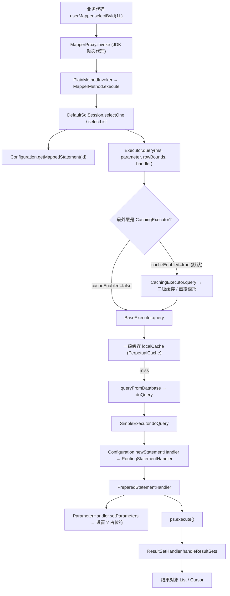

# 02 · SqlSession 与执行器

> 一句话结论：`SqlSessionFactory` 是"配置的容器"，`SqlSession` 是"一次数据库会话"，`Executor` 才是真正干活的那一层；Mapper 接口没有实现类，是因为 JDK 动态代理在运行期把"方法调用"翻译成了"`MappedStatement` id + 参数"。

> 阅读前置：读完 [01-初始化与配置解析](../01-初始化与配置解析/README.md)，知道 `Configuration` 里存着 `MappedStatement`、`Environment`、`InterceptorChain`。

> 预计阅读 90 分钟 ｜ 源码基线：mybatis 3.6.0（tag `mybatis-3.6.0`）

---

## 1. 本组解决什么问题

前面一组讲的是**启动期**：Spring（或 `SqlSessionFactoryBuilder`）把 XML / 注解解析成 `Configuration` 里的一堆对象，然后包成一个 `DefaultSqlSessionFactory` 交给容器。

这一组讲**运行期**：从你调用 `userMapper.selectById(1L)` 那一刻起，到 `ResultSet` 变成 `User` 对象为止，中间经过了哪些对象。

本组两篇文章：

| 文件 | 讲什么 | 关键源码 |
| --- | --- | --- |
| [01-sqlsession-与-mapper-代理.md](./01-sqlsession-与-mapper-代理.md) | `openSession` → `Executor` 创建；`getMapper` → JDK 动态代理 → `MapperMethod#execute` | `DefaultSqlSessionFactory`、`DefaultSqlSession`、`MapperRegistry`、`MapperProxyFactory`、`MapperProxy`、`MapperMethod` |
| [02-executor-执行器与一级缓存.md](./02-executor-执行器与一级缓存.md) | 四种 `Executor` 的选择、`BaseExecutor#query`、一级缓存的 key 与清除时机、二级缓存边界 | `Configuration#newExecutor`、`BaseExecutor`、`CachingExecutor`、`SimpleExecutor`、`RoutingStatementHandler`、`PreparedStatementHandler`、`CacheKey` |

---

## 2. 运行期调用链总览

读图说明：

1. **左侧竖着往下 = 一次同步调用栈**。箭头没有分叉的地方都是"直接方法调用"，不是异步、不是事件。
2. 图里出现两次 `Executor.query`：这是因为默认 `cacheEnabled=true`，`Configuration#newExecutor` 会在真实执行器外面再包一层 `CachingExecutor`（装饰器）。所以运行期最外层是 `CachingExecutor`，它不做真正的 SQL 执行，只在二级缓存命中时短路。
3. `J` 这一格是**一级缓存**，它的生命周期跟着 `SqlSession` 走；`H` 那一格涉及**二级缓存**，生命周期跟着 `namespace` 走（并且要事务提交才真正写入）。两者都叫"缓存"，但边界完全不同——这是面试最爱追问的点，详见第二篇。
4. `M` 的 `RoutingStatementHandler` 只是"分发器"：根据 `MappedStatement.statementType` 决定 new 哪个真正的 `StatementHandler`（默认 `PREPARED`）。
5. `O` 和 `Q` 是 MyBatis 相对裸 JDBC 最大的两处"补丁"：`ParameterHandler` 负责把对象字段塞进 `?`，`ResultSetHandler` 负责把 `ResultSet` 行映射成对象。

---

## 3. 两个阶段的对象生命周期对比

| 对象 | 创建时机 | 生命周期 | 线程安全 |
| --- | --- | --- | --- |
| `Configuration` | 启动期，`XMLConfigParser` 解析时 | 与 `SqlSessionFactory` 同生共死，**全局唯一** | 基本安全（解析完成后只读为主） |
| `SqlSessionFactory` | 启动期，`build()` 结束 | 全局唯一，应用级单例 | 安全 |
| `SqlSession` | 每次 `openSession()` / 每次 SQL 请求 | **一次会话**，用完必须 `close()` | **不安全**（内部有 `dirty`、`cursorList` 等可变字段） |
| `Executor` | `openSession` 时由 `Configuration#newExecutor` 创建 | 与 `SqlSession` 同生命周期 | 不安全 |
| `MappedStatement` | 启动期，`MapperBuilderAssistant#addMappedStatement` | 与 `Configuration` 同生命周期 | 安全（`final` 字段 + `build()` 后不可变） |
| `MapperProxy` | 每次 `getMapper` | 与 `SqlSession` 同生命周期（每次新建） | 依赖 `SqlSession`，因此同样不安全 |

> 记住一句话：**"工厂级单例 + 会话级非线程安全"**。Spring 之所以能让你在 Service 里随便注入 Mapper（而不注入 `SqlSession`），靠的是 `SqlSessionTemplate` 在每次调用时借一个绑定到当前线程的 `SqlSession`。

---

## 4. 本组检查点

读完这两篇，你应当能独立回答：

- [ ] `openSession()` 里 `Transaction`、`Executor`、`SqlSession` 三者的创建顺序，以及为什么 `Environment` 为 null 时 MyBatis 会悄悄用 `ManagedTransactionFactory`。
- [ ] `Mapper` 接口没有实现类为什么能跑：`MapperProxyFactory#newInstance` 里 `Proxy.newProxyInstance` 三个参数分别是什么。
- [ ] `MapperProxy#invoke` 里 `methodCache` 缓存的是什么对象，为什么 default 方法要单独走 `DefaultMethodInvoker`。
- [ ] `MapperMethod#execute` 的 switch 里，`int` / `List` / `Map` / `Cursor` / `Optional` 返回值的分支分别落到哪里。
- [ ] 四种 `ExecutorType` 的选择代码在哪一行，`cacheEnabled` 在哪一行决定要不要套 `CachingExecutor`。
- [ ] 一级缓存的 `CacheKey` 由哪些字段拼成，为什么 `environment.getId()` 也要算进去。
- [ ] `queryStack` 是干什么的，`localCacheScope=STATEMENT` 在哪一行生效。
- [ ] 二级缓存为什么"默认关闭"，以及事务没提交时 `TransactionalCache` 为什么必须把结果先放在 `entriesToAddOnCommit` 里。

---

## 5. 相关源码文件

本组文章引用的源码均已入库到 `assets/source/`（mybatis 3.6.0）：

- `DefaultSqlSessionFactory.java.md`、`DefaultSqlSession.java.md`、`SqlSessionFactory.java.md`
- `MapperRegistry.java.md`、`MapperProxyFactory.java.md`、`MapperProxy.java.md`、`MapperMethod.java.md`、`MapperMethodInvoker.java.md`
- `Executor.java.md`、`BaseExecutor.java.md`、`CachingExecutor.java.md`、`SimpleExecutor.java.md`
- `RoutingStatementHandler.java.md`、`PreparedStatementHandler.java.md`
- `CacheKey.java.md`、`TransactionalCache.java.md`、`TransactionalCacheManager.java.md`、`LocalCacheScope.java.md`
- `Configuration.java.md`、`Environment.java.md`

---

## 小结

1. 运行期的对象是**按次创建**的：一次 `openSession` 造一套 `Transaction + Executor + SqlSession`，`getMapper` 再造一个动态代理；它们都不是线程安全的，所以不能跨线程共享。
2. `Mapper` 接口的"实现"是 `MapperProxy`（`InvocationHandler`），它把方法调用翻译成 `MapperMethod#execute` 里的一个 switch，最终落到 `SqlSession` 的同名方法上。
3. 真正的 SQL 执行发生在 `Executor` 里：一层装饰（`CachingExecutor` 管二级缓存）+ 一层模板方法（`BaseExecutor` 管一级缓存和 `queryStack`）+ 一层可替换实现（`Simple/Batch/Reuse`）。

---

## 自测题

**1. `openSession()` 无参调用时，执行器类型和自动提交分别是什么？**

参考答案要点

`DefaultSqlSessionFactory#openSession()` 调 `openSessionFromDataSource(configuration.getDefaultExecutorType(), null, false)`。`defaultExecutorType` 默认是 `ExecutorType.SIMPLE`（`Configuration` 字段初始化），`autoCommit=false`，事务隔离级别为 `null`（用数据库默认）。所以"默认是非自动提交的 SIMPLE 执行器"。

**2. 为什么 `getMapper` 返回的对象每次都不一样，但用起来没差别？**

参考答案要点

`MapperRegistry#getMapper` 每次都 `mapperProxyFactory.newInstance(sqlSession)`，即 `Proxy.newProxyInstance` 新建一个代理对象。代理对象内部只持有 `sqlSession`、`mapperInterface`、共享的 `methodCache`（来自 `MapperProxyFactory`），真正的解析逻辑 `MapperMethod` 是缓存在 `methodCache` 里复用的，所以新建代理开销很小、行为一致。

**3. `MapperProxy#invoke` 为什么先判断 `Object.class.equals(method.getDeclaringClass())`？**

参考答案要点

`toString()`、`hashCode()`、`equals()` 声明在 `Object` 上，代理对象如果把它们也当成 SQL 方法，就会去 `Configuration` 里找不到 `MappedStatement` id 直接报错（比如日志框架打印 Mapper 对象）。所以这类方法直接 `method.invoke(this, args)` 走 `MapperProxy` 自己的实现。

**4. `localCacheScope` 设成 `STATEMENT` 后，一级缓存还是一级缓存吗？**

参考答案要点

仍然是，但"存活到语句结束"。`BaseExecutor#query` 在 `queryStack == 0` 的 finally 里判断 `configuration.getLocalCacheScope() == LocalCacheScope.STATEMENT` 就 `clearLocalCache()`。所以同一会话的两次相同查询不会命中缓存——这也顺带解决了"同一 SqlSession 里读到旧数据"的一类问题。

**5. `SqlSession` 非线程安全，那 Spring 里注入的 Mapper 为什么能并发用？**

参考答案要点

Mapper 代理本身不持有连接，它持有的 `sqlSession` 若是 `SqlSessionTemplate` 提供的，则每次方法调用都会通过 `SqlSessionInterceptor` 从 `SqlSessionUtils` 取"绑定到当前线程 / 当前事务"的 `SqlSession`，没有就临时开一个、用完关掉。所以并发安全来自"每个线程一份会话"，而不是 Mapper 本身线程安全。细节见 05 分册（Spring 集成与 Boot 自动配置）。

**6. 一级缓存的 `CacheKey` 里为什么必须有 `environment.getId()`？**

参考答案要点

`BaseExecutor#createCacheKey` 最后 `cacheKey.update(configuration.getEnvironment().getId())`（源码注释 `issue #176`）。因为一个 `Configuration` 可以配置多个 `Environment`（多数据源切换），同一个 `MappedStatement` 在不同数据源上执行结果可能不同，如果不把环境 id 算进 key，就会串数据。

**7. `cacheEnabled=false` 会关掉一级缓存吗？**

参考答案要点

不会。`cacheEnabled` 只控制 `Configuration#newExecutor` 是否外包 `CachingExecutor`（即二级缓存）。一级缓存是 `BaseExecutor.localCache`，永远存在，只能用 `localCacheScope=STATEMENT` 或每次查询后手动 `sqlSession.clearCache()` 来削弱。

**8. 为什么 `TransactionalCache#putObject` 不直接写进底层 `Cache`？**

参考答案要点

因为二级缓存必须在**事务提交后**才对其他会话可见，否则脏数据会扩散（回滚了但缓存已经写进去了）。所以 `putObject` 只放到 `entriesToAddOnCommit` 缓冲，`commit()` 时才 `flushPendingEntries()` 真正写入；同时被 `clear()` 标记过的键在 `getObject` 里直接返回 null（`clearOnCommit`）。

**9. `BatchExecutor` 下 `insert` 返回的影响行数是准的吗？**

参考答案要点

不准。批量模式下 `update` 只是把语句加进批处理，`doUpdate` 返回 `BATCH_UPDATE_RETURN_VALUE`（一个常量负值），真正影响行数要等 `flushStatements()` 返回的 `BatchResult[]`。所以批量场景要写 `int` 返回值时需特别注意。

**10. `Expecting one result but found N`（`TooManyResultsException`）从哪里抛出？**

参考答案要点

`DefaultSqlSession#selectOne` 里：先 `selectList`，若 `list.size() > 1` 就抛 `TooManyResultsException("Expected one result (or null) to be returned by selectOne(), but found: " + list.size())`。触发路径通常是 `MapperMethod#execute` 的 SELECT 分支走到 `sqlSession.selectOne(...)`，即方法返回单个对象但 SQL 返回了多行。

