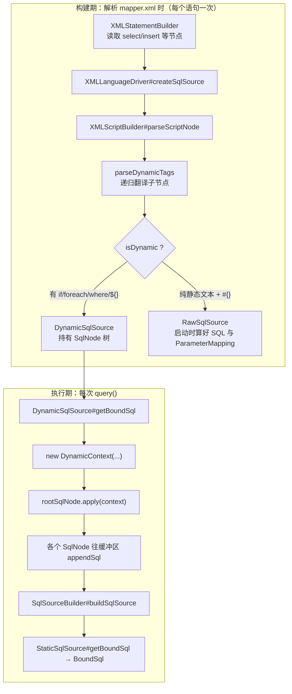
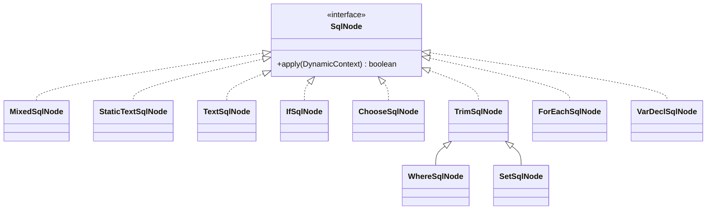
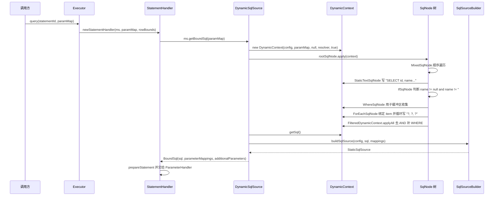

# 动态 SQL：SqlNode 树的构建与应用

> 一句话结论：MyBatis 的动态 SQL = **启动时把标签翻译成一棵 `SqlNode` 语法树** + **每次执行时让这棵树在一个 `DynamicContext` 缓冲区上"走一遍"**；`<if>` 是"走不走"、`<where>` 是"走完再修剪"，`#{}` 到 `?` 的替换也是在这次遍历里顺手做的。

> 阅读前置：读完后你是"零基础"也够——只要你会写 `<select>` 标签；但强烈建议先读 `../02-SqlSession与执行器/README.md`，知道"`MappedStatement#getBoundSql` 一次执行只调一次"这件事，后面所有分析都围绕它。OGNL 只需要知道它是"一种用字符串写表达式的库"。

> 预计阅读：70 分钟 ｜ 源码：mybatis@3.6.0

---

## 0. 先看现象（3 分钟上手）

### 0.1 一个最常见的动态 SQL

```xml
<select id="search" resultType="User">
  SELECT id, name, age FROM user
  <where>
    <if test="name != null and name != ''">
      AND name LIKE CONCAT('%', #{name}, '%')
    </if>
    <if test="minAge != null">
      AND age &gt;= #{minAge}
    </if>
    <if test="ids != null and ids.size() > 0">
      AND id IN
      <foreach collection="ids" item="id" open="(" close=")" separator=",">
        #{id}
      </foreach>
    </if>
  </where>
  ORDER BY id
</select>
```

`search("张三", 18, [1,2,3])` 打出来的最终 SQL 是：

```sql
SELECT id, name, age FROM user
 WHERE name LIKE CONCAT('%', ?, '%') AND age >= ? AND id IN ( ? , ? , ? )
 ORDER BY id
```

注意三件事，它们就是本文要解释的全部现象：

1. **`WHERE` 前面那个 `AND` 不见了**——是 `<where>` 干的（`WhereSqlNode` → `TrimSqlNode`）。
2. **`IN ( ? , ? , ? )` 的占位符个数随集合长度变化**——是 `<foreach>` 干的（`ForEachSqlNode#apply`）。
3. **`?` 的个数是从哪里数出来的**——是 `ParameterMappingTokenHandler` 在遍历过程中，每替换一个 `#{}` 就顺手往列表里加一条 `ParameterMapping`（下一篇的主角）。

### 0.2 打开日志，观察"每次执行都重新拼"

把 MyBatis 日志级别调到 `TRACE`，你会看到每次调用 `search` 都有一次 SQL 渲染。为什么？因为只要你写了任意一个 `<if>`/`<foreach>`/`<where>`，这条语句的 `SqlSource` 就是 `DynamicSqlSource`，而它的 `getBoundSql` 每次都从零开始遍历树。

反过来，如果你把 `<if>` 全删掉，只剩一句 `SELECT id, name FROM user WHERE id = #{id}`，那么这条语句启动时就会被编译成 `RawSqlSource`——`#{}` 在**启动时**就换成了 `?`，`ParameterMapping` 在启动时就算好了，每次执行只是新建一个 `BoundSql` 壳子。

这就是本文后半段"优化边界"要讲清楚的分水岭。

---

## 1. 整体地图（先图后码）

### 1.1 构建期与执行期两条线



**读图说明**：上半部分是"解析一次、作用长期"，下半部分是"执行一次、跑一遍"，两者交汇在 `DynamicSqlSource`——它把构建期产出的树留到执行期再用；而 `RawSqlSource` 根本没有下半部分，它在构建期就把 SQL 和参数列表算完了。

### 1.2 SqlNode 的家族关系



**读图说明**：整棵树只有**一个方法** `apply(DynamicContext)`，返回值 `boolean` 的唯一用途是让 `IfSqlNode` 告诉 `ChooseSqlNode`"我这个分支命中了"；`WhereSqlNode`/`SetSqlNode` 不是独立实现，而是 `TrimSqlNode` 的两个预设子类，这也是"`<where>` 去前缀"其实完全复用 trim 逻辑的原因。

---

## 2. 关键类逐个拆

| 类 | 一句话职责 | 关键点 |
| --- | --- | --- |
| `XMLScriptBuilder` | 把 XML 节点翻译成 `SqlNode` 树 | `parseDynamicTags` 是递归入口；`isDynamic` 在这里被"污染"成全局标记 |
| `SqlNode` | 树节点接口 | 只有一个 `apply(DynamicContext)` |
| `MixedSqlNode` | 顺序容器节点 | 按顺序 `forEach` 调用子节点 |
| `StaticTextSqlNode` | 纯文本节点 | 只做一次 `#{}`→`?` 替换 |
| `TextSqlNode` | 含 `${}` 的文本节点 | 每次执行都做 OGNL 求值 |
| `IfSqlNode` | 条件节点 | 用 `ExpressionEvaluator` 求布尔值 |
| `ChooseSqlNode` | 多分支节点 | 第一个为真的 `<when>` 胜出 |
| `TrimSqlNode` | 前后缀修剪节点 | `<where>`/`<set>` 都继承它 |
| `ForEachSqlNode` | 循环节点 | `open/close/separator/index/item` + `PrefixedContext` |
| `VarDeclSqlNode` | `<bind>` 节点 | 往 bindings 里塞一个变量 |
| `DynamicContext` | 缓冲区 + 变量表 | SQL 用 `StringJoiner(" ")` 拼，变量放在 `ContextMap` |
| `ExpressionEvaluator` | OGNL 求值器 | 把 OGNL 结果"翻译"成布尔 |
| `DynamicSqlSource` | 动态语句的 `SqlSource` | 每次执行新建 `DynamicContext` |
| `RawSqlSource` | 静态语句的 `SqlSource` | 启动时就把参数映射算好 |
| `SqlSourceBuilder` | 产出 `StaticSqlSource` | 3.6 里只剩"包一层 + 可选压缩空白" |

---

## 3. 源码逐段精读

### 3.1 parseScriptNode：决定命运的分岔口

```java (src: XMLScriptBuilder.java#L75-L84)
  public SqlSource parseScriptNode() {
    MixedSqlNode rootSqlNode = parseDynamicTags(context);
    SqlSource sqlSource;
    if (isDynamic) {
      sqlSource = new DynamicSqlSource(configuration, rootSqlNode);
    } else {
      sqlSource = new RawSqlSource(configuration, rootSqlNode, parameterType, paramNameResolver);
    }
    return sqlSource;
  }
```

**这段在做什么**：先递归翻译整棵 XML 得到根节点 `rootSqlNode`，然后看字段 `isDynamic` 决定造 `DynamicSqlSource` 还是 `RawSqlSource`。注意两边都拿同一棵树，区别只在"这棵树什么时候跑"。

**为什么这么写**：`isDynamic` 不是一个独立判断函数的结果，而是 `parseDynamicTags` 遍历过程中被"顺手置真"的标记——只要遇到任何一个元素节点（`<if>`、`<where>`、`<foreach>`…）或任何一个含 `${}` 的文本，它就被置为 `true`。这样判断零成本，代价是**保守**：哪怕某个 `<if test="true">` 永远成立，也照样进 `DynamicSqlSource`。

**如果改了会怎样**：假如把判断改成"运行时才知道"，那构建期就得先跑一次树，等于每次启动都执行一遍 OGNL，而且参数对象还不存在；假如去掉 `RawSqlSource` 分支全用动态的，那么每个最普通的 `select` 都会多一次解析——这正是 3.2.0 之前的行为，`RawSqlSource` 的类注释写着 "It is faster than DynamicSqlSource because mappings are calculated during startup"。

**坑位**：`XMLScriptBuilder` 里没有 `if`/`foreach` 之外的"自定义标签"入口，`nodeHandlerMap` 是硬编码的 8 个（trim/where/set/foreach/if/choose/when/otherwise/bind）。你写 `<selectKey>`、`<include>` 在 SQL 体内就会直接报 `BuilderException: Unknown element`，因为 `<include>` 早在 `XMLScriptBuilder` 之前就被 `XMLIncludeTransformer` 展开了。

### 3.2 initNodeHandlerMap：标签到节点的映射表

```java (src: XMLScriptBuilder.java#L63-L73)
  private void initNodeHandlerMap() {
    nodeHandlerMap.put("trim", new TrimHandler());
    nodeHandlerMap.put("where", new WhereHandler());
    nodeHandlerMap.put("set", new SetHandler());
    nodeHandlerMap.put("foreach", new ForEachHandler());
    nodeHandlerMap.put("if", new IfHandler());
    nodeHandlerMap.put("choose", new ChooseHandler());
    nodeHandlerMap.put("when", new IfHandler());
    nodeHandlerMap.put("otherwise", new OtherwiseHandler());
    nodeHandlerMap.put("bind", new BindHandler());
  }
```

**这段在做什么**：在构造 `XMLScriptBuilder` 时把 8 个标签名映射到 8 个内部 `NodeHandler`。特别注意 `<when>` 复用了 `IfHandler`——因为 `<when>` 的本质就是"有 test 属性的 if"。

**为什么这么写**：用一张 `Map` 替代 `switch`，新标签只需加一行；`NodeHandler` 是私有接口（`void handleNode(XNode, List<SqlNode>)`），所以外部无法扩展，这是一种"内部策略 + 封闭扩展"的折中。

**如果改了会怎样**：假如把 `when` 单独写一个 handler，它必须和 `IfHandler` 行为完全一致，否则 `ChooseHandler#handleWhenOtherwiseNodes` 里的 `handler instanceof IfHandler` 判断就会失效（见 3.14）。

**坑位**：`nodeHandlerMap` 是**实例字段**，每个 `XMLScriptBuilder` 都新建一份；它不是线程安全问题（构建期单线程），但如果你在自定义 `LanguageDriver` 里复用 builder 实例就要小心 `isDynamic` 残留。

### 3.3 parseDynamicTags：递归翻译，同时决定 isDynamic

```java (src: XMLScriptBuilder.java#L86-L115)
  protected MixedSqlNode parseDynamicTags(XNode node) {
    List<SqlNode> contents = new ArrayList<>();
    NodeList children = node.getNode().getChildNodes();
    for (int i = 0; i < children.getLength(); i++) {
      XNode child = node.newXNode(children.item(i));
      if (child.getNode().getNodeType() == Node.CDATA_SECTION_NODE || child.getNode().getNodeType() == Node.TEXT_NODE) {
        String data = child.getStringBody("");
        if (data.trim().isEmpty()) {
          contents.add(emptyNodeCache.computeIfAbsent(data, EmptySqlNode::new));
          continue;
        }
        TextSqlNode textSqlNode = new TextSqlNode(data);
        if (textSqlNode.isDynamic()) {
          contents.add(textSqlNode);
          isDynamic = true;
        } else {
          contents.add(new StaticTextSqlNode(data));
        }
      } else if (child.getNode().getNodeType() == Node.ELEMENT_NODE) { // issue #628
        String nodeName = child.getNode().getNodeName();
        NodeHandler handler = nodeHandlerMap.get(nodeName);
        if (handler == null) {
          throw new BuilderException("Unknown element <" + nodeName + "> in SQL statement.");
        }
        handler.handleNode(child, contents);
        isDynamic = true;
      }
    }
    return new MixedSqlNode(contents);
  }
```

**这段在做什么**：遍历当前 XML 节点的所有**直接子节点**，分三类处理：

1. 文本 / CDATA —— 纯空白文本走 `emptyNodeCache` 复用 `EmptySqlNode`（注意它仍然会 `appendSql(whitespaces)`，保留原始空白）；非空白文本先用 `TextSqlNode#isDynamic()` 检测有没有 `${`，有就置 `isDynamic=true`，没有就用 `StaticTextSqlNode`。
2. 元素节点 —— 查表得到 handler，把 handler 生成的节点塞进 `contents`，并**无条件**把 `isDynamic` 置 `true`。
3. 注释等其他节点 —— 直接忽略（不在任何分支里）。

**为什么这么写**：`MixedSqlNode` 是"顺序容器"，所以递归的返回值就是一层的 children 列表；文本节点区分静态/动态是为了让没有 `${}` 的文本跳过 OGNL，只做 `#{}` 替换。空白文本缓存（`static ConcurrentHashMap`）是一个微优化：一份 mapper 里大量缩进空白，如果每个都新建对象，启动期会产生很多垃圾。

**如果改了会怎样**：如果去掉 `isDynamic = true` 那行，一个只有 `<if>` 但文本全是静态的语句会被判成静态 → 走 `RawSqlSource` → 启动时 `<if>` 的 test 属性根本没有参数可求值 → 直接抛异常或拼出奇怪 SQL。如果让空白文本不进 `contents`，那么 `SELECT * FROM a<if .../>WHERE` 这类紧贴标签的 SQL 会变成 `SELECT * FROM aWHERE`——空白节点就是用来保命的。

**坑位**：`EmptySqlNode` 会原样 `appendSql` 那段空白，而 `DynamicContext#getSql()` 最后做 `trim()`，`StringJoiner(" ")` 又会用空格连接各段；所以你在日志里看到的 SQL 是多空格拼接后的结果，不要拿它去和手写的 SQL 做字符串相等断言。

### 3.4 EmptySqlNode：空白也要保留

```java (src: XMLScriptBuilder.java#L267-L280)
  private static class EmptySqlNode implements SqlNode {
    private final String whitespaces;

    public EmptySqlNode(String whitespaces) {
      super();
      this.whitespaces = whitespaces;
    }

    @Override
    public boolean apply(DynamicContext context) {
      context.appendSql(whitespaces);
      return true;
    }
  }
```

**这段在做什么**：把一段纯空白文本原封不动写回缓冲区。

**为什么这么写**：XML 里的换行、缩进都是文本节点，如果丢掉，`a<if>AND b</if>` 这种写法在标签不命中时可能把前后两个词粘成一个词（例如 `FROM t` 和 `WHERE` 之间本来有换行）。保留空白最安全，最终由 SQL 解析器去忽略多余空白。

**如果改了会怎样**：改成 `return true` 不 append，SQL 会出现 `FROM userWHERE` 之类粘连；改成 `appendSql(" ")` 又会丢掉原始换行（对 `--` 行注释有影响，虽然 mapper 里基本不用）。

**坑位**：`emptyNodeCache` 是 `static` 的，key 是空白字符串本身；如果你的 mapper 有成千上万个不同长度的缩进，这个缓存会一直增长（进程级，不会回收），但实际影响极小。

### 3.5 MixedSqlNode：只是按顺序执行

```java (src: MixedSqlNode.java#L23-L35)
public class MixedSqlNode implements SqlNode {
  private final List<SqlNode> contents;

  public MixedSqlNode(List<SqlNode> contents) {
    this.contents = contents;
  }

  @Override
  public boolean apply(DynamicContext context) {
    contents.forEach(node -> node.apply(context));
    return true;
  }
}
```

**这段在做什么**：依次调用每个子节点的 `apply`，忽略子节点返回值，自己恒返回 `true`。

**为什么这么写**：`MixedSqlNode` 是"组合模式"（Composite）里的容器，它必须让"容器"和"叶子"对外表现一致（都实现 `SqlNode`）。返回 `true` 表示"我这一层没有条件概念，永远算命中"。

**如果改了会怎样**：如果把子节点的返回值聚合成"任意一个为真则真"，那么 `ChooseSqlNode` 里的 `<when>` 分支只要含有 `<if>` 子节点就会误判命中——所以这里必须恒 `true`，这也是为什么 `if` 的语义只看 `IfSqlNode` 自己。

**坑位**：`contents` 是外部传入的 `List` 引用（不是拷贝），`XMLScriptBuilder#parseDynamicTags` 每次新建列表，所以安全；但如果你自己构造树，务必不要复用同一个可变 List。

### 3.6 IfSqlNode：一个布尔判断

```java (src: IfSqlNode.java#L21-L38)
public class IfSqlNode implements SqlNode {
  private final ExpressionEvaluator evaluator = ExpressionEvaluator.INSTANCE;
  private final String test;
  private final SqlNode contents;

  public IfSqlNode(SqlNode contents, String test) {
    this.test = test;
    this.contents = contents;
  }

  @Override
  public boolean apply(DynamicContext context) {
    if (evaluator.evaluateBoolean(test, context.getBindings())) {
      contents.apply(context);
      return true;
    }
    return false;
  }
```

**这段在做什么**：把 `test` 字符串交给 `ExpressionEvaluator` 求值；为真才执行子节点，返回值就是判断结果。

**为什么这么写**：`SqlNode#apply` 返回 `boolean` 的唯一消费者就是 `ChooseSqlNode`，`IfSqlNode` 是唯一"能说不"的节点。把求值委托给 `ExpressionEvaluator.INSTANCE`（单例）而不是静态方法，是为了可测试/可替换。

**如果改了会怎样**：如果 `IfSqlNode` 恒返回 `true`，`<choose>` 就会永远走第一个 `<when>`；如果 `contents.apply(context)` 放在判断外，`<if>` 就退化成无意义的包装。

**坑位**：`test` 属性在 XML 里必须写成 `test="..."`，用 `&quot;`/`&amp;&amp;` 转义特殊字符；`test` 里写 `name != null and name != ''` 这类判断请读 3.7 和 6.1，`0`/`false` 会被误判。

### 3.7 ExpressionEvaluator#evaluateBoolean：OGNL 结果如何变成布尔

```java (src: ExpressionEvaluator.java#L33-L42)
  public boolean evaluateBoolean(String expression, Object parameterObject) {
    Object value = OgnlCache.getValue(expression, parameterObject);
    if (value instanceof Boolean) {
      return (Boolean) value;
    }
    if (value instanceof Number) {
      return new BigDecimal(String.valueOf(value)).compareTo(BigDecimal.ZERO) != 0;
    }
    return value != null;
  }
```

**这段在做什么**：先用 `OgnlCache` 求值，然后按三种类型解释结果：`Boolean` 直接取、`Number` 转成 `BigDecimal` 与 0 比较（**非零为真**）、其他任何非 `null` 对象都为真。

**为什么这么写**：OGNL 表达式的结果不一定声明为 `boolean`（`test="ids"` 只得到一个 List），MyBatis 需要一个"宽松"的真值规则：非空集合/对象为真，避免你必须写 `ids != null and ids.size() > 0`。用 `BigDecimal` 比较而不是 `intValue() != 0`，是为了兼容 `Long`/`BigDecimal`/`Double` 等各种数字类型。

**如果改了会怎样**：如果只接受 `Boolean`，所有 `test="name"` 的写法都会抛类型异常；如果改成"字符串非空即真"，那么 `test="0"` 永远是 `true`（字符串 "0" 非 null），比现在的语义更糟。

**坑位**：这就是"`0` 为假"的根源——一旦你的表达式**结果**是一个数字 0（比如 `test="flag"` 且 `flag` 是 `Integer 0`），它就是假；但它和 `test="flag != null"` 是两回事，后者恒为 `true`（`0 != null` 为真）。此外 `OgnlCache` 缓存了编译后的 OGNL 表达式，`test` 写错（属性名不存在）时 OGNL 默认返回 `null` 而不是抛异常，于是"条件永远不成立"。

### 3.8 ChooseSqlNode：多分支只走一支

```java (src: ChooseSqlNode.java#L33-L44)
  public boolean apply(DynamicContext context) {
    for (SqlNode sqlNode : ifSqlNodes) {
      if (sqlNode.apply(context)) {
        return true;
      }
    }
    if (defaultSqlNode != null) {
      defaultSqlNode.apply(context);
      return true;
    }
    return false;
  }
```

**这段在做什么**：按顺序执行每个 `<when>`（它们都是 `IfSqlNode`），第一个返回 `true` 的立即 `return`；全不命中则执行 `<otherwise>`（可能为 `null`）。

**为什么这么写**：Java 的 `switch` 语义——`break` 就是这里的 `return true`。依赖 `IfSqlNode#apply` 的返回值，这也是 `apply` 返回 `boolean` 的原因。

**如果改了会怎样**：若去掉 `return true` 而继续循环，多个 `<when>` 会同时命中，SQL 里会出现两个互斥条件（`AND a=? AND b=?`），与使用者预期相反。

**坑位**：`<choose>` 里除了 `<when>`/`<otherwise>` 写任何东西（包括注释以外的文本）都会抛 `BuilderException: Unknown element`；`<otherwise>` 只能有一个，多个会抛 "Too many default (otherwise) elements in choose statement."（见 3.14）。

### 3.9 TrimSqlNode：修剪的真正实现

```java (src: TrimSqlNode.java#L53-L72)
  @Override
  public boolean apply(DynamicContext context) {
    FilteredDynamicContext filteredDynamicContext = new FilteredDynamicContext(context);
    boolean result = contents.apply(filteredDynamicContext);
    filteredDynamicContext.applyAll();
    return result;
  }

  private static List<String> parseOverrides(final String overrides) {
    if (overrides != null) {
      final List<String> list = new ArrayList<>();
      for (final String override : overrides.split("\\|")) {
        if (!override.isEmpty()) {
          list.add(override.toUpperCase(Locale.ENGLISH));
        }
      }
      return list;
    }
    return List.of();
  }
```

**这段在做什么**：`apply` 不直接往真正的 context 写，而是新建一个**子缓冲区** `FilteredDynamicContext`，让子节点往里写；写完后再 `applyAll()`（修剪 + 加前后缀）一次性追加到父 context。`parseOverrides` 把 `"AND |OR "` 这样用 `|` 分隔的字符串拆成大写列表。

**为什么这么写**：去前缀必须在"整段内容写完"之后做——因为只有写完才知道开头到底是什么。子缓冲区的做法让 trim 节点在树上可以嵌套（`<where>` 里套 `<trim>`），每一层管自己那段。

**如果改了会怎样**：如果边写边判断前缀，`<if>` 不命中时首段可能变成空白，前缀判断就失效；如果不做 `toUpperCase`，SQL 里写小写 `and` 会匹配不上（`parseOverrides` 在构建期就统一大写了，运行时只比较一次大写的整段 SQL）。

**坑位**：`prefixOverrides` 的分隔符是 `|`，`AND ` 后面的**空格是判断的一部分**（`"AND |OR "` 的第一个元素是 `"AND "` 带尾空格）——如果你写成 `prefixOverrides="AND"`，会把 `ORDER` 的开头 `OR` 之类的词误伤（详见 6.x）。

### 3.10 FilteredDynamicContext：去前缀的核心

```java (src: TrimSqlNode.java#L90-L106)
    public void applyAll() {
      sqlBuffer = new StringBuilder(sqlBuffer.toString().trim());
      String trimmedUppercaseSql = sqlBuffer.toString().toUpperCase(Locale.ENGLISH);
      if (!trimmedUppercaseSql.isEmpty()) {
        applyPrefix(sqlBuffer, trimmedUppercaseSql);
        applySuffix(sqlBuffer, trimmedUppercaseSql);
      }
      delegate.appendSql(sqlBuffer.toString());
    }

    @Override
    public void appendSql(String sql) {
      if (sqlBuffer.length() > 0) {
        sqlBuffer.append(" ");
      }
      sqlBuffer.append(sql);
    }
```

**这段在做什么**：`appendSql` 把子节点输出累积到自己的 `StringBuilder`（各段之间补一个空格）；`applyAll` 先 `trim()`，再转大写得到"比较用"的副本，然后做前缀/后缀处理和最终追加。

**为什么这么写**：`trim()` 是为了让 `\n      AND name = ?` 变成 `AND name = ?`，这样才可能 `startsWith("AND ")`；另外保留一份大写副本，避免每次比较都 `toUpperCase` 整个字符串（只算一次）。最终把修剪结果 append 到父 context，父 context 的 `StringJoiner` 会再补一个分隔空格。

**如果改了会怎样**：如果 `appendSql` 不加分隔空格，`contents` 里两个文本段（例如 `"AND name"` 和 `"= ?"`）会拼成 `AND name= ?`——语法仍合法但可读性差；如果 `applyAll` 不 trim，去前缀基本失效。

**坑位**：`delegate.appendSql(sqlBuffer.toString())` 即使 `sqlBuffer` 为空串也会调用，因此 `DynamicContext` 的 `StringJoiner` 里会多出空段，`getSql()` 后会出现连续多个空格。另外 `applyPrefix` 里加前缀是 `sql.insert(0, " ").insert(0, prefix)`，所以 `WHERE` 和后面的内容之间一定有一个空格。

### 3.11 applyPrefix：把 AND/OR 删掉再补 WHERE

```java (src: TrimSqlNode.java#L118-L130)
    private void applyPrefix(StringBuilder sql, String trimmedUppercaseSql) {
      if (prefixApplied) {
        return;
      }
      prefixApplied = true;
      if (prefixesToOverride != null) {
        prefixesToOverride.stream().filter(trimmedUppercaseSql::startsWith).findFirst()
            .ifPresent(toRemove -> sql.delete(0, toRemove.trim().length()));
      }
      if (prefix != null) {
        sql.insert(0, " ").insert(0, prefix);
      }
    }
```

**这段在做什么**：如果整段 SQL（大写）以某个待覆盖前缀开头，就删掉 `toRemove.trim().length()` 个字符；然后如果有 `prefix` 就插到最前面。

**为什么这么写**：`toRemove.trim()` 保证 `AND ` 和 `AND\t` 都删掉 3 个字符（`AND`），把后面的空白留给 `sqlBuffer` 原有的 trim 结果——所以 `AND name = ?` 删完就是 `name = ?`；然后 `insert(0, " ")` 再 `insert(0, "WHERE")` 得到 `WHERE name = ?`。

**如果改了会怎样**：如果按 `toRemove.length()` 删除，`AND ` 会删 4 个字符，把 `name` 的首字母也删掉（`AND name` → `me`）；这是很多手写 trim 逻辑踩过的坑，源码用 `trim()` 绕开了。

**坑位**：`prefixApplied` 保证只应用一次；它是 `FilteredDynamicContext` 的实例状态，所以每次 `apply` 都用新实例，天然重置。

### 3.12 WhereSqlNode / SetSqlNode：两个预设

```java (src: WhereSqlNode.java#L26-L33)
public class WhereSqlNode extends TrimSqlNode {

  private static final List<String> prefixList = Arrays.asList("AND ", "OR ", "AND\n", "OR\n", "AND\r", "OR\r", "AND\t",
      "OR\t");

  public WhereSqlNode(Configuration configuration, SqlNode contents) {
    super(configuration, contents, "WHERE", prefixList, null, null);
  }
```

**这段在做什么**：`<where>` 就是"前缀 `WHERE`、覆盖 `AND`/`OR` 的四种换行/制表符变体、无后缀"的 trim。`<set>` 同理：前缀 `SET`、覆盖尾随逗号。

**为什么这么写**：把八个变体写死成常量，避免每次运行都调用 `parseOverrides` 去 split；同时绕开 `|` 分隔符无法表达 `\n`/`\t` 的问题——`prefixOverrides="AND |OR "` 这种写法无法表达"AND 后面跟换行"（XML 属性里写换行会被规范化成空格，XML 本身会把属性值里的换行/制表符规范化为空格），所以 `<where>` 必须在 Java 里硬编码。

**如果改了会怎样**：如果 `<where>` 用 `parseOverrides` 的字符串版构造，几乎必然漏掉 `AND\n` 场景——因为 XML 属性规范化后你拿到的是空格，但 mapper 里 `<if>` 之间的换行是**文本节点**内容，不是属性值，最终拼出来的仍是 `\n`。

**坑位**：这就是"`<where>` 比手写 `<trim prefixOverrides="AND ">` 更保险"的原因；同时 `<where>` 不管里面有没有内容都会…等等，见 3.13：`applyAll` 在空串时**不加**前缀，所以空 `<where>` 不会产生 `WHERE`。

### 3.13 ForEachSqlNode：open/close/separator/index/item 如何拼

```java (src: ForEachSqlNode.java#L68-L103)
  public boolean apply(DynamicContext context) {
    Map<String, Object> bindings = context.getBindings();
    final Iterable<?> iterable = evaluator.evaluateIterable(collectionExpression, bindings,
        Optional.ofNullable(nullable).orElseGet(configuration::isNullableOnForEach));
    if (iterable == null || !iterable.iterator().hasNext()) {
      return true;
    }
    boolean first = true;
    applyOpen(context);
    int i = 0;
    for (Object o : iterable) {
      DynamicContext scopedContext;
      if (first || separator == null) {
        scopedContext = new PrefixedContext(context, "");
      } else {
        scopedContext = new PrefixedContext(context, separator);
      }
      // Issue #709
      if (o instanceof Map.Entry) {
        @SuppressWarnings("unchecked")
        Map.Entry<Object, Object> mapEntry = (Map.Entry<Object, Object>) o;
        applyIndex(scopedContext, mapEntry.getKey());
        applyItem(scopedContext, mapEntry.getValue());
      } else {
        applyIndex(scopedContext, i);
        applyItem(scopedContext, o);
      }
      contents.apply(scopedContext);
      if (first) {
        first = !((PrefixedContext) scopedContext).isPrefixApplied();
      }
      i++;
    }
    applyClose(context);
    return true;
  }
```

**这段在做什么**：① 求值 `collection` 属性得到 `Iterable`；② **空集合直接 return**（`open`/`close` 都不输出）；③ 输出 `open`；④ 每个元素新建一个 `PrefixedContext`（第一次前缀为 `""`，之后为 `separator`），把 `index`/`item` 绑定到它的 bindings 上，再让循环体 `contents.apply(scopedContext)`；⑤ 最后输出 `close`。

**为什么这么写**：`separator` 不是自己拼字符串，而是靠 `PrefixedContext#appendSql` 在"第一次真正写入内容"时补上——这样如果循环体里有 `<if>` 且不命中（一个字符都不写），分隔符就不会多出来。`first` 的判断被 `isPrefixApplied()` 修正过：当第一次迭代 body 完全没输出时，`first` 保持 `true`，保证下一次仍不带分隔符。

**如果改了会怎样**：如果空集合不提前 return，`open`/`close` 就会输出，得到 `IN ()`——SQL 语法错误；如果 `first` 不根据 `isPrefixApplied` 修正，`<foreach>` 体内第一个元素被 `<if>` 过滤掉时会产生 `( , ?, ? )`。

**坑位**：`index` 对 `Map` 是 key、对集合是 `int`；`item` 才是值。`evaluateIterable` 的 `nullable` 参数决定 `collection` 求值为 `null` 时是抛异常（默认）还是当作空集合（`<foreach nullable="true">` 或全局 `configuration.setNullableOnForEach(true)`）。

### 3.14 PrefixedContext：分隔符只补一次

```java (src: ForEachSqlNode.java#L129-L165)
  private class PrefixedContext extends DynamicContext {
    private final DynamicContext delegate;
    private final String prefix;
    private boolean prefixApplied;

    public PrefixedContext(DynamicContext delegate, String prefix) {
      super(configuration, delegate.getParameterObject(), delegate.getParameterType(), delegate.getParamNameResolver(),
          delegate.isParamExists());
      this.delegate = delegate;
      this.prefix = prefix;
      this.prefixApplied = false;
      this.bindings.putAll(delegate.getBindings());
    }

    public boolean isPrefixApplied() {
      return prefixApplied;
    }

    @Override
    public void appendSql(String sql) {
      if (!prefixApplied && sql != null && sql.trim().length() > 0) {
        delegate.appendSql(prefix);
        prefixApplied = true;
      }
      delegate.appendSql(sql);
    }

    @Override
    public String getSql() {
      return delegate.getSql();
    }

    @Override
    public List<ParameterMapping> getParameterMappings() {
      return delegate.getParameterMappings();
    }
  }
```

**这段在做什么**：`PrefixedContext` 继承 `DynamicContext`，把 `appendSql` 变成"首次非空白写入前先写 prefix"；`bindings.putAll(delegate.getBindings())` 让循环体里能读到外层所有变量；`getSql`/`getParameterMappings` 直接代理到外层，保证 SQL 和参数都写到同一个地方。

**为什么这么写**：这是"装饰器 + 作用域"的组合——每次迭代一份独立变量作用域，但共享同一个输出缓冲区。`getParameterMappings()` 必须代理，因为 `#{}` 的替换发生在 `StaticTextSqlNode#apply` → `context.parseParam`，而 `parseParam` 在 `DynamicContext` 里调用 `initTokenParser`，如果 `PrefixedContext` 自己新建 tokenHandler，参数映射就会丢在外层之外。

**如果改了会怎样**：如果不代理 `getParameterMappings`，`IN (?, ?, ?)` 只有 SQL 没有参数，运行时抛 `Parameter index out of range`；如果 `appendSql` 无条件先写 prefix，空 body 的迭代会多出 `,,`。

**坑位**：`bindings.putAll` 是**拷贝**外层 bindings，所以循环体内用 `<bind>` 新建的变量只在本次迭代有效（也符合直觉）；但反过来，你若在循环体内修改外层对象的属性，那是共享的。

### 3.15 DynamicContext：缓冲区与变量表

```java (src: DynamicContext.java#L63-L95)
  public DynamicContext(Configuration configuration, Object parameterObject, Class<?> parameterType,
      ParamNameResolver paramNameResolver, boolean paramExists) {
    if (parameterObject == null || parameterObject instanceof Map) {
      bindings = new ContextMap(null, false);
    } else {
      MetaObject metaObject = configuration.newMetaObject(parameterObject);
      boolean existsTypeHandler = configuration.getTypeHandlerRegistry().hasTypeHandler(parameterObject.getClass());
      bindings = new ContextMap(metaObject, existsTypeHandler);
    }
    bindings.put(PARAMETER_OBJECT_KEY, parameterObject);
    bindings.put(DATABASE_ID_KEY, configuration.getDatabaseId());
    this.configuration = configuration;
    this.parameterObject = parameterObject;
    this.paramExists = paramExists;
    this.parameterType = parameterType;
    this.paramNameResolver = paramNameResolver;
  }

  public Map<String, Object> getBindings() {
    return bindings;
  }

  public void bind(String name, Object value) {
    bindings.put(name, value);
  }

  public void appendSql(String sql) {
    sqlBuilder.add(sql);
  }

  public String getSql() {
    return sqlBuilder.toString().trim();
  }
```

**这段在做什么**：构造时把参数对象包装进 `ContextMap`（一个 `HashMap` 子类，`get` 时会回落到参数对象的属性），并把 `_parameter`、`_databaseId` 两个特殊变量放进去；`appendSql` 用 `StringJoiner(" ")` 拼接，`getSql` 输出前整体 trim。

**为什么这么写**：`bindings` 同时充当"OGNL 变量表"和"参数对象视图"两件事——`test="name != null"` 会先查 Map 有没有 `name` 键，没有就通过 `MetaObject` 读参数对象的 `name` 属性；`_databaseId` 让 `<if test="_databaseId == 'mysql'">` 成为可能。`StringJoiner` 用空格连接各段，避免两次 `appendSql` 之间没空格导致 `aAND b` 这类拼接错误。

**如果改了会怎样**：如果不用 `ContextMap` 而直接放参数对象，OGNL 就得自己处理"Map 和 Bean 两种形态"；如果 `getSql()` 不 trim，SQL 首尾空白会带进日志和 `BoundSql`。

**坑位**：`<foreach>` 的 `item` 名如果与外层参数同名（比如 Bean 里有 `id` 属性，`item="id"`），`ContextMap` 优先返回 Map 里的值，所以循环体内 `#{id}` 是循环变量——这正是"`<foreach>` 里参数名"最容易出错的点。见 6.3。

### 3.16 ContextMap 与 ContextAccessor：OGNL 如何读到参数

```java (src: DynamicContext.java#L144-L157)
      if (super.containsKey(strKey)) {
        return super.get(strKey);
      }

      if (parameterMetaObject == null) {
        return null;
      }

      if (fallbackParameterObject && !parameterMetaObject.hasGetter(strKey)) {
        return parameterMetaObject.getOriginalObject();
      }
      // issue #61 do not modify the context when reading
      return parameterMetaObject.getValue(strKey);
    }
```

**这段在做什么**：`ContextMap#get` 三步走——先查 Map 自己的键，再（没有 MetaObject 时）返回 `null`，最后从参数对象的 MetaObject 取属性；如果参数对象本身有 TypeHandler（`fallbackParameterObject`）且没有该属性，就把**整个参数对象**返回（让 `#{param}` 这种"单值参数"能对自己的属性求值）。

**为什么这么写**：`OgnlRuntime.setPropertyAccessor(ContextMap.class, new ContextAccessor())`（`DynamicContext` 静态块）让 OGNL 读 `ContextMap` 时走 `ContextAccessor#getProperty`：先 `map.get(name)`，若 Map 里没有但 `_parameter` 是 `Map`，则从 `_parameter` 里取。这两层回落正好对应"`#{name}` 里 name 是 `@Param` 名" 和 "name 是参数对象属性"两种来源。

**如果改了会怎样**：如果 `get` 里不放 `fallbackParameterObject` 分支，`#{value}` 这类"直接传一个 String 参数"的写法会拿不到值；如果没有 `ContextAccessor`，OGNL 对 Map 的 key 缺失会返回 `null` 而不是回落 `_parameter`，`<if test="ids != null">` 在 `ids` 是普通 Bean 属性时恰好能工作，但在 `@Param` Map 场景下反过来失效。

**坑位**：`ContextMap#get` 里注释 "issue #61 do not modify the context when reading" 提醒：读取不会写入 Map，所以多次读取同一属性不会污染 bindings；但 `OGNL` 默认对不存在的属性返回 `null`，于是拼错的属性名（`test="naem != null"`）永远为假——**这是一个静默失败**。

### 3.17 TextSqlNode：`${}` 每次执行都求值

```java (src: TextSqlNode.java#L32-L48)
  public boolean isDynamic() {
    DynamicCheckerTokenParser checker = new DynamicCheckerTokenParser();
    GenericTokenParser parser = createParser(checker);
    parser.parse(text);
    return checker.isDynamic();
  }

  @Override
  public boolean apply(DynamicContext context) {
    GenericTokenParser parser = createParser(new BindingTokenParser(context));
    context.appendSql(context.parseParam(parser.parse(text)));
    return true;
  }

  private GenericTokenParser createParser(TokenHandler handler) {
    return new GenericTokenParser("${", "}", handler);
  }
```

**这段在做什么**：`isDynamic` 在**构建期**用一次"探测解析"判断文本里有没有 `${`；`apply` 在**执行期**用 `BindingTokenParser` 把 `${expr}` 求值成字符串直接写进 SQL，然后把结果再交给 `context.parseParam` 做 `#{}`→`?` 替换。

**为什么这么写**：`${}` 是**文本替换**（字符串直接拼接），必须每次执行都重新求值；而它拼出来的文本里可能还含有 `#{}`，所以要先做 `${}` 再做 `#{}`——顺序反过来就会把 `${}` 表达式里的字符误当参数。

**如果改了会怎样**：如果先做 `#{}` 再 `${}`，`${'name = #{a}'}` 这类写法就没法用（这是 MyBatis 唯一支持的"动态列名 + 参数"组合技）。

**坑位**：`${}` 是 SQL 注入的头号来源，永远不要用它拼接用户输入；`BindingTokenParser` 对 `null` 返回 `""`（issue #274），所以 `${missing}` 不会抛异常，只会让 SQL 少一截——更难排查。

### 3.18 StaticTextSqlNode 与 VarDeclSqlNode

```java (src: StaticTextSqlNode.java#L21-L32)
public class StaticTextSqlNode implements SqlNode {
  private final String text;

  public StaticTextSqlNode(String text) {
    this.text = text;
  }

  @Override
  public boolean apply(DynamicContext context) {
    context.appendSql(context.parseParam(text));
    return true;
  }
```

**这段在做什么**：对一段不含 `${}` 的文本做 `#{}`→`?` 替换后写入缓冲区。`parseParam` 内部就是 `GenericTokenParser("#{", "}", tokenHandler).parse(sql)`。注意 3.6 里 `#{}` 的替换**在这一步**就完成了，而不是像 3.5.x 那样留到 `SqlSourceBuilder#parse`。

**为什么这么写**：把 `#{}` 的替换下放到每个文本节点，是为了让 `ParameterMapping` 能按"树遍历顺序"收集（`DynamicContext` 持有一个 tokenHandler，参数列表天然有序），同时让 `ForEachSqlNode` 循环体里的 `#{id}` 每迭代一次就多产生一条 `ParameterMapping`——`IN (?, ?, ?)` 就是这么来的。

**如果改了会怎样**：如果仍用 3.5 的"先拼完整 SQL 再统一解析 `#{}`"，那么在 `${}` 拼进文本时若产生新的 `#{}`，顺序就难以保证；3.6 的改法让"文本节点"与"参数收集"同步。

**坑位**：`#{...}` 里如果出现不合法的属性名，异常抛在**执行期**（`ParameterMappingTokenHandler#buildParameterMapping`），错误信息里带有 `#{...}` 原文，便于定位；`<bind>` 节点（`VarDeclSqlNode`）则是"求值后塞进 bindings"，之后可以用 `#{varName}` 或 `${varName}` 引用它。

### 3.19 DynamicContext#parseParam 与 getParameterMappings

```java (src: DynamicContext.java#L97-L113)
  private void initTokenParser(List<ParameterMapping> parameterMappings) {
    if (tokenParser == null) {
      tokenHandler = new ParameterMappingTokenHandler(parameterMappings != null ? parameterMappings : new ArrayList<>(),
          configuration, parameterObject, parameterType, bindings, paramNameResolver, paramExists);
      tokenParser = new GenericTokenParser("#{", "}", tokenHandler);
    }
  }

  public List<ParameterMapping> getParameterMappings() {
    initTokenParser(null);
    return tokenHandler.getParameterMappings();
  }

  protected String parseParam(String sql) {
    initTokenParser(getParameterMappings());
    return tokenParser.parse(sql);
  }
```

**这段在做什么**：`tokenParser` 懒初始化，首次调用时用**当前** bindings 造一个 `ParameterMappingTokenHandler`；`parseParam` 先把已有参数列表传进去（可能为空），然后解析 `#{}`，解析过程中 handler 会继续往同一列表里 add。

**为什么这么写**：`ParameterMappingTokenHandler` 需要 bindings（为了 `ParamMap` 里 `#{name}` 的 javaType 推断），也必须持有"参数列表"这个可变集合；懒初始化让它能拿到遍历到该文本节点时的 bindings 状态（此时 `<foreach>` 的 item 已经 bind 上去了）。

**如果改了会怎样**：如果提前在构造器里初始化，`<foreach>` 的 item 还没绑定，`figureOutJavaType` 就拿不到类型，只能退化成 `Object.class`；如果每次 `parseParam` 都新建 handler，参数列表会被清空重来，最终 `BoundSql` 里的参数个数与 `?` 个数不一致。

**坑位**：`getParameterMappings()` 传入 `null` → `new ArrayList<>()`，即"仅初始化不追加"；所以 `DynamicSqlSource#getBoundSql` 最后拿到的列表是**同一个** handler 里累积的列表。

### 3.20 DynamicSqlSource#getBoundSql：执行期的总入口

```java (src: DynamicSqlSource.java#L43-L52)
  @Override
  public BoundSql getBoundSql(Object parameterObject) {
    DynamicContext context = new DynamicContext(configuration, parameterObject, null, paramNameResolver, true);
    rootSqlNode.apply(context);
    String sql = context.getSql();
    SqlSource sqlSource = SqlSourceBuilder.buildSqlSource(configuration, sql, context.getParameterMappings());
    BoundSql boundSql = sqlSource.getBoundSql(parameterObject);
    context.getBindings().forEach(boundSql::setAdditionalParameter);
    return boundSql;
  }
```

**这段在做什么**：五步——① 新建 `DynamicContext`（`paramExists=true`，因为这次是真实执行，参数存在）；② 遍历整棵树；③ 取出拼好的 SQL；④ 包成 `StaticSqlSource` 并拿 `BoundSql`；⑤ 把 bindings 里所有变量作为 additional parameters 塞进 `BoundSql`（这一步让插件或最终参数绑定能读到 `<bind>`/`<foreach>` 产生的临时变量）。

**为什么这么写**：和 `RawSqlSource` 对比最清楚——`RawSqlSource` 在构造器里做同样 ①②③④，`getBoundSql` 只是转发；`DynamicSqlSource` 每次执行都重做。⑤ 是 3.6 的新版做法（早期版本由 `DefaultParameterHandler` 直接读 `DynamicContext`）。

**如果改了会怎样**：如果不把 bindings 塞进 `BoundSql#setAdditionalParameter`，`DefaultParameterHandler` 在 `parameterMapping.hasValue()` 为 false 时找不到 `_parameter` 之外的变量，`#{item}` 这种 foreach 变量就会解析失败。

**坑位**：`getBoundSql` 是**每次执行**调用的（`StatementHandler` 创建时调一次），所以 `DynamicSqlSource` 的 SQL 渲染开销 = 树遍历 + OGNL 求值 + `#{}` 正则解析，这也是"复杂动态 SQL 在超高频调用下 CPU 偏高"的原因。

### 3.21 RawSqlSource：优化的边界

```java (src: RawSqlSource.java#L49-L55)
  public RawSqlSource(Configuration configuration, SqlNode rootSqlNode, Class<?> parameterType,
      ParamNameResolver paramNameResolver) {
    DynamicContext context = new DynamicContext(configuration, parameterType, paramNameResolver);
    rootSqlNode.apply(context);
    String sql = context.getSql();
    sqlSource = SqlSourceBuilder.buildSqlSource(configuration, sql, context.getParameterMappings());
  }
```

**这段在做什么**：注意这里用的是 `DynamicContext(configuration, parameterType, paramNameResolver)` 这个"参数对象为 null、`paramExists=false`"的构造器，也就是说**构建期就跑了一遍树**，但因为树里不可能有动态节点（`isDynamic` 为假才走这里），跑一次的结果就是永远的结果。

**为什么这么写**：把"SQL 文本"和"参数映射列表"都固化成字段，之后每次执行只需 `new BoundSql(...)`（`StaticSqlSource#getBoundSql`）。这就是类注释说的 "mappings are calculated during startup"。

**如果改了会怎样**：如果 `RawSqlSource` 也用真实参数对象构造，启动时根本没有参数；如果 `parameterType` 为 `null` 就传 `Object.class`（这是字符串构造器里做的 `clazz = parameterType == null ? Object.class : parameterType`），否则 `figureOutJavaType` 会在 `MetaClass.forClass(null)` 处炸掉。

**坑位**：`RawSqlSource` 里 `paramExists=false`，所以 `ParameterMappingTokenHandler` 走"启动期"分支：不绑定 value、无法从参数对象推断类型（只能靠 `javaType` 属性和 `ParameterMapping.Builder` 的默认 `Object.class`）。因此 `#{name}` 在静态语句里没有 `jdbcType` 时，null 值的 `jdbcType` 推断只能靠数据库元数据（见下一篇）。

### 3.22 SqlSourceBuilder：3.6 里只剩"包一层"

```java (src: SqlSourceBuilder.java#L33-L42)
  public static SqlSource buildSqlSource(Configuration configuration, String sql,
      List<ParameterMapping> parameterMappings) {
    return new StaticSqlSource(configuration,
        configuration.isShrinkWhitespacesInSql() ? SqlSourceBuilder.removeExtraWhitespaces(sql) : sql,
        parameterMappings);
  }

  public static String removeExtraWhitespaces(final String original) {
    return original.replaceAll("\\s+", " ").trim();
  }
```

**这段在做什么**：把已渲染的 SQL + 已收集的 `ParameterMapping` 列表包成一个 `StaticSqlSource`；如果开了 `shrinkWhitespacesInSql`（3.5.5+，SQL 压缩），顺手把连续空白压成一个空格。

**为什么这么写**：3.6 把 `#{}` 解析搬进 `DynamicContext` 之后，`SqlSourceBuilder` 的职责就只剩"组装"，因此从实例类变成了纯静态工具（3.5.x 里它有 `parse(String, Class, String, List)`）。

**如果改了会怎样**：如果你按 3.5.x 的资料去找 `SqlSourceBuilder#parse`，会找不到方法——这是 3.6 的一处破坏性重构（详见第 7 节）。

**坑位**：`shrinkWhitespacesInSql` 只影响 SQL 文本，不影响参数；它会对包含 `--` 行注释的 SQL 造成灾难（注释后的换行被压掉，整行后续都成注释），启用前先确认 mapper 里没有行注释。

---

## 4. 一次完整执行时序

以 0.1 的 `search("张三", 18, [1,2,3])` 为例，从 `query()` 到拿到 `BoundSql`：



**读图说明**：注意 `DynamicContext` 只被创建一次，所有节点共用它；`WhereSqlNode` 与 `ForEachSqlNode` 都通过**子上下文**（`FilteredDynamicContext`/`PrefixedContext`）来改写写入行为，但最终都落到同一个 `StringJoiner` 与同一个 `ParameterMappingTokenHandler`（所以 SQL 与参数列表天然对齐）。

再补一张"决策表"，把常见写法与最终 `SqlSource` 对应起来：

| mapper 写法 | isDynamic | 最终 SqlSource | 每次执行是否重新拼 |
| --- | --- | --- | --- |
| `SELECT * FROM t WHERE id = #{id}` | false | `RawSqlSource` | 否 |
| 含 `<if>` | true | `DynamicSqlSource` | 是 |
| 含 `<where>`（即使里面没内容） | true | `DynamicSqlSource` | 是 |
| 含 `${orderBy}` | true | `DynamicSqlSource` | 是 |
| 含 `<bind>` | true | `DynamicSqlSource` | 是 |
| 只有 `#{}` 但整条 SQL 在 `<script>` 里 | 取决于内容 | 同上 | 同上 |

---

## 5. 设计模式与设计取舍

**组合模式（Composite）**：`SqlNode` 家族里 `MixedSqlNode` 是容器、其余是叶子，调用方只认 `apply(DynamicContext)`，不用关心子树结构。

**解释器模式（Interpreter）**：整棵树相当于一个"表达式"的语法树，`apply` 就是解释执行；`DynamicContext` 是解释器的"环境"。

**装饰器模式（Decorator）**：`PrefixedContext`、`FilteredDynamicContext` 都 `extends DynamicContext`，通过覆写 `appendSql` 改变写入行为，但不改变"它是个 DynamicContext"的事实——正因如此，它们能被任意 `SqlNode` 当作 `DynamicContext` 使用。

**策略模式（Strategy）**：`SqlSource` 的两个实现 `DynamicSqlSource`/`RawSqlSource` 是同一接口的两种策略，`MappedStatement` 不关心用了哪个；`NodeHandler` 的 `Map` 注册也是策略表。

**取舍一：为什么不在解析期就把条件"拍平"**？因为 `<if>` 的结果依赖运行时参数，无法在启动时确定。MyBatis 选择了"保留树、每次解释"，换取完全的灵活性。

**取舍二：为什么不做 SQL 缓存（对同一组参数缓存 BoundSql）**？理论上可以做，但需要在 `CacheKey` 里纳入参数对象，风险与收益不成比例；社区方案（如某些分页插件）自己做了类似缓存。MyBatis 只做"静态语句预处理"这一层优化，把边界划在"是否含动态节点"。

**取舍三：为什么 `#{}` 替换放在文本节点里做，而不是最后统一做**？因为要让"参数列表"与"树遍历顺序"天然一致，尤其是 `<foreach>` 展开后参数个数动态变化；代价是 `TextSqlNode`/`StaticTextSqlNode` 都得调 `parseParam`，逻辑分散但正确性更强。

---

## 6. 踩坑与调试手法

### 6.1 `<if test="a != null and a != ''">` 对 `0`/`false` 的误判

**现象**：`a` 是 `Integer 0` 时条件被判定为真（不是误判），但 `a` 是 `String "0"` 时也被判真——真正的问题在下面两种写法：

```xml
<!-- 写法 A：对 0 判断"非空字符串"，OGNL 会做数值/字符串比较 -->
<if test="status != null and status != ''">
```

当 `status` 是 `Integer` 且值为 `0` 时，OGNL 会把 `0 != ''` 解释成 `0 != 0`（OGNL 会把空字符串转成数字 0 参与比较），结果 `false`——**所以 `status=0` 时这段条件不成立**，查询条件凭空丢失。

**原因链**：`IfSqlNode#apply` → `ExpressionEvaluator#evaluateBoolean` → `OgnlCache.getValue`。OGNL 的比较运算符对 `Number` 与 `String` 混用时会做"宽松转换"，`''` 被当成 `0`。

**正确做法**：

- 数字类型只写 `test="status != null"`；
- 字符串类型才写 `test="name != null and name != ''"`；
- 或者先转字符串：`test="status != null and status.toString() != ''"`（不推荐，绕）。

**调试手法**：在 test 里临时写 `<bind name="dbg" value="status"/>` 或直接打印 `parameterObject`；更实用的做法是把 SQL 日志打开，观察 WHERE 少了哪个条件。

### 6.2 空集合导致 `IN ()` 语法错误

**现象**：`ids` 为空 List 时，SQL 里出现 `AND id IN ()`，数据库报语法错误。

**原因**：`ForEachSqlNode#apply` 对空集合是 `return true`（什么都不输出），但**外层的 `AND id IN` 照样输出**——`<if test="ids != null">` 对空集合是"真"（非 null 即可），于是整句变成 `AND id IN `。如果 `<foreach>` 的 `open="("` 也没执行，就是 `AND id IN` 后面直接跟 `ORDER BY`，同样报错。

**正确做法**：

```xml
<if test="ids != null and ids.size() > 0">
  AND id IN
  <foreach collection="ids" item="id" open="(" close=")" separator=",">#{id}</foreach>
</if>
```

**相关坑**：`ids.size() > 0` 对数组不适用（数组没有 `size`），要写 `ids.length > 0`；也可以用 `ids != null and !ids.isEmpty()`。

### 6.3 `<foreach>` 里的参数名

三个名字要分清：`collection`（表达式，指向**已有**变量）、`item`（每次迭代的元素）、`index`（下标/key）。

```xml
<foreach collection="userList" item="u" index="i">
  (#{u.name}, #{i})
</foreach>
```

**坑 A（参数名冲突）**：如果 `#{id}` 既想表示外层 Bean 的 `id`，又在 `<foreach item="id">` 里被占用，`ContextMap#get` 会**优先返回 Map 里的循环变量**（见 3.16），于是外层 `id` 被悄悄覆盖——这就是"`<foreach>` 里不要用太短的名字"的原因。

**坑 B（单参数集合的 collection 名）**：当方法只有一个集合参数且没加 `@Param` 时，`ParamNameResolver#wrapToMapIfCollection` 把它包成 Map，键是 `collection`（以及 `list`/`array`），所以 `collection="list"` 能工作，`collection="ids"` 不能（除非开 `useActualParamName` 且编译带 `-parameters`）。下一篇 2.x 会详细讲。

**坑 C（`Map` 的 index/item）**：遍历 `Map` 时 `index` 是 key、`item` 是 value（`o instanceof Map.Entry` 分支）。

### 6.4 `<where>` 之后仍然报错：`prefixOverrides` 写错

手写 `<trim prefixOverrides="AND">`（漏空格）会把 `ORDER BY` 里的 `OR` 也当成要覆盖的前缀吗？不会——它只看**开头**。但 `prefixOverrides="AND"` 在内容以 `ANDROID = ?` 开头时会把 `AND` 删掉，得到 `ROID = ?`。**永远带上尾随空格**，或直接用 `<where>`/`<set>`。

### 6.5 调试手法清单

1. **看最终 SQL**：`org.apache.ibatis.logging.jdbc.BaseJdbcLogger` 的 `DEBUG` 级别会打印 `==>  Preparing:` 与 `==> Parameters:`——这就是 `BoundSql` 的产物。
2. **手工渲染一次**：写一个单测，`configuration.getMappedStatement(id).getBoundSql(paramMap).getSql()`，不需要连数据库就能验证动态 SQL。
3. **打印解析结果**：`statement.getSqlSource().getClass()` 能立刻告诉你走的是 `DynamicSqlSource` 还是 `RawSqlSource`。
4. **断点位置**：`XMLScriptBuilder#parseDynamicTags`（构建期树结构）、`IfSqlNode#apply`（条件真假）、`TrimSqlNode.FilteredDynamicContext#applyAll`（修剪结果）、`DynamicSqlSource#getBoundSql`（每次执行的最终 SQL）。
5. **OGNL 单测**：`OgnlCache.getValue("a != ''", map)` 可以直接验证表达式的真实语义，避免猜。

---

## 7. ⚠️ 版本差异

| 版本 | 差异 | 影响 |
| --- | --- | --- |
| 3.5.x | `SqlSourceBuilder` 是实例类，有 `parse(String originalSql, Class<?> parameterType, String additionalParameters, List<ParameterMapping> parameterMappings)`，`#{}`→`?` 在 `DynamicSqlSource#getBoundSql` 末尾统一完成 | 网上大量 3.5 的源码分析文章会讲 `SqlSourceBuilder#parse`，对照读时容易找不到方法 |
| 3.6.0 | `SqlSourceBuilder` 只剩静态 `buildSqlSource` 与 `removeExtraWhitespaces`；`#{}` 替换下放到 `DynamicContext#parseParam` / `StaticTextSqlNode`；参数列表由 `DynamicContext` 持有的 `ParameterMappingTokenHandler` 累积 | 动态 SQL 与参数收集合并成一次遍历；`BoundSql` 的 additionalParameters 由 `context.getBindings().forEach(...)` 统一灌入 |
| 3.5.9 | `ForEachSqlNode` 新增 `nullable` 构造参数（对应 `<foreach nullable="true">` 与 `configuration.nullableOnForEach`） | 之前 `collection` 求值为 `null` 只能抛 `BuilderException` |
| 3.5.5 | 新增 `shrinkWhitespacesInSql`（SQL 空白压缩） | 见 3.22 的坑位 |
| 3.5.0 | `ExpressionEvaluator#evaluateIterable(String, Object)` 标记 `@Deprecated` | 3.5.9 起推荐三参版本 |
| 3.4.x 及更早 | `ForEachSqlNode` 没有 `nullable`，`ContextMap` 的 `fallbackParameterObject` 处理略有不同 | 老项目的 `IN` 空集合问题需要业务层兜底 |

> 版本基线：本文所有代码块与行号均来自 `org.mybatis:mybatis:3.6.0` 的 sources jar，仓库标签 `mybatis-3.6.0`。

---

## 8. 面试高频问与答（≥10）

### Q1：MyBatis 动态 SQL 是运行时字符串拼接吗？

**答**：不是。`<if>`、`<where>` 等标签在**解析期**被 `XMLScriptBuilder#parseDynamicTags` 翻译成 `SqlNode` 树；**运行期**只是让树在一个 `DynamicContext` 缓冲区上遍历一遍写 SQL。没有字符串 `+`，也没有字符串替换成 SQL 片段——`appendSql` 是 `StringJoiner#add`。

### Q2：`DynamicSqlSource` 和 `RawSqlSource` 的区别？什么时候用哪个？

**答**：`XMLScriptBuilder#parseScriptNode` 根据 `isDynamic` 选择。只要 mapper 里有 `<if>`/`<where>`/`<foreach>`/`<bind>`/`${}` 之一的元素或动态文本，`isDynamic=true` → `DynamicSqlSource`（每次执行重建 `DynamicContext` 并遍历树）；纯静态文本只用 `#{}` → `RawSqlSource`（启动时把 SQL 与 `ParameterMapping` 算好，`getBoundSql` 只包一层 `BoundSql`）。

### Q3：`<where>` 是怎么去掉开头 `AND` 的？

**答**：`WhereSqlNode` 继承 `TrimSqlNode`，构造时传 `prefix="WHERE"` 与 8 个 `prefixesToOverride`（`AND `、`OR ` 及各自的 `\n`/`\r`/`\t` 变体）。`apply` 时先把子节点写进 `FilteredDynamicContext#sqlBuffer`，`applyAll()` 里 `trim()` + 转大写，`applyPrefix` 用 `startsWith` 匹配后 `delete(0, toRemove.trim().length())` 删掉，再在头部插入 `"WHERE"`。

### Q4：为什么 `<where>` 能处理 `AND\n`，但 `<trim prefixOverrides="AND ">` 不行？

**答**：XML 属性值里的换行会被 XML 解析器规范化为空格，所以属性写法无法表达 `\n`/`\t`；而 `<where>` 的 8 个变体是在 `WhereSqlNode` 里用 Java 常量写死的。mapper 里 `<if>` 之间的换行是**文本节点**内容，拼接后仍然带 `\n`，因此必须覆盖这些变体。

### Q5：`<foreach>` 的 `separator` 是怎么实现的？为什么空迭代不会多出逗号？

**答**：`ForEachSqlNode#apply` 为每次迭代创建 `PrefixedContext`（第一次 prefix 为空，之后为 `separator`），`PrefixedContext#appendSql` 在**首次非空白写入**前才写 prefix 并把 `prefixApplied` 置真。如果循环体一个字符都没写（例如内部 `<if>` 不命中），prefix 就不会被写入；`first` 变量还会用 `isPrefixApplied()` 修正，保证下一轮仍不带分隔符。

### Q6：空集合时 `<foreach>` 会输出 `open`/`close` 吗？

**答**：不会。`apply` 里 `if (iterable == null || !iterable.iterator().hasNext()) return true;` 在 `applyOpen` 之前就返回了。所以 `IN ()` 其实来自外层裸写的 `IN` + 空 foreach，需要用 `<if test="ids != null and ids.size() > 0">` 包住。

### Q7：`${}` 和 `#{}` 的执行时机有什么不同？

**答**：`${}` 在 `TextSqlNode#apply` 里每次执行都用 `OgnlCache` 求值后**文本拼接**进 SQL，有注入风险；`#{}` 被替换成 `?` 并生成 `ParameterMapping`，值通过 `PreparedStatement` 绑定。顺序上先 `${}` 后 `#{}`（`apply` 里先 `parser.parse(text)` 再 `context.parseParam(...)`），所以 `${}` 拼出来的文本里可以继续包含 `#{}`。

### Q8：`<if test="...">` 的真值规则是什么？

**答**：`ExpressionEvaluator#evaluateBoolean`：`Boolean` 直接取；`Number` 用 `BigDecimal` 与 0 比较（非零为真）；其他非 `null` 为真。所以 `test="ids"` 对空 List 也是真（非 null），`test="0"` 而表达式结果是数字 0 则为假。

### Q9：`<choose>` 为什么需要 `SqlNode#apply` 返回 `boolean`？

**答**：`ChooseSqlNode#apply` 顺序执行 `<when>`（都是 `IfSqlNode`），靠 `if (sqlNode.apply(context)) return true;` 判断"这一支命中了"从而实现 switch 式短路。`MixedSqlNode` 恒返回 `true` 以保证"容器不算条件"，`IfSqlNode` 是唯一可能返回 `false` 的常规节点。

### Q10：每次执行重新拼 SQL 的代价有多大？能优化吗？

**答**：代价 = 树遍历 + OGNL 求值（`IfSqlNode`/`TextSqlNode`）+ `#{…}` 的 `GenericTokenParser` 扫描 + `StringJoiner` 拼接，均为 CPU 操作，与结果集规模无关。优化手段：① 去掉不必要的动态标签让语句变成 `RawSqlSource`；② 用 `<sql>` 片段 + `<include>` 减少重复文本（但 `<include>` 在构建期展开，不减少运行时开销）；③ 极端热点用注解 `@SelectProvider` 之外的自定义 `LanguageDriver` 预生成；④ 开 `shrinkWhitespacesInSql` 只能减小文本体积，不减遍历次数。

### Q11：`<bind>` 和 `<foreach>` 的变量为什么能在 SQL 里引用？

**答**：两者都往 `DynamicContext#bindings`（`ContextMap`）里 `put`：`VarDeclSqlNode#apply` 用 `OgnlCache.getValue(expression, bindings)` 求值后 `context.bind(name, value)`；`ForEachSqlNode` 通过 `applyIndex/applyItem` 调 `context.bind`。之后 `#{name}` 在 `ParameterMappingTokenHandler#figureOutJavaType` 里能从 bindings 推出类型，`DefaultParameterHandler` 也能通过 `BoundSql#getAdditionalParameter` 读到。

### Q12：`DynamicContext` 与 `PrefixedContext`/`FilteredDynamicContext` 是什么关系？为什么这样设计？

**答**：后两者都 `extends DynamicContext`，是装饰器：`PrefixedContext` 覆写 `appendSql` 以在首次写入前补分隔符、并把 `getSql`/`getParameterMappings` 代理给外层；`FilteredDynamicContext` 覆写 `appendSql` 收集到自己的 `StringBuilder` 以便统一 trim/去前后缀。这样任何 `SqlNode` 都不需要知道自己被"装饰"了。

---

## 9. 动手练习（含验收标准）

### 练习 1：手工渲染一条动态 SQL（基础）

**要求**：只依赖 MyBatis 的 `Configuration`（不连数据库），用 `XMLMapperBuilder` 加载一个只含 0.1 那段 `<select>` 的 mapper，然后：

1. 用 `configuration.getMappedStatement("search")` 拿到 `MappedStatement`；
2. 断言 `getSqlSource().getClass().getSimpleName()` 为 `DynamicSqlSource`；
3. 构造 `Map` 参数（`name=null`、`minAge=18`、`ids=[]`），调用 `getBoundSql(map).getSql()` 与 `getParameterMappings().size()`；
4. 再传 `ids=[1,2,3]`，再次断言 SQL 与参数个数。

**验收标准**：

- 第 3 步 SQL 中不含 `name LIKE`、含 `age >= ?`、不含 `IN`；参数个数为 1。
- 第 4 步 SQL 含 `IN ( ? , ? , ? )`（允许空格差异，用 `replaceAll("\\s+"," ")` 归一后断言），参数个数为 4。
- 你能指出"`isDynamic=true` 是由哪个子节点置的"（答：`<where>`/`<if>`/`<foreach>` 任一元素节点）。

### 练习 2：写一个"可控"的 `<where>` 与 `<trim>` 对照（进阶）

**要求**：同一个查询，写成两个版本：版本 A 用 `<where>` + `<if>`，版本 B 用 `<trim prefix="WHERE" prefixOverrides="AND |OR ">`。分别传入三个参数组合：

1. 三个条件全部命中；
2. 只有第二个命中；
3. 全部不命中（应为空串）。

**验收标准**：

- 三组用例下 A 与 B 渲染出的 SQL **归一化后完全相同**；
- 全部不命中时 SQL 里没有 `WHERE`（因为 `applyAll` 在空串时不做 prefix）；
- 能解释 `prefixOverrides="AND "` 中尾随空格的必要性（把空格去掉后构造以 `ANDROID` 开头的条件做反例）。

### 练习 3：给 `<foreach>` 加一层 `<if>`，验证分隔符（进阶）

**要求**：写 `<foreach collection="ids" item="id" open="(" close=")" separator=",">`，循环体内放 `<if test="id > 1">#{id}</if>`，传入 `[1,2,3]`。

**验收标准**：

- 渲染结果为 `( ? , ? )`（两个占位符，无多余逗号）；
- 你能说清 `first` 与 `isPrefixApplied()` 的配合（第一次迭代 `id=1` 时 body 不输出，`first` 仍为 `true`）；
- 传入 `[1]` 时渲染结果为 `()`——请解释为什么（`open`/`close` 照常输出），并写出业务上应加的防护条件。

### 练习 4：让语句退回 `RawSqlSource`（综合）

**要求**：把 0.1 中 `<if>`/`<where>`/`<foreach>` 全部删掉，改成三个不同的 `MappedStatement`（或三条语句），断言每条都是 `RawSqlSource`，并用 `getBoundSql` 观察 `ParameterMapping` 的个数在**启动后固定不变**。

**验收标准**：

- 三条语句的 `getSqlSource().getClass().getSimpleName()` 均为 `RawSqlSource`；
- 同一语句传不同参数，`getBoundSql(x).getSql()` 完全一致（说明没有运行时渲染）；
- 你能指出"如果给其中一条加一个永不成立的 `<if test="false">`，它就会变成 `DynamicSqlSource`"，并说明原因（`isDynamic` 被元素节点无条件置真）。

---

## 小结

- 动态 SQL 的骨架是 `SqlNode` 树（`apply(DynamicContext)`），构建期由 `XMLScriptBuilder#parseDynamicTags` 递归生成，`isDynamic` 由"遇到元素节点或含 `${}` 的文本"无条件置真。
- 执行期 `DynamicSqlSource#getBoundSql` 五步：建 `DynamicContext` → 遍历树 → `getSql()` → `buildSqlSource` → 转 `BoundSql` 并灌入 bindings 作为 additional parameters。
- `RawSqlSource` 是优化分支：同样是那棵树，但**在构造器里**跑一次，把 SQL 与 `ParameterMapping` 固化；边界就是"有没有动态节点"。
- `<where>`/`<set>` 是 `TrimSqlNode` 的预设，去前缀发生在 `FilteredDynamicContext#applyPrefix`，靠 `startsWith` + `delete(0, toRemove.trim().length())`，`<where>` 的 8 个变体是为了覆盖 `\n`/`\r`/`\t`。
- `<foreach>` 的 `open/close/separator` 由 `applyOpen/applyClose/PrefixedContext` 实现，`index`/`item` 靠 `Context.bind`；空集合直接返回，所以 `IN ()` 一定是外层写错。
- 坑位集中在三处：OGNL 的宽松真值（`0`/`''`）、空集合、`<foreach>` 变量名覆盖。

---

## 自测题

**1. `DynamicSqlSource#getBoundSql` 里 `DynamicContext` 的 `paramExists` 参数传什么？为什么？**

<details><summary>参考答案</summary>

传 `true`。因为这是真实执行阶段，参数对象是用户传进来的，`ParameterMappingTokenHandler` 可以据此走"绑定 value"的分支（`if (!ParameterMode.OUT.equals(mode) && paramExists)`），甚至直接把参数对象本身当值（`hasTypeHandler(parameterObject.getClass())`）。而 `RawSqlSource` 构造时用的是 `DynamicContext(configuration, parameterType, paramNameResolver)`，`paramExists=false`，因为启动期没有真实参数。

</details>

**2. 一个只有 `<where>` 没有 `<if>` 的语句，是 `DynamicSqlSource` 还是 `RawSqlSource`？**

<details><summary>参考答案</summary>

`DynamicSqlSource`。`parseDynamicTags` 遇到 `ELEMENT_NODE` 时无条件 `isDynamic = true`（`XMLScriptBuilder` L110-111），即使 `<where>` 里是纯静态文本。

</details>

**3. `WhereSqlNode` 的 `prefixesToOverride` 为什么不能在 XML 里用 `<trim>` 表达完？**

<details><summary>参考答案</summary>

因为 XML 属性值规范化（attribute-value normalization）会把 `\n`、`\r`、`\t` 转成空格，无法在属性里表达 `AND\n` 这样的前缀；而 mapper 中 `<if>` 间的换行是文本节点内容，拼接后确实会带 `\n`。所以 `WhereSqlNode` 在 Java 里硬编码了 8 个变体。

</details>

**4. `TrimSqlNode#applyPrefix` 里为什么用 `toRemove.trim().length()` 而不是 `toRemove.length()`？**

<details><summary>参考答案</summary>

`toRemove` 形如 `"AND "`（带尾空格），要删的是 `AND` 三个字符，后面的空格应保留（或由 trim 处理）。用 `trim()` 后长度为 3，`sql.delete(0,3)` 正好删掉 `AND`；如果用 `length()`=4，会把 `AND name` 中的 `n` 也删掉。

</details>

**5. `MixedSqlNode#apply` 为什么恒返回 `true`？**

<details><summary>参考答案</summary>

因为它是组合模式里的容器，没有"条件"概念。若它把子节点返回值聚合（例如任一为真），那么 `<choose>` 体内第一个 `<when>` 只要包含 `<if>` 就会被误判为命中；`ChooseSqlNode` 的短路语义必须只依赖 `IfSqlNode` 的返回值。

</details>

**6. `<foreach>` 空集合时为什么 `open`/`close` 都不输出？这带来什么风险？**

<details><summary>参考答案</summary>

`ForEachSqlNode#apply` 在 `applyOpen(context)` 之前就有 `if (iterable == null || !iterable.iterator().hasNext()) return true;`。风险是外层若裸写 `IN`，会得到 `AND id IN`（后接 ORDER BY 或语句结束），SQL 语法错误；必须用 `<if test="ids != null and ids.size() > 0">` 包住。

</details>

**7. `PrefixedContext` 为什么要重写 `getParameterMappings()`？**

<details><summary>参考答案</summary>

因为 `#{}`→`?` 的替换发生在 `context.parseParam(...)`（`StaticTextSqlNode#apply` 等），而 `DynamicContext#parseParam` 用的是**自己的** `tokenHandler`。如果 `PrefixedContext` 不把 `getParameterMappings()` 代理给外层，循环体里的 `#{id}` 产生的 `ParameterMapping` 会写进子上下文的独立列表，最终 `BoundSql` 只有 SQL 没有参数。

</details>

**8. `ExpressionEvaluator#evaluateBoolean` 对字符串 `"0"` 返回什么？对数字态 `0` 呢？**

<details><summary>参考答案</summary>

对**表达式结果为字符串** `"0"`：不是 `Boolean` 也不是 `Number`，走 `value != null` → `true`。对**结果为数字** `0`（如 `Integer 0`）：走 `Number` 分支，`BigDecimal("0").compareTo(ZERO) != 0` → `false`。所以 `test="flag"` 在 `flag=Integer 0` 时为假，这是常见误判来源。

</details>

**9. `<if test="status != null and status != ''">` 中 `status` 是 `Integer 0` 时结果如何？为什么？**

<details><summary>参考答案</summary>

结果为 `false`。OGNL 在比较 `Integer 0 != ''` 时会把空字符串按数值 0 处理，`0 != 0` 为假，于是整个 `and` 为假，条件被丢掉。正确写法是数字类型只判断 `!= null`。

</details>

**10. `RawSqlSource` 为什么有两个构造器（`SqlNode` 版和 `String` 版）？**

<details><summary>参考答案</summary>

`SqlNode` 版（`RawSqlSource(Configuration, SqlNode, Class, ParamNameResolver)`）用于 `XMLScriptBuilder#parseScriptNode` 的静态分支——它复用已解析的树跑一遍；`String` 版（`RawSqlSource(Configuration, String, Class, ParamNameResolver)`)直接用 `GenericTokenParser("#{", "}", ParameterMappingTokenHandler)` 解析原始 SQL 文本，供语言驱动/程序式构造使用（文本根本没有树）。注意 `String` 版把 `parameterType` 为 `null` 时替换为 `Object.class`。

</details>

**11. 3.6 里 `SqlSourceBuilder#parse` 去哪了？**

<details><summary>参考答案</summary>

被移除了。3.6 把 `#{}`→`?` 的替换下放到 `DynamicContext#parseParam`（`TextSqlNode`/`StaticTextSqlNode` 调用），`SqlSourceBuilder` 只剩静态 `buildSqlSource(configuration, sql, parameterMappings)` 与私有的 `removeExtraWhitespaces`。对照 3.5.x 的文章会看到 `parse`，属于版本差异。

</details>

**12. `DynamicContext` 里 `_parameter` 和 `_databaseId` 有什么用？**

<details><summary>参考答案</summary>

`_parameter` 指向本次执行的参数对象，`ContextAccessor#getProperty` 在 Map 里找不到键时回落到 `((Map) _parameter).get(name)`，`TextSqlNode.BindingTokenParser` 也用它判断"单值参数"以注入 `value` 变量；`_databaseId` 是 `configuration.getDatabaseId()`，让 `<if test="_databaseId == 'mysql'">` 可以按数据库切换 SQL。

</details>

**13. 如何判断一条语句走的是哪条 `SqlSource` 分支，而不用读源码？**

<details><summary>参考答案</summary>

`mappedStatement.getSqlSource().getClass()`，或直接看它是否打印 "Property 'configuration'..."；更实用的是在启动后打印 `getBoundSql` 的 SQL 并在运行时改参数——若 SQL 随参数变化，则是 `DynamicSqlSource`。也可以断点 `parseScriptNode` 观察 `isDynamic`。

</details>
