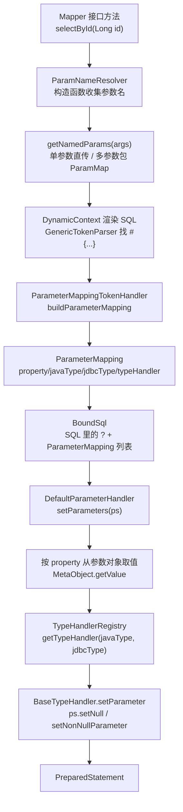
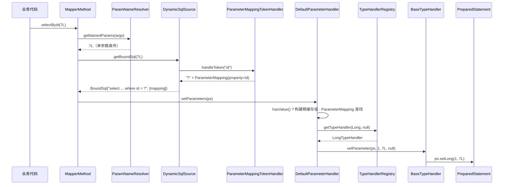

# 参数映射：`ParameterMapping` 与 `TypeHandler`

> 一句话结论：`#{name}` 从字符串到 JDBC 参数要走四步——**参数名解析（`ParamNameResolver`）→ 映射构建（`ParameterMappingTokenHandler` 产出 `ParameterMapping`）→ 值定位（`DefaultParameterHandler`）→ 类型落库（`TypeHandlerRegistry` 选 handler，`BaseTypeHandler` 调 `ps.setXxx`）**，四步之间的唯一纽带是 `ParameterMapping.property`。
>
> 阅读前置：读完 `01-动态sql-sqlnode树的构建与应用.md`（知道 `#{}` 会被 `DynamicContext` 里的 `GenericTokenParser` 交给 `ParameterMappingTokenHandler`）；了解 JDBC `PreparedStatement#setXxx` 的基本用法；知道什么是注解与方法反射参数名。
>
> 预计阅读：55 分钟 ｜ 源码：mybatis@3.6.0

## 0. 先看现象（3 分钟上手）

先看三个"看起来都能跑、实际上只有一个能跑"的写法，它们全部由 `ParamNameResolver` 的规则决定：

```text
// ① 单参数：不用 @Param 也能跑
User selectById(Long id);                       // XML: WHERE id = #{id}  ✅

// ② 多参数：必须 @Param，否则 XML 里写 #{} 会抛异常
User selectBy2(Long id, String name);            // XML: #{id}          ❌ BindingException
User selectBy2(@Param("id") Long id, @Param("name") String name);  // ✅

// ③ 多个参数但改用 param1/param2：不写 @Param 也能跑
User selectBy2(Long id, String name);            // XML: #{param1} #{param2}  ✅
```

再看一个运行期异常，它来自 `BaseTypeHandler`，是新手遇到的第一个"参数映射"报错：

```text
org.apache.ibatis.type.TypeException: Could not set parameters for mapping:
ParameterMapping{property='createTime', mode=IN, javaType=class java.lang.Object, jdbcType=null, ...}.
Cause: org.apache.ibatis.type.TypeException: Error setting null for parameter #1 with JdbcType OTHER .
Try setting a different JdbcType for this parameter or a different jdbcTypeForNull configuration property. Cause: java.sql.SQLException: 无效的列类型: 1111
```

这三段现象背后是同一套代码：`ParamNameResolver` 决定"参数对象长什么样"，`ParameterMapping` 记住"这个 `?` 对应哪个属性、什么 Java 类型、什么 JDBC 类型、用哪个 handler"，`DefaultParameterHandler` 在每次执行时按 `parameterMappings` 逐个 `setParameter`。

### 0.1 一张表记住 `#{}` 里的 key

| `#{}` 内写法 | 作用 | 谁解析 |
| --- | --- | --- |
| `#{id}` | 属性名 / Map key | `ParameterExpression#property` |
| `#{id, javaType=int}` | 强制 Java 类型 | `ParameterMappingTokenHandler#buildParameterMapping` |
| `#{id, jdbcType=INTEGER}` | 强制 JDBC 类型（null 值必需） | 同上 |
| `#{id, typeHandler=xxx}` | 指定 handler 别名或全类名 | `resolveTypeHandler` |
| `#{id, mode=OUT}` / `mode=INOUT` | 存储过程出参 | `resolveParameterMode` |
| `#{id, numericScale=2}` / `resultMap=xxx` / `jdbcTypeName=xxx` | 冷门选项 | 同上 |

## 1. 整体地图（先图后码）



**读图说明**：上图从上到下就是"一次查询的参数侧全链路"——上半部分（A→G）发生在 **SQL 构建期**（`SqlSession#selectList` 里 `getBoundSql` 那一刻），下半部分（H→L）发生在 **参数绑定期**（`PreparedStatementHandler#parameterize`）。两条路径通过 `BoundSql` 里的 `List<ParameterMapping>` 衔接：**`BoundSql` 里只有 `?` 和映射元数据，真正的值要到 `DefaultParameterHandler` 才去对象里取**。这也解释了为什么同一个 `MappedStatement` 可以被不同参数对象复用——SQL 文本和映射在构建期确定，值在运行期定位。

关键类职责一览：

| 类 | 所在包 | 一句话职责 |
| --- | --- | --- |
| `ParamNameResolver` | `org.apache.ibatis.reflection` | 把方法参数数组变成"命名参数对象"（单值或 `ParamMap`） |
| `ParameterExpression` | `org.apache.ibatis.builder` | 解析 `#{a, jdbcType=INTEGER}` 这一段文本 |
| `ParameterMappingTokenHandler` | `org.apache.ibatis.builder` | 把每段 `#{...}` 变成 `ParameterMapping` 并返回 `"?"` |
| `ParameterMapping` | `org.apache.ibatis.mapping` | 一个 `?` 的全套元数据（含 value 缓存） |
| `DefaultParameterHandler` | `org.apache.ibatis.scripting.defaults` | 遍历映射、取值、选 handler、调 `setParameter` |
| `TypeHandlerRegistry` | `org.apache.ibatis.type` | Java 类型 + JdbcType → `TypeHandler` 的注册表 |
| `BaseTypeHandler` | `org.apache.ibatis.type` | 统一 null 处理与异常包装的模板基类 |

## 2. 关键类逐个拆

### 2.1 `ParamNameResolver`：注解、`RowBounds`、`collection`

```java
// 这是 ParamNameResolver 的类注释，直接给出三条命名规则
[] 
```

上面那块注释是"源码里的权威说明"，下面用表格把它翻成人话（注释原文见 [[源码:ParamNameResolver.java#L53-L63]]）：

| 方法签名 | `names` 映射 | 说明 |
| --- | --- | --- |
| `aMethod(@Param("M") int a, @Param("N") int b)` | `{0:"M", 1:"N"}` | 以 `@Param` 为准 |
| `aMethod(int a, int b)` | `{0:"0", 1:"1"}` | 没开 `useActualParamName` 时用下标字符串 |
| `aMethod(int a, RowBounds rb, int b)` | `{0:"0", 2:"1"}` | `RowBounds` 被跳过，**后面的参数下标不重排** |

最后一行是最容易被忽略的细节：`RowBounds`/`ResultHandler` 被 `continue` 掉，所以 `names` 是 `{0:"0", 2:"1"}` 而不是 `{0:"0", 1:"1"}`。真正的参数名由 `useActualParamName`（默认 `true`，需要编译时 `-parameters`）从字节码读出来，读不到才退回下标字符串。

### 2.2 `ParameterMapping`：一个 `?` 的档案

`ParameterMapping` 是纯数据对象，`Builder` 校验 `javaType=ResultSet` 时必须配套 `resultMap`。它还有一个 `value` 字段（初始是一个 `UNSET` 哨兵），这是 3.6 的一个优化伏笔：**如果构建期就能确定值，就把它缓存进 `ParameterMapping`，运行期不必再去对象里取**（见 3.6 节 `hasValue()` 分支）。

### 2.3 `TypeHandler` 家族：`TypeHandler` → `BaseTypeHandler` → 具体实现

`TypeHandler` 只有 5 个方法：`setParameter` 一个 + `getResult` 三个重载。真实业务里我们几乎总是继承 `BaseTypeHandler`，因为它提供了 **null 值处理 + 异常包装** 的模板逻辑，子类只需实现 `setNonNullParameter` 和 `getNullableResult`。

### 2.4 `TypeHandlerRegistry`：三层回退

`getTypeHandler(Type, JdbcType)` 的回退顺序是"精确 → 同类型无 JdbcType → 唯一 handler → 智能 handler → 参数化类型降级"，这是"为什么我注册了一个 `EnumTypeHandler` 全部枚举都生效"的答案。

## 3. 源码逐段精读

### 3.1 `ParamNameResolver` 构造：谁被跳过、谁被命名

```java (src: ParamNameResolver.java#L70-L109)
  public ParamNameResolver(Configuration config, Method method, Class<?> mapperClass) {
    this.useActualParamName = config.isUseActualParamName();
    final Class<?>[] paramTypes = method.getParameterTypes();
    final Annotation[][] paramAnnotations = method.getParameterAnnotations();
    final SortedMap<Integer, String> map = new TreeMap<>();
    Type[] actualParamTypes = TypeParameterResolver.resolveParamTypes(method, mapperClass);
    int paramCount = paramAnnotations.length;
    // get names from @Param annotations
    for (int paramIndex = 0; paramIndex < paramCount; paramIndex++) {
      if (isSpecialParameter(paramTypes[paramIndex])) {
        // skip special parameters
        continue;
      }
      String name = null;
      for (Annotation annotation : paramAnnotations[paramIndex]) {
        if (annotation instanceof Param) {
          hasParamAnnotation = true;
          useParamMap = true;
          name = ((Param) annotation).value();
          break;
        }
      }
      if (name == null) {
        // @Param was not specified.
        if (useActualParamName) {
          name = getActualParamName(method, paramIndex);
        }
        if (name == null) {
          // use the parameter index as the name ("0", "1", ...)
          // gcode issue #71
          name = String.valueOf(map.size());
        }
      }
      map.put(paramIndex, name);
      typeMap.put(name, actualParamTypes[paramIndex]);
    }
    names = Collections.unmodifiableSortedMap(map);
    if (names.size() > 1) {
      useParamMap = true;
    }
```

**这段在做什么**：遍历方法形参，跳过 `RowBounds`/`ResultHandler`（由 3.2 的 `isSpecialParameter` 判定），为每个"真实参数"确定一个名字，并按"原始参数下标 → 名字"存进 `TreeMap`，同时记录"名字 → 泛型类型"。

**为什么这么写**：`Map<Integer, String>` 而不是 `List<String>`，是为了保留**原始下标**——`getNamedParams` 需要用下标去 `args` 里取值，同时"下标可以不连续"这一事实（跳过 `RowBounds` 后）也必须可表达。名字的优先级是 `@Param` > 真实参数名（`-parameters`）> 下标字符串，这三级回退保证"无论怎么编译都能跑"。

**如果改了会怎样**：如果把 `TreeMap` 换成 `ArrayList`，`RowBounds` 之后的参数会被错误地对应到前一个实参，`select(int a, RowBounds rb, int b)` 会把 `b` 的实参传给 `a` 的槽位——这是"`RowBounds` 之后参数错位"这类经典 bug 的根因。如果去掉 `if (names.size() > 1) useParamMap = true;`，单参数情况下 `getNamedParams` 会返回 `ParamMap`，下游 `MetaClass` 就无法再按"整个对象"推断类型，`#{createTime}` 的 `javaType` 会退化成 `Object`。

**坑位**：`useActualParamName=true`（默认）依赖编译参数 `-parameters`；Spring Boot 的 `spring-boot-maven-plugin` 与 `maven-compiler-plugin` 3.6.2+ 默认带 `-parameters`，但如果你用 `javac` 裸编译、或用 Kotlin/Groovy 某些配置，真实参数名可能读不到，此时 `@Param` 是唯一可靠写法。

### 3.2 `isSpecialParameter`：哪些参数不进 `names`

```java (src: ParamNameResolver.java#L135-L146)
  private static boolean isSpecialParameter(Class<?> clazz) {
    return RowBounds.class.isAssignableFrom(clazz) || ResultHandler.class.isAssignableFrom(clazz);
  }

  /**
   * Returns parameter names referenced by SQL providers.
   *
   * @return the names
   */
  public String[] getNames() {
    return names.values().toArray(new String[0]);
  }
```

**这段在做什么**：只有两类参数被认定为"特殊"——`RowBounds`（逻辑分页参数）和 `ResultHandler`（结果回调）。`getNames()` 是给 `@SelectProvider` 之类"SQL 提供者"用的：它需要知道方法有哪些参数名才能拼 SQL。

**为什么这么写**：这两个类型不由用户 SQL 引用，而是由 MyBatis 框架在 `MapperMethod` 里取出来用于控制执行（`RowBounds` 决定 limit/offset，`ResultHandler` 决定结果怎么消费）。把它们排除在 `names` 之外，才能让"参数个数"这个判断（`paramCount == 1`）不被污染——否则 `selectById(Long id, RowBounds rb)` 会被当成双参数，进而要求 `@Param`。

**如果改了会怎样**：如果不在 `MapperMethod` 层剥离而只在这里跳过，`args` 数组仍然带着 `RowBounds`，`args[names.firstKey()]` 取值就会错位；所以 `MapperMethod` 与 `ParamNameResolver` 必须"同一套特殊参数清单"。3.6 里 `MapperMethod` 用的是同一组类型判断（见 [02-SqlSession与执行器](../02-SqlSession与执行器/README.md) 里 `MapperMethod` 部分）。

**坑位**：`Page`（`PageHelper` 的）**不是**特殊参数，所以 `selectList(Page page, @Param("q") Query q)` 里 `Page` 也会被当成普通参数参与命名，结果 `names.size()` 变成 2、`useParamMap=true`——这就是 PageHelper 会去改写参数对象（把它从 `args` 挪走）的原因。

### 3.3 `getNamedParams`：单参数直传，多参数包 `ParamMap`

```java (src: ParamNameResolver.java#L157-L180)
  public Object getNamedParams(Object[] args) {
    final int paramCount = names.size();
    if (args == null || paramCount == 0) {
      return null;
    }
    if (!hasParamAnnotation && paramCount == 1) {
      Object value = args[names.firstKey()];
      return wrapToMapIfCollection(value, useActualParamName ? names.get(names.firstKey()) : null);
    } else {
      final Map<String, Object> param = new ParamMap<>();
      int i = 0;
      for (Map.Entry<Integer, String> entry : names.entrySet()) {
        param.put(entry.getValue(), args[entry.getKey()]);
        // add generic param names (param1, param2, ...)
        final String genericParamName = i < 10 ? GENERIC_NAME_CACHE[i] : GENERIC_NAME_PREFIX + (i + 1);
        // ensure not to overwrite parameter named with @Param
        if (!names.containsValue(genericParamName)) {
          param.put(genericParamName, args[entry.getKey()]);
        }
        i++;
      }
      return param;
    }
  }
```

**这段在做什么**：这是"**为什么单参数不用 `@Param`、多参数必须用**"的源码答案。三种分支：
1. `paramCount == 0` → `null`（无参方法）。
2. `!hasParamAnnotation && paramCount == 1` → **直接把实参本身当参数对象**（不包装），只对集合/数组做 `wrapToMapIfCollection` 包装。
3. 其它情况 → 造一个 `ParamMap`，每个名字一个 key，**额外加 `param1..paramN` 别名**，但别名不覆盖 `@Param` 已占用的名字。

**为什么这么写**：单参数直传是"能用就不绕路"的设计——`selectById(Long id)` 的参数对象就是那个 `Long`，于是 `#{id}` 的 `javaType` 可以从 `Long` 直接推断，`typeHandler` 也直接可用（`DefaultParameterHandler` 的"参数对象本身就是值"分支）。一旦有了第二个参数，参数对象只能是 `Map`，Map 的 value 类型是 `Object`，所以 `#{name}` 的类型推断只能靠 `ParamNameResolver#getType` 回头查方法签名——这就是多参数下 `javaType` 更容易退化为 `Object` 的原因。

**如果改了会怎样**：如果单参数也包装成 `ParamMap`，`selectById(Long id)` 的 `#{id}` 立刻失效（Map 里只有 `id` 和 `param1`，没有 `Long` 的"自身值"语义），于是所有单参数 XML 都得改写成 `#{param1}`——这正是 3.4 之后被移除的老行为。反过来，如果多参数不注入 `param1..paramN`，那些"只写 `#{param1}`"的老代码（3.4.2 之前的主流写法）全部失效。

**坑位**：`hasParamAnnotation` 是"任一参数带 `@Param` 就为 true"，所以 `selectA(@Param("id") Long id)`（**单参数但带注解**）会走 `ParamMap` 分支，参数对象变成 `{id: 1, param1: 1}`——此时 XML 里写 `#{id}` 可以，但"直接写 `#{anything}` 让 MyBatis 用整个对象"就不行了。

### 3.4 `wrapToMapIfCollection`：`collection`/`list`/`array` 从哪来

```java (src: ParamNameResolver.java#L222-L239)
  public static Object wrapToMapIfCollection(Object object, String actualParamName) {
    if (object instanceof Collection) {
      ParamMap<Object> map = new ParamMap<>();
      map.put("collection", object);
      if (object instanceof List) {
        map.put("list", object);
      }
      Optional.ofNullable(actualParamName).ifPresent(name -> map.put(name, object));
      return map;
    }
    if (object != null && object.getClass().isArray()) {
      ParamMap<Object> map = new ParamMap<>();
      map.put("array", object);
      Optional.ofNullable(actualParamName).ifPresent(name -> map.put(name, object));
      return map;
    }
    return object;
  }
```

**这段在做什么**：单参数是集合或数组时，把它塞进 `ParamMap` 并准备三套 key：`collection`（任何 `Collection`）、`list`（仅 `List`）、`array`（任何数组），外加真实参数名（如 `ids`）。

**为什么这么写**：`<foreach collection="...">` 需要一个属性名去取集合，但"单参数直传"时参数对象本身就是集合，`MetaObject` 无法从 `List` 上读出一个叫 `collection` 的属性。这层包装既保留了老写法（`#{collection}` / `<foreach collection="list">`），又让真实参数名可用（`<foreach collection="ids">`），且因为 `ParamMap` 是 `HashMap` 子类，`MapperMethod` 的"参数个数"逻辑不受影响。

**如果改了会怎样**：如果去掉包装，`List<Long> ids` 单参数直接传，`<foreach collection="ids">` 立刻报 `There is no getter for property named 'ids' in 'class java.util.ArrayList'`——这是 3.5.5 之前最著名的坑之一。如果只放 `collection` 不放真实名字，`<foreach collection="ids">` 这种"可读写法"就不可能存在。

**坑位**：`Set` 没有 `list` 这个 key，`<foreach collection="list">` 对 `Set` 参数会失败；数组也没有 `list`/`collection`，只有 `array`。另外**多参数**时不再自动包装，此时 `#{ids}`/`<foreach collection="ids">` 用的是 `@Param("ids")` 的名字，`collection`/`list` 别名则不再存在。

### 3.5 `getType`：`param1` 与 `ids[0]` 的类型回溯

```java (src: ParamNameResolver.java#L182-L208)
  public Type getType(String name) {
    PropertyTokenizer propertyTokenizer = new PropertyTokenizer(name);
    String unindexed = propertyTokenizer.getName();
    Type type = typeMap.get(unindexed);

    if (type == null && unindexed.startsWith(GENERIC_NAME_PREFIX)) {
      try {
        Integer paramIndex = Integer.valueOf(unindexed.substring(GENERIC_NAME_PREFIX.length())) - 1;
        unindexed = names.get(paramIndex);
        if (unindexed != null) {
          type = typeMap.get(unindexed);
        }
      } catch (NumberFormatException e) {
        // user mistake
      }
    }

    if (propertyTokenizer.getIndex() != null) {
      if (type instanceof ParameterizedType) {
        Type[] typeArgs = ((ParameterizedType) type).getActualTypeArguments();
        return typeArgs[0];
      } else if (type instanceof Class && ((Class<?>) type).isArray()) {
        return ((Class<?>) type).getComponentType();
      }
    }
    return type;
  }
```

**这段在做什么**：三段逻辑——先按名字直查 `typeMap`；查不到且名字以 `param` 开头，就把 `param3` 翻译成第 3 个参数的**真实名字**再查一次；若名字带下标（`ids[0]`、`ids[0].name`），则把 `List<T>` 降级为 `T`、数组降级为组件类型。

**为什么这么写**：这个方法服务于 `ParameterMappingTokenHandler#figureOutJavaType` 的 `ParamMap` 分支——多参数时参数对象是 `ParamMap`，类型信息只能回方法签名里找。没有它，`#{param1}` 这类写法在 3.6 里就推不出 `javaType`，只能落到 `Object`，进而可能走到 `UnknownTypeHandler`。

**如果改了会怎样**：如果去掉 `param` 前缀回溯，`#{param1}` 的 `javaType` 会退化为 `Object.class`，对于 `null` 值场景会显著增加"必须写 `jdbcType`"的概率。如果去掉下标降级，`#{ids[0]}` 的 `javaType` 会是 `List`，`TypeHandlerRegistry` 找不到 `List` 的 handler，直接抛 `Could not find type handler`。

**坑位**：`param` 前缀回溯只处理 `param1..paramN`，`#{param0}` 会被算成 `names.get(-1)` → `null` → 返回 `null`，最终 `javaType=Object` 而不是报错——属于"静默降级"，排查时容易看花眼。

### 3.6 `DefaultParameterHandler#setParameters`（上）：取值路径

```java (src: DefaultParameterHandler.java#L89-L119)
  @SuppressWarnings({ "rawtypes", "unchecked" })
  @Override
  public void setParameters(PreparedStatement ps) {
    ErrorContext.instance().activity("setting parameters").object(mappedStatement.getParameterMap().getId());
    List<ParameterMapping> parameterMappings = boundSql.getParameterMappings();
    if (parameterMappings != null) {
      ParamNameResolver paramNameResolver = mappedStatement.getParamNameResolver();
      for (int i = 0; i < parameterMappings.size(); i++) {
        ParameterMapping parameterMapping = parameterMappings.get(i);
        if (parameterMapping.getMode() != ParameterMode.OUT) {
          Object value;
          String propertyName = parameterMapping.getProperty();
          JdbcType jdbcType = parameterMapping.getJdbcType();
          JdbcType actualJdbcType = jdbcType == null ? getParamJdbcType(ps, i + 1) : jdbcType;
          Type propertyGenericType = null;
          TypeHandler typeHandler = parameterMapping.getTypeHandler();
          if (parameterMapping.hasValue()) {
            value = parameterMapping.getValue();
          } else if (boundSql.hasAdditionalParameter(propertyName)) { // issue #448 ask first for additional params
            value = boundSql.getAdditionalParameter(propertyName);
          } else if (parameterObject == null) {
            value = null;
          } else {
            Class<? extends Object> parameterClass = parameterObject.getClass();
            TypeHandler paramTypeHandler = typeHandlerRegistry.getTypeHandler(parameterClass, actualJdbcType);
            if (paramTypeHandler != null) {
              value = parameterObject;
              typeHandler = paramTypeHandler;
            } else {
              paramMetaObject = getParamMetaObject();
              value = paramMetaObject.getValue(propertyName);
```

**这段在做什么**：按 `parameterMappings` 的顺序逐个 `?`（位置 `i + 1`）取值，取值有**五级优先级**：
1. `parameterMapping.hasValue()` —— 构建期已缓存的值（3.6 新增优化）；
2. `boundSql.hasAdditionalParameter(propertyName)` —— 动态 SQL 的额外变量（`<foreach>` 的 `item`、`<bind>` 的变量、`_parameter` 等）；
3. `parameterObject == null` → 值就是 `null`；
4. **参数对象本身就是这个值**（`typeHandlerRegistry.getTypeHandler(parameterClass, ...)` 非空，典型是单参数 `Long`/`String`）；
5. 否则用 `MetaObject#getValue(propertyName)` 从对象/Map 上按属性路径取值。

**为什么这么写**：这五级顺序精确反映了"值可能来自哪里"。`additionalParameter` 排在"参数对象"之前，是因为 `<foreach>` 的 `item` 变量只存在于 `BoundSql.additionalParameters` 里，参数对象上根本没有这个名字——顺序错了就会 `There is no getter for property named 'item'`。`hasValue()` 排第一是 3.6 的性能优化：构建期已经能确定的值（例如 `#{id}` 且参数对象是单值、或 `RawSqlSource` 在启动期就绑定好的常量）不必每行都再反射一次。

**如果改了会怎样**：如果先查 `parameterObject` 再查 `additionalParameter`，`<foreach item="id">` 里 `#{id}` 会先在参数对象上找 `id` 属性，找不到就抛 `ReflectionException`；如果去掉 `hasValue()` 分支，单值参数每次都要重新走 `parameterObject.getClass()` 的 handler 查询，高频简单查询会多一次 `ConcurrentHashMap` 查找（3.6 的优化动机）。

**坑位**：`getParamJdbcType(ps, i + 1)` 在 `jdbcType` 为空时**每行都问一次数据库元数据**（`ps.getParameterMetaData()`），某些驱动（老版本 MySQL Connector）会因此额外一次 round-trip，性能与稳定性都受影响——这是"能在 `#{}` 里写清 `jdbcType` 就别省"的性能理由。

### 3.7 `DefaultParameterHandler#setParameters`（下）：类型兜底与落库

```java (src: DefaultParameterHandler.java#L153-L177)
          if (value == null) {
            if (jdbcType == null) {
              jdbcType = configuration.getJdbcTypeForNull();
            }
            if (typeHandler == null) {
              typeHandler = ObjectTypeHandler.INSTANCE;
            }
          } else if (typeHandler == null) {
            if (propertyGenericType == null) {
              propertyGenericType = value.getClass();
            }
            typeHandler = typeHandlerRegistry.getTypeHandler(propertyGenericType, actualJdbcType, null);
          }
          if (typeHandler == null) {
            typeHandler = typeHandlerRegistry.getTypeHandler(actualJdbcType);
          }
          if (typeHandler == null) {
            throw new TypeException("Could not find type handler for Java type '" + propertyGenericType.getTypeName()
                + "' nor JDBC type '" + actualJdbcType + "'");
          }
          try {
            typeHandler.setParameter(ps, i + 1, value, jdbcType);
          } catch (TypeException | SQLException e) {
            throw new TypeException("Could not set parameters for mapping: " + parameterMapping + ". Cause: " + e, e);
          }
```

**这段在做什么**：值确定之后的"类型兜底三连"：值为 `null` 时用 `configuration.getJdbcTypeForNull()`（默认 `JdbcType.OTHER`）+ `ObjectTypeHandler`；值非空但没有 handler 时按运行时 `value.getClass()` 再查一次；最后还查不到就按 `jdbcType` 单独找 handler，仍找不到才抛异常。异常文本"Could not set parameters for mapping: ..." 是排查参数问题的第一手证据。

**为什么这么写**：`null` 分支必须借 `jdbcType` 才能 `ps.setNull(i, type)`，这是 JDBC 的硬性要求；而 `null` 又无法推断类型，于是提供一个全局默认 `jdbcTypeForNull`（默认 `OTHER`）。`ObjectTypeHandler` 的作用是"把任意值按 `setObject` 塞进去"，它只负责 `ps.setObject`，所以 `null + OTHER` 的最终结果就是 `ps.setNull(i, Types.OTHER)`——Oracle/部分 MySQL 驱动会直接拒绝 `OTHER`，这就是 0 节那段报错的来源。

**如果改了会怎样**：如果 `null` 时不查 `jdbcTypeForNull` 而直接用 `parameterMapping.getJdbcType()`（可能为 `null`），`BaseTypeHandler` 会抛 `JDBC requires that the JdbcType must be specified for all nullable parameters.`。如果把 `propertyGenericType` 的兜底 `value.getClass()` 去掉，多参数 Map 里那些"声明类型推不出"的属性就永远找不到 handler，正常值也会报 `Could not find type handler`。

**坑位**：`propertyGenericType` 在异常信息里可能为 `null`，此时 `propertyGenericType.getTypeName()` 会抛 `NullPointerException` 把真正的错误盖掉——这是 3.6 里一个已知的异常信息瑕疵，看到 `NPE` 在 `setParameters` 里出现，先怀疑"handler 真的没找到"。

### 3.8 `getParamJdbcType`：向驱动要类型

```java (src: DefaultParameterHandler.java#L191-L203)
  private JdbcType getParamJdbcType(PreparedStatement ps, int paramIndex) {
    try {
      if (paramMetaData == null) {
        paramMetaData = ps.getParameterMetaData();
      }
      return paramMetaData == NULL_PARAM_METADATA ? null : JdbcType.forCode(paramMetaData.getParameterType(paramIndex));
    } catch (SQLException e) {
      if (paramMetaData == null) {
        paramMetaData = NULL_PARAM_METADATA;
      }
      return null;
    }
  }
```

**这段在做什么**：`jdbcType` 未指定时，尝试从 `PreparedStatement` 的参数元数据里拿到 JDBC 类型码，再翻成 `JdbcType`；拿不到（驱动不支持/抛异常）就缓存一个 `NULL_PARAM_METADATA` 哨兵，后续直接返回 `null`。

**为什么这么写**：这是"能自动推断就自动推断"的兜底尝试——很多驱动（如 PostgreSQL）能给出准确的参数类型，这样 `null` 值时无需用户写 `jdbcType`。哨兵 `NULL_PARAM_METADATA` 避免了"每个参数都抛一次 `SQLException`"的反复开销，属于典型的"负缓存"技巧。

**如果改了会怎样**：如果不做负缓存，一个 50 参数的 insert 在驱动不支持元数据时会抛 50 次异常、打 50 条堆栈；如果完全不尝试，所有 `null` 参数都必须显式 `jdbcType` 或改 `jdbcTypeForNull`。

**坑位**：`getParameterMetaData()` 在 MySQL 上有时被实现为一次服务端准备（`useServerPrepStmts=true` 时尤其），这会在**每行**都要调用时累积成性能问题；另外它返回的类型是"驱动认为的 SQL 类型"，可能与你要的类型不一致（例如 `VARCHAR` vs `NVARCHAR`），此时显式 `jdbcType` 更稳。

### 3.9 `ParameterMappingTokenHandler#buildParameterMapping`：把文本变成档案

```java (src: ParameterMappingTokenHandler.java#L85-L138)
  private ParameterMapping buildParameterMapping(String content) {
    Map<String, String> propertiesMap = parseParameterMapping(content);

    final String property = propertiesMap.remove("property");
    final JdbcType jdbcType = resolveJdbcType(propertiesMap.remove("jdbcType"));
    final String typeHandlerAlias = propertiesMap.remove("typeHandler");

    ParameterMapping.Builder builder = new ParameterMapping.Builder(configuration, property, (Class<?>) null);
    PropertyTokenizer propertyTokenizer = new PropertyTokenizer(property);
    builder.jdbcType(jdbcType);
    final Class<?> javaType = figureOutJavaType(propertiesMap, property, propertyTokenizer, jdbcType);
    builder.javaType(javaType);
    if (genericType == null) {
      genericType = javaType;
    }
    if (typeHandler == null || typeHandlerAlias != null) {
      typeHandler = resolveTypeHandler(genericType, jdbcType, typeHandlerAlias);
    }
    builder.typeHandler(typeHandler);

    ParameterMode mode = null;
    for (Map.Entry<String, String> entry : propertiesMap.entrySet()) {
      String name = entry.getKey();
      String value = entry.getValue();
      if ("mode".equals(name)) {
        mode = resolveParameterMode(value);
        builder.mode(mode);
      } else if ("numericScale".equals(name)) {
        builder.numericScale(Integer.valueOf(value));
      } else if ("resultMap".equals(name)) {
        builder.resultMapId(value);
      } else if ("jdbcTypeName".equals(name)) {
        builder.jdbcTypeName(value);
      } else if ("expression".equals(name)) {
        throw new BuilderException("Expression based parameters are not supported yet");
      } else {
        throw new BuilderException("An invalid property '" + name + "' was found in mapping #{" + content
            + "}.  Valid properties are " + PARAMETER_PROPERTIES);
      }
    }
    if (!ParameterMode.OUT.equals(mode) && paramExists) {
      if (metaParameters.hasGetter(propertyTokenizer.getName())) {
        builder.value(metaParameters.getValue(property));
      } else if (parameterObject == null) {
        builder.value(null);
      } else if (typeHandlerRegistry.hasTypeHandler(parameterObject.getClass())) {
        builder.value(parameterObject);
      } else {
        MetaObject metaObject = configuration.newMetaObject(parameterObject);
        builder.value(metaObject.getValue(property));
      }
    }
    return builder.build();
  }
```

**这段在做什么**：把 `PropertyExpression` 解析出的 key-value 表逐项消费：先取 `property`/`jdbcType`/`typeHandler` 三个"前置项"，再 `figureOutJavaType` 决定 `javaType` 并解析 handler，然后循环处理 `mode`/`numericScale`/`resultMap`/`jdbcTypeName`，**任何未知 key 直接抛 `BuilderException`**。最后在 `paramExists`（参数对象已存在，即运行期构建）时把值预先绑定进 `ParameterMapping`。

**为什么这么写**：未知 key 立即报错，是为了把 `#{id, jdbcTyp=INTEGER}` 这种拼写错误在构建期就暴露，而不是让它在运行期静默当成 `Object`。`PARAMETER_PROPERTIES` 常量（`"javaType,jdbcType,mode,numericScale,resultMap,typeHandler,jdbcTypeName"`）就是错误信息里列出的白名单。

**如果改了会怎样**：如果忽略未知 key，一个拼错的 `typehandler` 会让自定义 handler 静默失效，排查成本极高。如果去掉 `paramExists` 的值绑定，3.6 的 `hasValue()` 快速路径就永远命中不了，`<foreach>` 里大量参数会重复反射。

**坑位**：`builder.value(...)` 分支里 `typeHandlerRegistry.hasTypeHandler(parameterObject.getClass())` 命中的是"单值参数对象"场景，此时 `property` 写成什么都无所谓、值就是整个对象——这解释了 `selectById(Long id)` 里 `#{anything}` 也能跑的怪现象（但**不推荐**这么写，因为 `getType`/类型推断会不一致）。

### 3.10 `figureOutJavaType`：`javaType` 的六种来源

```java (src: ParameterMappingTokenHandler.java#L140-L184)
  private Class<?> figureOutJavaType(Map<String, String> propertiesMap, String property,
      PropertyTokenizer propertyTokenizer, JdbcType jdbcType) {
    Class<?> javaType = resolveClass(propertiesMap.remove("javaType"));
    if (javaType != null) {
      return javaType;
    }
    if (metaParameters.hasGetter(propertyTokenizer.getName())) { // issue #448 get type from additional params
      return metaParameters.getGetterType(property);
    }
    typeHandler = resolveTypeHandler(parameterType, jdbcType, (Class<? extends TypeHandler<?>>) null);
    if (typeHandler != null) {
      return parameterType;
    }
    if (JdbcType.CURSOR.equals(jdbcType)) {
      return ResultSet.class;
    }
    if (paramNameResolver != null && ParamMap.class.equals(parameterType)) {
      Type actualParamType = paramNameResolver.getType(property);
      if (actualParamType instanceof Type) {
        MetaClass metaClass = MetaClass.forClass(actualParamType, configuration.getReflectorFactory());
        String multiParamsPropertyName;
        if (propertyTokenizer.hasNext()) {
          multiParamsPropertyName = propertyTokenizer.getChildren();
          if (metaClass.hasGetter(multiParamsPropertyName)) {
            Entry<Type, Class<?>> getterType = metaClass.getGenericGetterType(multiParamsPropertyName);
            genericType = getterType.getKey();
            return getterType.getValue();
          }
        } else {
          genericType = actualParamType;
        }
      }
      return Object.class;
    }
    if (Map.class.isAssignableFrom(parameterType)) {
      return Object.class;
    }
    MetaClass metaClass = MetaClass.forClass(parameterType, configuration.getReflectorFactory());
    if (metaClass.hasGetter(property)) {
      Entry<Type, Class<?>> getterType = metaClass.getGenericGetterType(property);
      genericType = getterType.getKey();
      return getterType.getValue();
    }
    return Object.class;
  }
```

**这段在做什么**：`javaType` 的优先级：① 显式 `javaType=` → ② 额外参数（`<bind>`/`<foreach item>`）的真实类型 → ③ 参数类型本身已有 handler（单值参数） → ④ `CURSOR` 特判为 `ResultSet` → ⑤ `ParamMap` 时回查 `ParamNameResolver#getType` → ⑥ `Map` 一律 `Object` → ⑦ 最后按 `MetaClass` 的 getter 泛型类型；都不行就 `Object.class`。

**为什么这么写**：`javaType` 决定后续 `TypeHandlerRegistry` 查表能否命中。第 ⑤ 步是这个方法存在的最大理由：多参数时 `parameterType=ParamMap`，如果不回查方法签名，1/2/3 类查询里的 `#{id}` 就会全部退化为 `Object`——而 `Object` 在 `getTypeHandler` 里有"只按精确 jdbcType 找"的特判（见 3.12），极易命中不到 handler。

**如果改了会怎样**：如果把 `Map` 分支挪到 `ParamMap` 分支之前，多参数场景会被 `Map → Object.class` 提前拦截，第 ⑤ 步永远不生效，所有 `@Param` 查询都退化为 `Object`。如果去掉 `hasGetter` 判断直接按 `parameterType` 返回，`selectOne(User u)` 里写错属性名 `#{nmae}` 也不会在构建期暴露——MyBatis 允许"构建期宽松、运行期严格"，是因为多参数时确实无法在构建期确定 Map 的 key 是否存在。

**坑位**：`paramNameResolver != null` 意味着 `RawSqlSource` 的启动期路径（`paramNameResolver` 可能为 `null`）会走不到第 ⑤ 步——这就是"启动期解析的静态 SQL 里 `#{id}` 的 `javaType` 常常是 `Object`"的原因，也是为什么 `RawSqlSource` 的映射在启动期就固化。

### 3.11 `parseParameterMapping`：错误信息里的语法提示

```java (src: ParameterMappingTokenHandler.java#L186-L195)
  private Map<String, String> parseParameterMapping(String content) {
    try {
      return new ParameterExpression(content);
    } catch (BuilderException ex) {
      throw ex;
    } catch (Exception ex) {
      throw new BuilderException("Parsing error was found in mapping #{" + content
          + "}.  Check syntax #{property|(expression), var1=value1, var2=value2, ...} ", ex);
    }
  }
```

**这段在做什么**：把 `#{...}` 里的内容交给 `ParameterExpression` 解析成 `property` + 若干 `key=value`；`BuilderException` 原样透出，其它异常统一包装成带语法提示的消息。

**为什么这么写**：`#{id, jdbcType=}`（值为空）这类语法错误最终会以 `NumberFormatException` 之类的形式冒出来，包装后用户能看到"Check syntax"提示；而 `PropertyExpression` 自己抛的 `BuilderException` 已经足够清楚，不必重复包装。

**如果改了会怎样**：如果统一包装，`PropertyExpression` 里更精确的错误（例如重复的 `property=`）会被外层信息盖住，排查时看不到关键原因。

**坑位**：`#{ (expression) }` 这种"表达式参数"在 3.6 里是**明确不支持**的（`throw new BuilderException("Expression based parameters are not supported yet")`），看到这个报错不要去找开关——它没有开关。

### 3.12 `TypeHandlerRegistry#getTypeHandler`：五层回退

```java (src: TypeHandlerRegistry.java#L250-L284)
  public TypeHandler<?> getTypeHandler(Type type, JdbcType jdbcType) {
    if (ParamMap.class.equals(type)) {
      return null;
    } else if (type == null) {
      return getTypeHandler(jdbcType);
    }

    TypeHandler<?> handler = null;
    Map<JdbcType, TypeHandler<?>> jdbcHandlerMap = getJdbcHandlerMap(type);

    if (Object.class.equals(type)) {
      if (jdbcHandlerMap != null) {
        handler = jdbcHandlerMap.get(jdbcType);
      }
      return handler;
    }

    if (jdbcHandlerMap != null) {
      handler = jdbcHandlerMap.get(jdbcType);
      if (handler == null) {
        handler = jdbcHandlerMap.get(null);
      }
      if (handler == null) {
        // #591
        handler = pickSoleHandler(jdbcHandlerMap);
      }
    }
    if (handler == null) {
      handler = getSmartHandler(type, jdbcType);
    }
    if (handler == null && type instanceof ParameterizedType) {
      handler = getTypeHandler((Class<?>) ((ParameterizedType) type).getRawType(), jdbcType);
    }
    return handler;
  }
```

**这段在做什么**：查 handler 的回退链：
- `ParamMap` → `null`（"参数对象是 Map，让调用方自己推断"）；
- `type == null` → 只按 `jdbcType` 查；
- **`Object.class` 特判：只做精确 `jdbcType` 匹配，不做任何回退**；
- 普通类型：`jdbcType` 精确 → `jdbcHandlerMap.get(null)`（该类型的默认 handler）→ `pickSoleHandler`（该类型只注册了一个 handler 就直接用它）；
- 仍没有 → `getSmartHandler`（`smartHandlers` 里按"构造器 + 泛型"动态实例化，枚举就是这条路径）；
- 最后 `ParameterizedType` 降级为 raw type 再查一次。

**为什么这么写**：这套回退的设计目标是"**尽量找到、但绝不猜错**"。#591 的 `pickSoleHandler` 解决的是"`LocalDateTime` 只注册了 `LocalDateTimeTypeHandler`，但 `jdbcType` 是 `TIMESTAMP` 之外的码"这类问题；而 `Object.class` 必须严格，否则"任意未知类型"都会命中 `ObjectTypeHandler`，导致 `byte[]`、`JSON` 之类被静默 `setObject`——这正是 `DefaultParameterHandler` 里 `Object` 类型抛 `Could not find type handler` 更容易发生的原因。

**如果改了会怎样**：如果给 `Object.class` 也加回退，`#{jsonField}` 在 `javaType` 退化为 `Object` 时会静默走 `ObjectTypeHandler`，某些驱动把 `String` 当 `CLOB` 处理，于是出现"字符串太长"或类型不匹配的隐蔽错误。如果去掉 `pickSoleHandler`，自定义类型必须显式注册 `jdbcType` 或 `javaType`。

**坑位**：`pickSoleHandler` 只在"该类型只有一个 handler"时生效；一旦你为同一个 Java 类型注册了两个（例如同时注册 `EnumTypeHandler` 和自定义 handler），`pickSoleHandler` 返回 `null`，回退链断在这里——这与"注册得越多越保险"的直觉相反。

### 3.13 `getSmartHandler`：枚举 handler 从哪来

```java (src: TypeHandlerRegistry.java#L286-L294)
  private TypeHandler<?> getSmartHandler(Type type, JdbcType jdbcType) {
    Constructor<?> candidate = null;

    for (Entry<Type, Constructor<?>> entry : smartHandlers.entrySet()) {
      Type registeredType = entry.getKey();
      if (registeredType.equals(type)) {
        candidate = entry.getValue();
        break;
      }
```

**这段在做什么**：遍历 `smartHandlers`（"构造器注册表"），先找"注册类型与目标类型**完全相同**"的构造器，命中就记下并 `break`（L290-L294）；没有完全相同的，再用 `isAssignableFrom` 走"可赋值"匹配（源码 L295-L307，`Class` 与 `ParameterizedType` 各一套分支），此时**不 break**，后面的注册可能更贴切；整个循环没有候选时，进入"枚举兜底"分支（L310 起）——`Enum.class.isAssignableFrom(clazz)` 为真就用 `defaultEnumTypeHandler` 现造一个 handler、顺手 `register` 进缓存再返回。

**为什么这么写**：`smartHandlers` 是为"延迟实例化的泛型 handler"准备的——handler 构造器上标注了 `@MappedTypes`/`@MappedJdbcTypes` 时，注册阶段只登记构造器，真用到某类型时才 `new`，避免为每个枚举 / 泛型类都提前造对象；"先精确、再可赋值、最后枚举兜底"这个三段式，让"给 `Enum` 注册的 handler"能服务所有枚举类。

**如果改了会怎样**：去掉 `isAssignableFrom` 这一段，"登记给 `Enum` 的构造器"就匹配不到具体的 `MyEnum`，枚举 handler 只能靠后面的兜底分支——而兜底分支只在"没有任何候选"时才会执行，也就是说一旦你还注册了别的可匹配 handler，枚举就彻底没 handler 可用了。

**坑位**：遍历顺序是 `HashMap` 的桶顺序，多个可赋值候选时"最后一个赢"（`candidate` 不断被覆盖、不相等的分支不 break），因此**不要让两个 handler 覆盖有继承关系的类型**，否则结果依赖 hash 顺序，换个 JDK 都可能变。

### 3.14 `BaseTypeHandler#setParameter`：null 值的唯一出口

```java (src: BaseTypeHandler.java#L58-L80)
  @Override
  public void setParameter(PreparedStatement ps, int i, T parameter, JdbcType jdbcType) throws SQLException {
    if (parameter == null) {
      if (jdbcType == null) {
        throw new TypeException("JDBC requires that the JdbcType must be specified for all nullable parameters.");
      }
      try {
        ps.setNull(i, jdbcType.TYPE_CODE);
      } catch (SQLException e) {
        throw new TypeException("Error setting null for parameter #" + i + " with JdbcType " + jdbcType + " . "
            + "Try setting a different JdbcType for this parameter or a different jdbcTypeForNull configuration property. "
            + "Cause: " + e, e);
      }
    } else {
      try {
        setNonNullParameter(ps, i, parameter, jdbcType);
      } catch (Exception e) {
        throw new TypeException("Error setting non null for parameter #" + i + " with JdbcType " + jdbcType + " . "
            + "Try setting a different JdbcType for this parameter or a different configuration property. " + "Cause: "
            + e, e);
      }
    }
  }
```

**这段在做什么**：模板方法——`null` 时 `ps.setNull(i, jdbcType.TYPE_CODE)`，非 `null` 时委派给子类 `setNonNullParameter`；两种失败都包装成 `TypeException` 并附上"换 jdbcType / 换 jdbcTypeForNull"的提示。

**为什么这么写**：JDBC 的 `setNull` 必须带类型码，所以 `null + 无 jdbcType` 是**无法执行**的组合，只能抛异常；把这段统一放在基类，保证所有内置 handler 行为一致。`TypeException` 里带参数序号 `#i`，是为了在多参数 SQL 里能定位到具体是第几个 `?`。

**如果改了会怎样**：如果 `null` 时默认用 `Types.VARCHAR`，PostgreSQL 的 `timestamp` 字段会报 "column is of type timestamp but expression is of type character varying"；如果异常都吞掉，`setNull` 失败的列会以"未初始化"的形式影响后续 `execute`，错误位置更远、更难查。

**坑位**：`druid` 等连接池包装 `PreparedStatement` 后 `setNull` 的行为可能与驱动不同；`Oracle` 的 `setNull(i, Types.OTHER)` 通常需要 `jdbcTypeName` 或改用 `setNull(i, Types.NULL)`（`JdbcType.NULL`）。

### 3.15 `BaseTypeHandler#getResult`：读结果的三条通道

```java (src: BaseTypeHandler.java#L82-L110)
  @Override
  public T getResult(ResultSet rs, String columnName) throws SQLException {
    try {
      return getNullableResult(rs, columnName);
    } catch (Exception e) {
      throw new ResultMapException("Error attempting to get column '" + columnName + "' from result set.  Cause: " + e,
          e);
    }
  }

  @Override
  public T getResult(ResultSet rs, int columnIndex) throws SQLException {
    try {
      return getNullableResult(rs, columnIndex);
    } catch (Exception e) {
      throw new ResultMapException("Error attempting to get column #" + columnIndex + " from result set.  Cause: " + e,
          e);
    }
  }

  @Override
  public T getResult(CallableStatement cs, int columnIndex) throws SQLException {
    try {
      return getNullableResult(cs, columnIndex);
    } catch (Exception e) {
      throw new ResultMapException(
          "Error attempting to get column #" + columnIndex + " from callable statement.  Cause: " + e, e);
    }
  }
```

**这段在做什么**：三个 `getResult` 重载分别对应"按列名取"（结果映射默认）、"按列号取"（`ResultSetWrapper` 优化后走这条）和"存储过程出参"，全部包装 `ResultMapException`。

**为什么这么写**：结果集读取的错误信息最有价值的上下文是"哪一列"，所以三种通道都把列名/列号写进异常消息；3.5.0 起基类不再调用 `wasNull()`，把 `null` 处理完全交给子类（见类注释），因此这里的职责只有"转发 + 包装"。

**如果改了会怎样**：如果只保留列名版本，`ResultSetWrapper` 无法按列号快速读取，列名重复时（`select a.id, b.id`）会出现"取到错的那一列"的经典问题——按列号读取正是为了避免这个。

**坑位**：自定义 handler 忘实现 `getNullableResult(CallableStatement, int)` 时，`CallableStatement` 出参场景会抛 `UnsupportedOperationException`（基类默认实现），报错点在建结果映射而不是在建参数，容易误判。

## 4. 一次完整执行时序



**读图说明**：注意 `ParameterMapping` 是**构建期产物**（`DSS → PMTH` 那一段），`setParameters` 只是消费它。这也意味着：同一个 `MappedStatement` 被 100 个线程并发调用时，`ParameterMapping` 列表是共享只读的（`StaticSqlSource` 里缓存），而值定位（`DefaultParameterHandler`）是每次执行新建的——`DefaultParameterHandler` 是 `StatementHandler` 的一部分，随 `SqlSession` 每次执行创建。

文字版时序（对应 `PreparedStatementHandler#parameterize` 到 `execute` 之间）：

1. `MapperMethod#execute` 把实参数组交给 `ParamNameResolver#getNamedParams` 得到参数对象；
2. `MappedStatement#getBoundSql(parameterObject)` 触发 `DynamicSqlSource#getBoundSql`，`DynamicContext` 渲染 SQL 时 `#{...}` 被替换为 `?` 并收集 `ParameterMapping`；
3. `BaseStatementHandler#prepare` 用 `BoundSql#getSql` 创建 `PreparedStatement`；
4. `PreparedStatementHandler#parameterize` 调用 `parameterHandler.setParameters(ps)`（默认实现即 `DefaultParameterHandler`）；
5. `DefaultParameterHandler` 逐个映射取值、选 handler、`setParameter`；
6. `ps.execute()`。

## 5. 设计模式与设计取舍

| 设计点 | 模式 | 取舍 |
| --- | --- | --- |
| `SqlNode` 树 / `TypeHandler` | 组合、策略 | 类型处理可无限扩展，代价是"找 handler"要多层回退 |
| `BaseTypeHandler` | 模板方法 | 统一 null 与异常，子类只写非空路径 |
| `ParameterMapping.Builder` | 建造者 | 参数属性多且可选，构造器会爆炸 |
| `ParameterMappingTokenHandler` | 词法回调用模板 | 把"文本 → 结构"集中在一处，代价是错误信息要自己造 |
| 构建期缓存值（`hasValue`） | 惰性优化 | 简单场景更快，代价是语义"值在构建期已定"不易察觉 |
| `ParamMap` + `param1..N` 别名 | 兼容层 | 新旧写法都能跑，代价是参数对象"有两种形态" |

真正的难点取舍有两个：

1. **"单参数直传" vs "统一包装成 Map"**：MyBatis 选了前者，因为单值参数能让 `javaType` 从对象本身推断，性能与准确性都更好；代价是"参数对象形状取决于方法签名"，同一个 XML 片段在单/多参数方法下行为可能不同。
2. **构建期能否确定值**：3.6 在 `ParameterMapping` 里加了 `value`，把"能确定的"提前算掉；代价是 `ParameterMapping` 从纯元数据变成了"元数据 + 值缓存"，多个 `BoundSql` 复用时需注意值是否过期（`BoundSql` 每次 `getBoundSql` 新建，所以不会串）。

## 6. 踩坑与调试手法

### 6.1 坑 1：`<if test="a != null and a != ''">` 对 `0`/`false` 的误判

`IfSqlNode` 用 OGNL 求 `test` 表达式：

- `a != ''` 对数字 `0`：OGNL 把 `0` 与空串比较时，`0` 会先被转成字符串 `"0"`，`"0" != ""` 为 `true`——**这一条能过**；
- 但当 `a` 是 `Boolean false` 时，`false != ''`…实际 OGNL 会把 `''` 当作 `Boolean` 的空值处理，结果为 `false`，于是"传了 `false`"被当成"没传"。

**结论**：判断"字符串是否非空"只应用于 `String`；判断数值/布尔时只写 `a != null`（布尔可再写一个 `a`、数值避免 `!= ''`）。这是 `IfSqlNode` + OGNL 语义的组合问题，不是 MyBatis 的 bug。

### 6.2 坑 2：集合为空导致 `IN ()`

`ForeachSqlNode#apply` 在集合为空时**直接 `return true`、什么都不输出**（不含 `open`/`close`）。于是：

```xml
where status = 1 and id in
<foreach collection="ids" item="id" open="(" close=")" separator=",">#{id}</foreach>
<!-- ids 为空时 → where status = 1 and id in    ← 语法错误 -->
```

正确姿势：`<if test="ids != null and ids.size() > 0">` 包住整个 `in` 片段，或用 `<choose>` 退化为 `and 1 = 0`。注意 `ids.size()` 对 `Collection` 可用；对数组要用 `ids.length`。

### 6.3 坑 3：`<foreach>` 的参数名

- 单参数集合：`<foreach collection="list">`（`List`）、`collection="collection"`（任意 `Collection`）、`collection="array"`（数组）；开了 `-parameters` 后还可以直接用真实参数名。
- 多参数：`collection` 必须是 `@Param` 的名字（如 `collection="ids"`），`list`/`collection` 别名**不存在**。
- `item` 是 `additionalParameters` 里的变量名，XML 里写 `#{id}`；如果 `item="id"` 与参数对象上的 `id` 属性重名，`additionalParameters` 优先（见 3.6 的五级优先级）。

### 6.4 坑 4：`null` 值的 `jdbcType.OTHER`

症状：`Error setting null for parameter #1 with JdbcType OTHER`。原因链：`value == null` → `jdbcType = configuration.getJdbcTypeForNull()`（默认 `OTHER`）→ `ObjectTypeHandler` → `ps.setNull(i, Types.OTHER)` → 部分驱动拒绝。

三种解法（按推荐度）：

1. XML 里写 `#{createTime, jdbcType=TIMESTAMP}`（最精确）；
2. 全局 `configuration.setJdbcTypeForNull(JdbcType.NULL)`（注意 `NULL` 也可能被某些驱动拒绝）；
3. 保证值不为 `null`（业务层兜底）。

### 6.5 坑 5：`ParamMap` 的参数名与 `@Param`

`@Param("orderBy") String orderBy` 与 `#{orderBy}` 必须一致；一旦改名，`ParamMap` 里就没有旧 key，`MetaObject#getValue` 会抛 `There is no getter for property named 'orderBy' in 'class org.apache.ibatis.binding.MapperMethod$ParamMap'`。

### 6.6 坑 6：`${}` 与 `#{}` 混用导致的注入

`${}` 由 `TextSqlNode` 直接做字符串替换（不产生 `?`），`#{}` 才走本篇文章的映射链路。`order by ${column}` 是常见且危险用法——参数化不了列名，只能白名单校验。

### 6.7 调试手法

| 手段 | 能看到什么 |
| --- | --- |
| `logging.level.你的mapper=DEBUG` | SQL + 参数（`Preparing: ...` / `Parameters: ...`） |
| 自定义插件打印 `BoundSql#getSql` + `getParameterMappings` | 映射的 `property/javaType/jdbcType/typeHandler` |
| `Configuration#getTypeHandlerRegistry()` 在启动后断点 | 某类型最终选了哪个 handler |
| 异常里的 `ParameterMapping{...}` 文本 | 该 `?` 的完整元数据（`DefaultParameterHandler` 异常已带） |

## 7. ⚠️ 版本差异

| 版本 | 变化 | 影响 |
| --- | --- | --- |
| 3.5.0 | `BaseTypeHandler` 不再调用 `wasNull()`，null 交给子类处理 | 自定义 handler 的 `getNullableResult` 必须自己判 `rs.wasNull()` |
| 3.5.0 | `ParamNameResolver` 的 `RowBounds` 跳过逻辑与 `names` 下标不连续 | `aMethod(a, RowBounds, b)` 的 `names` 是 `{0, 2}` |
| 3.5.5 | 新增 `ParamNameResolver#wrapToMapIfCollection` | 单参数集合可用真实参数名（`<foreach collection="ids">`） |
| 3.6.0 | `SqlSourceBuilder#parse` 被移除，只剩静态 `buildSqlSource` | `#{}` 解析搬进 `DynamicContext`；按 3.5 资料找 `parse` 会找不到 |
| 3.6.0 | `ParameterMapping` 新增 `value`/`hasValue()`，`DefaultParameterHandler` 优先用缓存值 | 构建期能确定的值不再每行反射 |
| 3.6.0 | `ParameterMappingTokenHandler` 支持"启动期"构造（`parameterObject == null`、`paramExists=false`） | `RawSqlSource` 在启动期就能产出完整 `ParameterMapping` |
| 3.6.0 | `TypeHandlerRegistry#getTypeHandler(TypeReference, JdbcType)` 标记 `@Deprecated` | 新代码用 `getTypeHandler(Type, JdbcType, Class)` |
| 3.6.0 | `DefaultParameterHandler#setParameters` 增加 `ParamNameResolver` + `metaClassCache` 的类型回溯 | 多参数 Map 的 `javaType` 推断显著改善 |
| 3.6.0 | `#{ (expression) }` 明确不支持（`BuilderException`） | 表达式参数不可用，无开关 |
| Boot 4 / mybatis-spring-boot 4.1 | `mybatis.*` 属性绑定到 `MybatisProperties.CoreConfiguration`（全是包装类型） | 只有非 `null` 值才会覆盖 `Configuration`（详见 [05 组 02](../05-Spring集成与Boot自动配置/README.md)） |

## 8. 面试高频问与答（≥10）

**Q1：为什么单参数不需要 `@Param`，多参数必须用？**

A：`ParamNameResolver#getNamedParams` 里，`!hasParamAnnotation && paramCount == 1` 时直接把实参**本身**作为参数对象返回，所以 `#{id}` 能通过 `MetaObject` 从 `Long` 上取值（严格说是走 `hasValue`/单值 handler 分支）；多参数时参数对象只能是 `ParamMap`，key 由 `@Param`（或真实参数名/下标）决定，XML 里写错名字就取不到。

**Q2：`param1`/`param2` 是什么时候注入的？会不会覆盖 `@Param`？**

A：`getNamedParams` 的 `ParamMap` 分支里，每个参数都额外 `put` 一个 `paramN`；但前面有 `if (!names.containsValue(genericParamName))` 保护，所以 `@Param("param1")` 的名字不会被覆盖，此时 `param2` 会跳过这个槽位（`i` 仍自增，但 `containsValue` 命中就不再写）。**注意**：这意味着"参数里有人叫 `param2`"时，第 2 个参数的 `param2` 别名会被跳过。

**Q3：`RowBounds` 为什么会让参数下标不连续？**

A：`isSpecialParameter` 判定 `RowBounds`/`ResultHandler` 后 `continue`，`names` 只记录真实参数，但 key 仍是**原始方法下标**（`{0:"0", 2:"1"}`）。`getNamedParams` 用 key 去 `args` 取值才不会错位；`getNames()` 返回的是"按顺序的名字数组"，不含特殊参数。

**Q4：`<foreach>` 里 `item` 的值从哪取？为什么强调 additionalParameter 优先？**

A：`ForeachSqlNode#applyItem` 调用 `context.bind(item, o)`，绑定进 `DynamicContext.bindings`，最终通过 `DynamicContext#getBindings` 传到 `BoundSql#setAdditionalParameter`（`DynamicSqlSource#getBoundSql` 末尾逐条写入）。`DefaultParameterHandler` 里 `boundSql.hasAdditionalParameter(propertyName)` 在"参数对象"之前判断，所以即使参数对象上也有同名属性，也以 `item` 变量为准。

**Q5：什么时候必须写 `jdbcType`？**

A：值为 `null` 且驱动无法从 `getParameterMetaData()` 得到类型时。`BaseTypeHandler#setParameter` 里 `parameter == null && jdbcType == null` 会直接抛 `TypeException`；实际更常见的是 `jdbcTypeForNull=OTHER` 被驱动拒绝。因此**只要可能出现 `null`，就写 `jdbcType`**（最稳），或全局改 `jdbcTypeForNull`。

**Q6：`javaType` 有哪些推断来源？为什么多参数常退化成 `Object`？**

A：见 3.10 的六级优先级。多参数时 `parameterType` 是 `ParamMap`，如果 `paramNameResolver` 为 `null`（例如 `RawSqlSource` 启动期）或 `getType` 查不到，就落到 `return Object.class`；`Object` 在 `TypeHandlerRegistry#getTypeHandler` 里只做精确 `jdbcType` 匹配，回退能力最弱。

**Q7：`TypeHandlerRegistry` 找 handler 的回退顺序？`pickSoleHandler` 是干什么的？**

A：`jdbcType` 精确 → `get(null)` → `pickSoleHandler`（#591）→ `getSmartHandler` → `ParameterizedType` 降级；`Object.class` 和 `ParamMap.class` 是特判（前者只精确匹配、后者直接返回 `null`）。`pickSoleHandler` 让"只注册了一个 handler 的类型"在 `jdbcType` 不完全匹配时仍能命中，但一旦注册了多个就失效。

**Q8：自定义 `TypeHandler` 有哪几种注册方式？**

A：① `mybatis-config.xml` 的 `<typeHandlers><typeHandler handler="..."/></typeHandlers>`；② 配置类里 `configuration.getTypeHandlerRegistry().register(...)`；③ Spring Boot 里声明 `TypeHandler` 的 `@Bean`（`MybatisAutoConfiguration` 会收集 `TypeHandler[]` 并 `setTypeHandlers`）；④ `@MappedTypes` + 包扫描（`typeHandlersPackage`）。注册的键是"Java 类型 + JdbcType"，`@MappedTypes`/`@MappedJdbcTypes` 决定键。

**Q9：枚举怎么处理？`EnumTypeHandler` 与 `EnumOrdinalTypeHandler` 区别？**

A：默认走 `EnumTypeHandler`（存 `name()` 字符串），`configuration.setDefaultEnumTypeHandler(EnumOrdinalTypeHandler.class)` 可改成存序号（`ordinal()`，脆弱，不推荐）。`TypeHandlerRegistry` 对 `Enum` 子类会在 `getSmartHandler` 里按 `defaultEnumTypeHandler` 现场注册。

**Q10：`#{id}` 与 `${id}` 在参数侧的本质区别？**

A：`#{}` 走本篇文章整条链路（`ParameterMapping` + `PreparedStatement` 占位符），值永不出现在 SQL 文本里；`${}` 由 `TextSqlNode` 直接字符串拼接（`OgnlCache` 取值后 `String.valueOf`，`null` 变空串 issue #274），没有 `ParameterMapping`，因此无法参数化、且存在注入风险。

**Q11：单参数集合为什么要包装成 `ParamMap`？不包装会怎样？**

A：因为 `MetaObject` 无法从 `ArrayList` 上读出 `collection`/`list` 属性，`<foreach collection="list">` 会报 `There is no getter for property named 'list'`。`wrapToMapIfCollection` 同时放入 `collection`、`list`/`array` 和真实参数名，三种写法都能兼容。

**Q12：`LocalDateTime` 在 3.6 里还需要自定义 handler 吗？**

A：不需要。3.6 内置 `LocalDateTimeTypeHandler`（`org.apache.ibatis.type`），`TypeHandlerRegistry` 默认注册。若数据库列是 `VARCHAR` 存 `yyyy-MM-dd HH:mm:ss`，才需要自定义 handler（`setNonNullParameter` 里转字符串、`getNullableResult` 里 parse）。

## 9. 动手练习（含验收标准）

### 练习 1：打印 `ParameterMapping` 清单

写一个 `Interceptor` 拦截 `StatementHandler#prepare`，拿到 `BoundSql` 后打印每个 `ParameterMapping` 的 `property`、`javaType`、`jdbcType`、`typeHandler` 类名。

**验收标准**：
- 单参数 `selectById(Long id)`：`javaType` 是 `java.lang.Long`（或 `Object` 但 `typeHandler` 非空），`jdbcType=null`；
- 多参数 `selectBy2(@Param("id") Long id, @Param("name") String name)`：两条映射的 `property` 分别是 `id`、`name`，`javaType` 分别为 `Long`、`String`；
- 多参数但用 `#{param1}`/`#{param2}`：`property` 是 `param1`/`param2`，`javaType` 能正确回溯到 `Long`/`String`。

### 练习 2：制造并修复 `null + OTHER`

**验收标准**：
- 先复现：`insert into t(create_time) values(#{createTime})` 传 `null`，观察到 `JdbcType OTHER` 报错（MySQL 8 驱动可能不报错，可换驱动版本或用 `ps.setNull(i, Types.OTHER)` 单测）；
- 修复 A：`#{createTime, jdbcType=TIMESTAMP}` → 通过；
- 修复 B：全局 `jdbcTypeForNull=NULL` → 通过（并说明为何 `NULL` 也不总安全）；
- 修复 C：自定义 `LocalDateTimeTypeHandler` 里把 `null` 映射为 `TIMESTAMP`。

### 练习 3：自定义 JSON 字段 `TypeHandler`

场景：`User.tags` 是 `List<String>`，数据库列是 `varchar` 存 JSON 数组。

**验收标准**：
- 继承 `BaseTypeHandler<List<String>>`，`@MappedTypes(List.class)` + `@MappedJdbcTypes(JdbcType.VARCHAR)`；
- `setNonNullParameter` 里序列化 + `ps.setString`；`getNullableResult` 里反序列化；
- 注册后在 XML 里 `#{tags, typeHandler=com.xx.JsonListTypeHandler}` 可用；
- 观察：不写 `typeHandler=` 时是否会命中你的 handler？说明 `@MappedTypes(List.class)` 与 `ParameterizedType` 降级分支的关系。

### 练习 4：验证 `pickSoleHandler` 的"唯一性"限制

**验收标准**：
- 给同一个 Java 类型注册两个 handler（同 `jdbcType` 也算两个不同的 `TypeHandler` 实例）；
- 观察 `getTypeHandler(type, 不同 jdbcType)` 是否还能命中；
- 写出结论：为什么"注册越多越保险"在这里不成立。

## 小结

- `#{name}` 的全链路是 `ParamNameResolver`（造参数对象）→ `ParameterMappingTokenHandler`（造 `ParameterMapping` + 占位符）→ `DefaultParameterHandler`（取值 + 选 handler）→ `BaseTypeHandler`（`setParameter`/`setNull`）。
- 单参数不用 `@Param` 是因为 `getNamedParams` 直传实参；多参数一定是 `ParamMap`，因此必须用 `@Param`（或 `paramN`/真实参数名）匹配 XML 里的名字。
- `javaType` 的推断有六级优先级，多参数场景依赖 `ParamNameResolver#getType` 回查方法签名；退化成 `Object` 时 handler 命中率最低。
- `null` 值必须带到 `jdbcType`（显式或 `jdbcTypeForNull`），否则 `BaseTypeHandler` 直接拒绝或在驱动层报 `OTHER` 类型错误。
- 3.6 的关键变化：`SqlSourceBuilder#parse` 已移除、`ParameterMapping` 增加值缓存、`ParamNameMappingTokenHandler` 支持启动期构建、表达式参数被明确拒绝。

## 自测题

1. `ParamNameResolver` 处理 `aMethod(int a, RowBounds rb, int b)` 后，`names` 的内容是什么？为什么 key 是 `{0, 2}` 而不是 `{0, 1}`？
<details><summary>参考答案</summary>
`{0:"0", 2:"1"}`。`RowBounds` 被 `isSpecialParameter` 判定为特殊参数后 `continue`，不进入 `names`；key 始终是**原始方法下标**，所以 `b` 的 key 是 2。这样 `getNamedParams` 用 key 索引 `args` 才不会错位。
</details>

2. 单参数方法 `selectById(Long id)` 上写了 `@Param("uid")`，参数对象是什么？XML 里 `#{id}` 还能用吗？
<details><summary>参考答案</summary>
参数对象是 `ParamMap`（因为 `hasParamAnnotation=true`，走 Map 分支），内容为 `{uid: 7L, param1: 7L}`。`#{id}` 取不到，会抛 `There is no getter for property named 'id'`；应写 `#{uid}` 或 `#{param1}`。
</details>

3. `wrapToMapIfCollection` 对 `Set<Long>` 和 `Long[]` 分别放入哪些 key？
<details><summary>参考答案</summary>
`Set<Long>`：`collection` + 真实参数名（不含 `list`，因为不是 `List`）。`Long[]`：`array` + 真实参数名。
</details>

4. `DefaultParameterHandler#setParameters` 里取值为何 `additionalParameter` 优先于 `parameterObject`？
<details><summary>参考答案</summary>
因为 `<foreach item>`/`<bind>` 产生的变量只存在于 `BoundSql.additionalParameters`，参数对象上没有该属性；若先查参数对象会抛 `ReflectionException`。`DynamicSqlSource#getBoundSql` 末尾把 `context.getBindings()` 逐条写入 `additionalParameters`。
</details>

5. `javaType` 推断的六级来源按顺序写出。
<details><summary>参考答案</summary>
① 显式 `javaType=`；② `additionalParameters` 的 getter 类型（issue #448）；③ `parameterType` 自身已有 handler 时用 `parameterType`；④ `JdbcType.CURSOR` → `ResultSet.class`；⑤ `ParamMap` → `ParamNameResolver#getType` 回溯方法签名；⑥ `Map` → `Object.class`，否则 `MetaClass` getter 泛型类型，兜底 `Object.class`。
</details>

6. 为什么 `Object.class` 在 `TypeHandlerRegistry#getTypeHandler` 里不做回退？
<details><summary>参考答案</summary>
避免"任意未知类型"都静默命中 `ObjectTypeHandler`，从而把 `byte[]`、JSON 字符串等按 `setObject` 传给驱动，产生隐蔽的类型错误。`Object` 只允许精确 `jdbcType` 匹配。
</details>

7. `pickSoleHandler` 什么时候返回 `null`？后果是什么？
<details><summary>参考答案</summary>
当该 Java 类型在 `jdbcHandlerMap` 里注册了多个 handler（不同 `JdbcType` 或多个实例）时返回 `null`；回退链因此断掉，`getSmartHandler` 也可能找不到，最终 `DefaultParameterHandler` 抛 `Could not find type handler for Java type ...`。
</details>

8. `BaseTypeHandler#setParameter` 遇到 `null` 且 `jdbcType` 为 `null` 时的行为？
<details><summary>参考答案</summary>
抛 `TypeException("JDBC requires that the JdbcType must be specified for all nullable parameters.")`。因为 JDBC 的 `setNull` 必须带类型码。
</details>

9. `#{id, jdbcTyp=INTEGER}` 会怎样？为什么？
<details><summary>参考答案</summary>
构建期抛 `BuilderException("An invalid property 'jdbcTyp' was found in mapping #{...}. Valid properties are javaType,jdbcType,mode,numericScale,resultMap,typeHandler,jdbcTypeName")`，因为 `buildParameterMapping` 对未知 key 严格报错。
</details>

10. `<foreach collection="list">` 在多参数方法里为什么经常失效？
<details><summary>参考答案</summary>
多参数时参数对象是 `ParamMap`，不会走 `wrapToMapIfCollection`，因此没有 `list`/`collection` 别名；必须写 `collection="ids"`（与 `@Param("ids")` 对应）。
</details>

11. 3.6 里 `ParameterMapping` 的 `value` 字段解决了什么问题？有没有风险？
<details><summary>参考答案</summary>
解决"构建期能确定的值每行重复反射"的性能问题（`hasValue()` 优先分支）。风险在于语义：值为构建期快照，若同一个 `ParameterMapping` 被跨执行复用（理论上 `BoundSql` 每次新建，不会发生），会读到过期值。
</details>

12. 写自定义 `TypeHandler` 时 `@MappedTypes` 与 `@MappedJdbcTypes` 各决定什么？
<details><summary>参考答案</summary>
`@MappedTypes` 决定注册键中的 Java 类型（可多个），`@MappedJdbcTypes` 决定注册键中的 `JdbcType`（不写则为 `null` 键，即"该类型的默认 handler"）。二者共同构成 `TypeHandlerRegistry` 的查表键。
</details>

13. 为什么说 `getParamJdbcType` 可能带来性能问题？
<details><summary>参考答案</summary>
它在 `jdbcType == null` 时对每个参数调用 `ps.getParameterMetaData()`，某些驱动（如 MySQL 服务端预处理）会触发额外 round-trip；失败后靠 `NULL_PARAM_METADATA` 负缓存止损。显式写 `jdbcType` 可完全跳过这一步。
</details>
