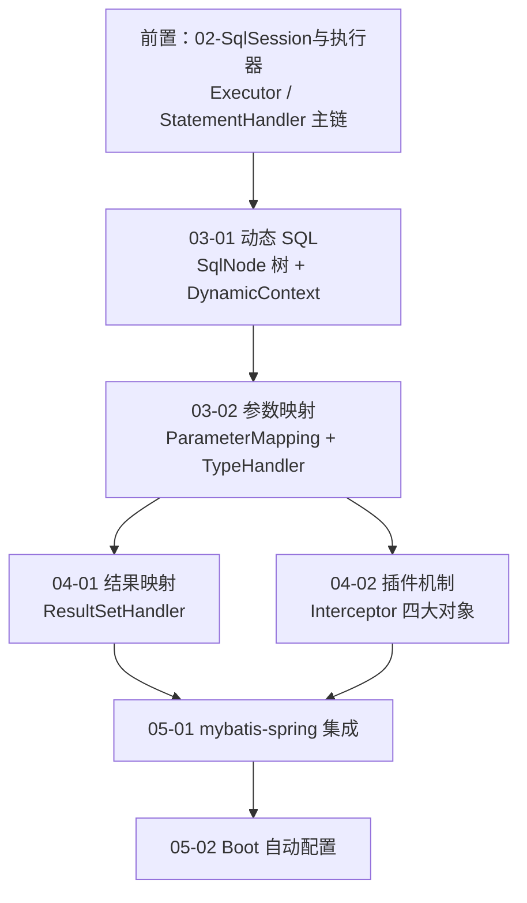

# 03-动态SQL与参数映射 · 目录导读

> 一句话结论：MyBatis 的"动态 SQL"不是运行时字符串拼接的黑魔法，而是一棵 `SqlNode` 语法树 + 一个 `DynamicContext` 缓冲区的**解释执行**；"参数映射"则是 `#{xxx}` 被解析成 `ParameterMapping` 后，由 `TypeHandler` 把 Java 值交给 `PreparedStatement`。

> 阅读前置：读完 `../README.md`（03-MyBatis 总览）与 `../02-SqlSession与执行器/README.md`（知道 `Executor#query` → `StatementHandler` 这条主链）。会写基本的 MyBatis XML mapper 即可，不需要提前懂 OGNL。

> 预计阅读：本组 2 篇，约 3~4 小时（含练习） ｜ 源码：mybatis@3.6.0

---

## 0. 学完这组你能回答什么

| 序号 | 问题 | 答案在哪篇 |
| --- | --- | --- |
| 1 | `<if>` / `<where>` / `<foreach>` 到底在什么时候被"算一次"？ | [01-动态sql-sqlnode树的构建与应用.md](./01-动态sql-sqlnode树的构建与应用.md) |
| 2 | 为什么有的语句启动时就把 `#{}` 换成了 `?`，有的每次执行都要重新解析？ | 01（`RawSqlSource` vs `DynamicSqlSource`） |
| 3 | `<where>` 是怎么把开头的 `AND` 悄悄吃掉的？ | 01（`TrimSqlNode#FilteredDynamicContext`） |
| 4 | `<if test="a != null and a != ''">` 为什么对 `0`、`false` 会误判？ | 01（`ExpressionEvaluator#evaluateBoolean` + OGNL） |
| 5 | 集合为空时为什么会拼出 `IN ()`？ | 01（`ForEachSqlNode#apply` 的空集合早退） |
| 6 | 单参数方法为什么不用 `@Param`，多参数就必须用？ | [02-参数映射-parametermapping与typehandler.md](./02-参数映射-parametermapping与typehandler.md) |
| 7 | `#{...}` 里的 `jdbcType` 什么时候必须写？不写会怎样？ | 02（`BaseTypeHandler#setParameter` 的 null 分支） |
| 8 | 自定义 `TypeHandler` 为什么有时候"注册了却不生效"？ | 02（`TypeHandlerRegistry#getTypeHandler` 的查找顺序） |

---

## 1. 推荐学习顺序

**读图说明**：图中的箭头是"知识依赖"而不是"时间顺序"——`03-01` 与 `03-02` 是同一枚硬币的两面（树在拼 SQL 的同时顺手产出 `ParameterMapping` 列表），必须先看懂 03-01 才能理解 03-02 里那些 `ParameterMapping` 是从哪冒出来的；之后 04 组的两篇分别走"出口（结果集）"与"横切（插件）"，最后汇入 Spring 集成。

---

## 2. 每篇摘要

### 2.1 [01-动态sql-sqlnode树的构建与应用.md](./01-动态sql-sqlnode树的构建与应用.md)

- **构建期**：`XMLScriptBuilder#parseDynamicTags` 把 `<if>`、`<foreach>` 等标签翻译成 `SqlNode` 实现类，返回一棵 `MixedSqlNode` 树；只有出现"会变化的节点"时 `isDynamic` 才为 `true`。
- **执行期**：`DynamicSqlSource#getBoundSql` 每次执行都新建 `DynamicContext`，调用 `rootSqlNode.apply(context)` 走一遍树，最后把缓冲区里的 SQL 交给 `SqlSourceBuilder#buildSqlSource`。
- **优化边界**：没有动态节点时退化成 `RawSqlSource`，`ParameterMapping` 在**启动时**就算好；一旦有 `<if>`、`${}`，就退化成每次执行重新解析。
- **`<where>` 原理**：`WhereSqlNode` 只是 `TrimSqlNode` 的预设（`prefix="WHERE"` + `prefixesToOverride=AND/OR` 八种变体），去前缀发生在 `FilteredDynamicContext#applyAll`。
- **坑位**：`test` 表达式对 `0`/`false` 的误判、空集合导致的 `IN ()`、`<foreach>` 里 `item`/`index` 的参数名与外部同名冲突。

### 2.2 [02-参数映射-parametermapping与typehandler.md](./02-参数映射-parametermapping与typehandler.md)

- **主线**：`#{prop, javaType=..., jdbcType=..., typeHandler=...}` → `ParameterMappingTokenHandler#buildParameterMapping` 生成 `ParameterMapping` → `DefaultParameterHandler#setParameters` 逐个取值 → `TypeHandlerRegistry#getTypeHandler` 选 handler → `BaseTypeHandler#setParameter` 落到 JDBC。
- **参数名解析**：`ParamNameResolver` 决定 `#{name}` 里的 `name` 能被解析成什么——`@Param`、单个参数直传、`param1..paramN` 兜底、`RowBounds`/`ResultHandler` 被剔除、集合被包成 `collection`/`list`/`array`。
- **TypeHandler**：自定义 handler 的注册与查找顺序、枚举/JSON/`LocalDateTime` 三类典型写法、`jdbcType` 在 null 场景下为何必须写。
- **坑位**：`ParamMap` 的 `getType` 猜测、`#{param1}` 与 `@Param` 混用、`UnknownTypeHandler` 掩盖的类型问题。

---

## 3. 依赖关系

**读图说明**：`MappedStatement` 的 `SqlSource` 是 01 组在解析 mapper 时创建的，所以 03 组默认你已经知道"`MappedStatement` 里存着 `SqlSource` + `ParamNameResolver`"；如果你对这两个字段没印象，先回 `../01-初始化与配置解析/README.md` 补一下再回来。

---

## 4. 学习检查点

- [ ] 能画出 `DynamicSqlSource#getBoundSql` 的时序（`DynamicContext` 创建 → 树遍历 → `buildSqlSource` → `StaticSqlSource#getBoundSql`）。
- [ ] 能解释为什么"有 `<if>` 的语句，第二次执行时 SQL 文本可能和第一次不同"，而 `BoundSql#getSql()` 每次都是新对象。
- [ ] 能说清 `<where>` 和 `<trim prefixOverrides="AND |OR ">` 的关系。
- [ ] 能凭记忆写出"多参数必须 `@Param`"的三条理由（`ParamMap`、`param1..N`、OGNL 解析）。
- [ ] 能写一个枚举 `TypeHandler` 并说明它在 `TypeHandlerRegistry` 里的注册与查找路径。
- [ ] 能解释为什么 `#{id}` 传 `null` 时报 `JdbcType must be specified for all nullable parameters`，以及两种修法。

---

## 5. 与本目录其它文章的关系

- 动态 SQL 拼出来的 SQL 长什么样，取决于**结果映射**阶段的列名约定 → 见 [../04-结果映射与插件/README.md](../04-结果映射与插件/README.md)。
- 参数设置与结果集处理都可以被**插件**拦截改写 → 见 [../04-结果映射与插件/README.md](../04-结果映射与插件/README.md)。
- 在 Spring 环境里 `DynamicSqlSource` 的"每次执行"发生在同一个 `SqlSession` 上 → 见 [../05-Spring集成与Boot自动配置/README.md](../05-Spring集成与Boot自动配置/README.md)。
