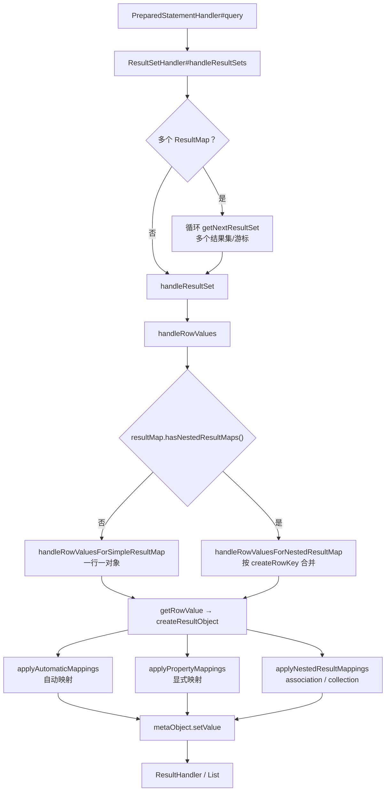
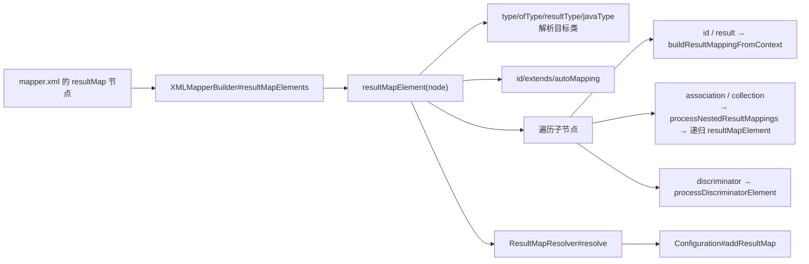
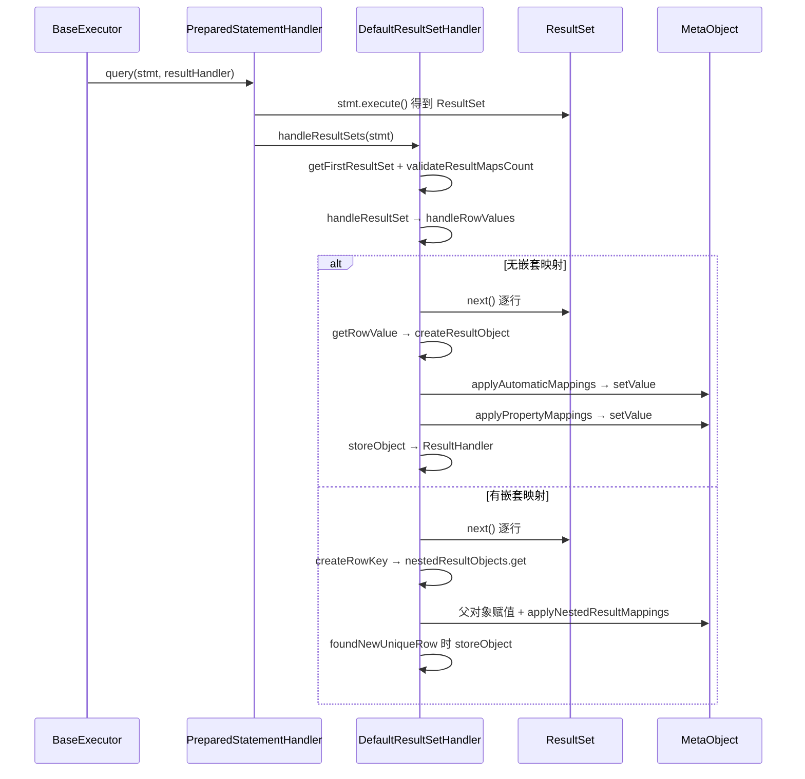

# 结果映射：`DefaultResultSetHandler` 与自动映射

> 一句话结论：MyBatis 把"结果集 → 对象"拆成两件事——**按 `ResultMap` 声明的映射逐条赋值（`applyPropertyMappings`）** 与**按列名/属性名猜着赋值（`applyAutomaticMappings`）**，猜测的规则由 `autoMappingBehavior` 与 `mapUnderscoreToCamelCase` 共同决定；嵌套映射（`association`/`collection`）则靠 `createRowKey` 生成的"行唯一键"把同一父行的多行结果合并成一个对象。
>
> 阅读前置：读过 [../02-SqlSession与执行器/README.md](../02-SqlSession与执行器/README.md)（知道 `ResultSetHandler` 在 `StatementHandler` 之后被调用）；知道 `ResultMap`/`ResultMapping` 是 XML `<resultMap>` 的内存模型；了解 `CacheKey` 是一个"可以 `update` 多段内容再比较"的键对象。
>
> 预计阅读：55 分钟 ｜ 源码：mybatis@3.6.0

## 0. 先看现象（3 分钟上手）

**现象一：`select *` 出来的字段没赋值。**

```xml
<select id="selectById" resultType="com.example.User">
  select * from user where id = #{id}
</select>
```

数据库列 `create_time`，Java 属性 `createTime`。默认 `mapUnderscoreToCamelCase=false`，于是 `create_time` 找不到同名属性 `create_time`，`createTime` 永远是 `null`。开启后（`mybatis.configuration.map-underscore-to-camel-case=true`）立刻正常。这条"开关"就作用在 `createAutomaticMappings` 的 `findProperty` 那一行，而且**只影响自动映射，不影响 `<result column="create_time" property="createTime"/>` 这种显式映射**。

**现象二：一对多分页数量不对。**

```xml
<resultMap id="userWithOrders" type="User">
  <id column="id" property="id"/>
  <collection property="orders" ofType="Order" columnPrefix="o_">
    <id column="id" property="id"/>
    <result column="amount" property="amount"/>
  </collection>
</resultMap>
<select id="pageUsers" resultMap="userWithOrders">
  select u.*, o.id as o_id, o.amount as o_amount
  from user u left join orders o on o.user_id = u.id
</select>
```

`pageUsers` 传 `RowBounds(0, 2)` 想取 2 个用户 → 实际拿到 2 行 join 结果，可能只是 1 个用户（或 2 个用户但订单不全）。原因是 `RowBounds` 作用在 **join 后的行**，而对象合并发生在 `handleRowValuesForNestedResultMap` 里。更糟的是：`safeRowBoundsEnabled=true`（默认）时 MyBatis 会直接抛 `Mapped Statements with nested result mappings cannot be safely constrained by RowBounds.`——这是框架在你踩坑之前拦了你。

**现象三：子集合里只留最后一条，或者父对象重复。**

```xml
<resultMap id="userWithOrders" type="User">
  <result column="id" property="id"/>   <!-- 写成了 result，不是 id -->
  <collection property="orders" ofType="Order">...</collection>
</resultMap>
```

`<id>` 的语义不是"主键"，而是"**行唯一键的组成列**"（见 `createRowKey`）。用 `<result>` 声明时 `getIdResultMappings()` 为空，`createRowKey` 退回用所有属性映射拼键；若某些列在 join 后被覆盖或为 `null`，键就可能重复或恒为 `NULL_CACHE_KEY`，于是"同一父行被当成不同行"或"不同父行被当成同一行"。

三段现象都指向同一个类：`DefaultResultSetHandler`。

## 1. 整体地图（先图后码）



**读图说明**：图里第一次分叉是"**有没有嵌套映射**"，它决定了"一行是否等于一个对象"这个根本假设——没有嵌套时一行一对象，走 `handleRowValuesForSimpleResultMap`；有嵌套时一行只是"父子对象的一个片段"，必须靠 `createRowKey` 把多行归并，走 `handleRowValuesForNestedResultMap`。第二次分叉是"**值从哪来**"，`applyAutomaticMappings`（猜）与 `applyPropertyMappings`（声明）都会写同一个 `MetaObject`，所以两者对同一属性的重复赋值会互相覆盖——这正是"字段名重复被覆盖"坑的根源。

构建侧（XML → `ResultMap`）在启动期完成：



**读图说明**：`association`/`collection` 在没有 `select` 属性时，会被 `processNestedResultMappings` **递归**当成一个匿名 `resultMap` 构建（`resultMapElement(context, resultMappings, enclosingType)`），所以嵌套映射本质上是"`ResultMap` 里再存一个 `ResultMap` 的 id"；`hasNestedResultMaps()` 判断的就是"有没有这种内联 `resultMap`"还是"用了 `select` 的延迟/子查询"。

## 2. 关键类逐个拆

| 类 | 职责 | 本文关注点 |
| --- | --- | --- |
| `DefaultResultSetHandler` | 结果集 → 对象的总调度 | `handleResultSets`/`handleRowValues`/`getRowValue`/`createRowKey` |
| `ResultMap` | 一个映射的完整定义 | `getPropertyResultMappings`/`getIdResultMappings`/`hasNestedResultMaps`/`getAutoMapping` |
| `ResultMapping` | 一条映射 | `column`/`property`/`nestedResultMapId`/`nestedQueryId`/`typeHandler`/`flags` |
| `ResultSetWrapper` | 结果集 + 列名元数据 | `getUnmappedColumnNames`/`getMappedColumnNames`/`getTypeHandler` |
| `MetaObject` | 反射门面 | `findProperty(columnName, camelCase)`/`setValue`/`getSetterType` |
| `AutoMappingBehavior` | 自动映射开关（枚举） | `NONE`/`PARTIAL`/`FULL` |
| `ResultLoader` | 延迟加载的单条 `select` 执行器 | `creatorThreadId`、`newExecutor` |
| `XMLMapperBuilder` | XML → `ResultMap` | `resultMapElement`/`buildResultMappingFromContext` |

两个容易混淆的概念先分清：

- **`autoMapping`（局部）**：`<resultMap autoMapping="false">`，只作用这一个 `ResultMap`，优先级最高。
- **`autoMappingBehavior`（全局）**：`configuration` 级开关，`NONE`/`PARTIAL`/`FULL`，作用于"没有局部声明"的所有 `ResultMap`。

## 3. 源码逐段精读

### 3.1 `handleResultSets`：多结果集与单结果集

```java (src: DefaultResultSetHandler.java#L210-L246)
  @Override
  public List<Object> handleResultSets(Statement stmt) throws SQLException {
    ErrorContext.instance().activity("handling results").object(mappedStatement.getId());

    final List<Object> multipleResults = new ArrayList<>();

    int resultSetCount = 0;
    ResultSetWrapper rsw = getFirstResultSet(stmt);

    List<ResultMap> resultMaps = mappedStatement.getResultMaps();
    int resultMapCount = resultMaps.size();
    validateResultMapsCount(rsw, resultMapCount);
    while (rsw != null && resultMapCount > resultSetCount) {
      ResultMap resultMap = resultMaps.get(resultSetCount);
      handleResultSet(rsw, resultMap, multipleResults, null);
      rsw = getNextResultSet(stmt);
      cleanUpAfterHandlingResultSet();
      resultSetCount++;
    }

    String[] resultSets = mappedStatement.getResultSets();
    if (resultSets != null) {
      while (rsw != null && resultSetCount < resultSets.length) {
        ResultMapping parentMapping = nextResultMaps.get(resultSets[resultSetCount]);
        if (parentMapping != null) {
          String nestedResultMapId = parentMapping.getNestedResultMapId();
          ResultMap resultMap = configuration.getResultMap(nestedResultMapId);
          handleResultSet(rsw, resultMap, null, parentMapping);
        }
        rsw = getNextResultSet(stmt);
        cleanUpAfterHandlingResultSet();
        resultSetCount++;
      }
    }

    return collapseSingleResultList(multipleResults);
  }
```

**这段在做什么**：这是结果处理的入口，处理三种情况：① 普通查询只有一个 `ResultMap`、一个结果集，循环体执行一次；② `@ResultType` 多结果集（`resultMaps` 有多个），结果集与 `ResultMap` 按顺序一一配对，全部塞进 `multipleResults`；③ 存储过程/多个 `ResultSet` 场景（`mappedStatement.getResultSets()` 给出 `resultSets` 属性名），通过 `nextResultMaps` 找到"这个结果集属于哪个父映射"，再以 `parentMapping` 非空的方式交给 `handleResultSet`——此时行对象不是"顶级结果"，而是被挂到父对象上。

**为什么这么写**：MyBatis 一个 `MappedStatement` 可以声明多个 `ResultMap`（`resultSets`/`resultOrdered` 那套是为了存储过程和"一次多查"服务），但 99% 的业务查询只用到第一个分支。把三种情况收口在同一个方法里，是为了让 `handleResultSet`（单个结果集的处理）变成唯一入口，后面所有嵌套/延迟加载逻辑只需处理"一个结果集 + 一个 `ResultMap` + 可选父映射"。

**如果改了会怎样**：如果去掉 `collapseSingleResultList`（把 `List<Object>` 摊平），单结果集查询在 `DefaultSqlSession#selectList` 里会多一层 `List<List<Object>>`，所有调用方都要拆包。如果去掉 `nextResultMaps` 分支，`<resultMap>` 里的 `resultSet` 属性（把某个 `ResultSet` 关联到父属性）就失效，存储过程返回多结果集的映射全部不可用。

**坑位**：`validateResultMapsCount` 在 `resultMapCount == 0` 且结果集有列时抛 `A query was run and no Result Maps were found for the Mapped Statement '...'. 'resultType' or 'resultMap' must be specified...`——这句报错意味着你既没写 `resultType` 也没写 `resultMap`，常见于 `@Select` 注解方法忘了 `@ResultType`（返回 `Map` 时除外）。

### 3.2 `handleRowValues`：简单映射 vs 嵌套映射

```java (src: DefaultResultSetHandler.java#L367-L394)
  public void handleRowValues(ResultSetWrapper rsw, ResultMap resultMap, ResultHandler<?> resultHandler,
      RowBounds rowBounds, ResultMapping parentMapping) throws SQLException {
    if (resultMap.hasNestedResultMaps()) {
      ensureNoRowBounds();
      checkResultHandler();
      handleRowValuesForNestedResultMap(rsw, resultMap, resultHandler, rowBounds, parentMapping);
    } else {
      handleRowValuesForSimpleResultMap(rsw, resultMap, resultHandler, rowBounds, parentMapping);
    }
  }

  private void ensureNoRowBounds() {
    if (configuration.isSafeRowBoundsEnabled() && rowBounds != null
        && (rowBounds.getLimit() < RowBounds.NO_ROW_LIMIT || rowBounds.getOffset() > RowBounds.NO_ROW_OFFSET)) {
      throw new ExecutorException(
          "Mapped Statements with nested result mappings cannot be safely constrained by RowBounds. "
              + "Use safeRowBoundsEnabled=false setting to bypass this check.");
    }
  }

  protected void checkResultHandler() {
    if (resultHandler != null && configuration.isSafeResultHandlerEnabled() && !mappedStatement.isResultOrdered()) {
      throw new ExecutorException(
          "Mapped Statements with nested result mappings cannot be safely used with a custom ResultHandler. "
              + "Use safeResultHandlerEnabled=false setting to bypass this check "
              + "or ensure your statement returns ordered data and set resultOrdered=true on it.");
    }
  }
```

**这段在做什么**：按 `hasNestedResultMaps()` 分流，并在走嵌套分支前做两道"安全检查"：① 传了有意义的 `RowBounds` 就抛异常（除非 `safeRowBoundsEnabled=false`）；② 传了自定义 `ResultHandler` 且语句没有 `resultOrdered=true` 也抛异常（除非 `safeResultHandlerEnabled=false`）。

**为什么这么写**：`RowBounds` 是**内存分页**——`skipRows` + `limit` 都作用在"结果集的物理行"上。对于嵌套映射，一行 ≠ 一个对象，所以"取 2 行"可能取到半个对象。同理 `ResultHandler` 是逐对象回调的，而嵌套映射下"对象什么时候完整"取决于后续行是否属于同一父行，除非结果已经按父键排序（`resultOrdered`），否则无法安全地提前回调。这两条是"与其给你错误的答案，不如直接报错"的防御式设计。

**如果改了会怎样**：如果静默允许 `RowBounds` + 嵌套映射，`pageUsers(0,2)` 会返回 1~2 个用户，每个用户的 `orders` 可能是残缺的——这种"看起来对、偶发错"的 bug 极难排查。如果去掉 `checkResultHandler`，`ResultHandler` 会在父对象还没合并完时就把它交出去，用户拿到的对象后续还会被修改（"对象被偷偷改了"的经典怪现象）。

**坑位**：`safeRowBoundsEnabled` 默认 `true`，`safeResultHandlerEnabled` 默认 `true`。把它们改成 `false` 只是"绕过检查"，**不会**让分页变正确——正确做法是"先分页查主表，再按 id 批量查子表"（两次查询）或在 SQL 层用 `limit` + 窗口函数。

### 3.3 `handleRowValuesForSimpleResultMap`：一行一对象

```java (src: DefaultResultSetHandler.java#L396-L455)
  private void handleRowValuesForSimpleResultMap(ResultSetWrapper rsw, ResultMap resultMap,
      ResultHandler<?> resultHandler, RowBounds rowBounds, ResultMapping parentMapping) throws SQLException {
    final boolean useCollectionConstructorInjection = resultMap.hasResultMapsUsingConstructorCollection();

    DefaultResultContext<Object> resultContext = new DefaultResultContext<>();
    ResultSet resultSet = rsw.getResultSet();
    skipRows(resultSet, rowBounds);
    while (shouldProcessMoreRows(resultContext, rowBounds) && !resultSet.isClosed() && resultSet.next()) {
      ResultMap discriminatedResultMap = resolveDiscriminatedResultMap(rsw, resultMap, null);
      Object rowValue = getRowValue(rsw, discriminatedResultMap, null, null);
      if (!useCollectionConstructorInjection) {
        storeObject(resultHandler, resultContext, rowValue, parentMapping, resultSet);
      } else {
        if (!(rowValue instanceof PendingConstructorCreation)) {
          throw new ExecutorException("Expected result object to be a pending constructor creation!");
        }

        createAndStorePendingCreation(resultHandler, resultSet, resultContext, (PendingConstructorCreation) rowValue);
      }
    }
  }

  private void storeObject(ResultHandler<?> resultHandler, DefaultResultContext<Object> resultContext, Object rowValue,
      ResultMapping parentMapping, ResultSet rs) throws SQLException {
    if (parentMapping != null) {
      linkToParents(rs, parentMapping, rowValue);
      return;
    }

    if (pendingPccRelations.containsKey(rowValue)) {
      createPendingConstructorCreations(rowValue);
    }

    callResultHandler(resultHandler, resultContext, rowValue);
  }

  @SuppressWarnings("unchecked" /* because ResultHandler<?> is always ResultHandler<Object> */)
  private void callResultHandler(ResultHandler<?> resultHandler, DefaultResultContext<Object> resultContext,
      Object rowValue) {
    resultContext.nextResultObject(rowValue);
    ((ResultHandler<Object>) resultHandler).handleResult(resultContext);
  }

  private boolean shouldProcessMoreRows(ResultContext<?> context, RowBounds rowBounds) {
    return !context.isStopped() && context.getResultCount() < rowBounds.getLimit();
  }

  private void skipRows(ResultSet rs, RowBounds rowBounds) throws SQLException {
    if (rs.getType() != ResultSet.TYPE_FORWARD_ONLY) {
      if (rowBounds.getOffset() != RowBounds.NO_ROW_OFFSET) {
        rs.absolute(rowBounds.getOffset());
      }
    } else {
      for (int i = 0; i < rowBounds.getOffset(); i++) {
        if (!rs.next()) {
          break;
        }
      }
    }
  }
```

**这段在做什么**：简单映射的主循环——先 `skipRows` 跳过 `RowBounds.offset` 行，然后逐行 `next()`：对每行先做 `discriminator` 解析（`resolveDiscriminatedResultMap`），再 `getRowValue` 生成对象，最后 `storeObject` 交给 `ResultHandler`（没有自定义 handler 时是 `DefaultResultHandler`，最终变成 `List`）。`shouldProcessMoreRows` 用 `resultCount < limit` 控制上限。

**为什么这么写**：`skipRows` 分两种实现是因为 JDBC 有两种 `ResultSet` 类型：可滚动（`TYPE_SCROLL_INSENSITIVE`/`TYPE_SCROLL_SENSITIVE`）可以直接 `absolute(offset)` 一次跳到位；`TYPE_FORWARD_ONLY`（MySQL 默认、流式查询必须用）只能靠循环 `next()` 硬跳。后者在深分页时是 O(offset) 的——这就是"`RowBounds` 深分页慢"的源码级原因。

**如果改了会怎样**：如果 `skipRows` 对 `TYPE_FORWARD_ONLY` 也用 `absolute`，会直接抛 `SQLException: Operation not supported`；如果 `shouldProcessMoreRows` 不判断 `context.isStopped()`，用户在 `ResultHandler` 里调用 `resultContext.stop()`（"提前终止"）就不会生效，大结果集无法中断。

**坑位**：`RowBounds.NO_ROW_LIMIT` 是 `Integer.MAX_VALUE`，所以"不传 RowBounds"时 `limit` 极大、循环靠 `resultSet.next()` 结束；而 `MapperMethod` 里 `RowBounds.DEFAULT` 与 `null` 都会被转成 `NO_ROW_LIMIT`/`NO_ROW_OFFSET`。

### 3.4 `getRowValue`（简单映射）：`foundValues` 与 `null` 行

```java (src: DefaultResultSetHandler.java#L461-L487)
  private Object getRowValue(ResultSetWrapper rsw, ResultMap resultMap, String columnPrefix, CacheKey parentRowKey)
      throws SQLException {
    final ResultLoaderMap lazyLoader = new ResultLoaderMap();
    Object rowValue = createResultObject(rsw, resultMap, lazyLoader, columnPrefix, parentRowKey);
    if (rowValue != null && !hasTypeHandlerForResultObject(rsw, resultMap.getType())) {
      final MetaObject metaObject = configuration.newMetaObject(rowValue);
      boolean foundValues = this.useConstructorMappings;
      if (shouldApplyAutomaticMappings(resultMap, false)) {
        foundValues = applyAutomaticMappings(rsw, resultMap, metaObject, columnPrefix) || foundValues;
      }
      foundValues = applyPropertyMappings(rsw, resultMap, metaObject, lazyLoader, columnPrefix) || foundValues;
      foundValues = lazyLoader.size() > 0 || foundValues;
      rowValue = foundValues || configuration.isReturnInstanceForEmptyRow() ? rowValue : null;
    }

    if (parentRowKey != null) {
      // found a simple object/primitive in pending constructor creation that will need linking later
      final CacheKey rowKey = createRowKey(resultMap, rsw, columnPrefix);
      final CacheKey combinedKey = combineKeys(rowKey, parentRowKey);

      if (combinedKey != CacheKey.NULL_CACHE_KEY) {
        nestedResultObjects.put(combinedKey, rowValue);
      }
    }

    return rowValue;
  }
```

**这段在做什么**：为一行创建对象，然后按顺序做三件事：① 若允许自动映射则 `applyAutomaticMappings`；② 无条件 `applyPropertyMappings`；③ 合并 `foundValues`。最后若一个值都没找到、也没有延迟加载、且没开 `returnInstanceForEmptyRow`，就**返回 `null`**（该行被丢弃）。

**为什么这么写**：`foundValues` 是"这一行到底有没有数据"的判据。`left join` 场景下"父行存在但子行全 `null`"是常态，如果无脑返回一个"所有属性都是 `null` 的对象"，用户就会拿到 `orders: [null]` 这种垃圾数据；`returnInstanceForEmptyRow=true` 提供"我就是要空对象"的开关。注意 `applyAutomaticMappings` 在 `applyPropertyMappings` **之前**：显式映射后赋值，可以覆盖自动映射的结果——这是"显式优先"的顺序保证。

**如果改了会怎样**：如果把顺序反过来（先显式后自动），自动映射可能把显式映射已经赋好的值用"同名列"再覆盖一次（例如 `result column="name" property="nickname"` 时，自动映射又把 `name` 列写到 `name` 属性）。如果去掉 `null` 行丢弃逻辑，`left join` 的空子行会变成"非空但字段全 `null`"的伪对象。

**坑位**：`useConstructorMappings` 为 `true`（用了 `<constructor>`）时 `foundValues` 初值为 `true`，于是"全空行"不会被丢弃——这是"构造器映射下行数为 `1` 但字段全 `null`"的原因。`hasTypeHandlerForResultObject` 为 `true`（`resultType="java.lang.String"` 这类简单类型）时，整段赋值逻辑跳过，直接由 `createResultObject` 从结果集读取。

### 3.5 `shouldApplyAutomaticMappings`：`autoMappingBehavior` 三值语义

```java (src: DefaultResultSetHandler.java#L530-L539)
  private boolean shouldApplyAutomaticMappings(ResultMap resultMap, boolean isNested) {
    if (resultMap.getAutoMapping() != null) {
      return resultMap.getAutoMapping();
    }
    if (isNested) {
      return AutoMappingBehavior.FULL == configuration.getAutoMappingBehavior();
    } else {
      return AutoMappingBehavior.NONE != configuration.getAutoMappingBehavior();
    }
  }
```

**这段在做什么**：三级决策——① `<resultMap autoMapping="...">` 局部声明优先；② 嵌套映射（`association`/`collection` 的内部 `ResultMap`）只有 `FULL` 才自动映射；③ 顶级 `ResultMap` 只要不是 `NONE` 就自动映射。

**为什么这么写**：这是 `autoMappingBehavior` 三个取值的准确语义：

| 取值 | 顶级 `ResultMap` | 嵌套 `ResultMap` |
| --- | --- | --- |
| `NONE` | 不自动映射 | 不自动映射 |
| `PARTIAL`（默认） | 自动映射 | 不自动映射 |
| `FULL` | 自动映射 | 自动映射 |

`PARTIAL` 之所以是默认，是因为嵌套映射里"列名前缀、同名列"冲突概率最高：父表 `id` 与子表 `id` 在同一个结果集里同名，如果嵌套层也自动映射，子对象很可能被父表的 `id` 污染。所以"嵌套默认不猜"，逼你写 `<id>/<result>`（通常还要 `columnPrefix`）。

**如果改了会怎样**：把默认改成 `FULL`，`<collection columnPrefix="o_">` 少写前缀时子对象会读到父表的列，产生"订单金额 = 用户余额"这类完全不讲道理的数据。把嵌套判断简化成 `NONE != behavior`，`PARTIAL` 就退化成 `FULL`，默认配置的安全性消失。

**坑位**：`<resultMap autoMapping="true">` 可以让**某个** `ResultMap` 在全局 `NONE` 下仍然自动映射，也可以在全局 `FULL` 下让嵌套层关掉；这个局部开关在 `ResultMap.Builder` 里存成 `Boolean`（可为 `null`），不是 `boolean`。

### 3.6 `applyPropertyMappings`：显式映射的赋值

```java (src: DefaultResultSetHandler.java#L545-L580)
  private boolean applyPropertyMappings(ResultSetWrapper rsw, ResultMap resultMap, MetaObject metaObject,
      ResultLoaderMap lazyLoader, String columnPrefix) throws SQLException {
    final Set<String> mappedColumnNames = rsw.getMappedColumnNames(resultMap, columnPrefix);
    boolean foundValues = false;
    final List<ResultMapping> propertyMappings = resultMap.getPropertyResultMappings();
    for (ResultMapping propertyMapping : propertyMappings) {
      String column = prependPrefix(propertyMapping.getColumn(), columnPrefix);
      if (propertyMapping.getNestedResultMapId() != null && !JdbcType.CURSOR.equals(propertyMapping.getJdbcType())) {
        // the user added a column attribute to a nested result map, ignore it
        column = null;
      }
      if (propertyMapping.isCompositeResult()
          || column != null && mappedColumnNames.contains(column.toUpperCase(Locale.ENGLISH))
          || propertyMapping.getResultSet() != null) {
        Object value = getPropertyMappingValue(rsw, metaObject, propertyMapping, lazyLoader, columnPrefix);
        // issue #541 make property optional
        final String property = propertyMapping.getProperty();
        if (property == null) {
          continue;
        }
        if (value == DEFERRED) {
          foundValues = true;
          continue;
        }
        if (value != null) {
          foundValues = true;
        }
        if (value != null
            || configuration.isCallSettersOnNulls() && !metaObject.getSetterType(property).isPrimitive()) {
          // gcode issue #377, call setter on nulls (value is not 'found')
          metaObject.setValue(property, value);
        }
      }
    }
    return foundValues;
  }
```

**这段在做什么**：遍历显式映射（`<id>`、`<result>`、`<association>`、`<collection>` 全在这里），只处理"列真的存在于结果集里"的映射（`mappedColumnNames` 判断，超过 8 行的条件就是这一行）；取到值后：`DEFERRED` 表示"这个属性稍后由子结果集填充"（跳过但算找到）；`null` 值默认**不**调用 setter，除非 `callSettersOnNulls=true` 且属性不是基本类型。

**为什么这么写**：`mappedColumnNames` 过滤是为了支持"同一个 `ResultMap` 在不同 SQL 下复用"——SQL 没查 `email` 列时，不该把 `email` 置 `null`（那会把原本有值的对象打空）。`callSettersOnNulls` 默认 `false` 是"null 不覆盖"的保守策略：对象刚 `new` 出来属性本来就是 `null`，不必显式设一次；但对 `Map`/`DynamicBean` 这类"没有默认值"的目标类型就必须开。

**如果改了会怎样**：如果去掉 `mappedColumnNames` 判断，`select id, name from user` 配一个含 `email` 映射的 `ResultMap` 会在 `getPropertyMappingValue` 里抛 `Column 'email' not found`。如果默认 `callSettersOnNulls=true`，所有 `null` 列都会调用 setter，`setCreateTime(null)` 之类可能触发业务校验异常。

**坑位**：`metaObject.getSetterType(property).isPrimitive()` 的短路顺序很重要——`callSettersOnNulls=true` 时对 `int` 属性**不会**调用 setter，否则 `setAge(null)` 会 `NullPointerException`（拆箱失败）。

### 3.7 `getPropertyMappingValue`：选 handler 读列

```java (src: DefaultResultSetHandler.java#L582-L610)
  private Object getPropertyMappingValue(ResultSetWrapper rsw, MetaObject metaResultObject,
      ResultMapping propertyMapping, ResultLoaderMap lazyLoader, String columnPrefix) throws SQLException {
    final ResultSet rs = rsw.getResultSet();
    if (propertyMapping.getNestedQueryId() != null) {
      return getNestedQueryMappingValue(rsw, metaResultObject, propertyMapping, lazyLoader, columnPrefix);
    }
    if (JdbcType.CURSOR.equals(propertyMapping.getJdbcType())) {
      List<Object> results = getNestedCursorValue(rsw, propertyMapping, columnPrefix);
      linkObjects(metaResultObject, propertyMapping, results.get(0), true);
      return metaResultObject.getValue(propertyMapping.getProperty());
    }
    if (propertyMapping.getResultSet() != null) {
      addPendingChildRelation(rs, metaResultObject, propertyMapping); // TODO is that OK?
      return DEFERRED;
    } else {
      final String column = prependPrefix(propertyMapping.getColumn(), columnPrefix);
      TypeHandler<?> typeHandler = propertyMapping.getTypeHandler();
      if (typeHandler == null) {
        final String property = propertyMapping.getProperty();
        final Type javaType = property == null ? null : metaResultObject.getGenericSetterType(property).getKey();
        typeHandler = rsw.getTypeHandler(javaType, column);
        if (typeHandler == null) {
          throw new ExecutorException(
              "No type handler found for '" + javaType + "' and JDBC type '" + rsw.getJdbcType(column) + "'");
        }
      }
      return typeHandler.getResult(rs, column);
    }
  }
```

**这段在做什么**：四条分支——① `nestedQueryId` 有值（`<association select="...">`）走子查询/延迟加载；② `jdbcType=CURSOR` 走游标；③ `resultSet` 属性走"另一个结果集"（存储过程）；④ 普通情况：先看映射上有没有指定 `typeHandler`，没有就用 `rsw.getTypeHandler(javaType, column)` 按"setter 的泛型类型 + 列的 JDBC 类型"查表，查不到抛 `No type handler found for '...' and JDBC type '...'`。

**为什么这么写**：`rsw.getTypeHandler` 是 `ResultSetWrapper` 缓存的查表入口，它知道每一列的 JDBC 类型（从 `ResultSetMetaData` 读一次），所以能精确命中 `TIMESTAMP` 对应 `LocalDateTime` 这类"同 Java 类型多 JDBC 类型"的 handler。第 ④ 步的 `javaType` 来自 `getGenericSetterType`，因此 `List<String>` 属性的泛型信息也能参与查表。

**如果改了会怎样**：如果直接用 `TypeHandlerRegistry.getTypeHandler(javaType)`（不带 jdbcType），`LocalDateTime` + `DATE` 列可能命中 `TIMESTAMP` 的 handler，读出的时间会带上 00:00:00 之外的语义偏差（具体取决于 handler 实现）。

**坑位**：`No type handler found` 报错里同时给了 Java 类型与 JDBC 类型，最常见的两个原因：属性是自定义类型且没注册 handler；把 JSON 字符串映射到了非 `String` 属性。

### 3.8 `createAutomaticMappings`：`mapUnderscoreToCamelCase` 的唯一位置

```java (src: DefaultResultSetHandler.java#L625-L669)
  private List<UnMappedColumnAutoMapping> createAutomaticMappings(ResultSetWrapper rsw, ResultMap resultMap,
      MetaObject metaObject, String columnPrefix) throws SQLException {
    final String mapKey = resultMap.getId() + ":" + columnPrefix;
    List<UnMappedColumnAutoMapping> autoMapping = autoMappingsCache.get(mapKey);
    if (autoMapping == null) {
      autoMapping = new ArrayList<>();
      final List<String> unmappedColumnNames = rsw.getUnmappedColumnNames(resultMap, columnPrefix);
      // Remove the entry to release the memory
      List<String> mappedInConstructorAutoMapping = constructorAutoMappingColumns.remove(mapKey);
      if (mappedInConstructorAutoMapping != null) {
        unmappedColumnNames.removeAll(mappedInConstructorAutoMapping);
      }
      for (String columnName : unmappedColumnNames) {
        String propertyName = columnName;
        if (columnPrefix != null && !columnPrefix.isEmpty()) {
          // When columnPrefix is specified,
          // ignore columns without the prefix.
          if (!columnName.toUpperCase(Locale.ENGLISH).startsWith(columnPrefix)) {
            continue;
          }
          propertyName = columnName.substring(columnPrefix.length());
        }
        final String property = metaObject.findProperty(propertyName, configuration.isMapUnderscoreToCamelCase());
        if (property != null && metaObject.hasSetter(property)) {
          if (resultMap.getMappedProperties().contains(property)) {
            continue;
          }
          final Type propertyType = metaObject.getGenericSetterType(property).getKey();
          TypeHandler<?> typeHandler = rsw.getTypeHandler(propertyType, columnName);
          if (typeHandler != null) {
            autoMapping.add(new UnMappedColumnAutoMapping(columnName, property, typeHandler,
                propertyType instanceof Class && ((Class<?>) propertyType).isPrimitive()));
          } else {
            configuration.getAutoMappingUnknownColumnBehavior().doAction(mappedStatement, columnName, property,
                propertyType);
          }
        } else {
          configuration.getAutoMappingUnknownColumnBehavior().doAction(mappedStatement, columnName,
              property != null ? property : propertyName, null);
        }
      }
      autoMappingsCache.put(mapKey, autoMapping);
    }
    return autoMapping;
  }
```

**这段在做什么**：这是自动映射的"规划"阶段——对每个**未被显式映射的列**，去掉 `columnPrefix` 后，用 `metaObject.findProperty(propertyName, mapUnderscoreToCamelCase)` 找出对应属性，再校验"有 setter 且没被显式映射占用"，最后按属性类型查 `TypeHandler`，产出一个 `UnMappedColumnAutoMapping` 列表并缓存到 `autoMappingsCache`（key 是 `resultMapId:columnPrefix`）。

**为什么这么写**：`mapUnderscoreToCamelCase` 就作用在 `findProperty` 的第二个参数上——**这是它在整条结果映射链路里唯一生效的地方**。`Reflector#findPropertyName` 内部会先精确匹配，未命中且开启驼峰时把 `create_time` 转成 `createTime` 再查。缓存按 `resultMapId:columnPrefix` 做键，是因为同一个 `ResultMap` 在不同前缀下会产生不同的列集合，缓存不能混用。

**如果改了会怎样**：如果把 `findProperty` 换成精确匹配，驼峰开关失效；如果把 `resultMap.getMappedProperties().contains(property)` 检查去掉，显式映射过的属性会被自动映射再写一次——而由于 `applyAutomaticMappings` 在前、`applyPropertyMappings` 在后，最终结果不变，但会多一次无谓的 `typeHandler.getResult` 与 setter 调用（并且 `autoMappingUnknownColumnBehavior` 的处理时机也会错）。

**坑位**：`columnPrefix` 去前缀后**可能留下下划线开头**（`o_id` → `id` 正常，但 `order_id` 当 `columnPrefix="order"` 时变成 `_id`），此时驼峰转换得到 `_id` 而不是 `id`，属性查不到——这是"用了列名前缀以后自动映射突然不灵"的常见原因。另外 `unmappedColumnNames` 是"列名大写集合"，`startsWith(columnPrefix)` 用大写比较，所以 `columnPrefix` 建议全大写或全小写保持一致（代码里先 `toUpperCase` 再比，但 `substring` 用的是原长度，大小写混写一般也能工作）。

### 3.9 `applyAutomaticMappings`：真正写值

```java (src: DefaultResultSetHandler.java#L671-L688)
  private boolean applyAutomaticMappings(ResultSetWrapper rsw, ResultMap resultMap, MetaObject metaObject,
      String columnPrefix) throws SQLException {
    List<UnMappedColumnAutoMapping> autoMapping = createAutomaticMappings(rsw, resultMap, metaObject, columnPrefix);
    boolean foundValues = false;
    if (!autoMapping.isEmpty()) {
      for (UnMappedColumnAutoMapping mapping : autoMapping) {
        final Object value = mapping.typeHandler.getResult(rsw.getResultSet(), mapping.column);
        if (value != null) {
          foundValues = true;
        }
        if (value != null || configuration.isCallSettersOnNulls() && !mapping.primitive) {
          // gcode issue #377, call setter on nulls (value is not 'found')
          metaObject.setValue(mapping.property, value);
        }
      }
    }
    return foundValues;
  }
```

**这段在做什么**：消费 `createAutomaticMappings` 的规划结果，逐条 `typeHandler.getResult(rs, column)` 读值并 `metaObject.setValue(property, value)`；`null` 值同样受 `callSettersOnNulls` 与基本类型保护约束。返回"是否至少读到一个非空值"。

**为什么这么写**：规划与执行分离，是因为规划结果被 `autoMappingsCache` 缓存（同一 `ResultMap` 下每行只需规划一次），执行部分每行都要跑。这是典型的"元数据缓存 + 数据热路径"结构，与 `ResultSetWrapper` 缓存列名、`TypeHandlerRegistry` 缓存 handler 的思路一致。

**如果改了会怎样**：如果每行都重新规划，100 万行结果会做 100 万次 `findProperty` 反射——这是老版本大结果集慢的主要原因之一（3.5 之前没有 `autoMappingsCache` 的列级缓存时确实如此）。

**坑位**：`mapping.primitive` 为 `true`（属性是 `int`/`long`/`double` 等）且值为 `null` 时**跳过 setter**，对象保持默认值 `0`——这就是"数据库里是 `null`，查出来是 `0`"的原因，也是"可空列不要用基本类型"的最强理由。

### 3.10 `resolveDiscriminatedResultMap`：`discriminator` 原理

```java (src: DefaultResultSetHandler.java#L1105-L1133)
      throws SQLException {
    Set<String> pastDiscriminators = new HashSet<>();
    Discriminator discriminator = resultMap.getDiscriminator();
    while (discriminator != null) {
      final Object value = getDiscriminatorValue(rsw, discriminator, columnPrefix);
      final String discriminatedMapId = discriminator.getMapIdFor(String.valueOf(value));
      if (!configuration.hasResultMap(discriminatedMapId)) {
        break;
      }
      resultMap = configuration.getResultMap(discriminatedMapId);
      Discriminator lastDiscriminator = discriminator;
      discriminator = resultMap.getDiscriminator();
      if (discriminator == lastDiscriminator || !pastDiscriminators.add(discriminatedMapId)) {
        break;
      }
    }
    return resultMap;
  }

  private Object getDiscriminatorValue(ResultSetWrapper rsw, Discriminator discriminator, String columnPrefix)
      throws SQLException {
    final ResultMapping resultMapping = discriminator.getResultMapping();
    String column = prependPrefix(resultMapping.getColumn(), columnPrefix);
    TypeHandler<?> typeHandler = resultMapping.getTypeHandler();
    if (typeHandler == null) {
      typeHandler = typeHandlerRegistry.getTypeHandler(resultMapping.getJavaType(), rsw.getJdbcType(column));
    }
    return typeHandler.getResult(rsw.getResultSet(), column);
  }
```

**这段在做什么**：`discriminator` 是"按某一列的值选择不同子 `ResultMap`"的机制。每处理一行，先读 `discriminator` 指定的列（如 `user_type`），用值去 `Discriminator#getMapIdFor` 找对应的 `resultMap` id，若该 `ResultMap` 存在就切换到它，并可继续链式判断（子 `ResultMap` 自己也有 `discriminator`）。`pastDiscriminators` 与 `lastDiscriminator` 是死循环保护。

**为什么这么写**：值可能是 `enum`（`<discriminator javaType="...">` 里的 `javaType` 决定用哪个 handler 把列值读成"可比较的对象"），所以 `getDiscriminatorValue` 走的是与普通映射相同的 `TypeHandler` 查表逻辑。`hasResultMap` 判断让"没定义对应子类映射"时**优雅退化**为父 `ResultMap`，而不是抛异常。

**如果改了会怎样**：如果没有 `pastDiscriminators`，两个子 `ResultMap` 互相 `discriminator` 引用就会无限循环；如果值读成 `String` 但 XML 里的 `value` 写的是枚举名，"大小写不一致/带空格"会导致永远匹配不到、静默退化为父映射——排查时看起来"discriminator 没生效"。

**坑位**：`discriminator` 的 `column` 必须出现在结果集里；用了 `columnPrefix` 时列名要带前缀。`Discriminator#getMapIdFor(String.valueOf(value))` 用 `String.valueOf`，所以 `null` 会变成字符串 `"null"`，`<case value="null">` 是可以匹配的（但极易忽略）。

### 3.11 `handleRowValuesForNestedResultMap`：按行键合并

```java (src: DefaultResultSetHandler.java#L1146-L1200)
  private void handleRowValuesForNestedResultMap(ResultSetWrapper rsw, ResultMap resultMap,
      ResultHandler<?> resultHandler, RowBounds rowBounds, ResultMapping parentMapping) throws SQLException {
    final boolean useCollectionConstructorInjection = resultMap.hasResultMapsUsingConstructorCollection();
    PendingConstructorCreation lastHandledCreation = null;
    if (useCollectionConstructorInjection) {
      verifyPendingCreationPreconditions(parentMapping);
    }

    final DefaultResultContext<Object> resultContext = new DefaultResultContext<>();
    ResultSet resultSet = rsw.getResultSet();
    skipRows(resultSet, rowBounds);
    Object rowValue = previousRowValue;

    while (shouldProcessMoreRows(resultContext, rowBounds) && !resultSet.isClosed() && resultSet.next()) {
      final ResultMap discriminatedResultMap = resolveDiscriminatedResultMap(rsw, resultMap, null);
      final CacheKey rowKey = createRowKey(discriminatedResultMap, rsw, null);

      final Object partialObject = nestedResultObjects.get(rowKey);
      final boolean foundNewUniqueRow = partialObject == null;

      // issue #577, #542 && #101
      if (useCollectionConstructorInjection) {
        if (foundNewUniqueRow && lastHandledCreation != null) {
          createAndStorePendingCreation(resultHandler, resultSet, resultContext, lastHandledCreation);
          lastHandledCreation = null;
        }

        rowValue = getRowValue(rsw, discriminatedResultMap, rowKey, null, partialObject);
        if (rowValue instanceof PendingConstructorCreation) {
          lastHandledCreation = (PendingConstructorCreation) rowValue;
        }
      } else if (mappedStatement.isResultOrdered()) {
        if (foundNewUniqueRow && rowValue != null) {
          nestedResultObjects.clear();
          storeObject(resultHandler, resultContext, rowValue, parentMapping, resultSet);
        }
        rowValue = getRowValue(rsw, discriminatedResultMap, rowKey, null, partialObject);
      } else {
        rowValue = getRowValue(rsw, discriminatedResultMap, rowKey, null, partialObject);
        if (foundNewUniqueRow) {
          storeObject(resultHandler, resultContext, rowValue, parentMapping, resultSet);
        }
      }
    }

    if (useCollectionConstructorInjection && lastHandledCreation != null) {
      createAndStorePendingCreation(resultHandler, resultSet, resultContext, lastHandledCreation);
    } else if (rowValue != null && mappedStatement.isResultOrdered()
        && shouldProcessMoreRows(resultContext, rowBounds)) {
      storeObject(resultHandler, resultContext, rowValue, parentMapping, resultSet);
      previousRowValue = null;
    } else if (rowValue != null) {
      previousRowValue = rowValue;
    }
  }
```

**这段在做什么**：嵌套映射的主循环。每行先算 `rowKey`，用它在 `nestedResultObjects` 里找"已经创建的父对象"（`partialObject`）；`foundNewUniqueRow` 表示"这是一个新的父行"。分支有两种：
- **默认分支**：先 `getRowValue`（复用 `partialObject` 继续填子集合），当发现新父行时**立刻**把上一行对象 `storeObject` 交出去。
- **`resultOrdered=true` 分支**：只有当发现新父行时才把**上一个**对象交出去，并 `nestedResultObjects.clear()` 释放内存（因为结果已按父键排序，旧对象以后不会再用到）。

**为什么这么写**：这是流式合并——不排序时所有父对象都要留在 `nestedResultObjects` 里，直到结果集结束；开启 `resultOrdered` 后内存只保留"当前父对象"，把 O(父行数 × 子行数) 的内存降为 O(1)，代价是 SQL 必须 `order by 父键`。这正是 `checkResultHandler` 里要求 `resultOrdered=true` 的原因：只有"对象一旦交出就不会再被修改"时才允许回调 `ResultHandler`。

**如果改了会怎样**：如果 `resultOrdered=true` 但 SQL 没排序，同一父行可能分两次出现在开头和结尾，`nestedResultObjects.clear()` 后第二次出现会被当成新父行，导致**父对象重复**（经典"分页/排序后数据翻倍"bug）。如果不开 `resultOrdered`，超大 join 结果会把所有父对象堆在内存里，容易 OOM。

**坑位**：`nestedResultObjects` 是 `Map<CacheKey, Object>`，`CacheKey` 实现了 `equals`/`hashCode`（内部是多段字段的比较），所以 `createRowKey` 返回的键必须稳定——列值相同则键相等。若 `<id>` 用错列（比如用了 `amount`），同一父行的不同子行会生成不同键，父对象直接重复。

### 3.12 `applyNestedResultMappings` 与 `createRowKey`

```java (src: DefaultResultSetHandler.java#L1401-L1438)
  private boolean applyNestedResultMappings(ResultSetWrapper rsw, ResultMap resultMap, MetaObject metaObject,
      String parentPrefix, CacheKey parentRowKey, boolean newObject) {
    boolean foundValues = false;
    for (ResultMapping resultMapping : resultMap.getPropertyResultMappings()) {
      final String nestedResultMapId = resultMapping.getNestedResultMapId();
      if (nestedResultMapId != null && resultMapping.getResultSet() == null) {
        try {
          final String columnPrefix = getColumnPrefix(parentPrefix, resultMapping);
          final ResultMap nestedResultMap = getNestedResultMap(rsw, nestedResultMapId, columnPrefix);
          if (resultMapping.getColumnPrefix() == null) {
            // try to fill circular reference only when columnPrefix
            // is not specified for the nested result map (issue #215)
            Object ancestorObject = ancestorObjects.get(nestedResultMapId);
            if (ancestorObject != null) {
              if (newObject) {
                linkObjects(metaObject, resultMapping, ancestorObject); // issue #385
              }
              continue;
            }
          }
          final CacheKey rowKey = createRowKey(nestedResultMap, rsw, columnPrefix);
          final CacheKey combinedKey = combineKeys(rowKey, parentRowKey);
          Object rowValue = nestedResultObjects.get(combinedKey);
          boolean knownValue = rowValue != null;
          instantiateCollectionPropertyIfAppropriate(resultMapping, metaObject); // mandatory
          if (anyNotNullColumnHasValue(resultMapping, columnPrefix, rsw)) {
            rowValue = getRowValue(rsw, nestedResultMap, combinedKey, columnPrefix, rowValue);
            if (rowValue != null && !knownValue) {
              linkObjects(metaObject, resultMapping, rowValue);
              foundValues = true;
            }
          }
        } catch (SQLException e) {
          throw new ExecutorException(
              "Error getting nested result map values for '" + resultMapping.getProperty() + "'.  Cause: " + e, e);
        }
      }
    }
```

**这段在做什么**：对 `ResultMap` 里每个"内联嵌套映射"（`nestedResultMapId != null` 且没用 `resultSet` 属性）：计算子 `columnPrefix` → 取子 `ResultMap` → 处理循环引用（祖先对象直接链接，见 issue #215/#385）→ 用子 `createRowKey` 加父键组合出 `combinedKey` → 从 `nestedResultObjects` 取"已创建的子对象" → **先无条件实例化集合属性**（`instantiateCollectionPropertyIfAppropriate`，注释 "mandatory"）→ 判断"子对象是否真有数据"（`anyNotNullColumnHasValue`，避免 `left join` 空行造出空子对象）→ 递归 `getRowValue` 并把新对象挂到父属性上。

**为什么这么写**：三层键机制（`rowKey` + `parentRowKey` → `combinedKey`）是为了支持**多层嵌套**（用户 → 订单 → 订单项）：子对象的身份必须"相对于父对象"唯一，否则不同用户的订单会互相串。`instantiateCollectionPropertyIfAppropriate` 必须提前执行，是因为后续 `linkObjects` 需要往集合里 `add`，集合为 `null` 就没法加。

**如果改了会怎样**：如果没有 `anyNotNullColumnHasValue` 判断，`left join` 产生的"子列全 `null`"行会让每个父对象都多出一个"字段全空"的子对象。如果没有 `combinedKey` 只有 `rowKey`，订单 id 相同但属于不同用户时会复用同一个订单对象，产生跨父污染。

**坑位**：`ancestorObjects` 的循环引用处理只在**没有 `columnPrefix`** 时生效（issue #215 的注释），所以"自关联表 + `columnPrefix`"可能仍然递归到栈溢出或造出无限深的链，需要限制层级。

```java (src: DefaultResultSetHandler.java#L1494-L1525)
  private CacheKey createRowKey(ResultMap resultMap, ResultSetWrapper rsw, String columnPrefix) throws SQLException {
    final CacheKey cacheKey = new CacheKey();
    cacheKey.update(resultMap.getId());
    List<ResultMapping> resultMappings = getResultMappingsForRowKey(resultMap);
    if (resultMappings.isEmpty()) {
      if (Map.class.isAssignableFrom(resultMap.getType())) {
        createRowKeyForMap(rsw, cacheKey);
      } else {
        createRowKeyForUnmappedProperties(resultMap, rsw, cacheKey, columnPrefix);
      }
    } else {
      createRowKeyForMappedProperties(resultMap, rsw, cacheKey, resultMappings, columnPrefix);
    }
    if (cacheKey.getUpdateCount() < 2) {
      return CacheKey.NULL_CACHE_KEY;
    }
    return cacheKey;
  }

  private CacheKey combineKeys(CacheKey rowKey, CacheKey parentRowKey) {
    if (rowKey.getUpdateCount() > 1 && parentRowKey.getUpdateCount() > 1) {
      CacheKey combinedKey;
      try {
        combinedKey = rowKey.clone();
      } catch (CloneNotSupportedException e) {
        throw new ExecutorException("Error cloning cache key.  Cause: " + e, e);
      }
      combinedKey.update(parentRowKey);
      return combinedKey;
    }
    return CacheKey.NULL_CACHE_KEY;
  }
```

**这段在做什么**：`createRowKey` 先用 `resultMap.getId()` 占第一位（区分不同映射），再按"`<id>` 映射优先、否则全部属性映射、否则未映射属性、否则 Map 全部列"四种策略往 `CacheKey` 里 `update` 列名与列值；若最终 `updateCount < 2`（只有 `resultMapId` 这一段，没读到任何值）就返回 `CacheKey.NULL_CACHE_KEY`——**这就是 `<id>` 的作用**：`getResultMappingsForRowKey` 先取 `getIdResultMappings()`，为空才退回 `getPropertyResultMappings()`。

**为什么这么写**：`<id>` 存在的意义不是"声明主键"这么简单，而是"**明确告诉框架用什么列来判定'两行属于同一个对象'**"。用全部属性映射拼键时，任何一列（包括可变的 `amount`）参与比较都会导致"同一订单的两行因为金额列被 `columnPrefix` 拼错而键不同"。`updateCount < 2` 的判断保证"读不到值"时不产生"所有行同键"的灾难（`NULL_CACHE_KEY` 在 `nestedResultObjects.put` 处被跳过，等于"该行不参与合并"）。

**如果改了会怎样**：如果去掉 `updateCount < 2` 判断，所有"读不到值"的行都得到同一个空键，会被合并成一个对象——"一对多查出来只有一条"的经典症状。如果 `getResultMappingsForRowKey` 优先用全部属性，`<id>` 就失去意义，性能与稳定性都退化（参与比较的列变多）。

**坑位**：`CacheKey.NULL_CACHE_KEY` 在 `combineKeys` 里也会传染——只要 `rowKey` 或 `parentRowKey` 之一是 `NULL_CACHE_KEY`，组合键就是 `NULL_CACHE_KEY`，该子对象不参与跨行合并，于是每行都会被当成新对象（子集合出现重复元素）。

### 3.13 `XMLMapperBuilder#resultMapElement`：`ResultMap` 从 XML 长出来

```java (src: XMLMapperBuilder.java#L210-L263)
  private void resultMapElements(List<XNode> list) {
    for (XNode resultMapNode : list) {
      try {
        resultMapElement(resultMapNode);
      } catch (IncompleteElementException e) {
        // ignore, it will be retried
      }
    }
  }

  private ResultMap resultMapElement(XNode resultMapNode) {
    return resultMapElement(resultMapNode, List.of(), null);
  }

  private ResultMap resultMapElement(XNode resultMapNode, List<ResultMapping> additionalResultMappings,
      Class<?> enclosingType) {
    ErrorContext.instance().activity("processing " + resultMapNode.getValueBasedIdentifier());
    String type = resultMapNode.getStringAttribute("type", resultMapNode.getStringAttribute("ofType",
        resultMapNode.getStringAttribute("resultType", resultMapNode.getStringAttribute("javaType"))));
    Class<?> typeClass = resolveClass(type);
    if (typeClass == null) {
      typeClass = inheritEnclosingType(resultMapNode, enclosingType);
    }

    String id = resultMapNode.getStringAttribute("id", resultMapNode::getValueBasedIdentifier);
    String extend = resultMapNode.getStringAttribute("extends");
    Boolean autoMapping = resultMapNode.getBooleanAttribute("autoMapping");

    Discriminator discriminator = null;
    List<ResultMapping> resultMappings = new ArrayList<>(additionalResultMappings);
    List<XNode> resultChildren = resultMapNode.getChildren();
    for (XNode resultChild : resultChildren) {
      if ("constructor".equals(resultChild.getName())) {
        processConstructorElement(resultChild, typeClass, resultMappings, id);
      } else if ("discriminator".equals(resultChild.getName())) {
        discriminator = processDiscriminatorElement(resultChild, typeClass, resultMappings);
      } else {
        List<ResultFlag> flags = new ArrayList<>();
        if ("id".equals(resultChild.getName())) {
          flags.add(ResultFlag.ID);
        }
        resultMappings.add(buildResultMappingFromContext(resultChild, typeClass, flags));
      }
    }

    ResultMapResolver resultMapResolver = new ResultMapResolver(builderAssistant, id, typeClass, extend, discriminator,
        resultMappings, autoMapping);
    try {
      return resultMapResolver.resolve();
    } catch (IncompleteElementException e) {
      configuration.addIncompleteResultMap(resultMapResolver);
      throw e;
    }
  }
```

**这段在做什么**：解析一个 `<resultMap>`（或一个内联的 `<association>`/`<collection>`/`<case>` 节点）：解析目标类（`type`/`ofType`/`resultType`/`javaType` 四者取第一个非空的，都为空时用 `inheritEnclosingType` 从父类 setter 推断）、`id`（缺省用 `getValueBasedIdentifier` 生成）、`extends`、`autoMapping`；然后遍历子节点：`constructor` 走构造器映射，`discriminator` 走鉴别器，其余（`id`/`result`/`association`/`collection`）都走 `buildResultMappingFromContext`，其中**只有 `<id>` 会加 `ResultFlag.ID`**；最后交给 `ResultMapResolver` 解析（`extends` 需要在此时查父映射，若父映射还没注册就抛 `IncompleteElementException` 并被 `incompleteResultMaps` 记录、稍后重试）。

**为什么这么写**：`flags.add(ResultFlag.ID)` 是 `<id>` 语义的**唯一来源**——到运行期 `createRowKey` 只看 `getIdResultMappings()`，而这个集合就是靠 `ResultFlag.ID` 筛出来的。`IncompleteElementException` + 重试机制解决的是"XML 里的 `<resultMap extends="base">` 顺序问题"（`base` 可能定义在后面的文件里）。

**如果改了会怎样**：如果 `<id>` 不加 flag，`getIdResultMappings()` 永远为空，`createRowKey` 退回用全部属性映射，`<id>` 完全失去作用。如果去掉 `IncompleteElementException` 重试，`extends` 跨文件引用就会在启动期直接失败。

**坑位**：`inheritEnclosingType` 只在"节点名是 `association` 且没写 `resultMap` 属性"时按父类 setter 推断类型（`collection` 不推断，需要 `ofType` 或 `javaType`），所以 `<collection>` 省略 `ofType` 会得到 `Ambiguous collection type for property ... You must specify 'javaType' or 'resultMap'`（由 `validateCollection` 抛出）。

### 3.14 `buildResultMappingFromContext` 与嵌套映射递归

```java (src: XMLMapperBuilder.java#L351-L387)
  private ResultMapping buildResultMappingFromContext(XNode context, Class<?> resultType, List<ResultFlag> flags) {
    String property;
    if (flags.contains(ResultFlag.CONSTRUCTOR)) {
      property = context.getStringAttribute("name");
    } else {
      property = context.getStringAttribute("property");
    }
    String column = context.getStringAttribute("column");
    String javaType = context.getStringAttribute("javaType");
    String jdbcType = context.getStringAttribute("jdbcType");
    String nestedSelect = context.getStringAttribute("select");
    String nestedResultMap = context.getStringAttribute("resultMap",
        () -> processNestedResultMappings(context, List.of(), resultType));
    String notNullColumn = context.getStringAttribute("notNullColumn");
    String columnPrefix = context.getStringAttribute("columnPrefix");
    String typeHandler = context.getStringAttribute("typeHandler");
    String resultSet = context.getStringAttribute("resultSet");
    String foreignColumn = context.getStringAttribute("foreignColumn");
    boolean lazy = "lazy"
        .equals(context.getStringAttribute("fetchType", configuration.isLazyLoadingEnabled() ? "lazy" : "eager"));
    Class<?> javaTypeClass = resolveClass(javaType);
    Class<? extends TypeHandler<?>> typeHandlerClass = resolveClass(typeHandler);
    JdbcType jdbcTypeEnum = resolveJdbcType(jdbcType);
    return builderAssistant.buildResultMapping(resultType, property, column, javaTypeClass, jdbcTypeEnum, nestedSelect,
        nestedResultMap, notNullColumn, columnPrefix, typeHandlerClass, flags, resultSet, foreignColumn, lazy);
  }

  private String processNestedResultMappings(XNode context, List<ResultMapping> resultMappings,
      Class<?> enclosingType) {
    if (Arrays.asList("association", "collection", "case").contains(context.getName())
        && context.getStringAttribute("select") == null) {
      validateCollection(context, enclosingType);
      ResultMap resultMap = resultMapElement(context, resultMappings, enclosingType);
      return resultMap.getId();
    }
    return null;
  }
```

**这段在做什么**：把一条映射节点的十几个属性全部读出来，构造 `ResultMapping`。关键在 `nestedResultMap` 那一行：`getStringAttribute("resultMap", supplier)` —— **只有当没写 `resultMap` 属性时才调用 supplier**，即 `processNestedResultMappings`；后者对 `association`/`collection`/`case` 且**没有 `select`** 的节点递归 `resultMapElement` 生成一个新的匿名 `ResultMap` 并返回它的 id。`lazy` 的默认值由全局 `lazyLoadingEnabled` 决定，`fetchType` 可覆盖。

**为什么这么写**：`select` 与内联子节点是两条互斥路径：写了 `select` 就是"子查询/延迟加载"（`nestedQueryId`），写子节点就是"join 一次性映射"（`nestedResultMapId`）。用 `Supplier` 延迟计算，避免了"即使有 `resultMap` 属性也去递归解析子节点"的开销与副作用。

**如果改了会怎样**：如果无条件调用 `processNestedResultMappings`，`<association property="x" resultMap="other">` 里若恰好也有子节点，会产生一个"没人引用的匿名 ResultMap"，并且 `resultMap` 属性被覆盖，映射行为完全改变。

**坑位**：`fetchType="eager"` 只对 `select` 子查询有意义（控制 `ResultLoader` 是否立即执行）；对**内联 join 映射**无效——join 映射的"延迟"只能靠 `<association>`/`<collection>` 上的 `fetchType="lazy"` 配合 `ResultLoader`（`nestedQueryId` 路径）实现。

### 3.15 `ResultLoader`：延迟加载怎么执行

```java (src: ResultLoader.java#L56-L103)
  public ResultLoader(Configuration config, Executor executor, MappedStatement mappedStatement, Object parameterObject,
      Class<?> targetType, CacheKey cacheKey, BoundSql boundSql) {
    this.configuration = config;
    this.executor = executor;
    this.mappedStatement = mappedStatement;
    this.parameterObject = parameterObject;
    this.targetType = targetType;
    this.objectFactory = configuration.getObjectFactory();
    this.cacheKey = cacheKey;
    this.boundSql = boundSql;
    this.resultExtractor = new ResultExtractor(configuration, objectFactory);
    this.creatorThreadId = Thread.currentThread().getId();
  }

  public Object loadResult() throws SQLException {
    List<Object> list = selectList();
    resultObject = resultExtractor.extractObjectFromList(list, targetType);
    return resultObject;
  }

  private <E> List<E> selectList() throws SQLException {
    Executor localExecutor = executor;
    if (Thread.currentThread().getId() != this.creatorThreadId || localExecutor.isClosed()) {
      localExecutor = newExecutor();
    }
    try {
      return localExecutor.query(mappedStatement, parameterObject, RowBounds.DEFAULT, Executor.NO_RESULT_HANDLER,
          cacheKey, boundSql);
    } finally {
      if (localExecutor != executor) {
        localExecutor.close(false);
      }
    }
  }

  private Executor newExecutor() {
    final Environment environment = configuration.getEnvironment();
    if (environment == null) {
      throw new ExecutorException("ResultLoader could not load lazily.  Environment was not configured.");
    }
    final DataSource ds = environment.getDataSource();
    if (ds == null) {
      throw new ExecutorException("ResultLoader could not load lazily.  DataSource was not configured.");
    }
    final TransactionFactory transactionFactory = environment.getTransactionFactory();
    final Transaction tx = transactionFactory.newTransaction(ds, null, false);
    return configuration.newExecutor(tx, ExecutorType.SIMPLE);
  }
```

**这段在做什么**：延迟加载时真正去查子对象。`loadResult` 调 `selectList` 执行 `nestedQueryId` 对应的 `MappedStatement`，再用 `ResultExtractor` 把 `List` 转成单个目标对象（或集合）。`selectList` 的关键判断是"**当前线程是不是创建时那个线程**"以及"`Executor` 是否已关闭"——不满足就 `newExecutor()` 新建一个独立执行器（新的 `Transaction`），执行完立刻 `close(false)`。

**为什么这么写**：延迟加载的触发点是"用户访问属性"（`CglibProxyFactory` 生成的代理在 `getXxx` 时调 `ResultLoaderMap`），可能在以下时刻发生：① 同一线程、`SqlSession` 还开着 → 复用 `Executor`；② 出了方法、`SqlSession` 已 `close` → 必须新建执行器；③ 被 `Future`/线程池拿到别的线程访问 → 同样必须新建。`creatorThreadId` 就是这个判断的凭据。

**如果改了会怎样**：如果一律复用原 `Executor`，"session 已关闭后再访问延迟属性"会抛 `Executor was closed`；如果一律新建，"同一事务内的延迟加载"就拿不到未提交数据（新连接看不到别的连接的未提交事务），延迟加载的数据与主查询不一致——这是"延迟加载读到旧数据"的经典原因。

**坑位**：`newExecutor` 里 `transactionFactory.newTransaction(ds, null, false)` 用 `autoCommit=false` 且不受 Spring 事务管理（`SpringManagedTransactionFactory` 会走 `DataSourceUtils.getConnection`，若当前无事务则每次新建连接后 `close(false)` 不提交），所以在 Spring 环境里**延迟加载往往依赖"当前事务是否还有连接"**；`open-in-view` 之外触发延迟加载，极易出现 `LazyInitializationException` 之外的隐蔽问题（读到已回滚的数据）。

## 4. 一次完整执行时序



**读图说明**：分叉点只有一个——`resultMap.hasNestedResultMaps()`。左侧流程里 `setValue` 出现两次（自动 + 显式），右侧流程里同一父行会被反复 `setValue`（每次 join 行都重写父字段，子对象通过 `rowKey` 复用）。这也解释了为什么嵌套映射的"父字段被最后一次 join 行的值覆盖"是无害的：同一父行的父字段本来就应该相同。

文字版时序（从上到下 7 步）：

1. `PreparedStatementHandler#query` 执行 SQL，拿到 `ResultSet`；
2. `DefaultResultSetHandler#handleResultSets` 取第一个结果集、校验 `ResultMap` 数量；
3. `handleResultSet` 创建 `ResultHandler`（默认 `DefaultResultHandler`），调 `handleRowValues`；
4. `handleRowValues` 按 `hasNestedResultMaps()` 分流；
5. 简单分支：每行 `resolveDiscriminatedResultMap` → `getRowValue` → `storeObject`；
6. 嵌套分支：每行 `createRowKey` → `getRowValue`（复用/新建父对象）→ 新父行时 `storeObject`；
7. 结果汇总为 `List`（`collapseSingleResultList`），`finally` 里 `closeResultSet`。

## 5. 设计模式与设计取舍

| 设计点 | 模式 | 取舍 |
| --- | --- | --- |
| `ResultSetHandler` 接口 + `DefaultResultSetHandler` | 策略 | 可替换，但接口只暴露三个方法，扩展点有限 |
| `typeHandler.getResult` | 策略 | 类型读取可扩展；`null` 语义由子类负责（3.5+） |
| `ResultMap` 内嵌 `ResultMap` | 组合 | 无限嵌套能力，代价是"行键"必须多层组合 |
| `createRowKey` + `nestedResultObjects` | 缓存/记忆化 | 省内存/去重，代价是必须"按父键排序"或全量驻留 |
| `applyAutomaticMappings` + `applyPropertyMappings` | 双通道 | 少写 XML；代价是"猜"出来的行为难以预测 |
| `UnMappedColumnAutoMapping` 缓存 | 元数据缓存 | 每行只规划一次，代价是 `resultMapId:prefix` 组合爆炸 |
| `IncompleteElementException` + 重试 | 两阶段构建 | 允许 `extends` 跨文件；代价是错误时机推迟 |

最核心的取舍是**"自动映射猜多少"**：MyBatis 的立场是"顶级猜、嵌套不猜（`PARTIAL`）"，因为嵌套层同名冲突的概率极高。工程上的建议是：**关键业务一律显式写 `<resultMap>`（含 `<id>` 与 `columnPrefix>`），只在简单 demo/内部工具里依赖自动映射**。

## 6. 踩坑与调试手法

### 6.1 坑 1：一对多 `collection` 分页错误

**症状**：`pageUsers(0,2)` 返回 1~2 个用户，订单不全；或直接抛 `cannot be safely constrained by RowBounds`。

**根因**：`RowBounds` 是"结果集行数"的分页（`skipRows` + `shouldProcessMoreRows`），而对象合并发生在行读取之后（`handleRowValuesForNestedResultMap`）；`limit=2` 作用在 join 结果上，2 行可能只属于 1 个用户。

**解法**：
1. 两次查询：先 `limit` 查主表 id，再用 `in` 查子表（推荐，可控）；
2. 用真分页插件（PageHelper 等）在 SQL 层加 `limit`，并对主表查询做"子查询 + 延迟加载"；
3. 内联 join + `resultOrdered=true` + 自己保证排序与分页语义（难写对，不推荐）。

### 6.2 坑 2：字段名重复被覆盖

**症状**：`select u.id, u.name, o.id, o.amount` 时，`Order.id` 变成用户 id，或 `User.name` 被 `o.name` 覆盖。

**根因**：`ResultSet` 允许同名列，`ResultSetWrapper.getColumnNames` 是"列名大写集合"，同名列会被去重；自动映射用 `findProperty` 按列名找属性，取到哪一列取决于驱动与 `getString(column)` 的行为（多数驱动取第一个匹配列）。

**解法**：给子表列加别名 + `columnPrefix`（`o_id` + `columnPrefix="o_"`），或用 `<result column="o_id" property="id">` 显式指定。**永远不要**在自动化程度高的地方依赖 `select *` + join。

### 6.3 坑 3：`resultOrdered` 用错

**症状**：开启 `resultOrdered=true` 后父对象重复出现（数量翻倍），或子集合丢失部分元素。

**根因**：`handleRowValuesForNestedResultMap` 在有 `resultOrdered` 时"发现新父行就 `nestedResultObjects.clear()`"，前提是 SQL 结果**按父键有序**。若 SQL 没有 `order by u.id`（或 `order by` 被插件改写），同一父行会分段出现，`clear()` 后旧对象丢失、新对象重复创建。

**解法**：`resultOrdered` 必须配合确定的 `order by`；分页时更不能开（`limit` 会截断跨页的父行）。

### 6.4 坑 4：`<constructor>` 与 `foundValues`

**症状**：`left join` 查询时，父对象"全空"却出现在列表里。

**根因**：`getRowValue` 里 `foundValues` 初值 `this.useConstructorMappings` 为 `true`，于是 `null` 行不会被丢弃。

**解法**：`<constructor>` 场景下自己用 `anyNotNullColumnHasValue` 类似逻辑过滤，或改回 setter 映射 + `returnInstanceForEmptyRow=false`。

### 6.5 坑 5：`callSettersOnNulls` 与 `Map`

**症状**：`resultType="java.util.HashMap"` 查出 `null` 值的列"不见了"。

**根因**：`applyPropertyMappings`/`applyAutomaticMappings` 在 `value == null` 且 `callSettersOnNulls=false` 时不调用 `setValue`，而 `Map` 的"默认值"不是 `null` 而是"没有这个 key"。

**解法**：`callSettersOnNulls=true`（注意对基本类型属性无效，仍需注意）。

### 6.6 坑 6：延迟加载在事务外触发

**症状**：`ResultLoader#newExecutor` 抛 `ResultLoader could not load lazily. Environment was not configured.` 或在 Spring 里读到旧数据。

**根因**：`selectList` 发现线程不同/执行器已关闭时新建执行器与事务；Spring 下 `SpringManagedTransaction` 会取当前线程绑定连接，若无事务则新建连接，看不到他人未提交数据。

**解法**：尽量在事务内访问延迟属性；或改用 `fetchType="eager"` / 两次查询。Spring Boot 里可开 `mybatis.configuration.lazy-loading-enabled=false` 直接关闭延迟加载。

### 6.7 调试手法

| 手段 | 能看到什么 |
| --- | --- |
| `logging.level.<mapper包>=TRACE` | 每行 `Total/Columns/Row` 明细，确认列名与顺序 |
| 在 `createRowKey` 处打断点/条件断点 | 每行的 `rowKey` 是否唯一、是否 `NULL_CACHE_KEY` |
| `ResultSetWrapper#getColumnNames` | 结果集真实列名（含重复列） |
| 打开 `autoMappingUnknownColumnBehavior=WARNING` | 哪些列没被映射（`Unmapped column` 警告） |
| `mybatis.configuration.map-underscore-to-camel-case=true` 前后对比 | 确认是否驼峰问题 |

## 7. ⚠️ 版本差异

| 版本 | 变化 | 影响 |
| --- | --- | --- |
| 3.3.x | `autoMappingBehavior` 默认 `PARTIAL` | 嵌套映射不再自动映射，需显式 `<id>/<result>` |
| 3.4.x | `<association>`/`<collection>` 支持嵌套 `select` + 延迟加载 | `ResultLoader` 路径成为主流 |
| 3.5.0 | `removeFirstPrependingColumnSuffix`/嵌套映射重构，`previousRowValue` 引入 | `resultOrdered` 分支换行时机变化 |
| 3.5.6 | 内联 `resultMap` 的 `autoMapping` 属性生效 | `<collection autoMapping="true">` 可用 |
| 3.5.9 | `DefaultResultSetHandler` 支持 `<constructor>` 集合注入 | 不可变对象映射需要 `PendingConstructorCreation` |
| 3.6.0 | `getRowValue` 增加 `CacheKey parentRowKey` 参数，`createResultObject` 携带父键 | 构造器集合注入能与嵌套映射配合 |
| 3.6.0 | `createRowKey` 的 `CacheKey.NULL_CACHE_KEY` 判定保留（`getUpdateCount() < 2`） | `<id>` 缺失时的行为与 3.5 一致 |
| 3.6.0 | `applyPropertyMappings` 使用 `getGenericSetterType` 查 handler | 泛型属性（`List<T>`）映射更准 |
| Boot 4 / 4.1.0 | `mybatis.configuration.map-underscore-to-camel-case` 等用包装类型绑定 | 不配置就不覆盖 `Configuration`（详见 [../05-Spring集成与Boot自动配置/README.md](../05-Spring集成与Boot自动配置/README.md)） |

## 8. 面试高频问与答（≥10）

**Q1：`autoMappingBehavior` 三个取值分别是什么语义？**

A：`NONE` 完全关闭自动映射；`PARTIAL`（默认）只对顶级 `ResultMap` 自动映射，嵌套映射不自动映射；`FULL` 对嵌套映射也自动映射。局部可用 `<resultMap autoMapping="true|false">` 覆盖。

**Q2：`mapUnderscoreToCamelCase` 在哪里生效？对显式映射有用吗？**

A：只作用在 `createAutomaticMappings` 的 `metaObject.findProperty(columnName, configuration.isMapUnderscoreToCamelCase())` 一行；显式 `<result column="create_time" property="createTime">` 是直接按 `column` 读列，与这个开关无关。

**Q3：`<id>` 与 `<result>` 的区别？不加 `<id>` 会怎样？**

A：`<id>` 会带上 `ResultFlag.ID`，`ResultMap#getIdResultMappings()` 只收这些字段；`createRowKey` 优先用它构造行唯一键。不加 `<id>` 时退回用全部属性映射拼键，键更容易"意外相同/不同"，导致父对象重复或子集合合并错误。

**Q4：一对多分页为什么会错？怎么解决？**

A：`RowBounds` 分页作用在结果集物理行上，而对象合并发生在之后，`limit` 截断 join 结果。`safeRowBoundsEnabled=true`（默认）会直接报错。解决：两次查询（主表分页 + 子表 `in`）、SQL 层真分页 + 延迟加载、或 `resultOrdered` + 自行保证语义（不推荐）。

**Q5：`resultOrdered=true` 做了什么优化？前提是什么？**

A：`handleRowValuesForNestedResultMap` 在发现新父行时立即 `nestedResultObjects.clear()` 并 `storeObject` 上一个对象，内存从 O(父行数) 降到 O(1)；前提是 SQL 结果按父键排序，否则父对象重复或丢数据。

**Q6：`discriminator` 怎么实现的？为什么它是"一次性"的？**

A：`resolveDiscriminatedResultMap` 在每行读取时读 `discriminator` 列的值，`getMapIdFor(String.valueOf(value))` 找到子 `ResultMap` 并切换；有 `pastDiscriminators` 与"同一 `discriminator` 立即退出"的保护。它只在"解析这一行用哪个映射"时生效，不会改变后续行的选择。

**Q7：`getRowValue` 的 `foundValues` 为什么重要？什么情况会让空行变成空对象？**

A：`foundValues` 为 `false` 且未开 `returnInstanceForEmptyRow` 时返回 `null`，该行被丢弃——这是 `left join` 空子行的过滤器。`useConstructorMappings=true`（`<constructor>`）时初值就是 `true`，空行不会被丢弃。

**Q8：延迟加载（`ResultLoader`）在什么情况下会新建 `Executor`？**

A：`selectList` 里判断 `Thread.currentThread().getId() != creatorThreadId || localExecutor.isClosed()`，满足任一就 `newExecutor()`：`environment` 与 `DataSource` 必须存在，否则抛 `ResultLoader could not load lazily. Environment was not configured.`/`DataSource was not configured.`

**Q9：`association` 的 `select` 与内联子节点有什么区别？**

A：`select` 走 `nestedQueryId` 路径，可由 `fetchType` 控制立即/延迟执行，但会产生 N+1 查询；内联子节点走 `nestedResultMapId` 路径，一次 join 完成，不产生额外 SQL，但必须写 `columnPrefix` 且无法延迟。

**Q10：`columnPrefix` 对自动映射有什么影响？**

A：`createAutomaticMappings` 先去掉前缀再 `findProperty`，所以 `o_create_time` + `columnPrefix="o_"` + 驼峰开关 → `createTime`。前缀不匹配的列直接跳过（"ignore columns without the prefix"）。前缀配置错误会导致"子对象字段全空"。

**Q11：`applyPropertyMappings` 里 `mappedColumnNames` 的作用？**

A：它集合是"结果集里真实存在、且属于该 `ResultMap`/`columnPrefix` 的列名（大写）"。不在其中的映射会被跳过，这样同一个 `ResultMap` 可以用于"只查部分列"的 SQL，而不会把未查询的列置 `null` 或抛 `Column not found`。

**Q12：`left join` 出来的空子对象怎么避免？**

A：`applyNestedResultMappings` 里 `anyNotNullColumnHasValue(resultMapping, columnPrefix, rsw)` 检查：若 `notNullColumn` 配了，就检查这些列是否有非 `null` 值；没配则检查是否存在带前缀的列；否则一律认为有值。推荐给 `<collection>` 配 `notNullColumn`。

**Q13：`<resultMap extends="...">` 为什么可能触发 `IncompleteElementException`？**

A：`resultMapElement` 在构建当前映射时要解析父映射，若父映射尚未注册（定义在后面的文件里），`ResultMapResolver#resolve` 抛 `IncompleteElementException`，`resultMapElements` 捕获并忽略、`Configuration#addIncompleteResultMap` 记录，等全部 XML 解析完再重试。

**Q14：为什么写 `<resultType="java.util.Map">` 时不需要 `<id>`？**

A：`createRowKey` 在 `getResultMappingsForRowKey` 为空且目标类型是 `Map` 时走 `createRowKeyForMap`（用全部列名+值拼键），不需要显式 `<id>`；但这也意味着"列值相同则被视为同一行对象"，嵌套 `Map` 场景仍需注意。

## 9. 动手练习（含验收标准）

### 练习 1：验证 `mapUnderscoreToCamelCase` 的作用范围

**要求**：建表 `t_user(id, user_name, create_time)`，写两个查询：① `resultType="User"` 自动映射；② `resultMap` 显式 `<result column="user_name" property="userName">`。分别在开关关闭/打开时执行。

**验收标准**：
- 开关关闭：① 的 `userName` 为 `null`；② 正常；
- 开关打开：① 正常；② 无论开关都正常；
- 能指出生效的那一行代码位置并解释。

### 练习 2：复现"一对多分页错误"

**要求**：用户表 3 条、订单表每用户 2 条；用 `collection` 内联映射 + `RowBounds(0, 2)` 查询。

**验收标准**：
- 复现异常 `cannot be safely constrained by RowBounds`（默认 `safeRowBoundsEnabled=true`）；
- 设 `safeRowBoundsEnabled=false` 后再查，观察到"只返回 1~2 个用户且订单不全"；
- 用"主表分页 + 子表 `in` 查询"的方案改对，并写出改造前后的 SQL 对比。

### 练习 3：构造 `<id>` 缺失导致的重复

**要求**：同一 `ResultMap` 两版：A 版用 `<id column="id" property="id"/>`，B 版改成 `<result column="id" property="id"/>`（其它不动），在"同一用户 2 条订单、其中一条 `amount` 为 `null`"的数据上观察结果。

**验收标准**：
- 两版分别打印 `handleRowValuesForNestedResultMap` 里每行的 `rowKey`（可临时加日志或用插件）；
- 说明 B 版在某数据组合下 `createRowKey` 为何返回 `NULL_CACHE_KEY`（`getUpdateCount() < 2`）；
- 写出结论：`<id>` 该选哪些列。

### 练习 4：用 `discriminator` 实现"按类型映射不同子类"

**要求**：`Animal(id, type, ...)`，`type='cat'` 映射 `Cat`（有 `meow` 属性），`type='dog'` 映射 `Dog`（有 `bark` 属性）。

**验收标准**：
- 一个 `select` 返回 `List<Animal>`，其中元素分别是 `Cat`/`Dog` 实例；
- 故意把 SQL 里的 `type` 列去掉，观察 `resolveDiscriminatedResultMap` 的行为（`getDiscriminatorValue` 读不到列时的异常）；
- 说明 `pastDiscriminators` 的作用。

### 练习 5：`resultOrdered` 前后内存对比

**要求**：造 1 个用户 + 5000 条订单的 join 结果，分别在 `resultOrdered=false`/`true` 下统计 `nestedResultObjects` 的最大尺寸（可用调试器或临时日志）。

**验收标准**：
- `false` 时尺寸随行数增长（≈父对象数）；
- `true` 时尺寸稳定在 1~2；
- 能说明 `true` 必须配合 `order by` 的原因，并演示"不排序时数据翻倍"的现象。

## 小结

- 结果映射的入口是 `handleResultSets`，分流点是 `hasNestedResultMaps()`：简单映射一行一对象，嵌套映射按 `createRowKey` 合并行。
- 赋值有两条通道：`applyAutomaticMappings`（按列名猜，受 `autoMappingBehavior` 与 `mapUnderscoreToCamelCase` 控制）与 `applyPropertyMappings`（按 XML 声明），显式在自动之后执行，可以覆盖。
- `mapUnderscoreToCamelCase` 只在 `createAutomaticMappings` 的 `findProperty` 一行生效；`autoMappingBehavior` 的 `PARTIAL` 默认下嵌套映射不自动映射。
- `<id>` 的作用是"提供行唯一键的列"，`createRowKey` 优先使用 `getIdResultMappings()`；缺失时退回全部属性映射，键不稳 → 父对象重复或子集合丢失。
- `resultOrdered=true` 用"结果有序"换内存常量级；不排序时会把同一父行拆成多个对象。
- 嵌套映射与 `RowBounds` 天生冲突（默认直接报错），一对多分页应改为"主表分页 + 子表 `in`"或 SQL 层真分页。

## 自测题

1. `handleRowValues` 是按什么分流到两个私有方法的？
<details><summary>参考答案</summary>
按 `resultMap.hasNestedResultMaps()`：为 `true` 先做 `ensureNoRowBounds`/`checkResultHandler` 再走 `handleRowValuesForNestedResultMap`，否则走 `handleRowValuesForSimpleResultMap`。
</details>

2. `autoMappingBehavior=PARTIAL` 时，`<collection>` 内部的 `ResultMap` 会自动映射吗？
<details><summary>参考答案</summary>
不会。`shouldApplyAutomaticMappings(resultMap, isNested=true)` 只有 `FULL` 才返回 `true`，`PARTIAL` 返回 `false`；可用 `<collection autoMapping="true">` 局部打开。
</details>

3. `mapUnderscoreToCamelCase` 对 `resultType="Map"` 有意义吗？
<details><summary>参考答案</summary>
没有意义——`Map` 没有属性，`createAutomaticMappings` 里 `findProperty` 对 `Map` 的 `MetaObject` 返回原列名（`MapWrapper.findProperty` 直接返回 name），所以 key 仍是数据库列名（`create_time`）。
</details>

4. `createRowKey` 在什么情况下返回 `CacheKey.NULL_CACHE_KEY`？后果是什么？
<details><summary>参考答案</summary>
当 `cacheKey.getUpdateCount() < 2`，即除 `resultMap.getId()` 之外没有读到任何列名+列值（`<id>`/属性映射/未映射属性都取不到值）。后果：`nestedResultObjects.put(combinedKey, ...)` 被跳过、`combineKeys` 传染为 `NULL_CACHE_KEY`，该行无法与其它行合并，子对象会重复出现。
</details>

5. `getResultMappingsForRowKey` 的两级回退是什么？
<details><summary>参考答案</summary>
先 `resultMap.getIdResultMappings()`（`<id>` 声明的字段），为空才退回 `resultMap.getPropertyResultMappings()`（全部显式映射）。
</details>

6. `applyPropertyMappings` 中 `value == DEFERRED` 表示什么？
<details><summary>参考答案</summary>
该属性由"另一个结果集"（`resultSet` 属性）填充，当前行先跳过赋值但计为 `foundValues = true`；后续行在 `handleResultSet` 里以 `parentMapping` 形式回填（`linkToParents`）。
</details>

7. `callSettersOnNulls=true` 时，`int age` 属性遇到 `null` 列会怎样？
<details><summary>参考答案</summary>
不会调用 setter。条件是 `!metaObject.getSetterType(property).isPrimitive()`，基本类型属性被跳过，对象保持默认值 `0`。
</details>

8. 嵌套映射下传了 `RowBounds(0, 10)`，默认配置会怎样？
<details><summary>参考答案</summary>
`ensureNoRowBounds` 抛 `ExecutorException: Mapped Statements with nested result mappings cannot be safely constrained by RowBounds. Use safeRowBoundsEnabled=false setting to bypass this check.`
</details>

9. `resultOrdered=true` 为什么能让内存变成常量级？
<details><summary>参考答案</summary>
因为结果按父键有序，一旦读到新父行，之前的父对象不会再被后续行修改，于是可以立即 `storeObject` 并 `nestedResultObjects.clear()`，不需要保留历史父对象。
</details>

10. `association` 两种写法（`select` vs 内联子节点）在 SQL 次数与延迟加载能力上的差异？
<details><summary>参考答案</summary>
`select`：1 + N 次 SQL，可按 `fetchType`/`lazyLoadingEnabled` 延迟加载；内联子节点：1 次 join SQL，无延迟加载能力（`fetchType` 对它无效），需要 `columnPrefix` 避免列名冲突。
</details>

11. `<collection>` 不写 `ofType`/`javaType`/`resultMap` 会怎样？
<details><summary>参考答案</summary>
`validateCollection` 抛 `BuilderException: Ambiguous collection type for property 'xxx'. You must specify 'javaType' or 'resultMap'.`（它要求父类有对应 setter）。
</details>

12. `discriminator` 的 `<case>` 都没匹配上时结果如何？
<details><summary>参考答案</summary>
`discriminator.getMapIdFor(...)` 返回的 id 不存在时 `configuration.hasResultMap(...)` 为 `false`，`resolveDiscriminatedResultMap` 直接 `break`，沿用当前（父）`ResultMap`，因此只映射父映射声明的字段。
</details>

13. 为什么说"嵌套映射下父字段被最后一次 join 行覆盖"通常无害？
<details><summary>参考答案</summary>
因为同一父行的父字段在各 join 行里值相同（来自同一主表行），重复 `setValue` 结果一致；若 SQL 里对父字段做了聚合/计算导致不同行值不同，才会出现"取最后一行值"的偏差。
</details>

14. `ResultLoader` 里 `creatorThreadId` 的作用？
<details><summary>参考答案</summary>
记录创建时的线程 id；`selectList` 时若当前线程不同（异步/线程池访问延迟属性）或原 `Executor` 已关闭，则新建 `Executor`+`Transaction`，避免 `Executor was closed` 与数据一致性错乱。
</details>
