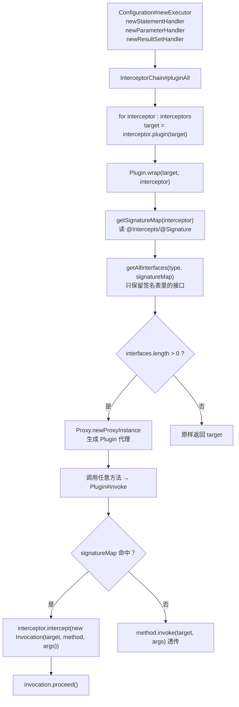
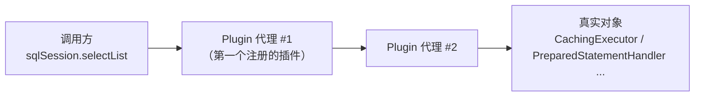
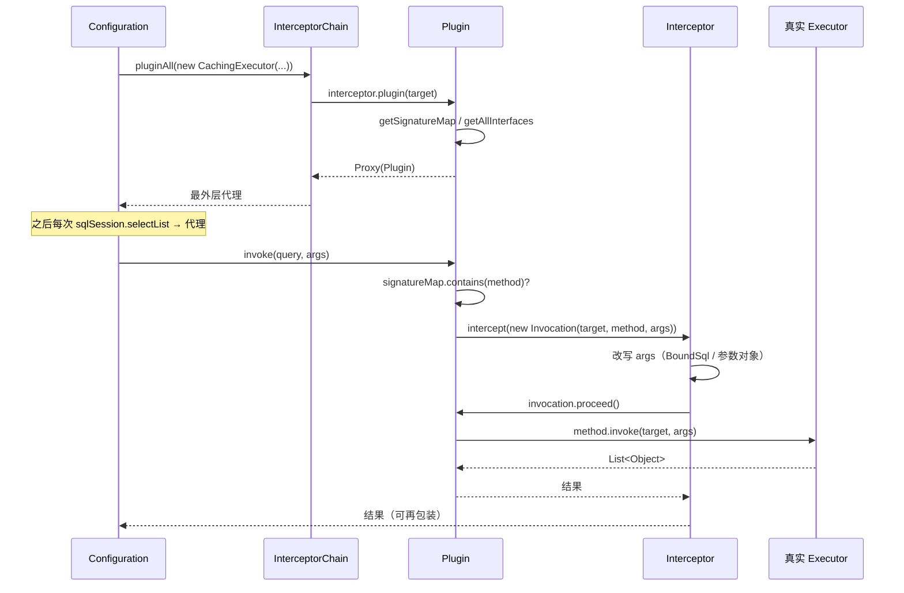

# 插件机制：`Interceptor` 与四大对象代理

> 一句话结论：MyBatis 的插件 = **JDK 动态代理 + 一张"类→方法"签名表**。`InterceptorChain#pluginAll` 在创建四大对象（`Executor`/`StatementHandler`/`ParameterHandler`/`ResultSetHandler`）时逐个套上 `Plugin` 代理，代理只在"调用的方法在 `@Signature` 表里"时才进你的 `intercept`，其余方法直接透传。
>
> 阅读前置：知道 JDK 动态代理（`InvocationHandler` + `Proxy.newProxyInstance`）；读过 [01-结果映射-resultsethandler与自动映射.md](./01-结果映射-resultsethandler与自动映射.md)（知道 `ResultSetHandler` 干什么）；读过 [../03-动态SQL与参数映射/02-参数映射-parametermapping与typehandler.md](../03-动态SQL与参数映射/02-参数映射-parametermapping与typehandler.md)（知道 `BoundSql` 与 `ParameterMapping` 的结构）；想了解 `Executor` 的执行骨架可读 [../02-SqlSession与执行器/README.md](../02-SqlSession与执行器/README.md)。
>
> 预计阅读：50 分钟 ｜ 源码：mybatis@3.6.0

## 0. 先看现象（3 分钟上手）

**现象一：写了拦截器但一次都没进。**

```java
@Intercepts(@Signature(type = Executor.class, method = "query",
    args = { MappedStatement.class, Object.class, RowBounds.class, ResultHandler.class }))
public class MyPlugin implements Interceptor { /* ... */ }
```

- 如果只在类上加了 `@Component` 而**没有把它注册到 MyBatis**，`InterceptorChain` 里根本没有这个实例 → 永不触发。
- 如果 `method`/`args` 写错（例如漏了 `ResultHandler`），`Plugin#getSignatureMap` 在注册时就抛 `PluginException: Could not find method on interface org.apache.ibatis.executor.Executor named query. Cause: java.lang.NoSuchMethodException` → 启动失败（**注意**：是启动就失败，不是静默不生效；"静默不生效"通常是"方法签名写对了但被代理的对象类型不对"）。

**现象二：`getArgs()` 改了参数，业务却没变化。**

```java
@Override
public Object intercept(Invocation invocation) throws Throwable {
  Object[] args = invocation.getArgs();
  args[1] = newArgs;      // 改了数组元素
  return invocation.proceed();
}
```

上面**是对的**——`Invocation` 持有的是 `args` 数组的引用，改元素后 `proceed()` 用新数组调用目标方法。但如果你写的是：

```java
MappedStatement ms = (MappedStatement) args[0];
ms.setSqlSource(...);   // ❌ MappedStatement 一旦构建就是共享只读的
```

就会污染全局配置（同一个 `MappedStatement` 被所有线程共用），甚至并发下直接报错。

**现象三：分页插件拦了 `Executor#query` 但有时不生效。**

`Executor` 有 6 参和 4 参两个 `query` 重载，`CachingExecutor` 与 `BaseExecutor` 的实现路径不同；`RoutingStatementHandler` 又会把 `StatementHandler` 委派给 `PreparedStatementHandler`。拦截点选错，就会出现"普通查询生效、`Cursor` 查询不生效"之类的问题。

这三段现象都来自同一套代码：`Plugin` 的签名表 + `InterceptorChain` 的包装顺序。

## 1. 整体地图（先图后码）



**读图说明**：图里有两个"过滤"决定插件是否生效——① `getAllInterfaces` 只返回"在签名表里出现过的接口"，所以**如果你把 `@Signature` 写成某个实现类而不是接口，代理就套不上**（`type` 必须是 `Executor`/`StatementHandler`/`ParameterHandler`/`ResultSetHandler` 这四个接口之一）；② `invoke` 里再按 `method.getDeclaringClass()` 查 `signatureMap`，只有**精确匹配的方法**才进 `intercept`，同一个接口的其它方法走透传。两个过滤都基于"方法对象相等"（`Method#equals` 比 声明类+名字+参数类型），所以 `args` 数组必须一字不差。

多层代理的结构：



**读图说明**：`pluginAll` 是**迭代包装**：先注册的拦截器在**最外层**（后包装的在内层），所以调用顺序是"注册顺序 → 内层"，`proceed()` 返回时是"内层 → 注册顺序"的逆序。这一点决定了"多个插件谁先改 SQL"——先注册的先看到原始 SQL。

## 2. 关键类逐个拆

| 类 | 职责 | 关键点 |
| --- | --- | --- |
| `Interceptor` | 插件接口 | 3 个方法：`intercept`、`plugin`（默认 `Plugin.wrap`）、`setProperties` |
| `Intercepts` / `Signature` | 声明"拦哪个类的哪个方法" | `type`/`method`/`args` 三元组，`args` 必须精确 |
| `InterceptorChain` | 拦截器列表 + 包装 | `pluginAll` 循环；`getInterceptors` 返回不可变副本 |
| `Plugin` | `InvocationHandler` 实现 | 持有 `target`/`interceptor`/`signatureMap`，`wrap` + `invoke` |
| `Invocation` | 一次被拦截的调用 | `getTarget`/`getMethod`/`getArgs`/`proceed` |
| `PluginException` | 插件配置错误 | 无 `@Intercepts`、方法找不到时抛 |

四大对象与"为什么只有这四个"：

| 接口 | 创建的时机 | 能改什么 |
| --- | --- | --- |
| `Executor` | `Configuration#newExecutor` | SQL 改写（分页）、缓存、批量、事务边界 |
| `StatementHandler` | `Configuration#newStatementHandler` + `RoutingStatementHandler` | `BoundSql`、超时、`PreparedStatement` 代理 |
| `ParameterHandler` | `Configuration#newParameterHandler` | 参数值、参数类型（含加密、脱敏） |
| `ResultSetHandler` | `Configuration#newResultSetHandler` | 结果集 → 对象（含字段解密、结果过滤） |

为什么是这四个？因为它们是 `Configuration` 工厂里"可插拔的四个钩子"——`SqlSource`、`BoundSql`、`MappedStatement` 都是**构建期不可变对象**，而 `Transaction`/`DataSource` 属于环境配置，`SqlSession` 本身没有拦截点（`SqlSessionTemplate` 用的是自己的代理，另一码事，见 [../05-Spring集成与Boot自动配置/README.md](../05-Spring集成与Boot自动配置/README.md)）。`Invocation` 的构造函数会显式校验：

```java (src: Invocation.java#L31-L46)
public class Invocation {

  private static final List<Class<?>> targetClasses = Arrays.asList(Executor.class, ParameterHandler.class,
      ResultSetHandler.class, StatementHandler.class);
  private final Object target;
  private final Method method;
  private final Object[] args;

  public Invocation(Object target, Method method, Object[] args) {
    if (!targetClasses.contains(method.getDeclaringClass())) {
      throw new IllegalArgumentException("Method '" + method + "' is not supported as a plugin target.");
    }
    this.target = target;
    this.method = method;
    this.args = args;
  }
```

**这段在做什么**：`Invocation` 的构造函数只接受"声明类属于四大接口之一"的方法，否则抛 `IllegalArgumentException("Method '...' is not supported as a plugin target.")`。`targetClasses` 是写死的白名单。

**为什么这么写**：这是"只能拦四大对象"的**运行时强制校验**——即使你绕过 `Plugin#getAllInterfaces` 的过滤（比如自己 `Proxy.newProxyInstance` 生成代理然后 `interceptor.intercept(new Invocation(...))`），也会在这里被拦住。白名单写死而不是"任何接口"，是因为 `Plugin` 的语义依赖"四大对象由 `Configuration` 工厂创建并经过 `pluginAll`"这一前提。

**如果改了会怎样**：如果放开白名单，插件可以拦 `SqlSession`、`Mapper` 代理、`Transaction` 等对象，但这些对象并不是所有路径都经过 `InterceptorChain`（例如 `MapperProxy` 是 `MapperRegistry` 创建的、`SqlSessionTemplate` 是 Spring 创建的），"有时生效有时不生效"的问题会爆炸式增长。

**坑位**：`method.getDeclaringClass()` 要求 `@Signature.type()` 写的是**接口**（`Executor.class`），而不是 `SimpleExecutor.class`——写实现类时 `getAllInterfaces` 不会把实现类放进代理接口列表，`Plugin#wrap` 直接返回原对象，插件静默失效。

## 3. 源码逐段精读

### 3.1 `Interceptor` 接口：三个方法

```java (src: Interceptor.java#L23-L35)
public interface Interceptor {

  Object intercept(Invocation invocation) throws Throwable;

  default Object plugin(Object target) {
    return Plugin.wrap(target, this);
  }

  default void setProperties(Properties properties) {
    // NOP
  }

}
```

**这段在做什么**：`intercept` 是唯一的必实现方法（拿 `Invocation`，返回目标方法的结果）；`plugin` 默认就是 `Plugin.wrap(target, this)`，绝大多数插件不要覆盖它；`setProperties` 对应 `<plugin>` 标签里的 `<property>` 子元素，用于把配置传进插件实例。

**为什么这么写**：用 `default` 方法把"包装方式"与"配置注入"做成可选覆盖点——普通插件只写 `intercept`；如果某个插件需要"包装成自定义代理"（例如需要额外接口）才覆盖 `plugin`；`setProperties` 让 XML 配置可以在不改代码的情况下传参（典型如 PageHelper 的 `helperDialect`）。

**如果改了会怎样**：如果覆盖 `plugin` 而不调用 `Plugin.wrap`，`@Intercepts` 的签名过滤就完全失效（所有方法都进 `intercept`），同时 `Invocation` 的构造校验仍然存在，于是"拦截到不该拦的方法"时会抛 `not supported as a plugin target`。

**坑位**：`setProperties` 在 Spring Boot 下**不会被调用**（`MybatisAutoConfiguration` 直接把 `Interceptor` 的 `@Bean` 塞进 `factory.setPlugins(...)`，没有 `properties` 环节），所以靠 `setProperties` 传参的旧插件在 Boot 里要改成"构造器注入参数"。

### 3.2 `@Intercepts` 与 `@Signature`

```java (src: Intercepts.java#L44-L54)
@Documented
@Retention(RetentionPolicy.RUNTIME)
@Target(ElementType.TYPE)
public @interface Intercepts {
  /**
   * Returns method signatures to intercept.
   *
   * @return method signatures
   */
  Signature[] value();
}
```

```java (src: Signature.java#L30-L54)
@Documented
@Retention(RetentionPolicy.RUNTIME)
@Target({})
public @interface Signature {
  /**
   * Returns the java type.
   *
   * @return the java type
   */
  Class<?> type();

  /**
   * Returns the method name.
   *
   * @return the method name
   */
  String method();

  /**
   * Returns java types for method argument.
   *
   * @return java types for method argument
   */
  Class<?>[] args();
}
```

**这段在做什么**：`@Intercepts` 是"插件类"上的注解，值是若干 `@Signature`；每个 `@Signature` 由"目标接口 `type` + 方法名 `method` + 参数类型数组 `args`"三段组成。注解本身没有逻辑，真正起作用的是 `Plugin#getSignatureMap` 把它们翻译成"`Method` 集合"。

**为什么这么写**：用注解而不是"实现某个带泛型参数的接口"，是因为 MyBatis 要支持"一个插件拦多个类型、多个方法"（`@Intercepts({@Signature(...), @Signature(...)})`），而 Java 接口无法表达"我要拦别人的方法"。`args` 必须是"精确的形参类型数组"，因为 `Method` 的唯一标识就是 声明类+名字+参数签名。

**如果改了会怎样**：如果 `args` 用"父类型"或省略一个参数，`sig.type().getMethod(method, args)` 找不到方法 → 启动抛 `PluginException`。如果把 `type` 写成实现类，`getAllInterfaces` 不会把它当代理接口 → 静默失效。

**坑位**：同一个方法在接口与实现类上都有声明时，`getDeclaringClass()` 返回**声明该方法的类**——`@Signature(type = Executor.class, ...)` 对应的是 `Executor` 接口上声明的方法，`method.getDeclaringClass()` 也是 `Executor.class`（因为代理是基于接口的），这两者天然一致。这也是"必须写接口"的深层原因。

### 3.3 `InterceptorChain#pluginAll`：迭代包装

```java (src: InterceptorChain.java#L24-L33)
public class InterceptorChain {

  private final List<Interceptor> interceptors = new ArrayList<>();

  public Object pluginAll(Object target) {
    for (Interceptor interceptor : interceptors) {
      target = interceptor.plugin(target);
    }
    return target;
  }
```

**这段在做什么**：按注册顺序循环，每轮把"当前对象"包一层代理。第一轮包外层？不——第一轮包出来的代理在**内层**：第二轮 `interceptor.plugin(第一轮结果)` 生成的代理把第一轮代理当 `target` 包住，所以**后注册的在最外层**，调用时**后注册的先执行**。

**为什么这么写**：`pluginAll` 是 `Configuration` 创建四大对象时的统一入口（`newExecutor`/`newStatementHandler`/`newParameterHandler`/`newResultSetHandler` 末尾都有 `interceptorChain.pluginAll(...)`）。用"迭代"而不是"递归"或"一次性构造代理链"，是因为每个拦截器的签名表不同，每层代理的接口集合也可能不同（`getAllInterfaces` 只保留命中签名的接口）。

**如果改了会怎样**：如果改成 `for` 反序，插件执行顺序完全反过来——分页插件与"SQL 改写"插件配合时，改动先后会让生成的 SQL 完全不同（例如"先分页后加租户条件"vs"先加租户条件后分页"，后者才是对的）。

**坑位**：`getInterceptors()` 返回 `List.copyOf(interceptors)`（不可变副本），所以运行期不能通过它增删拦截器；配置 `Configuration#addInterceptor` 之后再注册的拦截器不会作用到已创建的四大对象上（`SqlSessionFactory` 构建完成后再 `addInterceptor` 只影响之后创建的 `Executor`，而 `SqlSessionTemplate` 复用的是同一个 `Configuration`，故一般有效但行为隐晦——不建议运行期加）。

### 3.4 `Plugin#wrap`：按签名表挑接口

```java (src: Plugin.java#L43-L51)
  public static Object wrap(Object target, Interceptor interceptor) {
    Map<Class<?>, Set<Method>> signatureMap = getSignatureMap(interceptor);
    Class<?> type = target.getClass();
    Class<?>[] interfaces = getAllInterfaces(type, signatureMap);
    if (interfaces.length > 0) {
      return Proxy.newProxyInstance(type.getClassLoader(), interfaces, new Plugin(target, interceptor, signatureMap));
    }
    return target;
  }
```

**这段在做什么**：先解析签名表，再从 `target.getClass()` 的接口（含父类接口，见 3.6）里筛出"出现在签名表里的接口"；只要有至少一个命中，就用 JDK 动态代理生成只实现这些接口的代理对象，`InvocationHandler` 是 `Plugin` 自身；一个都没命中就原样返回 `target`（**不打代理**）。

**为什么这么写**：只代理"命中的接口"是关键优化与正确性保证——如果代理所有接口，则"其它接口的方法"调用会绕一层 `Plugin#invoke` 再反射进去（性能损耗），而且一旦签名表里某接口方法 `args` 写错，代理层会以奇怪的方式报 `IllegalArgumentException`。另外 `Proxy` 要求"代理类实现接口"，只保留命中接口能让 `equals/hashCode` 等也走正常反射路径。

**如果改了会怎样**：如果对所有接口都打代理，`CachingExecutor` 这类"只实现 `Executor`"的对象变化不大，但 `PreparedStatementHandler`（实现 `StatementHandler`）如果签名表里写的是 `BaseStatementHandler`（抽象类而非接口），`getAllInterfaces` 里永远不会出现它 → 不生效。

**坑位**：`Proxy.newProxyInstance` 的类加载器用的是 `target` 的类加载器，所以在 OSGi/多类加载器环境里要注意接口的可见性；另外代理对象**不是** `target` 的类型，`instanceof CachingExecutor` 会返回 `false`——"插件生效后强转失败"就是这个原因。

### 3.5 `Plugin#invoke`：命中就拦，否则透传

```java (src: Plugin.java#L53-L64)
  @Override
  public Object invoke(Object proxy, Method method, Object[] args) throws Throwable {
    try {
      Set<Method> methods = signatureMap.get(method.getDeclaringClass());
      if (methods != null && methods.contains(method)) {
        return interceptor.intercept(new Invocation(target, method, args));
      }
      return method.invoke(target, args);
    } catch (Exception e) {
      throw ExceptionUtil.unwrapThrowable(e);
    }
  }
```

**这段在做什么**：代理收到任何方法调用时，先按"方法声明类"取出该接口对应的方法集合，只有**集合里真的有这个 `Method`** 才进 `intercept`；否则直接反射调 `target`。所有异常经 `ExceptionUtil.unwrapThrowable` 剥掉 `InvocationTargetException` 包装。

**为什么这么写**：`signatureMap.get(method.getDeclaringClass())` 用"声明类"做键，是因为同一个方法名可能同时存在于多个接口（例如 `query` 在 `Executor` 上有、在别处没有，但 `close` 到处都有），必须靠声明类消歧。`unwrapThrowable` 是为了让用户看到的异常栈是业务异常而不是"反射包装异常"。

**如果改了会怎样**：如果不解包，`intercept` 里抛的 `PersistenceException` 会变成 `InvocationTargetException`，Spring 的异常翻译（`MyBatisExceptionTranslator`）就无法按 `PersistenceException` 识别，最终变成 `UndeclaredThrowableException`——"异常类型莫名其妙变了"的经典原因。

**坑位**：`methods.contains(method)` 依赖 `Method#equals`，它比较"声明类 + 名字 + 参数类型"。所以 `@Signature` 里 `args` 必须是**精确的形参类型**（不能写 `Object[]` 去匹配 `String[]`，也不能漏 `RowBounds`）。

### 3.6 `getSignatureMap` 与 `getAllInterfaces`

```java (src: Plugin.java#L66-L99)
  private static Map<Class<?>, Set<Method>> getSignatureMap(Interceptor interceptor) {
    Intercepts interceptsAnnotation = interceptor.getClass().getAnnotation(Intercepts.class);
    // issue #251
    if (interceptsAnnotation == null) {
      throw new PluginException(
          "No @Intercepts annotation was found in interceptor " + interceptor.getClass().getName());
    }
    Signature[] sigs = interceptsAnnotation.value();
    Map<Class<?>, Set<Method>> signatureMap = new HashMap<>();
    for (Signature sig : sigs) {
      Set<Method> methods = signatureMap.computeIfAbsent(sig.type(), k -> new HashSet<>());
      try {
        Method method = sig.type().getMethod(sig.method(), sig.args());
        methods.add(method);
      } catch (NoSuchMethodException e) {
        throw new PluginException("Could not find method on " + sig.type() + " named " + sig.method() + ". Cause: " + e,
            e);
      }
    }
    return signatureMap;
  }

  private static Class<?>[] getAllInterfaces(Class<?> type, Map<Class<?>, Set<Method>> signatureMap) {
    Set<Class<?>> interfaces = new HashSet<>();
    while (type != null) {
      for (Class<?> c : type.getInterfaces()) {
        if (signatureMap.containsKey(c)) {
          interfaces.add(c);
        }
      }
      type = type.getSuperclass();
    }
    return interfaces.toArray(new Class<?>[0]);
  }
```

**这段在做什么**：`getSignatureMap` 把注解翻译成 `Map<接口, Set<Method>>`：没有 `@Intercepts` 直接抛（issue #251），`getMethod` 找不到就抛 `Could not find method on ... named ...`。`getAllInterfaces` 从 `type` 开始沿**父类链**向上走，收集每一层的接口，只保留"在签名表里出现过"的。

**为什么这么写**：`type.getClass().getInterfaces()` 只返回**直接实现的接口**，而 `RoutingStatementHandler` 实现了 `StatementHandler` 且继承 `BaseStatementHandler`（后者可能再实现接口），代理必须把父类链上的接口也纳入，否则"给 `StatementHandler` 打代理"在 `RoutingStatementHandler` 上会失效——`while (type != null)` 就是为此。

**如果改了会怎样**：如果只取 `type.getInterfaces()`，`CachingExecutor`（`BaseExecutor` 的子类，`Executor` 接口在父类上）就无法被代理——所有"拦 `Executor`"的插件全部失效。这正是"必须写父类链遍历"的原因。

**坑位**：`signatureMap.containsKey(c)` 用的是 `Class` 的相等（同一个类加载器下是同一个 `Class` 对象），所以"父类实现的接口"必须与 `@Signature.type()` 是同一个 `Class` 实例；在多类加载器环境里可能出现"同名不同 Class"导致不命中。

### 3.7 `Invocation#proceed`：往下传递

```java (src: Invocation.java#L48-L62)
  public Object getTarget() {
    return target;
  }

  public Method getMethod() {
    return method;
  }

  public Object[] getArgs() {
    return args;
  }

  public Object proceed() throws InvocationTargetException, IllegalAccessException {
    return method.invoke(target, args);
  }
```

**这段在做什么**：`proceed()` 用**当前 `args` 数组**反射调用 `target`。因为 `getArgs()` 返回的是同一个数组引用，插件在 `proceed()` 之前修改元素，就等于改了实际传给目标方法的参数。

**为什么这么写**：这是"改写 SQL/参数"的标准姿势的基础——不需要替换 `MappedStatement`、不需要新建代理，只要把 `args[i]` 换成新对象即可。`args` 不做防御性拷贝，是为了让"改写"成为默认能力，而不是额外 API。

**如果改了会怎样**：如果 `getArgs()` 返回 `args.clone()`，所有"改 `args[i]` 再 `proceed()`"的插件立刻失效（改的是副本），这是最隐蔽的 API 变更之一。

**坑位**：`args` 可能是 `null`（无参方法），写插件时要判空；`proceed()` 的 `target` 是**被代理的对象**（即内层代理或真实对象），在多层代理下它自动继续往里走。

## 4. 一次完整执行时序



**读图说明**：注意"包装"只发生一次（`pluginAll` 在创建对象时），而"拦截"发生在每次调用。所以插件里做重量级初始化（读配置、建连接池）应放在 `setProperties`/构造函数，而不是 `intercept` 里每行都做；同时 `intercept` 是**同步**执行的，任何耗时操作都会拖慢查询（这也是"插件里别打同步日志到远程服务"的原因）。

文字版时序（以"分页插件拦 `Executor#query`"为例）：

1. `Configuration#newExecutor` 创建 `CachingExecutor`（装饰 `SimpleExecutor`/`BatchExecutor`）；
2. `pluginAll` 依次套插件代理（顺序：注册顺序在内层）；
3. `DefaultSqlSession#selectList` 调 `executor.query(ms, param, rowBounds, handler)` → 打到最外层代理；
4. `Plugin#invoke` 命中 `query` → `intercept`；
5. 插件里从 `args[0]` 拿 `MappedStatement`、`args[1]` 拿参数对象，`ms.getBoundSql(param)` 拿到 `BoundSql`，改写 `sql`（或用 `BoundSql` 构造新对象）后替换 `args`；
6. `proceed()` 继续向内，最终 `CachingExecutor#query` → `BaseExecutor#query` → `StatementHandler`；
7. 结果返回，插件可对结果再加工（分页总数、脱敏等）。

## 5. 设计模式与设计取舍

| 设计点 | 模式 | 取舍 |
| --- | --- | --- |
| `Interceptor` + `@Signature` | 声明式扩展点 | 零侵入，代价是签名写错只能靠异常发现 |
| `Plugin`（`InvocationHandler`） | 动态代理 | 不改原类即可增强，代价是 `instanceof`/强转失效 |
| `InterceptorChain#pluginAll` | 职责链 | 顺序可控，代价是"谁先谁后"依赖注册顺序这个隐式契约 |
| `Invocation` 白名单校验 | 防御式编程 | 明确边界，代价是"想拦别的东西就别想" |
| `args` 数组共享 | 引用传递 | 改写方便，代价是插件间会互相影响（后面的插件看到前面的修改） |
| `setProperties` | 配置注入 | XML 时代友好，Spring 时代冗余 |

三个值得讨论的取舍：

1. **代理 vs 继承**：MyBatis 选 JDK 动态代理（不做字节码增强），因此只能基于接口拦；如果选 CGLIB 子类代理，`final` 类（`RoutingStatementHandler` 不是 `final`，但很多实现是）就拦不了，且启动开销更大。
2. **白名单 vs 全开放**：限定四大对象让"插件生态"稳定（大家知道能拦什么），代价是"想拦 `SqlSession`/`Mapper`"就必须自己写代理（`SqlSessionTemplate` 就是这么干的）。
3. **签名精确匹配 vs 模糊匹配**：精确 `Method` 相等可以做到零误伤，代价是"重载方法必须写全参数类型"——这也是 `Executor#query` 有两个重载时必须分别声明的原因。

## 6. 踩坑与调试手法

### 6.1 坑 1：修改参数后 `MappedStatement` 不可变

**症状**：插件里改了 `MappedStatement` 的 `SqlSource`，第一次查询生效，之后所有查询（包括别的 mapper）都受影响；并发下偶发 `ConcurrentModificationException` 或数据错乱。

**根因**：`MappedStatement` 是 `Configuration` 级别的**共享只读对象**（构建期 `MappedStatement.Builder` 一次性构建，之后只读），`BoundSql` 才是**每次执行新建**的。

**正确姿势**（示意代码，非 MyBatis 源码）：

```java
Object[] args = invocation.getArgs();   // ms, param, rowBounds, resultHandler, cacheKey, boundSql
MappedStatement ms = (MappedStatement) args[0];
BoundSql boundSql = ms.getBoundSql(args[1]);
args[5] = new BoundSql(ms.getConfiguration(), rewrite(boundSql.getSql()),
    boundSql.getParameterMappings(), args[1]);
return invocation.proceed();
```

**这段在做什么**：从 `Invocation` 取出 6 参 `query` 的实参数组，用原 `MappedStatement` + 参数对象**生成一份新的** `BoundSql`（SQL 被 `rewrite` 改写，参数映射沿用原列表），再把它塞回 `args[5]`，让内层 `Executor` 用新 `BoundSql` 执行。

**为什么这么写**：`BoundSql` 的职责就是"一次执行所需的最终 SQL + 参数映射 + 附加参数"，它是**方法级对象**，替换它不会污染共享状态；而 `MappedStatement` 属于 `Configuration`，是全局共享的只读对象。

**如果改了会怎样**：如果只替换 `args[5]` 却忘了同步 `args[4]`（`CacheKey`），二级缓存会以旧 SQL 的键命中新 SQL 的结果；如果把新 `BoundSql` 的 `additionalParameters` 丢掉，`<foreach>` 的动态参数会在 `DefaultParameterHandler` 里取不到值而报 `Could not set parameters`。

**坑位**：`args` 只有在你拦的是 **6 参** `query` 时才是这个长度，4 参版本里没有 `CacheKey`/`BoundSql`；`update` 系列方法根本没有 `BoundSql` 参数，要改 SQL 只能装饰 `MappedStatement`。

补充说明：

1. **只改 SQL 文本**：如上，用新 `BoundSql` 替换 `args` 里的元素，**不要**碰 `MappedStatement`；同时要重新计算 `args[4]` 的 `CacheKey`（键随 SQL 变化），并把原 `BoundSql` 的 `additionalParameters`（`<foreach>`、`<bind>` 的变量都在里面）逐个 `setAdditionalParameter` 到新对象上，否则动态参数丢失。
2. **装饰 `MappedStatement`**：用 `MappedStatement.Builder` 复制一份，仅替换 `SqlSource`，然后 `args[0] = newMs`。官方文档与多数生产插件（分页插件）选这个方案，因为它让内层的 `StatementHandler` 也看到新 SQL（`BoundSql` 在 `StatementHandler#getBoundSql` 里重新生成）。
3. **拦 `StatementHandler#prepare`**：只能改"已经生成的 `BoundSql`"（`RoutingStatementHandler` 的 `delegate.boundSql` 字段），`PreparedStatement` 已按旧 SQL 预编译时改文本会不匹配参数个数——所以改 SQL 一律优先拦 `Executor`。

### 6.2 坑 2：`Interceptor` 未注册不生效

**症状**：`@Component` 打了、日志也打了，但 `intercept` 一次没进。

**根因**：`@Bean Interceptor` 只是 Spring 容器里的 Bean，MyBatis 只认 `Configuration#addInterceptor` 或 `SqlSessionFactoryBean#setPlugins`。Spring Boot 下 `MybatisAutoConfiguration` 会自动收集 `Interceptor[]` 并 `setPlugins`——但前提是**你的插件是 Spring Bean 且类型是 `org.apache.ibatis.plugin.Interceptor`**；纯 XML 时代要写 `<plugins><plugin interceptor="..."/></plugins>`。

**排查**：在启动后打断点/打印 `configuration.getInterceptors()`（`InterceptorChain#getInterceptors` 返回副本），如果为空，说明没注册上。

### 6.3 坑 3：`Executor` 类型差异

**症状**：同一插件，"普通查询能拦、`SqlSession#selectCursor` 拦不到"或"批量插入完全绕过"。

**根因**：
- `Executor#query` 有 6 参与 4 参两个重载：4 参版本内部会 `new BoundSql` 后调用 6 参版本（具体见 [../02-SqlSession与执行器/README.md](../02-SqlSession与执行器/README.md)）。只拦 4 参也能达到目的，但**改 SQL 必须拦 6 参**（或拦 4 参后改 `args[1]` 并让内层重新 `getBoundSql`，不推荐）。
- `Cursor` 查询走 `queryCursor`，与 `query` 是不同方法，必须单独 `@Signature`。
- `ExecutorType.BATCH` 下，`BatchExecutor#update` 只是把 `Statement` 缓存起来，真正 `executeBatch` 发生在 `flushStatements`（`doFlushStatements`）——你拦 `update` 看到的是"语句被加入批"，不是"已执行"。
- `update` 还有 `flushStatements`、`doFlushStatements` 相关方法，分页插件无需关心，但"SQL 审计"插件必须同时拦 `update` 与 `flushStatements`。

**排查**：确认 `@Signature` 覆盖了你要拦的全部重载；用 `configuration.getDefaultExecutorType()` 确认执行器类型。

### 6.4 坑 4：多层代理下的 SQL 改写顺序

**症状**：分页 + 多租户两个插件，有时 SQL 里 `limit` 在租户条件之前，导致"分页总数包含别人的数据"。

**根因**：`pluginAll` 迭代包装，**后注册的在最外层、先执行**；先注册的先看到原始 SQL。

**解法**：明确"谁必须在外层"——多租户（添加 `where tenant_id = ?`）应在内层先做，分页在外层包 `limit`；即"注册顺序：分页先、租户后"（租户在内层先执行）。或者干脆合并成一个插件。

### 6.5 坑 5：`instanceof` 与强转

**症状**：`if (invocation.getTarget() instanceof SimpleExecutor)` 永远是 `false`。

**根因**：`getTarget()` 返回的是"内层对象"，如果还有其它插件，它是另一个 `Plugin` 代理；只有最内层才是真实对象。用 `MetaObject.forObject(target, ...)` 或 `Proxy.getInvocationHandler` 层层剥。

**解法**：需要判断真实类型时用 `TargetUtils` 风格的层层解包，或干脆不判断类型、只依赖方法签名。

### 6.6 坑 6：插件里抛异常导致异常类型变化

**症状**：插件里 `throw new IllegalStateException(...)`，上层收到的是 `PersistenceException` 或 `UndeclaredThrowableException`。

**根因**：`intercept` 抛出的受检/非受检异常会穿过 `Plugin#invoke` 的 `unwrapThrowable` 与 `MapperMethod`/`SqlSessionTemplate` 的异常翻译链。

**解法**：插件内部异常包装成 `PersistenceException`（MyBatis 体系的根异常），Spring 下才能被 `MyBatisExceptionTranslator` 正确翻译成 `DataAccessException`。

### 6.7 调试手法

| 手段 | 能看到什么 |
| --- | --- |
| `configuration.getInterceptors()` | 已注册的拦截器列表与顺序 |
| 在 `Plugin#invoke` 打断点（条件：方法名） | 哪些方法真的进了代理 |
| `mybatis.configuration.log-impl=org.apache.ibatis.logging.stdout.StdOutImpl` | 插件改写后的最终 SQL 与参数 |
| 打印 `Invocation#getMethod().getDeclaringClass()` | 确认签名匹配到哪个接口 |
| 打印 `sqlSessionFactory.getConfiguration().getDefaultExecutorType()` | 当前执行器类型 |

## 7. ⚠️ 版本差异

| 版本 | 变化 | 影响 |
| --- | --- | --- |
| 3.4.x | `Plugin#getAllInterfaces` 增加父类链遍历 | 继承自 `BaseExecutor` 的 `CachingExecutor` 才能被 `Executor` 代理 |
| 3.5.0 | `Interceptor#plugin`/`setProperties` 变为 `default` 方法（原为抽象方法） | 老插件里的空实现可以删掉 |
| 3.5.0 | `InterceptorChain#getInterceptors` 返回 `List.copyOf(...)` | 不能通过返回值直接改拦截器列表 |
| 3.5.6 | `Plugin` 异常从 `IllegalStateException` 改为 `PluginException` | 捕获类型需调整 |
| 3.6.0 | `Invocation` 构造校验用 `method.getDeclaringClass()` 匹配四大接口 | 写实现类的 `@Signature.type()` 一定失败 |
| 3.6.0 | `ParamNameResolver` 参与构建期参数映射，`BoundSql` 的 `additionalParameters` 仍需手工复制 | 改写 `BoundSql` 时必须把原 `additionalParameters` 拷过去，否则 `<foreach>` 参数丢失 |
| Boot 4 / 4.1.0 | `MybatisAutoConfiguration` 用 `ObjectProvider<Interceptor[]>` 收集插件并 `factory.setPlugins(...)` | 不再调用 `setProperties`；插件参数用构造器注入（详见 [../05-Spring集成与Boot自动配置/02-boot-自动配置-深入-mybatisautoconfiguration.md](../05-Spring集成与Boot自动配置/02-boot-自动配置-深入-mybatisautoconfiguration.md)） |

## 8. 面试高频问与答（≥10）

**Q1：MyBatis 插件能拦截哪些对象？为什么？**

A：只有 `Executor`、`StatementHandler`、`ParameterHandler`、`ResultSetHandler` 四个。因为只有它们在 `Configuration` 的工厂方法（`newExecutor`/`newStatementHandler`/`newParameterHandler`/`newResultSetHandler`）里经过 `InterceptorChain#pluginAll`，`Invocation` 构造函数还会用白名单显式校验。

**Q2：`@Signature` 的 `type` 为什么必须写接口？**

A：`Plugin#wrap` 用 `getAllInterfaces(target.getClass(), signatureMap)` 收集"target 实现的、且在签名表里出现的接口"作为代理接口；写实现类时签名表的 key 是实现类，而 `getInterfaces()` 返回的是接口，永不匹配 → 不打代理 → 静默失效。

**Q3：多个插件的执行顺序是怎样的？**

A：`pluginAll` 迭代包装，**后注册的在最外层**，因此**后注册的先执行 `intercept`**，`proceed()` 返回时逆序。想控制顺序就控制注册顺序（Spring 下可用 `@Order`，`SqlSessionFactoryBean#setPlugins` 按数组顺序）。

**Q4：为什么"改参数"要改 `Invocation#getArgs()` 返回的数组？**

A：`Invocation` 持有 `args` 引用，`proceed()` 用同一个数组反射调用目标；改元素即改实参。改 `MappedStatement` 是错的——它是共享只读对象。

**Q5：怎么改写 SQL 而不破坏缓存与参数？**

A：拦 `Executor#query` 的 6 参版本，用 `ms.getBoundSql(parameter)` 拿原 `BoundSql`，构造新的 `BoundSql(configuration, newSql, 原 parameterMappings, parameter)`，**手工复制 `additionalParameters`**，并同步更新 `args` 里的 `CacheKey` 与 `BoundSql`（`args[4]`/`args[5]`）。

**Q6：为什么改了 SQL 后要重建 `CacheKey`？**

A：`CacheKey` 是"SQL + 参数 + RowBounds + StatementId"的摘要，同一 `MappedStatement` 下不同 SQL 必须得到不同键，否则一级/二级缓存会串。

**Q7：`setProperties` 有什么用？Spring Boot 下还用得到吗？**

A：用于 `<plugin><property name="..." value="..."/></plugin>` 传参。Spring Boot 下 `MybatisAutoConfiguration` 直接把 `Interceptor` 实例塞进 `setPlugins`，不会调用 `setProperties`，所以应改为构造器注入。

**Q8：为什么 `getTarget()` 强转可能失败？**

A：多层代理时 `getTarget()` 返回内层代理（`Plugin`），不是真实对象。需要真实类型时层层 `Proxy.getInvocationHandler` 解包，或改用 `MetaObject`。

**Q9：`Executor#query` 的 4 参与 6 参有什么区别？插件该拦哪个？**

A：4 参是"用户入口"，内部 `new BoundSql` 并生成 `CacheKey` 后调用 6 参；6 参带 `CacheKey` 与 `BoundSql`，`CachingExecutor`/`BaseExecutor` 真正执行的地方。改 SQL 拦 6 参；只做统计/日志拦 4 参即可。

**Q10：`ExecutorType.BATCH` 下插件为什么"看不到执行"？**

A：`BatchExecutor#update` 只把 `Statement` 加入批，真正执行在 `flushStatements` → `doFlushStatements`。拦 `update` 只能看到"语句入批"。

**Q11：写一个 SQL 打印插件，最小实现是什么？**

A：`@Intercepts(@Signature(type = StatementHandler.class, method = "prepare", args = {Connection.class, Integer.class}))`，在 `intercept` 里从 `invocation.getTarget()` 用 `MetaObject` 取 `delegate.boundSql.sql`（`RoutingStatementHandler` 的 `delegate` 字段）并打印，再 `proceed()`。

**Q12：写一个多租户插件要注意什么？**

A：① 只对 `select`/`update`/`delete` 加条件，`insert` 补列；② 用 `#{}` 占位而不是拼接（防注入）；③ 追加 `${}` 的部分要白名单；④ 追加参数后要更新 `BoundSql.parameterMappings` 与 `additionalParameters`，否则参数序号错位；⑤ 拦 `StatementHandler#prepare` 时改 SQL 需要重新 `prepareStatement`，容易出错，推荐拦 `Executor#query/update`。

**Q13：分页插件为什么通常拦 `Executor#query` 而不是 `StatementHandler`？**

A：分页需要 ① 执行 `count` SQL（要复用 `Executor`/`MappedStatement`）、② 拼接 `limit`、③ 返回 `Page` 对象。`Executor` 层能拿到 `MappedStatement` 与 `CacheKey`，也能发起新的查询（`executor.query(countMs, ...)`）；`StatementHandler` 层无法再发起查询。

**Q14：`PluginException` 什么时候抛？**

A：① 插件类没有 `@Intercepts`（issue #251）；② `@Signature` 里的 `method`/`args` 在 `type` 上找不到对应方法（`Could not find method on ... named ...`）。都在启动期（`pluginAll`）触发。

## 9. 动手练习（含验收标准）

### 练习 1：SQL 打印插件

**要求**：拦截 `StatementHandler#prepare`，打印最终 SQL、参数与执行耗时。

**验收标准**：
- 控制台能看到 `==> Preparing: ...` 风格的输出，且 SQL 是插件改写后的最终文本；
- 能取到 `BoundSql` 的 `additionalParameters`（`<foreach>` 场景）；
- 说明为什么用 `MetaObject` 取 `delegate.boundSql.sql` 而不是反射 `getBoundSql()`。

### 练习 2：多租户插件

**要求**：所有 `user`/`order` 表的 `select`/`update`/`delete` 自动追加 `tenant_id = #{_tenantId}`，并从 `ThreadLocal` 取租户 id。

**验收标准**：
- 只影响白名单表；`insert` 自动补 `tenant_id` 列；
- 参数映射不串位（执行成功且值正确）；
- 用 `EXPLAIN`/日志确认 SQL 语法正确（`where` / `and` 拼接正确，`<where>` 场景不产生双 `where`）；
- 写出"为什么必须把新参数加入 `BoundSql` 的 `additionalParameters` 或 `parameterMappings`"的解释。

### 练习 3：验证插件顺序

**要求**：写两个插件 A、B，都拦 `Executor#query`，各打印一行日志。

**验收标准**：
- 观察到入栈顺序与返回顺序；
- 改变注册顺序（Spring `@Order` 或 `setPlugins` 数组顺序）后，顺序对应改变；
- 给出"分页 + 多租户"应采用的顺序及其理由。

### 练习 4：最小分页插件

**要求**：拦 `Executor#query`，对 `select` 语句加 `limit ?, ?`，并执行 `count` SQL 计算总数。

**验收标准**：
- 返回 `Page` 包装对象或"分页后的 List + 总数"；
- 说明 `CacheKey` 为什么要重新生成；
- 说明为什么不支持 `<foreach>`/`association` 场景的完美分页（`count` SQL 改写要处理 `order by` 与 `select` 列）。

### 练习 5：制造 `PluginException`

**要求**：故意把 `args` 写错（漏掉 `ResultHandler`），观察启动行为。

**验收标准**：
- 启动时抛 `PluginException: Could not find method on interface org.apache.ibatis.executor.Executor named query.`；
- 能指出抛异常的源码位置（`getSignatureMap`）；
- 修正后再启动正常，并说明为什么错误是"启动失败"而不是"运行静默失效"。

## 小结

- 插件 = `Interceptor`（业务逻辑）+ `@Intercepts/@Signature`（拦截声明）+ `Plugin`（JDK 动态代理）。
- 只有四个对象能被拦：`Executor`、`StatementHandler`、`ParameterHandler`、`ResultSetHandler`，`Invocation` 构造时白名单校验。
- `pluginAll` 迭代包装：后注册的在最外层、先执行；顺序即注册顺序的逆序。
- 改 SQL/参数的标准姿势是"改 `Invocation#getArgs()` 里的对象并 `proceed()`"，绝不能改 `MappedStatement`。
- 签名写错在启动期就抛 `PluginException`；`type` 写实现类会静默失效；`ExecutorType.BATCH` 下 `update` 不等于执行。
- 插件内部异常要包装成 `PersistenceException`，否则 Spring 的异常翻译会错位。

## 自测题

1. `Plugin#wrap` 在什么情况下返回原对象而不打代理？
<details><summary>参考答案</summary>
`getAllInterfaces(type, signatureMap)` 返回空数组时，即 `target` 的类（含父类链）实现的接口里没有任何一个出现在签名表（`@Signature.type()`）中。
</details>

2. `Plugin#invoke` 用什么作为 `signatureMap` 的键？
<details><summary>参考答案</summary>
`method.getDeclaringClass()`，即"声明该方法的类/接口"，再在该集合里用 `contains(method)` 精确匹配（声明类+名字+参数类型）。
</details>

3. 两个拦截器 A（先注册）、B（后注册）同时拦 `Executor#query`，`intercept` 的执行顺序？
<details><summary>参考答案</summary>
B 先执行（B 的代理在最外层），`proceed()` 后进 A，再进真实 `Executor`；返回时 A 先返回、B 后返回。
</details>

4. 为什么 `@Signature(type = SimpleExecutor.class, ...)` 会静默失效？
<details><summary>参考答案</summary>
代理接口只从 `getInterfaces()` 收集，`SimpleExecutor` 的接口是 `Executor`，与签名表 key（`SimpleExecutor`）不匹配，`interfaces.length == 0`，`wrap` 返回原对象。
</details>

5. 改 SQL 时为什么不能改 `MappedStatement#setSqlSource`？
<details><summary>参考答案</summary>
`MappedStatement` 是 `Configuration` 级共享只读对象，被所有线程/所有查询复用；改了会污染全局并引发并发问题。
</details>

6. 拦 `Executor#query` 的 6 参版本，`args` 六个元素分别是什么？
<details><summary>参考答案</summary>
`{MappedStatement, Object parameterObject, RowBounds, ResultHandler, CacheKey, BoundSql}`。
</details>

7. `Invocation` 构造函数校验的是什么？
<details><summary>参考答案</summary>
`method.getDeclaringClass()` 必须是 `Executor`/`ParameterHandler`/`ResultSetHandler`/`StatementHandler` 之一，否则抛 `IllegalArgumentException("Method '...' is not supported as a plugin target.")`。
</details>

8. 想在 Spring Boot 下让插件生效，最少要做什么？
<details><summary>参考答案</summary>
把插件声明为类型为 `org.apache.ibatis.plugin.Interceptor` 的 Spring Bean；`MybatisAutoConfiguration` 会收集 `Interceptor[]` 并 `factory.setPlugins(this.interceptors)`（或自己 `@Bean SqlSessionFactory` 时手动 `setPlugins`）。
</details>

9. `ExecutorType.BATCH` 下想审计"真正执行的 SQL"该拦哪个方法？
<details><summary>参考答案</summary>
拦 `Executor#flushStatements`（或 `doFlushStatements`），因为 `update` 只是入批，`executeBatch` 在 flush 时执行。
</details>

10. 为什么改写 `BoundSql` 后要重建 `CacheKey`？
<details><summary>参考答案</summary>
`CacheKey` 由 SQL、参数、`RowBounds`、StatementId 等组成；SQL 变了而键不变会让缓存串数据（读别人的结果）。
</details>

11. `getTarget()` 返回的对象一定是你注册插件时那个类吗？
<details><summary>参考答案</summary>
不一定。多层代理时返回的是内层代理（`Plugin` 实例），只有最内层是真实对象；强转/`instanceof` 都可能失败。
</details>

12. 插件里抛出的 `IllegalStateException` 到 Spring 层会变成什么？怎么改？
<details><summary>参考答案</summary>
可能被 `SqlSessionTemplate`/`MyBatisExceptionTranslator` 包装成 `UndeclaredThrowableException` 或原样透出，导致 `DataAccessException` 翻译失效。应包装为 `org.apache.ibatis.exceptions.PersistenceException`。
</details>

13. `InterceptorChain#getInterceptors()` 能用来运行期加插件吗？
<details><summary>参考答案</summary>
不能。它返回 `List.copyOf(interceptors)` 的不可变副本；要加用 `Configuration#addInterceptor`，但注意只影响之后创建的四大对象。
</details>

14. 为什么 `Plugin` 只用 `target.getClass()` 的接口，而不是全部 `Class`？
<details><summary>参考答案</summary>
JDK 动态代理只能基于接口生成代理类；且只保留"签名表里出现过"的接口可以避免无谓的反射层与误拦。
</details>
