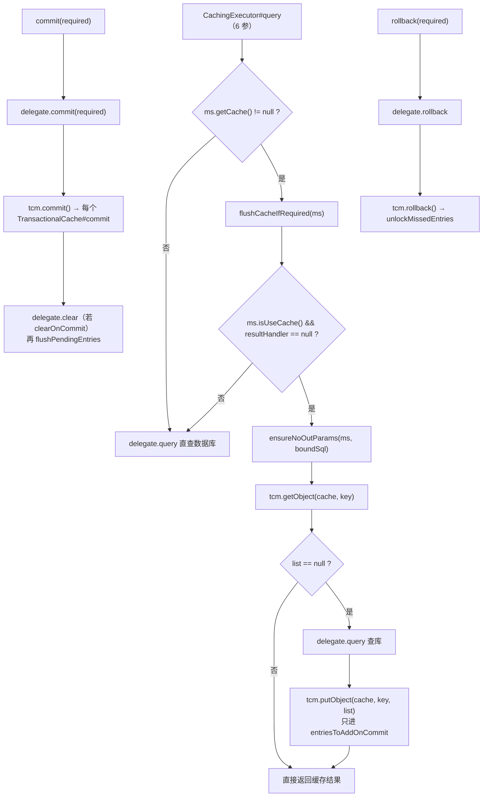
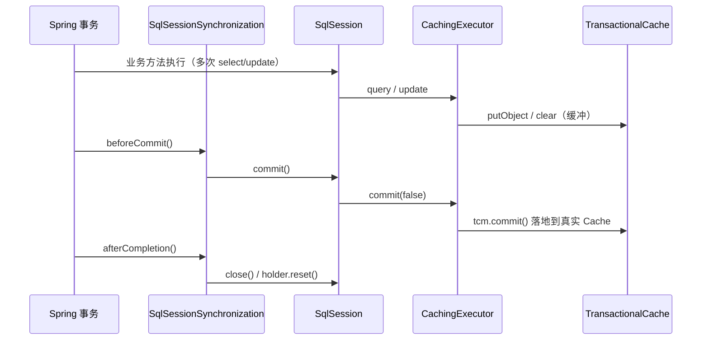
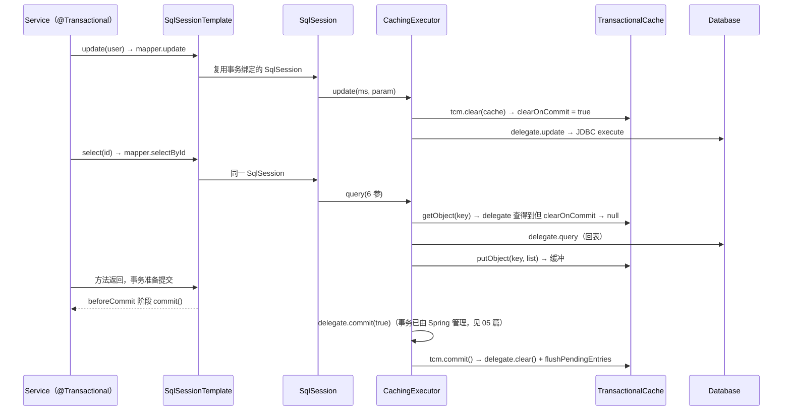

# 二级缓存与坑位

> 一句话结论：MyBatis 的二级缓存是**命名空间级**缓存，写入必须在事务提交时才真正落到 `Cache`（由 `TransactionalCache` + `TransactionalCacheManager` 实现），所以"没提交就读不到"、"回滚不脏缓存"、"跨命名空间失效要 `<cache-ref>`"；而它和 Spring 事务的同步点如果对不上（`beforeCommit` 提交 SqlSession、事务后续回滚），就会出现**缓存里留下已回滚数据**的经典问题。
>
> 阅读前置：知道 `Executor` 的执行骨架与 `CacheKey`（见 [../02-SqlSession与执行器/README.md](../02-SqlSession与执行器/README.md)）；了解 Spring 事务的提交/回滚回调顺序（见 [../../01-Spring框架/03-事务管理/01-transactional-事务拦截器与传播行为.md](../../01-Spring框架/03-事务管理/01-transactional-事务拦截器与传播行为.md)）；本目录 [01-结果映射-resultsethandler与自动映射.md](./01-结果映射-resultsethandler与自动映射.md) 讲的是"行 → 对象"，本篇讲"对象 → 缓存"。
>
> 预计阅读：45 分钟 ｜ 源码：mybatis@3.6.0

## 0. 先看现象（3 分钟上手）

**现象一：同一个查询，两次调用打印两次 SQL。**

```text
==>  Preparing: select id,name from user where id = ?
==>  Preparing: select id,name from user where id = ?
```

说明二级缓存**没命中**。常见原因只有三个：

1. 没配 `<cache/>`（或 `@CacheNamespace`）——`MappedStatement#getCache()` 为 `null`，`CachingExecutor` 直接走 `delegate.query`；
2. `<select>` 上写了 `useCache="false"`（`MappedStatement#isUseCache()` 为 `false`）；
3. 第一次查询**事务还没提交**——`TransactionalCache#putObject` 只是把结果放进 `entriesToAddOnCommit` 这个"待提交缓冲区"，没提交前 `delegate`（真正的 `Cache`）里没有数据，所以第二次查询依然回表。

**现象二：`update` 之后同一个事务里再查，读到的是旧数据？**

不会。`<insert>/<update>/<delete>` 默认 `flushCache="true"`，`CachingExecutor#update` 会先 `flushCacheIfRequired(ms)` → `tcm.clear(cache)` → `TransactionalCache#clear` 把 `clearOnCommit` 置为 `true`，于是本事务内所有 `getObject` 都返回 `null`（issue #146），强制回表。真正"读到旧数据"的场景是**读在写之前、且读结果被缓存在另一个事务里**（跨事务/跨节点）。

**现象三：Spring 环境下偶发"缓存里有已回滚的数据"。**

`CachingExecutor#close(forceRollback)`、`commit`、`rollback` 三个方法决定了缓存何时生效。MyBatis-Spring 的 `SqlSessionSynchronization#beforeCommit` 会在**Spring 事务提交之前**调用 `SqlSession#commit()`，而此刻 Spring 事务可能还在提交过程中、甚至后续回滚——缓存已经刷进去了。这就是本篇第 6 节的重点坑位。

这段行为全部来自 `Cache` 接口 + `TransactionalCache` 三层缓冲 + `TransactionalCacheManager` 汇总提交这套设计。

## 1. 整体地图（先图后码）



**读图说明**：图中"读"这条线有三道门（有无 `Cache`、`useCache`、`resultHandler`），"写"这条线却只有两处触发点——`commit` 和 `close(false)`；`rollback` 走的是"解锁未命中键"而不是"撤销已写入"。这就是二级缓存最重要的不对称性：**查询结果先进入事务缓冲，只有提交才落地**。

Spring 场景下多一层关系：



**读图说明**：缓存落地发生在 `beforeCommit`，而 Spring 事务的**真正提交才在 `beforeCommit` 之后**。所以"缓存已写入但数据库回滚"的窗口客观存在——这是设计上的取舍（保证"提交成功后缓存一定已更新"），代价是极端情况下要接受短暂脏缓存。

## 2. 关键类逐个拆

| 类 | 职责 | 关键点 |
| --- | --- | --- |
| `Cache` | 二级缓存 SPI | `getId` / `putObject` / `getObject` / `removeObject` / `clear` / `getSize` / `getReadWriteLock` |
| `TransactionalCache` | 一个事务内的缓存缓冲 | `clearOnCommit`、`entriesToAddOnCommit`、`entriesMissedInCache` |
| `TransactionalCacheManager` | 汇总一个 `SqlSession` 里涉及的所有 `TransactionalCache` | `Map<Cache, TransactionalCache>`，`commit()` 统一落地 |
| `CachingExecutor` | 装饰 `Executor`，加二级缓存 | 读：`tcm.getObject`；写：`tcm.putObject`；`update` 先 `flushCacheIfRequired` |
| `LruCache` | 默认淘汰策略 | `LinkedHashMap(accessOrder=true)` + `removeEldestEntry` |
| `MappedStatement` | 携带 `cache` / `useCache` / `flushCacheRequired` | 对应 XML 的 `<cache/>`、`useCache`、`flushCache` |

`<cache>` / `<cache-ref>` 与 `@CacheNamespace` 的关系（构建期）：

| XML | 注解 | 效果 |
| --- | --- | --- |
| `<cache/>` | `@CacheNamespace` | 给**本命名空间**所有语句挂一个 `Cache` 实例 |
| `<cache-ref namespace="x"/>` | `@CacheNamespaceRef` | 复用命名空间 `x` 的 `Cache` 实例（共享、同时失效） |
| `<select useCache="false"/>` | `@Options(useCache = false)` | 该语句不进缓存（仍会 `flushCacheIfRequired`） |
| `<update flushCache="false"/>` | `@Options(flushCache = CacheFlushPolicy.NONE)` | 该语句不清缓存（危险，慎用） |

为什么默认"读入缓存、写清缓存"？因为 `MapperAnnotationBuilder#parseStatement` 里 `flushCache = !isSelect`、`useCache = isSelect`——写操作默认清、读操作默认进，这是最安全的默认值。

## 3. 源码逐段精读

### 3.1 `Cache` 接口：7+1 个方法

```java (src: Cache.java#L42-L101)
public interface Cache {

  /**
   * @return The identifier of this cache
   */
  String getId();

  /**
   * @param key
   *          Can be any object but usually it is a {@link CacheKey}
   * @param value
   *          The result of a select.
   */
  void putObject(Object key, Object value);

  /**
   * @param key
   *          The key
   *
   * @return The object stored in the cache.
   */
  Object getObject(Object key);
...
  void clear();

  /**
   * Optional. This method is not called by the core.
   *
   * @return The number of elements stored in the cache (not its capacity).
   */
  int getSize();

  /**
   * Optional. As of 3.2.6 this method is no longer called by the core.
   * <p>
   * Any locking needed by the cache must be provided internally by the cache provider.
   *
   * @return A ReadWriteLock
   */
  default ReadWriteLock getReadWriteLock() {
    return null;
  }

}
```

**这段在做什么**：定义二级缓存的最小 SPI。`getId()` 是缓存的身份（一般都返回命名空间，例如 `com.example.UserMapper`）；`putObject/getObject/removeObject/clear` 是四个基本操作；`getSize` 与 `getReadWriteLock` 是 `default` 方法，第三方实现可以不写。

**为什么这么写**：`getId()` 的存在是为了让不同命名空间的缓存可以"互相引用/失效"（`<cache-ref>` 通过命名空间找到同一个 `Cache`）；`getReadWriteLock` 标为 `default` 返回 `null`，注释说明"core 已不再调用"，因为 3.2.6 之后强制使用 `synchronized` 的方式改为可选——所以自定义缓存要线程安全，不能指望 MyBatis 帮你加锁。

**如果改了会怎样**：如果 `getId()` 在每个节点上返回不同值（例如拼了主机名），`<cache-ref>` 就无法共享，集群缓存（Redis）的 key 前缀也会错乱。

**坑位**：`removeObject` 的语义在不同实现下不一样——`LruCache` 真删；`TransactionalCache#removeObject` 直接返回 `null`（**不删任何东西**），所以自定义缓存实现不要依赖 `removeObject` 做"精确失效"，用 `clear()`。

### 3.2 `TransactionalCache`：三层缓冲

```java (src: TransactionalCache.java#L38-L81)
public class TransactionalCache implements Cache {

  private static final Log log = LogFactory.getLog(TransactionalCache.class);

  private final Cache delegate;
  private boolean clearOnCommit;
  private final Map<Object, Object> entriesToAddOnCommit;
  private final Set<Object> entriesMissedInCache;

  public TransactionalCache(Cache delegate) {
    this.delegate = delegate;
    this.clearOnCommit = false;
    this.entriesToAddOnCommit = new HashMap<>();
    this.entriesMissedInCache = new HashSet<>();
  }

  @Override
  public String getId() {
    return delegate.getId();
  }

  @Override
  public int getSize() {
    return delegate.getSize();
  }

  @Override
  public Object getObject(Object key) {
    // issue #116
    Object object = delegate.getObject(key);
    if (object == null) {
      entriesMissedInCache.add(key);
    }
    // issue #146
    if (clearOnCommit) {
      return null;
    }
    return object;
  }

  @Override
  public void putObject(Object key, Object object) {
    entriesToAddOnCommit.put(key, object);
  }
```

**这段在做什么**：`TransactionalCache` 是 `Cache` 的**事务装饰器**，它不真正存数据，而是维护三样东西：① `delegate` 真正的缓存；② `entriesToAddOnCommit` 待提交的键值；③ `entriesMissedInCache` 本次事务里"查过但没命中"的键（用于配合 `BlockingCache` 解锁）。`getObject` 先查 `delegate`，然后把"是否 `clearOnCommit`"作为最终裁决；`putObject` **只写缓冲区**。

**为什么这么写**：这样能保证"事务回滚时缓存不被污染"——`putObject` 从没落到 `delegate`，回滚时只需要丢弃缓冲区。`clearOnCommit` 的用意是"一旦本事务里发生过写操作，则本次事务的后续读一律视为未命中"（issue #146），避免"读到自己写之前的旧缓存值"。

**如果改了会怎样**：如果 `putObject` 直接写 `delegate`，一次回滚就会让缓存里留下不存在的数据；如果去掉 `clearOnCommit` 判断，事务内 `update` 后再读会命中旧快照。

**坑位**：`getObject` 在 `clearOnCommit == true` 时**依然会**把 key 记进 `entriesMissedInCache`（先查 delegate 再判断），所以"写后读"的键在提交时会被 `flushPendingEntries` 以 `null` 值写一份——这也是 `BlockingCache` 解锁需要的。

### 3.3 `TransactionalCache#clear` / `commit` / `rollback`

```java (src: TransactionalCache.java#L88-L133)
  @Override
  public void clear() {
    clearOnCommit = true;
    entriesToAddOnCommit.clear();
  }

  public void commit() {
    if (clearOnCommit) {
      delegate.clear();
    }
    flushPendingEntries();
    reset();
  }

  public void rollback() {
    unlockMissedEntries();
    reset();
  }

  private void reset() {
    clearOnCommit = false;
    entriesToAddOnCommit.clear();
    entriesMissedInCache.clear();
  }

  private void flushPendingEntries() {
    for (Map.Entry<Object, Object> entry : entriesToAddOnCommit.entrySet()) {
      delegate.putObject(entry.getKey(), entry.getValue());
    }
    for (Object entry : entriesMissedInCache) {
      if (!entriesToAddOnCommit.containsKey(entry)) {
        delegate.putObject(entry, null);
      }
    }
  }

  private void unlockMissedEntries() {
    for (Object entry : entriesMissedInCache) {
      try {
        delegate.removeObject(entry);
      } catch (Exception e) {
        log.warn("Unexpected exception while notifying a rollback to the cache adapter. "
            + "Consider upgrading your cache adapter to the latest version. Cause: " + e);
      }
    }
  }
```

**这段在做什么**：`clear()` 只**打标记**（`clearOnCommit = true`）并清空待提交区——真正的 `delegate.clear()` 推到 `commit()`。`commit()` 三步：若标记过就清空底层缓存 → 落地待提交项 → `reset()`。`rollback()` 只做"解锁未命中键"（对 `BlockingCache` 而言就是把占位锁释放）+ `reset()`，**不写任何数据**。

**为什么这么写**：`clear()` 延迟到提交，是为了"本事务内不误删别人的数据"（清空动作如果在事务中立刻生效，而本事务最终回滚，那别人的缓存就被白白清掉了——虽然清空是"安全但低效"的）。`flushPendingEntries` 里那个"把未命中键写 `null`"的循环是给 `BlockingCache` 用的：未命中时 `BlockingCache#getObject` 会锁住键，必须有人 `putObject(key, null)` 才能解锁。

**如果改了会怎样**：如果 `rollback()` 里也 `flushPendingEntries()`，回滚事务的查询结果就会落进缓存——这是最危险的错误；如果 `clear()` 立即 `delegate.clear()`，`<cache>` 场景下并发事务会互相"清空对方的缓存"。

**坑位**：`flushPendingEntries` 会往 `delegate` 写 `null` 值，某些 Redis/自定义缓存实现不接受 `null` value，会抛 `NullPointerException`——"接入 Redis 二级缓存后偶发 NPE"多半是这个原因。

### 3.4 `TransactionalCacheManager`：按 `Cache` 实例汇总

```java (src: TransactionalCacheManager.java#L26-L56)
public class TransactionalCacheManager {

  private final Map<Cache, TransactionalCache> transactionalCaches = new HashMap<>();

  public void clear(Cache cache) {
    getTransactionalCache(cache).clear();
  }

  public Object getObject(Cache cache, CacheKey key) {
    return getTransactionalCache(cache).getObject(key);
  }

  public void putObject(Cache cache, CacheKey key, Object value) {
    getTransactionalCache(cache).putObject(key, value);
  }

  public void commit() {
    for (TransactionalCache txCache : transactionalCaches.values()) {
      txCache.commit();
    }
  }

  public void rollback() {
    for (TransactionalCache txCache : transactionalCaches.values()) {
      txCache.rollback();
    }
  }

  private TransactionalCache getTransactionalCache(Cache cache) {
    return transactionalCaches.computeIfAbsent(cache, TransactionalCache::new);
  }
```

**这段在做什么**：`CachingExecutor` 是**每个 `SqlSession` 一个**，它持有一个 `TransactionalCacheManager`；这个 manager 用 `Map<Cache, TransactionalCache>` 记录"本 session 触碰过的每个命名空间缓存"（因为一次 session 可以查多个 mapper），`commit()`/`rollback()` 时统一遍历。

**为什么这么写**：二级缓存是**命名空间级**、跨 session 共享的，但"事务缓冲"必须是**session 级**的；用 `Cache` 实例做 key 而不是命名空间字符串，是因为 `<cache-ref>` 之后两个命名空间共享同一个 `Cache` 实例，用实例做 key 才能保证"同一个底层缓存只缓冲一次"。

**如果改了会怎样**：如果 key 用 `cache.getId()` 字符串，`<cache-ref>` 场景会在同一个 session 里创建两个 `TransactionalCache` 包同一个 `Cache`，提交时重复写入、`clearOnCommit` 标记互相看不到——事务内的一致性就破了。

**坑位**：`transactionalCaches` 是 `HashMap` 且 `CachingExecutor` 不是线程安全的（一个 `SqlSession` 只能一个线程用）；把 `SqlSession` 当单例共享会导致 `ConcurrentModificationException`。

### 3.5 `CachingExecutor#query`：三处 gating

```java (src: CachingExecutor.java#L93-L111)
  @Override
  public <E> List<E> query(MappedStatement ms, Object parameterObject, RowBounds rowBounds, ResultHandler resultHandler,
      CacheKey key, BoundSql boundSql) throws SQLException {
    Cache cache = ms.getCache();
    if (cache != null) {
      flushCacheIfRequired(ms);
      if (ms.isUseCache() && resultHandler == null) {
        ensureNoOutParams(ms, boundSql);
        @SuppressWarnings("unchecked")
        List<E> list = (List<E>) tcm.getObject(cache, key);
        if (list == null) {
          list = delegate.query(ms, parameterObject, rowBounds, resultHandler, key, boundSql);
          tcm.putObject(cache, key, list); // issue #578 and #116
        }
        return list;
      }
    }
    return delegate.query(ms, parameterObject, rowBounds, resultHandler, key, boundSql);
  }
```

**这段在做什么**：先取 `MappedStatement` 上挂的 `Cache`；有缓存时先"按需清空"（`flushCacheIfRequired`）；然后判断 `useCache` 与 **`resultHandler == null`**（有自定义 `ResultHandler` 时必须回表逐行回调，不能整块返回缓存）；`ensureNoOutParams` 拒绝对带 OUT 参数的存储过程语句走缓存；最后 `tcm.getObject` 未命中才查库并 `tcm.putObject`。

**为什么这么写**：三个 gating 各自对应一个正确性约束——① `flushCache`：写操作要让缓存失效；② `resultHandler == null`：`ResultHandler` 是流式处理，缓存一个 `List` 没有意义且会破坏逐行语义；③ `ensureNoOutParams`：OUT 参数必须在每次执行时重新赋值，缓存结果会取不到输出值（错误信息里明确建议 `useCache=false`）。

**如果改了会怎样**：如果允许 `resultHandler != null` 走缓存，`selectList` 风格的回调会一次都不触发；如果不检查 OUT 参数，存储过程调用第二次就拿不到输出参数。

**坑位**：`tcm.putObject(cache, key, list)` 存进去的是 `delegate.query` 返回的 `List` 引用本身——调用方随后 `list.clear()` 或排序，就会直接改坏缓存内容。**"二级缓存拿到的集合被业务代码修改，导致后续查询结果错乱"** 是最常见的二级缓存事故，所以 `selectList` 返回值不要原地修改（要改先 `new ArrayList<>(list)`）。

### 3.6 `commit` / `rollback` / `close`：落地时机

```java (src: CachingExecutor.java#L54-L66)
  @Override
  public void close(boolean forceRollback) {
    try {
      // issues #499, #524 and #573
      if (forceRollback) {
        tcm.rollback();
      } else {
        tcm.commit();
      }
    } finally {
      delegate.close(forceRollback);
    }
  }
```

```java (src: CachingExecutor.java#L118-L133)
  @Override
  public void commit(boolean required) throws SQLException {
    delegate.commit(required);
    tcm.commit();
  }

  @Override
  public void rollback(boolean required) throws SQLException {
    try {
      delegate.rollback(required);
    } finally {
      if (required) {
        tcm.rollback();
      }
    }
  }
```

**这段在做什么**：三个"结束"入口都会驱动 `tcm`：`commit` 先提交 JDBC 事务再落地缓存；`rollback` 在 `finally` 里回滚缓存缓冲（仅当 `required`）；`close(forceRollback)` 在关闭时按 `forceRollback` 决定落地或丢弃（issues #499/#524/#573 修复的就是"忘记在 close 时处理缓存"）。

**为什么这么写**：`commit` 里"先 `delegate.commit` 再 `tcm.commit`"的顺序很重要——数据库先落盘，缓存再更新，避免"数据库没提交但缓存已有"的窗口；`rollback` 里只清缓冲，不动已存在的共享缓存（那是别的事务的成果）。

**如果改了会怎样**：如果 `rollback()` 无条件 `tcm.rollback()`，嵌套事务/保存点（`required=false`）的内层回滚会把外层尚未提交的缓存缓冲也丢掉——只是少命中，不会错，但违背 `required` 语义。

**坑位**：`close(false)` 会 `tcm.commit()`！所以"只读事务里 `sqlSession.close()`"也会把查询结果刷进二级缓存，哪怕 Spring 那边最终回滚——这正是第 6 节的头号坑。

### 3.7 `flushCacheIfRequired`：只对 `Cache` 非空生效

```java (src: CachingExecutor.java#L168-L173)
  private void flushCacheIfRequired(MappedStatement ms) {
    Cache cache = ms.getCache();
    if (cache != null && ms.isFlushCacheRequired()) {
      tcm.clear(cache);
    }
  }
```

**这段在做什么**：语句配置了 `flushCache="true"` 且该语句所在命名空间有 `Cache` 时，调用 `tcm.clear(cache)`（→ `TransactionalCache#clear` → 仅仅打 `clearOnCommit` 标记）。

**为什么这么写**：`update` 之前先清（`update` 里 `flushCacheIfRequired` 在 `delegate.update` 之前），保证"写之前的读"和"写之后的读"在同一个事务里不会读到同一条缓存；`clear` 是延迟的，所以不影响别的事务。

**如果改了会怎样**：如果 `clear` 立即清底层的 `delegate`，任何一次 `update` 都会清空全局缓存 → 二级缓存命中率归零。

**坑位**：`flushCache="true"` 只清**本命名空间**（或 `<cache-ref>` 指向的）缓存；跨命名空间的失效要显式设计（例如订单表与用户表共用一个 `Cache` 命名空间，或用 `<cache-ref>` 串起来）。

## 4. 一次完整执行时序

以"Spring 事务内 `update` 后 `select`，然后提交"为例：



**读图说明**：`clearOnCommit` 的作用在这个时序里非常直观——写之后的读**必须回表**（缓存一律视为未命中），而写之前的读结果在 `tcm.commit()` 时会被 `delegate.clear()` 一并抹掉，所以不会出现"旧值留在新缓存里"。注意最后一步 `tcm.commit()` 是在 Spring 事务 `beforeCommit` 阶段完成的，与数据库事务提交之间还有时间差（第 6.1 节）。

时序里的第二个要点：同一个 `SqlSession` 内所有 mapper 共享同一个 `CachingExecutor`，所以 `TransactionalCacheManager` 能在一次 `commit()` 里把所有命名空间的缓冲统一落地。

## 5. 设计模式与设计取舍

| 设计点 | 模式 | 取舍 |
| --- | --- | --- |
| `CachingExecutor` 装饰 `Executor` | 装饰器 | 与事务/批处理执行器正交，代价是多一层调用 |
| `TransactionalCache` 装饰 `Cache` | 装饰器 + 延迟写 | 隔离回滚，代价是"未提交读不到" |
| `TransactionalCacheManager` | 聚合/门面 | 统一提交，代价是非线程安全 |
| `LruCache` / `FifoCache` / `WeakCache` / `BlockingCache` | 组合式纯装饰 | 可任意叠加，代价是叠加顺序影响语义 |
| `<cache-ref>` 共享同一 `Cache` 实例 | 共享对象 | 一次失效全链路生效，代价是耦合（一处写入清空全部） |
| `useCache` / `flushCache` 语句级开关 | 细粒度开关 | 灵活，代价是默认值就是"安全但低效"的策略 |

三个值得讨论的取舍：

1. **"延迟落地" vs "立即落地"**：延迟落地让回滚安全，但产生"未提交读不到 + 提交后才可见"的时序特性；MyBatis 选择了正确性优先。
2. **"清空" vs "精确失效"**：`clear()` 是本命名空间级全清，实现简单、绝不出错，但命中率低；生产上需要精确失效就用 `<cache-ref>` + 自己的缓存实现，或干脆关闭二级缓存改用 Redis 手工缓存。
3. **"缓存集合引用" vs "缓存副本"**：`CachingExecutor` 缓存的是查询返回的同一个 `List` 引用（不拷贝），省内存但要求调用方不许改；这是"性能优先"的选择，也是坑位来源。

## 6. 踩坑与调试手法

### 6.1 坑 1：与 Spring 事务提交时机的错配（最重要）

**症状**：极端情况下，日志显示"缓存已写入"，但之后查询数据库却是回滚后的旧值；或者压测时偶发"读到别的请求写入的数据"。

**根因**：`SqlSessionUtils$SqlSessionSynchronization#beforeCommit` 里调用 `this.holder.getSqlSession().commit()`，而源码注释自己也写着 "TODO This updates 2nd level caches but the tx may be rolledback later on!"。也就是说 **MyBatis 的 `tcm.commit()` 在 Spring 事务真正提交之前**执行；如果 Spring 事务在 `beforeCommit` 之后的提交阶段失败并回滚，二级缓存里就会留下已回滚的数据。

**对策**：

1. 二级缓存只放**低频变更、容忍轻微不一致**的数据（字典、配置）；
2. 对一致性要求高的表干脆不用二级缓存；
3. 用 Redis 等外部缓存时，自己控制"提交后写入"（`TransactionSynchronization#afterCommit`）；
4. 让不同节点用同一个 `Cache` 实现（Redis），否则本地缓存各节点互相不可见。

### 6.2 坑 2：`useCache=false` 与 `flushCache` 的语义混淆

**症状**：给一个"报表查询"配了 `useCache="false"`，但每次查询后别人家的缓存全清了。

**根因**：`flushCache` 默认值来自 `MapperAnnotationBuilder#parseStatement`：`flushCache = !isSelect`——XML 里 `<select>` 默认 `flushCache="false"`，`<update>` 默认 `true`。但如果你在 `<select>` 上写了 `flushCache="true"`（有些人为了"保证数据新鲜"这么写），每次查询都会 `tcm.clear(cache)`。

**排查**：`grep flushCache` 检查所有语句；确认 `useCache`（是否进缓存）与 `flushCache`（是否清缓存）是两个独立开关。

### 6.3 坑 3：集合被业务代码修改污染缓存

**症状**：第一次查询正常，第二次同一个查询返回的 `List` 少了几个元素。

**根因**：`tcm.putObject(cache, key, list)` 存的是引用；业务层 `list.removeIf(...)`、`list.sort(...)` 直接改坏了缓存里的对象。

**对策**：`selectList` 返回值一律当作不可变；需要修改就 `new ArrayList<>(list)`；对可变实体做"缓存后修改"同样危险（建议缓存 DTO 或返回前深拷贝）。

### 6.4 坑 4：`<cache-ref>` 造成的意外失效风暴

**症状**：某个高频字典查询即使在稳定期命中率也很低。

**根因**：字典 mapper `<cache-ref namespace="UserMapper"/>`，而 `UserMapper` 高频 `update`，每次 `update` 的 `flushCacheIfRequired` 都清空共享的 `Cache`。

**对策**：`<cache-ref>` 只用于"确实要一起失效"的场景；字典类数据用独立 `<cache/>`。

### 6.5 坑 5：`RowBounds` / 分页与缓存键

**症状**：分页查询第 1、2 页返回相同数据。

**根因**：`CacheKey` 由 `MappedStatement` id + SQL + 参数 + `RowBounds` 的 offset/limit 共同组成；如果你用插件改写 SQL 实现分页却复用了原 `CacheKey`，两页会共用一个键。

**对策**：分页插件改 SQL 后必须让 `CacheKey` 反映改写后 SQL；或者对分页查询 `useCache=false`。

### 6.6 坑 6：自定义 `Cache` 实现的两个硬要求

**症状**：Redis 二级缓存接入后偶发 NPE、序列化失败、跨节点数据不一致。

**根因**：① `flushPendingEntries` 会 `putObject(key, null)`（`BlockingCache` 解锁），Redis 实现必须能存 `null` 或忽略 `null`；② 缓存对象必须可序列化，且**类定义变更要换命名空间或加版本号**，否则反序列化失败；③ `getId()` 必须是稳定的命名空间字符串，且**不要包含主机名**。

### 6.7 坑 7：一级缓存与二级缓存叠加

**症状**：改了库（另一个进程/手工 SQL）后，应用还在返回旧值。

**根因**：一级缓存（`LocalCacheScope.SESSION`）在同一 `SqlSession` 内直接返回结果，根本不问二级缓存；Spring 下 `SqlSession` 绑定事务，事务未结束前一级缓存一直有效。

**对策**：需要"读最新"的场景用 `SqlSession#clearCache()` 或把 `localCacheScope` 改成 `STATEMENT`；跨进程修改只能靠二级缓存 TTL 或手工刷新。

### 6.8 调试手法

| 手段 | 能看到什么 |
| --- | --- |
| `logging.level.<mapper包>=DEBUG` | `Cache Hit Ratio` 日志（`Cache` 装饰器的 `getSize`/命中统计） |
| 断点 `TransactionalCache#commit` | 哪些键在提交时落地 |
| `ms.getCache() == null`？ | 是否配了 `<cache/>` |
| `configuration.getLocalCacheScope()` | 一级缓存作用域 |
| 打印 `CacheKey` | 是否分页参数没进键 |
| `EXPLAIN` + 打开 `StdOutImpl` 日志 | 判断是缓存未命中还是 SQL 走了全表 |

## 7. ⚠️ 版本差异

| 版本 | 变化 | 影响 |
| --- | --- | --- |
| 3.2.6 | `Cache#getReadWriteLock` 之后核心不再调用 | 自定义缓存必须自己保证线程安全 |
| 3.4.x | `TransactionalCache#getObject` 增加 `clearOnCommit` 判断（issue #146） | 事务内写后读一定回表 |
| 3.5.x | `TransactionalCacheManager` 用 `computeIfAbsent` 创建包装 | 同一 `Cache` 实例只包一次 |
| 3.5.x | `CachingExecutor#close` 增加 `tcm.rollback()/commit()`（issues #499/#524/#573） | 忘记 `commit` 也能落地（`close(false)`）；但也造成"只读事务关闭即刷缓存" |
| 3.6.0 | `BoundSql` 携带 `additionalParameters`，插件改写 SQL 时要一同复制 | 缓存键与参数映射不一致会导致串数据（见 [02-插件机制-interceptor与四大对象代理.md](./02-插件机制-interceptor与四大对象代理.md)） |
| mybatis-spring 3.0.x | `SqlSessionSynchronization#beforeCommit` 调 `SqlSession#commit()` | 二级缓存落地早于 Spring 事务提交（本篇 6.1） |
| mybatis-spring-boot 4.1.0 | `MybatisProperties.CoreConfiguration` 提供 `cacheEnabled`、`localCacheScope` 等 Swagger 式开关，仅**非 null** 才覆盖 | 想恢复默认行为必须显式写值（见 [../05-Spring集成与Boot自动配置/02-boot-自动配置-深入-mybatisautoconfiguration.md](../05-Spring集成与Boot自动配置/02-boot-自动配置-深入-mybatisautoconfiguration.md)） |

## 8. 面试高频问与答（≥10）

**Q1：一级缓存和二级缓存的区别？**

A：一级缓存是 `SqlSession` 级（`BaseExecutor#localCache`，默认 `SESSION` 作用域），随 session 关闭消失；二级缓存是命名空间级（`MappedStatement#getCache()`），挂在 `Configuration` 上，跨 session 共享，需要显式 `<cache/>`，且写入延迟到事务提交。

**Q2：为什么二级缓存的写要延迟到提交？**

A：为了回滚安全。`TransactionalCache#putObject` 只进 `entriesToAddOnCommit`，`commit()` 时才 `delegate.putObject`，`rollback()` 只丢弃缓冲。

**Q3：`clearOnCommit` 有什么用？**

A：一旦本事务发生过 `update`（`flushCache`），`tcm.clear(cache)` 会把 `clearOnCommit` 置为 `true`，本事务后续 `getObject` 一律返回 `null`（issue #146），保证"写后读"不回表读到旧缓存。

**Q4：`flushCache="true"` 到底清了什么？**

A：清的是**本命名空间**（或 `<cache-ref>` 指向）的 `Cache`，而且是"标记 + 提交时 `delegate.clear()`"的延迟清空，不是立即清。

**Q5：`useCache` 与 `flushCache` 有什么区别？**

A：`useCache` 决定该语句的查询结果是否**写入/读取**缓存；`flushCache` 决定该语句执行时是否**清空**缓存。默认：`select` → `useCache=true, flushCache=false`；`insert/update/delete` → `flushCache=true`。

**Q6：Spring 事务下二级缓存为什么可能出现"缓存有、库里没有"？**

A：MyBatis-Spring 在 `beforeCommit` 里 `commit()`，此时 `tcm.commit()` 已经把结果刷进缓存，而 Spring 事务真正提交发生在之后；若提交失败回滚，缓存就脏了。

**Q7：`<cache-ref>` 的风险是什么？**

A：多个命名空间共享同一个 `Cache` 实例，任何一个命名空间的 `update` 都会清空整块缓存，可能造成高频失效；好处是跨表查询能一起失效。

**Q8：为什么自定义 `Cache` 要能处理 `null` 值？**

A：`TransactionalCache#flushPendingEntries` 会把未命中键 `putObject(key, null)` 用于解锁 `BlockingCache`。

**Q9：把 `selectList` 的结果直接 `sort` 有什么问题？**

A：缓存保存的是同一个 `List` 引用，原地修改会污染缓存，后续查询返回被改过的集合。

**Q10：`resultHandler != null` 时为什么不能走二级缓存？**

A：`ResultHandler` 是逐行流式回调，缓存 `List` 无法重放"回调"语义，`CachingExecutor` 因此要求 `resultHandler == null` 才查缓存。

**Q11：存储过程（`CALLABLE`）能用二级缓存吗？**

A：带 OUT/INOUT 参数的不行，`ensureNoOutParams` 会抛 `ExecutorException` 并建议设置 `useCache=false`；因为 OUT 参数必须在每次执行时重新赋值。

**Q12：如何让二级缓存在集群下一致？**

A：换成共享存储的 `Cache` 实现（Redis、Hazelcast 等），`getId()` 用统一命名空间，key 含命名空间+方法 id；本地缓存（默认 `PerpetualCache`）各节点互相不可见。

**Q13：`localCacheScope=STATEMENT` 有什么代价？**

A：同一事务内的重复查询会重复回表（甚至看到不同结果，破坏可重复读语义），好处是避免"改了库还在读旧值"；Spring 下通常是 `SESSION`。

**Q14：二级缓存的命中率怎么观测？**

A：MyBatis 在有 `Cache` 且 logger 为 DEBUG 时会打印 `Cache Hit Ratio`；也可以用自定义 `Cache` 包装统计 `getObject`/`putObject` 次数。

**Q15：`clear()` 在 `TransactionalCache` 里为什么只打标记？**

A：避免"事务中的清空动作"影响其他事务；延迟到提交，如果本事务回滚，别的缓存不会被无谓清空。

## 9. 动手练习（含验收标准）

### 练习 1：验证"未提交读不到"

**要求**：手工 `SqlSession`，`<cache/>` 已配，执行两次相同 `select` 但不 `commit()`，观察 SQL 次数；再 `commit()` 后重新开 session 执行，观察 SQL 次数。

**验收标准**：
- 不 `commit` 时两次都打印 SQL（缓存未落地）；
- `commit` 后新 session 不再打印 SQL（命中二级缓存）；
- 能说出"哪一步把数据写进 `delegate`"（`TransactionalCache#commit` → `flushPendingEntries`）。

### 练习 2：制造 `clearOnCommit` 效果

**要求**：同一 session 内先 `update` 再 `select`，观察 `select` 是否回表。

**验收标准**：
- `select` 打印 SQL（说明 `clearOnCommit=true` 让 `getObject` 返回 `null`）；
- 断点停在 `TransactionalCache#getObject` 能观察到 `clearOnCommit == true`；
- 解释 issue #146 的作用。

### 练习 3：集合污染复现

**要求**：`selectList` 后对返回集合 `remove(0)`，再次执行同一查询。

**验收标准**：
- 第二次查询结果少一个元素（或命中缓存后直接返回被改过的集合）；
- 用 `new ArrayList<>(list)` 修复后问题消失；
- 能指出 `CachingExecutor#query` 中 `tcm.putObject(cache, key, list)` 这一行。

### 练习 4：接到 Redis 并处理 `null`

**要求**：实现一个 `Cache`，底层用 `Map`（模拟 Redis），要求能处理 `putObject(key, null)`。

**验收标准**：
- 不加 `null` 处理时，`BlockingCache` 场景抛 NPE；
- 加上后正常，`getId()` 返回命名空间；
- 写出 `flushPendingEntries` 写 `null` 的源码依据。

### 练习 5：Spring 事务下的落地时机

**要求**：`@Transactional` 方法里更新再查询，观察 `TransactionalCache#commit` 与 `SqlSessionSynchronization#beforeCommit` 的调用顺序。

**验收标准**：
- 断言 `tcm.commit()` 发生在 Spring 事务提交之前；
- 引用 `SqlSessionUtils` 里 "TODO This updates 2nd level caches but the tx may be rolledback later on!" 注释；
- 给出至少两条线上规避方案。

## 小结

- 二级缓存挂在**命名空间**的 `Cache` 上，`CachingExecutor` 是它的唯一入口。
- 写入经过 `TransactionalCache` 三层缓冲：`entriesToAddOnCommit` / `entriesMissedInCache` / `clearOnCommit`。
- `commit()` 才落地，`rollback()` 只丢弃；`close(false)` 也会落地（只读事务也能刷缓存）。
- `clearOnCommit` 保证事务内写后读不回表；`flushCache`/`useCache` 是两个独立开关。
- 最大的坑：Spring 的 `beforeCommit` 早于真正提交，缓存在极端回滚场景可能脏；另外缓存的 `List`/实体是共享引用，不能原地修改。
- 集群下必须换共享存储的 `Cache` 实现，且实现要能处理 `null` 值。

## 自测题

1. 二级缓存的作用域是什么？由哪个类负责读写？
<details><summary>参考答案</summary>
命名空间级，挂在 `MappedStatement#getCache()`；读写由 `CachingExecutor` 负责（`tcm.getObject` / `tcm.putObject`）。
</details>

2. `TransactionalCache#putObject` 真的写进了缓存吗？
<details><summary>参考答案</summary>
没有。只写进 `entriesToAddOnCommit` 缓冲区，`commit()` 时由 `flushPendingEntries` 落地到 `delegate`。
</details>

3. `clearOnCommit` 为 `true` 时 `getObject` 返回什么？
<details><summary>参考答案</summary>
返回 `null`（issue #146），强制回表；但 key 仍会记入 `entriesMissedInCache`。
</details>

4. `CachingExecutor#query` 要求哪三个条件同时满足才查缓存？
<details><summary>参考答案</summary>
`ms.getCache() != null`、`ms.isUseCache()`、`resultHandler == null`（另有 `ensureNoOutParams` 校验）。
</details>

5. `insert/update/delete` 默认会不会清二级缓存？依据是哪行代码？
<details><summary>参考答案</summary>
会。`CachingExecutor#update` 里先 `flushCacheIfRequired(ms)`；默认值来自 `MapperAnnotationBuilder#parseStatement` 的 `flushCache = !isSelect`。
</details>

6. `TransactionalCacheManager` 为什么用 `Cache` 实例而不是缓存名做 key？
<details><summary>参考答案</summary>
`<cache-ref>` 会让多个命名空间共享同一个 `Cache` 实例，用实例做 key 才能保证同一底层缓存只缓冲一次。
</details>

7. `flushPendingEntries` 里为什么要写 `null`？
<details><summary>参考答案</summary>
给 `BlockingCache` 解锁：未命中时键被锁住，必须 `putObject(key, null)` 才能释放。
</details>

8. 为什么"缓存存的是引用"会导致事故？怎么规避？
<details><summary>参考答案</summary>
`tcm.putObject` 存的是 `delegate.query` 返回的同一个 `List`/对象；调用方原地修改会改坏缓存。规避：不改返回值、必要时拷贝成新集合或缓存 DTO。
</details>

9. Spring 事务下 MyBatis 二级缓存在哪个阶段落地？会有什么问题？
<details><summary>参考答案</summary>
在 `SqlSessionSynchronization#beforeCommit` 里 `SqlSession#commit()` 时落地，早于 Spring 事务真正提交；若随后回滚，缓存留下已回滚数据。
</details>

10. `useCache=false` 与 `flushCache=true` 各自的效果？
<details><summary>参考答案</summary>
前者查询不读也不写缓存；后者执行时清空本命名空间的缓存（延迟到提交）。
</details>

11. 存储过程带 OUT 参数为什么不能缓存？
<details><summary>参考答案</summary>
OUT 参数必须在每次执行时由数据库赋值，缓存结果无法携带新的输出值，`ensureNoOutParams` 会抛 `ExecutorException`。
</details>

12. 集群下用默认 `PerpetualCache` 会怎样？
<details><summary>参考答案</summary>
每个节点各自一份本地缓存，互相不可见，某节点更新后其它节点仍读到旧值；应改用 Redis 等共享存储实现。
</details>

13. `Cache#getReadWriteLock` 现在还有用吗？
<details><summary>参考答案</summary>
核心已不再调用（3.2.6 起），自定义缓存必须自己保证线程安全。
</details>

14. 为什么只读事务也可能把数据刷进二级缓存？
<details><summary>参考答案</summary>
`CachingExecutor#close(false)` 会调 `tcm.commit()`（issues #499/#524/#573），所以关闭 session 即落地。
</details>
