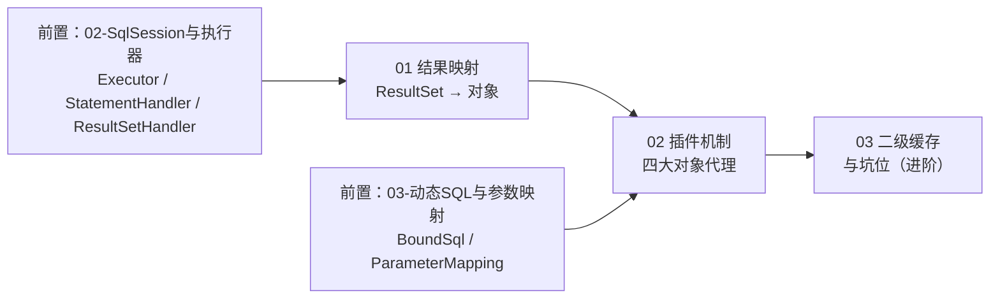
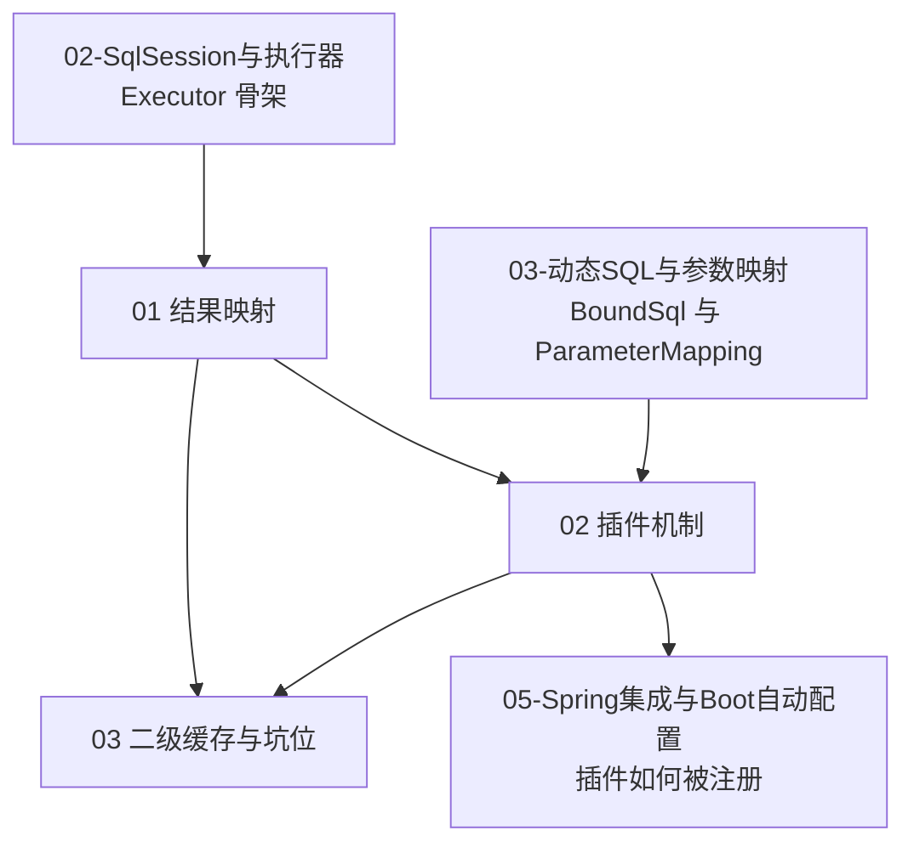

# 04 结果映射与插件

本目录回答一个问题的两半：**结果集怎么变成对象**（`DefaultResultSetHandler` + `ResultMap`），以及**怎么在执行链上插一脚**（`Interceptor` + `Plugin` 动态代理）。这两块是 MyBatis 里"最常被二次开发碰"的部分：分页、SQL 打印、多租户、数据权限、字段加解密，全部落在插件机制上；而几乎所有"数据错乱/对不上"的疑难杂症，都落在结果映射上。

## 0. 学完能回答什么

| 你可能遇到的问题 | 对应文章 | 关键类 |
| --- | --- | --- |
| `select *` 查出来的字段为什么没赋值到属性上？ | [01](./01-结果映射-resultsethandler与自动映射.md) | `DefaultResultSetHandler#createAutomaticMappings` |
| `mapUnderscoreToCamelCase` 为什么有时不生效？ | [01](./01-结果映射-resultsethandler与自动映射.md) | `shouldApplyAutomaticMappings`、`autoMappingBehavior` |
| 一对多 `collection` 分页数量为什么不对？ | [01](./01-结果映射-resultsethandler与自动映射.md) | `handleRowValuesForNestedResultMap`、`RowBounds` |
| `<id>` 到底有什么用？不加会怎样？ | [01](./01-结果映射-resultsethandler与自动映射.md) | `createRowKey` |
| 插件为什么只能拦四个对象？ | [02](./02-插件机制-interceptor与四大对象代理.md) | `Invocation#targetClasses`、`Plugin#wrap` |
| 多个插件谁先执行？ | [02](./02-插件机制-interceptor与四大对象代理.md) | `InterceptorChain#pluginAll` |
| 分页插件怎么改写 SQL？ | [02](./02-插件机制-interceptor与四大对象代理.md) | `Invocation#getArgs`、`BoundSql` |
| 二级缓存为什么在 Spring 事务里"串味"？ | [03](./03-二级缓存与坑位.md) | `TransactionalCacheManager`、`CachingExecutor` |
| 一级缓存和二级缓存谁先看？ | [03](./03-二级缓存与坑位.md) | `BaseExecutor#query`、`CachingExecutor#query` |

## 1. 学习顺序

**读图说明**：先读 01 建立"结果集 → `ResultMap` → 对象"的完整链路，因为插件的三个高频场景里有两个（分页、结果改写）都要用到 `ResultSetHandler` 与 `ResultMap` 的知识；再读 02 学习代理链，因为只有知道四大对象各自的职责边界，才能判断插件该拦谁；最后读 03 二级缓存，它把"执行器 + 事务 + 插件"三者串在一起。左侧两个灰色前置是本目录之外的必读材料：`Executor`/`StatementHandler` 的执行骨架在 [../02-SqlSession与执行器](../02-SqlSession与执行器/README.md)，`BoundSql`/`ParameterMapping` 在 [../03-动态SQL与参数映射/02-参数映射-parametermapping与typehandler.md](../03-动态SQL与参数映射/02-参数映射-parametermapping与typehandler.md)。

## 2. 每篇摘要

### [01-结果映射-resultsethandler与自动映射.md](./01-结果映射-resultsethandler与自动映射.md)

主线：`DefaultResultSetHandler#handleResultSets` → `handleRowValues` → `getRowValue` → `applyAutomaticMappings` / `applyPropertyMappings` → `XMLMapperBuilder#resultMapElements` 构建 `ResultMap`/`ResultMapping` → `association`/`collection` 嵌套映射与 `ResultLoader` 延迟加载。

重点讲清：`mapUnderscoreToCamelCase` 在自动映射里的**准确位置**（`createAutomaticMappings` 里 `metaObject.findProperty(..., configuration.isMapUnderscoreToCamelCase())`）、`autoMappingBehavior` 三值语义、`<id>` 通过 `createRowKey` 实现分组去重、`discriminator` 的解析链路，以及一对多分页错误、列名重复覆盖、`resultOrdered` 三个坑。

### [02-插件机制-interceptor与四大对象代理.md](./02-插件机制-interceptor与四大对象代理.md)

主线：`Interceptor#plugin` + `@Intercepts`/`@Signature` → `InterceptorChain#pluginAll` → `Plugin#wrap`（`Proxy.newProxyInstance`）→ `Plugin#invoke`（按 `signatureMap` 命中才进 `interceptor.intercept(new Invocation(...))`）→ 四大对象（`Executor`/`StatementHandler`/`ParameterHandler`/`ResultSetHandler`）。

重点讲清：为什么只能拦这四个、多层代理的顺序、`Invocation#getArgs` 改写 `BoundSql` 的标准姿势（分页/SQL 打印/多租户三个实例），以及"改了参数但 `MappedStatement` 不可变"、"拦截器注册了却没生效"、"`Executor` 类型不同导致拦截不到"三个坑。

### [03-二级缓存与坑位.md](./03-二级缓存与坑位.md)

主线：`Cache` 接口 → `CachingExecutor#query` 的 `useCache`/`flushCache` 判断 → `TransactionalCacheManager` 把"写缓存"延迟到事务提交 → `<cache>`/`<cache-ref>` 的 `CacheKey` 与 per-namespace 作用域 → 与 Spring 事务 `beforeCommit` 时机的错配。

本目录三篇的依赖关系见下一节的图；`04` 系列读完，建议回到 [../05-Spring集成与Boot自动配置/README.md](../05-Spring集成与Boot自动配置/README.md) 看这些机制在 Spring/Spring Boot 下如何被装配。

## 3. 依赖关系

**读图说明**：箭头是"知识依赖"而不是"代码调用"——`02 插件机制` 需要先知道 `BoundSql` 的结构（否则不知道怎么改 SQL）和 `ResultSetHandler` 的输入输出（否则不知道怎么改结果），`03 二级缓存` 需要先知道 `ResultMap`/`CacheKey`（`createRowKey` 用的就是 `CacheKey`）与执行器装饰链（`CachingExecutor` 是 `Executor` 的装饰器）。

## 4. 学习检查点

- [ ] 能说出 `handleResultSets` 对"多结果集"（`multipleResults`）与"单结果集"两种情况的处理差异。
- [ ] 能指出 `mapUnderscoreToCamelCase` 生效的**唯一一行**代码，并解释它为什么只影响自动映射。
- [ ] 能解释 `autoMappingBehavior=NONE/PARTIAL/FULL` 三者在嵌套映射下的行为差异。
- [ ] 能说明 `<id>` 缺失时 `collection` 出现"重复父对象"或"子集合只剩一条"的原因（`createRowKey` 返回 `NULL_CACHE_KEY`）。
- [ ] 能写出一个只拦 `Executor#query(4 参)` 的插件，并说明为什么拦 `query(6 参)` 也能达到目的。
- [ ] 能说明为什么"改参数对象"必须用 `Invocation#getArgs()` 返回的数组回写，而不能改 `MappedStatement`。
- [ ] 能画出"多个插件 + `CachingExecutor` + 一级缓存"的代理嵌套顺序。

## 5. 与本目录其它文章的关系

- 本组依赖 [../02-SqlSession与执行器](../02-SqlSession与执行器/README.md) 中的执行骨架与 `ResultSetHandler` 接口说明。
- 本组的 `BoundSql`/`ParameterMapping` 概念定义在 [../03-动态SQL与参数映射/02-参数映射-parametermapping与typehandler.md](../03-动态SQL与参数映射/02-参数映射-parametermapping与typehandler.md)。
- 结果映射里 `TypeHandler` 的选型逻辑（`TypeHandlerRegistry`）同样在 03 组 02 篇，本文只讲"用哪个 handler 读哪一列"。
- 本组所有机制在 Spring 下的装配方式（插件 `@Bean`、`Cache` 与事务）见 [../05-Spring集成与Boot自动配置/README.md](../05-Spring集成与Boot自动配置/README.md)。
