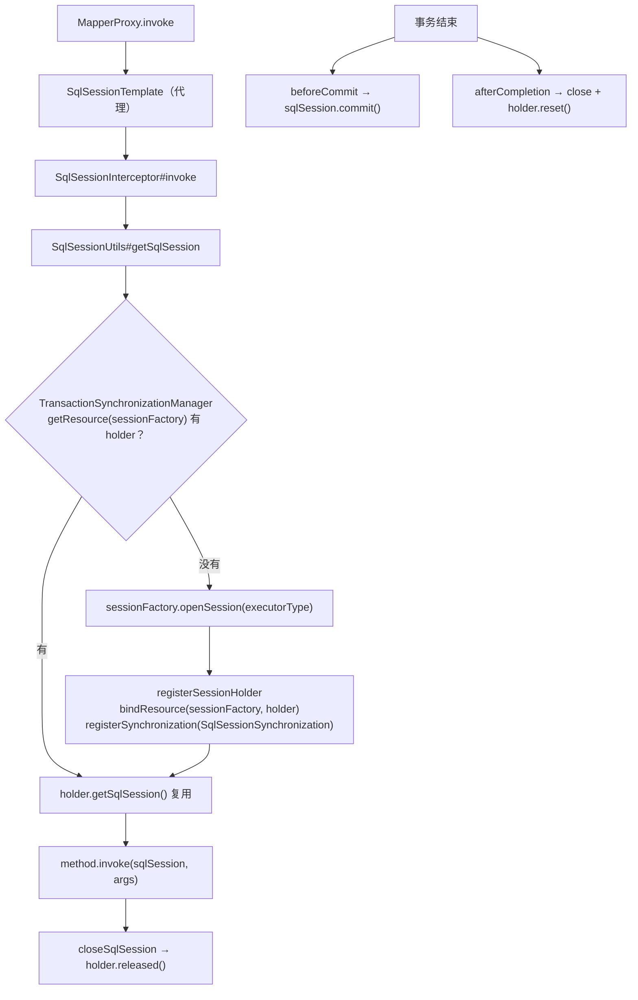
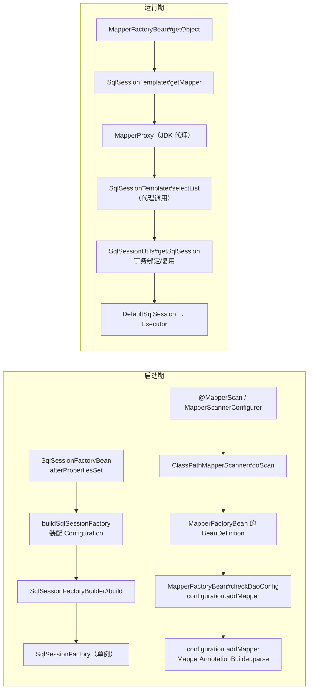
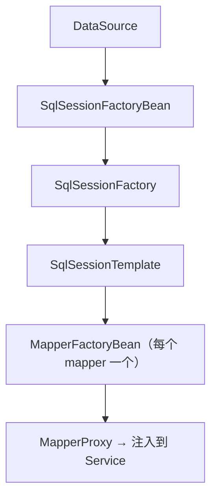
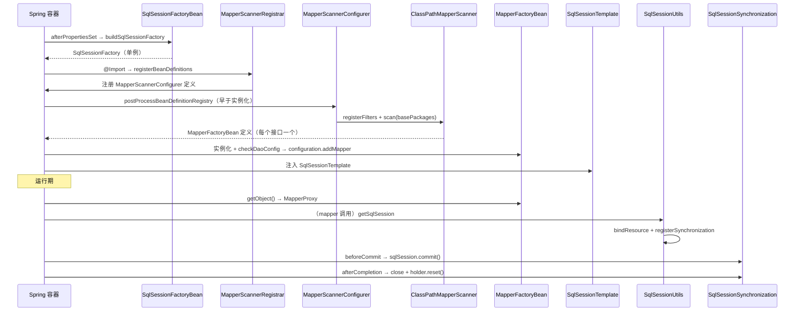

# mybatis-spring 集成原理

> 一句话结论：`mybatis-spring` 只做三件事——① 用 `SqlSessionFactoryBean` 把 MyBatis 的 `Configuration` 装配进 Spring 容器；② 用 `SqlSessionTemplate` 把 `SqlSession` 的获取/提交/关闭交给 **Spring 事务同步器**（`TransactionSynchronizationManager`），从而"一个事务内共用一个 `SqlSession`"；③ 用 `MapperScannerConfigurer` + `ClassPathMapperScanner` + `MapperFactoryBean` 把 `@Mapper` 接口注册成 Bean，`getObject()` 返回的是 `MapperProxy` 动态代理。
>
> 阅读前置：知道 `SqlSessionFactory` / `SqlSession` / `Configuration` 三者关系；了解 Spring 的 `FactoryBean`、`BeanDefinitionRegistryPostProcessor`、`TransactionSynchronization`（事务同步回调）与 `TransactionSynchronizationManager`（用 `ThreadLocal` 绑定"当前线程事务资源"的工具类）；事务传播与提交/回滚回调可参考 [../../01-Spring框架/03-事务管理/01-transactional-事务拦截器与传播行为.md](../../01-Spring框架/03-事务管理/01-transactional-事务拦截器与传播行为.md)。
>
> 预计阅读：45 分钟 ｜ 源码：mybatis-spring@3.0.5

## 0. 先看现象（3 分钟上手）

**现象一：`sqlSession.commit()` 抛异常。**

```text
java.lang.UnsupportedOperationException: Manual commit is not allowed over a Spring managed SqlSession
```

因为 Spring 注入的 `SqlSession` 其实是一个 `SqlSessionTemplate`（`SqlSession` 接口的实现），它的 `commit`/`rollback`/`close` 全部**故意**抛 `UnsupportedOperationException`：

```java (src: SqlSessionTemplate.java#L252-L275)
  @Override
  public void commit() {
    throw new UnsupportedOperationException("Manual commit is not allowed over a Spring managed SqlSession");
  }

  @Override
  public void commit(boolean force) {
    throw new UnsupportedOperationException("Manual commit is not allowed over a Spring managed SqlSession");
  }

  @Override
  public void rollback() {
    throw new UnsupportedOperationException("Manual rollback is not allowed over a Spring managed SqlSession");
  }

  @Override
  public void rollback(boolean force) {
    throw new UnsupportedOperationException("Manual rollback is not allowed over a Spring managed SqlSession");
  }

  @Override
  public void close() {
    throw new UnsupportedOperationException("Manual close is not allowed over a Spring managed SqlSession");
  }
```

**这段在做什么**：这五个方法一律抛异常，`SqlSessionTemplate` 只允许"执行语句"（`select*`/`insert`/`update`/`delete`/`flushStatements`/`clearCache`），事务边界完全交给 Spring。

**为什么这么写**：因为 `SqlSession` 的生命周期与 Spring 事务绑定——`commit` 由 `SqlSessionSynchronization#beforeCommit` 触发，`close` 由 `afterCompletion` 触发，而且一个 `SqlSession` 可能被同一个事务内的多个 DAO 共享，"谁先关谁错"，所以干脆禁止手工操作。

**如果改了会怎样**：如果允许 `commit()`，一个事务内的多个 mapper 调用会被拆成多次提交——`@Transactional` 的原子性就没了。

**坑位**：`DisposableBean#destroy()` 是空实现，就是为了**避免 Spring 容器关闭时反射调用 `close()`** 抛异常——见 `destroy` 方法上的注释（`SqlSessionTemplate.java#L297-L320`）。

**现象二：一次事务里两次 mapper 调用，日志只出现一次 `Creating a new SqlSession`。**

```text
Creating a new SqlSession
Registering transaction synchronization for SqlSession [org.apache.ibatis.session.defaults.DefaultSqlSession@...]
... 第一次 mapper 调用 ...
Fetched SqlSession [...] from current transaction
... 第二次 mapper 调用 ...
Transaction synchronization committing SqlSession [...]
Transaction synchronization closing SqlSession [...]
```

这四行日志就是"一个事务一个 `SqlSession`"的直接证据，来自 `SqlSessionUtils`。完整的资源绑定关系：



**读图说明**：图中"复用"与"新建"的分叉取决于 `TransactionSynchronizationManager` 的 `ThreadLocal` 里有没有绑 `SqlSessionFactory → SqlSessionHolder`。**没有 Spring 事务时**（未开同步），每次调用都会新建一个 `SqlSession` 并在 `finally` 里真关掉；**有 Spring 事务时**，首次创建后绑定到当前线程，后续调用复用，关闭动作延迟到事务结束——这就是"事务内缓存（一级缓存）能生效"的根本原因。

**现象三：`@MapperScan` 没配，但 `@Mapper` 接口也能注入。**

那是因为 Spring Boot 的 `MybatisAutoConfiguration` 注册了 `AutoConfiguredMapperScannerRegistrar`，默认扫 `@Mapper`（详见 [02-boot-自动配置-深入-mybatisautoconfiguration.md](./02-boot-自动配置-深入-mybatisautoconfiguration.md)）。**纯 Spring（非 Boot）** 不配 `@MapperScan`（或 `MapperScannerConfigurer`）就扫不到——这是 `mybatis-spring` 与 Boot starter 的分界线。

## 1. 整体地图（先图后码）



**读图说明**：启动期有两条独立支线——"建工厂"（左）与"建 mapper Bean"（右），它们通过同一个 `Configuration` 交汇：`MapperFactoryBean#checkDaoConfig` 把 mapper 接口注册进 `Configuration`（同时解析注解上的 `@Select` 等），而 `SqlSessionTemplate` 执行时又从同一个 `Configuration` 取 `MappedStatement`。运行期 `getObject()` 每次返回的都是"同一个小巧的 `MapperProxy`"（`isSingleton=true`，代理内部无状态，真正的会话从 `SqlSessionTemplate` 按事务取）。

依赖顺序（`MapperFactoryBean` 依赖 `SqlSessionTemplate`，后者依赖 `SqlSessionFactory`）：



**读图说明**：`MapperFactoryBean` 继承 `SqlSessionDaoSupport`，`setSqlSessionFactory` 会自动 `new SqlSessionTemplate(factory)`；如果容器里已有 `SqlSessionTemplate` Bean（Boot 里通常有），Spring 会按类型注入它。

## 2. 关键类逐个拆

| 类 | 角色 | 一句话职责 |
| --- | --- | --- |
| `SqlSessionFactoryBean` | `FactoryBean<SqlSessionFactory>` + `InitializingBean` | 装配 `Configuration` 并构建单例 `SqlSessionFactory` |
| `SqlSessionTemplate` | `SqlSession` 实现 | 线程安全门面，所有调用经 `SqlSessionInterceptor` 转发到"当前事务的 `SqlSession`" |
| `SqlSessionUtils` | 静态工具 | `getSqlSession`/`closeSqlSession`/`isSqlSessionTransactional` + 内部类 `SqlSessionSynchronization` |
| `SqlSessionHolder` | 资源持有者 | 包一个 `SqlSession` + `ExecutorType` + 引用计数（`requested`/`released`） |
| `SqlSessionDaoSupport` | DAO 基类 | 提供 `getSqlSession()`，并自动把 `SqlSessionFactory` 包装成 `SqlSessionTemplate` |
| `MapperFactoryBean` | `FactoryBean<T>` | `checkDaoConfig` 注册 mapper 接口；`getObject` 返回 `MapperProxy` |
| `ClassPathMapperScanner` | `ClassPathBeanDefinitionScanner` 子类 | 扫接口 → 把 `BeanDefinition` 的 class 换成 `MapperFactoryBean` |
| `MapperScannerConfigurer` | `BeanDefinitionRegistryPostProcessor` | 把注解/XML 配置翻译成 `ClassPathMapperScanner` 的一次 `scan()` |
| `MapperScannerRegistrar` | `ImportBeanDefinitionRegistrar` | `@MapperScan` 的入口，注册一个 `MapperScannerConfigurer` 的 BeanDefinition |
| `SpringManagedTransaction` | `Transaction` 实现 | 从 `DataSourceUtils` 取连接，`commit/rollback` 在事务活跃时是 no-op |
| `SpringManagedTransactionFactory` | `TransactionFactory` | `newTransaction(...)` 返回 `SpringManagedTransaction` |

四个常被误解的点：

1. `SqlSessionTemplate` 本身**不是** `SqlSession` 的实现细节泄漏——它 `implements SqlSession`，但把真正工作交给 JDK 代理 `sqlSessionProxy`。
2. `MapperFactoryBean` 的 `getObject()` **每次调用**都 `getMapper`，但返回的是 `Configuration` 里缓存的同一个 `MapperProxy`（`MapperRegistry#getMapper` 内部缓存 `knownMappers`）。
3. `MapperScannerConfigurer` 是 `BeanDefinitionRegistryPostProcessor`，在 `@Configuration` 里写的 `${...}` 占位符此时还没解析，所以有 `processPropertyPlaceHolders` 这个补丁（类注释里写得明明白白）。
4. `SpringManagedTransaction#commit` 在 Spring 事务活跃时**什么都不做**，真正的提交由 `DataSourceTransactionManager` 完成。

## 3. 源码逐段精读

### 3.1 `SqlSessionFactoryBean#afterPropertiesSet`：两处硬校验

```java (src: SqlSessionFactoryBean.java#L564-L573)
  @Override
  public void afterPropertiesSet() throws Exception {
    notNull(dataSource, "Property 'dataSource' is required");
    notNull(sqlSessionFactoryBuilder, "Property 'sqlSessionFactoryBuilder' is required");
    // TODO Review this statement as it seems off!
    state((configuration == null && configLocation == null) || !(configuration != null && configLocation != null),
        "Property 'configuration' and 'configLocation' can not specified with together");

    this.sqlSessionFactory = buildSqlSessionFactory();
  }
```

**这段在做什么**：`InitializingBean` 回调里做三件事：`dataSource` 必填、`sqlSessionFactoryBuilder` 必填、`configuration` 与 `configLocation` **二选一**（两个都给就抛 `IllegalStateException`，消息里的 `can not specified with together` 是原文的笔误），最后在**初始化阶段就构建** `SqlSessionFactory`。

**为什么这么写**：`sqlSessionFactoryBuilder` 默认已由字段初始化 `new SqlSessionFactoryBuilder()`，但允许替换；`configuration`（Java API 配置）与 `configLocation`（XML 配置）互斥是因为二者都会"生成/提供一个 `Configuration`"，同时给会产生"用哪个"的歧义；在 `afterPropertiesSet` 内构建而不是懒加载，是为了让配置错误在**启动期**暴露（`failFast` 更进一步，见 `onApplicationEvent`）。

**如果改了会怎样**：如果允许二者共存，`buildSqlSessionFactory` 里的三分支就会有一个永远走不到，用户会误以为 XML 里的设置生效了。

**坑位**：`getObject()` 里还有一次 `if (this.sqlSessionFactory == null) afterPropertiesSet();`（懒构建兜底），所以**手动 `new SqlSessionFactoryBean()` 不调 `afterPropertiesSet` 也能用**——但错误会延迟到第一次取 Bean 时才暴露。

### 3.2 `buildSqlSessionFactory` 的三分支：`Configuration` 从哪来

```java (src: SqlSessionFactoryBean.java#L587-L607)
  protected SqlSessionFactory buildSqlSessionFactory() throws Exception {

    final Configuration targetConfiguration;

    XMLConfigBuilder xmlConfigBuilder = null;
    if (this.configuration != null) {
      targetConfiguration = this.configuration;
      if (targetConfiguration.getVariables() == null) {
        targetConfiguration.setVariables(this.configurationProperties);
      } else if (this.configurationProperties != null) {
        targetConfiguration.getVariables().putAll(this.configurationProperties);
      }
    } else if (this.configLocation != null) {
      xmlConfigBuilder = new XMLConfigBuilder(this.configLocation.getInputStream(), null, this.configurationProperties);
      targetConfiguration = xmlConfigBuilder.getConfiguration();
    } else {
      LOGGER.debug(
          () -> "Property 'configuration' or 'configLocation' not specified, using default MyBatis Configuration");
      targetConfiguration = new Configuration();
      Optional.ofNullable(this.configurationProperties).ifPresent(targetConfiguration::setVariables);
    }
```

**这段在做什么**：三条路选一条——① 用户直接给了 `Configuration` 实例：直接用，并把 `configurationProperties` 合并进 `variables`；② 用户给了 `configLocation`（`mybatis-config.xml`）：创建 `XMLConfigBuilder` 并**立即**通过 `getConfiguration()` 拿到它内部的 `Configuration`（注意此时**还没 parse**，parse 在后面 L667）；③ 都没给：`new Configuration()`（走 MyBatis 默认注册表）。

**为什么这么写**：`XMLConfigBuilder` 的构造过程本身就会初始化 `Configuration`（含默认 `TypeHandlerRegistry`、`TypeAliasRegistry`），所以"先拿 `Configuration`、再补 Spring 特有配置（插件/别名/类型处理器）、最后 `parse()`"这个顺序才能让 XML 里的 `<mappers>` 与 Java 侧的补充配置**都生效**且不互相覆盖。

**如果改了会怎样**：如果先 `parse()` 再补插件/别名，XML 里引用别名的语句会找不到别名；如果第③分支忘了 `setVariables`，`${}` 变量替换会拿不到 `configurationProperties`。

**坑位**：`configLocation` 分支里 `XMLConfigBuilder` 用的是 `this.configurationProperties`（`<properties>` 的替代），所以 `mybatis.configuration-properties.*` 在两种模式下都能用；但 `mybatis.configuration.*`（`CoreConfiguration`）**只有**在 `configuration == null` 时才会被 `applyConfiguration` 建出 `new Configuration()` 并 `applyTo`——这就是"配了 `configLocation` 后 `mybatis.configuration.*` 全部失效"的原因（Boot 篇详述）。

### 3.3 补充装配：别名、插件、类型处理器、`databaseId`、`Environment`

```java (src: SqlSessionFactoryBean.java#L626-L646)
    if (!isEmpty(this.plugins)) {
      Stream.of(this.plugins).forEach(plugin -> {
        targetConfiguration.addInterceptor(plugin);
        LOGGER.debug(() -> "Registered plugin: '" + plugin + "'");
      });
    }

    if (hasLength(this.typeHandlersPackage)) {
      scanClasses(this.typeHandlersPackage, TypeHandler.class).stream().filter(clazz -> !clazz.isAnonymousClass())
          .filter(clazz -> !clazz.isInterface()).filter(clazz -> !Modifier.isAbstract(clazz.getModifiers()))
          .forEach(targetConfiguration.getTypeHandlerRegistry()::register);
    }

    if (!isEmpty(this.typeHandlers)) {
      Stream.of(this.typeHandlers).forEach(typeHandler -> {
        targetConfiguration.getTypeHandlerRegistry().register(typeHandler);
        LOGGER.debug(() -> "Registered type handler: '" + typeHandler + "'");
      });
    }

    targetConfiguration.setDefaultEnumTypeHandler(defaultEnumTypeHandler);
```

**这段在做什么**：把 Spring 侧声明的扩展点灌进 `Configuration`：`plugins` → `addInterceptor`（这就是"插件注册"在 Spring 下的落点）；`typeHandlersPackage` → 扫描包内所有 `TypeHandler` 实现并注册；`typeHandlers` → 注册显式实例；最后设置默认枚举处理器。

**为什么这么写**：MyBatis 原生只能用 XML `<plugins>`/`<typeHandlers>` 声明这些，Spring 集成层让它们变成**普通 Bean 属性**，从而可以注入依赖（比如插件需要 `DataSource` 或 `RedisTemplate`）。

**如果改了会怎样**：如果 `plugins` 在 `parse()` **之后**才加，`Configuration` 里已有 `Executor` 的创建发生在运行期（`newExecutor` 每次都 `pluginAll`），所以其实仍会生效——但**拦截器列表被复制到其他 `Configuration`**（如多数据源共享配置）时就会漏。

**坑位**：`typeHandlersPackage` 扫描会**跳过接口与抽象类**，并且需要 `TypeHandler` 的**无参构造**（`TypeHandlerRegistry#register(Class)` 内部 `getInstance`），构造器注入的 `TypeHandler` 必须显式用 `setTypeHandlers(...)` 传入。

```java (src: SqlSessionFactoryBean.java#L657-L680)
    if (this.databaseIdProvider != null) {// fix #64 set databaseId before parse mapper xmls
      try {
        targetConfiguration.setDatabaseId(this.databaseIdProvider.getDatabaseId(this.dataSource));
      } catch (SQLException e) {
        throw new IOException("Failed getting a databaseId", e);
      }
    }

    Optional.ofNullable(this.cache).ifPresent(targetConfiguration::addCache);

    if (xmlConfigBuilder != null) {
      try {
        xmlConfigBuilder.parse();
        LOGGER.debug(() -> "Parsed configuration file: '" + this.configLocation + "'");
      } catch (Exception ex) {
        throw new IOException("Failed to parse config resource: " + this.configLocation, ex);
      } finally {
        ErrorContext.instance().reset();
      }
    }

    targetConfiguration.setEnvironment(new Environment(this.environment,
        this.transactionFactory == null ? new SpringManagedTransactionFactory() : this.transactionFactory,
        this.dataSource));
```

**这段在做什么**：① `databaseId` 必须在 `parse()` **之前**设置（注释 `fix #64`），否则 XML 里 `databaseId="mysql"` 的语句会被判为不匹配而跳过；② `parse()` 解析 `mybatis-config.xml`；③ **无条件**用 Spring 的 `DataSource` + `SpringManagedTransactionFactory` 覆盖 `Environment`。

**为什么这么写**：③ 是最容易被忽视的一行——不管你有没有配 `configLocation`、里面写了什么 `environment`，**Spring 集成后 `Environment` 一律以 `dataSource`/`transactionFactory` 为准**。这也解释了为什么"Spring 下 MyBatis 自己管不了数据源"。

**如果改了会怎样**：如果 `setEnvironment` 放到 `parse()` 之前，XML 里的 `<environment>` 会把 Spring 的设置覆盖掉，导致 MyBatis 用自己 `PooledDataSource`（多数据源/事务全部错乱）。

**坑位**：`transactionFactory` 若被手动设成 `JdbcTransactionFactory`，`SqlSessionUtils#registerSessionHolder` 会走 `else` 分支并抛 `TransientDataAccessResourceException("SqlSessionFactory must be using a SpringManagedTransactionFactory ...")`——**必须**用 `SpringManagedTransactionFactory`。

### 3.4 `mapperLocations`：XML 映射文件的手工解析

```java (src: SqlSessionFactoryBean.java#L682-L707)
    if (this.mapperLocations != null) {
      if (this.mapperLocations.length == 0) {
        LOGGER.warn(() -> "Property 'mapperLocations' was specified but matching resources are not found.");
      } else {
        for (Resource mapperLocation : this.mapperLocations) {
          if (mapperLocation == null) {
            continue;
          }
          try {
            var xmlMapperBuilder = new XMLMapperBuilder(mapperLocation.getInputStream(), targetConfiguration,
                mapperLocation.toString(), targetConfiguration.getSqlFragments());
            xmlMapperBuilder.parse();
          } catch (Exception e) {
            throw new IOException("Failed to parse mapping resource: '" + mapperLocation + "'", e);
          } finally {
            ErrorContext.instance().reset();
          }
          LOGGER.debug(() -> "Parsed mapper file: '" + mapperLocation + "'");
        }
      }
    } else {
      LOGGER.debug(() -> "Property 'mapperLocations' was not specified.");
    }

    return this.sqlSessionFactoryBuilder.build(targetConfiguration);
  }
```

**这段在做什么**：把 `mapperLocations` 里的每个 XML 依次用 `XMLMapperBuilder` 解析（等价于 `mybatis-config.xml` 里的 `<mapper resource="..."/>`）；`mapperLocations` 为空数组时**只告警**；最后 `SqlSessionFactoryBuilder#build(targetConfiguration)` 产出单例工厂。

**为什么这么写**：Spring 资源通配符（`classpath*:mapper/**/*.xml`）由 `PathMatchingResourcePatternResolver` 在上游解析成 `Resource[]`，`SqlSessionFactoryBean` 只负责逐个解析，避免让 MyBatis 依赖 Spring 的资源抽象。

**如果改了会怎样**：如果为空时不告警（静默），"XML 没打包进 jar / 通配符写错"这两类问题会极难排查——这条 `warn` 日志是排查 `mapper-locations` 问题的第一落点。

**坑位**：`xmlMapperBuilder.parse()` 失败会抛 `IOException("Failed to parse mapping resource: '...'")`，而 Boot 的 `MybatisProperties#getResources` 在通配符非法时**直接返回空数组**（吞掉 `IOException`），所以"通配符写错"表现为**只有 warn 没有 error**。

### 3.5 `SqlSessionTemplate` 的结构：一个代理包住一切

```java (src: SqlSessionTemplate.java#L122-L133)
  public SqlSessionTemplate(SqlSessionFactory sqlSessionFactory, ExecutorType executorType,
      PersistenceExceptionTranslator exceptionTranslator) {

    notNull(sqlSessionFactory, "Property 'sqlSessionFactory' is required");
    notNull(executorType, "Property 'executorType' is required");

    this.sqlSessionFactory = sqlSessionFactory;
    this.executorType = executorType;
    this.exceptionTranslator = exceptionTranslator;
    this.sqlSessionProxy = (SqlSession) newProxyInstance(SqlSessionFactory.class.getClassLoader(),
        new Class[] { SqlSession.class }, new SqlSessionInterceptor());
  }
```

**这段在做什么**：构造时创建一个实现了 `SqlSession` 接口的 JDK 代理 `sqlSessionProxy`，`InvocationHandler` 是内部类 `SqlSessionInterceptor`。之后所有 `SqlSession` 方法（`selectList`、`insert`、`getMapper` 等）都先打到这个代理。

**为什么这么写**：`SqlSessionTemplate` 要**线程安全**，而 `DefaultSqlSession` 不是。用代理把"每次方法调用 → 从当前事务取一个 `SqlSession`"这一步统一织入，就不用为每个方法都手写一遍 `try/finally`。`ExecutorType` 在构造时固定（Javadoc 明确"cannot be changed once constructed"）。

**如果改了会怎样**：如果直接持有 `DefaultSqlSession` 字段，多线程并发调用会共享同一个 `Executor` → 数据错乱。

**坑位**：`getMapper` 不经过代理而是 `getConfiguration().getMapper(type, this)`——所以 mapper 代理绑定的 `SqlSession` 是 **`this`（模板）**，这也是 mapper 调用能自动享受"事务内复用"的原因。

### 3.6 `SqlSessionInterceptor#invoke`：取会话、提交、翻译异常、关闭

```java (src: SqlSessionTemplate.java#L327-L359)
  private class SqlSessionInterceptor implements InvocationHandler {
    @Override
    public Object invoke(Object proxy, Method method, Object[] args) throws Throwable {
      var sqlSession = getSqlSession(SqlSessionTemplate.this.sqlSessionFactory, SqlSessionTemplate.this.executorType,
          SqlSessionTemplate.this.exceptionTranslator);
      try {
        var result = method.invoke(sqlSession, args);
        if (!isSqlSessionTransactional(sqlSession, SqlSessionTemplate.this.sqlSessionFactory)) {
          // force commit even on non-dirty sessions because some databases require
          // a commit/rollback before calling close()
          sqlSession.commit(true);
        }
        return result;
      } catch (Throwable t) {
        var unwrapped = unwrapThrowable(t);
        if (SqlSessionTemplate.this.exceptionTranslator != null && unwrapped instanceof PersistenceException) {
          // release the connection to avoid a deadlock if the translator is no loaded. See issue #22
          closeSqlSession(sqlSession, SqlSessionTemplate.this.sqlSessionFactory);
          sqlSession = null;
          Throwable translated = SqlSessionTemplate.this.exceptionTranslator
              .translateExceptionIfPossible((PersistenceException) unwrapped);
          if (translated != null) {
            unwrapped = translated;
          }
        }
        throw unwrapped;
      } finally {
        if (sqlSession != null) {
          closeSqlSession(sqlSession, SqlSessionTemplate.this.sqlSessionFactory);
        }
      }
    }
  }
```

**这段在做什么**：每次调用：① `getSqlSession` 取会话；② 反射执行目标方法；③ **若非事务托管的会话，则 `commit(true)`**（有些数据库要求先 commit/rollback 再 close）；④ 异常时剥包、`PersistenceException` 交给 Spring 的 `PersistenceExceptionTranslator` 翻译成 `DataAccessException`，并在翻译前**先关会话**防止连接泄漏死锁（issue #22）；⑤ `finally` 关会话（事务托管的只是 `released()` 减计数）。

**为什么这么写**：这里的 `commit(true)` 与 `closeSqlSession` 是"**非 Spring 事务**"场景的全部保障——即"方法没有 `@Transactional` 时，每次 mapper 调用就是一个独立自动提交事务"。异常翻译这一步让 MyBatis 的 `PersistenceException` 变成 Spring 统一的数据访问异常体系。

**如果改了会怎样**：如果去掉 `isSqlSessionTransactional` 判断直接 `commit(true)`，那 `@Transactional` 方法里第一次 mapper 调用就会提交半截事务；如果去掉"翻译前先关会话"，连接池在长时间异常处理器里可能被占满（死锁）。

**坑位**：`sqlSession.commit(true)` 调用的是 `DefaultSqlSession#commit` → `Executor#commit(isCommitOrRollbackRequired(force))`，`force=true` 保证即使会话不脏也会 commit——`Connection` 的 autoCommit 语义依赖它。

### 3.7 `getSqlSession` + `registerSessionHolder`：资源绑定

```java (src: SqlSessionUtils.java#L94-L113)
  public static SqlSession getSqlSession(SqlSessionFactory sessionFactory, ExecutorType executorType,
      PersistenceExceptionTranslator exceptionTranslator) {

    notNull(sessionFactory, NO_SQL_SESSION_FACTORY_SPECIFIED);
    notNull(executorType, NO_EXECUTOR_TYPE_SPECIFIED);

    var holder = (SqlSessionHolder) TransactionSynchronizationManager.getResource(sessionFactory);

    var session = sessionHolder(executorType, holder);
    if (session != null) {
      return session;
    }

    LOGGER.debug(() -> "Creating a new SqlSession");
    session = sessionFactory.openSession(executorType);

    registerSessionHolder(sessionFactory, executorType, exceptionTranslator, session);

    return session;
  }
```

**这段在做什么**：用 `SqlSessionFactory` 作为 key 从 `TransactionSynchronizationManager` 的 `ThreadLocal` 资源表里取 `SqlSessionHolder`；取到可用会话就**直接复用**；否则 `openSession` 新建，然后交给 `registerSessionHolder` 决定"绑不绑到事务"。

**为什么这么写**：以 `SqlSessionFactory` 为 key（而不是 `DataSource`）意味着**多数据源天然隔离**——每个 factory 各自一个 holder。`holder.isSynchronizedWithTransaction()` 为假时（例如上次事务已结束但 holder 还在），`sessionHolder` 返回 `null`，从而新建。

**如果改了会怎样**：如果只用 `ThreadLocal<SqlSession>` 而不区分 factory，多数据源会拿到错误库的会话。

**坑位**：`openSession(executorType)` 会在**此时**创建 `Executor`（`newExecutor` 里做 `pluginAll`），所以插件生效时刻是"第一次使用会话"，而不是"启动"。

```java (src: SqlSessionUtils.java#L131-L158)
  private static void registerSessionHolder(SqlSessionFactory sessionFactory, ExecutorType executorType,
      PersistenceExceptionTranslator exceptionTranslator, SqlSession session) {
    SqlSessionHolder holder;
    if (TransactionSynchronizationManager.isSynchronizationActive()) {
      var environment = sessionFactory.getConfiguration().getEnvironment();

      if (environment.getTransactionFactory() instanceof SpringManagedTransactionFactory) {
        LOGGER.debug(() -> "Registering transaction synchronization for SqlSession [" + session + "]");

        holder = new SqlSessionHolder(session, executorType, exceptionTranslator);
        TransactionSynchronizationManager.bindResource(sessionFactory, holder);
        TransactionSynchronizationManager
            .registerSynchronization(new SqlSessionSynchronization(holder, sessionFactory));
        holder.setSynchronizedWithTransaction(true);
        holder.requested();
      } else if (TransactionSynchronizationManager.getResource(environment.getDataSource()) == null) {
        LOGGER.debug(() -> "SqlSession [" + session
            + "] was not registered for synchronization because DataSource is not transactional");
      } else {
        throw new TransientDataAccessResourceException(
            "SqlSessionFactory must be using a SpringManagedTransactionFactory in order to use Spring transaction synchronization");
      }
    } else {
      LOGGER.debug(() -> "SqlSession [" + session
          + "] was not registered for synchronization because synchronization is not active");
    }

  }
```

**这段在做什么**：只有"Spring 事务同步激活"（`isSynchronizationActive()`，即处于 `@Transactional` 或 `TransactionTemplate` 内）**且**事务工厂是 `SpringManagedTransactionFactory` 时，才：新建 `SqlSessionHolder` → `bindResource(sessionFactory, holder)` 绑定到线程 → 注册 `SqlSessionSynchronization` 回调 → 标记 `synchronizedWithTransaction` → `requested()` 计数加一。

**为什么这么写**：三条分支覆盖三种情形：① 正常事务 → 绑定；② 事务同步活跃但数据源**不在** Spring 事务里（例如 MyBatis 用的是另一个非事务 `DataSource`）→ 只打 debug 日志，**不绑定**（否则会话被错误复用）；③ 数据源在被 Spring 管理、但事务工厂不是 `SpringManagedTransactionFactory` → 直接抛异常（配置错误，早失败）。

**如果改了会怎样**：如果去掉 `isSynchronizationActive()` 判断，非事务环境下也会注册同步回调，`beforeCommit` 永远不会触发 → 会话永不关闭 → 连接泄漏。

**坑位**：这就是**"为什么一个事务内是同一个 `SqlSession`"的源码答案**——`bindResource` 把 holder 放进 `TransactionSynchronizationManager` 的 `ThreadLocal`（`resources` Map），下次同一线程同一 factory 调用 `getResource` 就命中；事务结束由 `SqlSessionSynchronization` 解绑。

### 3.8 `sessionHolder` / `closeSqlSession` / `isSqlSessionTransactional`

```java (src: SqlSessionUtils.java#L160-L174)
  private static SqlSession sessionHolder(ExecutorType executorType, SqlSessionHolder holder) {
    SqlSession session = null;
    if (holder != null && holder.isSynchronizedWithTransaction()) {
      if (holder.getExecutorType() != executorType) {
        throw new TransientDataAccessResourceException(
            "Cannot change the ExecutorType when there is an existing transaction");
      }

      holder.requested();

      LOGGER.debug(() -> "Fetched SqlSession [" + holder.getSqlSession() + "] from current transaction");
      session = holder.getSqlSession();
    }
    return session;
  }
```

```java (src: SqlSessionUtils.java#L186-L198)
  public static void closeSqlSession(SqlSession session, SqlSessionFactory sessionFactory) {
    notNull(session, NO_SQL_SESSION_SPECIFIED);
    notNull(sessionFactory, NO_SQL_SESSION_FACTORY_SPECIFIED);

    var holder = (SqlSessionHolder) TransactionSynchronizationManager.getResource(sessionFactory);
    if (holder != null && holder.getSqlSession() == session) {
      LOGGER.debug(() -> "Releasing transactional SqlSession [" + session + "]");
      holder.released();
    } else {
      LOGGER.debug(() -> "Closing non transactional SqlSession [" + session + "]");
      session.close();
    }
  }
```

**这段在做什么**：`sessionHolder` 从 holder 里取会话，并校验 `ExecutorType` 不能被中途切换（否则抛 `Cannot change the ExecutorType when there is an existing transaction`）；`closeSqlSession` 判断"当前会话是不是线程绑定的那一个"——是就只 `released()` 减引用计数，等事务结束再真关；不是就当场 `close()`。

**为什么这么写**：引用计数（`requested()`/`released()`）支持"同一事务内多次取用/释放"，只有计数归零（`holder.isOpen()==false`）时 `beforeCompletion` 才真正 `close()`；`ExecutorType` 校验是因为 `Executor` 类型在 `openSession` 时就固定了。

**如果改了会怎样**：如果 `closeSqlSession` 一律 `session.close()`，事务内第一个 mapper 调用结束就会关掉共享会话 → 后续调用报 `Executor was closed` 或新开会话导致一级缓存失效。

**坑位**：`holder.getSqlSession() == session` 用的是**引用相等**——所以你手工包了一层 `SqlSession`（如自定义装饰器）后传进来，会被当作"非事务会话"直接关闭。

### 3.9 `SqlSessionSynchronization`：四个事务回调

```java (src: SqlSessionUtils.java#L240-L260)
    @Override
    public int getOrder() {
      // order right before any Connection synchronization
      return DataSourceUtils.CONNECTION_SYNCHRONIZATION_ORDER - 1;
    }

    @Override
    public void suspend() {
      if (this.holderActive) {
        LOGGER.debug(() -> "Transaction synchronization suspending SqlSession [" + this.holder.getSqlSession() + "]");
        TransactionSynchronizationManager.unbindResource(this.sessionFactory);
      }
    }

    @Override
    public void resume() {
      if (this.holderActive) {
        LOGGER.debug(() -> "Transaction synchronization resuming SqlSession [" + this.holder.getSqlSession() + "]");
        TransactionSynchronizationManager.bindResource(this.sessionFactory, this.holder);
      }
    }
```

```java (src: SqlSessionUtils.java#L262-L298)
    @Override
    public void beforeCommit(boolean readOnly) {
      // Connection commit or rollback will be handled by ConnectionSynchronization or
      // DataSourceTransactionManager.
      // But, do cleanup the SqlSession / Executor, including flushing BATCH statements so
      // they are actually executed.
      // SpringManagedTransaction will no-op the commit over the jdbc connection
      // TODO This updates 2nd level caches but the tx may be rolledback later on!
      if (TransactionSynchronizationManager.isActualTransactionActive()) {
        try {
          LOGGER.debug(() -> "Transaction synchronization committing SqlSession [" + this.holder.getSqlSession() + "]");
          this.holder.getSqlSession().commit();
        } catch (PersistenceException p) {
          if (this.holder.getPersistenceExceptionTranslator() != null) {
            var translated = this.holder.getPersistenceExceptionTranslator().translateExceptionIfPossible(p);
            if (translated != null) {
              throw translated;
            }
          }
          throw p;
        }
      }
    }

    @Override
    public void beforeCompletion() {
      // Issue #18 Close SqlSession and deregister it now
      // because afterCompletion may be called from a different thread
      if (!this.holder.isOpen()) {
        LOGGER
            .debug(() -> "Transaction synchronization deregistering SqlSession [" + this.holder.getSqlSession() + "]");
        TransactionSynchronizationManager.unbindResource(sessionFactory);
        this.holderActive = false;
        LOGGER.debug(() -> "Transaction synchronization closing SqlSession [" + this.holder.getSqlSession() + "]");
        this.holder.getSqlSession().close();
      }
    }
```

**这段在做什么**：`suspend`/`resume` 处理"事务挂起"（`PROPAGATION_REQUIRES_NEW` 时外层资源被解开、恢复时重新绑定）；`beforeCommit` 在**真正提交前**调 `sqlSession.commit()`——注释明确说明这会把 `Executor` 缓冲的 BATCH 语句刷出去，且 `SpringManagedTransaction` 对 JDBC 的 commit 是 no-op；`beforeCompletion` 在"提交/回滚前的最后一刻"解绑并关闭会话（issue #18：因为 `afterCompletion` 可能在**另一个线程**执行）。

**为什么这么写**：BATCH 执行器必须有人 `flushStatements()`，`commit()` → `Executor#commit` → `flushStatements` 是唯一保证刷出批的时机；因此**提交动作必须在 `beforeCommit`**。会话关闭放在 `beforeCompletion` 而不是 `afterCompletion`，是为了避免跨线程访问 `ThreadLocal`。

**如果改了会怎样**：如果把 `commit` 放到 `afterCompletion`，`PROPAGATION_REQUIRES_NEW` 内层提交时 SQL 都还没来得及 flush；如果不在此处 unbound，`ThreadLocal` 会泄漏到线程池的后续任务里（脏读风险）。

**坑位**：`beforeCommit` 目前**不区分 `readOnly`**，所以只读事务也会 commit（`DefaultSqlSession#commit` 会 `isCommitOrRollbackRequired(false)` 决定是否真提交，一般 no-op）——但二级缓存会因此落地（见 [../04-结果映射与插件/03-二级缓存与坑位.md](../04-结果映射与插件/03-二级缓存与坑位.md)）。

```java (src: SqlSessionUtils.java#L300-L313)
    @Override
    public void afterCompletion(int status) {
      if (this.holderActive) {
        // afterCompletion may have been called from a different thread
        // so avoid failing if there is nothing in this one
        LOGGER
            .debug(() -> "Transaction synchronization deregistering SqlSession [" + this.holder.getSqlSession() + "]");
        TransactionSynchronizationManager.unbindResourceIfPossible(sessionFactory);
        this.holderActive = false;
        LOGGER.debug(() -> "Transaction synchronization closing SqlSession [" + this.holder.getSqlSession() + "]");
        this.holder.getSqlSession().close();
      }
      this.holder.reset();
    }
```

**这段在做什么**：兜底清理：如果 `beforeCompletion` 里因为 `holder.isOpen()` 为真（引用计数没归零）而没关，则在这里 `unbindResourceIfPossible` + `close()`；最后 `holder.reset()` 重置计数与持有状态，方便下一事务。

**为什么这么写**：`beforeCompletion` 只有在"所有使用方都 `released()`"时才关闭；如果有人忘了 `closeSqlSession`（例如自己 `getSqlSession` 后没关），`afterCompletion` 兜底保证最终关闭。

**坑位**：`unbindResourceIfPossible` 会检查"当前线程绑定的是不是这个资源"，避免解绑别人（另一个 factory 的）资源。

### 3.10 `SpringManagedTransaction`：commit 是 no-op 的关键

```java (src: SpringManagedTransaction.java#L76-L104)
  private void openConnection() throws SQLException {
    this.connection = DataSourceUtils.getConnection(this.dataSource);
    this.autoCommit = this.connection.getAutoCommit();
    this.isConnectionTransactional = DataSourceUtils.isConnectionTransactional(this.connection, this.dataSource);

    LOGGER.debug(() -> "JDBC Connection [" + this.connection + "] will"
        + (this.isConnectionTransactional ? " " : " not ") + "be managed by Spring");
  }

  @Override
  public void commit() throws SQLException {
    if (this.connection != null && !this.isConnectionTransactional && !this.autoCommit) {
      LOGGER.debug(() -> "Committing JDBC Connection [" + this.connection + "]");
      this.connection.commit();
    }
  }

  @Override
  public void rollback() throws SQLException {
    if (this.connection != null && !this.isConnectionTransactional && !this.autoCommit) {
      LOGGER.debug(() -> "Rolling back JDBC Connection [" + this.connection + "]");
      this.connection.rollback();
    }
  }

  @Override
  public void close() throws SQLException {
    DataSourceUtils.releaseConnection(this.connection, this.dataSource);
  }
```

**这段在做什么**：`openConnection` 用 `DataSourceUtils.getConnection` 拿连接（**会返回当前 Spring 事务绑定的那个连接**），并记录"连接是否被事务托管"与 `autoCommit`。`commit`/`rollback` 只在"连接**不**被事务托管且非自动提交"时真正调用 JDBC 方法，否则 no-op。`close` 用 `DataSourceUtils.releaseConnection`（事务托管时是"归还到事务"，不是真关）。

**为什么这么写**：Spring 事务管理器统一管理 `Connection` 的提交/回滚/回收；MyBatis 若也 `commit()` 就会破坏 Spring 的事务边界（部分提交）。`DataSourceUtils.releaseConnection` 是关键——事务活跃时它只做引用计数，事务结束才真正关连接。

**如果改了会怎样**：如果 `commit` 无条件 `connection.commit()`，`@Transactional` 中途任何一次 `SqlSession#commit` 都会提前提交；如果 `close` 直接用 `connection.close()`，事务未结束时连接就被关，后续 SQL 报"连接已关闭"。

**坑位**：`getTimeout` 从 `TransactionSynchronizationManager` 的 `ConnectionHolder` 取超时（`holder.hasTimeout()`），这解释了"`@Transactional(timeout=...)` 如何作用到 MyBatis SQL 上"。

### 3.11 `MapperFactoryBean`：`checkDaoConfig` + `getObject`

```java (src: MapperFactoryBean.java#L53-L99)
public class MapperFactoryBean<T> extends SqlSessionDaoSupport implements FactoryBean<T> {

  private Class<T> mapperInterface;

  private boolean addToConfig = true;

  public MapperFactoryBean() {
    // intentionally empty
  }

  public MapperFactoryBean(Class<T> mapperInterface) {
    this.mapperInterface = mapperInterface;
  }

  @Override
  protected void checkDaoConfig() {
    super.checkDaoConfig();

    notNull(this.mapperInterface, "Property 'mapperInterface' is required");

    var configuration = getSqlSession().getConfiguration();
    if (this.addToConfig && !configuration.hasMapper(this.mapperInterface)) {
      try {
        configuration.addMapper(this.mapperInterface);
      } catch (Exception e) {
        logger.error("Error while adding the mapper '" + this.mapperInterface + "' to configuration.", e);
        throw new IllegalArgumentException(e);
      } finally {
        ErrorContext.instance().reset();
      }
    }
  }

  @Override
  public T getObject() throws Exception {
    return getSqlSession().getMapper(this.mapperInterface);
  }

  @Override
  public Class<T> getObjectType() {
    return this.mapperInterface;
  }

  @Override
  public boolean isSingleton() {
    return true;
  }
```

**这段在做什么**：`checkDaoConfig`（由 `DaoSupport#afterPropertiesSet` 触发）校验 `mapperInterface` 必填，并在 `addToConfig=true` 且尚未注册时调用 `configuration.addMapper(...)`（内部 `MapperAnnotationBuilder#parse` 会解析 `@Select`/`@Results` 等注解，并尝试加载同名 XML）；`getObject()` 返回 `getSqlSession().getMapper(mapperInterface)`，即从 `Configuration` 的 `MapperRegistry` 拿 `MapperProxy`；`isSingleton=true`。

**为什么这么写**：`FactoryBean` 让"接口类型"与"实际 Bean 类型"解耦——Spring 容器里 Bean 的类型对外呈现为 `mapperInterface`（`getObjectType`），注入时可以直接写接口；`addToConfig` 开关支持"mapper 已在 `mybatis-config.xml` 里注册过"的场景（避免重复注册）。

**如果改了会怎样**：如果 `isSingleton=false`，每次注入都新建一个 `MapperFactoryBean` 实例并重复 `addMapper`（`hasMapper` 虽然挡了一下，但 Bean 数量爆炸）；如果去掉 `checkDaoConfig` 里的 `addMapper`，注解式 mapper 的 `MappedStatement` 根本不会注册，运行时抛 `BindingException: Invalid bound statement (not found)`。

**坑位**：`super.checkDaoConfig()` 校验的是 `sqlSessionTemplate` 非空（`Property 'sqlSessionFactory' or 'sqlSessionTemplate' are required`）——所以 `MapperFactoryBean` 必须**先**注入 factory 或 template，这也是 `ClassPathMapperScanner` 默认开 `AUTOWIRE_BY_TYPE` 的原因。

### 3.12 `ClassPathMapperScanner`：扫接口 → 换成 `MapperFactoryBean`

```java (src: ClassPathMapperScanner.java#L210-L247)
  public void registerFilters() {
    var acceptAllInterfaces = true;

    // if specified, use the given annotation and / or marker interface
    if (this.annotationClass != null) {
      addIncludeFilter(new AnnotationTypeFilter(this.annotationClass));
      acceptAllInterfaces = false;
    }

    // override AssignableTypeFilter to ignore matches on the actual marker interface
    if (this.markerInterface != null) {
      addIncludeFilter(new AssignableTypeFilter(this.markerInterface) {
        @Override
        protected boolean matchClassName(String className) {
          return false;
        }
      });
      acceptAllInterfaces = false;
    }

    if (acceptAllInterfaces) {
      // default include filter that accepts all classes
      addIncludeFilter((metadataReader, metadataReaderFactory) -> true);
    }

    // exclude package-info.java
    addExcludeFilter((metadataReader, metadataReaderFactory) -> {
      var className = metadataReader.getClassMetadata().getClassName();
      return className.endsWith("package-info");
    });

    // exclude types declared by MapperScan.excludeFilters
    if (excludeFilters != null && excludeFilters.size() > 0) {
      for (TypeFilter excludeFilter : excludeFilters) {
        addExcludeFilter(excludeFilter);
      }
    }
  }
```

**这段在做什么**：按 `annotationClass`（如 `@Mapper`）或 `markerInterface`（如 `BaseMapper`）加 `include` 过滤器；两者都没配时"接受所有类"（后面还有 `isCandidateComponent` 保证**只接受接口**）；排除 `package-info`；追加用户自定义排除规则。

**为什么这么写**：`include` 过滤器决定"扫不扫"，`isCandidateComponent` 决定"是不是合法的 mapper"（接口 + 独立类）；`markerInterface` 的 `matchClassName` 覆写为 `false`，是为了**不把标记接口本身**注册成 mapper Bean。

**如果改了会怎样**：如果没配 `annotationClass` 也不配 `markerInterface`，包里所有接口都会被当成 mapper 注册，`checkDaoConfig` 阶段会因"接口没有对应 `MappedStatement`"而大量报 `BindingException`（或启动即失败）。

```java (src: ClassPathMapperScanner.java#L286-L302)
      // the mapper interface is the original class of the bean
      // but, the actual class of the bean is MapperFactoryBean
      definition.getConstructorArgumentValues().addGenericArgumentValue(beanClassName); // issue #59
      try {
        Class<?> beanClass = Resources.classForName(beanClassName);
        // Attribute for MockitoPostProcessor
        // https://github.com/mybatis/spring-boot-starter/issues/475
        definition.setAttribute(FACTORY_BEAN_OBJECT_TYPE, beanClass);
        // for spring-native
        definition.getPropertyValues().add("mapperInterface", beanClass);
      } catch (ClassNotFoundException ignore) {
        // ignore
      }

      definition.setBeanClass(this.mapperFactoryBeanClass);

      definition.getPropertyValues().add("addToConfig", this.addToConfig);
```

**这段在做什么**：把扫到的接口 `BeanDefinition` 改造为 `MapperFactoryBean` 的定义——① 构造函数参数塞进原接口名（issue #59）；② 属性 `mapperInterface` 设为接口 `Class`（为 AOT/spring-native 准备）；③ `setBeanClass(MapperFactoryBean.class)`——**Bean 的实际类型变了**；④ 传递 `addToConfig`。

**为什么这么写**：Spring 的注入按"BeanDefinition 的 class"实例化，所以必须把 class 从"接口"替换成"工厂"；同时保留接口名/`Class` 是为了 `getObjectType()` 与 AOT 元数据。`FACTORY_BEAN_OBJECT_TYPE` 属性是给 Mockito 测试后处理器识别"这个 Bean 的目标类型是接口"用的。

**如果改了会怎样**：如果只改 `beanClass` 而不塞 `mapperInterface` 属性，`MapperFactoryBean#checkDaoConfig` 的 `notNull` 校验会直接失败。

```java (src: ClassPathMapperScanner.java#L304-L336)
      var explicitFactoryUsed = false;
      if (StringUtils.hasText(this.sqlSessionFactoryBeanName)) {
        definition.getPropertyValues().add("sqlSessionFactory",
            new RuntimeBeanReference(this.sqlSessionFactoryBeanName));
        explicitFactoryUsed = true;
      } else if (this.sqlSessionFactory != null) {
        definition.getPropertyValues().add("sqlSessionFactory", this.sqlSessionFactory);
        explicitFactoryUsed = true;
      }

      if (StringUtils.hasText(this.sqlSessionTemplateBeanName)) {
        if (explicitFactoryUsed) {
          LOGGER.warn(
              () -> "Cannot use both: sqlSessionTemplate and sqlSessionFactory together. sqlSessionFactory is ignored.");
        }
        definition.getPropertyValues().add("sqlSessionTemplate",
            new RuntimeBeanReference(this.sqlSessionTemplateBeanName));
        explicitFactoryUsed = true;
      } else if (this.sqlSessionTemplate != null) {
        if (explicitFactoryUsed) {
          LOGGER.warn(
              () -> "Cannot use both: sqlSessionTemplate and sqlSessionFactory together. sqlSessionFactory is ignored.");
        }
        definition.getPropertyValues().add("sqlSessionTemplate", this.sqlSessionTemplate);
        explicitFactoryUsed = true;
      }

      if (!explicitFactoryUsed) {
        LOGGER.debug(() -> "Enabling autowire by type for MapperFactoryBean with name '" + holder.getBeanName() + "'.");
        definition.setAutowireMode(AbstractBeanDefinition.AUTOWIRE_BY_TYPE);
      }

      definition.setLazyInit(lazyInitialization);
```

**这段在做什么**：按优先级注入 `sqlSessionFactory`（按名字 → 按实例）或 `sqlSessionTemplate`（按名字 → 按实例）；**都没显式指定时**开启按类型自动装配（`AUTOWIRE_BY_TYPE`），让 Spring 自己找容器里的 `SqlSessionFactory`/`SqlSessionTemplate`。

**为什么这么写**：多数据源时 `@MapperScan(sqlSessionFactoryRef="ds1SqlSessionFactory")` 必须**按名字**绑定，否则按类型注入在有多个 factory 时抛 `NoUniqueBeanDefinitionException`；单数据源时开 `AUTOWIRE_BY_TYPE` 是最省心的默认值。

**如果改了会怎样**：如果单数据源也强制 `RuntimeBeanReference`，Bean 名不同（如 `sqlSessionFactoryBean`）就会注入失败；反之如果多数据源不显式指定，必然报"expected single matching bean but found 2"。

**坑位**：同时配 `sqlSessionFactoryRef` 与 `sqlSessionTemplateRef` 时只有 warn（`sqlSessionFactory is ignored`），不报错——**它真的会被忽略**，因为 `sqlSessionTemplate` 属性覆盖了 `sqlSessionFactory` 的效果（`SqlSessionDaoSupport` 优先用 `sqlSessionTemplate`）。

### 3.13 `MapperScannerConfigurer`：为什么要 `processPropertyPlaceHolders`

```java (src: MapperScannerConfigurer.java#L371-L408)
  @Override
  public void afterPropertiesSet() throws Exception {
    notNull(this.basePackage, "Property 'basePackage' is required");
  }

  @Override
  public void postProcessBeanFactory(ConfigurableListableBeanFactory beanFactory) {
    // left intentionally blank
  }

  @Override
  public void postProcessBeanDefinitionRegistry(BeanDefinitionRegistry registry) {
    if (this.processPropertyPlaceHolders) {
      processPropertyPlaceHolders();
    }

    var scanner = new ClassPathMapperScanner(registry, getEnvironment());
    scanner.setAddToConfig(this.addToConfig);
    scanner.setAnnotationClass(this.annotationClass);
    scanner.setMarkerInterface(this.markerInterface);
    scanner.setExcludeFilters(this.excludeFilters = mergeExcludeFilters());
    scanner.setSqlSessionFactory(this.sqlSessionFactory);
    scanner.setSqlSessionTemplate(this.sqlSessionTemplate);
    scanner.setSqlSessionFactoryBeanName(this.sqlSessionFactoryBeanName);
    scanner.setSqlSessionTemplateBeanName(this.sqlSessionTemplateBeanName);
    scanner.setResourceLoader(this.applicationContext);
    scanner.setBeanNameGenerator(this.nameGenerator);
    scanner.setMapperFactoryBeanClass(this.mapperFactoryBeanClass);
    if (StringUtils.hasText(lazyInitialization)) {
      scanner.setLazyInitialization(Boolean.parseBoolean(lazyInitialization));
    }
    if (StringUtils.hasText(defaultScope)) {
      scanner.setDefaultScope(defaultScope);
    }
    scanner.registerFilters();
    scanner.scan(
        StringUtils.tokenizeToStringArray(this.basePackage, ConfigurableApplicationContext.CONFIG_LOCATION_DELIMITERS));
  }
```

**这段在做什么**：`postProcessBeanDefinitionRegistry`（`BeanDefinitionRegistryPostProcessor` 回调，**在普通 Bean 实例化之前**）里组装 `ClassPathMapperScanner` 并 `scan(basePackages)`；`processPropertyPlaceHolders=true` 时先手工跑一遍 `PropertyResourceConfigurer`，让 `${mybatis.base-package}` 这类占位符被替换。

**为什么这么写**：`BeanDefinitionRegistryPostProcessor` 执行时机非常早（早于 `PropertySourcesPlaceholderConfigurer` 的常规处理），若不补这一步，`@MapperScan("${...}")` 或 XML 里的占位符会**原样当作包名**去扫，扫不到任何类。

**如果改了会怎样**：如果把它改成普通 `BeanFactoryPostProcessor` 或 `@Bean` 方法里 `scan`，mapper Bean 的定义可能晚于依赖它的 Bean 实例化，导致 `NoSuchBeanDefinitionException`。

**坑位**：`scanner.scan(...)` 里的 `basePackage` 用 `CONFIG_LOCATION_DELIMITERS`（`,; \t\n`）分隔，没有 `*` 通配符支持——`com.example.*.mapper` 是**无效**的（这是 mapper 重扫失败的又一类原因）。

### 3.14 `MapperScannerRegistrar`：`@MapperScan` 的翻译官

```java (src: MapperScannerRegistrar.java#L82-L116)
  void registerBeanDefinitions(AnnotationMetadata annoMeta, AnnotationAttributes annoAttrs,
      BeanDefinitionRegistry registry, String beanName) {

    var builder = BeanDefinitionBuilder.genericBeanDefinition(MapperScannerConfigurer.class);
    builder.addPropertyValue("processPropertyPlaceHolders", annoAttrs.getBoolean("processPropertyPlaceHolders"));

    Class<? extends Annotation> annotationClass = annoAttrs.getClass("annotationClass");
    if (!Annotation.class.equals(annotationClass)) {
      builder.addPropertyValue("annotationClass", annotationClass);
    }

    Class<?> markerInterface = annoAttrs.getClass("markerInterface");
    if (!Class.class.equals(markerInterface)) {
      builder.addPropertyValue("markerInterface", markerInterface);
    }

    Class<? extends BeanNameGenerator> generatorClass = annoAttrs.getClass("nameGenerator");
    if (!BeanNameGenerator.class.equals(generatorClass)) {
      builder.addPropertyValue("nameGenerator", BeanUtils.instantiateClass(generatorClass));
    }

    Class<? extends MapperFactoryBean> mapperFactoryBeanClass = annoAttrs.getClass("factoryBean");
    if (!MapperFactoryBean.class.equals(mapperFactoryBeanClass)) {
      builder.addPropertyValue("mapperFactoryBeanClass", mapperFactoryBeanClass);
    }

    var sqlSessionTemplateRef = annoAttrs.getString("sqlSessionTemplateRef");
    if (StringUtils.hasText(sqlSessionTemplateRef)) {
      builder.addPropertyValue("sqlSessionTemplateBeanName", annoAttrs.getString("sqlSessionTemplateRef"));
    }

    var sqlSessionFactoryRef = annoAttrs.getString("sqlSessionFactoryRef");
    if (StringUtils.hasText(sqlSessionFactoryRef)) {
      builder.addPropertyValue("sqlSessionFactoryBeanName", annoAttrs.getString("sqlSessionFactoryRef"));
    }
```

**这段在做什么**：`@MapperScan` 通过 `@Import(MapperScannerRegistrar.class)` 引入；注册器把注解属性逐个翻译成 `MapperScannerConfigurer` 的 BeanDefinition 属性（`sqlSessionTemplateRef` → `sqlSessionTemplateBeanName`、`sqlSessionFactoryRef` → `sqlSessionFactoryBeanName`）。

**为什么这么写**：注解是"编译期声明"，`MapperScannerConfigurer` 是"运行期执行器"；寄存器只做"声明 → 定义"的翻译，扫描本身仍然交给 `MapperScannerConfigurer` 的早回调，从而**所有入口（注解/XML/Boot 自动配置）共用同一套扫描实现**。

**如果改了会怎样**：如果 `@MapperScan` 直接自己 `scan()`，就会绕过 `processPropertyPlaceHolders` 与统一的 `ClassPathMapperScanner` 配置，行为与 XML 方式不一致。

**坑位**：`sqlSessionFactoryRef` 是**Bean 名**不是类型，写错会在启动期报 `NoSuchBeanDefinitionException`；配合 `@MapperScan` 时若同时存在 Boot 的自动扫描，两者会**叠加**（Boot 的注册器只在容器里没有 `MapperScannerConfigurer` 时才生效，见 Boot 篇）。

```java (src: MapperScannerRegistrar.java#L118-L159)
    List<String> basePackages = new ArrayList<>(Arrays.stream(annoAttrs.getStringArray("basePackages"))
        .filter(StringUtils::hasText).collect(Collectors.toList()));

    basePackages.addAll(Arrays.stream(annoAttrs.getClassArray("basePackageClasses")).map(ClassUtils::getPackageName)
        .collect(Collectors.toList()));

    if (basePackages.isEmpty()) {
      basePackages.add(getDefaultBasePackage(annoMeta));
    }

    var excludeFilterArray = annoAttrs.getAnnotationArray("excludeFilters");
    if (excludeFilterArray.length > 0) {
      List<TypeFilter> typeFilters = new ArrayList<>();
      List<Map<String, String>> rawTypeFilters = new ArrayList<>();
      for (AnnotationAttributes excludeFilters : excludeFilterArray) {
        if (excludeFilters.getStringArray("pattern").length > 0) {
          // in oder to apply placeholder resolver
          rawTypeFilters.addAll(parseFiltersHasPatterns(excludeFilters));
        } else {
          typeFilters.addAll(typeFiltersFor(excludeFilters));
        }
      }
      builder.addPropertyValue("excludeFilters", typeFilters);
      builder.addPropertyValue("rawExcludeFilters", rawTypeFilters);
    }

    var lazyInitialization = annoAttrs.getString("lazyInitialization");
    if (StringUtils.hasText(lazyInitialization)) {
      builder.addPropertyValue("lazyInitialization", lazyInitialization);
    }

    var defaultScope = annoAttrs.getString("defaultScope");
    if (!AbstractBeanDefinition.SCOPE_DEFAULT.equals(defaultScope)) {
      builder.addPropertyValue("defaultScope", defaultScope);
    }

    builder.addPropertyValue("basePackage", StringUtils.collectionToCommaDelimitedString(basePackages));

    // for spring-native
    builder.setRole(BeanDefinition.ROLE_INFRASTRUCTURE);

    registry.registerBeanDefinition(beanName, builder.getBeanDefinition());
```

**这段在做什么**：合并 `basePackages` 与 `basePackageClasses`（后者取包名）；都为空时退回到**被注解类的包**（`getDefaultBasePackage`）；把 `@MapperScan(excludeFilters=...)` 转成过滤器（带 `pattern` 的留作占位符解析后处理）；最后把 `basePackage` 逗号拼接注册进注册表，Bean 角色设为 `ROLE_INFRASTRUCTURE`（基础设施 Bean，不参与普通 `@Autowired` 候选排序）。

**为什么这么写**：`basePackageClasses` 是"类型安全"写法（重构改名不会失效）；`getDefaultBasePackage` 让"不填包名"也能工作；`ROLE_INFRASTRUCTURE` 避免用户代码把它当成业务 Bean 注入。

**坑位**：`basePackages` 之间用逗号拼接，`MapperScannerConfigurer` 用 `CONFIG_LOCATION_DELIMITERS` 切分——所以包名里**不能有空格/分号问题**；另外 `defaultScope` 非 `""` 时会给 mapper Bean 加作用域代理（`ScopedProxyUtils.createScopedProxy`），在单例 Service 里注入 request 作用域 mapper 才需要。

## 4. 一次完整执行时序



**读图说明**：注意"注册器/配置器/扫描器"这三层都在**容器启动非常早**的阶段完成，`MapperFactoryBean#checkDaoConfig` 在 Bean 初始化阶段把接口注册进 `Configuration`；运行期只有 `getSqlSession` 与两个事务回调在工作。所以排查"mapper 找不到"应在启动日志里找 `Creating MapperFactoryBean with name ...` 与 `No MyBatis mapper was found in '...' package`。

文字版"一个事务一个 `SqlSession`"证据链：

1. `MapperProxy` 调用 → `SqlSessionTemplate#selectList` → `sqlSessionProxy`（JDK 代理）；
2. `SqlSessionInterceptor#invoke` → `SqlSessionUtils#getSqlSession`；
3. 第一次：`getResource(sessionFactory)` 为空 → `openSession` → `isSynchronizationActive()` 为真 → `bindResource(sessionFactory, holder)` + `registerSynchronization(SqlSessionSynchronization)`；
4. 第二次：`getResource` 命中 holder → `holder.requested()` → 返回**同一个** `DefaultSqlSession`（因此一级缓存与 `Executor` 状态连续）；
5. 方法结束：`closeSqlSession` → `holder.released()`（计数减一，不真关）；
6. 事务提交前：`beforeCommit` → `sqlSession.commit()`（刷 BATCH、落地二级缓存）；
7. 事务完成：`beforeCompletion`/`afterCompletion` → `unbindResource` + `close()` + `holder.reset()`。

## 5. 设计模式与设计取舍

| 设计点 | 模式 | 取舍 |
| --- | --- | --- |
| `SqlSessionFactoryBean` / `MapperFactoryBean` | `FactoryBean` | 把"接口类型"与"实际实例"解耦，代价是 AOT/调试时类型不再是字面类型 |
| `SqlSessionTemplate` 用内部 `InvocationHandler` | 动态代理 | 一次织入所有方法，代价是多一层反射（性能可忽略） |
| `TransactionSynchronizationManager` 绑定 | 线程上下文（`ThreadLocal`） | 无需传参即"事务内共享"，代价是异步/线程池场景失效 |
| `ClassPathMapperScanner` 改 `BeanDefinition` | 元编程（BeanDefinition 改造） | 零侵入接口，代价是排查困难（Bean 类型被替换） |
| `MapperScannerConfigurer` 实现 `BeanDefinitionRegistryPostProcessor` | 早回调 | 保证扫描在最前，代价是占位符需手工处理 |
| `SpringManagedTransaction` 的 no-op commit | 适配器 | 让 MyBatis 事务语义让位于 Spring，代价是"两个事务管理器的边界必须对齐" |

三个值得讨论的取舍：

1. **"每次调用都取会话" vs "注入一个 `SqlSession` 字段"**：`SqlSessionTemplate` 选择了前者，因为 `SqlSession` 不能跨线程/跨事务共享；代价是每次调用多几次 `ThreadLocal` 查找。
2. **"引用计数关闭" vs "立即关闭"**：引用计数让同一事务内多个 DAO 共享会话，代价是"谁忘记 released 就泄漏到 `afterCompletion` 兜底"。
3. **"自动装配（`AUTOWIRE_BY_TYPE`）" vs "显式 Bean 名"**：默认自动装配对单数据源友好，代价是多数据源必须显式 `sqlSessionFactoryRef`，且错误信息是 Spring 的 `NoUniqueBeanDefinitionException`（不像 MyBatis 自己的错误那么直白）。

## 6. 踩坑与调试手法

### 6.1 坑 1：自建 `SqlSessionFactory` 忘了 `setEnvironment`

**症状**：`@Transactional` 不生效、每个 SQL 各自提交，或抛 `TransientDataAccessResourceException: SqlSessionFactory must be using a SpringManagedTransactionFactory`。

**根因**：`buildSqlSessionFactory` 里 `setEnvironment(new Environment(..., new SpringManagedTransactionFactory(), dataSource))` 是"事务同步能工作"的前提；手工 `new SqlSessionFactoryBuilder().build(configuration)` 会得到 `JdbcTransactionFactory`。

**对策**：优先用 `SqlSessionFactoryBean`；必须手写时显式 `configuration.setEnvironment(new Environment("dev", new SpringManagedTransactionFactory(), dataSource))`。

### 6.2 坑 2：`@Transactional` 不生效的三种典型

1. 方法 `private`/`final`/`static` → 代理无法覆盖（Spring AOP 限制）；
2. **同类内部调用**（`this.method()`）→ 绕过了代理；
3. 方法在**没有 `@EnableTransactionManagement`** 的上下文里（Boot 的 `DataSourceTransactionManagerAutoConfiguration` 会开，纯 XML 要手写 `<tx:annotation-driven/>`）。

排查：看日志有没有 `Creating a new SqlSession` 每次都出现（说明没有事务同步）。

### 6.3 坑 3：`ExecutorType.BATCH` 与模板搭配

**症状**：批量插入"看起来成功"但数据库没有数据；或 `flushStatements` 后才有数据。

**根因**：`ExecutorType.BATCH` 下 `update` 只入批，`SqlSessionSynchronization#beforeCommit` 的 `commit()` 才 `flushStatements`。若你手工 `new SqlSessionTemplate(factory, ExecutorType.BATCH)` 又没有事务（无 `@Transactional`），那每次调用结束 `commit(true)` 会立即刷——行为正确；但若在事务里用**不同的** `ExecutorType` 复用会话，会抛 `Cannot change the ExecutorType when there is an existing transaction`。

**对策**：批量操作要么单独 `SqlSessionTemplate`（`ExecutorType.BATCH`）并在事务里使用，要么在事务内显式 `flushStatements()`；不要在一个事务里混用不同 `ExecutorType`。

### 6.4 坑 4：`SqlSession` 跨线程/异步丢失

**症状**：`@Async`/`CompletableFuture` 里查不到当前事务的数据，或报 `Invalid bound statement` 之外的奇怪错误。

**根因**：`TransactionSynchronizationManager` 的绑定是 `ThreadLocal`，异步线程没有绑定 → 新建独立会话、独立连接 → 看不到未提交数据（可能还能读到旧值）。

**对策**：事务边界内完成所有 DB 操作；确需异步就把参数/结果传出事务再处理。

### 6.5 坑 5：`getMapper` 与 `SqlSession` 混用

**症状**：事务内 `sqlSession.getMapper(X.class)` 与注入的 mapper 行为不一致（前者不带 Spring 代理）。

**根因**：`sqlSession.getMapper(type)` 用的是**这个 `SqlSession` 实例**，若你拿到的是 `DefaultSqlSession`（如 `SqlSessionUtils.getSqlSession` 直接拿），`getMapper` 绑定的就是它自己；注入的 mapper 绑定的是 `SqlSessionTemplate`。

**对策**：统一用注入的 mapper；手工 `getSqlSession()` 后必须 `closeSqlSession(...)`（或使用 `SqlSessionTemplate`，它会自己管理）。

### 6.6 坑 6：`mapperLocations` 通配符/打包问题

**症状**：`Invalid bound statement (not found)`；日志有 `Property 'mapperLocations' was specified but matching resources are not found.`。

**根因**：Maven 默认只打包 `src/main/resources`；`mapper/**/*.xml` 放在 `src/main/java` 下不会进 jar（需要 `resources` 配置或 `build-helper`）。另外通配符写错时 Boot 的 `resolveMapperLocations` 会**静默返回空数组**。

**对策**：用 `classpath*:mapper/**/*.xml`；在 `application.yml` 里确认路径；在 `target/classes` 里 `dir` 检查 XML 是否被复制。

### 6.7 坑 7：`MapperFactoryBean` 的 `sqlSessionFactory` 与 `sqlSessionTemplate` 同时配置

**症状**：启动日志出现 `Cannot use both: sqlSessionTemplate and sqlSessionFactory together. sqlSessionFactory is ignored.`。

**根因**：`ClassPathMapperScanner` 只 warn 不报错，实际 `SqlSessionDaoSupport` 优先用 `sqlSessionTemplate`。

**对策**：二选一；多数据源通常配置 `sqlSessionFactoryRef`（不要同时给 template）。

### 6.8 调试手法

| 手段 | 能看到什么 |
| --- | --- |
| `logging.level.org.mybatis.spring=DEBUG` | `Creating a new SqlSession` / `Registering transaction synchronization` / `Fetched SqlSession ... from current transaction` |
| `logging.level.org.mybatis=DEBUG` | 每次 SQL、参数、结果行数 |
| 断点 `SqlSessionUtils#getSqlSession` | 是否复用（看 `holder` 是否为 null） |
| `configuration.getEnvironment().getTransactionFactory()` | 是否为 `SpringManagedTransactionFactory` |
| `applicationContext.getBeanNamesForType(MapperFactoryBean.class)` | 扫到了哪些 mapper Bean |
| 启动日志搜 `Creating MapperFactoryBean with name` | 扫描结果与绑定的 factory 名 |

## 7. ⚠️ 版本差异

| 版本 | 变化 | 影响 |
| --- | --- | --- |
| mybatis-spring 1.x | `SqlSessionTemplate` 的 `ExecutorType` 只能在构造时指定；`MapperScannerConfigurer` 无 `lazyInitialization`/`defaultScope` | 老代码升级时这几个属性不可用 |
| mybatis-spring 2.0 | 基于 Spring 5 / Java 8；`SqlSessionDaoSupport` 改为持有 `SqlSessionTemplate`（不再直接持有 `SqlSessionFactory`） | `getSqlSessionFactory()` 可能返回 `null`（内部从 template 取） |
| mybatis-spring 2.0.6 | 新增 `defaultScope`（`@MapperScan(defaultScope=...)`） | 支持 request/session 作用域的 mapper |
| mybatis-spring 3.0 | 基于 Spring 6 / Java 17；`SqlSessionTemplate` 用 `var`、`notNull` 等内部工具；`SqlSessionSynchronization` 仍保留 "TODO This updates 2nd level caches..." | 与 Spring 6 的 `TransactionSynchronization` 默认方法兼容 |
| mybatis-spring 3.0.5 | `SqlSessionTemplate#destroy` 空实现（避免容器关闭调 `close()`）；`ClassPathMapperScanner` 保留 `FACTORY_BEAN_OBJECT_TYPE` 属性（starter issue #475） | Spring Boot AOT/Mockito 友好 |
| Boot 4 / starter 4.1.0 | 自动配置改用 `.imports` 注册；`MybatisAutoConfiguration` 增加 `ConfigurationCustomizer`/`SqlSessionFactoryBeanCustomizer`；`MybatisProperties.CoreConfiguration` 只覆盖非 null 值 | 与"手工 `SqlSessionFactoryBean`"混用时要小心覆盖顺序（见 [02-boot-自动配置-深入-mybatisautoconfiguration.md](./02-boot-自动配置-深入-mybatisautoconfiguration.md)） |

## 8. 面试高频问与答（≥10）

**Q1：`SqlSessionTemplate` 为什么是线程安全的？**

A：它自身不持有 `SqlSession` 状态，只持有一个 `SqlSession` 的 JDK 代理；每次调用都通过 `SqlSessionUtils#getSqlSession` 从当前线程/事务取真实会话。字段 `sqlSessionFactory`/`executorType`/`exceptionTranslator` 都是构造后不可变。

**Q2：为什么 `SqlSessionTemplate#commit()` 抛 `UnsupportedOperationException`？**

A：事务边界由 Spring 管理，`commit` 由 `SqlSessionSynchronization#beforeCommit` 统一调用；`close` 由事务回调完成。若允许手工提交会破坏 `@Transactional` 原子性。

**Q3：一个事务内为什么是同一个 `SqlSession`？**

A：`SqlSessionUtils#registerSessionHolder` 在 `isSynchronizationActive()` 时把 `SqlSessionHolder` 通过 `TransactionSynchronizationManager.bindResource(sessionFactory, holder)` 绑定到当前线程；下次 `getSqlSession` 用 `getResource(sessionFactory)` 命中同一 holder 并 `requested()`。这依赖环境的事务工厂是 `SpringManagedTransactionFactory`。

**Q4：`SqlSessionHolder` 的引用计数有什么用？**

A：同一事务内多个 DAO 各自 `getSqlSession`/`closeSqlSession`，`requested()` 加一、`released()` 减一，只有计数归零（`holder.isOpen()==false`）时 `beforeCompletion` 才真正 `close()`。

**Q5：`SpringManagedTransaction#commit` 为什么是 no-op？**

A：连接由 Spring 的 `DataSourceTransactionManager`（`ConnectionHolder` 同步）管理，MyBatis 只借用连接（`DataSourceUtils.getConnection`）。若 MyBatis 也 commit，就会出现部分提交。

**Q6：`MapperFactoryBean` 的 `getObject()` 返回什么？**

A：`getSqlSession().getMapper(mapperInterface)`，即 `Configuration#getMapper` → `MapperRegistry#getMapper` 返回的 `MapperProxy`（`MapperProxyFactory` 缓存，通常同一个实例）。

**Q7：`MapperFactoryBean#checkDaoConfig` 做了什么？**

A：校验 `mapperInterface` 非空；若 `addToConfig=true` 且未注册过，`configuration.addMapper(mapperInterface)`——内部触发 `MapperAnnotationBuilder#parse` 解析注解与同名 XML。异常时清 `ErrorContext`。

**Q8：`@MapperScan` 的生效链路？**

A：注解 `@Import(MapperScannerRegistrar.class)` → `MapperScannerRegistrar` 注册 `MapperScannerConfigurer` 的 BeanDefinition → 后者 `postProcessBeanDefinitionRegistry`（早回调）里 `ClassPathMapperScanner#scan` → 每个接口的 BeanDefinition 被改造成 `MapperFactoryBean`。

**Q9：为什么 `MapperScannerConfigurer` 要自己 `processPropertyPlaceHolders()`？**

A：`BeanDefinitionRegistryPostProcessor` 早于 `PropertySourcesPlaceholderConfigurer`，`${...}` 尚未解析；手工跑一遍 `PropertyResourceConfigurer` 才能替换占位符。

**Q10：`ClassPathMapperScanner#registerFilters` 的 `acceptAllInterfaces` 是什么？**

A：当既没配 `annotationClass` 也没配 `markerInterface` 时，加一个"接受所有类"的 include 过滤器（最终仍由 `isCandidateComponent` 限制为接口），否则会把所有接口都当 mapper。

**Q11：`MapperScannerRegistrar` 里 `sqlSessionTemplateRef` 与 `sqlSessionFactoryRef` 同时给会怎样？**

A：两个属性都会被设置；`ClassPathMapperScanner` 也都会注入，但只 warn `sqlSessionFactory is ignored`——实际生效的是 `sqlSessionTemplate`（`SqlSessionDaoSupport` 优先用它）。

**Q12：`SqlSessionFactoryBean` 的 `configuration` 和 `configLocation` 能同时给吗？**

A：不能。`afterPropertiesSet` 里 `state(...)` 校验，同时给会抛 `Property 'configuration' and 'configLocation' can not specified with together`。

**Q13：`buildSqlSessionFactory` 中 `databaseId` 为什么要在 `parse()` 之前设置？**

A：XML mapper 里的 `databaseId="xxx"` 语句在解析时就按 `Configuration#getDatabaseId()` 过滤，设置晚了会被当作不匹配而丢弃（源码注释 `fix #64`）。

**Q14：`mapperLocations` 与 `@Mapper` 扫描的分工？**

A：`@Mapper` 扫描负责"接口 → `MapperFactoryBean`（→ `MapperAnnotationBuilder` 注册 `MappedStatement`）"；`mapperLocations` 负责"把 XML 映射文件交给 `XMLMapperBuilder` 解析"。两者互补：接口里有 `@Select` 不需要 XML；只有 XML 没有注解时也必须扫到接口（`<mapper namespace>` 与接口全限定名一致）。

**Q15：Spring 下 MyBatis 的一级缓存为什么在同一事务内有效？**

A：因为同一事务复用同一个 `SqlSession`，而一级缓存（`BaseExecutor#localCache`）在 `SqlSession` 生命周期内有效；`SESSION` 作用域下同一会话的重复查询不再回表。

## 9. 动手练习（含验收标准）

### 练习 1：手工装配一套 mybatis-spring（不用 Boot）

**要求**：只用 `@Configuration` + `@Bean` 提供 `DataSource`、`SqlSessionFactoryBean`、`SqlSessionTemplate`、`MapperScannerConfigurer`（或 `@MapperScan`），跑通一次查询。

**验收标准**：
- 启动日志有 `Parsed mapper file` 与 `Creating MapperFactoryBean with name`；
- `logging.level.org.mybatis.spring=DEBUG` 下能看到 `Creating a new SqlSession` 与 `Closing non transactional SqlSession`；
- 说明 `SqlSessionFactoryBean#afterPropertiesSet` 是在什么时机被调用的。

### 练习 2：验证事务内复用

**要求**：写两个 `@Transactional` 方法，各调用两次 mapper，观察日志中 `Creating a new SqlSession` 的次数。

**验收标准**：
- 每次事务只出现一次 `Creating a new SqlSession`；
- 第二次 mapper 调用出现 `Fetched SqlSession [...] from current transaction`；
- 用断点在 `SqlSessionUtils#getSqlSession` 观察到 `getResource` 命中。

### 练习 3：破坏事务配置并观察错误

**要求**：把 `transactionFactory` 手工设成 `JdbcTransactionFactory`，在 `@Transactional` 下执行查询。

**验收标准**：
- 抛 `TransientDataAccessResourceException: SqlSessionFactory must be using a SpringManagedTransactionFactory ...`；
- 能指出抛异常的源码位置（`registerSessionHolder` 的 `else` 分支）；
- 修复后恢复。

### 练习 4：多数据源（精简版）

**要求**：两个 `DataSource` + 两套 `SqlSessionFactory`，用 `@MapperScan(basePackages=..., sqlSessionFactoryRef=...)` 分别绑定。

**验收标准**：
- 两个 mapper 各自访问到正确的库；
- 说明为什么**不能**只靠 `AUTOWIRE_BY_TYPE`（会 `NoUniqueBeanDefinitionException`）；
- 说明 `TransactionSynchronizationManager` 为什么用 `SqlSessionFactory` 当 key 才不会混。

### 练习 5：跟踪事务回调顺序

**要求**：在 `SqlSessionSynchronization` 的 `beforeCommit`/`beforeCompletion`/`afterCompletion` 打断点，记录顺序；再制造一次异常回滚。

**验收标准**：
- 正常：`beforeCommit` → `beforeCompletion` → `afterCompletion(STATUS_COMMITTED)`；
- 异常：`beforeCommit` 不执行（或执行后事务回滚）→ `afterCompletion(STATUS_ROLLED_BACK)`；
- 解释 `beforeCommit` 里为什么必须 `sqlSession.commit()`（BATCH flush）。

## 小结

- `SqlSessionFactoryBean` 负责装配 `Configuration`（三分支）+ `setEnvironment`（必须用 `SpringManagedTransactionFactory`）+ 解析 `mapperLocations`。
- `SqlSessionTemplate` = `SqlSession` 门面 + 内部 JDK 代理；禁止手工 `commit/rollback/close`；每次调用从当前事务取会话。
- `SqlSessionUtils` 用 `TransactionSynchronizationManager` 把 `SqlSessionHolder` 绑定到线程，并在事务回调里 `commit`/`close`——这就是"一个事务一个 `SqlSession`"的全部机制。
- `SpringManagedTransaction` 的连接来自 `DataSourceUtils`，`commit/rollback` 在事务活跃时是 no-op，`close` 是归还连接。
- `@MapperScan` → `MapperScannerRegistrar` → `MapperScannerConfigurer` → `ClassPathMapperScanner` → `MapperFactoryBean`（`checkDaoConfig` 注册接口，`getObject` 返回 `MapperProxy`）。
- 排查顺序：先看 `org.mybatis.spring` DEBUG 日志，再看 `Configuration#getEnvironment().getTransactionFactory()`，最后确认 mapper 是否被扫描注册。

## 自测题

1. `SqlSessionFactoryBean#afterPropertiesSet` 里有哪两条 `notNull` 校验、一条 `state` 校验？
<details><summary>参考答案</summary>
`dataSource` 必须非空、`sqlSessionFactoryBuilder` 必须非空；`configuration` 与 `configLocation` 不能同时指定（否则抛 `Property 'configuration' and 'configLocation' can not specified with together`）。
</details>

2. `buildSqlSessionFactory` 里 `Configuration` 的三个来源是什么？
<details><summary>参考答案</summary>
① 用户传入的 `this.configuration`；② 由 `configLocation` 创建的 `XMLConfigBuilder#getConfiguration()`；③ `new Configuration()` 默认配置。
</details>

3. `setEnvironment` 在哪一步执行、为什么重要？
<details><summary>参考答案</summary>
在 `parse()` 之后、解析 `mapperLocations` 之前；它用 Spring 的 `DataSource` 与 `SpringManagedTransactionFactory`（默认）覆盖环境，保证事务同步与数据源统一。
</details>

4. `SqlSessionTemplate` 的 `sqlSessionProxy` 是什么？
<details><summary>参考答案</summary>
实现 `SqlSession` 接口的 JDK 动态代理，`InvocationHandler` 是内部类 `SqlSessionInterceptor`。
</details>

5. 无 Spring 事务时，一次 mapper 调用结束会做什么？
<details><summary>参考答案</summary>
`SqlSessionInterceptor` 在 `isSqlSessionTransactional` 为 false 时 `sqlSession.commit(true)`，并在 `finally` 里 `closeSqlSession` → 直接 `session.close()`。
</details>

6. "一个事务一个 `SqlSession`"取决于哪一行代码？
<details><summary>参考答案</summary>
`SqlSessionUtils#registerSessionHolder` 中的 `TransactionSynchronizationManager.bindResource(sessionFactory, holder)`，配合 `getSqlSession` 开头的 `getResource(sessionFactory)`。
</details>

7. 为什么 `transactionFactory` 必须是 `SpringManagedTransactionFactory`？
<details><summary>参考答案</summary>
`registerSessionHolder` 只在该类型下绑定事务同步；否则若数据源被 Spring 托管会抛 `TransientDataAccessResourceException`，若未被托管则不绑定（事务内复用失效）。
</details>

8. `SqlSessionHolder` 的 `requested`/`released` 作用？
<details><summary>参考答案</summary>
引用计数；`isOpen()` 为 false（计数归零）时 `beforeCompletion` 才真正 `close()` 会话。
</details>

9. `SqlSessionSynchronization#beforeCommit` 为什么必须调 `sqlSession.commit()`？
<details><summary>参考答案</summary>
刷出 `ExecutorType.BATCH` 缓冲的语句，并触发二级缓存落地；`SpringManagedTransaction` 对 JDBC 的 commit 是 no-op，不会与 Spring 事务冲突。
</details>

10. `MapperFactoryBean#getObject()` 的实现是什么？
<details><summary>参考答案</summary>
`return getSqlSession().getMapper(this.mapperInterface);`
</details>

11. `ClassPathMapperScanner` 如何把一个接口的 BeanDefinition 变成工厂？
<details><summary>参考答案</summary>
构造函数参数加接口名、属性加 `mapperInterface`、`definition.setBeanClass(this.mapperFactoryBeanClass)`（`MapperFactoryBean`），并注入 `sqlSessionFactory`/`sqlSessionTemplate` 或开 `AUTOWIRE_BY_TYPE`。
</details>

12. `MapperScannerConfigurer` 为什么在 `postProcessBeanDefinitionRegistry` 里扫描？
<details><summary>参考答案</summary>
它是 `BeanDefinitionRegistryPostProcessor`，执行早于普通 Bean 实例化，能保证 mapper Bean 定义先于依赖方创建；同时需要 `processPropertyPlaceHolders()` 补占位符解析。
</details>

13. `SpringManagedTransaction#close` 做了什么？
<details><summary>参考答案</summary>
`DataSourceUtils.releaseConnection(connection, dataSource)`——事务活跃时只做引用计数归还，不真正关闭连接。
</details>

14. `mapperLocations` 为空时 `SqlSessionFactoryBean` 的行为？
<details><summary>参考答案</summary>
只打 `LOGGER.warn(() -> "Property 'mapperLocations' was specified but matching resources are not found.")`，不抛异常——"XML 没生效"时先看这条 warn。
</details>

15. 多数据源时 `@MapperScan` 为什么必须写 `sqlSessionFactoryRef`？
<details><summary>参考答案</summary>
默认 `AUTOWIRE_BY_TYPE` 会按类型注入 `SqlSessionFactory`，容器里有多个时抛 `NoUniqueBeanDefinitionException`；显式按名绑定才能隔离。
</details>
