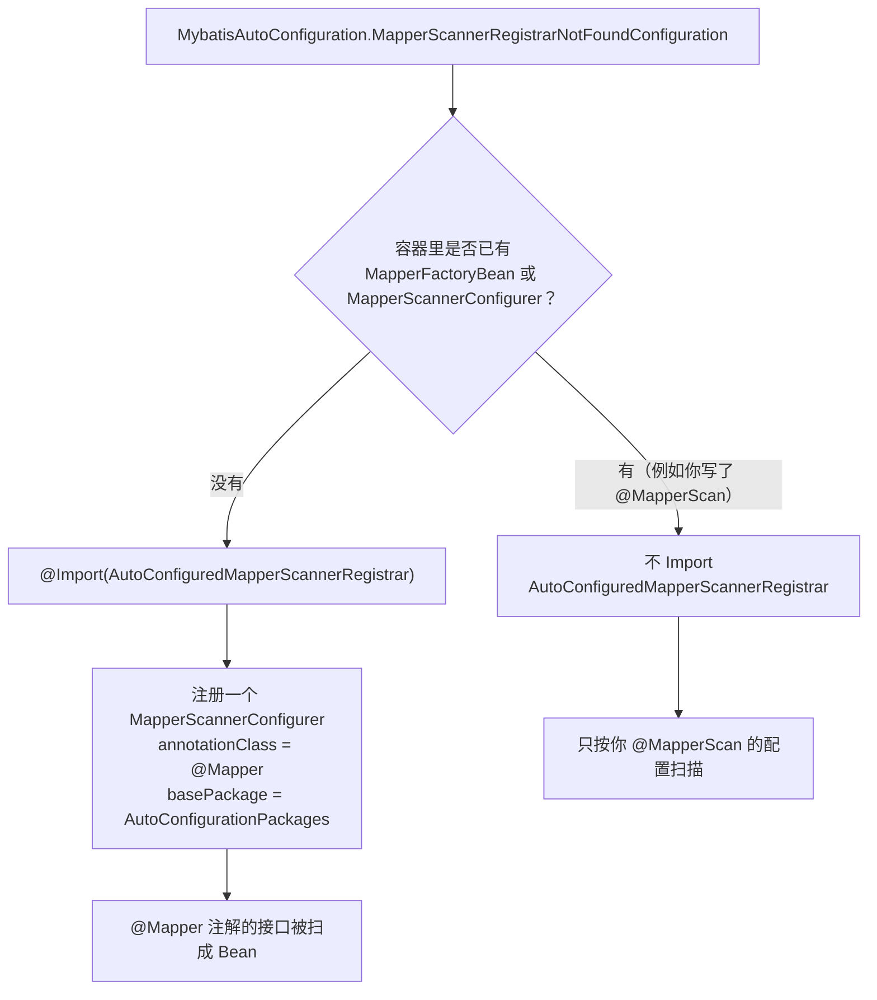
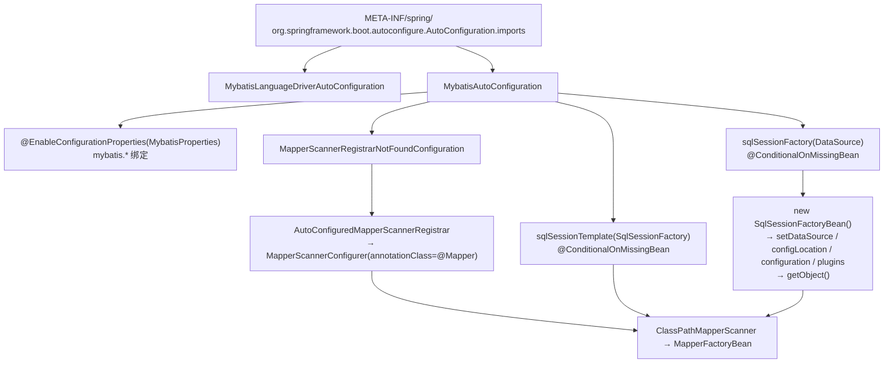
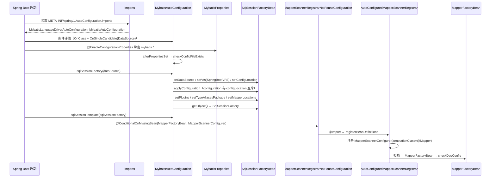

# Boot 自动配置：深入 MybatisAutoConfiguration

> 一句话结论：`mybatis-spring-boot-autoconfigure-4.1.0` 的自动配置只有一个入口类 `MybatisAutoConfiguration`——它用 `@ConditionalOnSingleCandidate(DataSource.class)` 要求"**必须恰好有一个** `DataSource`"，用两个 `@ConditionalOnMissingBean`（`SqlSessionFactory`、`SqlSessionTemplate`）实现"**你一旦自己定义就完全让位**"，再用内嵌的 `AutoConfiguredMapperScannerRegistrar` 在"容器里没有 `MapperScannerConfigurer`/`MapperFactoryBean`"时**补一个默认的 `@Mapper` 扫描器**；而所有 `mybatis.*` 配置项都由 `MybatisProperties`（`@ConfigurationProperties(prefix="mybatis")`）承载，其中 `configuration` 与 `configLocation` 的组合关系决定了 `mybatis.configuration.*` 到底生效不生效。
>
> 阅读前置：读完 [01-mybatis-spring-集成原理.md](./01-mybatis-spring-集成原理.md)（`SqlSessionFactoryBean` 的三分支、`MapperScannerConfigurer` 的早回调）；了解 Spring Boot 的自动配置原理（`@ConditionalOnClass`/`@ConditionalOnMissingBean`、`AutoConfiguration.imports` 注册文件、`@ConfigurationProperties` 绑定、`AutoConfigurationPackages`）；`@ConditionalOnSingleCandidate` 的语义（"有且仅有一个候选 Bean，或有一个 `@Primary`"）。
>
> 预计阅读：50 分钟 ｜ 源码：mybatis-spring-boot-autoconfigure@4.1.0（依赖 mybatis-spring@3.0.5、mybatis@3.6.0）

## 0. 先看现象（3 分钟上手）

**现象一：`mybatis.configuration.map-underscore-to-camel-case=true` 不生效。**

```yaml
mybatis:
  config-location: classpath:mybatis-config.xml
  configuration:
    map-underscore-to-camel-case: true   # ← 写了但没效果
```

`MybatisProperties` 里 `configuration` 字段的 Javadoc 已经把话说完了：

```java (src: MybatisProperties.java#L101-L105)
  /**
   * A Configuration object for customize default settings. If {@link #configLocation} is specified, this property is
   * not used.
   */
  private CoreConfiguration configuration;
```

**这段在做什么**：`configuration` 注释里写明"如果指定了 `configLocation`，这个属性就不会被使用"。

**为什么这么写**：`MybatisAutoConfiguration#applyConfiguration` 只在"`coreConfiguration != null` **或** `configLocation` 为空"时才 `new Configuration()`；一旦 `configLocation` 有值且 `configuration` 为空，`configuration` 局部变量保持 `null`，`factory.setConfiguration(null)`，于是 `SqlSessionFactoryBean` 走 `configLocation` 分支，`mybatis.configuration.*` 无人处理。

**如果改了会怎样**：如果两者都生效，就会出现"XML 里的 `<settings>` 与 YAML 里的 `mybatis.configuration.*` 谁赢"的混乱——框架选择了"XML 优先且完全接管"。

**坑位**：这正是"驼峰映射被 `configuration` 覆盖"类问题的镜像——不是"被覆盖"，而是**根本没被应用**。排查办法：`logging.level.org.mybatis=DEBUG` 看启动时 `Configuration` 的 `mapUnderscoreToCamelCase` 值，或在 `ConfigurationCustomizer` 里打断点。

**现象二：`mybatis.mapper-locations` 写了个错通配符，应用照样启动，只是 SQL 全报 `Invalid bound statement (not found)`。**

`MybatisProperties` 解析 mapper 位置时对 `IOException` **直接吞掉**：

```java (src: MybatisProperties.java#L211-L222)
  public Resource[] resolveMapperLocations() {
    return Stream.of(Optional.ofNullable(this.mapperLocations).orElse(new String[0]))
        .flatMap(location -> Stream.of(getResources(location))).toArray(Resource[]::new);
  }

  private Resource[] getResources(String location) {
    try {
      return resourceResolver.getResources(location);
    } catch (IOException e) {
      return new Resource[0];
    }
  }
```

**这段在做什么**：`resolveMapperLocations` 把每个字符串 pattern 用 `PathMatchingResourcePatternResolver` 解析成 `Resource[]`；`getResources` 捕获 `IOException` 后**返回空数组**。

**为什么这么写**：让"没匹配到任何 XML"成为一个**非致命**状态（有些项目纯注解，本来就没有 XML）；但代价是"pattern 语法错误"与"确实没有 XML"被混成同一种结果。

**如果改了会怎样**：如果这里抛异常，那些"配了 `mapper-locations` 但用的是纯注解"的项目会全部启动失败——兼容性取舍。

**坑位**：所以你只能靠下游日志定位：`MybatisAutoConfiguration` 里 `if (!ObjectUtils.isEmpty(mapperLocations)) factory.setMapperLocations(...)`，**为空时连 `setMapperLocations` 都不会调用**，`SqlSessionFactoryBean` 里那条 `Property 'mapperLocations' was specified but matching resources are not found.` 的 warn 也就**永远不会打印**（因为 `mapperLocations == null`）。这是 Boot 与纯 `mybatis-spring` 最阴的一个差异。

**现象三：加了 `@MapperScan` 之后，`mybatis.type-aliases-package` 之类照常生效，但"默认扫描"消失了——这其实是好事。**



**读图说明**：`MapperScannerRegistrarNotFoundConfiguration` 上的 `@ConditionalOnMissingBean({ MapperFactoryBean.class, MapperScannerConfigurer.class })` 是"默认扫描只在无人接管时生效"的开关——注意它检查的是 `MapperFactoryBean` **类型**的 Bean，而 `@MapperScan` 注册的是 `MapperScannerConfigurer`（一个 `BeanDefinitionRegistryPostProcessor`），两者都会被 `getBeanNamesForType` 命中，因此"只要用了 `@MapperScan`，默认扫描一定不生效"。这就是"`@MapperScan` 优先级高于自动扫描"的源码落点。

## 1. 整体地图（先图后码）



**读图说明**：整个自动配置是"两条 Bean 支线 + 一条扫描支线"：`sqlSessionFactory` 与 `sqlSessionTemplate` 各有一个 `@ConditionalOnMissingBean` 缺口（你可以完全替换），扫描支线则被 `@ConditionalOnMissingBean` 保护在"用户没接管"的前提下。注意 `MybatisLanguageDriverAutoConfiguration` 在 `.imports` 里排在前面，`@AutoConfigureAfter` 也声明了它——因为语言驱动需要先注册到 `Configuration`。

`.imports` 文件本身只有两行（Boot 3/4 的自动配置注册方式）：

```text (src: boot-mybatis-AutoConfiguration.imports#L1-L2)
org.mybatis.spring.boot.autoconfigure.MybatisLanguageDriverAutoConfiguration
org.mybatis.spring.boot.autoconfigure.MybatisAutoConfiguration
```

**这段在做什么**：Boot 启动时读 `META-INF/spring/org.springframework.boot.autoconfigure.AutoConfiguration.imports`（在 `mybatis-spring-boot-autoconfigure-4.1.0.jar` 的 `META-INF/spring/` 目录下），把列出的类全部当作自动配置处理。

**为什么这么写**：Boot 2.7 起用 `.imports` 取代 `spring.factories` 里的 `EnableAutoConfiguration` 键；Boot 3/4 已**不再读取 `spring.factories` 的自动配置条目**，所以缺这个文件 = 自动配置完全不生效（且无任何报错）。

**如果改了会怎样**：把类全限定名写错，Boot 会抛 `IllegalStateException`（找不到类）；把文件名写错（例如放到 `META-INF/spring.factories`），则静默失效。

**坑位**：这一行文本块用的是 `text` 而不是 `java`，因为它是**资源文件**而不是源码；用它来对照你 jar 里的实际内容（`unzip -l` 或 IDE 里展开）。

## 2. 关键类逐个拆

| 类 | 角色 | 关键点 |
| --- | --- | --- |
| `MybatisAutoConfiguration` | 自动配置主类 | `@ConditionalOnSingleCandidate(DataSource.class)` 才生效；两个 `@Bean @ConditionalOnMissingBean` |
| `MybatisProperties` | `mybatis.*` 属性 | `configLocation` / `mapperLocations` / `configuration`（`CoreConfiguration`）/ `executorType` 等 |
| `MybatisProperties.CoreConfiguration` | 核心设置镜像 | 全部用**包装类型**（`Boolean`/`Integer`），只把非 null 值 `applyTo` 到 `Configuration` |
| `AutoConfiguredMapperScannerRegistrar` | 默认扫描器 | 只扫 `@Mapper`；包来自 `AutoConfigurationPackages` |
| `MapperScannerRegistrarNotFoundConfiguration` | 开关 | `@ConditionalOnMissingBean({MapperFactoryBean, MapperScannerConfigurer})` |
| `SpringBootVFS` | `VFS` 实现 | 在 fat jar（`BOOT-INF/classes` / 嵌套 jar）里也能枚举 `**/*.class` |

六个必须记住的结论：

1. **`@ConditionalOnSingleCandidate(DataSource.class)`**：有两个 `DataSource` 且没有 `@Primary` 时，整个自动配置**不生效**（不是报错，是静默跳过）——这是多数据源必须手写配置的原因。
2. **`@ConditionalOnMissingBean` 只看类型**：你自己定义一个 `SqlSessionFactory` Bean，框架就整个放手（连 `mybatis.*` 里的 `mapperLocations` 都不会被应用）。
3. **`AutoConfiguredMapperScannerRegistrar` 只扫 `@Mapper`**：纯接口（无 `@Mapper`）不会被扫；`@MapperScan` 不指定 `annotationClass` 时**扫所有接口**。
4. **`AutoConfigurationPackages`**：默认扫描包 = `@SpringBootApplication` 所在包（及其子包），不是 `mybatis.mapper-locations` 的包。
5. **`SpringBootVFS`**：`typeAliasesPackage`/`typeHandlersPackage` 在 fat jar 里能扫到，靠它。
6. **`executorType` 只影响 `SqlSessionTemplate`**（`mybatis.executor-type`），不影响 `Configuration#getDefaultExecutorType`（那是 `mybatis.configuration.default-executor-type`）。

## 3. 源码逐段精读

### 3.1 类头上的四个条件

```java (src: MybatisAutoConfiguration.java#L83-L106)
@org.springframework.context.annotation.Configuration(proxyBeanMethods = false)
@ConditionalOnClass({ SqlSessionFactory.class, SqlSessionFactoryBean.class })
@ConditionalOnSingleCandidate(DataSource.class)
@EnableConfigurationProperties(MybatisProperties.class)
@AutoConfigureAfter({ DataSourceAutoConfiguration.class, MybatisLanguageDriverAutoConfiguration.class })
public class MybatisAutoConfiguration implements InitializingBean {

  private static final Logger logger = LoggerFactory.getLogger(MybatisAutoConfiguration.class);

  private final MybatisProperties properties;

  private final Interceptor[] interceptors;

  private final TypeHandler[] typeHandlers;

  private final LanguageDriver[] languageDrivers;

  private final ResourceLoader resourceLoader;

  private final DatabaseIdProvider databaseIdProvider;

  private final List<ConfigurationCustomizer> configurationCustomizers;

  private final List<SqlSessionFactoryBeanCustomizer> sqlSessionFactoryBeanCustomizers;
```

**这段在做什么**：`@ConditionalOnClass` 要求 classpath 上有 MyBatis 核心与 `SqlSessionFactoryBean`（有 starter 就有）；`@ConditionalOnSingleCandidate(DataSource.class)` 要求"恰好一个 `DataSource`（或有 `@Primary`）"；`@EnableConfigurationProperties` 注册并绑定 `MybatisProperties`；`@AutoConfigureAfter` 保证在数据源与语言驱动之后。字段里八个"扩展点"全部来自容器（可以是 0 个或多个）。

**为什么这么写**：`@ConditionalOnSingleCandidate` 是**多数据源的天然护栏**——框架宁可不干活，也不愿意把两个库的数据混到一个 `SqlSessionFactory` 里；`proxyBeanMethods = false` 表示不生成 CGLIB 子类（更省内存、支持 final 方法）。

**如果改了会怎样**：如果把 `@ConditionalOnSingleCandidate` 换成 `@ConditionalOnBean`，多数据源项目会在启动时报 `NoUniqueBeanDefinitionException`（因为 `sqlSessionFactory(DataSource dataSource)` 注入时找不到唯一的 `DataSource`）。

**坑位**：`@ConditionalOnSingleCandidate` 不生效时**没有任何日志**。排查多数据源问题时，先确认 `Environment` 里是否还存在框架注册的 `sqlSessionFactory` Bean（`getBeanNamesForType(SqlSessionFactory.class)` 应只含你手写的那个）。

### 3.2 构造器：全部扩展点走 `ObjectProvider`

```java (src: MybatisAutoConfiguration.java#L108-L134)
  public MybatisAutoConfiguration(MybatisProperties properties, ObjectProvider<Interceptor[]> interceptorsProvider,
      ObjectProvider<TypeHandler[]> typeHandlersProvider, ObjectProvider<LanguageDriver[]> languageDriversProvider,
      ResourceLoader resourceLoader, ObjectProvider<DatabaseIdProvider> databaseIdProvider,
      ObjectProvider<List<ConfigurationCustomizer>> configurationCustomizersProvider,
      ObjectProvider<List<SqlSessionFactoryBeanCustomizer>> sqlSessionFactoryBeanCustomizers) {
    this.properties = properties;
    this.interceptors = interceptorsProvider.getIfAvailable();
    this.typeHandlers = typeHandlersProvider.getIfAvailable();
    this.languageDrivers = languageDriversProvider.getIfAvailable();
    this.resourceLoader = resourceLoader;
    this.databaseIdProvider = databaseIdProvider.getIfAvailable();
    this.configurationCustomizers = configurationCustomizersProvider.getIfAvailable();
    this.sqlSessionFactoryBeanCustomizers = sqlSessionFactoryBeanCustomizers.getIfAvailable();
  }

  @Override
  public void afterPropertiesSet() {
    checkConfigFileExists();
  }

  private void checkConfigFileExists() {
    if (this.properties.isCheckConfigLocation() && StringUtils.hasText(this.properties.getConfigLocation())) {
      Resource resource = this.resourceLoader.getResource(this.properties.getConfigLocation());
      Assert.state(resource.exists(),
          "Cannot find config location: " + resource + " (please add config file or check your Mybatis configuration)");
    }
  }
```

**这段在做什么**：用 `ObjectProvider<Interceptor[]>` 之类**数组形式的注入**收集容器里所有 `Interceptor` Bean（多个拦截器会聚成一个数组，而不是抛"不唯一"）；`afterPropertiesSet` 里在 `mybatis.check-config-location=true` 时校验 `config-location` 文件存在，否则抛 `IllegalStateException`（消息原文包含 `Cannot find config location`）。

**为什么这么写**：`ObjectProvider#getIfAvailable()` 对"没有 / 有一个"两种情形都安全，避免了 `@Autowired(required=false)` 与构造函数注入的兼容问题；`check-config-location` 默认 `false`，是为了兼容"`config-location` 指向 optional 位置"的老项目。

**如果改了会怎样**：如果用 `@Autowired Interceptor[]` 直接注入，没有拦截器时会注入空数组（没问题），但**同时有多个** `ConfigurationCustomizer` 时行为一致——真正的差别是 `ObjectProvider` 让"扩展点 Bean 何时创建"延迟到自动配置实例化时，避免循环依赖。

**坑位**：`Interceptor` **必须**是 Spring Bean 才会被收集——`@Bean` 声明或 `@Component` 注解都行，但**手动 `new` 一个拦截器然后 `configuration.addInterceptor(...)` 之后再被覆盖就没有**（见坑 4）。`@ConditionalOnMissingBean` 只保护 `SqlSessionFactory`/`SqlSessionTemplate`，**保护不了拦截器收集逻辑**（你自定义 `SqlSessionFactory` 后，这里的 `interceptors` 就完全不会被应用）。

### 3.3 `sqlSessionFactory`：把 `mybatis.*` 逐项喂给 `SqlSessionFactoryBean`

```java (src: MybatisAutoConfiguration.java#L136-L156)
  @Bean
  @ConditionalOnMissingBean
  public SqlSessionFactory sqlSessionFactory(DataSource dataSource) throws Exception {
    SqlSessionFactoryBean factory = new SqlSessionFactoryBean();
    factory.setDataSource(dataSource);
    if (properties.getConfiguration() == null || properties.getConfiguration().getVfsImpl() == null) {
      factory.setVfs(SpringBootVFS.class);
    }
    if (StringUtils.hasText(this.properties.getConfigLocation())) {
      factory.setConfigLocation(this.resourceLoader.getResource(this.properties.getConfigLocation()));
    }
    applyConfiguration(factory);
    if (this.properties.getConfigurationProperties() != null) {
      factory.setConfigurationProperties(this.properties.getConfigurationProperties());
    }
    if (!ObjectUtils.isEmpty(this.interceptors)) {
      factory.setPlugins(this.interceptors);
    }
    if (this.databaseIdProvider != null) {
      factory.setDatabaseIdProvider(this.databaseIdProvider);
    }
```

**这段在做什么**：新建 `SqlSessionFactoryBean` 并逐项传参：数据源；**默认 VFS**（除非你自己指定了 `mybatis.configuration.vfs-impl`）；`config-location`；`applyConfiguration`（见 3.4，这是 `mybatis.configuration.*` 的唯一入口）；`configuration-properties`；`plugins`（=所有 `Interceptor` Bean）；`DatabaseIdProvider`。

**为什么这么写**：`SpringBootVFS` 是 Boot 专属补丁——标准 `VFS` 在嵌套 jar/`BOOT-INF` 结构下无法枚举 class，`type-aliases-package` 会扫不到任何类；只有在用户没自定义 `vfsImpl` 时才覆盖，尊重用户选择。

**如果改了会怎样**：如果去掉 `setVfs(SpringBootVFS.class)`，用 `java -jar` 跑 fat jar 时 `type-aliases-package` 静默失效（本地 IDE 却正常）——这是极典型的"打包后才坏"问题。

**坑位**：`properties.getConfiguration() == null || ...getVfsImpl() == null` 这个条件意味着**只要配了 `mybatis.configuration.*` 但没配 `vfs-impl`，仍然会用 `SpringBootVFS`**；反之配了 `vfs-impl` 就完全交给你。

```java (src: MybatisAutoConfiguration.java#L157-L190)
    if (StringUtils.hasLength(this.properties.getTypeAliasesPackage())) {
      factory.setTypeAliasesPackage(this.properties.getTypeAliasesPackage());
    }
    if (this.properties.getTypeAliasesSuperType() != null) {
      factory.setTypeAliasesSuperType(this.properties.getTypeAliasesSuperType());
    }
    if (StringUtils.hasLength(this.properties.getTypeHandlersPackage())) {
      factory.setTypeHandlersPackage(this.properties.getTypeHandlersPackage());
    }
    if (!ObjectUtils.isEmpty(this.typeHandlers)) {
      factory.setTypeHandlers(this.typeHandlers);
    }
    Resource[] mapperLocations = this.properties.resolveMapperLocations();
    if (!ObjectUtils.isEmpty(mapperLocations)) {
      factory.setMapperLocations(mapperLocations);
    }
    Set<String> factoryPropertyNames = Stream
        .of(new BeanWrapperImpl(SqlSessionFactoryBean.class).getPropertyDescriptors()).map(PropertyDescriptor::getName)
        .collect(Collectors.toSet());
    Class<? extends LanguageDriver> defaultLanguageDriver = this.properties.getDefaultScriptingLanguageDriver();
    if (factoryPropertyNames.contains("scriptingLanguageDrivers") && !ObjectUtils.isEmpty(this.languageDrivers)) {
      // Need to mybatis-spring 2.0.2+
      factory.setScriptingLanguageDrivers(this.languageDrivers);
      if (defaultLanguageDriver == null && this.languageDrivers.length == 1) {
        defaultLanguageDriver = this.languageDrivers[0].getClass();
      }
    }
    if (factoryPropertyNames.contains("defaultScriptingLanguageDriver")) {
      // Need to mybatis-spring 2.0.2+
      factory.setDefaultScriptingLanguageDriver(defaultLanguageDriver);
    }
    applySqlSessionFactoryBeanCustomizers(factory);
    return factory.getObject();
  }
```

**这段在做什么**：继续传 `typeAliasesPackage`/`typeAliasesSuperType`/`typeHandlersPackage`/`typeHandlers`；**`resolveMapperLocations()` 为空就跳过**；接着用 `BeanWrapperImpl` 反射出 `SqlSessionFactoryBean` 的属性名集合，做**兼容性开关**（只有老版 mybatis-spring 才没有 `scriptingLanguageDrivers` 属性）；最后 `applySqlSessionFactoryBeanCustomizers` 让你能在 `getObject()` 之前"最后一刻"改工厂，再 `factory.getObject()`。

**为什么这么写**：属性名探测是为了"同一个 starter 兼容多个 mybatis-spring 版本"（注释 `Need to mybatis-spring 2.0.2+`）；`SqlSessionFactoryBeanCustomizer` 是 **2.2.0 之后**新增的"万能后门"——它拿到的是工厂对象本身，可以做 `setConfiguration` 之外的任何设置（例如 `setObjectFactory`）。

**如果改了会怎样**：如果去掉 `BeanWrapperImpl` 探测，在没有 `scriptingLanguageDrivers` 的旧版 mybatis-spring 上会抛 `NoSuchMethodError`。

**坑位**：`mapperLocations` 为空时**不调用** `setMapperLocations` → `SqlSessionFactoryBean` 里"`mapperLocations` 已指定但没匹配到资源"的 warn 永远不会出现（前面"现象二"已说明）。另外 `defaultLanguageDriver` 仅在"只有一个 `LanguageDriver` Bean"时自动作为默认，多个时必须显式 `mybatis.default-scripting-language-driver`。

### 3.4 `applyConfiguration`：`configuration` 与 `configLocation` 的互斥逻辑

```java (src: MybatisAutoConfiguration.java#L192-L215)
  private void applyConfiguration(SqlSessionFactoryBean factory) {
    MybatisProperties.CoreConfiguration coreConfiguration = this.properties.getConfiguration();
    Configuration configuration = null;
    if (coreConfiguration != null || !StringUtils.hasText(this.properties.getConfigLocation())) {
      configuration = new Configuration();
    }
    if (configuration != null && coreConfiguration != null) {
      coreConfiguration.applyTo(configuration);
    }
    if (configuration != null && !CollectionUtils.isEmpty(this.configurationCustomizers)) {
      for (ConfigurationCustomizer customizer : this.configurationCustomizers) {
        customizer.customize(configuration);
      }
    }
    factory.setConfiguration(configuration);
  }

  private void applySqlSessionFactoryBeanCustomizers(SqlSessionFactoryBean factory) {
    if (!CollectionUtils.isEmpty(this.sqlSessionFactoryBeanCustomizers)) {
      for (SqlSessionFactoryBeanCustomizer customizer : this.sqlSessionFactoryBeanCustomizers) {
        customizer.customize(factory);
      }
    }
  }
```

**这段在做什么**：四步——① 只有"配了 `mybatis.configuration.*`"**或**"没配 `config-location`"时才 `new Configuration()`；② 有 `CoreConfiguration` 就 `applyTo`；③ 有 `ConfigurationCustomizer` Bean 就逐个 `customize`；④ **无论 `configuration` 是否为 null 都 `setConfiguration(configuration)`**。

**为什么这么写**：第 ④ 步是关键——当 `configLocation` 有值且 `configuration` 为 null 时，`setConfiguration(null)` 让 `SqlSessionFactoryBean` 走 `configLocation` 分支；如果这里"有 configLocation 就不调用 setConfiguration"，效果其实一样（字段默认 null），但显式写出来表明"两者的互斥由本方法统一决策"。

**如果改了会怎样**：如果去掉 `|| !StringUtils.hasText(configLocation)` 这一半，纯 YAML 配置（无 `config-location`）时 `configuration` 仍是 `new Configuration()`（`coreConfiguration` 为 null 时也不会 `applyTo`），`ConfigurationCustomizer` 依然会执行——所以这个条件真正的作用是"有 `config-location` 时**不要**新建 `Configuration`，让 XML 说了算，同时 `ConfigurationCustomizer` 也**不再执行**"。

**坑位**：**`ConfigurationCustomizer` 在"配了 `config-location` 且没配 `mybatis.configuration.*`"时完全不执行**！很多人踩这个坑（写了 customizer 却没生效），根因就是 `configuration == null`。规避：要么不用 `config-location`，要么在 `configuration` 里配任意一项让 `coreConfiguration != null`，要么改用 `SqlSessionFactoryBeanCustomizer`（它在 `getObject()` 前总是执行）。

### 3.5 `sqlSessionTemplate`：`executorType` 的落点

```java (src: MybatisAutoConfiguration.java#L217-L226)
  @Bean
  @ConditionalOnMissingBean
  public SqlSessionTemplate sqlSessionTemplate(SqlSessionFactory sqlSessionFactory) {
    ExecutorType executorType = this.properties.getExecutorType();
    if (executorType != null) {
      return new SqlSessionTemplate(sqlSessionFactory, executorType);
    } else {
      return new SqlSessionTemplate(sqlSessionFactory);
    }
  }
```

**这段在做什么**：也是一个 `@ConditionalOnMissingBean` Bean；`mybatis.executor-type=BATCH` 时用带类型的构造器，否则用默认（`SIMPLE`）。

**为什么这么写**：`SqlSessionTemplate` 在构造时固定 `ExecutorType`，所以要在这里决定；用 `@ConditionalOnMissingBean(SqlSessionTemplate.class)` 让"想要批量模板 + 普通模板并存"的项目自己定义。

**如果改了会怎样**：如果把 `executorType` 同时塞给 `Configuration#setDefaultExecutorType`，`openSession()`（无参版本）也会用 BATCH，容易造成"忘了 flush"的隐性 bug。

**坑位**：`mybatis.executor-type` 与 `mybatis.configuration.default-executor-type` 是**两个不同东西**：前者决定 `SqlSessionTemplate` 的 `ExecutorType`；后者只影响 `Configuration#getDefaultExecutorType()`（`openSession()` 无参时）。99% 的场景只应配前者。

### 3.6 `AutoConfiguredMapperScannerRegistrar`：只认 `@Mapper`

```java (src: MybatisAutoConfiguration.java#L228-L257)
  /**
   * This will just scan the same base package as Spring Boot does. If you want more power, you can explicitly use
   * {@link org.mybatis.spring.annotation.MapperScan} but this will get typed mappers working correctly, out-of-the-box,
   * similar to using Spring Data JPA repositories.
   */
  public static class AutoConfiguredMapperScannerRegistrar
      implements BeanFactoryAware, EnvironmentAware, ImportBeanDefinitionRegistrar {

    private BeanFactory beanFactory;
    private Environment environment;

    @Override
    public void registerBeanDefinitions(AnnotationMetadata importingClassMetadata, BeanDefinitionRegistry registry) {

      if (!AutoConfigurationPackages.has(this.beanFactory)) {
        logger.debug("Could not determine auto-configuration package, automatic mapper scanning disabled.");
        return;
      }

      logger.debug("Searching for mappers annotated with @Mapper");

      List<String> packages = AutoConfigurationPackages.get(this.beanFactory);
      if (logger.isDebugEnabled()) {
        packages.forEach(pkg -> logger.debug("Using auto-configuration base package '{}'", pkg));
      }

      BeanDefinitionBuilder builder = BeanDefinitionBuilder.genericBeanDefinition(MapperScannerConfigurer.class);
      builder.addPropertyValue("processPropertyPlaceHolders", true);
      builder.addPropertyValue("annotationClass", Mapper.class);
      builder.addPropertyValue("basePackage", StringUtils.collectionToCommaDelimitedString(packages));
```

**这段在做什么**：`ImportBeanDefinitionRegistrar` 实现里：① 若 `AutoConfigurationPackages` 为空（例如不是通过 `@SpringBootApplication` 引导）→ 打 debug 并 return，**不做扫描**；② 取默认扫描包列表；③ 构造一个 `MapperScannerConfigurer` 的 BeanDefinition，属性 `annotationClass = org.apache.ibatis.annotations.Mapper`、`basePackage = 默认包`、`processPropertyPlaceHolders = true`。

**为什么这么写**：`@Mapper`（MyBatis 自己的注解）与 `@MapperScan`（mybatis-spring 的扫描注解）在语义上是"我是映射器"与"我要扫描"两种意图；默认扫描只认前者，避免把业务接口（`Service`/`Repository`）误注册成 mapper。包范围与 `@SpringBootApplication` 一致，符合"零配置"预期。

**如果改了会怎样**：如果 `annotationClass` 改成"无过滤"（像 `@MapperScan` 不填 `annotationClass` 那样），默认扫描会把**所有接口**当 mapper 注册，启动大概率因 `BindingException` 失败。

**坑位**：`@Mapper` 是**接口级注解**，写在实现类上无效；`@MapperScan` 不指定 `annotationClass` 时则"扫所有接口"——所以"用了 `@MapperScan` 之后不需要再给接口加 `@Mapper`"，这是两条扫描路径的**重要差异**。

```java (src: MybatisAutoConfiguration.java#L258-L289)
      BeanWrapper beanWrapper = new BeanWrapperImpl(MapperScannerConfigurer.class);
      Set<String> propertyNames = Stream.of(beanWrapper.getPropertyDescriptors()).map(PropertyDescriptor::getName)
          .collect(Collectors.toSet());
      if (propertyNames.contains("lazyInitialization")) {
        // Need to mybatis-spring 2.0.2+
        builder.addPropertyValue("lazyInitialization", "${mybatis.lazy-initialization:false}");
      }
      if (propertyNames.contains("defaultScope")) {
        // Need to mybatis-spring 2.0.6+
        builder.addPropertyValue("defaultScope", "${mybatis.mapper-default-scope:}");
      }

      // for spring-native
      boolean injectSqlSession = environment.getProperty("mybatis.inject-sql-session-on-mapper-scan", Boolean.class,
          Boolean.TRUE);
      if (injectSqlSession && this.beanFactory instanceof ListableBeanFactory) {
        ListableBeanFactory listableBeanFactory = (ListableBeanFactory) this.beanFactory;
        Optional<String> sqlSessionTemplateBeanName = Optional
            .ofNullable(getBeanNameForType(SqlSessionTemplate.class, listableBeanFactory));
        Optional<String> sqlSessionFactoryBeanName = Optional
            .ofNullable(getBeanNameForType(SqlSessionFactory.class, listableBeanFactory));
        if (sqlSessionTemplateBeanName.isPresent() || !sqlSessionFactoryBeanName.isPresent()) {
          builder.addPropertyValue("sqlSessionTemplateBeanName",
              sqlSessionTemplateBeanName.orElse("sqlSessionTemplate"));
        } else {
          builder.addPropertyValue("sqlSessionFactoryBeanName", sqlSessionFactoryBeanName.orElseThrow());
        }
      }
      builder.setRole(BeanDefinition.ROLE_INFRASTRUCTURE);

      registry.registerBeanDefinition(MapperScannerConfigurer.class.getName(), builder.getBeanDefinition());
    }
```

**这段在做什么**：继续补三件"可选能力"：① `lazyInitialization` / `defaultScope` 用 `${mybatis.lazy-initialization:false}`、`${mybatis.mapper-default-scope:}` **属性占位符**注入（因为此时属性还没绑定到 `MybatisProperties`）；② **`mybatis.inject-sql-session-on-mapper-scan`（默认 true）** 决定是否把 `sqlSessionTemplateBeanName`/`sqlSessionFactoryBeanName` 显式绑上（这是为 AOT/spring-native 准备的：AOT 下按类型自动装配不可靠）；③ 设 `ROLE_INFRASTRUCTURE` 并用**全限定类名**注册 BeanDefinition。

**为什么这么写**：`MapperScannerConfigurer` 自己的 `processPropertyPlaceHolders=true` 会去解析 `${...}`，所以这里可以放心用占位符；用 `MapperScannerConfigurer.class.getName()` 当 Bean 名，保证**全局唯一**（也方便其他地方 `getBeanDefinition` 判断）。

**如果改了会怎样**：如果不用占位符而直接 `builder.addPropertyValue("lazyInitialization", false)`，`mybatis.lazy-initialization=true` 就永远不生效（这个属性此时还没绑定到 properties 对象）。

**坑位**：`mybatis.inject-sql-session-on-mapper-scan=false` 时**既不注入 template 也不注入 factory**，全靠 `AUTOWIRE_BY_TYPE`——多数据源场景请保持默认 `true`，否则可能注入错的 factory；反之若在 AOT 编译时报"无法解析 bean 名"，可尝试显式 `@MapperScan(sqlSessionFactoryRef=...)`。

### 3.7 开关：`MapperScannerRegistrarNotFoundConfiguration`

```java (src: MybatisAutoConfiguration.java#L308-L323)
  /**
   * If mapper registering configuration or mapper scanning configuration not present, this configuration allow to scan
   * mappers based on the same component-scanning path as Spring Boot itself.
   */
  @org.springframework.context.annotation.Configuration(proxyBeanMethods = false)
  @Import(AutoConfiguredMapperScannerRegistrar.class)
  @ConditionalOnMissingBean({ MapperFactoryBean.class, MapperScannerConfigurer.class })
  public static class MapperScannerRegistrarNotFoundConfiguration implements InitializingBean {

    @Override
    public void afterPropertiesSet() {
      logger.debug(
          "Not found configuration for registering mapper bean using @MapperScan, MapperFactoryBean and MapperScannerConfigurer.");
    }

  }
```

**这段在做什么**：内嵌 `@Configuration`，用 `@ConditionalOnMissingBean({MapperFactoryBean.class, MapperScannerConfigurer.class})` 判断"用户是否已经接管 mapper 注册"——没有才 `@Import(AutoConfiguredMapperScannerRegistrar.class)`；`afterPropertiesSet` 打的一条 debug 日志（只要看到它，就说明默认扫描生效了）。

**为什么这么写**：`@MapperScan` 注册的是 `MapperScannerConfigurer` 类型；手工 `@Bean MapperFactoryBean` 也会被命中——两种"用户接管"的方式都能挡住默认扫描，避免**两套扫描器并存**（重复注册 `MappedStatement`、Bean 名冲突 `Skipping MapperFactoryBean with name ... Bean already defined with the same name!`）。

**如果改了会怎样**：如果去掉 `@ConditionalOnMissingBean`，`@MapperScan(basePackages="com.a")` 与默认扫描（`com.b`）会同时工作，`com.a` 里的接口被两个扫描器各注册一次，Bean 名冲突。

**坑位**：`@ConditionalOnMissingBean` 在**自动配置类注册顺序**上工作，它依赖"用户 Bean 定义先注册"（`@Import` 的 `MapperScannerConfigurer` 由 `@MapperScan` 的 registrar 注册，早于自动配置），所以可靠；但如果你用 `@Bean` 在**另一个自动配置类**里注册 `MapperScannerConfigurer` 且顺序更晚，就可能失效。

### 3.8 `MybatisProperties.applyTo`：只覆盖非 null

```java (src: MybatisProperties.java#L675-L709)
    public void applyTo(Configuration target) {
      PropertyMapper mapper = PropertyMapper.get();
      mapper.from(getSafeRowBoundsEnabled()).to(target::setSafeRowBoundsEnabled);
      mapper.from(getSafeResultHandlerEnabled()).to(target::setSafeResultHandlerEnabled);
      mapper.from(getMapUnderscoreToCamelCase()).to(target::setMapUnderscoreToCamelCase);
      mapper.from(getAggressiveLazyLoading()).to(target::setAggressiveLazyLoading);
      mapper.from(getMultipleResultSetsEnabled()).to(target::setMultipleResultSetsEnabled);
      mapper.from(getUseGeneratedKeys()).to(target::setUseGeneratedKeys);
      mapper.from(getUseColumnLabel()).to(target::setUseColumnLabel);
      mapper.from(getCacheEnabled()).to(target::setCacheEnabled);
      mapper.from(getCallSettersOnNulls()).to(target::setCallSettersOnNulls);
      mapper.from(getUseActualParamName()).to(target::setUseActualParamName);
      mapper.from(getReturnInstanceForEmptyRow()).to(target::setReturnInstanceForEmptyRow);
      mapper.from(getShrinkWhitespacesInSql()).to(target::setShrinkWhitespacesInSql);
      mapper.from(getNullableOnForEach()).to(target::setNullableOnForEach);
      mapper.from(getArgNameBasedConstructorAutoMapping()).to(target::setArgNameBasedConstructorAutoMapping);
      mapper.from(getLazyLoadingEnabled()).to(target::setLazyLoadingEnabled);
      mapper.from(getLogPrefix()).to(target::setLogPrefix);
      mapper.from(getLazyLoadTriggerMethods()).to(target::setLazyLoadTriggerMethods);
      mapper.from(getDefaultStatementTimeout()).to(target::setDefaultStatementTimeout);
      mapper.from(getDefaultFetchSize()).to(target::setDefaultFetchSize);
      mapper.from(getLocalCacheScope()).to(target::setLocalCacheScope);
      mapper.from(getJdbcTypeForNull()).to(target::setJdbcTypeForNull);
      mapper.from(getDefaultResultSetType()).to(target::setDefaultResultSetType);
      mapper.from(getDefaultExecutorType()).to(target::setDefaultExecutorType);
      mapper.from(getAutoMappingBehavior()).to(target::setAutoMappingBehavior);
      mapper.from(getAutoMappingUnknownColumnBehavior()).to(target::setAutoMappingUnknownColumnBehavior);
      mapper.from(getVariables()).to(target::setVariables);
      mapper.from(getLogImpl()).to(target::setLogImpl);
      mapper.from(getVfsImpl()).to(target::setVfsImpl);
      mapper.from(getDefaultSqlProviderType()).to(target::setDefaultSqlProviderType);
      mapper.from(getConfigurationFactory()).to(target::setConfigurationFactory);
      mapper.from(getDefaultEnumTypeHandler()).to(target::setDefaultEnumTypeHandler);
      mapper.from(getDatabaseId()).to(target::setDatabaseId);
    }
```

**这段在做什么**：`CoreConfiguration` 的所有字段都是**包装类型**（`Boolean`/`Integer`/枚举/`Class`/`Properties`），`applyTo` 用 Spring 的 `PropertyMapper`（`from(x).to(setter)`）逐个搬运；`PropertyMapper` 的语义是"**null 就不调用 setter**"。

**为什么这么写**：如果字段用 `boolean`/`int` 原始类型，未配置时也有默认值（`false`/`0`），会把 `Configuration` 里的**MyBatis 默认值**（例如 `mapUnderscoreToCamelCase` 默认 `false`、`jdbcTypeForNull` 默认 `OTHER`、`localCacheScope` 默认 `SESSION`）覆盖成 `false`/`0`/`null`——灾难。包装类型 + `PropertyMapper` 保证"你没写就不碰"。

**如果改了会怎样**：把 `defaultStatementTimeout` 改成 `int` 且默认 0，未配置时会把 `Configuration` 的超时设成 0（可能意味着"无超时"或"立即超时"，取决于驱动），线上出现大量超时/挂住。

**坑位**：`applyTo` 里**没有** `setEnvironment`（环境由 `SqlSessionFactoryBean` 管），也没有 `setMapperLocations`（那是 `Resource` 级，不属于 `Configuration`），更没有 `setPlugins`——**插件必须通过 `Interceptor` Bean 注册**，不能写在 `mybatis.configuration` 下。

### 3.9 `SpringBootVFS`：fat jar 里的 class 枚举

```java (src: SpringBootVFS.java#L40-L67)
public class SpringBootVFS extends VFS {

  private static Charset urlDecodingCharset;
  private static Supplier<ClassLoader> classLoaderSupplier;
  private final ResourcePatternResolver resourceResolver;

  static {
    setUrlDecodingCharset(Charset.defaultCharset());
    setClassLoaderSupplier(ClassUtils::getDefaultClassLoader);
  }

  public SpringBootVFS() {
    this.resourceResolver = new PathMatchingResourcePatternResolver(classLoaderSupplier.get());
  }

  @Override
  public boolean isValid() {
    return true;
  }

  @Override
  protected List<String> list(URL url, String path) throws IOException {
    String urlString = URLDecoder.decode(url.toString(), urlDecodingCharset);
    String baseUrlString = urlString.endsWith("/") ? urlString : urlString.concat("/");
    Resource[] resources = resourceResolver.getResources(baseUrlString + "**/*.class");
    return Stream.of(resources).map(resource -> preserveSubpackageName(baseUrlString, resource, path))
        .collect(Collectors.toList());
  }
```

**这段在做什么**：覆盖 `VFS#list(URL, String)`，改用 Spring 的 `PathMatchingResourcePatternResolver` 按 `**/*.class` 匹配——这样无论 class 在目录、普通 jar、还是 Spring Boot 的嵌套 jar（`jar:file:...!/BOOT-INF/classes!/`）里都能列出。

**为什么这么写**：MyBatis 原生 `VFS` 依赖 `URL` 的文件系统/`JarURLConnection` 探测，遇到 Boot 的可执行 jar 结构会失败（`type-aliases-package`、`type-handlers-package` 扫描静默为空）。`isValid()` 恒 `true` 表示"在 Boot 环境里总能工作"。

**如果改了会怎样**：注释掉 `SpringBootVFS`，`java -jar` 部署后 `@Alias` 不起作用、别名找不到 → 启动报 `TypeException: Could not resolve type alias`。

**坑位**：`setUrlDecodingCharset` 默认是**系统默认字符集**，在 `-Dfile.encoding` 不统一的环境（Windows 开发 / Linux 容器）里可能把含中文的路径解错——如有问题用 `SpringBootVFS.setUrlDecodingCharset(StandardCharsets.UTF_8)` 显式设置（这是 `static` 方法）。

## 4. 一次完整执行时序



**读图说明**：注意 `MapperScannerRegistrarNotFoundConfiguration` 的条件评估发生在"用户的 `@MapperScan` 已注册 `MapperScannerConfigurer` 之后"；如果你看到 `Not found configuration for registering mapper bean using @MapperScan, MapperFactoryBean and MapperScannerConfigurer.` 这条 debug 日志，说明默认扫描**生效**了。

手工排查顺序（多数据源/扫描不出来时照这个走）：

1. `getBeanNamesForType(SqlSessionFactory.class)` → 是否只有一个、是不是你期望的那个（`MybatisAutoConfiguration` 的是 `sqlSessionFactory`）；
2. `getBeanNamesForType(SqlSessionTemplate.class)` → 是否只有一个；
3. `getBeanNamesForType(MapperScannerConfigurer.class)` → 有几个（多个说明 `@MapperScan` 与自动扫描并存或重复注解）；
4. `getBeanNamesForType(MapperFactoryBean.class)` → 扫到了哪些（Bean 名默认是接口简写首字母小写，例如 `userMapper`）；
5. `Configuration#getEnvironment().getDataSource()` → 是否是你期望的数据源。

## 5. 设计模式与设计取舍

| 设计点 | 模式 | 取舍 |
| --- | --- | --- |
| `@ConditionalOnMissingBean` | 约定优于配置 + 完全让位 | 用起来爽，但"我自定义了 factory，`mybatis.*` 全失效"极难意识到 |
| `@ConditionalOnSingleCandidate` | 守卫条件 | 多数据源必须手写，但绝不会串库 |
| `AutoConfiguredMapperScannerRegistrar` | 自动注册 | 零配置扫描，但只认 `@Mapper` |
| `MapperScannerRegistrarNotFoundConfiguration` | 兜底开关 | 与 `@MapperScan` 不冲突，但依赖条件评估的时机 |
| `CoreConfiguration` + `PropertyMapper` | 空值透明映射 | 只覆盖显式配置，代价是"配了 config-location 就整体失效" |
| `SqlSessionFactoryBeanCustomizer` / `ConfigurationCustomizer` | 扩展点回调 | 后者受 `configLocation` 影响，前者不受 |

三个值得深思的取舍：

1. **"`config-location` 与 `configuration` 二选一"**：Boot 采用"XML 一旦存在就完全接管"的激进策略，导致 YAML 里的 `mybatis.configuration.*` 与 `ConfigurationCustomizer` 同时失效。想混用只能用 `SqlSessionFactoryBeanCustomizer` 或自己定义 `SqlSessionFactory`。
2. **"默认扫描只认 `@Mapper`"**：安全性优先（不会误扫），代价是从 Spring Data 迁过来的人以为"接口自动变 Bean"。
3. **`MapperScannerConfigurer` 用全限定名当 Bean 名**：唯一性优先，代价是在 `@Bean(name="mapperScannerConfigurer")` 时与默认扫描并存会出现两个扫描器。

## 6. 踩坑与调试手法

### 6.1 坑 1：`mapper-locations` 通配符写错/路径不对，静默失效

**症状**：`Invalid bound statement (not found): com.x.mapper.UserMapper.selectById`。

**根因**：`MybatisProperties#getResources` 吞 `IOException` 返回空数组；`MybatisAutoConfiguration` 里 `ObjectUtils.isEmpty(mapperLocations)` 为真就**不调用** `setMapperLocations`；于是 `SqlSessionFactoryBean` 连那条 warn 都不打。

**对策**：确认 pattern（`classpath*:mapper/**/*.xml`）；`target/classes` 下 `dir` 看 XML 是否被复制；把 `logging.level.org.mybatis.spring=DEBUG` 打开，是否出现 `Parsed mapper file`。

### 6.2 坑 2：`type-aliases-package` 与 `@Alias`

**症状**：`TypeException: Could not resolve type alias 'User'`。

**根因**：① 别名包写错或类在 jar 里没被打包；② 使用了 `@Alias` 但 `type-aliases-package` 未包含该类；③ 多个包用逗号分隔但写成了空格/分号（`MybatisProperties` 的 Javadoc 说分隔符是 `",; \t\n"`）；④ `typeAliasesSuperType` 过滤掉了目标类。

**对策**：别名要么全靠 `@Alias`，要么全靠"包扫描 + 类简名"；确认分隔符；fat jar 场景确认 `SpringBootVFS` 生效（不要覆盖 `vfs-impl`）。

### 6.3 坑 3：驼峰映射"被 `configuration` 覆盖"

**症状**：YAML 写了 `mybatis.configuration.map-underscore-to-camel-case: true`，结果 `user_name` 映射不到 `userName`。

**根因**：见 §0 现象一——`config-location` 存在时 `applyConfiguration` 不会 `new Configuration()`，`configuration` 为 null → `setConfiguration(null)` → 走 XML 分支 → YAML 的 `configuration` 完全不生效。

**对策**：删掉 `config-location`，把 `<settings>` 迁到 YAML；或保留 XML 并把设置写在 XML 里；或用 `SqlSessionFactoryBeanCustomizer`。

### 6.4 坑 4：插件未注册

**症状**：分页插件"没生效"，SQL 没被改写。

**根因**：`MybatisAutoConfiguration` 通过 `ObjectProvider<Interceptor[]>` 收集**容器里的 `Interceptor` Bean**；如果拦截器不是 Bean（`new` 出来手工 `addInterceptor`），或你自己定义了 `SqlSessionFactory` Bean（`@ConditionalOnMissingBean` 让自动配置放手），收集逻辑就完全不参与。

**对策**：用 `@Bean` 或 `@Component` 声明拦截器；若自定义了 `SqlSessionFactory`，记得手动 `factory.setPlugins(...)`；排查时看 `Registered plugin: '...'` 日志（`SqlSessionFactoryBean` 打）是否存在。

### 6.5 坑 5：`databaseId` 不生效 / 多库 SQL 串用

**症状**：配了 `mybatis.configuration.database-id: mysql` 但 `databaseId="mysql"` 的语句没被选中（或两套库共用一个）。

**根因**：`Configuration#databaseId` 必须在解析 mapper XML **之前**设置（`SqlSessionFactoryBean` 注释 `fix #64`）；若同时存在 `DatabaseIdProvider` Bean，则以 provider 为准（`getDatabaseId(dataSource)` 覆盖 YAML 值）。另外 `databaseId` 对**注解语句**不生效（注解解析时 `databaseId` 已定，但 `MapperAnnotationBuilder` 不按 `databaseId` 过滤）。

**对策**：统一用 `DatabaseIdProvider`；多数据源时每个 factory 各自 provider；验证方式：`configuration.getDatabaseId()`。

### 6.6 坑 6：`ExecutorType.BATCH` 的刷新时机

**症状**：批量插入"执行了"但无数据（或部分数据）；`@Transactional` 方法抛异常时批里数据还在。

**根因**：`ExecutorType.BATCH` 只入批，`flushStatements()` 才下发；`SqlSessionSynchronization#beforeCommit` 里的 `sqlSession.commit()` 是唯一的自动刷新点。所以：**没有事务**时每次调用结束 `commit(true)` 会刷新（行为 OK）；**有事务**时直到事务提交前才刷新；在事务里手工 `sqlSession.flushStatements()` 也要注意 `BatchExecutor` 的 `doFlushStatements` 语义（`BATCH_UPDATE_RETURN_VALUE` 是占位值）。

**对策**：批量模板（`mybatis.executor-type: batch`）只用于独立批量任务并加 `@Transactional`；需要"读到刚写的行"就调用 `flushStatements()` 或改用 `SIMPLE`。

### 6.7 坑 7：`SqlSession` 未关闭

**症状**：连接池耗尽、`Timeout waiting for idle object`。

**根因**：手工 `sqlSessionFactory.openSession()`（或 `SqlSessionUtils.getSqlSession`）后忘了 `close()`。Spring 管理路径下由 `SqlSessionInterceptor#finally` + `SqlSessionSynchronization` 关闭；手工路径没人管。

**对策**：坚持用注入的 mapper 或 `SqlSessionTemplate`；必须手工开时 `try (SqlSession session = ...) { ... }`（`DefaultSqlSession` 实现了 `Closeable`）。

### 6.8 坑 8：`@Transactional` 与 `SqlSessionTemplate` 的边界

**症状**：多数据源时 A 库提交了、B 库回滚了（或相反）；`@Transactional` 只对其中一个数据源生效。

**根因**：`@Transactional` 默认只绑定一个 `PlatformTransactionManager`（通常是 `@Primary` 的那个 `DataSource`）；`SqlSessionTemplate` 与 `DataSourceTransactionManager` 一一对应。混用两个数据源必须 `@Transactional(transactionManager="ds1TxManager")`。

**对策**：多数据源 → 每个库一套 `DataSource` + `PlatformTransactionManager` + `SqlSessionFactory` + `SqlSessionTemplate` + `@MapperScan(basePackages=..., sqlSessionFactoryRef=...)`；跨库一致性用分布式事务（Seata）或"业务补偿"，不要在同一个 `@Transactional` 里指望两库原子。

### 6.9 坑 9（附加）：`mybatis.type-handlers-package` 扫不到带构造参数的处理器

**症状**：自定义 `TypeHandler` 需要注入 `ObjectMapper`，写进包扫描却不生效。

**根因**：包扫描走 `TypeHandlerRegistry#register(Class)` → `getInstance` → **无参构造**；构造器注入的处理器必须作为 Bean 存在并由 `ObjectProvider<TypeHandler[]>` 收集（`factory.setTypeHandlers(...)`）。

**对策**：把处理器声明为 `@Component`（或 `@Bean`），不要只依赖 `type-handlers-package`。

### 6.10 调试手法

| 手段 | 能看到什么 |
| --- | --- |
| `logging.level.org.mybatis.spring.boot.autoconfigure=DEBUG` | `Searching for mappers annotated with @Mapper` / `Not found configuration for registering mapper bean ...` |
| `logging.level.org.mybatis.spring=DEBUG` | `Parsed mapper file` / `Registered plugin` / `Creating MapperFactoryBean with name` |
| `--debug`（Boot 的 conditions report） | `MybatisAutoConfiguration` 是否 matched，`@ConditionalOnSingleCandidate` 为何不匹配 |
| `configprops` actuator 端点 | `mybatis.*` 实际绑定的值 |
| `getBeanNamesForType(SqlSessionFactory.class)` | 有几个工厂、Bean 名是什么 |
| `configuration.getVariables()` / `getDatabaseId()` | 属性与库 ID 是否被应用 |

## 7. ⚠️ 版本差异

| 版本 | 变化 | 影响 |
| --- | --- | --- |
| starter 2.x（Boot 2.x） | 自动配置注册在 `META-INF/spring.factories` 的 `EnableAutoConfiguration` 键 | 升级 Boot 3 后如果只改依赖版本不改注册方式，自动配置会"静默消失" |
| starter 2.1 | 增加 `ConfigurationCustomizer` | 但受 `config-location` 影响（见 3.4） |
| starter 2.2 | 增加 `SqlSessionFactoryBeanCustomizer`；`AutoConfiguredMapperScannerRegistrar` 用 `BeanWrapperImpl` 探测属性名兼容 mybatis-spring 2.0.2+ | 旧版 mybatis-spring 下自动降级 |
| starter 2.3 / 3.0 | `.imports` 成为唯一注册方式；`mybatis.inject-sql-session-on-mapper-scan` 出现（AOT 支持） | AOT/`spring-aot` 场景依赖它 |
| starter 4.1.0（Boot 4） | 基于 Spring Boot 4 / Spring Framework 7 / Java 17+；`MybatisAutoConfiguration` 仍是 `@Configuration(proxyBeanMethods=false)` + `@ConditionalOnSingleCandidate`；`.imports` 内 2 个类；`MybatisProperties` 的 `CoreConfiguration` 覆盖到 `null`-safe 的 27 项设置 | 与 Boot 4 的条件评估/属性绑定一致；`mybatis-spring` 需 3.0.5 |

**版本相关的行为差异提示**：

- Boot 3 起 `spring.factories` 里的 `EnableAutoConfiguration` 完全不再被读取（不再是"仍兼容"）。
- `mybatis-spring` 2.0.2 之前没有 `scriptingLanguageDrivers`/`defaultScriptingLanguageDriver` → `BeanWrapperImpl` 探测生效。
- `mybatis-spring` 2.0.6 之前没有 `defaultScope` → `mybatis.mapper-default-scope` 不生效。
- Boot 4 的 `@ConditionalOnSingleCandidate` 语义与 Boot 2/3 一致，但条件报告（`--debug`）输出格式变了。

## 8. 面试高频问与答（≥10）

**Q1：`MybatisAutoConfiguration` 类上有哪些条件注解？分别防什么？**

A：`@ConditionalOnClass({SqlSessionFactory.class, SqlSessionFactoryBean.class})` 防"没有 MyBatis 依赖却加载配置"；`@ConditionalOnSingleCandidate(DataSource.class)` 防"多数据源串库"；`@AutoConfigureAfter(...)` 保证顺序；`@EnableConfigurationProperties(MybatisProperties.class)` 绑定属性。

**Q2：`@ConditionalOnMissingBean` 在 `sqlSessionFactory` 上的效果是什么？**

A：用户一旦自己定义一个 `SqlSessionFactory` Bean，自动配置的 `sqlSessionFactory` 就不再创建——**同时 `mybatis.*` 里的 `mapper-locations`、`type-aliases-package`、`plugins` 等全部不再被应用**（因为赋值代码就在这个 `@Bean` 方法里）。

**Q3：为什么多数据源时自动配置"不报错但也不生效"？**

A：`@ConditionalOnSingleCandidate(DataSource.class)` 在有两个 `DataSource` 且无 `@Primary` 时不匹配，整个 `MybatisAutoConfiguration` 被跳过（只有 `--debug` 的条件报告能看到原因）。

**Q4：`configuration` 与 `configLocation` 的互斥逻辑在哪个方法？**

A：`MybatisAutoConfiguration#applyConfiguration`：只有 `coreConfiguration != null || configLocation` 为空时才 `new Configuration()`；有 `configLocation` 且 `configuration` 为空时 `setConfiguration(null)`，让 `SqlSessionFactoryBean` 走 XML 分支。

**Q5：`ConfigurationCustomizer` 什么时候不执行？**

A：当配了 `mybatis.config-location` 且没有配任何 `mybatis.configuration.*` 时——因为 `configuration == null`，`for (ConfigurationCustomizer ...)` 循环直接跳过。

**Q6：`AutoConfiguredMapperScannerRegistrar` 扫什么包、扫什么注解？**

A：包来自 `AutoConfigurationPackages.get(beanFactory)`（即 `@SpringBootApplication` 所在包及其子包）；注解固定为 `Mapper.class`（`@Mapper`）。`AutoConfigurationPackages.has(...)` 为假时（没用 `@SpringBootApplication` 引导）直接 return。

**Q7：`@MapperScan` 为什么能"压过"自动扫描？**

A：`MapperScannerRegistrarNotFoundConfiguration` 上有 `@ConditionalOnMissingBean({MapperFactoryBean.class, MapperScannerConfigurer.class})`；`@MapperScan` 通过 `MapperScannerRegistrar` 注册了一个 `MapperScannerConfigurer` 的 BeanDefinition（早于自动配置），条件不匹配 → 默认扫描的 `@Import` 不发生。

**Q8：`mybatis.executor-type` 与 `mybatis.configuration.default-executor-type` 区别？**

A：前者决定 `SqlSessionTemplate` 构造用的 `ExecutorType`（自动配置 `sqlSessionTemplate` Bean 里用）；后者写给 `Configuration#setDefaultExecutorType`，只影响 `openSession()` 无参版本。

**Q9：`.imports` 文件在哪、里面是什么？**

A：`META-INF/spring/org.springframework.boot.autoconfigure.AutoConfiguration.imports`，两行：`MybatisLanguageDriverAutoConfiguration` 与 `MybatisAutoConfiguration`。

**Q10：`SpringBootVFS` 解决什么问题？什么时候必须用？**

A：解决"fat jar/嵌套 jar 里无法枚举 `**/*.class`"，从而 `type-aliases-package`/`type-handlers-package` 扫描在 `java -jar` 下可用。只要用 Boot 打包方式运行就受益；覆盖 `mybatis.configuration.vfs-impl` 后就交给了用户实现。

**Q11：`mybatis.mapper-locations` 配错为何没有错误日志？**

A：`MybatisProperties#getResources` 捕获 `IOException` 返回空数组；`MybatisAutoConfiguration` 里 `ObjectUtils.isEmpty(...)` 为真则不 `setMapperLocations`，`SqlSessionFactoryBean` 里那条 warn 因为 `mapperLocations == null` 也不会执行。

**Q12：`ObjectProvider<Interceptor[]>` 注入与 `@Autowired Interceptor[]` 有什么差别？**

A：都能收集所有 Bean；`ObjectProvider#getIfAvailable()` 在"没有"时返回 null 而不是空数组，且能延迟到使用点解析，避免自动配置实例化时的循环依赖。

**Q13：`MybatisProperties.CoreConfiguration` 为什么全用包装类型？**

A：配合 `PropertyMapper`（null 不调用 setter）实现"只覆盖用户显式配置的项"，避免把 MyBatis 默认值（如 `jdbcTypeForNull=OTHER`、`localCacheScope=SESSION`）改成 `null`/`0`/`false`。

**Q14：多数据源的正确配置姿势？**

A：每个库一套 `DataSource`、`PlatformTransactionManager`、`SqlSessionFactoryBean`（自己 `@Bean`）、`SqlSessionTemplate`（可选），并用 `@MapperScan(basePackages="com.x.mapper1", sqlSessionFactoryRef="ds1SqlSessionFactory")` 分别绑定；`@Transactional(transactionManager="ds1TxManager")` 精确指定事务管理器。

**Q15：`AutoConfiguredMapperScannerRegistrar` 里的 `inject-sql-session-on-mapper-scan` 是什么？**

A：默认 `true`，决定是否把 `sqlSessionTemplateBeanName`/`sqlSessionFactoryBeanName` 显式写进 `MapperScannerConfigurer` 的 BeanDefinition（为 AOT/spring-native 准备，因为 AOT 下按类型自动装配不可靠）。

## 9. 动手练习（含验收标准）

### 练习 1：观察条件评估

**要求**：启动一个最简 Boot 应用（一个 `DataSource` + `@Mapper` 接口），用 `--debug` 运行，找到 `MybatisAutoConfiguration` 的条件报告。

**验收标准**：
- 报告里 `MybatisAutoConfiguration` 为 `matched`；
- 能看到 `@ConditionalOnSingleCandidate(DataSource.class)` 的匹配原因；
- 找到 `MapperScannerRegistrarNotFoundConfiguration` 的匹配结果与那条 `Not found configuration for registering mapper bean ...` debug 日志。

### 练习 2：验证 `config-location` 让 `mybatis.configuration.*` 失效

**要求**：写一个最小 `mybatis-config.xml`（只有 `<configuration>`），同时在 YAML 里配 `mybatis.configuration.map-underscore-to-camel-case: true`，查询一个 `user_name → userName` 的映射。

**验收标准**：
- 结果显示 `userName == null`（YAML 设置未生效）；
- 在 `ConfigurationCustomizer` 里打断点**不会命中**；
- 删掉 `config-location` 后映射恢复，且断点命中。

### 练习 3：验证 `@MapperScan` 压过默认扫描

**要求**：先在 `@SpringBootApplication` 同包放一个 `@Mapper` 接口（默认扫描生效），再加一个 `@MapperScan(basePackages="其他包")`。

**验收标准**：
- 加 `@MapperScan` 后，"Not found configuration for registering mapper bean ..." 日志消失；
- 原包里的 `@Mapper` 接口**不再**被注册（`getBeanNamesForType(MapperFactoryBean.class)` 里没有它）；
- 能指出是哪一行条件注解导致的。

### 练习 4：多数据源最小可运行骨架

**要求**：两个 H2 数据源，两个 `SqlSessionFactoryBean`，两组 `@MapperScan(basePackages=..., sqlSessionFactoryRef=...)`。

**验收标准**：
- 两个 mapper 分别访问到正确的库；
- 证明 `mybatis.` 前缀的属性**只对没有自定义 factory 的场景生效**（自定义后 `type-aliases-package` 需要手动 set）；
- 说明为什么必须自己写 `@Bean SqlSessionFactory`（`@ConditionalOnSingleCandidate` 不匹配）。

### 练习 5：让插件既被自动配置收集又被自定义 factory 场景使用

**要求**：写一个 `@Intercepts(@Signature(type=Executor.class, method="query", args={MappedStatement.class, Object.class, RowBounds.class, ResultHandler.class}))` 的日志插件，先用自动配置（`@Component`）验证生效；再自定义 `SqlSessionFactory` 并手动 `setPlugins`。

**验收标准**：
- 自动配置路径下看到 `Registered plugin: '...'` 日志与插件输出；
- 自定义 factory 后如果忘了 `setPlugins` 插件不再生效；
- 能说明 `Interceptor` Bean 收集只发生在 `MybatisAutoConfiguration#sqlSessionFactory` 内部。

## 小结

- 自动配置入口只有 `.imports` 里的两个类，主类是 `MybatisAutoConfiguration`，生效前提是"恰好一个 `DataSource`"。
- 两个 `@Bean @ConditionalOnMissingBean`（`SqlSessionFactory`、`SqlSessionTemplate`）是"完全让位"的开关：自定义其一就丢掉 `mybatis.*` 的对应装配。
- `configuration` 与 `configLocation` 互斥：有了 XML 配置，`mybatis.configuration.*` 与 `ConfigurationCustomizer` 都不再生效（`SqlSessionFactoryBeanCustomizer` 例外）。
- `mapperLocations` 解析失败会**静默返回空数组**，导致"没有 error、只有 `Invalid bound statement`"。
- 默认 mapper 扫描由 `AutoConfiguredMapperScannerRegistrar` 提供，只认 `@Mapper`，包范围 = `AutoConfigurationPackages`；被 `@ConditionalOnMissingBean({MapperFactoryBean, MapperScannerConfigurer})` 守门，所以 `@MapperScan` 优先级更高。
- `SpringBootVFS` 是 fat jar 下类型别名/类型处理器包扫描能工作的前提。
- 多数据源的正确姿势是"每个库一套四件套 + `sqlSessionFactoryRef` 精确绑定"，不要指望自动配置。

## 自测题

1. `.imports` 文件里登记了哪两个自动配置类？
<details><summary>参考答案</summary>
`org.mybatis.spring.boot.autoconfigure.MybatisLanguageDriverAutoConfiguration` 与 `org.mybatis.spring.boot.autoconfigure.MybatisAutoConfiguration`。
</details>

2. `MybatisAutoConfiguration` 类上有哪 5 个注解/条件？
<details><summary>参考答案</summary>
`@Configuration(proxyBeanMethods=false)`、`@ConditionalOnClass({SqlSessionFactory.class, SqlSessionFactoryBean.class})`、`@ConditionalOnSingleCandidate(DataSource.class)`、`@EnableConfigurationProperties(MybatisProperties.class)`、`@AutoConfigureAfter({DataSourceAutoConfiguration.class, MybatisLanguageDriverAutoConfiguration.class})`。
</details>

3. 有两个 `DataSource` 且都没有 `@Primary` 时会发生什么？
<details><summary>参考答案</summary>
`@ConditionalOnSingleCandidate(DataSource.class)` 不匹配 → 整个 `MybatisAutoConfiguration` 不生效（不报错，`sqlSessionFactory`/`sqlSessionTemplate`/默认扫描都不注册）。
</details>

4. `sqlSessionFactory` Bean 方法上 `@ConditionalOnMissingBean` 的实际效果？
<details><summary>参考答案</summary>
用户自定义了 `SqlSessionFactory` 就完全让位；`mybatis.*` 里的别名包、映射文件、插件等装配逻辑都在这个方法里，因此也一并失效。
</details>

5. `applyConfiguration` 里 `configuration` 局部变量何时为 null？
<details><summary>参考答案</summary>
当 `mybatis.configuration.*` 未配置（`coreConfiguration == null`）且 `config-location` 有值时。
</details>

6. 配了 `config-location` 后 `ConfigurationCustomizer` 还执行吗？
<details><summary>参考答案</summary>
不执行（`configuration == null`，循环被跳过），除非同时配了任一 `mybatis.configuration.*` 才 `new Configuration()`。
</details>

7. `mapper-locations` 通配符非法时的表现？
<details><summary>参考答案</summary>
`MybatisProperties#getResources` 捕获 `IOException` 返回空数组 → `MybatisAutoConfiguration` 不调用 `setMapperLocations` → 无任何 warn/error；运行期报 `Invalid bound statement (not found)`。
</details>

8. 默认 mapper 扫描的包范围如何确定？
<details><summary>参考答案</summary>
`AutoConfigurationPackages.get(beanFactory)`，即 `@SpringBootApplication` 所在包及其子包；`AutoConfigurationPackages.has(...)` 为假时直接跳过扫描。
</details>

9. 默认扫描与 `@MapperScan` 的过滤差异？
<details><summary>参考答案</summary>
默认扫描固定 `annotationClass = @Mapper`（只扫带注解的接口）；`@MapperScan` 不指定 `annotationClass` 时扫所有接口。
</details>

10. `@MapperScan` 能压过默认扫描靠哪个注解？
<details><summary>参考答案</summary>
`MapperScannerRegistrarNotFoundConfiguration` 上的 `@ConditionalOnMissingBean({MapperFactoryBean.class, MapperScannerConfigurer.class})`。
</details>

11. `SpringBootVFS` 为什么必须？
<details><summary>参考答案</summary>
Boot 的可执行 jar（嵌套 jar / `BOOT-INF`）下原生 `VFS` 无法枚举 `**/*.class`，`type-aliases-package`/`type-handlers-package` 会扫不到；`SpringBootVFS` 改用 `PathMatchingResourcePatternResolver` 解决。
</details>

12. `mybatis.executor-type` 与 `mybatis.configuration.default-executor-type` 区别？
<details><summary>参考答案</summary>
前者决定自动配置的 `SqlSessionTemplate` 的 `ExecutorType`；后者设到 `Configuration#setDefaultExecutorType`，只影响 `openSession()` 无参版本。
</details>

13. `mybatis.inject-sql-session-on-mapper-scan` 的作用？
<details><summary>参考答案</summary>
默认 `true`，为 `MapperScannerConfigurer` 显式写入 `sqlSessionTemplateBeanName`/`sqlSessionFactoryBeanName`（AOT/spring-native 兼容）；设为 `false` 则依赖 `AUTOWIRE_BY_TYPE`。
</details>

14. 自定义 `SqlSessionFactory` 后插件为什么没生效？如何修？
<details><summary>参考答案</summary>
自动配置里 `factory.setPlugins(this.interceptors)` 随 `@ConditionalOnMissingBean` 一起失效；需在自定义工厂里手动 `setPlugins(...)`（或声明 `Interceptor` Bean 后仍用自动配置）。
</details>

15. 多数据源的最小正确配置包含哪几件？
<details><summary>参考答案</summary>
每个库：`DataSource`、`PlatformTransactionManager`、`SqlSessionFactoryBean`（或 `SqlSessionFactory`）、可选 `SqlSessionTemplate`；`@MapperScan(basePackages=..., sqlSessionFactoryRef="...")` 精确绑定；`@Transactional(transactionManager="...")` 指定事务管理器。
</details>
