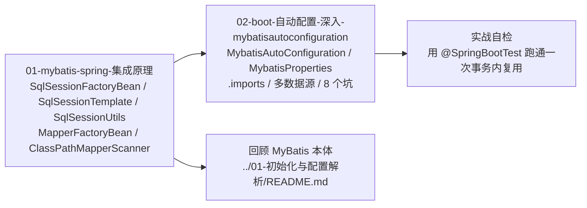
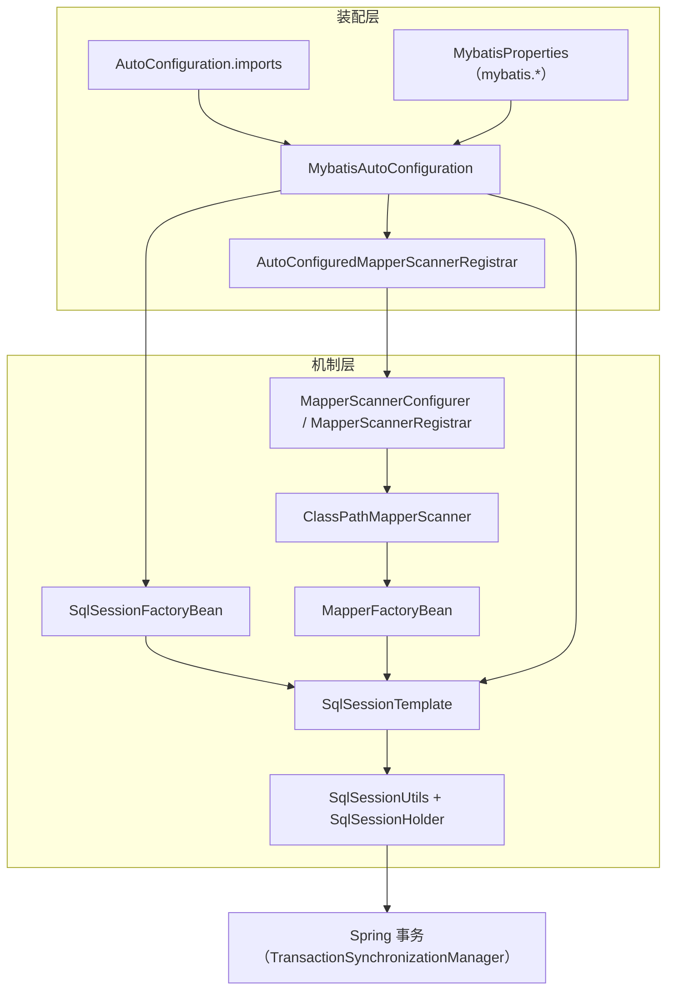

# 05-Spring 集成与 Boot 自动配置

> 一句话结论：MyBatis 自己不管 Spring 容器、不管事务、不管 mapper 扫描；`mybatis-spring` 负责把 `SqlSessionFactory` 交给 Spring、把 `SqlSession` 绑定到 Spring 事务、把 `@Mapper` 接口注册成 Bean；`mybatis-spring-boot-autoconfigure` 则把上面这些"能省的都省掉"，只留 `mybatis.*` 配置项与 `@ConditionalOnMissingBean` 的扩展点。
>
> 阅读前置：读过 [../03-动态SQL与参数映射/README.md](../03-动态SQL与参数映射/README.md) 与 [../04-结果映射与插件/README.md](../04-结果映射与插件/README.md)（知道 `Configuration`、`MappedStatement`、插件都装在哪）；了解 Spring 的 `FactoryBean`、`ImportBeanDefinitionRegistrar`、`TransactionSynchronizationManager`（事务同步器）这三个概念；对 Spring 事务的提交/回滚回调顺序有兴趣可先读 [../../01-Spring框架/03-事务管理/01-transactional-事务拦截器与传播行为.md](../../01-Spring框架/03-事务管理/01-transactional-事务拦截器与传播行为.md)。
>
> 预计阅读：55 分钟 ｜ 源码：mybatis-spring@3.0.5、mybatis-spring-boot-autoconfigure@4.1.0

## 学习目标

学完本目录，你应该能回答：

1. `SqlSessionFactoryBean` 的 `buildSqlSessionFactory` 到底按什么顺序装配 `Configuration`？`configuration` 与 `configLocation` 为什么互斥？
2. 为什么一个 `@Transactional` 方法里多次 mapper 调用复用**同一个 `SqlSession`**？资源绑定在哪、谁负责关闭？
3. `SqlSessionTemplate` 为什么把 `commit`/`rollback`/`close` 都变成 `UnsupportedOperationException`？
4. `@MapperScan` 与 Boot 自动配置的 `AutoConfiguredMapperScannerRegistrar` 谁先谁后？为什么加了 `@MapperScan` 就不自动扫了？
5. `mybatis.*` 属性怎么落到 `Configuration` 上？为什么"显式配了 `configuration` 就覆盖掉 `map-underscore-to-camel-case`"？
6. 多数据源时哪些地方不能靠自动配置，必须手工装配？

## 学习顺序

**读图说明**：先读 01 打底——它是"机制层"，讲清 `SqlSessionFactory` 怎么被 Spring 托管、`SqlSession` 怎么与事务同步、mapper 接口怎么变成 Bean；再读 02 的"装配层"，看 Boot 如何用条件注解把这些机制自动串联；如果对 `Configuration` 的构建细节有疑问，回到另一位作者的 [../01-初始化与配置解析/README.md](../01-初始化与配置解析/README.md) 补齐。

## 每篇摘要

### [01-mybatis-spring-集成原理.md](./01-mybatis-spring-集成原理.md)

- **主线**：`SqlSessionFactoryBean#buildSqlSessionFactory`（三分支装配 `Configuration`）→ `SqlSessionTemplate`（`SqlSessionInterceptor` 代理）→ `SqlSessionUtils#getSqlSession`（`TransactionSynchronizationManager` 资源绑定 + `registerSynchronization`）→ `closeSqlSession`；`@MapperScan` / `MapperScannerConfigurer` → `ClassPathMapperScanner` → `MapperFactoryBean`（`checkDaoConfig` + `getObject` 返回 `MapperProxy`）。
- **讲清**："一个事务一个 `SqlSession`"的完整证据链；`SpringManagedTransaction` 为什么必须由 `DataSourceUtils` 取连接；`SqlSessionTemplate` 为什么禁止手动 `commit`；`MapperFactoryBean` 为什么是 `FactoryBean` 且 `isSingleton=true`；`MapperScannerConfigurer` 为什么是 `BeanDefinitionRegistryPostProcessor`（要在 `@Configuration` 解析之前跑）。
- **坑位**：自建 `SqlSessionFactory` 忘了 `setEnvironment`；`SqlSessionTemplate` 跨线程传递；`@Transactional` 加在 `private`/同类调用上不生效；`ExecutorType.BATCH` 与 `SqlSessionTemplate` 的搭配。

### [02-boot-自动配置-深入-mybatisautoconfiguration.md](./02-boot-自动配置-深入-mybatisautoconfiguration.md)

- **主线**：`META-INF/spring/org.springframework.boot.autoconfigure.AutoConfiguration.imports`（Boot 4 的注册入口）→ `MybatisAutoConfiguration`（`@ConditionalOnClass`/`@ConditionalOnSingleCandidate(DataSource.class)`/`@AutoConfigureAfter`）→ `sqlSessionFactory(DataSource)` 与 `sqlSessionTemplate` 的 `@ConditionalOnMissingBean` 分支 → `applyConfiguration` 的 `configuration`/`configLocation` 互斥 → `AutoConfiguredMapperScannerRegistrar`（只扫 `@Mapper`）与 `@MapperScan` 的优先级 → `MybatisProperties` + `CoreConfiguration.applyTo`（`PropertyMapper` 只覆盖非 null 值）。
- **讲清**：`.imports` 文件位置与 Boot 4 的自动配置注册方式；`mybatis.*` 全量属性表；`AutoConfigurationPackages` 的包来源；`mapper-locations` 为什么用 `PathMatchingResourcePatternResolver` 且会静默失败；多数据源手工装配的正确姿势。
- **坑位**：≥8 条（`mapper-locations` 通配符、`type-aliases-package` 与 `@Alias`、驼峰映射被 `configuration` 覆盖、插件未注册、`databaseId`、`ExecutorType.BATCH` 刷新时机、`SqlSession` 未关闭、`@Transactional` 与 `SqlSessionTemplate` 边界）。

## 依赖关系

**读图说明**：下半部分的自动配置最终都收敛到上半部分的三个手工装配入口（`SqlSessionFactory`、`SqlSessionTemplate`、`MapperScannerConfigurer`）；所以"Boot 里出问题"时，先按上半部分的手工装配逻辑排查，再检查下半部分有没有把某个 Bean 提前注册（`@ConditionalOnMissingBean` 一旦被满足，自动配置就整体让位）。

## 学习检查点

- [ ] 能画出"`@Transactional` 方法里两次 mapper 调用共用一个 `SqlSession`"的时序图，并指出 `bindResource` 与 `SqlSessionSynchronization` 的位置。
- [ ] 能解释 `SqlSessionTemplate` 为什么是线程安全的、为什么 `commit()` 抛 `UnsupportedOperationException`。
- [ ] 能说出 `buildSqlSessionFactory` 装配 `Configuration` 的三个分支与"`configuration` 与 `configLocation` 互斥"在源码中的判断位置。
- [ ] 能用 `@MapperScan(basePackages=..., sqlSessionFactoryRef=...)` 配好双数据源，并说明为什么不自动扫。
- [ ] 能列举"加了 `mybatis.configuration` 后 `map-underscore-to-camel-case` 失效"的原因与修复方法。
- [ ] 能够定位"mapper 找不到"的三类根因（包扫不到、XML `mapper-locations` 不匹配、`@Alias` 与 XML 不一致）。

## 与本目录其它文章的关系

- 上一篇（机制侧）：[../04-结果映射与插件/README.md](../04-结果映射与插件/README.md) —— 插件在 Spring 下"注册不上"的坑在这里有专门一节。
- 下一篇/外层：[../README.md](../README.md) —— 03-MyBatis 总目录，含整体学习路线。
- 跨章节：[../../01-Spring框架/03-事务管理/01-transactional-事务拦截器与传播行为.md](../../01-Spring框架/03-事务管理/01-transactional-事务拦截器与传播行为.md) —— `TransactionSynchronizationManager` 与事务同步回调。
