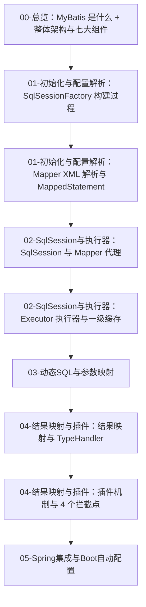

# 03 MyBatis（初始化 / SqlSession / 动态 SQL / 结果映射 / Spring 集成）

> 目标：读完你能画出"MyBatis 一次 `selectList` 到底走了哪 6 层"，并且知道插件在哪些点能拦截。
> 版本基线：`mybatis@3.6.0`、`mybatis-spring@3.0.5`、`mybatis-spring-boot-starter@4.1.0`（面向 Boot 4）

## 学习目标

- 知道 `Configuration`（MyBatis 的全局配置：`MappedStatement` 注册表、类型处理器、插件链都在这里）是"框架的内存数据库结构"。
- 能逐层讲 `SqlSession` → `Executor` → `StatementHandler` → `ParameterHandler` / `ResultSetHandler` 的职责边界。
- 能写一个插件并说清它能拦截哪 4 个点、为什么不能拦截 `ResultSet` 的行级操作。
- 能解释 `#{}` 与 `${}` 在源码层面的差别（`BoundSql` 与预编译参数）。

## 文章顺序

> 读图说明：`SQL 解析（第二步、第三步）`把 XML/注解编译成 `MappedStatement` 并注册进 `Configuration`，之后每次查询只是"按 id 查表 → 动态 SQL 求值 → 执行"；`Executor` 一层负责缓存与策略，`StatementHandler` / `ParameterHandler` / `ResultSetHandler` 才是真正接触 JDBC 的地方；插件机制（第八步）要拦截前面所有接口，所以放在最后讲。

### 已完成的文章（可直接阅读）

| 分组 | 文章 |
| --- | --- |
| 00-总览 | [总览](./00-总览/README.md)、[MyBatis 整体架构与四大对象 / 七大组件](./00-总览/01-mybatis-整体架构与四大对象.md) |
| 01-初始化与配置解析 | [本组导读](./01-初始化与配置解析/README.md)、[SqlSessionFactory 构建过程](./01-初始化与配置解析/01-sqlsessionfactory-构建过程.md)、[Mapper XML 解析与 MappedStatement](./01-初始化与配置解析/02-mapperxml-解析与-mappedstatement.md) |
| 02-SqlSession与执行器 | [本组导读](./02-SqlSession与执行器/README.md)、[SqlSession 与 Mapper 代理](./02-SqlSession与执行器/01-sqlsession-与-mapper-代理.md)、[Executor 执行器与一级缓存](./02-SqlSession与执行器/02-executor-执行器与一级缓存.md) |

## 子目录

| 目录 | 内容 | 学完能做到 |
| --- | --- | --- |
| `00-总览` | 组件清单、与 JDBC 的对照 | 建立整体心智模型 |
| `01-初始化与配置解析` | `SqlSessionFactoryBuilder`、`XMLConfigBuilder`、`XMLMapperBuilder` | 解释 mapper 是怎么被注册的 |
| `02-SqlSession与执行器` | `DefaultSqlSession`、`BaseExecutor`、`SimpleExecutor`、一级/二级缓存 | 讲清缓存何时失效 |
| `03-动态SQL与参数映射` | `DynamicSqlSource`、`OGNL`、`ParameterMapping` | 解释 `<foreach>`/`#{}` 的底层 |
| `04-结果映射与插件` | `ResultMap`、`TypeHandler`、`InterceptorChain` | 写出可用的分页/脱敏插件 |
| `05-Spring集成与Boot自动配置` | `SqlSessionFactoryBean`、`SqlSessionTemplate`、`MybatisAutoConfiguration` | 解释 Mapper 接口为什么能直接注入 |

## 依赖关系

- 前置：`01-Spring框架/01-IoC`（`FactoryBean`、`BeanPostProcessor`、`ImportBeanDefinitionRegistrar`）。
- 后续：`04-SpringCloud` 的分布式事务（MyBatis 的 `DataSource` 挂进 XA/AT 事务）。

## 学习检查点

- [ ] 能默写 MyBatis 一次查询的 6 层调用链。
- [ ] 能解释 `SqlSessionTemplate` 如何保证线程安全（`SqlSessionInterceptor` + `TransactionSynchronizationManager`）。
- [ ] 能说出 `#{}` 与 `${}` 在 `SqlSource` 层面的不同实现类。
- [ ] 能写一个 `Interceptor` 拦截 `Executor#query` 并说明参数传递方式。
