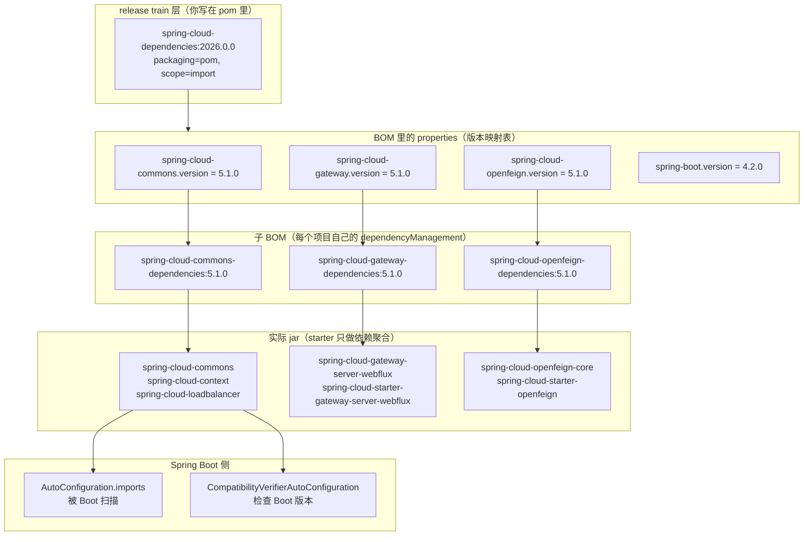
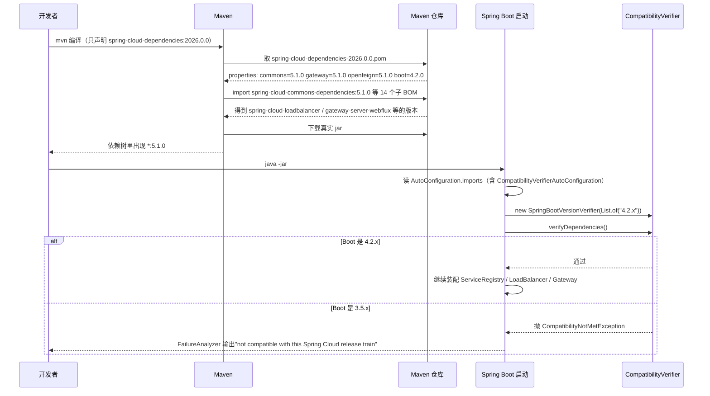

# Spring Cloud 体系与版本矩阵：release train、BOM、六大件

> 一句话结论：Spring Cloud 的版本号有两套——**release train（`2026.0.0` 这种日期版本）** 给"整套"用，**子项目版本（`5.1.0` 这种数字版本）** 给"单个模块"用；BOM 就是那张把两套编号钉死在一起的映射表，`CompatibilityVerifier` 会在启动时替你检查 Boot 大版本对不对。
> 阅读前置：`02-SpringBoot/02-自动配置/`（`AutoConfiguration.imports` 怎么被加载）
> 预计阅读：35 分钟 ｜ 源码：`org.springframework.cloud:spring-cloud-commons:5.1.0`、`org.springframework.cloud:spring-cloud-dependencies:2026.0.0`（BOM）

---

## 0. 先看现象

一个刚接触 Spring Cloud 的同学，`pom.xml` 通常长这样（从教程抄的）：

```xml
<properties>
    <spring-cloud.version>2021.0.5</spring-cloud.version>
</properties>
<dependencyManagement>
    <dependencies>
        <dependency>
            <groupId>org.springframework.cloud</groupId>
            <artifactId>spring-cloud-dependencies</artifactId>
            <version>${spring-cloud.version}</version>
            <type>pom</type>
            <scope>import</scope>
        </dependency>
    </dependencies>
</dependencyManagement>
```

然后换成 Boot 4.2.0 + `2026.0.0`，IDE 的依赖树里突然出现：

```text
org.springframework.cloud:spring-cloud-commons:5.1.0
org.springframework.cloud:spring-cloud-gateway-server-webflux:5.1.0
org.springframework.cloud:spring-cloud-openfeign-core:5.1.0
```

三个疑问立刻冒出来：

1. **我明明只写了 `2026.0.0`，`5.1.0` 是哪来的？**
2. 教程里写 `spring-cloud-starter-gateway`，我这里为什么报"找不到 artifact"？
3. 如果我把 `spring-cloud-commons` 手动升到 `5.1.1` 会怎样？

第四个现象更隐蔽——如果你 Boot 用了 3.5.x 而 Cloud 用了 `2026.0.0`，启动会直接失败：

```text
***************************
APPLICATION FAILED TO START
***************************

Description:

Your project setup is incompatible with our requirements due to following reasons:

- Spring Boot [3.5.4] is not compatible with this Spring Cloud release train
```

这条报错就来自本篇要读的 `CompatibilityVerifier`。**把版本关系搞清楚，一半的"环境问题"就自动消失了。**

## 1. 整体地图



> 读图说明：
> - **上半部分是"名字"，下半部分是"jar"**。你只声明最上面那个桩（`spring-cloud-dependencies`，`packaging=pom`），Maven 用它的 `<properties>` 决定中间那层子 BOM 的版本，子 BOM 再决定最底层 jar 的版本。**所以 `5.1.0` 一直是"被别人填进去"的，不是你写的。**
> - `spring-boot.version = 4.2.0` 也在 BOM 的 `<properties>` 里——这就是"Cloud 版本决定了它能配哪个 Boot"的物理来源（虽然 Boot 的依赖管理仍需你自己 import `spring-boot-dependencies`）。
> - 底层的 starter（`spring-cloud-starter-*`）在这张图上没有独立地位：它只是"一串 jar 的聚合 pom"，本身几乎没有代码。**遇到 starter 找不到，一定是坐标名或版本没被管理**，而不是"jar 不存在"。
> - 图中 `CompatibilityVerifier` 与业务无关，它只在启动最开始跑一次：Boot 大版本不匹配就抛异常终止。

## 2. 关键类逐个拆

| 类 / 文件 | 职责 | 关键点 |
| --- | --- | --- |
| `spring-cloud-dependencies-2026.0.0.pom` | release train BOM | `packaging=pom`；`<properties>` 里给出全部子项目版本；`<dependencyManagement>` 里 `import` 14 个子 BOM |
| `spring-cloud-commons-dependencies:5.1.0`（子 BOM） | commons 项目的"清单" | 里面才有 `spring-cloud-commons`、`spring-cloud-context`、`spring-cloud-loadbalancer`、`spring-cloud-starter-loadbalancer` 等真实 artifact |
| `spring-cloud-gateway-dependencies:5.1.0` | gateway 项目清单 | 5.x 起拆成 `spring-cloud-gateway-server-webflux` / `-webmvc` / `proxyexchange-*`，老坐标 `spring-cloud-starter-gateway` **不再由它管理** |
| `AutoConfiguration.imports`（commons） | 自动配置清单 | 17 行，含 `CompatibilityVerifierAutoConfiguration`、`ServiceRegistryAutoConfiguration` 等 |
| `spring.factories`（commons） | 非自动配置的扩展点 | 只剩 `EnvironmentPostProcessor`（`HostInfoEnvironmentPostProcessor`）与 `FailureAnalyzer` |
| `CompatibilityVerifierAutoConfiguration` | 启动期版本闸门 | `@AutoConfigureOrder(0)` + `@ConditionalOnProperty(matchIfMissing = true)` |
| `CompatibilityVerifierProperties` | 闸门配置 | `compatibleBootVersions` 默认 `4.2.x`，`enabled` 默认 false（但注解 `matchIfMissing=true` 表示"没配也生效"） |

## 3. 源码逐段精读

### 3.1 BOM 的骨架：`packaging=pom` + `<parent>`

```java (src: spring-cloud-dependencies-2026.0.0.pom#L5-L17)
  <parent>
    <groupId>org.springframework.cloud</groupId>
    <artifactId>spring-cloud-dependencies-parent</artifactId>
    <version>5.1.0</version>
    <relativePath></relativePath>
  </parent>
  <groupId>org.springframework.cloud</groupId>
  <artifactId>spring-cloud-dependencies</artifactId>
  <version>2026.0.0</version>
  <packaging>pom</packaging>
  <name>spring-cloud-dependencies</name>
  <description>Spring Cloud Dependencies</description>
  <url>https://spring.io/projects/spring-cloud</url>
```

- **在干什么**：声明"我是一个 `pom` 打包的构件，版本 `2026.0.0`，父亲是 `spring-cloud-dependencies-parent:5.1.0`"。
- **为什么这么写**：`<parent>` 的版本 `5.1.0` **恰好等于所有子项目的版本**。这不是巧合——`spring-cloud-dependencies-parent` 就是"这一代构建的根 pom"，它统一了 `spring-cloud-build`、编译插件、编码等。所以"train 版本"和"子项目版本"的关系是：**train 版本是发布日期快照，parent 版本是代码基线代号**。
- **如果改成 `2022.0.0`**：`<parent>` 会变成 `4.0.0`，`<properties>` 里的 `spring-cloud-gateway.version` 变成 `4.0.0`——同一份结构，只是数字全换一档。这也说明：**看 BOM 的 `<properties>` 就能反推版本矩阵，不需要猜**。
- **常见坑**：很多人以为 `spring-cloud-starter-parent` 和 `spring-cloud-dependencies` 是同一件事。它们不是：前者给"直接继承"，后者给"import 只借依赖管理"。**Boot 4 项目里推荐 `spring-boot-starter-parent` + import `spring-cloud-dependencies`**，因为继承只能有一个 parent。

### 3.2 release train 里的版本映射表（全在这十几行）

```java (src: spring-cloud-dependencies-2026.0.0.pom#L87-L104)
  <properties>
    <spring-cloud-circuitbreaker.version>5.1.0</spring-cloud-circuitbreaker.version>
    <spring-cloud-consul.version>5.1.0</spring-cloud-consul.version>
    <spring-cloud-stream.version>5.1.0</spring-cloud-stream.version>
    <spring-cloud-openfeign.version>5.1.0</spring-cloud-openfeign.version>
    <spring-boot.version>4.2.0</spring-boot.version>
    <spring-cloud-config.version>5.1.0</spring-cloud-config.version>
    <spring-cloud-gateway.version>5.1.0</spring-cloud-gateway.version>
    <spring-cloud-task.version>5.1.0</spring-cloud-task.version>
    <spring-cloud-vault.version>5.1.0</spring-cloud-vault.version>
    <main.basedir>${basedir}/../..</main.basedir>
    <spring-cloud-netflix.version>5.1.0</spring-cloud-netflix.version>
    <spring-cloud-function.version>5.1.0</spring-cloud-function.version>
    <spring-cloud-build.version>5.1.0</spring-cloud-build.version>
    <spring-cloud-commons.version>5.1.0</spring-cloud-commons.version>
    <spring-cloud-kubernetes.version>5.1.0</spring-cloud-kubernetes.version>
    <spring-cloud-zookeeper.version>5.1.0</spring-cloud-zookeeper.version>
  </properties>
```
```

- **在干什么**：这就是"版本矩阵"本身。注意两件事：**① 绝大多数子项目都是 `5.1.0`，但 `circuitbreaker` 也是 `5.1.0`（早期 train 里它是独立走 `3.x` 的）；② `<spring-boot.version>4.2.0</spring-boot.version>` 就写在这里**——这是"Cloud `2026.0.0` 对应 Boot `4.2.0`"的**机器可读证据**，不是文档口径。
- **为什么这么写**：train 的意义就是"这些版本一起测过"。让一个 `pom` 的 `<properties>` 成为唯一事实来源（single source of truth），构建脚本、文档、验证器都读它。**这也解释了为什么你不该自己指定 `spring-cloud-commons` 版本**：一旦你覆盖，等于宣称"我比 train 更懂兼容性"，而 `CompatibilityVerifier` 只检查 Boot，**不检查你私自换掉的 commons**——出问题没人拦你。
- **如果改成注释掉 `spring-boot.version`**：BOM 仍然能用（它不负责管理 Boot 依赖），但你就丢掉了"这个 train 预期配哪个 Boot"的唯一凭证，只能看官方 release notes。
- **常见坑**：`spring-cloud-circuitbreaker` 从 `3.x` 跳到 `5.1.0`，`spring-cloud-kubernetes` 从 `3.x` 跳到 `5.1.0`——说明 **子项目版本号不是"同步递增"的，有的项目会跳过数字**。所以不要用"commons 版本 + 固定偏移"推算别的项目版本，必须查 BOM。

### 3.3 子 BOM 的 import：真正的 jar 名录在下一层

```java (src: spring-cloud-dependencies-2026.0.0.pom#L105-L113)
  <dependencyManagement>
    <dependencies>
      <dependency>
        <groupId>org.springframework.cloud</groupId>
        <artifactId>spring-cloud-commons-dependencies</artifactId>
        <version>${spring-cloud-commons.version}</version>
        <type>pom</type>
        <scope>import</scope>
      </dependency>
```

- **在干什么**：把 `spring-cloud-commons-dependencies:5.1.0` 这个**子 BOM** 整个导入。真正出现 `spring-cloud-loadbalancer:5.1.0`、`spring-cloud-starter-loadbalancer:5.1.0` 这些 artifact 的地方是子 BOM，而不是这一层。
- **为什么这么写**：分层解耦——`spring-cloud-release` 仓库只负责"哪一版对哪一版"，各子项目自己在自己仓库里维护"我有哪些 artifact"。否则每加一个模块都要改 release 仓库。
- **如果改成直接写 `<artifactId>spring-cloud-commons</artifactId><version>5.1.0</version>`**：你只能管理到"commons 这一个 jar"，`spring-cloud-context`、`spring-cloud-loadbalancer` 就失去版本管理，Maven 会报 `'dependencies.dependency.version' is missing`。
- **常见坑**：`spring-cloud-gateway-dependencies:5.1.0` 里 **没有** `spring-cloud-starter-gateway`，只有 `spring-cloud-starter-gateway-server-webflux` 和 `spring-cloud-starter-gateway-server-webmvc`。抄老教程写 `spring-cloud-starter-gateway` 且**不写版本**时，Maven 会报"没有 version"（因为你没被管理）；写了老版本号又会拉进 4.x 的 jar 与 5.x 的 API 打架。

### 3.4 历史 release train 的同一位置长什么样

```java (src: spring-cloud-dependencies-2022.0.0.pom#L5-L13)
  <parent>
    <groupId>org.springframework.cloud</groupId>
    <artifactId>spring-cloud-dependencies-parent</artifactId>
    <version>4.0.0</version>
    <relativePath></relativePath>
  </parent>
  <groupId>org.springframework.cloud</groupId>
  <artifactId>spring-cloud-dependencies</artifactId>
  <version>2022.0.0</version>
```

```java (src: spring-cloud-dependencies-2024.0.0.pom#L5-L13)
  <parent>
    <groupId>org.springframework.cloud</groupId>
    <artifactId>spring-cloud-dependencies-parent</artifactId>
    <version>4.2.0</version>
    <relativePath></relativePath>
  </parent>
  <groupId>org.springframework.cloud</groupId>
  <artifactId>spring-cloud-dependencies</artifactId>
  <version>2024.0.0</version>
```

- **在干什么**：同样是"train 版本 + parent 版本"两个数字：`2022.0.0 ↔ 4.0.0`、`2024.0.0 ↔ 4.2.0`、`2026.0.0 ↔ 5.1.0`。
- **为什么这么写**：演进规律非常稳定——**train 的年份数字每变一次，子项目大版本 +1**；patch 位对应子项目的 minor（`2022.0.0`→`4.0.0`，`2023.0.0`→`4.1.0`，`2024.0.0`→`4.2.0`，`2026.0.0`→`5.1.0`）。为什么 `2025.x` 对应 `5.0.x` 而不是 `5.1.0`？因为 `2025.1.x` 的 BOM 里写的是 `spring-cloud-commons.version = 5.0.x`（本仓库实际引用的 `5.1.0` 属于 `2026.0.0`）。
- **如果改成拿 `2024.0.0` 的 BOM 配 Boot 4.2**：能编译过，但 `CompatibilityVerifier` 会拒绝启动（`2024.0.0` 那代认的 Boot 是 3.x）。
- **常见坑**：**"Spring Cloud 5.x" 有两种说法**——一说"子项目 5.x"，一说"release train 2025/2026"。看到 `5.1.0` 请先确认它是**子项目版本**，去 BOM 里查它属于哪个 train（本仓库：`2026.0.0`）。

### 3.5 启动期的版本闸门：`CompatibilityVerifierAutoConfiguration`

```java (src: CompatibilityVerifierAutoConfiguration.java#L35-L53)
@Configuration(proxyBeanMethods = false)
@ConditionalOnProperty(value = "spring.cloud.compatibility-verifier.enabled", matchIfMissing = true)
@AutoConfigureOrder(0)
@EnableConfigurationProperties(CompatibilityVerifierProperties.class)
public class CompatibilityVerifierAutoConfiguration {

	@Bean
	CompositeCompatibilityVerifier compositeCompatibilityVerifier(List<CompatibilityVerifier> verifiers) {
		CompositeCompatibilityVerifier verifier = new CompositeCompatibilityVerifier(verifiers);
		verifier.verifyDependencies();
		return verifier;
	}

	@Bean
	SpringBootVersionVerifier springBootVersionVerifier(CompatibilityVerifierProperties properties) {
		return new SpringBootVersionVerifier(properties.getCompatibleBootVersions());
	}

}
```

- **在干什么**：注册一个 `CompositeCompatibilityVerifier` Bean，**在 `@Bean` 方法体内就调用 `verifyDependencies()`**——不匹配时抛异常，导致容器启动失败。`@AutoConfigureOrder(0)` 让它在绝大多数自动配置之前执行。
- **为什么这么写**：版本不兼容造成的报错（`NoSuchMethodError`、`ClassNotFoundException`）极难定位。**宁可在启动第 1 秒就死**，也不要跑半天在业务里炸。把校验放在 `@Bean` 方法体里（而不是 `@PostConstruct`）能保证它在"Bean 创建阶段"立刻生效。
- **如果改成 `@ConditionalOnProperty(...)` 不带 `matchIfMissing = true`**：默认就关掉了，等于删掉这道闸门——这类"为了省事关掉校验"的改法是生产事故常见源头。
- **常见坑**：`CompatibilityVerifierProperties.enabled` 字段**并不是**控制这道闸门的开关（它由 `SpringBootVersionVerifier` 内部读取），真正开关是 `spring.cloud.compatibility-verifier.enabled`。想临时绕过（**不推荐**）才去设 `false`。

### 3.6 闸门的判定依据：`compatibleBootVersions` 默认值

```java (src: CompatibilityVerifierProperties.java#L27-L44)
@ConfigurationProperties("spring.cloud.compatibility-verifier")
public class CompatibilityVerifierProperties {

	/**
	 * Enables creation of Spring Cloud compatibility verification.
	 */
	private boolean enabled;

	/**
	 * Default accepted versions for the Spring Boot dependency. You can set {@code x} for
	 * the patch version if you don't want to specify a concrete value. Example:
	 * {@code 3.5.x}
	 */
	private List<String> compatibleBootVersions = List.of("4.2.x");

	public boolean isEnabled() {
		return this.enabled;
	}
```

- **在干什么**：`spring-cloud-commons:5.1.0` 这个 jar 里硬编码了"我只接受 Boot `4.2.x`"。
- **为什么这么写**：把"哪个 Boot 大版本"写在代码里，随 jar 一起发布，**不依赖文档**。你在 Boot 3.5 上用 `spring-cloud-commons:5.1.0`，启动立刻失败——这是特性，不是 bug。
- **如果改成 `List.of("3.5.x")`**：闸门会放行 Boot 3.5，但 `5.1.0` 编译时用的是 Spring Framework 7 + Jakarta 新 API，运行时照样炸在别处。**改这里只是把清晰报错换成模糊报错。**
- **常见坑**：这段是**源码 + javadoc 双证据**，可以直接当作"Cloud `5.1.0` 对应 Boot `4.2.x`"的权威依据写进方案文档；反过来说，任何声称"`5.1.0` 能跑 Boot 3.x"的资料都可以用两行代码否掉。

### 3.7 自动配置清单：Cloud 能力是怎么"自动"出现的

```java (src: sc-commons-autoconfig.imports#L1-L17)
org.springframework.cloud.client.CommonsClientAutoConfiguration
org.springframework.cloud.client.ReactiveCommonsClientAutoConfiguration
org.springframework.cloud.client.discovery.composite.CompositeDiscoveryClientAutoConfiguration
org.springframework.cloud.client.discovery.composite.reactive.ReactiveCompositeDiscoveryClientAutoConfiguration
org.springframework.cloud.client.discovery.simple.SimpleDiscoveryClientAutoConfiguration
org.springframework.cloud.client.discovery.simple.reactive.SimpleReactiveDiscoveryClientAutoConfiguration
org.springframework.cloud.client.hypermedia.CloudHypermediaAutoConfiguration
org.springframework.cloud.client.loadbalancer.LoadBalancerAutoConfiguration
org.springframework.cloud.client.loadbalancer.LoadBalancerDefaultMappingsProviderAutoConfiguration
org.springframework.cloud.client.loadbalancer.reactive.LoadBalancerBeanPostProcessorAutoConfiguration
org.springframework.cloud.client.loadbalancer.reactive.ReactorLoadBalancerClientAutoConfiguration
org.springframework.cloud.client.serviceregistry.ServiceRegistryAutoConfiguration
org.springframework.cloud.commons.util.UtilAutoConfiguration
org.springframework.cloud.configuration.CompatibilityVerifierAutoConfiguration
org.springframework.cloud.client.serviceregistry.AutoServiceRegistrationAutoConfiguration
org.springframework.cloud.commons.security.ResourceServerTokenRelayAutoConfiguration
org.springframework.cloud.commons.config.CommonsConfigAutoConfiguration
```

- **在干什么**：`spring-cloud-commons:5.1.0` 的 `META-INF/spring/org.springframework.boot.autoconfigure.AutoConfiguration.imports` 全文。**这 17 行就是"Cloud 抽象层"的全部入口**：注册（`AutoServiceRegistrationAutoConfiguration`）、发现（`CompositeDiscoveryClientAutoConfiguration`）、负载均衡（`LoadBalancerAutoConfiguration` 系列）、版本闸门（`CompatibilityVerifierAutoConfiguration`）。
- **为什么这么写**：Boot 3 起 `spring.factories` 里的 `EnableAutoConfiguration` 键被迁移到 `AutoConfiguration.imports`（Boot 4 沿用）。Cloud 5.x 已经完全迁移——注意 **`ServiceRegistryAutoConfiguration` 与 `AutoServiceRegistrationAutoConfiguration` 是分开的两行**，前者管"注册表抽象"，后者管"自动注册动作"，`02-注册中心Nacos` 会分别展开。
- **如果改成删掉第 14 行 `CompatibilityVerifierAutoConfiguration`**：版本闸门消失——这正是你自己写 `spring.factories` 覆盖时的真实风险。
- **常见坑**：想让某个 Cloud 能力"不生效"，正确做法是 `@ConditionalOnXxx` 对应的属性（如 `spring.cloud.service-registry.auto-registration.enabled=false`），而不是去排除自动配置类；**排除 `ServiceRegistryAutoConfiguration` 往往连带把注册能力一起关掉**。

### 3.8 `spring.factories` 里还剩下什么

```java (src: sc-commons-spring.factories#L1-L6)
# Environment Post Processors
org.springframework.boot.EnvironmentPostProcessor=\
org.springframework.cloud.client.HostInfoEnvironmentPostProcessor
# Failure Analyzers
org.springframework.boot.diagnostics.FailureAnalyzer=\
org.springframework.cloud.configuration.CompatibilityNotMetFailureAnalyzer
```

- **在干什么**：`spring-cloud-commons:5.1.0` 的 `META-INF/spring.factories` **全文只剩 6 行**：一个 `EnvironmentPostProcessor`（把"本机名/IP"注入 `Environment`，`spring.cloud.client.hostname` 一类属性由此而来）和一个 `FailureAnalyzer`。
- **为什么这么写**：`FailureAnalyzer` 就是第 0 节那条"Your project setup is incompatible with our requirements"漂亮报错的产出者——**闸门抛异常，FailureAnalyzer 负责翻译成人类可读格式**。这两者配合是 "校验 + 报错友好" 的标准套路。
- **如果改成把所有自动配置写回 `spring.factories`**：Boot 4 下不会生效（`EnableAutoConfiguration` 键已不被使用），你会得到"jar 在 classpath 上但什么都自动装配不上"的诡异现象。
- **常见坑**：`HostInfoEnvironmentPostProcessor` 决定了 `spring.cloud.client.ip-address` 的值——**注册到 Nacos 的 IP 就是它给的**（`InetUtils` 选网卡的结果）。多网卡机器注册了错误 IP，问题源头在这里，不在 Nacos。

## 4. 一次完整执行时序

以"新建项目 → Maven 解析 → 启动"为主线：



> 读图说明：
> - 上半段（Maven）与下半段（启动）**只通过 pom 里的两个 `<properties>` 关联**：`spring-cloud-*.version` 决定 jar 版本，`spring-boot.version` 决定闸门预期。
> - 注意 `verifyDependencies()` 发生在**任何 Cloud 业务 Bean 之前**，所以"版本不对"永远是第一个报错，不会被 `Nacos`/`Gateway` 花式异常掩盖。
> - 图里"下载真实 jar"这一步，**starter 与非 starter 没有区别**——starter 只是依赖聚合，它的 pom 里 `<dependencies>` 指向真实模块。
> - 出问题时看这张图的两个位置：**Maven 阶段看依赖树**（`mvn dependency:tree -Dincludes=org.springframework.cloud`），**启动阶段看第一条 APPLICATION FAILED TO START**。

## 5. 设计模式与取舍

| 设计模式 | 在哪儿体现 | 收益 | 代价 |
| --- | --- | --- | --- |
| BOM（Bill of Materials） | `spring-cloud-dependencies` + 14 个子 BOM | 一处声明全局版本，杜绝"你升 A 我升 B" | 想用 train 之外的单模块版本就必须显式覆盖，覆盖后无校验 |
| 分层 import | train → 子 BOM → jar 三级 | release 仓库与子项目仓库解耦 | 排查版本要跳三四层 pom，IDE 依赖树里看不出"谁给的版本" |
| 失败快（Fail-Fast） | `CompatibilityVerifierAutoConfiguration` 在 `@Bean` 体里抛 | 把"运行时 `NoSuchMethodError`"提前成"启动失败" | 想跑非官方组合（如自编译 Cloud）必须手动关闸门 |
| 自动配置清单化 | `AutoConfiguration.imports` 17 行 | 单文件读完全部入口，便于审计 | 排错时要靠 `--debug` 或 `ConditionEvaluationReport` |
| 契约接口 + 多实现 | `DiscoveryClient` / `ServiceRegistry` / `ReactorLoadBalancer` | Nacos/Eureka/Consul 可互换，是"六大件"能替换的基础 | 抽象层多一层，出问题要判断"是抽象层还是实现层" |

**取舍**：Spring Cloud 选了"**版本由 BOM 强制统一 + 启动期硬校验**"这条路。好处极其明显——本仓库能放心写 `5.1.0` 并声称"配套 Boot 4.2.0"；坏处是**升级被锁成整体升级**：想单独把 Gateway 升到修了 bug 的 patch 版本，你必须确认它在当前 train 的 `<properties>` 里是哪个数，否则就是"逃逸出矩阵"。

对立方案是 **Spring Boot 的 `spring-boot-dependencies`**（同样 BOM，但覆盖面是 Boot 自身）与 **K8s 的原生方案**（不要客户端负载均衡，用 `Service` + kube-proxy 做，见 5.1 节对比）。前者与本方案叠加使用，后者直接**取消掉**了"服务发现 + 客户端负载均衡"这两件，是另一条路。

### 5.1 六大件职责边界与常见替代

| # | 能力 | 本仓库用谁 | 抽象层（Spring Cloud 侧） | 主要替代 | 边界（最容易混淆的点） |
| --- | --- | --- | --- | --- | --- |
| 1 | 服务发现 | Nacos 3.3.0 | `DiscoveryClient`、`ServiceRegistry`、`AutoServiceRegistration` | Consul、Eureka、Zookeeper、K8s Service/DNS | **只回答"有哪些实例"**；不负责选谁、也不负责发请求 |
| 2 | 客户端负载均衡 | `spring-cloud-loadbalancer:5.1.0` | `ReactorLoadBalancer`、`ServiceInstanceListSupplier` | Ribbon（已退役）、`spring-cloud-starter-loadbalancer` 的 K8s 版本、Nginx/Envoy 服务端 LB | **只回答"选哪一台"**；不建连接、不重试业务异常 |
| 3 | 声明式 HTTP | OpenFeign（`spring-cloud-openfeign-core:5.1.0`，Feign 本体 13.17） | `FeignClientFactoryBean`、`Contract` | `RestClient` + `@HttpExchange`、`WebClient`、gRPC、Dubbo | **只管"把方法调用翻译成 HTTP"**；LB 由 #2 提供，容错由 #6 提供 |
| 4 | 网关 | `spring-cloud-gateway-server-webflux:5.1.0` | `RouteLocator`、`GlobalFilter`、`GatewayFilter` | Nginx/OpenResty、Envoy/Istio、APISIX、`spring-cloud-gateway-server-webmvc` | **管南北向入口**：路由、鉴权、限流、改包；不做业务 |
| 5 | 配置中心 | Nacos Config / Spring Cloud Config | `ConfigService`、`@RefreshScope`、`EnvironmentRepository` | Apollo、Consul KV、K8s ConfigMap、Vault | **管"配置从哪来、怎么刷"**；不负责灰度发布策略本身 |
| 6 | 熔断限流 | Sentinel 1.8.10 / Resilience4j | `CircuitBreakerFactory`、`@SentinelResource` | Resilience4j、Sentinel、Hystrix（退役） | **管"失败时怎么办"**：熔断、降级、限流、隔离；不负责路由 |

**读表要点（面试常考的三个边界）**：

- **服务发现 ≠ 负载均衡**。注册中心里 3 台实例，不代表流量会均分——均分是 #2 的事。反过来，把 Nacos 关掉后 `RestTemplate` 直连 IP 仍然能跑（只是没有 #1）。
- **网关不是注册中心的替代品**。网关是入口，注册中心是通讯录；网关自己也要从注册中心拿实例（`lb://` 路由）。
- **熔断不是重试的替代品**。重试是"再试一次"，熔断是"别再试了"；完整链条是 `Retry(Feign) → 熔断(Sentinel/Resilience4j) → 降级(fallback)`。

**替代方案怎么选**（一句话版）：

- 全 K8s 环境、不需要精细灰度：**K8s Service 取代 #1+#2**，Cloud 里用 `spring-cloud-kubernetes` 的 discovery，Spring Cloud Gateway 退化成一个 `http://service-name` 反代。
- 已有 Nacos 且用阿里技术栈：**#1+#5 都用 Nacos**（一套运维、一个控制台），这也是本仓库的形态。
- 只有 Java 单体拆服务、不想要 sidecar：**#6 用 Resilience4j**（纯库、无 agent），需要控制台/集群流控再上 Sentinel。

## 6. 踩坑与调试手法

1. **版本对不上，先看三个数字**：`spring-boot` 版本、train 版本、`spring-cloud-commons` 实际版本。后两个用 `mvn dependency:tree -Dincludes=org.springframework.cloud` 一次看清，别靠 pom 猜。
2. **`spring-cloud-starter-gateway` 报找不到 managed version**：5.x 已拆分，改 `spring-cloud-starter-gateway-server-webflux`（本项目是 WebFlux 栈）或 `-webmvc`。
3. **`APPLICATION FAILED TO START ... not compatible with this Spring Cloud release train`**：不要关闸门，先核对 Boot 大版本；Spring Cloud `5.1.0` 只接受 Boot `4.2.x`。
4. **手动覆盖了某个子项目版本后行为诡异**：`mvn dependency:tree` 找 `omitted for conflict`，确认是不是你的 `<dependencyManagement>` 覆盖了 train 的值；`mvn help:effective-pom` 能看最终"谁赢"。
5. **`spring.factories` 里加的自动配置不生效**：Boot 3+ 必须写 `AutoConfiguration.imports`。可用 `java -jar app.jar --debug` 拿 `ConditionEvaluationReport`。
6. **注册到 Nacos 的 IP 是 `127.0.0.1` 或某块内网错网卡**：查 `HostInfoEnvironmentPostProcessor` / `spring.cloud.inetutils.preferred-networks`，别改 Nacos 配置。
7. **想临时绕过版本闸门**：`spring.cloud.compatibility-verifier.enabled=false` 只在"确认能跑"的自研构建里用，且在 PR 里写明原因。
8. **本地能跑、流水线上不能跑**：多半是流水线用了另一个 parent 或私有仓库镜像了不同版本的 BOM，用 `mvn versions:display-dependency-updates` 对照。

## 7. ⚠️ 版本差异

| 版本 | release train | 关键变化 |
| --- | --- | --- |
| Spring Cloud `4.0.x` | `2022.0.x` | 首批要求 **Boot 3.0 + Jakarta**；`spring.factories` 自动配置迁到 `AutoConfiguration.imports`；**Ribbon 彻底移除**，客户端 LB 统一到 `spring-cloud-loadbalancer`；`spring-cloud-starter-gateway` 仍是唯一网关 starter |
| Spring Cloud `4.1.x` | `2023.0.x` | 要求 Boot 3.2；Gateway 增加 `spring-cloud-gateway-server-webmvc`（**Servlet 栈网关**）；`spring-cloud-commons` 引入 `RestClient` 相关支持起步 |
| Spring Cloud `4.2.x` | `2024.0.x` | 要求 Boot 3.4/3.5；`RestClient` + `@HttpExchange` + `@LoadBalanced` 组合成熟；OpenFeign 4.2.x |
| Spring Cloud `5.0.x` | `2025.1.x` | 要求 **Boot 4.0**（BOM 里 `<spring-boot.version>4.0.x</spring-boot.version>`）；**`spring-cloud-bus-dependencies` 从 train 中消失**（本仓库不做 Bus 组件的源码精读即与此有关） |
| Spring Cloud `5.1.x`（**本仓库基线**） | `2026.0.0` | 要求 **Boot 4.2.0**；Gateway 拆成 `spring-cloud-gateway-server-webflux` / `-server-webmvc` / `proxyexchange-webflux` / `proxyexchange-webmvc`；`CompatibilityVerifierProperties.compatibleBootVersions` 默认 `4.2.x`；大部分子项目齐步 `5.1.0` |

> ⚠️ 不确定项（诚实声明）：`2026.0.0` 是**日期式 release train**，与 `2025.1.x` 的命名规律（"年份.第几个 minor"）不一致，其 GA 时间与官方公告口径请**以官方 release notes 为准**。上表所有版本数字均取自 Maven Central 上各族 `spring-cloud-dependencies-*.pom` 的 `<properties>`，属于**机器可验证事实**；但"某 train 支持哪个 Boot 最小/最大 patch"仍需查官方 wiki 的 release train 表。

## 8. 面试高频问与答

1. **Spring Cloud 版本号为什么是 `2024.0.0` 这种日期？那 `5.1.0` 又是什么？** → `2024.0.0` 是 release train（整套发布单元），`5.1.0` 是子项目版本。BOM 的 `<properties>` 把两者绑死；`2024.0.0` 的 parent 是 `4.2.0`，`2026.0.0` 的 parent 是 `5.1.0`。
2. **BOM 是怎么生效的？`scope=import` 和 `<parent>` 继承有什么区别？** → `import` 只导入 `<dependencyManagement>`，不影响你的 `<dependencies>` 和插件；继承会共享 parent 的全部配置。Maven 只能有一个 parent，所以 Cloud 推荐 import 方式以保留 `spring-boot-starter-parent`。
3. **为什么不能自己指定 `spring-cloud-commons` 的版本？** → 会脱离 train 的兼容矩阵，而 `CompatibilityVerifier` 只校验 Boot，不校验你换掉的 commons，等于绕过唯一的护栏。
4. **Spring Cloud 怎么保证版本兼容？** → 双保险：① BOM 统一版本；② `CompatibilityVerifierAutoConfiguration` 在启动最早期校验 Boot 大版本（`compatibleBootVersions` 默认 `4.2.x`），不匹配抛 `CompatibilityNotMetException`，再由 `FailureAnalyzer` 输出可读信息。
5. **starter 里有什么？为什么有的 starter 几乎是空 jar？** → starter 的角色是"依赖聚合 + 少量自动配置"，真正的实现在 `-core`/`-server`/`-client` 等模块。所以排查逻辑时不该看 starter，要看它拉进来的实现模块。
6. **服务发现和负载均衡分别解决什么问题？能不能只用其中一个？** → 发现解决"有哪些实例"，LB 解决"选哪一台"。只装发现：能拿到列表但需要自己选；只装 LB：没有实例列表可挑（可用 `spring.cloud.discovery.client.simple` 的静态列表兜底）。
7. **Nacos、Consul、Eureka 都实现 `DiscoveryClient`，切换成本高吗？** → 抽象层成本低（换 starter + 配置），真实成本在"能力差异"：Nacos 有命名空间/分组/权重/临时实例，Eureka 的 AP 语义与自我保护阈值不同，迁移时要对齐健康检查和实例元数据。
8. **Gateway 和 Nginx 的分工？** → Nginx 属于基础设施层（TLS 卸载、静态资源、四层转发）；Gateway 是应用层网关，能做"随服务发现的动态路由、按 `lb://` 选实例、JWT 校验、改包"等需要业务上下文的事。K8s 下常两者并存。
9. **`spring-cloud-gateway-server-webmvc` 和 `-webflux` 怎么选？** → 看主栈：项目已是 WebFlux 用 webflux 版（官方主推）；阻塞栈想复用 MVC 的 `HandlerInterceptor`/Filter 用 webmvc 版。**同一功能不要两个同时引**。
10. **为什么 Cloud `5.x` 之后 `Bus` 不在 train 里了？** → 从 `2026.0.0` 的 BOM 依赖列表看，`spring-cloud-bus-dependencies` 已不存在（`2025.1.3` 里还有）。官方迁移理由**待官方 release notes 核实**；工程上可理解为"配置刷新改用 `@RefreshScope` + 配置中心推送，不再强依赖消息总线"。
11. **升级 Cloud 大版本时你会怎么排期？** → ① 先升 Boot 到 BOM 指定的 `spring-boot.version`；② 全量 `dependency:tree` 对差异；③ 优先处理"被拆分/改名的坐标"（gateway、circuitbreaker）；④ 再改 API（包名、方法签名）；⑤ 最后打开 `CompatibilityVerifier` 跑全量回归。
12. **怎么判断一个 Cloud 能力"有没有生效"？** → 三个办法：`--debug` 看 `ConditionEvaluationReport`、`/actuator/beans` 查关键 Bean（如 `LoadBalancerClientFactory`）、打日志看抽象层是否走到（如 `ServiceInstanceListSupplier` 的 debug 输出）。

## 9. 动手练习

1. **拆 BOM**：下载 `spring-cloud-dependencies-2024.0.0.pom` 与 `2026.0.0.pom`，用 `Select-String` 抽出所有 `spring-cloud-*.version`，导出成两列对比表。
   - **验收**：能指出哪 4 个项目从 `4.x` 跳到 `5.x`，并说出 `bus` 在哪一版消失。
2. **验证闸门**：建两个 Boot 项目（4.2.0 与 3.5.x），都 import `spring-cloud-dependencies:2026.0.0`，只加 `spring-cloud-starter-loadbalancer`。
   - **验收**：3.5.x 那个启动报 `not compatible with this Spring Cloud release train`，且日志第一条就是这个（没有别的异常污染）。
3. **复现坐标坑**：把 `spring-cloud-starter-gateway`（不带版本）加到 Boot 4.2 项目里。
   - **验收**：记录 Maven 的报错原文，改成 `spring-cloud-starter-gateway-server-webflux` 后能启动。
4. **搭最小工程骨架**：按下面 9.1 的结构建 4 个模块，先在**不接 Nacos** 的情况下跑通（用 `spring.cloud.discovery.client.simple.instances` 静态配置）。
   - **验收**：`curl http://localhost:8080/order/1` 能返回 `user-service` 的响应，网关日志里能看到路由 id。
5. **六大件无依赖清单**：给你的项目画一张表，列出"如果去掉 Nacos / 去掉 LB / 去掉 Feign / 去掉 Gateway"分别会出什么现象。
   - **验收**：每个"去掉"都能写出**第一条报错原文**（如 `No Feign Client for loadBalancing defined`）。

### 9.1 最小工程结构（3 个服务 + 1 个网关）

```text
cloud-demo/
├── pom.xml                        # 父 pom：import spring-boot-dependencies + spring-cloud-dependencies:2026.0.0
├── gateway/                       # 端口 8080，WebFlux
│   ├── pom.xml                    # spring-cloud-starter-gateway-server-webflux + nacos-discovery
│   └── src/main/java/.../GatewayApplication.java
│   └── src/main/resources/application.yml   # lb:// 路由
├── order-service/                 # 端口 8081，WebMVC，被网关调用
│   ├── pom.xml                    # web + nacos-discovery + openfeign + loadbalancer
│   └── .../OrderApplication.java  + OrderController（调 user-service）
├── user-service/                  # 端口 8082，WebMVC，被 order-service 调用
│   ├── pom.xml                    # web + nacos-discovery
│   └── .../UserApplication.java   + UserController
└── common/                        # 可选：共享 DTO / Feign 接口包
```

调用链：`浏览器 → gateway:8080/order/** → order-service:8081 → (Feign) → user-service:8082`。这 4 个模块正好覆盖第 5.1 节表格里的 #1~#4；#5/#6 在 `05`/`06` 两目录再挂上去。

### 9.2 各组件 starter 清单表

| 用途 | 坐标（版本由 BOM 管，无需写） | 装进哪个模块 | 备注 |
| --- | --- | --- | --- |
| 服务发现（注册 + 拉取） | `com.alibaba.cloud:spring-cloud-starter-alibaba-nacos-discovery` | 全部 4 个 | 版本由 **spring-cloud-alibaba** BOM 管（本仓库用 `2025.1.0.0`），与 Spring Cloud BOM 是**两张表** |
| 客户端负载均衡 | `org.springframework.cloud:spring-cloud-starter-loadbalancer` | gateway、order-service | Nacos starter 通常已带上，但显式声明更清晰 |
| 声明式调用 | `org.springframework.cloud:spring-cloud-starter-openfeign` | order-service | 依赖 loadbalancer，缺了会报 3.2 节提到的 `IllegalStateException` |
| 网关（WebFlux） | `org.springframework.cloud:spring-cloud-starter-gateway-server-webflux` | gateway | **5.x 新坐标**，老 `spring-cloud-starter-gateway` 不再被管理 |
| 网关（WebMVC，二选一） | `org.springframework.cloud:spring-cloud-starter-gateway-server-webmvc` | — | 只在必须复用阻塞栈时用 |
| 配置中心 | `com.alibaba.cloud:spring-cloud-starter-alibaba-nacos-config` | 全部 4 个 | 见 `05-配置中心与Bus` |
| 熔断限流 | `com.alibaba.cloud:spring-cloud-starter-alibaba-sentinel` | order-service、gateway | 见 `06-熔断限流与容错` |
| 熔断（Resilience4j 路线） | `org.springframework.cloud:spring-cloud-starter-circuitbreaker-resilience4j` | order-service | 与 Sentinel 二选一，别同时用 |

> ⚠️ 两套 BOM：Spring Cloud 的 train（`2026.0.0`）**不管理** `com.alibaba.cloud:*`，spring-cloud-alibaba 有自己的一套版本（本仓库为 `2025.1.0.0`）。项目里因此会有**两个 `dependencyManagement` import**，这是正常现象，也是"starter 找不到版本"的高发区。

## 小结

- **两套版本**：release train（`2026.0.0`）给整套用；子项目版本（`5.1.0`）给单模块用。BOM 的 `<properties>` 是唯一的映射事实来源。
- **本仓库基线**：`spring-cloud-commons/gateway/openfeign = 5.1.0`，属于 `spring-cloud-dependencies:2026.0.0`，该 BOM 里明写 `<spring-boot.version>4.2.0</spring-boot.version>`。
- **演进规律**：`2022.0.x → 4.0.x`（Boot 3.0 / 去 Ribbon）、`2023.0.x → 4.1.x`（Boot 3.2 / MVC 网关）、`2024.0.x → 4.2.x`（Boot 3.4+）、`2025.1.x → 5.0.x`（Boot 4.0 / Bus 移出 train）、`2026.0.0 → 5.1.x`（Boot 4.2 / Gateway 拆分）。
- **自动配置入口**：`spring-cloud-commons:5.1.0` 的 `AutoConfiguration.imports` 共 17 行；`spring.factories` 只剩 `HostInfoEnvironmentPostProcessor` 与 `CompatibilityNotMetFailureAnalyzer`。
- **启动闸门**：`CompatibilityVerifierAutoConfiguration` + `CompatibilityVerifierProperties`（默认 `4.2.x`）在 `@Bean` 方法体内校验，不匹配即启动失败。
- **六大件边界**：发现（有哪些）→ LB（选哪个）→ 声明式调用（怎么发）→ 网关（怎么进）→ 配置（参数从哪来）→ 熔断（失败怎么办）。
- **取舍**：BOM 换来确定性，代价是整体升级；K8s Service 是"取消 #1+#2"的替代路线，Resilience4j 是"#6 去控制台化"的替代路线。

## 自测题

1. `spring-cloud-dependencies:2026.0.0` 里面 `spring-cloud-commons` 的版本是多少？这个数字写在哪一行 XML 元素里？
2. 为什么 `spring-cloud-starter-gateway` 在 Boot 4.2 + Cloud `5.1.0` 环境下会报错？正确坐标是什么？
3. `spring-cloud-dependencies` 用 `scope=import` 而不是 `<parent>` 继承，好处是什么？
4. `CompatibilityVerifierAutoConfiguration` 为什么把 `verifyDependencies()` 写在 `@Bean` 方法体内，而不是 `@PostConstruct`？
5. Spring Cloud `5.1.0` 默认接受的 Boot 版本范围是什么？写在哪段源码里？
6. `spring-cloud-commons:5.1.0` 的 `AutoConfiguration.imports` 里跟"注册"相关的有哪两行？分别管什么？
7. `spring.factories` 里的 `HostInfoEnvironmentPostProcessor` 和注册 IP 有什么关系？
8. 六大件里，哪两件最容易被混为一谈？各自回答什么问题？
9. 一个项目同时用了 Nacos 和 Sentinel，`pom.xml` 里通常需要几个 `dependencyManagement` import？为什么？
10. 如果你必须把 Gateway 单独升到比 train 更新的 patch 版本，你会怎么验证没有脱离兼容矩阵？

<details><summary>参考答案要点</summary>

1. `5.1.0`；写在 `<properties>` 下的 `<spring-cloud-commons.version>` 元素里（`spring-cloud-dependencies-2026.0.0.pom` L101）。
2. 5.x 已把网关拆分为 `spring-cloud-gateway-server-webflux` / `-server-webmvc` / `proxyexchange-*`，老 artifact 不再由 `spring-cloud-gateway-dependencies:5.1.0` 管理，导致"没有 managed version"或拉进 4.x 旧 jar。正确坐标：`spring-cloud-starter-gateway-server-webflux`（WebFlux 栈）。
3. Maven 只允许一个 parent；用 `import` 能保留 `spring-boot-starter-parent`（或自有 parent），只借 Cloud 的依赖管理，同时不影响 `<dependencies>` 以外的构建配置。
4. `@Bean` 方法体在"Bean 创建阶段"同步执行，抛出即中断启动；`@PostConstruct` 需等 Bean 实例化后才会跑，且行为依赖初始化顺序，不够"最早、最确定"。
5. `4.2.x`，写在 `CompatibilityVerifierProperties#compatibleBootVersions` 的字段初始值里（`List.of("4.2.x")`）。
6. `ServiceRegistryAutoConfiguration`（注册表抽象，提供 `ServiceRegistry` 相关基础设施）与 `AutoServiceRegistrationAutoConfiguration`（自动注册动作的开关与编排）。
7. 该 post-processor 用 `InetUtils` 选网卡，把本机 IP/主机名注入 `Environment`（`spring.cloud.client.ip-address` 等），Nacos 注册时读的就是这个值；多网卡选错网卡会导致注册错 IP。
8. 服务发现与客户端负载均衡。发现回答"有哪些实例"，LB 回答"选哪一台"；前者给列表，后者做选择。
9. 两个：`spring-cloud-dependencies`（管理 `org.springframework.cloud:*` 与 OpenFeign 版本）和 `spring-cloud-alibaba-dependencies`（管理 `com.alibaba.cloud:*`）。两套坐标系互不覆盖，缺一个就会"没有 version"。
10. 先查当前 train 的 `<properties>` 里 gateway 的号；若必须偏离，记录偏离理由，跑 `mvn dependency:tree` 确认只有 gateway 一族变化，再用集成测试覆盖路由匹配、`lb://` 选实例、过滤器顺序三类行为，并在升级单里标注"已脱离 train 矩阵"。

</details>
