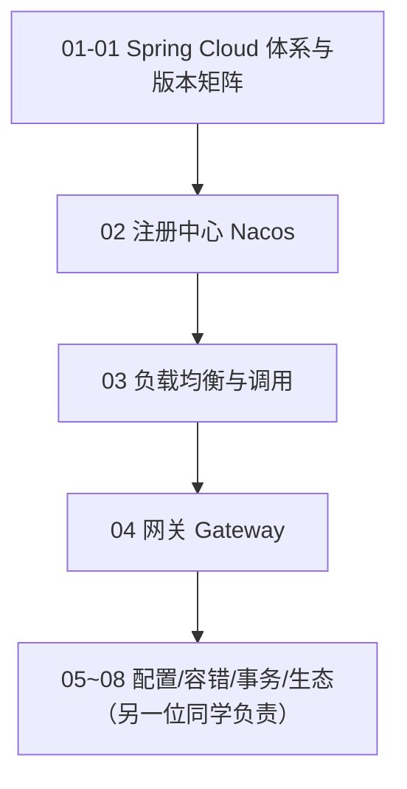
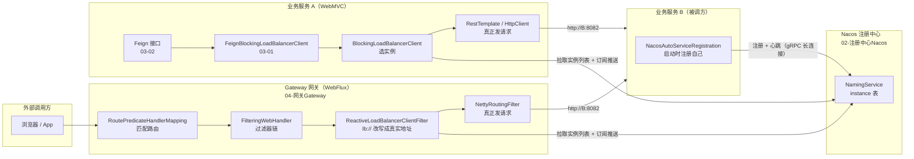

# 01 总览与版本

> 一句话结论：Spring Cloud 不是"一个框架"，而是**一组版本一起发布的子项目 + 一份 BOM**；本仓库的基线是各子项目 `5.1.0`（属于 release train `2026.0.0`，而 `2025.1.x` 对应的是子项目 `5.0.x`），配套 Spring Boot `4.2.0`。
> 阅读前置：`02-SpringBoot/02-自动配置`（所有 Cloud 能力都是 starter + 自动配置）
> 预计阅读：15 分钟（本 README）+ 60 分钟（正文）

---

## 这个目录要解决什么问题

初学者看 Spring Cloud 最常见的三个困惑：

1. **版本怎么对不上？** 网上教程写 `spring-cloud-starter-parent:Hoxton.SR8`，而自己项目里是 `5.1.0`，两者是什么关系？
2. **starer 一装进去，代码在哪？** 加了 `spring-cloud-starter-loadbalancer` 之后，`@LoadBalanced` 就"自动"能用了，谁在中间干活？
3. **这么多组件，到底谁管什么？** Nacos、LoadBalancer、OpenFeign、Gateway、Config、Sentinel——一次性全装进项目，出问题根本不知道去哪个模块查。

这三件事最后都归结为一个能力：**能画出"一次 HTTP 请求从进网关到打到下游实例"的完整路径，并指出每一步归属哪个子项目**。

## 学习目标

学完本目录，你应该能做到：

- 说清 release train（`2022.0.x` / `2023.0.x` / `2024.0.x` / `2025.x`）与"子项目版本号 `5.1.0`"的对应关系，并能解释为什么**不能**自己随便指定 `spring-cloud-commons` 的版本。
- 说出六大件（服务发现、客户端负载均衡、声明式 HTTP、网关、配置中心、熔断）各自的**职责边界**，以及每一个的常见替代方案（Consul/Eureka/K8s Service、Resilience4j/Sentinel、Apollo/Nacos）。
- 照着本目录给出的最小工程结构，搭出 **3 个服务 + 1 个网关**的可运行骨架，且知道每个 starter 是干什么的。
- 判断一个"Cloud 组件缺失"类错误（`No Feign Client for loadBalancing defined`、`Unable to find instance for xxx`）应该去哪个模块定位。

## 文章顺序

> 读图说明：`01-01` 是**地图**，`02~04` 是**沿着一次请求走一遍**：注册中心负责"有哪些实例"，负载均衡负责"选哪一台"，OpenFeign 负责"怎么发出去"，Gateway 负责"外面怎么进来"。`05~08` 是在这条主链上继续加"配置/限流/事务/追踪"的横切能力，请移步对应目录。

## 本目录文章

| 文章 | 讲什么 | 读完能做到 |
| --- | --- | --- |
| [`01-springcloud-体系与版本矩阵.md`](./01-springcloud-体系与版本矩阵.md) | release train、BOM、starter 机制、六大件职责边界与替代品、最小工程结构 | 独立搭一个 3 服务 + 网关的骨架，并能解释每个依赖的来历 |

## 全局全景图（后面四篇都在这张图上）

> 读图说明：
> - **灰色虚线不是同一次调用**：注册是在**启动时**做一次（+ 长期心跳），拉取实例列表是在**调用时**做（+ 长期订阅推送）。这正是后面 Nacos 两篇文章的分界。
> - 网关和服务 A 走的是**同一套 LB 抽象**（`ReactiveLoadBalancer`），但一个在 WebFlux 栈用 `Mono`，一个在 WebMVC 栈用 `block()`——这是 `03-01` 的重点。
> - 图里出现三个"发请求的地方"：网关的 `NettyRoutingFilter`、Feign 的 `Client#execute`、`RestTemplate` 的拦截器链。**任何超时/重试/连接池问题都要先分清自己在哪一个。**
> - 想单独看某一层，按图上的目录跳转：注册 → `02-注册中心Nacos`，选实例 → `03-负载均衡与调用`，写接口 → `03-负载均衡与调用` 的 Feign 篇，入口 → `04-网关Gateway`。

## 依赖关系

- **前置**：`02-SpringBoot/01-启动原理`（注册动作就挂在 `WebServerInitializedEvent` 上）、`02-SpringBoot/02-自动配置`（`spring.factories` / `AutoConfiguration.imports`）、`01-Spring框架/02-AOP`（Feign 代理本质是 JDK 动态代理）。
- **后续**：`02-注册中心Nacos` → `03-负载均衡与调用` → `04-网关Gateway`，再到 `05-配置中心与Bus`、`06-熔断限流与容错`、`07-分布式事务与链路追踪`、`08-Alibaba生态详解`。

## 学习检查点

- [ ] 能解释 `spring-cloud-dependencies`（BOM）与 `spring-cloud-starter-xxx` 的分工：谁管版本、谁管 jar。
- [ ] 能说出本仓库基线 `spring-cloud-commons:5.1.0` 属于哪个 release train，以及它要求的 Spring Boot 大版本。
- [ ] 能列出六大件各自"最容易被误认为它干的活"（例如：服务发现≠负载均衡、网关≠注册中心）。
- [ ] 能画出最小工程里 `gateway → order-service → user-service` 的三跳调用，并标出每一跳经过哪些类。
- [ ] 能判断：把 `spring-cloud-starter-loadbalancer` 从依赖里删掉后，哪一行会先报错、报什么。
