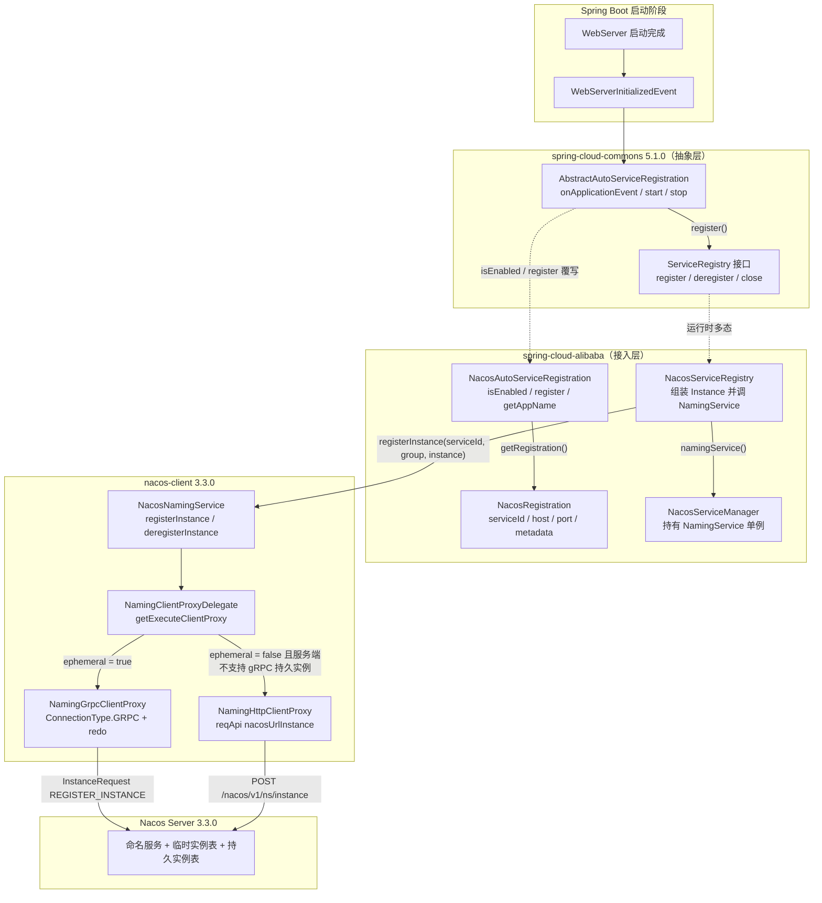
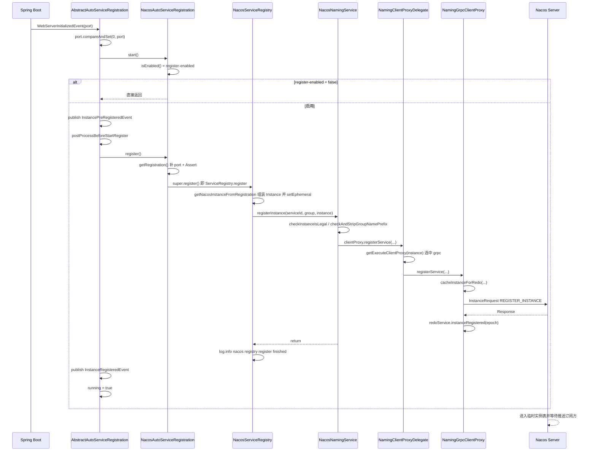

# Nacos 服务注册源码：从 `WebServerInitializedEvent` 到一条 gRPC 注册请求

> 一句话结论：Spring Cloud 只定义"**谁来注册、什么时候注册**"（`AbstractAutoServiceRegistration` 生命周期 + `ServiceRegistry` 契约），Nacos 负责"**注册到哪、怎么发出去**"（`NacosServiceRegistry` → `NacosNamingService` → `NamingClientProxyDelegate` → gRPC）；临时实例走 gRPC 长连接，HTTP `/nacos/v1/ns/instance` 路线**只服务持久实例**。
> 阅读前置：`04-SpringCloud/01-总览与版本/01-springcloud-体系与版本矩阵.md`（知道 Spring Cloud 有哪些子项目）、`02-SpringBoot/01-启动原理/01-springapplication-run-启动全流程.md`（知道 `WebServerInitializedEvent` 是什么时候发的）。
> 预计阅读：45 分钟 ｜ 源码：`org.springframework.cloud:spring-cloud-commons:5.1.0`、`com.alibaba.cloud:spring-cloud-starter-alibaba-nacos-discovery:2025.1.0.0`、`com.alibaba.nacos:nacos-client:3.3.0`

---

## 0. 先看现象

你在本地起了两个服务：`order-service`（8081）、`user-service`（8082）。打开 Nacos 控制台，服务列表里两个都有。于是"服务发现"看起来就像打开一个网页——**服务把自己的地址写进去，别人读出来**。

但一旦出问题，现象就不那么直观了：

**现象 A：`nacos registry, DEFAULT_GROUP order-service 10.0.0.12:8081 register finished` 打了，控制台却看不到实例。**
日志说注册成功，控制台说没有。这中间至少隔着 5 层：`NacosRegistration` 组装 `Instance` → `NacosNamingService.registerInstance` → `NamingClientProxyDelegate` 选通道 → gRPC/HTTP 出网 → Nacos 服务端落库。任何一层用错命名空间（namespace），都会出现"日志成功、控制台查不到"。

**现象 B：`service.port has not been set`。**
这是 `NacosAutoServiceRegistration#getRegistration` 里的 `Assert` 抛出来的（见 §3.3）。它说明注册动作发生在 Web 容器端口确定之前——顺序错了。

**现象 C：关掉一个实例，另一个实例还在报 `ConnectException` 打到已经关掉的那台。**
注册端的"下线"和你调"下线"之间还有一条链路（`stop()` → `deregister()` → 服务端移除 → 推送 → 客户端缓存刷新），每一段都可能断，见下一篇《02-服务发现与拉取》。

**现象 D：Nacos 2.x 之后，抓包看不到 `POST /nacos/v1/ns/instance` 了。**
因为从 Nacos 2.0 起客户端默认走 **gRPC 长连接**（默认端口 9848），HTTP 接口只作为兼容/持久实例通道保留。很多老教程还在讲 HTTP 心跳 `PUT /nacos/v1/ns/instance/beat`，在新版本上直接对不上。

本节要回答的核心问题：**一行"注册成功"的日志，背后到底跑了多远？** 我们从 Spring 的"注册生命周期"开始，一路追到 gRPC 的 `InstanceRequest`。

---

## 1. 整体地图



> 读图说明：
> 1. **上面两层是"什么时候注册"，下面三层是"怎么注册"**。`AbstractAutoServiceRegistration` 完全不认识 Nacos，它只认 `ServiceRegistry` 和 `AutoServiceRegistration` 两个接口——这就是为什么换个注册中心（Consul/Eureka/Zookeeper）时，你的业务代码一行都不用改。
> 2. 虚线表示"运行时多态"：`AbstractAutoServiceRegistration.start()` 里调用的 `this.register()` 落到 `NacosAutoServiceRegistration.register()`；`register()` 内部再调 `this.serviceRegistry.register(...)`，落到 `NacosServiceRegistry`。读源码时一定要在脑子里补上这两条虚线，否则会卡在"谁调了谁"。
> 3. `NamingClientProxyDelegate` 是**通道选择器**，不是简单门面：`ephemeral=true` 一定走 gRPC；`ephemeral=false` 时看服务端能力（`AbilityKey.SERVER_PERSISTENT_INSTANCE_BY_GRPC`），支持才走 gRPC，否则退回 HTTP。
> 4. 图里没有画"定时心跳"，因为**临时实例的心跳不再是客户端定时 HTTP 请求**，而是 gRPC 长连接的存活本身 + Nacos 客户端内部 redo 重注册。这一层在 §3.10 展开。

---

## 2. 关键类逐个拆

| 类 | 归属 | 职责 | 关键点 |
| --- | --- | --- | --- |
| `AbstractAutoServiceRegistration` | commons 5.1.0 | 监听 `WebServerInitializedEvent`，端口就绪后触发注册；容器关闭时反注册 | `port.compareAndSet(0, ...)` 保证只记一次；`InstancePreRegisteredEvent` / `InstanceRegisteredEvent` 两个扩展点 |
| `AutoServiceRegistration` | commons 5.1.0 | 纯标记接口，表示"这是一个自动注册器" | **没有任何方法**，只用于类型筛选 |
| `ServiceRegistry<R extends Registration>` | commons 5.1.0 | `register/deregister/close/setStatus/getStatus` | 注册中心 SPI，Nacos/Eureka/Consul 各自实现 |
| `NacosAutoServiceRegistration` | alibaba 2025.1.0.0 | 补端口、判断 `register-enabled`、覆写 `getAppName` | `getManagementRegistration()` 返回 `null`（不单独注册管理端口） |
| `NacosRegistration` | alibaba | 一个实例的元数据载体（`serviceId/host/port/metadata`） | `@PostConstruct` 里把管理端口、心跳参数塞进 metadata |
| `NacosServiceRegistry` | alibaba | 把 `NacosRegistration` 转成 Nacos `Instance`，调 `NamingService` | `setEphemeral(...)` 决定走哪条通道；失败时看 `failFast` |
| `NacosServiceManager` | alibaba | 持有 `NamingService` 实例，负责创建与优雅关闭 | `volatile` 单例 + `nacosServiceShutDown()` |
| `NacosNamingService` | nacos-client 3.3.0 | 客户端门面：注册/反注册/订阅/查询 | 注册前做 `NamingUtils.checkInstanceIsLegal` 与组名前缀校验 |
| `NamingClientProxyDelegate` | nacos-client | 在 gRPC 与 HTTP 之间做通道选择 | `getExecuteClientProxy(instance)` 是唯一判定点 |
| `NamingGrpcClientProxy` | nacos-client | gRPC 长连接通道，含 redo（断线重注册） | 临时实例**只**能走这里 |
| `NamingHttpClientProxy` | nacos-client | HTTP 通道，`/nacos/v1/ns/instance` | 收到 `ephemeral=true` 直接抛 `UnsupportedOperationException` |

---

## 3. 源码逐段精读

### 3.1 入口：端口就绪之后才开始注册

```java (src: AbstractAutoServiceRegistration.java#L114-L125)
	@Override
	@SuppressWarnings("deprecation")
	public void onApplicationEvent(WebServerInitializedEvent event) {
		ApplicationContext context = event.getApplicationContext();
		if (context instanceof ConfigurableWebServerApplicationContext configurableWebServerApplicationContext) {
			if ("management".equals(configurableWebServerApplicationContext.getServerNamespace())) {
				return;
			}
		}
		this.port.compareAndSet(0, event.getWebServer().getPort());
		this.start();
	}
```

- **在干什么**：`WebServerInitializedEvent` 是 Tomcat/Netty 端口真正绑定成功之后发出的。这里过滤掉 management 上下文（管理端口另算），把业务端口用 CAS 记一次，然后 `start()`。
- **为什么这么写**：注册需要真实端口。监听 `WebServerInitializedEvent` 是**最早能拿到端口**的时机；`compareAndSet(0, port)` 而不是 `set`，是为了幂等——这个事件可能因为容器重启/子上下文被触发多次。
- **如果改成 `this.port.set(...)`**：多 Web 容器（同时起 servlet 与 reactive）时后者的端口会覆盖前者，注册到错误的地址。
- **常见坑**：`spring.main.web-application-type=none` 的纯 Worker 应用根本不会有这个事件，注册永远不会发生。要么手动调 `start()`，要么自己直接调 `NamingService`。

### 3.2 生命周期：`start()` 里的四件事与两个扩展点

```java (src: AbstractAutoServiceRegistration.java#L141-L155)
	public void start() {
		if (!isEnabled()) {
			if (logger.isDebugEnabled()) {
				logger.debug("Discovery Lifecycle disabled. Not starting");
			}
			return;
		}

		// only initialize if nonSecurePort is greater than 0 and it isn't already running
		// because of containerPortInitializer below
		if (!this.running.get()) {
			this.context.publishEvent(new InstancePreRegisteredEvent(this, getRegistration()));
			registrationLifecycles.forEach(
					registrationLifecycle -> registrationLifecycle.postProcessBeforeStartRegister(getRegistration()));
			register();
```

- **在干什么**：`isEnabled()` → `running` 守卫 → 发 `InstancePreRegisteredEvent` → 跑注册生命周期回调 → `register()`。
- **为什么这么写**：`register()` 是模板方法里的**抽象步骤**（落到 §3.4 的 `NacosAutoServiceRegistration.register`）。把"发事件 + 回调"放在它前面，是为了让用户能在真正注册前改元数据（例如灰度标签）；放在后面的 `postProcessAfterStartRegister` 则用于注册后的副作用（预热连接池等）。
- **如果改成删掉 `isEnabled()` 判断**：`spring.cloud.nacos.discovery.register-enabled=false` 就失效了，本地多实例调试会互相覆盖实例列表。
- **常见坑**：`InstancePreRegisteredEvent` 里改 `Registration` 的 metadata **有时不生效**——Nacos 侧 `Instance` 是在 `register()` 内部才组装的（§3.6），事件里改 `NacosRegistration` 有效；但别指望"改了就能改回已经发出去的请求"。

```java (src: AbstractAutoServiceRegistration.java#L156-L172)
			this.registrationLifecycles.forEach(
					registrationLifecycle -> registrationLifecycle.postProcessAfterStartRegister(getRegistration()));
			if (shouldRegisterManagement()) {
				this.registrationManagementLifecycles
					.forEach(registrationManagementLifecycle -> registrationManagementLifecycle
						.postProcessBeforeStartRegisterManagement(getManagementRegistration()));
				this.registerManagement();
				registrationManagementLifecycles
					.forEach(registrationManagementLifecycle -> registrationManagementLifecycle
						.postProcessAfterStartRegisterManagement(getManagementRegistration()));

			}
			this.context.publishEvent(new InstanceRegisteredEvent<>(this, getConfiguration()));
			this.running.compareAndSet(false, true);
		}

	}
```

- **在干什么**：注册后回调 → 可选地再注册管理端口 → 发 `InstanceRegisteredEvent` → 标记 `running=true`。
- **为什么这么写**：`InstanceRegisteredEvent` 是"刚完成自注册"的广播，`NacosWatch`（下一篇讲）等组件靠它做后续动作；`running` 标记让 `start()` 幂等。
- **如果改成在 `register()` 之前就 `running.compareAndSet(false, true)`**：注册失败时也标记已运行，后续再调 `start()` 就不重试了，实例永久丢失注册。
- **常见坑**：`running` 是 `AtomicBoolean` 但整个过程**没有加锁**，并发调用 `start()`（例如配置变更触发 `restart()`）会有窗口期重复注册。

### 3.3 Nacos 侧：`getRegistration()` 的端口断言

```java (src: NacosAutoServiceRegistration.java#L57-L64)
	@Override
	protected NacosRegistration getRegistration() {
		if (this.registration.getPort() < 0 && this.getPort().get() > 0) {
			this.registration.setPort(this.getPort().get());
		}
		Assert.isTrue(this.registration.getPort() > 0, "service.port has not been set");
		return this.registration;
	}
```

- **在干什么**：如果 `NacosRegistration` 没显式配置端口（`-1`），用父类记下来的 Web 端口补上；两个都没有就断言失败。
- **为什么这么写**：`NacosRegistration` 是普通 Bean，它的 `port` 来自 `NacosDiscoveryProperties`，默认 `-1` 表示"用容器端口"。补端口必须发生在**注册动作前**，所以放在 `getRegistration()` 这个每次取用都会走的方法里。
- **如果改成构造器里补端口**：那时 `AbstractAutoServiceRegistration` 的 `port` 还是 0（Web 容器没起来），永远补成 -1。
- **常见坑**：报 `service.port has not been set` 的典型场景——(1) 服务没起 Web 容器；(2) 你在端口绑定前手动调了 `start()`；(3) 用了 `@SpringBootTest(webEnvironment = NONE)` 却加载了自动注册。

### 3.4 Nacos 侧：`register()` 的开关与 `super.register()`

```java (src: NacosAutoServiceRegistration.java#L71-L81)
	@Override
	protected void register() {
		if (!this.registration.getNacosDiscoveryProperties().isRegisterEnabled()) {
			log.debug("Registration disabled.");
			return;
		}
		if (this.registration.getPort() < 0) {
			this.registration.setPort(getPort().get());
		}
		super.register();
	}
```

- **在干什么**：`register-enabled=false` 直接返回；否则再兜一次端口，然后交给父类（父类的 `register()` 只有一行：`this.serviceRegistry.register(getRegistration());`）。
- **为什么这么写**：`isEnabled()` 和这里的 `isRegisterEnabled()` 读同一个开关但**检查时机不同**：前者在 `start()` 入口拦截（不发事件、不进生命周期），后者在真正注册时拦截（生命周期回调照跑）。多点校验是因为 `register-enabled` 支持配置中心动态改。
- **如果改成只留一处**：动态刷新 `register-enabled` 后行为会不一致（有时发事件有时不发）。
- **常见坑**：`register-enabled=false` 时 `NacosWatch` 仍会尝试订阅别的服务，日志里看着"还在连 Nacos"，别误判为"注册没被关掉"。

### 3.5 `isEnabled()` 与 `getAppName()`：名字从哪来

```java (src: NacosAutoServiceRegistration.java#L97-L107)
	@Override
	protected boolean isEnabled() {
		return this.registration.getNacosDiscoveryProperties().isRegisterEnabled();
	}
...
	@Override
	@SuppressWarnings("deprecation")
	protected String getAppName() {
		String appName = registration.getNacosDiscoveryProperties().getService();
		return StringUtils.isEmpty(appName) ? super.getAppName() : appName;
	}
```

- **在干什么**：`isEnabled()` 读 `spring.cloud.nacos.discovery.register-enabled`（默认 `true`）；`getAppName()` 优先用 `spring.cloud.nacos.discovery.service`，没配才回落到父类的 `spring.application.name`（默认 `"application"`）。
- **为什么这么写**：Nacos 的服务名可以独立于 Spring 应用名配置（例如灰度环境加后缀），但要有一个确定的回落顺序。
- **如果改成直接用 `super.getAppName()`**：所有忘记配 `spring.application.name` 的服务都会注册为 `application`，服务列表里一堆同名实例，LB 会把请求打到毫不相干的服务上。
- **常见坑**：`spring.cloud.nacos.discovery.service` 与 `spring.application.name` 不一致时，**配置中心的 dataId 前缀仍按 `spring.application.name` 走**，两个体系会错位。

### 3.6 组装：把 `Registration` 翻译成 Nacos `Instance`

```java (src: NacosServiceRegistry.java#L170-L180)
	private Instance getNacosInstanceFromRegistration(Registration registration) {
		Instance instance = new Instance();
		instance.setIp(registration.getHost());
		instance.setPort(registration.getPort());
		instance.setWeight(nacosDiscoveryProperties.getWeight());
		instance.setClusterName(nacosDiscoveryProperties.getClusterName());
		instance.setEnabled(nacosDiscoveryProperties.isInstanceEnabled());
		instance.setMetadata(registration.getMetadata());
		instance.setEphemeral(nacosDiscoveryProperties.isEphemeral());
		return instance;
	}
```

- **在干什么**：把 Spring Cloud 的 `Registration` 翻译成 nacos-client 的协议对象 `Instance`。八个字段里，`ephemeral` 最值得盯。
- **为什么这么写**：字段名必须和服务端协议对得上；`Instance` 里 `ephemeral` 默认就是 `true`，这里显式再设一次，保证配置能覆盖。
- **如果改成 `setEphemeral(false)`**（即 `spring.cloud.nacos.discovery.ephemeral=false`）：实例变成**持久实例**，不会随应用退出自动消失，需要显式反注册或手工删；注册通道也可能从 gRPC 退回 HTTP（§3.11）。
- **常见坑**：持久实例 + `kill -9` = 控制台里永远挂着一条"健康"的假实例，调用方持续超时。生产环境除非有特殊需求，**保持 `ephemeral=true`**。

### 3.7 注册主体：`register()` 与 `failFast`

```java (src: NacosServiceRegistry.java#L59-L89)
	@Override
	public void register(Registration registration) {

		if (StringUtils.isEmpty(registration.getServiceId())) {
			log.warn("No service to register for nacos client...");
			return;
		}

		NamingService namingService = namingService();
		String serviceId = registration.getServiceId();
		String group = nacosDiscoveryProperties.getGroup();

		Instance instance = getNacosInstanceFromRegistration(registration);

		try {
			namingService.registerInstance(serviceId, group, instance);
			log.info("nacos registry, {} {} {}:{} register finished", group, serviceId,
					instance.getIp(), instance.getPort());
		}
		catch (Exception e) {
			if (nacosDiscoveryProperties.isFailFast()) {
				log.error("nacos registry, {} register failed...{},", serviceId,
						registration.toString(), e);
				rethrowRuntimeException(e);
			}
			else {
				log.warn("Failfast is false. {} register failed...{},", serviceId,
						registration.toString(), e);
			}
		}
	}
```

- **在干什么**：判空 → 取 `NamingService` → 组 `Instance` → 调 `registerInstance` → 打日志；异常时按 `failFast` 决定抛出还是吞掉。
- **为什么这么写**：`failFast` 默认 `false`，意味着**注册失败不阻断启动**。注册中心抖动不该让整个业务起不来，服务可以先跑，靠后续重连与重试补注册。
- **如果改成 `failFast=true`**：Nacos 不可用时应用直接启动失败——K8s 里表现为 CrashLoopBackOff，看起来像"应用有 bug"。
- **常见坑**：`log.info("... register finished")` 只代表**请求发出并返回成功**，不代表控制台一定看得到——namespace 配错时请求打到别的 namespace，日志照样成功。

### 3.8 nacos-client 门面：`NacosNamingService#registerInstance`

```java (src: NacosNamingService.java#L179-L184)
    public void registerInstance(String serviceName, String groupName, Instance instance)
        throws NacosException {
        NamingUtils.checkInstanceIsLegal(instance);
        checkAndStripGroupNamePrefix(instance, groupName);
        clientProxy.registerService(serviceName, groupName, instance);
    }
```

- **在干什么**：先做实例合法性校验（`ip` 非空、`port` 在 0~65535），再做组名前缀兼容处理，最后委托给 `clientProxy`。
- **为什么这么写**：`nacos-client` 要兼容"服务名里带 `group@@`"的老写法（1.x 时代），所以 `checkAndStripGroupNamePrefix` 在需要时把组名从服务名里剥出来；校验放在最外层，能让调用方尽早拿到参数错误。
- **如果改成跳过校验**：`ip` 为空的请求打到服务端会返回参数错误，错误位置被推远几跳，排查成本高。
- **常见坑**：校验的是 `instance.getIp()`，而 Spring Cloud 传进来的是 `registration.getHost()` = `nacosDiscoveryProperties.getIp()`。**多网卡机器选错网卡**（注册成 127.0.0.1 或 docker0 的 172.17.x）就是这样发生的——需要显式配 `spring.cloud.nacos.discovery.ip`。

### 3.9 通道选择：`getExecuteClientProxy` 的三行判断

```java (src: NamingClientProxyDelegate.java#L218-L224)
    private NamingClientProxy getExecuteClientProxy(Instance instance) {
        if (instance.isEphemeral() || grpcClientProxy.isAbilitySupportedByServer(
            AbilityKey.SERVER_PERSISTENT_INSTANCE_BY_GRPC)) {
            return grpcClientProxy;
        }
        return httpClientProxy;
    }
```

- **在干什么**：临时实例（`ephemeral=true`）无条件走 gRPC；持久实例在服务端支持"gRPC 持久实例"能力时也走 gRPC，否则退回 HTTP。
- **为什么这么写**：Nacos 2.x 起，临时实例的健康与推送都绑在 gRPC 长连接上，服务端不再接受 HTTP 注册临时实例；持久实例在早期 2.x 服务端只能通过 HTTP 管理，所以保留能力探测。
- **如果改成无条件走 HTTP**：`NamingHttpClientProxy` 会直接抛异常（见下一段），这就是"老代码升级 Nacos 2.x 后注册失败"的根因。
- **常见坑**：9848（客户端 gRPC）端口没开、只有 8848（HTTP）通时，表现为大量重连日志，而不是明确的"端口不通"。

```java (src: NamingHttpClientProxy.java#L134-L143)
    public void registerService(String serviceName, String groupName, Instance instance)
        throws NacosException {
        NAMING_LOGGER.info("[REGISTER-SERVICE] {} registering service {} with instance: {}",
            namespaceId, serviceName,
            instance);
        String groupedServiceName = NamingUtils.getGroupedName(serviceName, groupName);
        if (instance.isEphemeral()) {
            throw new UnsupportedOperationException(
                "Do not support register ephemeral instances by HTTP, please use gRPC replaced.");
        }
```

- **在干什么**：HTTP 通道明确拒绝临时实例，异常文案直接告诉你"改用 gRPC"。
- **为什么这么写**：临时实例的健康完全依赖"连接是否活着"，HTTP 是无状态短连接，无法承载这个语义。
- **如果改成允许 HTTP 临时实例**：服务端要么把你当持久实例（永远健康的脏数据），要么立刻删除（注册了等于没注册）。
- **常见坑**：`failFast=false` 时这个异常会被吞成一行 `log.warn`，只留下"控制台没实例"的表象。

### 3.10 报文：HTTP 与 gRPC 各自长什么样

```java (src: NamingHttpClientProxy.java#L144-L156)
        final Map<String, String> params = new HashMap<>(32);
        params.put(CommonParams.NAMESPACE_ID, namespaceId);
        params.put(CommonParams.SERVICE_NAME, groupedServiceName);
        params.put(CommonParams.GROUP_NAME, groupName);
        params.put(CommonParams.CLUSTER_NAME, instance.getClusterName());
        params.put(IP_PARAM, instance.getIp());
        params.put(PORT_PARAM, String.valueOf(instance.getPort()));
        params.put(WEIGHT_PARAM, String.valueOf(instance.getWeight()));
        params.put(REGISTER_ENABLE_PARAM, String.valueOf(instance.isEnabled()));
        params.put(HEALTHY_PARAM, String.valueOf(instance.isHealthy()));
        params.put(EPHEMERAL_PARAM, String.valueOf(instance.isEphemeral()));
        params.put(META_PARAM, JsonUtils.toJson(instance.getMetadata()));
        reqApi(UtilAndComs.nacosUrlInstance, params, HttpMethod.POST);
```

- **在干什么**：HTTP 路线把 `Instance` 拆成 query 参数，POST 到 `UtilAndComs.nacosUrlInstance`（即 `/nacos/v1/ns/instance`）。
- **为什么这么写**：这是 Nacos 最早的 v1 开放 API，参数名与文档一一对应，方便 curl 手工排障。
- **如果改成用 JSON body**：服务端 v1 API 不支持；v2 API 才有 JSON 形态。
- **常见坑**：`EPHEMERAL_PARAM` 恒为 `false`（因为临时实例在上一步就被拦了）；手工 curl 时若写 `ephemeral=true`，服务端会直接报错。

```java (src: NamingGrpcClientProxy.java#L154-L171)
    public void registerService(String serviceName, String groupName, Instance instance)
        throws NacosException {
        NAMING_LOGGER.info("[REGISTER-SERVICE] {} registering service {} with instance {}",
            namespaceId, serviceName,
            instance);
        if (instance.isEphemeral()) {
            registerServiceForEphemeral(serviceName, groupName, instance);
        } else {
            doRegisterServiceForPersistent(serviceName, groupName, instance);
        }
    }
    
    private void registerServiceForEphemeral(String serviceName, String groupName,
        Instance instance)
        throws NacosException {
        redoService.cacheInstanceForRedo(serviceName, groupName, instance);
        doRegisterService(serviceName, groupName, instance);
    }
```

- **在干什么**：临时实例先写进 **redo 缓存**（断线重连后要重放的清单），再发请求；持久实例不写 redo。
- **为什么这么写**：gRPC 长连接会断。断了之后服务端认为你下线（临时实例被摘掉），客户端必须能自动重注册——redo 缓存就是这个"待重放队列"。
- **如果改成临时实例也不缓存 redo**：网络抖动 3 秒就会让实例从服务端消失，重连后不会自己回来，只能重启应用。
- **常见坑**：`redo` 重放发生在连接恢复时。如果应用已经 `stop()` 了再重连，重放会把实例又注册回来——所以优雅停机要保证"先反注册、再关客户端"（§3.14）。

```java (src: NamingGrpcClientProxy.java#L279-L286)
    public void doRegisterService(String serviceName, String groupName, Instance instance)
        throws NacosException {
        InstanceRequest request = new InstanceRequest(namespaceId, serviceName, groupName,
            NamingRemoteConstants.REGISTER_INSTANCE, instance);
        long connectionEpoch = redoService.getCurrentConnectionEpoch();
        requestToServer(request, Response.class);
        redoService.instanceRegistered(serviceName, groupName, connectionEpoch);
    }
```

- **在干什么**：组装 `InstanceRequest`（带 `REGISTER_INSTANCE` 动作）→ 发请求 → 用 `connectionEpoch` 标记"这条 redo 记录已经在当前连接上注册成功"。
- **为什么这么写**：`connectionEpoch` 是连接代次。重连后 epoch 变化，就知道哪些记录属于"上一代连接、需要重放"，避免重复注册或漏注册。
- **如果改成不带 epoch**：断线瞬间"请求已发出但响应没回来"的情况无法判断，要么重复注册要么漏掉。
- **常见坑**：这一步成功返回后，服务端**推送给订阅方是异步的**——所以会出现"我注册成功了，但另一个服务几秒后才看到我"。

### 3.11 心跳与健康检查：谁在维持"在线"

Nacos 3.3.0 客户端**没有**"每 5 秒发一次 HTTP 心跳"的定时器给临时实例（那是 1.x 的做法）。临时实例的存活由三件事共同维持：

1. **gRPC 长连接本身**：构造时 `RpcClientFactory.createClient(uuid, ConnectionType.GRPC, grpcClientConfig)`，连接断开服务端即刻把该连接上的临时实例标记不可用。
2. **redo 重连重注册**：`start(...)` 里 `rpcClient.registerConnectionListener(redoService)`，重连成功后重放缓存里的注册请求。
3. **客户端上报的心跳/超时元数据**：`NacosRegistration` 在 `@PostConstruct` 里把 `heartBeatInterval` / `heartBeatTimeout` / `ipDeleteTimeout` 写进 metadata，服务端据此判定"多久没消息算掉线"。

三类"实例一直健康但其实挂了"的根因：
- 用了持久实例（`ephemeral=false`），服务端不会因为进程消失而删除它；
- 服务端开了 `naming.push.empty.protection`（推送空保护），收到空列表时不覆盖本地缓存；
- 客户端开了 `naming-load-cache-at-start`，从磁盘快照恢复了一份"上次还活着"的实例列表。

后两条属于**发现侧**，详见《02-服务发现与拉取》。

### 3.12 临时实例 vs 持久实例

| 维度 | 临时实例 `ephemeral=true`（默认） | 持久实例 `ephemeral=false` |
| --- | --- | --- |
| 注册通道 | 只走 gRPC（`NamingHttpClientProxy` 直接拒绝） | gRPC（服务端支持时）或 HTTP `/v1/ns/instance` |
| 健康来源 | gRPC 连接存活 + 心跳元数据 | 服务端主动探测（或客户端心跳上报） |
| 进程 `kill -9` 后 | 连接断开 → 自动摘除 | **仍显示健康**，需手工删或显式反注册 |
| redo 重放 | 有（`cacheInstanceForRedo`） | 无 |
| 批量注册 | 支持（`batchRegisterService`） | HTTP 通道直接抛 `UnsupportedOperationException` |
| 适用场景 | 绝大多数微服务 | 注册信息不随进程消失的场景（静态登记的上游等） |
| 配置项 | `spring.cloud.nacos.discovery.ephemeral=true` | `=false` |

> 一句话选择建议：**默认就是临时实例，别去动它**。你要的"实例下线立刻不接流量"只有临时实例能给你。

### 3.13 三层隔离：namespace / group / cluster

| 层级 | 配置项 | 语义 | 用错的表现 |
| --- | --- | --- | --- |
| namespace | `spring.cloud.nacos.discovery.namespace`（填 **namespace ID**，不是名字） | 最外层租户隔离，通常是 dev/test/prod | 日志注册成功、控制台换 namespace 才看得到；调用方"找不到实例" |
| group | `spring.cloud.nacos.discovery.group`（默认 `DEFAULT_GROUP`） | 同一 namespace 内的逻辑分组 | 服务名对但 group 不对 → 实例列表为空 |
| cluster | `spring.cloud.nacos.discovery.cluster-name`（默认 `DEFAULT`） | 同机房/同可用区，供就近访问 | 跨机房调用延迟高；`selectInstances` 的 cluster 选择失效 |
| service | `spring.cloud.nacos.discovery.service` / `spring.application.name` | 服务名 | 回落成 `application` 后所有服务撞名（§3.5） |

再加一组常用配置：

| 配置项 | 默认 | 说明 |
| --- | --- | --- |
| `spring.cloud.nacos.discovery.enabled` | `true` | 总开关（关掉后连 `DiscoveryClient` 都不装配） |
| `spring.cloud.nacos.discovery.register-enabled` | `true` | 只关"注册"，仍可发现别人 |
| `spring.cloud.nacos.discovery.fail-fast` | `false` | 注册失败是否抛异常阻断启动 |
| `spring.cloud.nacos.discovery.ephemeral` | `true` | 临时/持久实例 |
| `spring.cloud.nacos.discovery.weight` | `1` | 权重，配合加权负载均衡 |
| `spring.cloud.nacos.discovery.ip` / `network-interface` | 自动探测 | 多网卡时手工指定 |
| `spring.cloud.nacos.discovery.naming-load-cache-at-start` | `false` | 启动时是否从磁盘快照恢复实例列表 |
| `spring.cloud.nacos.discovery.watch.enabled` | `true` | 是否启用 `NacosWatch` 定时心跳事件 |

### 3.14 反注册：`stop()` 与 `setStatus("DOWN")`

```java (src: AbstractAutoServiceRegistration.java#L293-L312)
	public void stop() {
		if (this.getRunning().compareAndSet(true, false) && isEnabled()) {

			this.registrationLifecycles.forEach(
					registrationLifecycle -> registrationLifecycle.postProcessBeforeStopRegister(getRegistration()));
			deregister();
			this.registrationLifecycles.forEach(
					registrationLifecycle -> registrationLifecycle.postProcessAfterStopRegister(getRegistration()));
			if (shouldRegisterManagement()) {
				this.registrationManagementLifecycles
					.forEach(registrationManagementLifecycle -> registrationManagementLifecycle
						.postProcessBeforeStopRegisterManagement(getManagementRegistration()));
				deregisterManagement();
				this.registrationManagementLifecycles
					.forEach(registrationManagementLifecycle -> registrationManagementLifecycle
						.postProcessAfterStopRegisterManagement(getManagementRegistration()));
			}
			this.serviceRegistry.close();
		}
	}
```

- **在干什么**：`running` 从 true 翻成 false 且当前启用时：跑停止前回调 → `deregister()` → 停止后回调 → 关掉 `ServiceRegistry`（对 Nacos 就是 `nacosServiceShutDown()`）。
- **为什么这么写**：把"反注册"和"关连接"分开——先告诉服务端我下线了，再断连接，避免服务端把断连当成"异常掉线"而触发保护逻辑。
- **如果改成直接 `close()`**：临时实例靠断连摘除也能生效，但持久实例会永远留在服务端。
- **常见坑**：`kill -9` / `SIGKILL` 不会执行 `@PreDestroy`（`destroy()` → `stop()` 跑不到）。K8s 里靠 `preStop` + `server.shutdown=graceful` 兜底。

`NacosServiceRegistry` 还实现了 `setStatus`，只接受 `UP` / `DOWN`：

```java (src: NacosServiceRegistry.java#L128-L147)
	public void setStatus(Registration registration, String status) {

		if (!STATUS_UP.equalsIgnoreCase(status)
				&& !STATUS_DOWN.equalsIgnoreCase(status)) {
			log.warn("can't support status {},please choose UP or DOWN", status);
			return;
		}

		try {
			if (STATUS_DOWN.equalsIgnoreCase(status)) {
				deregister(registration);
			}
			else {
				register(registration);
			}
		}
		catch (Exception e) {
			throw new RuntimeException("update nacos instance status fail", e);
		}
	}
```

- **在干什么**：`DOWN` → 反注册；`UP` → 重新注册。这是 Spring Cloud "实例状态"抽象在 Nacos 上的落地方式。
- **为什么这么写**：Nacos 的 `Instance` 有 `enabled` 字段（存在但不接流量），但 Spring Cloud Alibaba 没做这个映射，只能降级成"删掉/加回来"。
- **如果改成映射到 `enabled=false`**：能做到"保留注册但不接流量"，更接近 Eureka 的 `OUT_OF_SERVICE`，但需要自己改 `NacosServiceRegistry`。
- **常见坑**：调 `setStatus("DOWN")` 后实例**从列表消失**；如果后续没有 `UP` 流程，实例就丢了。

---

## 4. 一次完整执行时序



> 读图说明：
> 1. **注册成功 ≠ 调用方立刻知道**。服务端拿到注册后，还要通过订阅关系把变更推给已订阅的客户端；客户端再更新本地缓存 → 发 `InstancesChangeEvent` → Spring Cloud 侧发 `HeartbeatEvent` → LB 缓存刷新。这条链路是下一篇的主题。
> 2. gRPC 请求是"发送 + 等 Response"，但**服务端推送是异步的**，所以有"注册成功但别人还没发现我"的窗口。
> 3. `redoService.instanceRegistered(...)` 是收尾动作：把 redo 缓存里对应条目标成"已成功注册到当前连接"，断线重连时才知道要重放什么。
> 4. 整条链路**没有任何 HTTP 心跳请求**——这就是为什么在 Nacos 2.x+ 上抓不到 `PUT /nacos/v1/ns/instance/beat`。

---

## 5. 设计模式与取舍

| 模式 | 出现位置 | 作用 | 取舍 |
| --- | --- | --- | --- |
| 模板方法 | `AbstractAutoServiceRegistration#start/stop` | 固定"发事件-回调-注册"骨架，子类只实现 `register()` | 灵活但**调用链隐蔽**：读 `NacosAutoServiceRegistration` 时看不到 `register` 是谁调的 |
| 策略 / SPI | `ServiceRegistry<R>` 多实现 | 换注册中心不改业务代码 | 抽象层只能表达"注册/反注册/状态"，表达不了"动态调权重"等厂商特性 |
| 委托 / 门面 | `NacosNamingService` → `clientProxy` | 客户端 API 稳定，通道可换 | 多一层跳转，栈更深，出错要多读一个类 |
| 代理 + 通道选择 | `NamingClientProxyDelegate` | gRPC/HTTP 双通道路由 | 逻辑集中在一处（好），但能力探测依赖服务端版本（跨版本行为不一致） |
| 观察者 | `WebServerInitializedEvent` / `InstancePreRegisteredEvent` / `InstanceRegisteredEvent` | 解耦启动阶段与注册动作 | 事件顺序即隐式契约，排查靠日志确认 |
| 写前日志（redo） | `registerServiceForEphemeral` | 断线可重放 | 只对临时实例有效；进程被杀即丢失 |

**取舍总述**：Spring Cloud 在这条链路上做了一个很明确的取舍——**"注册"是尽力而为（best-effort），不是分布式事务**。`failFast=false` 默认值、留出 `InstancePreRegisteredEvent` 扩展点、`redo` 重放，方向都是"让服务先活下来，注册稍后一致"。因此排障时你要反过来查：**日志成功只是第一层，"服务端有没有这条记录"是第二层，"订阅方有没有收到推送"是第三层。**

---

## 6. 踩坑与调试手法

1. **先确认 namespace 填的是 ID**：`spring.cloud.nacos.discovery.namespace` 要填控制台里那串 UUID，不是 "dev" 这个名字。填错时注册日志一切正常。
2. **用三行日志定位到第几层**：`[REGISTER-SERVICE]`（客户端收到）→ `nacos registry, ... register finished`（Spring Cloud 侧成功）→ 控制台有实例（服务端落库）。缺哪行，问题就在那层之下。
3. **打开 `logging.level.com.alibaba.nacos=debug`**：能看到 `NamingGrpcClientProxy` / `RpcClient` 的连接与重连，以及失败原因。
4. **确认 9848/9849 端口**：Nacos 2.x+ 除 8848 外还需要 9848（客户端 gRPC）、9849（服务端间 gRPC）。只开 8848 时表现为"一直重连"。
5. **多网卡选错 IP**：显式配 `spring.cloud.nacos.discovery.ip`，或打印 `nacosDiscoveryProperties.getIp()` 验证。
6. **`service.port has not been set`**：检查 `web-application-type`、是否手动调了 `start()`、是否在端口绑定前触发。
7. **持久实例脏数据**：`ephemeral=false` + 非正常退出。手工控制台删除，或发 `DELETE /nacos/v1/ns/instance`。
8. **注册成功但被 LB 过滤掉**：发现侧会跳过 `!instance.isEnabled() || !instance.isHealthy()` 的实例。控制台显示"不健康"的实例在客户端侧直接被丢掉。
9. **`failFast=false` 吞异常**：默认配置下注册失败只有一行 `warn`。网关类服务建议打开，让失败暴露在启动阶段。
10. **动态刷新导致重复注册**：`NacosDiscoveryInfoChangedEvent` → `restart()` = `stop()` + `start()`，并发改多个 discovery 配置时会看到成对的"De-registering / register finished"日志，属于预期，但下游会有短暂实例消失。

---

## 7. ⚠️ 版本差异

| 版本 | 差异点 |
| --- | --- |
| Eureka 时代（`2021.x` 及更早生态） | 注册是 HTTP `POST /eureka/apps/{app}`，心跳是客户端定时 `PUT`；`AbstractAutoServiceRegistration` 的骨架在 `spring-cloud-commons` 里，从那时起基本没变 |
| Nacos 1.x 客户端 | 临时实例用 **HTTP 心跳**：`PUT /nacos/v1/ns/instance/beat`，客户端起定时线程每 5 秒一次 |
| Nacos 2.x 客户端（含 3.3.0） | 临时实例改为 **gRPC 长连接**（9848），HTTP 只服务持久实例；`NamingHttpClientProxy` 对 `ephemeral=true` 直接抛 `UnsupportedOperationException` |
| Nacos 3.x 服务端 | 鉴权与命名空间隔离更严格，`NacosServiceManager#nacosServiceShutDown()` 走优雅关闭。具体灰度行为 **待官方 release notes 核实** |
| Spring Cloud 3.x → 4.x | `javax.*` → `jakarta.*`；`AbstractAutoServiceRegistration` 多个 protected 方法被标 `@Deprecated`（`getPort()`、`getEnvironment()`、`getAppName()`、`getManagementServiceName()`），新代码不要依赖 |
| Spring Cloud 4.x → 5.x（`5.1.0`） | `ServiceRegistry` 接口多了一个 `<T> T getStatus(R registration)`；`RegistrationLifecycle` / `RegistrationManagementLifecycle` 回调取代了旧的 `onApplicationEvent` 钩子。`spring-cloud-commons-dependencies:5.1.0` 仍管理 `spring-cloud-loadbalancer` 等 |
| `spring-cloud-alibaba` 对应版本 | 本文用 `2025.1.0.0`（Maven Central 有源码包）。本仓库基线 Boot 4.2.0 + Cloud 子项目 5.1.0 对应哪个 alibaba 版本，**待官方 release notes 核实**（`2025.1.0`、`2024.0.0.0` 在 Maven Central 返回 404） |

> 说明：`AbstractAutoServiceRegistration` 的 `onApplicationEvent` 在 3.x/4.x/5.x 三个大版本间签名一致；真正会变的是 Nacos 客户端内部的传输层（HTTP → gRPC）以及 starter 的自动配置类名。本文引用的自动配置类是 `NacosServiceRegistryAutoConfiguration`（`2025.1.0.0`）。

---

## 8. 面试高频问与答

1. **Nacos 2.x 之后为什么抓不到心跳的 HTTP 请求了？** → 临时实例改为 gRPC 长连接，存活由连接状态维持；客户端侧另有 redo 缓存用于断线重注册，HTTP 接口仅保留给持久实例。
2. **Spring Cloud 的注册动作是谁触发的？** → `AbstractAutoServiceRegistration` 监听 `WebServerInitializedEvent`，端口就绪后 `start()`；`register()` 是模板方法里的抽象步骤，由 `NacosAutoServiceRegistration` 实现。
3. **`AutoServiceRegistration` 接口为什么没有任何方法？** → 纯标记接口，用于按类型筛选/装配；真正契约在 `AbstractAutoServiceRegistration` 与 `ServiceRegistry` 上。
4. **`failFast` 默认值？影响什么？** → 默认 `false`，注册失败不阻断启动，只打 `warn`。生产里注册中心不重要可以留 false，网关类服务建议 true。
5. **临时实例与持久实例的差别？** → 存活判定与注册通道不同；持久实例进程消失仍显示健康，需要显式反注册或手工删。
6. **为什么注册成功了调用方还是打不通？** → 可能是 namespace/group/cluster 不一致、实例被判不健康被过滤、或订阅方缓存还没刷新（下一篇）。
7. **`NacosServiceManager` 为什么单独存在？** → 统一管理 `NamingService` 生命周期（`volatile` 单例 + 关闭），避免每次注册都新建客户端、也避免容器关闭时连接泄漏。
8. **`redo` 缓存解决什么问题？** → gRPC 断线后服务端会摘掉临时实例，重连必须重放注册；`cacheInstanceForRedo` 记下要重放什么，`instanceRegistered` 标记已成功。
9. **如何临时把一台实例摘掉流量但保留注册？** → Nacos 的 `Instance.enabled=false` 支持，但 Spring Cloud Alibaba 只实现了 `setStatus("DOWN")` → 直接反注册。
10. **多网卡机器注册了错误 IP 怎么修？** → 配 `spring.cloud.nacos.discovery.ip`（或 `network-interface`），并确认 Docker/K8s 下选的是 Pod IP。
11. **`NacosRegistration#init()` 往 metadata 里塞了什么？** → 管理端口相关键与心跳参数（`preserved.heart.beat.interval` / `timeout` / `ip.delete.timeout`），服务端据此判定掉线。
12. **应用被 `kill -9` 后实例会怎样？** → 临时实例随 gRPC 连接断开被摘除；持久实例留在列表里显示健康，形成脏数据。

---

## 9. 动手练习

1. **跑通最小注册**：用 `spring-cloud-starter-alibaba-nacos-discovery` 起一个 8081 的服务，`spring.application.name=order-service`。
   **验收**：Nacos 控制台"服务管理→服务列表"能看到 `order-service`，且实例 IP 是真实网卡 IP（不是 127.0.0.1）。
2. **制造 namespace 错位**：把 `namespace` 改成控制台里另一个 namespace 的 ID 重启。
   **验收**：日志仍有 `register finished`，但原 namespace 实例消失、新 namespace 出现——能讲清"日志成功 ≠ 控制台可见"。
3. **对比临时/持久实例**：`ephemeral=false` 起服务后 `kill -9`。
   **验收**：控制台实例仍在；换回 `ephemeral=true` 重启后 `kill -9`，实例在心跳超时窗口内消失。
4. **验证 9848 依赖**：把客户端 gRPC 指向不通的端口（或用防火墙拦），观察日志。
   **验收**：能贴出 `NamingGrpcClientProxy` / `RpcClient` 的重连日志，并说明为什么此时注册必然失败。
5. **打开 failFast**：在 Nacos 不可用时启动应用，对比 `failFast=false` 与 `true`。
   **验收**：`false` → 应用正常起，日志 `Failfast is false.`；`true` → 启动失败且栈里有 `NacosException`。
6. **读源码定位一条日志**：全局搜索 `"register finished"`，找到它所在的类与方法。
   **验收**：能写出完整调用栈 `AbstractAutoServiceRegistration#start → NacosAutoServiceRegistration#register → AbstractAutoServiceRegistration#register → NacosServiceRegistry#register`。

---

## 小结

- Spring Cloud 只负责**时机**（监听 `WebServerInitializedEvent`）与**契约**（`ServiceRegistry`），Nacos 负责**实现**（`NacosServiceRegistry` → `NacosNamingService`）。
- `start()` 的骨架是：`isEnabled` → `running` 守卫 → `InstancePreRegisteredEvent` → 生命周期回调 → `register()` → `InstanceRegisteredEvent` → `running=true`。
- `NacosServiceRegistry#getNacosInstanceFromRegistration` 是元数据翻译点，`ephemeral` 字段决定通道。
- `NamingClientProxyDelegate#getExecuteClientProxy` 是唯一通道选择点：临时实例必走 gRPC，持久实例看服务端能力。
- Nacos 2.x+ 临时实例**没有 HTTP 心跳**，靠 gRPC 长连接 + `redo` 重放 + 心跳元数据共同维持。
- 三层隔离 `namespace / group / cluster` 加"服务名"，任一层错位都表现为"注册成功但找不到"。
- `failFast` 默认 `false`：注册失败不阻断启动，代价是问题被降级成一行 `warn`。
- 反注册靠 `stop()`（`@PreDestroy` 触发）；`kill -9` 时临时实例靠断连摘除，持久实例会留下脏数据。

---

## 自测题

1. `AbstractAutoServiceRegistration` 监听的是哪个事件？为什么不用 `ApplicationReadyEvent`？
2. `AutoServiceRegistration` 接口为什么一个方法都没有？
3. `start()` 里 `running` 守卫的作用是什么？去掉会怎样？
4. `NacosAutoServiceRegistration#getRegistration` 里的 `Assert` 报错文案是什么？触发条件是什么？
5. `ephemeral` 字段在哪个类的哪个方法里被设置？它影响什么？
6. `NamingHttpClientProxy` 收到 `ephemeral=true` 会怎样？为什么不支持？
7. `getExecuteClientProxy` 的判定逻辑是什么（三种情况）？
8. `registerServiceForEphemeral` 为什么要先 `cacheInstanceForRedo`？
9. `failFast` 默认值是什么？两种取值分别产生什么行为？
10. `setStatus(registration, "DOWN")` 的实际效果是什么？和 Eureka 的 `OUT_OF_SERVICE` 有何不同？

<details>
<summary>参考答案要点</summary>

1. `WebServerInitializedEvent`。它在 Web 容器端口**刚绑定成功**时发出，是能拿到真实端口的最早时机；`ApplicationReadyEvent` 太晚，会错过需要"启动中即注册"的扩展场景。
2. 它是纯标记接口，只用于按类型筛选/装配；真正的行为契约在 `AbstractAutoServiceRegistration`（生命周期）与 `ServiceRegistry`（注册中心 SPI）上。
3. `AtomicBoolean` 保证 `start()` 幂等，避免同一实例重复注册。去掉后重复调用会重复发注册请求与事件，服务端也可能因为重复注册覆盖元数据。
4. 文案是 `service.port has not been set`。触发条件：`registration.getPort() < 0` 且父类记录的 Web 端口也 `<= 0`——即既没配端口、也不是 Web 应用、或注册发生在端口绑定之前。
5. `NacosServiceRegistry#getNacosInstanceFromRegistration` 里 `instance.setEphemeral(nacosDiscoveryProperties.isEphemeral())`。它决定实例是临时还是持久，进而决定注册通道（gRPC vs HTTP）、存活判定方式与是否参与 redo 重放。
6. 抛 `UnsupportedOperationException("Do not support register ephemeral instances by HTTP, please use gRPC replaced.")`。临时实例的"健康"依赖长连接存活，HTTP 无状态短连接承载不了这个语义。
7. `instance.isEphemeral()` 为真 → gRPC；否则若 `grpcClientProxy.isAbilitySupportedByServer(AbilityKey.SERVER_PERSISTENT_INSTANCE_BY_GRPC)` 为真 → gRPC；否则 → HTTP。
8. 因为 gRPC 长连接会断，断开后服务端会摘除临时实例；redo 缓存记录了"连接恢复后要重放的注册清单"，保证实例自动回到服务端而不用重启应用。
9. 默认 `false`。`false` → 注册失败只打 `warn`，应用继续启动；`true` → 打 `error` 并 `rethrowRuntimeException`，应用启动失败。
10. 实际是**反注册**（`deregister(registration)`），实例从列表消失。Eureka 的 `OUT_OF_SERVICE` 是"保留注册但标记不接流量"，两者语义不同。

</details>
