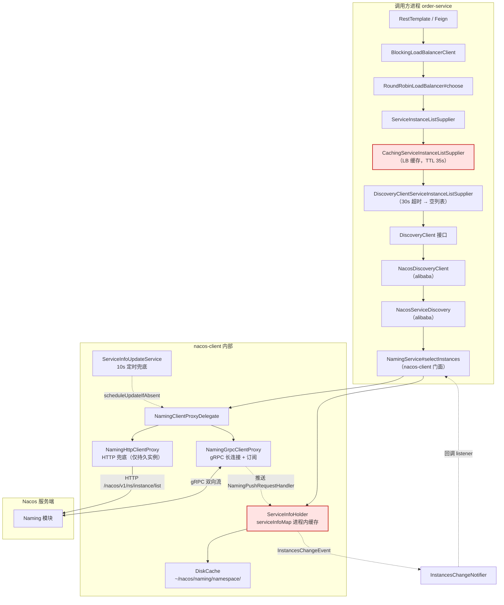
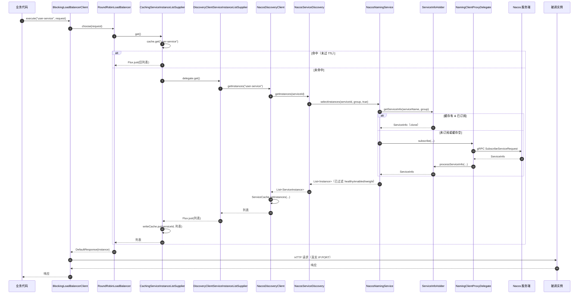

# Nacos（二）：服务发现与拉取 —— 服务实例列表到底怎么更新

> 一句话结论：调用方的实例列表不是"每次调用都问 Nacos"，而是"订阅一次、推送更新、三层缓存兜底"：`ServiceInfoHolder` 进程内缓存 → `CachingServiceInstanceListSupplier` 的 LB 缓存 → `DiskCache` 本地快照，任何一层过期都会让"已经下线的实例"继续收到流量。
>
> 阅读前置：已读 [01-nacos-服务注册与发现源码](./01-nacos-服务注册与发现源码.md)（知道注册是 `AbstractAutoServiceRegistration#start` 触发的）；知道 Spring Cloud 的 `DiscoveryClient` 是什么。
>
> 预计阅读：55 分钟 ｜ 源码：`com.alibaba.cloud:spring-cloud-starter-alibaba-nacos-discovery:2025.1.0.0`、`com.alibaba.nacos:nacos-client:3.3.0`、`org.springframework.cloud:spring-cloud-loadbalancer:5.1.0`、`org.springframework.cloud:spring-cloud-commons:5.1.0`

---

## 0. 先看现象

四个真实报障，全都指向同一套"实例列表"机制：

**现象 A：控制台已经把 user-service 的实例下线了，order-service 还在报连接拒绝。**

```
2026-11-20T10:12:31.442+08:00 ERROR 1 --- [order-service] [nio-8081-exec-3] o.a.c.c.C.[.[.[/].[dispatcherServlet] : Servlet.service() for servlet [dispatcherServlet] threw exception
java.net.ConnectException: Connection refused: /10.20.30.41:8082
...
2026-11-20T10:12:33.110+08:00 WARN  1 --- [order-service] [nio-8081-exec-4] o.s.c.l.core.RoundRobinLoadBalancer : No servers available for service: user-service
```

前 30 秒还在打已下线的 `10.20.30.41:8082`，之后才开始报"No servers available"。这段"残留窗口"就是缓存 TTL。

**现象 B：Nacos 控制台只有 1 个实例，`/actuator/health` 里 `discoveryComposite` 却报告 2 个。**

因为 actuator 走的是 `DiscoveryClient#getInstances`（走 `ServiceInfoHolder` 进程内缓存），而控制台是直接查服务端；两者本来就允许短时间不一致。

**现象 C：把 Nacos 服务端整个停掉，order-service 依然能正常启动、还能调用成功。**

不是 bug。`ServiceInfoHolder` 启动时会从 `~/nacos/naming/<namespace>/` 读磁盘快照（`nacos.naming.load-cache-at-start` 控制，默认 `false`，但很多脚手架会打开），加上 `ServiceCache` 容错，能撑一段时间。

**现象 D：`ls ~/nacos/naming/` 会看到一堆没后缀的怪文件。**

那是 `DiskCache` 写的服务快照，文件名是 `URLEncoder` 编码后的 `group@@service`。

**现象 E：把 `spring.cloud.loadbalancer.cache.ttl` 改成 3s，还是感觉"下线后 30 秒才生效"。**

因为 LB 缓存之外，还有 `ServiceInfoHolder`（由 Nacos 推送/定时刷新）和 Nacos 服务端自己的 `IP 删除延迟`（默认 15s 的 `ipDeleteTimeout`）在前面挡着。改一层不解决问题。

---

## 1. 整体地图



> 读图说明：
> 1. **左侧从上到下就是一次调用的取列表路径**：`BlockingLoadBalancerClient` 不直接问 Nacos，它问 `ServiceInstanceListSupplier`；这一层是 Spring Cloud 的抽象，可以换成 Consul/K8s。
> 2. **标红的两处是缓存**：`ServiceInfoHolder`（Nacos 客户端缓存，随推送实时更新但受推送延迟影响）与 `CachingServiceInstanceListSupplier`（Spring Cloud 侧缓存，靠 TTL 过期）。"下线后还有流量"就是这两个红框叠加的效果。
> 3. **`NamingClientProxyDelegate` 是分叉点**：临时实例走 gRPC 长连接并允许订阅推送；持久实例可能落到 HTTP。所以"为什么我订阅不到变化"要先确认实例是不是临时实例。
> 4. **虚线表示事件回调**：`InstancesChangeEvent` 由 `ServiceInfoHolder` 发布，`InstancesChangeNotifier` 分发给注册过的 listener，`NacosNamingService` 的订阅者最终拿到新列表。这是"推"的一端；`ServiceInfoUpdateService` 是"拉"的兜底。

---

## 2. 关键类逐个拆

| 类 | 所属模块 | 职责 | 关键点 |
| --- | --- | --- | --- |
| `DiscoveryClient` | spring-cloud-commons | 服务发现的**唯一契约** | 只有 `getInstances/getServices/description/getOrder` |
| `NacosDiscoveryClient` | alibaba-discovery | 契约实现，负责容错与 `ServiceCache` | `failure-tolerance-enabled` 默认 `false` |
| `NacosServiceDiscovery` | alibaba-discovery | Nacos 语义 → Spring Cloud 语义的翻译层 | `selectInstances(..., true)` 顺带订阅；`enabled/healthy` 过滤 |
| `NacosServiceInstance` | alibaba-discovery | Spring Cloud 侧实例结构 | `serviceId/instanceId/host/port/secure/metadata` |
| `NamingService` | nacos-client | 客户端门面接口 | `selectInstances` / `subscribe` / `getAllInstances` |
| `NacosNamingService` | nacos-client | 门面实现 | 缓存读 + 订阅兜底 + 集群过滤；`tryToSubscribe` |
| `ServiceInfoHolder` | nacos-client | **进程内实例缓存 + 本地快照** | `serviceInfoMap`、`processServiceInfo`、空推送保护 |
| `InstancesChangeNotifier` | nacos-client | 订阅关系注册表 | 把 `InstancesChangeEvent` 分发给 listener |
| `NamingClientProxyDelegate` | nacos-client | gRPC/HTTP 路由 | `getExecuteClientProxy` 按 `ephemeral` 选通道 |
| `NamingGrpcClientProxy` | nacos-client | gRPC 长连接 + 订阅 | `NamingPushRequestHandler` 收到推送后写 `ServiceInfoHolder` |
| `ServiceInfoUpdateService` | nacos-client | 定时兜底拉取 | 默认 10s 一次，防推送丢失 |
| `DiskCache` / `CacheDirUtil` | nacos-client | 本地快照读写 / 目录计算 | 目录 = `${user.home}/nacos/naming/<namespace>` |
| `CachingServiceInstanceListSupplier` | spring-cloud-loadbalancer | LB 层缓存 | 默认 TTL 35s，走 `LoadBalancerCacheManager` |
| `DiscoveryClientServiceInstanceListSupplier` | spring-cloud-loadbalancer | 把 `DiscoveryClient` 包成 `Flux` | 默认 30s 超时，超时**返回空列表而不是报错** |

---

## 3. 源码逐段精读

### 3.1 `DiscoveryClient`：Spring Cloud 只给了四个方法

先看契约有多"薄"。

```java (src: DiscoveryClient.java#L30-L31)
 * @author Chris Bono
 */
```

```java (src: DiscoveryClient.java#L32-L55)
public interface DiscoveryClient extends Ordered {

	/**
	 * Default order of the discovery client.
	 */
	int DEFAULT_ORDER = 0;

	/**
	 * A human-readable description of the implementation, used in HealthIndicator.
	 * @return The description.
	 */
	String description();
...
	/**
	 * Gets all ServiceInstances associated with a particular serviceId.
	 * @param serviceId The serviceId to query.
	 * @return A List of ServiceInstance.
	 */
	List<ServiceInstance> getInstances(String serviceId);
...
	/**
	 * @return All known service IDs.
	 */
	List<String> getServices();
```

- **在干什么**：`DiscoveryClient` 只规定 4 件事——描述、按服务名取实例、列出所有服务名、排序。
- **为什么这么写**：Spring Cloud 想让 Nacos / Consul / Eureka / Zookeeper / K8s 都能塞进同一个插槽，所以抽象层只留"最小公分母"。**没有** `getInstances(healthy=true)`、没有集群参数、没有权重——这些一律下沉到实现类或 `ServiceInstance#getMetadata()`。
- **如果改成**：如果契约里加 `getInstances(serviceId, cluster)`，K8s 实现根本没法对应（K8s 只有 Service/Endpoint），就得写空实现，接口就"漏抽象"了。
- **常见坑**：`getInstances` 返回 `List` 而不是 `Optional`，实现类约定"查不到返回空列表"。`NacosDiscoveryClient` 若抛异常，会被上层 `DiscoveryClientServiceInstanceListSupplier` 吞成空列表，最终只看得到 `No servers available for service`，**根因日志被埋**。

### 3.2 `NacosDiscoveryClient#getInstances`：先缓存再翻译

```java (src: NacosDiscoveryClient.java#L59-L75)
	@Override
	public List<ServiceInstance> getInstances(String serviceId) {
		try {
			return Optional.of(serviceDiscovery.getInstances(serviceId))
					.map(instances -> {
						ServiceCache.setInstances(serviceId, instances);
						return instances;
					}).get();
		}
		catch (Exception e) {
			if (failureToleranceEnabled) {
				return ServiceCache.getInstances(serviceId);
			}
			throw new RuntimeException(
					"Can not get hosts from nacos server. serviceId: " + serviceId, e);
		}
	}
```

```java (src: NacosDiscoveryClient.java#L77-L90)
	@Override
	public List<String> getServices() {
		try {
			return Optional.of(serviceDiscovery.getServices()).map(services -> {
				ServiceCache.setServiceIds(services);
				return services;
			}).get();
		}
		catch (Exception e) {
			log.error("get service name from nacos server failed.", e);
			return failureToleranceEnabled ? ServiceCache.getServiceIds()
					: Collections.emptyList();
		}
	}
```

- **在干什么**：正常路径把结果**顺手塞进** `ServiceCache`；异常路径如果开了 `spring.cloud.nacos.discovery.failure-tolerance-enabled=true`，就返回上一次的 `ServiceCache`，否则抛 `RuntimeException`。
- **为什么这么写**：`ServiceCache` 是"最后一次成功快照"，让 Nacos 抖动时调用还能活；默认关闭是怕**僵尸实例**——你宁可快速失败，也不想拿过期列表打黑洞。
- **如果改成**：直接把 `ServiceCache` 默认打开，那 Nacos 长时间不可用时服务看似正常，实际流量全打到已下线的机器，比直接报错更难排查。
- **常见坑**：`Optional.of(...).map(...).get()` 在 `serviceDiscovery.getInstances` 返回 `null` 时会 NPE（被下面的 `catch (Exception)` 抓住，于是走进 `failureToleranceEnabled` 分支）——所以"返回 null"和"抛异常"在行为上等价，日志却完全不同。

### 3.3 `NacosServiceDiscovery#getInstances`：订阅式拉取

```java (src: NacosServiceDiscovery.java#L56-L61)
	public List<ServiceInstance> getInstances(String serviceId) throws NacosException {
		String group = discoveryProperties.getGroup();
		List<Instance> instances = namingService().selectInstances(serviceId, group,
				true);
		return hostToServiceInstanceList(instances, serviceId);
	}
```

- **在干什么**：拿 `group` 配置，调用 `selectInstances(serviceId, group, true)`——**第三个参数 `subscribe=true`** 是关键。
- **为什么这么写**：Spring Cloud 期望"高频取列表"，如果每次都走 RPC，Nacos 会被打爆。所以第一次调用就**顺带订阅**，之后都从本地缓存取。
- **如果改成**：传 `false` 就变成每次都 `queryInstancesOfService`（网络请求），列表更实时但吞吐骤降，还会触发服务端限流。
- **常见坑**：`group` 来自 `spring.cloud.nacos.discovery.group`，默认 `DEFAULT_GROUP`。**调用方与提供方 group 不一致时返回空列表**，日志里只有 `No servers available`，看起来像"服务没注册"。

### 3.4 `NacosServiceDiscovery#hostToServiceInstance`：翻译 + 两道过滤

```java (src: NacosServiceDiscovery.java#L87-L96)
	public static ServiceInstance hostToServiceInstance(Instance instance,
			String serviceId) {
		if (instance == null || !instance.isEnabled() || !instance.isHealthy()) {
			return null;
		}
		NacosServiceInstance nacosServiceInstance = new NacosServiceInstance();
		nacosServiceInstance.setHost(instance.getIp());
		nacosServiceInstance.setPort(instance.getPort());
		nacosServiceInstance.setServiceId(serviceId);
		nacosServiceInstance.setInstanceId(instance.getInstanceId());
```

```java (src: NacosServiceDiscovery.java#L87-L114)
	public static ServiceInstance hostToServiceInstance(Instance instance,
			String serviceId) {
		if (instance == null || !instance.isEnabled() || !instance.isHealthy()) {
			return null;
		}
		NacosServiceInstance nacosServiceInstance = new NacosServiceInstance();
		nacosServiceInstance.setHost(instance.getIp());
		nacosServiceInstance.setPort(instance.getPort());
		nacosServiceInstance.setServiceId(serviceId);
		nacosServiceInstance.setInstanceId(instance.getInstanceId());

		Map<String, String> metadata = new HashMap<>();
		metadata.put("nacos.instanceId", instance.getInstanceId());
		metadata.put("nacos.weight", instance.getWeight() + "");
		metadata.put("nacos.healthy", instance.isHealthy() + "");
		metadata.put("nacos.cluster", instance.getClusterName() + "");
		if (instance.getMetadata() != null) {
			metadata.putAll(instance.getMetadata());
		}
		metadata.put("nacos.ephemeral", String.valueOf(instance.isEphemeral()));
		nacosServiceInstance.setMetadata(metadata);

		if (metadata.containsKey("secure")) {
			boolean secure = Boolean.parseBoolean(metadata.get("secure"));
			nacosServiceInstance.setSecure(secure);
		}
		return nacosServiceInstance;
	}
```

- **在干什么**：`enabled=false` 或 `healthy=false` 的实例**直接丢**（返回 `null`，上层过滤）；其余复制到 `NacosServiceInstance`，并把 `instanceId/weight/healthy/cluster` 摊进 metadata（前缀 `nacos.`）；metadata 里有 `secure` 就设 `secure=true`（URL scheme 变 `https`）。
- **为什么这么写**：Spring Cloud 的 `ServiceInstance` 只有 5 个字段，Nacos 想传更多"软信息"只能走 metadata；前缀 `nacos.` 避免与业务 metadata 撞名。
- **如果改成**：不过滤健康状态，LB 就会把 `DOWN` 实例选中，白丢一次请求——Nacos 的心跳/健康检查等于白做。
- **常见坑**：`metadata.putAll(instance.getMetadata())` 在**后面**，所以业务 metadata 里若写了 `nacos.weight`，会**覆盖**客户端算出来的真实权重。

### 3.5 `NacosNamingService#selectInstances`：过滤三层

```java (src: NacosNamingService.java#L354-L370)
    private List<Instance> selectInstances(ServiceInfo serviceInfo, boolean healthy) {
        List<Instance> list;
        if (serviceInfo == null || CollectionUtils.isEmpty(list = serviceInfo.getHosts())) {
            return new ArrayList<>();
        }
        
        Iterator<Instance> iterator = list.iterator();
        while (iterator.hasNext()) {
            Instance instance = iterator.next();
            if (healthy != instance.isHealthy() || !instance.isEnabled()
                || instance.getWeight() <= 0) {
                iterator.remove();
            }
        }
        
        return list;
    }
```

- **在干什么**：在**客户端**按三条规则剔除实例：健康标记不符、`enabled=false`、`weight<=0`。
- **为什么这么写**：服务端返回完整实例列表（含所有集群、所有状态），过滤放客户端能少一次网络往返，也方便按 `clusters` 只拉自己关心的部分。
- **如果改成**：如果把过滤放服务端，Nacos 就要为每个调用方组合 `healthy/weight/enabled` 参数，服务端压力会大很多。
- **常见坑**：`getWeight() <= 0` 会被剔除——**权重设 0 不是"不接收流量"，而是"从列表里消失"**；想摘流量请用 `enabled=false`（控制台下线）或停止服务。

### 3.6 `getServiceInfo`：先看熔断开关，再决定订阅还是直查

```java (src: NacosNamingService.java#L372-L389)
    private ServiceInfo getServiceInfo(String serviceName, String groupName, List<String> clusters,
        boolean subscribe)
        throws NacosException {
        ServiceInfo serviceInfo;
        NamingSelector clusterSelector = NamingSelectorFactory.newClusterSelector(clusters);
        if (serviceInfoHolder.isFailoverSwitch()) {
            serviceInfo = getServiceInfoByFailover(serviceName, groupName, clusterSelector);
            if (serviceInfo != null && !serviceInfo.getHosts().isEmpty()) {
                NAMING_LOGGER.debug("getServiceInfo from failover,serviceName: {}  data:{}",
                    serviceName,
                    JsonUtils.toJson(serviceInfo.getHosts()));
                return serviceInfo;
            }
        }
        serviceInfo = getServiceInfoBySubscribe(serviceName, groupName, clusters, clusterSelector,
            subscribe);
        return serviceInfo;
    }
```

- **在干什么**：先看 `isFailoverSwitch()`（本地故障转移文件），命中就直接返回；否则走订阅路径。
- **为什么这么写**：故障转移文件是给"服务端整个不可用"准备的最后一道保险，优先级高于正常路径。
- **如果改成**：把 failover 放在后面，它永远命中不了——因为正常路径也会返回缓存。
- **常见坑**：`serviceInfoHolder.isFailoverSwitch()` 是**全局**开关（`FailoverReactor` 的 switch 文件），一旦不小心打开，所有服务都读本地文件，线上表现为"怎么改 Nacos 都不生效"。

### 3.7 `getServiceInfoBySubscribe`：订阅优先，未订阅才 RPC

```java (src: NacosNamingService.java#L397-L411)
    private ServiceInfo getServiceInfoBySubscribe(String serviceName, String groupName,
        List<String> clusters,
        NamingSelector selector, boolean subscribe) throws NacosException {
        ServiceInfo serviceInfo;
        if (subscribe) {
            serviceInfo = serviceInfoHolder.getServiceInfo(serviceName, groupName);
            serviceInfo = tryToSubscribe(serviceName, groupName, serviceInfo);
            serviceInfo = doSelectInstance(serviceInfo, selector);
        } else {
            String clusterString = NamingSelectorFactory.getUniqueClusterString(clusters);
            serviceInfo = clientProxy.queryInstancesOfService(serviceName, groupName, clusterString,
                false);
        }
        return serviceInfo;
    }
```

- **在干什么**：`subscribe=true` 时先从 `ServiceInfoHolder` 读缓存，再 `tryToSubscribe`（必要时发起订阅），最后按集群选择；`subscribe=false` 时直接走一次 RPC。
- **为什么这么写**：把"读缓存"与"建立订阅"合成一步，调用方无感；`doSelectInstance` 在缓存之上再做集群过滤，避免每换一次集群参数就重新订阅。
- **如果改成**：先 RPC 再订阅，首次调用会多一次网络往返，而且高并发下会重复订阅（`NacosNamingService` 用 `changeNotifier` 去重）。
- **常见坑**：`clusterString` 为空字符串时表示"所有集群"，不是"默认集群"。

### 3.8 `tryToSubscribe`：三种状态，别把 warn 当错误

```java (src: NacosNamingService.java#L413-L433)
    private ServiceInfo tryToSubscribe(String serviceName, String groupName,
        ServiceInfo cachedServiceInfo)
        throws NacosException {
        // not found in cache, service never subscribed.
        if (null == cachedServiceInfo) {
            return clientProxy.subscribe(serviceName, groupName, StringUtils.EMPTY);
        }
        // found in cache, and subscribed.
        if (clientProxy.isSubscribed(serviceName, groupName, StringUtils.EMPTY)) {
            return cachedServiceInfo;
        }
        // found in cached, but not subscribed, such as cached from local file when starting.
        ServiceInfo result = cachedServiceInfo;
        try {
            result = clientProxy.subscribe(serviceName, groupName, StringUtils.EMPTY);
        } catch (NacosException e) {
            NAMING_LOGGER.warn("Subscribe from Server failed, will use local cache. fail message: ",
                e);
        }
        return result;
    }
```

- **在干什么**：三种情况——缓存空（首次，订阅并同步返回）、已有缓存且已订阅（直接返回）、有缓存但没订阅（从磁盘快照恢复的场景，**尝试订阅，失败只 warn 并继续用缓存**）。
- **为什么这么写**：第三种情况常出现在"启动时加载了本地快照，但 gRPC 还没连上"。此时服务必须能起来，不能因为订阅失败就整体不可用。
- **如果改成**：订阅失败直接抛异常，Nacos 短暂不可用会导致所有服务启动失败——这就是"服务端一挂，全站起不来"。
- **常见坑**：日志里出现 `Subscribe from Server failed, will use local cache.` 说明**你现在看到的是快照数据**，下线变更永远不会生效，直到订阅恢复。这是排查"改了实例列表不生效"的第一现场。

### 3.9 `ServiceInfoHolder` 构造：快照目录从哪来

```java (src: ServiceInfoHolder.java#L68-L72)
        if (isLoadCacheAtStart(properties)) {
            this.serviceInfoMap = new ConcurrentHashMap<>(DiskCache.read(this.cacheDir));
        } else {
            this.serviceInfoMap = new ConcurrentHashMap<>(16);
        }
```

- **在干什么**：`nacos.naming.load-cache-at-start=true` 时，启动即把磁盘快照全量读进内存；否则空表。
- **为什么这么写**：容器化场景"Pod 重启"非常频繁，读快照能让第一个请求不必等 gRPC 建连；默认关闭是因为快照里可能全是过期实例。
- **如果改成**：默认打开，冷启动时 LB 会先拿到旧列表，出现"刚发布完，流量还在打旧 Pod"。
- **常见坑**：开发机 `~/nacos/naming/` 里的文件可能来自**别的项目/别的 namespace**；排查怪异现象时先 `rm -rf ~/nacos/naming` 再启动。

### 3.10 `ServiceInfoHolder#processServiceInfo`：推送写缓存 + 发布变更事件

```java (src: ServiceInfoHolder.java#L129-L146)
    public ServiceInfo processServiceInfo(ServiceInfo serviceInfo) {
        String serviceKey = serviceInfo.getKeyWithoutClusters();
        if (serviceKey == null) {
            NAMING_LOGGER.warn("process service info but serviceKey is null, service host: {}",
                JsonUtils.toJson(serviceInfo.getHosts()));
            return null;
        }
        ServiceInfo oldService = serviceInfoMap.get(serviceKey);
        if (isEmptyOrErrorPush(serviceInfo)) {
            //empty or error push, just ignore
            NAMING_LOGGER.warn(
                "process service info but found empty or error push, serviceKey: {}, "
                    + "pushEmptyProtection: {}, hosts: {}",
                serviceKey, pushEmptyProtection, serviceInfo.getHosts());
            return oldService;
        }
        serviceInfoMap.put(serviceKey, serviceInfo);
        InstancesDiff diff = getServiceInfoDiff(oldService, serviceInfo);
```

```java (src: ServiceInfoHolder.java#L159-L172)
        if (diff.hasDifferent()) {
            NAMING_LOGGER.info("current ips:({}) service: {} -> {}", serviceInfo.ipCount(),
                serviceKey,
                JsonUtils.toJson(serviceInfo.getHosts()));
            
            if (!failoverReactor.isFailoverSwitch(serviceKey)) {
                NotifyCenter.publishEvent(
                    new InstancesChangeEvent(notifierEventScope, serviceInfo.getName(),
                        serviceInfo.getGroupName(),
                        serviceInfo.getClusters(), serviceInfo.getHosts(), diff));
            }
            publishDiskCacheRefreshEvent(serviceKey, serviceInfo);
        }
        return serviceInfo;
```

- **在干什么**：拿到推送的 `ServiceInfo` 后 ①空/错误推送一律丢弃并保留旧值（`isEmptyOrErrorPush`）②写 `serviceInfoMap` ③算 diff ④有变化才发 `InstancesChangeEvent` ⑤刷磁盘快照。
- **为什么这么写**：`pushEmptyProtection` 防的是"服务端抖动推了个空列表把所有实例删光"；只在 diff 有变化时发事件，是为了避免无意义唤醒所有订阅者。
- **如果改成**：每次都发事件，`NacosWatch` 会疯狂发 `HeartbeatEvent`，actuator 与下游监听者都会被刷爆。
- **常见坑**：日志 `current ips:(N) service: DEFAULT_GROUP@@user-service -> [...]` 是**推送收到**的铁证；如果一直看不到这条日志，说明订阅没建立成功（回到 3.8）。

### 3.11 为什么"下线实例之后调用方还有流量"：三层缓存叠加

| 层 | 组件 | 生效延迟来源 | 默认值 | 调整手段 |
| --- | --- | --- | --- | --- |
| ① Nacos 服务端 | 临时实例心跳超时 / `ipDeleteTimeout` | 心跳丢失判定 | 15s 级 | 服务端 `nacos.naming.clean.*`、客户端 `PreservedMetadataKeys.IP_DELETE_TIMEOUT` |
| ② nacos-client | `ServiceInfoHolder` + 推送 | 推送到达时间 | 近实时 | 无直接开关，靠健康 gRPC 长连接 |
| ③ nacos-client 兜底 | `ServiceInfoUpdateService` | 定时拉取周期 | 10s | `nacos.naming.polling.*` |
| ④ Spring Cloud LB | `CachingServiceInstanceListSupplier` | TTL | 35s（`spring.cloud.loadbalancer.cache.ttl`） | 改 TTL 或关缓存 |
| ⑤ Spring Cloud LB 超时 | `DiscoveryClientServiceInstanceListSupplier` | 查询超时→返回**空** | 30s | `spring.cloud.loadbalancer.service-discovery.timeout` |
| ⑥ 本地快照 | `DiskCache` | 启动时加载 | 关闭 | `nacos.naming.load-cache-at-start` |

```java (src: CachingServiceInstanceListSupplier.java#L51-L80)
	public CachingServiceInstanceListSupplier(ServiceInstanceListSupplier delegate, CacheManager cacheManager) {
		super(delegate);
		String serviceId = delegate.getServiceId();
		this.serviceInstances = Flux.defer(() -> {
			// TODO: configurable cache name
			Cache cache = cacheManager.getCache(SERVICE_INSTANCE_CACHE_NAME);
			if (cache == null) {
				if (log.isErrorEnabled()) {
					log.error("Unable to find cache: " + SERVICE_INSTANCE_CACHE_NAME);
				}
			}
			else {
				List<ServiceInstance> list = cache.get(serviceId, List.class);
				if (list != null && !list.isEmpty()) {
					return Flux.just(list);
				}
			}
			return delegate.get().take(1).doOnNext(instances -> {
				Cache writeCache = cacheManager.getCache(SERVICE_INSTANCE_CACHE_NAME);
				if (writeCache == null) {
					if (log.isErrorEnabled()) {
						log.error("Unable to find cache for writing: " + SERVICE_INSTANCE_CACHE_NAME);
					}
				}
				else {
					writeCache.put(serviceId, instances);
				}
			});
		});
	}
```

- **在干什么**：先查缓存，命中直接用；未命中才调 `delegate.get()`（真正去问 `DiscoveryClient`），同时写缓存。
- **为什么这么写**：`getInstances` 一次可能涉及一次 gRPC 或 HTTP，而 LB 是**每个请求**都要取列表的，不缓存会把 Nacos 打挂。
- **如果改成**：关掉 LB 缓存（`spring.cloud.loadbalancer.cache.enabled=false`），列表实时性最好，但 QPS 一高就会出现 `GetServiceInfo` 超时。
- **常见坑**：`cache.get(getServiceId(), List.class)` 命中后**直接返回**，所以"实例删了但列表不变"最多持续一个 TTL；如果你的 `LoadBalancerCacheManager` 是 Caffeine 且 `ttl` 配成了 300s，就会看到"下线 5 分钟后还有流量"。

### 3.12 `DiscoveryClientServiceInstanceListSupplier`：超时吞成空列表

```java (src: DiscoveryClientServiceInstanceListSupplier.java#L67-L75)
		this.serviceInstances = Flux.defer(() -> Mono.fromCallable(() -> delegate.getInstances(serviceId)))
			.timeout(timeout, Flux.defer(() -> {
				logTimeout();
				return Flux.just(new ArrayList<>());
			}), Schedulers.boundedElastic())
			.onErrorResume(error -> {
				logException(error);
				return Flux.just(new ArrayList<>());
			});
```

- **在干什么**：`getInstances` 超时或异常时**返回空列表**，让 LB 走 `EmptyResponse`。
- **为什么这么写**：明确"当前没有可用实例"，比让异常冒泡到业务层更容易统一处理（也避免一个慢注册中心拖垮所有请求线程）。
- **如果改成**：抛异常，业务侧要处理 `DiscoveryException`；Spring Cloud 选择不这么做，是为了让 LB 的降级逻辑（比如 `EmptyResponse` + 日志）集中在一处。
- **常见坑**：日志里 `No servers available for service: user-service` **常常是超时导致的假象**，而不是真的没实例。要看 `logTimeout()` 打出的 warn。

### 3.13 `CacheDirUtil#initCacheDir`：快照文件在哪

```java (src: CacheDirUtil.java#L50-L73)
    public static String initCacheDir(String namespace, NacosClientProperties properties) {
        
        String jmSnapshotPath = properties.getProperty(JM_SNAPSHOT_PATH_PROPERTY);
        
        String namingCacheRegistryDir = "";
        if (properties.getProperty(PropertyKeyConst.NAMING_CACHE_REGISTRY_DIR) != null) {
            namingCacheRegistryDir =
                File.separator
                    + properties.getProperty(PropertyKeyConst.NAMING_CACHE_REGISTRY_DIR);
        }
        
        if (!StringUtils.isBlank(jmSnapshotPath)) {
            cacheDir = jmSnapshotPath + File.separator + FILE_PATH_NACOS + namingCacheRegistryDir
                + File.separator
                + FILE_PATH_NAMING + File.separator + namespace;
        } else {
            cacheDir =
                properties.getProperty(USER_HOME_PROPERTY) + File.separator + FILE_PATH_NACOS
                    + namingCacheRegistryDir
                    + File.separator + FILE_PATH_NAMING + File.separator + namespace;
        }
        
        return cacheDir;
    }
```

- **在干什么**：拼出快照目录——默认 `${user.home}/nacos/naming/<namespace>`，可用 `JM.SNAPSHOT.PATH` 改根目录，可用 `nacos.naming.cache.registry.dir` 插一层。
- **为什么这么写**：`JM.SNAPSHOT.PATH` 是阿里历史约定（JM = Java Middleware），容器里挂共享盘就能让 Pod 重启后秒级拿到实例列表。
- **如果改成**：如果直接写当前目录，多个应用会互相覆盖快照。
- **常见坑**：多个 Spring Cloud 应用跑在同一台开发机上，**共用同一个 `~/nacos/naming/default/`**，于是 A 应用写的 `user-service` 快照会污染 B 应用。本地排查前先清理该目录。

---

## 4. 一次完整执行时序

场景：order-service 第三次请求 user-service（缓存过期，触发刷新）。



> 读图说明：
> 1. **只有在缓存未命中时才走到 Nacos**，所以"调用越快、Nacos 压力越小"是设计目标，不是巧合。
> 2. **`alt` 内层的第二个分支**才是真正的网络交互，两条路都会让 `ServiceInfoHolder` 成为最新数据的唯一内存来源。
> 3. **`ServiceCache.setInstances` 与 `CACHE` 写缓存是两次独立写入**，前者在 alibaba 层（给容错用），后者在 LB 层（给性能用），两者 TTL/失效策略不同。
> 4. **推送（`SubscribeServiceRequest` 之后的 push）不在这个时序里**：它是一条独立的长连接回调，随时可能触发 `processServiceInfo`，所以服务端一改实例，`ServiceInfoHolder` 立刻更新，但 `CACHE` 仍要等 TTL 过期。

---

## 5. 设计模式与取舍

| 模式 | 出现在哪 | 作用 |
| --- | --- | --- |
| 门面（Facade） | `NamingService` → `NacosNamingService` | 对外屏蔽 gRPC/HTTP、订阅、缓存、集群过滤的差异 |
| 委派 + 策略路由 | `NamingClientProxyDelegate#getExecuteClientProxy` | 按 `ephemeral`/服务端能力选 gRPC 或 HTTP |
| 观察者 | `InstancesChangeEvent` + `InstancesChangeNotifier` + `NacosWatch` | 实例变化一次发布，多方消费（LB、actuator、自定义 listener） |
| 装饰器（Decorator） | `ServiceInstanceListSupplier` 链 | `withDiscoveryClient().withCaching()` 一层层包，能力可叠加 |
| 缓存 + 快照 | `ServiceInfoHolder` + `DiskCache` | 内存优先、磁盘兜底，牺牲一致性换可用性 |
| 空推送保护（Guard） | `ServiceInfoHolder#isEmptyOrErrorPush` | 防止一次错误推送清空全部实例 |

**取舍总述**：这套设计明确选择了 **最终一致 + 高可用**，而不是强一致。代价是"下线后还有流量"的窗口必然存在（最小约等于服务端判定心跳超时 + 推送延迟 + LB TTL）。工程上要接受这个窗口，并把它压到可接受范围：

1. **优雅下线**：先 `NacosServiceRegistry#setStatus(DOWN)` 或调 `deregister`，再等待 `spring.cloud.loadbalancer.cache.ttl` 的时长（默认 35s）才真正停进程；
2. **缩短 LB TTL**：`spring.cloud.loadbalancer.cache.ttl=5s`，代价是 Nacos 查询 QPS 上升；
3. **不要依赖 `weight=0`** 摘流量（会被 `selectInstances` 直接剔除，看起来像"实例消失"）；
4. **K8s 场景**可以叠加 `preStop` + `readinessProbe`，让 LB 层先摘流量。

---

## 6. 踩坑与调试手法

1. **先看 `current ips:(N) service: ...` 日志**。有这条说明推送正常；一直没有说明订阅没建起来（gRPC 不通 / 端口 9848 被拦）。
2. **确认是不是临时实例**。控制台"临时实例"为否时，变更不会推送，只能靠 `ServiceInfoUpdateService` 定时拉。
3. **打开 actuator 对比**：`/actuator/health/discoveryComposite` 看的是 `DiscoveryClient`（客户端缓存），和 Nacos 控制台不一致是正常的。
4. **看 LB 缓存是否在作怪**：临时把 `spring.cloud.loadbalancer.cache.enabled` 设 `false`，如果问题消失，就是 TTL 问题。
5. **留意 `No servers available` 前的超时 warn**：`spring.cloud.loadbalancer.service-discovery.timeout` 调大再试，区分"真的没实例"和"查询超时"。
6. **清理本地快照**：`rm -rf ~/nacos/naming`（Windows：`%USERPROFILE%\nacos\naming`），排除跨项目污染。
7. **确认 `group`/`namespace` 一致**：`spring.cloud.nacos.discovery.group`、`spring.cloud.nacos.discovery.namespace`，不一致时表现为"空列表"而不是报错。
8. **不要长期开启 `failure-tolerance-enabled`**：它会把 Nacos 故障掩盖成"一切正常但偶尔连不上"。
9. **`NacosWatch` 的心跳事件**：`HeartbeatEvent` 默认 30s 一次（`spring.cloud.nacos.discovery.watch-delay`），不要在里面做重活。
10. **优雅下线顺序**：`deregister` → 等 LB TTL → `shutdown`，直接把顺序反过来就会出现"实例已注销、流量还在打"。

---

## 7. ⚠️ 版本差异

| 版本 | 差异 |
| --- | --- |
| nacos-client `1.x` | 服务端 HTTP 长轮询（`/nacos/v1/ns/instance/list` + `Long-Polling`），无 gRPC；所有实例走 HTTP |
| nacos-client `2.0+` | 引入 gRPC 长连接（默认 9848 端口），注册/订阅改走 gRPC；HTTP 仅保留兼容查询 |
| nacos-client `2.3+` | `NamingHttpClientProxy` 明确**拒绝**通过 HTTP 注册临时实例（`Do not support register ephemeral instances by HTTP`）；持久实例也可走 gRPC（`AbilityKey.SERVER_PERSISTENT_INSTANCE_BY_GRPC`） |
| nacos-client `3.x`（本仓库 `3.3.0`） | 命名空间隔离/多命名空间客户端（`NacosClientProperties` 取代裸 `Properties`）、`NacosFuzzyWatchServiceListHolder`、安全代理登录；`CacheDirUtil` 增加 `naming.cache.registry.dir` 分层 |
| spring-cloud-alibaba `2021.0.1.0` → `2022.x` → `2025.x` | `NacosWatch` 与 `NacosDiscoveryHeartBeatPublisher` 的默认启用关系有变化，**待官方 release notes 核实**；本文只描述当前 `2025.1.0.0` 的行为 |
| spring-cloud-loadbalancer `4.x` → `5.1.0`（train `2026.0.0`） | `LoadBalancerCacheProperties.ttl` 默认值仍为 `35s`；`@LoadBalancerClients(defaultConfiguration = ...)` 仍是扩展入口；Ribbon 已在 2021.x 彻底移除，最后一层"Ribbon 遗留缓存"只存在于老项目 |
| 未核实 | `NacosDiscoveryProperties` 中 `ephemeral` 默认值在 `2025.1.0.0` 为 `true`（源码可读），跨大版本是否变化请以官方文档为准 |

---

## 8. 面试高频问与答

1. **`DiscoveryClient#getInstances` 为什么返回空列表而不是抛异常？** → 契约上"查不到"是常态（服务未上线、group 写错），返回空能让 LB 统一走 `EmptyResponse`；异常会让每个调用点都要写 try/catch。
2. **实例列表更新的实时性由哪几层决定？** → Nacos 服务端心跳判定 → gRPC 推送 → `ServiceInfoHolder` → `CachingServiceInstanceListSupplier` TTL → 本地快照。
3. **`selectInstances(serviceId, group, true)` 的第三个参数是什么？** → `subscribe`，为 `true` 时会顺带建立订阅，之后都从缓存取。
4. **`weight=0` 和 `enabled=false` 有什么区别？** → `weight<=0` 会被客户端直接从列表剔除（等于"不存在"）；`enabled=false` 是下线，同样被过滤，但语义上明确表示"人为下线"。
5. **为什么订阅会失败但服务还能用？** → `tryToSubscribe` 在"有本地快照但未订阅"时只 warn 不抛错，保证启动可用性。
6. **`isEmptyOrErrorPush` 保护的是什么？** → 防止服务端异常推送空列表把所有实例清空；`pushEmptyProtection` 开启时连 `validate()` 失败也一并忽略。
7. **`ServiceInfoUpdateService` 还有必要吗？** → 有：推送可能丢失（长连接断开、服务端重启），定时拉取是兜底，默认 10s。
8. **`NamingClientProxyDelegate` 为什么要同时持有 gRPC 与 HTTP 两个代理？** → 兼容老服务端（不支持 gRPC 持久实例）与持久实例场景；临时实例强制走 gRPC。
9. **LB 层缓存的 TTL 怎么改？改完为什么感觉没用？** → `spring.cloud.loadbalancer.cache.ttl`；感觉没用是因为 `ServiceInfoHolder` 的更新延迟与服务端心跳超时在前面。
10. **本地快照有什么用、有什么坑？** → 启动秒级可用；坑是可能加载过期数据、多项目共用目录互相污染。
11. **`NacosDiscoveryClient` 的 `ServiceCache` 与 LB 缓存有什么区别？** → 前者是"最后一次成功结果"用于容错（默认关闭），后者是"性能缓存"按 TTL 失效（默认开启）。
12. **怎么做到秒级下线？** → 主动 `deregister`/`setStatus(DOWN)` + 调小 LB TTL + 优雅停机等待窗口；只调小一层不够。

---

## 9. 动手练习

1. **打印实例列表变化日志**。开启 `logging.level.com.alibaba.nacos.client.naming=DEBUG`，下线一个实例，观察 `current ips:(N) service: ...` 与 `InstancesChangeEvent` 的输出顺序。**验收**：能贴出"推送日志 → LB 新列表"两条时间戳，并算出延迟。
2. **关掉 LB 缓存验证 TTL**。设置 `spring.cloud.loadbalancer.cache.enabled=false` 后重复练习 1。**验收**：延迟显著下降，且 Nacos 侧日志频率明显上升。
3. **制造"只读快照"场景**。把 `nacos.naming.load-cache-at-start=true`，启动后立刻停掉 Nacos，调用一次接口。**验收**：能解释为什么会看到 `Subscribe from Server failed, will use local cache.` 并成功返回。
4. **观察快照文件**。找到 `~/nacos/naming/<namespace>/` 下的文件，用 `URLDecoder` 还原服务名。**验收**：说出文件名与 `group@@service` 的对应关系。
5. **复现"组不一致"**。把调用方 `spring.cloud.nacos.discovery.group` 改成 `OTHER_GROUP`。**验收**：日志只有 `No servers available`，并能在 `NacosNamingService` 层定位到返回空列表。
6. **写一个自定义 listener**。实现 `AbstractEventListener<InstancesChangeEvent>` 并 `NotifyCenter.registerSubscriber`，打印实例变化。**验收**：能收到与 `current ips` 日志一一对应的事件。

---

## 小结

- 调用方拿实例列表走的是"订阅 + 缓存"路线，不是"每次调 Nacos 查一次"。
- `DiscoveryClient` 契约极薄（4 个方法），Nacos 的丰富信息靠 `metadata` 的 `nacos.*` 前缀带出来。
- `NacosServiceDiscovery` 在客户端做了 `enabled/healthy/weight` 的三重过滤；`weight<=0` 等于实例消失。
- `NacosNamingService` 的 `subscribe=true` 会顺带建立订阅；`tryToSubscribe` 在"有快照未订阅"时只 warn，保证可用性。
- `ServiceInfoHolder` 是 Nacos 客户端的唯一内存真相，推送（`NamingPushRequestHandler`）与定时拉取（`ServiceInfoUpdateService`）都会写它。
- `CachingServiceInstanceListSupplier` 默认 35s TTL，`DiscoveryClientServiceInstanceListSupplier` 默认 30s 超时并返回空列表。
- "下线后还有流量"是三层缓存叠加的正常现象，缩小窗口要靠主动下线 + 调 TTL + 优雅停机。
- 本地快照目录默认 `${user.home}/nacos/naming/<namespace>`，是多项目互相污染的常见来源。

---

## 自测题

1. `DiscoveryClient` 接口定义了哪几个方法？为什么没有集群/权重参数？
2. `NacosDiscoveryClient#getInstances` 在异常时做了哪两种处理？由哪个配置切换？
3. `selectInstances(serviceId, group, true)` 中 `true` 的含义是什么？传 `false` 时行为有何不同？
4. `hostToServiceInstance` 会过滤掉哪些实例？为什么会返回 `null` 而不是抛异常？
5. `ServiceInfoHolder` 的 `pushEmptyProtection` 解决什么问题？
6. `tryToSubscribe` 的三种分支分别对应什么运行状态？
7. LB 缓存默认 TTL 是多少？配置项叫什么？改它为什么可能"感觉没生效"？
8. `DiscoveryClientServiceInstanceListSupplier` 在超时时返回什么？这会导致什么日志表现？
9. 本地快照的默认目录是什么？`JM.SNAPSHOT.PATH` 有什么用？
10. 要把"实例下线后的残留流量窗口"压到最小，你会按什么顺序做哪几件事？

<details><summary>参考答案要点</summary>

1. `description()`、`getInstances(String)`、`getServices()`、`getOrder()`（继承 `Ordered`）。没有集群/权重参数是为了让 Consul/Eureka/K8s 都能实现，保持最小公分母；扩展信息走 `ServiceInstance#getMetadata()`。
2. 若 `failureToleranceEnabled`（`spring.cloud.nacos.discovery.failure-tolerance-enabled`）为 `true`，返回 `ServiceCache` 中上次成功的列表；否则抛 `RuntimeException("Can not get hosts from nacos server. serviceId: ...")`。
3. `true` 表示顺带建立订阅，之后从 `ServiceInfoHolder` 缓存读；`false` 时每次走 `clientProxy.queryInstancesOfService` 的 RPC，实时但吞吐差。
4. 过滤 `instance == null`、`!isEnabled()`、`!isHealthy()`；返回 `null` 让上层 `hostToServiceInstanceList` 统一收集过滤，避免在半路抛异常打断整批转换。
5. 防止服务端异常/抖动推送空列表或校验失败的 `ServiceInfo` 把 `serviceInfoMap` 清空，从而让调用方瞬间"无实例可用"。
6. ①缓存为空（首次访问，订阅并返回）②有缓存且已订阅（直接返回缓存）③有缓存但未订阅（多为启动加载快照，尝试订阅，失败只 warn 并用缓存）。
7. 默认 35s，配置 `spring.cloud.loadbalancer.cache.ttl`；感觉没生效是因为前面还有 Nacos 服务端心跳超时、推送延迟与 `ServiceInfoHolder` 的刷新，且下游可能还有 `ServiceCache`/本地快照。
8. 返回空列表（`Flux.just(new ArrayList<>())`），并打 `logTimeout()`；表现为紧跟着的 `No servers available for service: xxx`，容易被误判成"服务没注册"。
9. 默认 `${user.home}/nacos/naming/<namespace>`；`JM.SNAPSHOT.PATH` 用于改根目录，容器里挂共享卷实现 Pod 重启秒级可用。
10. ①提供方主动 `deregister`/`setStatus(DOWN)` ②调小 `spring.cloud.loadbalancer.cache.ttl` ③确认 `nacos.naming.load-cache-at-start=false` ④优雅停机等待 ≥ LB TTL 再退出 ⑤K8s 场景叠加 `preStop`/`readinessProbe`。

</details>
