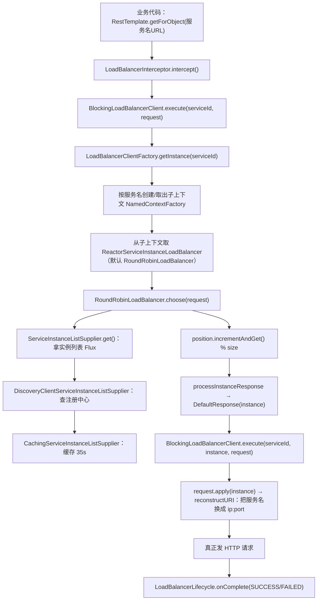

# Spring Cloud 源码精读 03-1：LoadBalancer —— 负载均衡与轮询策略到底是怎么选出一台机器的

> **一句话结论**：Spring Cloud LoadBalancer 的核心只有三件事——**按服务名拿实例列表**（`ServiceInstanceListSupplier`）、**用一条规则从列表里挑一个**（`ReactorLoadBalancer`，默认 `RoundRobinLoadBalancer`）、**把 `http://服务名/路径` 改写成 `http://ip:port/路径`**（`reconstructURI`）。默认轮询的全部"算法"就是一个 `AtomicInteger` 自增后取模。
>
> | 项目 | 说明 |
> | --- | --- |
> | 阅读前置 | 知道什么是注册中心（Nacos/Eureka）、看过 `RestTemplate` 或 `WebClient` 发 HTTP 请求、了解 `Mono/Flux` 是"将来才会有的一个/多个值" |
> | 预计阅读 | 60–75 分钟（含动手练习约 2 小时） |
> | 源码基线 | `org.springframework.cloud:spring-cloud-loadbalancer:5.1.0`、`spring-cloud-commons:5.1.0`（均已入库 `assets/source/`，下文行号均指入库文件） |
> | 配套阅读 | [03-2 OpenFeign 动态代理与请求拼接](02-openfeign-动态代理与请求拼接.md)、[04-1 Gateway 路由断言与过滤器链](../04-网关Gateway/01-route-路由断言与过滤器链.md) |

---

## 0. 先看现象

### 0.1 一个让新人困惑的场景

你写了一个订单服务（两个实例：`10.0.0.1:8081`、`10.0.0.2:8081`），在商品服务里用服务名调用它：

```yaml
# 调用方配置（示意）
product-service:
  order-base-url: http://order-service   # 写的是服务名，不是 IP
```

```java
// 示意（≤8 行）
@Bean @LoadBalanced
RestTemplate restTemplate() {
    return new RestTemplate();
}

// 业务代码
Order o = restTemplate.getForObject("http://order-service/orders/42", Order.class);
```

一切都"神奇地"工作了：没有 IP、没有端口，请求却轮流打到两台机器上。新人常见的困惑有这几类：

| # | 现象 | 第一反应（通常是错的） | 真正原因（本文会讲） |
| --- | --- | --- | --- |
| 1 | 日志里出现 `No instances available for order-service` | "注册中心挂了？" | 多半是服务名写错（大小写/连字符）、或 `@LoadBalanced` 所在的 `RestTemplate` 不是你注入的那个 |
| 2 | 服务下线一台后，调用方仍然打过去，报连接拒绝 | "LoadBalancer 有 bug" | 实例列表是**缓存**的（默认 35 秒），下线通知与拉取之间有时间窗 |
| 3 | 两台机器流量并不严格 1:1 | "轮询不均匀" | 轮询位置是**每个调用方进程各自一个计数器**，且启动时随机种子；多个调用方叠加后自然不严格均匀 |
| 4 | 加了 `@LoadBalanced` 后反而报 `URI does not contain a valid hostname` | "注解用错了" | URL 里写了 IP（`host` 为空）或用了 `lb://` 之类非 http scheme |
| 5 | 想换成随机策略，照网上教程写了个 `@Bean RoundRobinLoadBalancer`，结果**所有服务**都变了 | "没配对" | `LoadBalancerClientConfiguration` 是**默认配置**，要针对单个服务需用 `@LoadBalancerClient(serviceName, configuration=…)` 建独立子上下文 |
| 6 | 压测时 QPS 上不去，线程都卡在 `block()` | "LoadBalancer 慢" | 阻塞式客户端内部用 `Mono.block()` 把响应式结果同步化，实例列表首次加载慢时会阻塞调用线程 |

### 0.2 先把术语说清楚

在读源码前，先把几个反复出现的名词用大白话解释一遍。后面首次出现时不再重复。

| 术语 | 大白话 | 类比 |
| --- | --- | --- |
| **服务发现（Service Discovery）** | 一个"电话簿"，服务启动时把自己的 IP:port 登记上去，调用方按名字查 | 公司通讯录 |
| **ServiceInstance** | 电话簿里的一条记录：服务名、IP、端口、是否 https、元数据 | 通讯录里的一行 |
| **LoadBalancer（负载均衡器）** | 从电话簿里挑一条出来的"调度员" | 前台分派来访客户 |
| **轮询（Round Robin）** | 这次 1 号、下次 2 号、再下次 3 号……循环 | 发扑克牌 |
| **Reactor / Mono / Flux** | 一套"异步结果"的库：`Mono<T>` 是"将来会有 0 或 1 个 T"，`Flux<T>` 是"将来会有 0..N 个 T" | 快递单号：现在没货，但最终会送到 |
| **ObjectProvider** | Spring 提供的"懒取 Bean 的句柄"，调用 `.getObject()` 时才真正去拿 | 取餐号 |
| **NamedContextFactory** | 为每个服务名单独建一个小 Spring 容器（子上下文），从中取 Bean | 每个客户一个独立档案袋 |
| **阻塞式 vs 响应式** | 阻塞式 = 打电话等人接；响应式 = 留言后挂机，对方回拨 | 打电话 vs 微信留言 |

---

## 1. 整体地图

### 1.1 一次 `restTemplate.getForObject("http://order-service/...")` 的旅程



### 1.2 读图说明

- **左上到右下的主干**只有 4 步：拦截 → 选实例 → 改写 URL → 发请求。其余都是"怎么拿到实例列表"和"通知生命周期"。
- 图中 `D → D1 → D2` 这条线是 Spring Cloud LoadBalancer 的**结构特点**：不是一个大 Map 存所有策略，而是**每个服务名一个子 Spring 容器**，容器里装着这个服务专属的 `LoadBalancer`、`ServiceInstanceListSupplier` 等 Bean。这就是为什么可以用 `@LoadBalancerClient(configuration=…)` 为单个服务换策略。
- `F → F1 → F2` 是一条**装饰器链**（后文 5 节）：缓存层包着发现层，发现层查注册中心。
- `G` 是整篇文章的主角：一个 `AtomicInteger` 自增后取模，仅此而已。
- 图里的 `block()`（6 号坑）发生在 `BlockingLoadBalancerClient.choose` 里，把 `Mono<Response>` 同步等出结果——这就是"阻塞式"客户端的代价。

---

## 2. 关键类

### 2.1 类职责一览

| 类 | 所在包 | 一句话职责 | 本文精读的行 |
| --- | --- | --- | --- |
| `LoadBalancerInterceptor` | `org.springframework.cloud.client.loadbalancer`（commons） | 拦截 `RestTemplate` 请求，把服务名取出来交给 `LoadBalancerClient` | L49–L56 |
| `LoadBalancerClient` | 同上（接口） | 阻塞世界的门面：`choose`、`execute`、`reconstructURI` | — |
| `BlockingLoadBalancerClient` | `org.springframework.cloud.loadbalancer` | 上述接口的默认实现：把响应式 `choose` 用 `block()` 转同步 | L59–L177 |
| `LoadBalancerClientFactory` | `org.springframework.cloud.loadbalancer.support` | 按服务名建子上下文并从中取 `ReactorServiceInstanceLoadBalancer` | L48–L135 |
| `LoadBalancerClientConfiguration` | `org.springframework.cloud.loadbalancer.annotation` | 默认配置：声明 `RoundRobinLoadBalancer` 与 `ServiceInstanceListSupplier` 的 Bean | L65–L95 |
| `ReactorServiceInstanceLoadBalancer` | `org.springframework.cloud.loadbalancer.core` | 空标记接口：`ReactorLoadBalancer<ServiceInstance>` | — |
| `ReactorLoadBalancer<T>` | 同上 | 响应式负载均衡器接口，只有一个 `choose(Request)` | L31–L45 |
| `RoundRobinLoadBalancer` | 同上 | 默认策略：计数器自增取模 | L43–L122 |
| `ServiceInstanceListSupplier` | 同上 | "实例列表提供者"：`Flux<List<ServiceInstance>>` | L31–L45 |
| `CachingServiceInstanceListSupplier` / `DiscoveryClientServiceInstanceListSupplier` | 同上 | 缓存层 / 发现层（装饰器链的两环） | 概述，不逐行 |
| `LoadBalancerAutoConfiguration` | `org.springframework.cloud.loadbalancer` | 自动装配入口 | L45–L72 |
| `@LoadBalancerClient` | `org.springframework.cloud.loadbalancer.annotation` | 为单个服务指定配置 | L36–L70 |

> 说明：`LoadBalancerInterceptor`、`LoadBalancerClient`、`ServiceInstance` 属于 `spring-cloud-commons`，它们已经在 `assets/source/` 入库，本文直接引用。

### 2.2 三层抽象的关系

把 LoadBalancer 想成一家"外卖调度中心"：

- **`ServiceInstanceListSupplier` = 骑手名册**：告诉你现在有哪些骑手（实例）在线。
- **`ReactorLoadBalancer` = 派单规则**：从名册里挑一个骑手。
- **`LoadBalancerClient` = 前台**：接单（拦截请求）、问派单规则要人（`choose`）、把地址改成骑手的（`reconstructURI`）、把单子发出去（`execute`）。

名册和规则都是**按服务名隔离**的——`LoadBalancerClientFactory` 给每个服务名建一个子容器，容器里装自己的名册与规则。

---

## 3. 源码逐段精读

> 阅读方式：每段代码块后面分四层讲——**在干什么 / 为什么这么写 / 改成别的会怎样 / 常见坑**。代码块首行括号里的 `src:` 表示行号来自入库文件，可到 `assets/source/X.java.md` 对照。

### 3.1 自动装配入口：`LoadBalancerAutoConfiguration`

```java (src: LoadBalancerAutoConfiguration.java#L48-L62)
@AutoConfigureBefore({ ReactorLoadBalancerClientAutoConfiguration.class,
		LoadBalancerBeanPostProcessorAutoConfiguration.class })
@ConditionalOnProperty(value = "spring.cloud.loadbalancer.enabled", havingValue = "true", matchIfMissing = true)
public class LoadBalancerAutoConfiguration {

...
	public LoadBalancerClientFactory loadBalancerClientFactory(LoadBalancerClientsProperties properties,
			ObjectProvider<List<LoadBalancerClientSpecification>> configurations) {
```

**在干什么**：这是一个自动配置类，带 `@LoadBalancerClients`（默认配置的入口），并声明了工厂 Bean。`spring.cloud.loadbalancer.enabled=false` 可以整体关掉。

**为什么这么写**：`matchIfMissing = true` 表示"不配就启用"，符合 Spring Boot"约定优于配置"的风格；`proxyBeanMethods = false` 是为了省掉 CGLIB 代理、加快启动。

**改成别的会怎样**：如果去掉 `@LoadBalancerClients`，`LoadBalancerClientFactory` 就没有默认配置类型可加载，`getInstance()` 会拿到 `null` → `choose` 返回 `null` → 抛 `No instances available`。

**常见坑**：有人为了"关掉负载均衡"把这个开关设成 `false`，结果 Feign 报 `No Feign Client for loadBalancing defined`——因为 Feign 依赖 LoadBalancer 提供带负载均衡的 `Client`。

### 3.2 拦截器：`LoadBalancerInterceptor.intercept()`

```java (src: LoadBalancerInterceptor.java#L49-L57)
	@Override
	public ClientHttpResponse intercept(HttpRequest request, byte[] body, ClientHttpRequestExecution execution)
			throws IOException {
		URI originalUri = request.getURI();
		String serviceName = originalUri.getHost();
		Assert.state(serviceName != null, "Request URI does not contain a valid hostname: " + originalUri);
		return loadBalancer.execute(serviceName, requestFactory.createRequest(request, body, execution));
	}

```

**在干什么**：从请求 URI 里取出 **host**（也就是服务名 `order-service`），断言非空，然后把"怎么发请求"（`requestFactory.createRequest`）包装成 `LoadBalancerRequest` 交给 `loadBalancer.execute`。

**为什么这么写**：拦截器**不关心**怎么选实例，只负责"把服务名和请求交出去"。它拿到的是一个回调（`LoadBalancerRequest`），等 `execute` 选好实例后回调它。这就是**回调解耦**。

**改成别的会怎样**：如果在这里就直接 `choose` 然后改 URL，拦截器就得知道 `LoadBalancerClient` 的内部细节；而且 `WebClient` 侧的 `ReactorLoadBalancerClientFilter` 也要重复一份逻辑。

**常见坑**：
- URL 写成 `http://10.0.0.1:8081/x`：host 是 IP，照样能跑，但负载均衡形同虚设；若写成 `localhost` 之类会被当成服务名去查，查不到就 `No instances available`。
- `@LoadBalanced` 注解加在 `RestTemplate` 的 `@Bean` 方法上才生效；加在字段上没用（它通过 `LoadBalancerBeanPostProcessor` 后处理 `@LoadBalanced` 的 Bean）。

### 3.3 门面：`BlockingLoadBalancerClient.execute()`

```java (src: BlockingLoadBalancerClient.java#L67-L96)
	@Override
	public <T> T execute(String serviceId, LoadBalancerRequest<T> request) throws IOException {
		String hint = getHint(serviceId);
		LoadBalancerRequestAdapter<T, TimedRequestContext> lbRequest = new LoadBalancerRequestAdapter<>(request,
				buildRequestContext(request, hint));
		Set<LoadBalancerLifecycle> supportedLifecycleProcessors = getSupportedLifecycleProcessors(serviceId);
		supportedLifecycleProcessors.forEach(lifecycle -> lifecycle.onStart(lbRequest));
		ServiceInstance serviceInstance = choose(serviceId, lbRequest);
		if (serviceInstance == null) {
			supportedLifecycleProcessors.forEach(lifecycle -> lifecycle
				.onComplete(new CompletionContext<>(CompletionContext.Status.DISCARD, lbRequest, new EmptyResponse())));
			throw new IllegalStateException("No instances available for " + serviceId);
		}
		return execute(serviceId, serviceInstance, lbRequest);
	}
...
	public <T> T execute(String serviceId, ServiceInstance serviceInstance, LoadBalancerRequest<T> request)
			throws IOException {
```

**在干什么**：这是"阻塞世界"的总入口。第一段：组装上下文（hint、`LoadBalancerRequestAdapter`）、通知生命周期 `onStart`、调 `choose`；若 `null`，通知 `DISCARD` 并抛 `IllegalStateException("No instances available for " + serviceId)`。第二段是三参版本：通知 `onStartRequest`，**真正回调** `request.apply(instance)` 让拦截器用选好的实例去发请求，最后根据成功/失败通知 `SUCCESS`/`FAILED`。

**为什么这么写**：把"选实例"和"用实例发请求"分成两步，是为了让 `LoadBalancerClient` 既能被 `RestTemplate` 用，也能被 Feign（见 03-2）用——它们都只需要"给我一个实例"。

**改成别的会怎样**：如果没有 `DISCARD` 这个状态，监控/指标（Micrometer 的 `loadbalancer.requests.active` 之类）就不知道"这次根本没选出来"。

**常见坑**：`request.apply(instance)` 抛出的**业务异常**会被包成 `FAILED` 完成，但异常本身继续向上抛；所以别指望 LoadBalancer 会"自动重试"——重试是另一个模块（`spring-retry`）的事。

### 3.4 同步化：`BlockingLoadBalancerClient.choose()`

```java (src: BlockingLoadBalancerClient.java#L158-L166)
	public <T> ServiceInstance choose(String serviceId, Request<T> request) {
		ReactiveLoadBalancer<ServiceInstance> loadBalancer = loadBalancerClientFactory.getInstance(serviceId);
		if (loadBalancer == null) {
			return null;
		}
		Response<ServiceInstance> loadBalancerResponse = Mono.from(loadBalancer.choose(request)).block();
		if (loadBalancerResponse == null) {
			return null;
		}
```

**在干什么**：通过工厂拿到这个服务名对应的 `ReactiveLoadBalancer`，调用其 `choose(request)` 得到 `Mono<Response>`，然后 **`.block()`** 同步等待，再 `getServer()` 取出实例。

**为什么这么写**：Spring Cloud LoadBalancer 内核是响应式的（实例列表本身是 `Flux`，可以随注册中心推送而变化），但 `RestTemplate` 是阻塞的，必须在某处"桥接"。`block()` 就是这座桥。

**改成别的会怎样**：若 `block()` 不带超时，极端情况下（注册中心连不上、`Flux` 永远不发射）会一直卡住调用线程。Spring Cloud 没有在这里加超时，超时应该在 HTTP 客户端层或 `spring.cloud.loadbalancer.callGetWithRequest` 之类配置上做。

**常见坑**：在 Reactor 的非阻塞线程（如 Netty event loop）里调用 `block()` 会抛 `block()/blockFirst()/blockLast() are blocking, which is not supported in thread reactor-http-nio-x`。这就是为什么 Gateway（WebFlux）必须用响应式那一套（`ReactiveLoadBalancerClientFilter`），不能用阻塞 `LoadBalancerClient`。

### 3.5 工厂：`LoadBalancerClientFactory`

```java (src: LoadBalancerClientFactory.java#L65-L82)
	public LoadBalancerClientFactory(LoadBalancerClientsProperties properties) {
		super(LoadBalancerClientConfiguration.class, NAMESPACE, PROPERTY_NAME, new HashMap<>());
		this.properties = properties;
	}
...
	public ReactiveLoadBalancer<ServiceInstance> getInstance(String serviceId) {
		return getInstance(serviceId, ReactorServiceInstanceLoadBalancer.class);
```

**在干什么**：构造器把 `LoadBalancerClientConfiguration` 作为**默认配置类**传给父类 `NamedContextFactory`，命名空间是 `loadbalancer`，`PROPERTY_NAME = loadbalancer.client.name`。`getInstance(name, type)` 则按名字创建/复用子上下文并从中取 Bean。

**为什么这么写**：`NamedContextFactory` 是 Spring 自己的工具，Feign（`FeignClientFactory`）也复用同一套机制——每个客户端一个独立小容器，配置互不影响。

**改成别的会怎样**：如果不按名字隔离，一个 `@Bean RoundRobinLoadBalancer` 就会影响所有服务，无法做到"订单服务用轮询、商品服务用随机"。

**常见坑**：
- 子上下文里**没有**父容器的全部 Bean，只有 `LoadBalancerClientConfiguration` + `@LoadBalancerClient(configuration=…)` 指定的类。想在子容器里注入 `RestTemplate` 之类的 Bean 会失败。
- `@LoadBalancerClient` 的 `name`/`value` 必须与服务名完全一致（含大小写）。

### 3.6 默认配置：`RoundRobinLoadBalancer` 的诞生

`LoadBalancerClientConfiguration` 中与本文相关的只有一个 Bean 方法（行号以入库文件为准）：

```java (src: LoadBalancerClientConfiguration.java#L71-L78)
	@Bean
	@ConditionalOnMissingBean
	public ReactorLoadBalancer<ServiceInstance> reactorServiceInstanceLoadBalancer(Environment environment,
			LoadBalancerClientFactory loadBalancerClientFactory) {
		String name = environment.getProperty(LoadBalancerClientFactory.PROPERTY_NAME);
		return new RoundRobinLoadBalancer(
				loadBalancerClientFactory.getLazyProvider(name, ServiceInstanceListSupplier.class), name);
	}
```

> 该文件在 5.1.0 中较长，这里只摘 `reactorServiceInstanceLoadBalancer` 这一个方法的核心行；完整方法请看入库文件对应位置。

**在干什么**：`@ConditionalOnMissingBean` 意味着"你没有自己定义 `ReactorServiceInstanceLoadBalancer`，我才给默认的 `RoundRobinLoadBalancer`"。`name` 从子上下文的 `Environment` 里读 `loadbalancer.client.name`，`getLazyProvider` 保证 `ServiceInstanceListSupplier` 延迟到第一次 `choose` 时才解析。

**为什么这么写**：`@ConditionalOnMissingBean` 是"可替换默认实现"的标准手法；`getLazyProvider` 是为了避免子上下文初始化时就去连注册中心。

**改成别的会怎样**：如果你在**主上下文**里定义了一个 `RandomLoadBalancer` Bean，这个默认 Bean 不会退让（因为条件判断发生在子上下文），所有服务仍然轮询——这是 5 号坑的根源。

**常见坑**：正确的定制写法是"独立配置类 + `@LoadBalancerClient`"：

```java
// 示意（≤8 行）
public class MyLbConfig {
    @Bean
    ReactorServiceInstanceLoadBalancer randomLb(LoadBalancerClientFactory f, Environment env) {
        String name = env.getProperty(LoadBalancerClientFactory.PROPERTY_NAME);
        return new RandomLoadBalancer(f.getLazyProvider(name, ServiceInstanceListSupplier.class), name);
    }
}
```

然后在启动类上加 `@LoadBalancerClient(name = "order-service", configuration = MyLbConfig.class)`。注意 `MyLbConfig` **不要**加 `@Configuration`，否则它会被主上下文扫描到而影响所有服务。

### 3.7 接口：`ReactorLoadBalancer` 与 `ServiceInstanceListSupplier`

```java (src: ReactorLoadBalancer.java#L31-L42)
public interface ReactorLoadBalancer<T> extends ReactiveLoadBalancer<T> {

	/**
...
	@SuppressWarnings("rawtypes")
	Mono<Response<T>> choose(Request request);

	default Mono<Response<T>> choose() {
		return choose(REQUEST);
```

```java (src: ServiceInstanceListSupplier.java#L33-L38)
public interface ServiceInstanceListSupplier extends Supplier<Flux<List<ServiceInstance>>> {

	String getServiceId();
...
	default Flux<List<ServiceInstance>> get(Request request) {
		return get();
```

**在干什么**：`ReactorLoadBalancer` 只有一个真正的方法 `choose(Request)`，返回 `Mono<Response<T>>`——"将来会选出一个结果（或空）"。`ServiceInstanceListSupplier` 是 `Supplier<Flux<List<ServiceInstance>>>`：每次 `get()` 返回一个会**持续更新**的实例列表流。`get(Request)` 默认忽略请求、直接 `get()`。

**为什么这么写**：实例列表设计成 `Flux` 而不是 `List`，是为了支持"注册中心推送变化"——订阅一次，后续实例上下线会自动发射新列表，`CachingServiceInstanceListSupplier` 就靠这个刷新缓存。

**改成别的会怎样**：若是 `List`，每次调用都要重新查注册中心，或者得自己写定时刷新。

**常见坑**：`choose()` 的无参重载默认调用 `choose(REQUEST)`（一个空的 `Request`），自定义策略若只覆盖了有参版本，无参调用也能走到。

### 3.8 主角：`RoundRobinLoadBalancer`

#### 字段与构造器

```java (src: RoundRobinLoadBalancer.java#L43-L75)
public class RoundRobinLoadBalancer implements ReactorServiceInstanceLoadBalancer {

	private static final Log log = LogFactory.getLog(RoundRobinLoadBalancer.class);

	final AtomicInteger position;

	final String serviceId;

	private final SingletonSupplier<ServiceInstanceListSupplier> serviceInstanceListSingletonSupplier;

	/**
...
	 */
	public RoundRobinLoadBalancer(ObjectProvider<ServiceInstanceListSupplier> serviceInstanceListSupplierProvider,
...
			String serviceId, int seedPosition) {
		this.serviceId = serviceId;
		this.serviceInstanceListSingletonSupplier = SingletonSupplier
			.of(() -> serviceInstanceListSupplierProvider.getIfAvailable(NoopServiceInstanceListSupplier::new));
		this.position = new AtomicInteger(seedPosition);
	}
```

**在干什么**：两个构造器。两参版本用一个 `0..999` 的随机数作种子；三参版本把 `serviceInstanceListSupplierProvider` 包成 `SingletonSupplier`（第一次用时才取，取不到就用 `NoopServiceInstanceListSupplier` 即空列表），并用种子初始化 `position`。

**为什么这么写**：
- **随机种子**：避免多个调用方进程同时启动后"步调一致"——如果都从 0 开始，第一波请求会全部砸向实例 0。种子让每个进程的起点错开。
- **`SingletonSupplier`**：延迟解析，避免在子上下文初始化阶段就触碰注册中心。
- **`AtomicInteger`**：`choose` 会被多线程并发调用，自增必须是原子的。

**改成别的会怎样**：去掉随机种子不会出错，只是"冷启动时瞬时集中"；把 `AtomicInteger` 换成普通 `int` 则会出现竞态——两个线程同时自增拿到同一个值，分配不均。

**常见坑**：`position` 是**每个进程**一个，不是全局一个。3 台调用方 × 2 台提供者的流量分布不保证 1:1，这是设计上的取舍，不是 bug。

#### `choose` 与 `processInstanceResponse`

```java (src: RoundRobinLoadBalancer.java#L82-L98)
	public Mono<Response<ServiceInstance>> choose(Request request) {
		ServiceInstanceListSupplier supplier = serviceInstanceListSingletonSupplier.obtain();
		return supplier.get(request)
			.next()
			.map(serviceInstances -> processInstanceResponse(supplier, serviceInstances));
	}
...
	@SuppressWarnings("NullAway") // guarded by hasServer()
	private Response<ServiceInstance> processInstanceResponse(ServiceInstanceListSupplier supplier,
			List<ServiceInstance> serviceInstances) {
		Response<ServiceInstance> serviceInstanceResponse = getInstanceResponse(serviceInstances);
		if (supplier instanceof SelectedInstanceCallback callback && serviceInstanceResponse.hasServer()) {
			callback.selectedServiceInstance(serviceInstanceResponse.getServer());
		}
		return serviceInstanceResponse;
	}

```

**在干什么**：`choose` 先从 supplier 拿实例列表流，`.next()` 只取**第一个**发射的列表（即"当前这一刻的快照"），然后对列表做选择。`processInstanceResponse` 先调 `getInstanceResponse`，若 supplier 实现了 `SelectedInstanceCallback`，就把选中的实例回调通知它（供同一个请求内重试时"记住"上次选了谁）。

**为什么这么写**：`Flux` 可能发射多次（实例变化），但**一次请求只需要一次决定**，所以 `.next()`。

**改成别的会怎样**：若订阅整个 `Flux`，实例列表每变一次就会重新选一次，一个请求可能被改派多次——不可接受。

**常见坑**：`EmptyResponse` 是"没有可用实例"的信号，`BlockingLoadBalancerClient` 收到后 `getServer()` 为 `null` → 抛 `IllegalStateException`；而 Feign 侧（03-2）收到后返回 **503**。两边表现不同，排查时别只看一种。

#### 核心：`getInstanceResponse`

```java (src: RoundRobinLoadBalancer.java#L98-L121)

	private Response<ServiceInstance> getInstanceResponse(List<ServiceInstance> instances) {
		if (instances.isEmpty()) {
			if (log.isWarnEnabled()) {
				log.warn("No servers available for service: " + serviceId);
			}
			return new EmptyResponse();
		}

		// Do not move position when there is only 1 instance, especially some suppliers
		// have already filtered instances
		if (instances.size() == 1) {
			return new DefaultResponse(instances.get(0));
		}

		// Ignore the sign bit, this allows pos to loop sequentially from 0 to
		// Integer.MAX_VALUE
		int pos = this.position.incrementAndGet() & Integer.MAX_VALUE;

		ServiceInstance instance = instances.get(pos % instances.size());

		return new DefaultResponse(instance);
	}

```

**在干什么**：三步——
1. 列表为 `null`/空 → `log.warn("No servers available for service: " + serviceId)`，返回 `EmptyResponse`。
2. 列表只有 **1 个**实例 → 直接返回它，**不移动 `position`**。
3. 否则：`pos = position.incrementAndGet() & Integer.MAX_VALUE`，取 `instances.get(pos % size)`，包成 `DefaultResponse`。

**为什么这么写**：
- `& Integer.MAX_VALUE` 把符号位抹掉：`int` 自增到 `2147483647` 后会溢出成负数，负数取模会得到负下标 → `ArrayIndexOutOfBounds`。抹掉符号位后值永远 ≥ 0，且从 0 开始循环（源码注释原话："Ignore the sign bit, this allows pos to loop sequentially from 0 to Integer.MAX_VALUE"）。
- 单实例时不移动计数器：省一次原子操作，也避免"服务只剩一个实例时计数器狂涨"。

**改成别的会怎样**：如果改成 `Math.abs(position.incrementAndGet())`，`Integer.MIN_VALUE` 的绝对值仍是负数（经典陷阱），约 21 亿次调用后会崩一次；用 `& Integer.MAX_VALUE` 则没有这个问题。

**常见坑**：
- `instances` 的顺序来自 supplier。若 `DiscoveryClientServiceInstanceListSupplier` 每次返回的顺序不同（例如 Nacos 返回顺序不稳定），"轮询"就会退化成"随机"。Spring Cloud 在 `CachingServiceInstanceListSupplier` 层缓存了列表，同一缓存周期内顺序稳定，所以正常情况下不会出现。
- 这段代码**没有任何权重、健康检查、一致性哈希**。需要这些能力要自定义 `ReactorServiceInstanceLoadBalancer`（Nacos 的 `NacosLoadBalancer` 就是一个实现，已入库可对照）。

### 3.9 改写 URL：`reconstructURI`

```java (src: BlockingLoadBalancerClient.java#L147-L150)
	@Override
	public URI reconstructURI(ServiceInstance serviceInstance, URI original) {
		return LoadBalancerUriTools.reconstructURI(serviceInstance, original);
	}
```

**在干什么**：把 `http://order-service/orders/42` 改成 `http://10.0.0.1:8081/orders/42`。真正干活的是 `LoadBalancerUriTools.reconstructURI`（commons 里的小工具）：保留原 URI 的 path/query/fragment，只替换 scheme（看 `instance.isSecure()`）、host、port。

**为什么这么写**：实例可能注册了 `https`，也可能注册了非默认端口（8081），所以 scheme 和 port 都以**实例**为准，而不是原 URI。

**改成别的会怎样**：如果只替换 host 不替换 port，请求会打到 80 端口。

**常见坑**：若实例的 `uri` 字段本身已经带了 path（例如 Nacos 元数据里配了 context-path），`reconstructURI` 会以实例的 path 为前缀再拼原 path——多数情况下这是你想要的；但如果你在 `@FeignClient(url=…)` 里又写了 path，就可能重复。

---

## 4. 完整时序

下面以 `RestTemplate` + `@LoadBalanced` 为例，画一次成功调用的完整时序（含失败分支说明）。

```mermaid
sequenceDiagram
    participant U as 业务代码
    participant RT as RestTemplate
    participant I as LoadBalancerInterceptor
    participant C as BlockingLoadBalancerClient
    participant F as LoadBalancerClientFactory
    participant LB as RoundRobinLoadBalancer
    participant S as ServiceInstanceListSupplier(缓存层)
    participant D as DiscoveryClient
    participant H as HTTP 客户端

    U->>RT: getForObject("http://order-service/orders/42")
    RT->>I: intercept(request, body, execution)
    I->>I: serviceName = uri.getHost()
    I->>C: execute(serviceName, LoadBalancerRequest)
    C->>C: lifecycle.onStart(lbRequest)
    C->>F: getInstance(serviceName, ReactorServiceInstanceLoadBalancer.class)
    F-->>C: RoundRobinLoadBalancer（首次调用时创建子上下文）
    C->>LB: choose(request) → Mono
    LB->>S: get(request) → Flux<List<ServiceInstance>>
    S->>D: 缓存未命中 → 查注册中心
    D-->>S: List<ServiceInstance>
    S-->>LB: 发射列表
    LB->>LB: .next() 取第一个列表
    alt 列表为空
        LB-->>C: Mono<EmptyResponse>
        C->>C: lifecycle.onComplete(DISCARD)
        C-->>I: throw IllegalStateException("No instances available for order-service")
        I-->>U: 异常向上抛
    else 列表非空
        LB->>LB: pos = position.incrementAndGet() & MAX ; instance = list[pos % n]
        LB-->>C: Mono<DefaultResponse(instance)>
        C->>C: .block() → getServer()
        C->>C: lifecycle.onStartRequest(instance)
        C->>I: request.apply(instance)
        I->>I: reconstructURI → http://10.0.0.2:8081/orders/42
        I->>H: execution.execute(改写后的请求)
        H-->>I: 响应
        I-->>C: 响应
        C->>C: lifecycle.onComplete(SUCCESS)
        C-->>U: 响应
    end
```

**几个值得注意的点**：

1. **子上下文是懒创建的**：第一次调用某服务名时才会 `getContext(name)` 建容器、建 `RoundRobinLoadBalancer`。可通过 `spring.cloud.loadbalancer.eager-load.clients` 预热（`loadBalancerEagerContextInitializer` Bean 就是干这个的）。
2. **`DISCARD` vs `FAILED`**：前者是"没得选"，后者是"选了但请求失败"。监控上要分开统计。
3. **`block()` 发生在调用线程**：`RestTemplate` 所在线程会被占住，直到 `Mono` 发射。
4. **响应式链路（WebClient/Gateway）** 走的是 `ReactiveLoadBalancerClientFilter`，直接订阅 `Mono`，没有 `block()`，逻辑见 04-2。

---

## 5. 设计模式

| 模式 | 在哪里 | 解决什么问题 | 代价/取舍 |
| --- | --- | --- | --- |
| **策略模式** | `ReactorLoadBalancer` 接口 + `RoundRobinLoadBalancer`/`RandomLoadBalancer`/`NacosLoadBalancer` | 选择算法可替换 | 策略 Bean 住在子上下文里，不能直接 `@Autowired` 到主上下文 |
| **模板方法** | `BlockingLoadBalancerClient.execute` 固定流程：onStart → choose → onStartRequest → apply → onComplete | 生命周期回调不遗漏 | 流程固定，想在中间插步骤只能靠 `LoadBalancerLifecycle` |
| **回调/命令模式** | `LoadBalancerRequest<T>`：拦截器把"怎么发请求"包成对象交出去 | 门面不需要知道发送细节 | 闭包里捕获的 `execution`/`body` 要注意生命周期 |
| **工厂 + 子上下文** | `LoadBalancerClientFactory extends NamedContextFactory` | 按服务名隔离配置 | 子上下文多了占内存；调试时 Bean 不在主容器里，容易找不着 |
| **装饰器链** | `CachingServiceInstanceListSupplier` 包 `DiscoveryClientServiceInstanceListSupplier` | 缓存、发现、过滤各自独立组合 | 链条长，排查"为什么列表不对"要逐层看 |
| **单例句柄** | `SingletonSupplier.of(() -> provider.getIfAvailable(...))` | 延迟解析、避免 NPE | 取不到时静默降级为空列表，不报错——排错时要注意 |
| **原子计数器** | `AtomicInteger position` | 无锁线程安全 | 单进程内有序，跨进程无协调 |

**取舍总结**：Spring Cloud LoadBalancer 选择"**简单 + 可替换**"而不是"开箱即用功能全面"（Ribbon 那种带权重、区域感知的默认策略没了）。要更复杂的调度，自己写 `ReactorServiceInstanceLoadBalancer`。

---

## 6. 踩坑调试

### 6.1 症状 → 定位表

| 症状 | 可能原因 | 怎么定位 |
| --- | --- | --- |
| `No instances available for xxx` | 服务名不一致；实例未注册；子上下文里没有 `ReactorServiceInstanceLoadBalancer` | 开 `logging.level.org.springframework.cloud.loadbalancer=DEBUG`，看 `Loaded RoutePredicateFactory`（Gateway）/ 实例列表日志；用 `/actuator/beans` 搜 `loadbalancer` 子上下文 |
| `Load balancer does not contain an instance for the service xxx` + 503 | Feign 侧的同类问题（03-2） | 同上；注意 Feign 返回 503 而不是抛异常 |
| 实例下线后仍被打 | 缓存窗口（默认 35s） | 调 `spring.cloud.loadbalancer.configurations` 或缓存 TTL；或依赖注册中心主动推送 |
| 轮询不均匀 | 多调用方各自计数；随机种子 | 正常现象；需要严格均匀得用集中式计数 |
| `block() are blocking` 异常 | 在 Netty event loop 里用了阻塞客户端 | 改用 `WebClient` + `@LoadBalanced`（响应式） |
| 自定义策略不生效 | Bean 定义在主上下文，或配置类被 `@Configuration` 扫描 | 配置类不加 `@Configuration`，用 `@LoadBalancerClient(configuration=…)` |
| 所有策略同时变 | 同上 | 同上 |
| 首次调用慢 | 子上下文创建 + 首次查注册中心 | `spring.cloud.loadbalancer.eager-load.clients=order-service` |

### 6.2 建议开启的日志

```yaml
logging:
  level:
    org.springframework.cloud.loadbalancer: DEBUG
    org.springframework.cloud.client.loadbalancer: DEBUG
```

重点日志关键字（均来自入库源码）：
- `No servers available for service:`（`RoundRobinLoadBalancer`）
- `No instances available for`（`BlockingLoadBalancerClient`）
- `Load balancer does not contain an instance for the service`（Feign 侧）

---

## 7. ⚠️版本差异

| 版本 | 变化 | 对你的影响 |
| --- | --- | --- |
| Spring Cloud **2020.0 (Ilford)** 起 | 移除 Ribbon，`spring-cloud-starter-netflix-ribbon` 下线；`spring-cloud-starter-loadbalancer` 成为唯一默认 | 从 Hoxton 升级时必须把 Ribbon 的 `@RibbonClient` 配置迁到 `@LoadBalancerClient` |
| **2022.0 (Kilburn)** | `spring.cloud.loadbalancer.cache.enabled`/`ttl` 配置成熟；`LoadBalancerLifecycle` 成为稳定扩展点 | 想做"选实例前后埋点"用 `LoadBalancerLifecycle`，别再改 `LoadBalancerClient` |
| **2026.0（5.1.x，本文基线）** | 与 Spring Boot 4 对齐；包名/类名与 4.x 基本一致；`LoadBalancerClientConfiguration` 中 `RestClient` 支持（`@LoadBalanced RestClient`）成熟 | 从 4.1.x 升级到 5.1.0，本文行号可直接对照 |
| 4.x → 5.x | `spring-cloud-starter-loadbalancer` 不再默认带 `spring-cloud-starter` 的部分老依赖，`block()` 行为不变 | 建议升级后跑一遍本文 9 节练习 1 验证 |

> 注意：表格里"引入时间"为经验值，源码层面可对照的只有 5.1.0 的入库文件；其他版本的差异点请以官方 Release Notes 为准，本文未逐版本入库验证。

---

## 8. 面试问答

**Q1：Spring Cloud LoadBalancer 默认策略是什么？算法核心是什么？**
A：默认 `RoundRobinLoadBalancer`。核心是一个 `AtomicInteger position`，每次 `choose` 执行 `pos = position.incrementAndGet() & Integer.MAX_VALUE`，然后 `instances.get(pos % size)`。`& MAX_VALUE` 抹掉符号位防止溢出为负。单实例时直接返回不移动计数器。

**Q2：为什么构造器里用 `new Random().nextInt(1000)` 作种子？**
A：让多个调用方进程的轮询起点错开，避免冷启动时第一波请求全部集中到实例 0。它是进程级别的随机，不是全局协调。

**Q3：`choose` 为什么用 `.next()` 而不是订阅整个 `Flux`？**
A：实例列表是 `Flux`（会随注册中心变化持续发射），但一次请求只需要"此刻"的快照。`.next()` 只取第一个发射的列表。

**Q4：`BlockingLoadBalancerClient` 里的 `block()` 有什么风险？**
A：在 Reactor 非阻塞线程里调用会直接抛异常；在普通线程里会占住线程直到 `Mono` 发射，若注册中心迟迟不返回会一直卡住。所以 WebFlux/Gateway 侧必须用响应式 `ReactiveLoadBalancerClientFilter`。

**Q5：如何为一个服务指定随机策略？**
A：写一个**不加 `@Configuration`** 的配置类，声明 `@Bean ReactorServiceInstanceLoadBalancer`（`RandomLoadBalancer`），然后在启动类上 `@LoadBalancerClient(name="xxx", configuration=该类)`。不要把 Bean 放到主上下文，否则会影响所有服务且不会退让默认 Bean。

**Q6：`LoadBalancerClientFactory` 为什么继承 `NamedContextFactory`？**
A：为每个服务名建独立子容器，让"订单服务用轮询、商品服务用随机"成为可能。Feign 的 `FeignClientFactory` 用的是同一套机制。


**Q8：`@LoadBalanced` 的原理？**
A：它是一个 `@Qualifier`，`LoadBalancerBeanPostProcessor` 后处理所有带该注解的 `RestTemplate`/`WebClient`/`RestClient` Bean，把 `LoadBalancerInterceptor`/`LoadBalancerClientFilter` 加进去。

**Q9：`reconstructURI` 做了什么？**
A：保留原 URI 的 path/query，用实例的 scheme（看 `isSecure()`）、host、port 替换服务名，得到可直接访问的 URL。

**Q10：实例列表有缓存吗？默认多久？**
A：有，`CachingServiceInstanceListSupplier` 默认 TTL 35 秒（`spring.cloud.loadbalancer.cache.ttl`）。这也是"下线后仍被打"的原因之一。

**Q11：`LoadBalancerLifecycle` 是什么？能做什么？**
A：`onStart`/`onStartRequest`/`onComplete` 三个回调，状态有 `SUCCESS`/`FAILED`/`DISCARD`。可用来做指标、日志、链路追踪。

**Q12：LoadBalancer 能做权重/一致性哈希吗？**
A：核心库不提供，需要自定义 `ReactorServiceInstanceLoadBalancer`；Nacos 的 `NacosLoadBalancer` 是一个带权重的实现。

---

## 9. 动手练习

### 练习 1：用日志证明"轮询 + 随机种子"

**目标**：观察 `RoundRobinLoadBalancer` 的两个特性。

**步骤**：
1. 启动两个 `order-service` 实例（端口 8081/8082）注册到 Nacos。
2. 调用方加 `logging.level.org.springframework.cloud.loadbalancer=DEBUG`。
3. 连续调用 10 次 `http://order-service/ping`，记录每次命中的实例。

**验收标准**：
- 两个实例被交替命中（顺序 1→2→1→2）。
- 重启调用方后，第一次命中的实例与上次可能不同（随机种子）。
- 把实例缩到 1 个，连续调用 20 次，日志里无异常，全部命中该实例。

### 练习 2：为单个服务换成随机策略

**目标**：验证 `@LoadBalancerClient` 的隔离性。

**步骤**：
1. 写 `RandomLbConfig`（不加 `@Configuration`），声明 `@Bean ReactorServiceInstanceLoadBalancer` 返回 `RandomLoadBalancer`。
2. 启动类加 `@LoadBalancerClient(name = "order-service", configuration = RandomLbConfig.class)`。
3. 注册两个服务：`order-service`（随机）、`stock-service`（默认轮询）。
4. 分别连续调用 20 次，统计分布。

**验收标准**：
- `order-service` 分布不再严格交替（可能出现 3 连中同一台）。
- `stock-service` 仍严格交替。
- `/actuator/beans` 中能找到名为 `order-service` 的子上下文 Bean。

### 练习 3：观察 `block()` 的代价

**目标**：理解阻塞桥接的线程代价。

**RestTemplate 同步等**：
1. 在提供者侧 `ping` 接口里 `Thread.sleep(2000)`。
2. 调用方用 `RestTemplate`，并发 100 请求（`wrk` 或 `bombardier`），观察调用方线程 dump 中大量线程 `WAITING` 在 `Mono.block`。

**验收标准**：
- 线程 dump 里能看到 `ReactiveAdapters`/`Mono.block` 相关栈。
- 改用 `WebClient`（`@LoadBalanced`）后同样场景 `WAITING` 线程数显著下降。

---

## 小结

- Spring Cloud LoadBalancer = **名册**（`ServiceInstanceListSupplier`）+ **规则**（`ReactorLoadBalancer`）打底，**前台**（`LoadBalancerClient`）负责拦截、选实例、改写 URL、发请求。
- 默认轮询的全部算法是 `position.incrementAndGet() & Integer.MAX_VALUE` 再取模；随机种子错开多进程起点；单实例不移动计数器。
- 每个服务名一个**子上下文**（`NamedContextFactory`）隔离配置；自定义策略要放子上下文且配置类不加 `@Configuration`。
- 阻塞客户端通过 `block()` 桥接响应式内核；WebFlux/Gateway 走的是响应式 `ReactiveLoadBalancerClientFilter`。
- 扩展点：`LoadBalancerLifecycle`（埋点）、`ReactorServiceInstanceLoadBalancer`（换算法）、`@LoadBalancerClient`（按服务定制）。

---

## 自测题

> 先自己回答，再展开答案。答案里给出了源码位置，建议对照入库文件。

**1. `RoundRobinLoadBalancer` 中 `position` 字段的类型是什么？为什么？**
<details><summary>答案</summary>

`final AtomicInteger`（`RoundRobinLoadBalancer.java` L47）。`choose` 可能被多线程并发调用，自增必须原子；用普通 `int` 会出现两个线程拿到同一个值的竞态。
</details>

**2. 为什么要 `& Integer.MAX_VALUE`？**
<details><summary>答案</summary>

`int` 自增到 `2147483647` 后溢出为负数，负数取模得到负下标会越界。`& MAX_VALUE` 抹掉符号位，值永远非负且循环（L115 注释）。用 `Math.abs` 则 `Integer.MIN_VALUE` 仍为负。
</details>

**3. 列表只有 1 个实例时，`position` 会自增吗？**
<details><summary>答案</summary>

不会，直接 `return new DefaultResponse(instances.get(0))`，省一次原子操作（`getInstanceResponse` 中 `size == 1` 分支）。
</details>

**4. `choose` 中 `.next()` 的作用？**
<details><summary>答案</summary>

`Flux` 可能发射多次（实例列表随注册中心变化），`.next()` 只取第一个列表作为"此刻快照"，保证一次请求只做一次决定。
</details>

**5. `BlockingLoadBalancerClient.execute` 在 `choose` 返回 `null` 时做什么？**
<details><summary>答案</summary>

通知生命周期 `onComplete(DISCARD)` 并抛 `IllegalStateException("No instances available for " + serviceId)`。
</details>

**6. `LoadBalancerClientFactory.getInstance(name, type)` 的 `name` 参数是什么？**
<details><summary>答案</summary>

服务名（如 `order-service`），它既是子上下文的名字，也是 `loadbalancer.client.name` 环境属性的值，`LoadBalancerClientConfiguration` 用它构造 `RoundRobinLoadBalancer`。
</details>

**6. `@LoadBalancerClient` 的 `value` 和 `name` 是什么关系？**
<details><summary>答案</summary>

`@AliasFor` 互为别名，`value` 是 `name` 的简写（`LoadBalancerClient.java` L50–L51）。
</details>

**7. 自定义 `ReactorServiceInstanceLoadBalancer` 时，配置类为什么不能加 `@Configuration`？**
<details><summary>答案</summary>

加了会被主上下文组件扫描到，Bean 进入主容器，影响所有服务；正确做法是只通过 `@LoadBalancerClient(configuration=…)` 导入到子上下文。
</details>

**8. 在 Netty event loop 线程里调用 `BlockingLoadBalancerClient.choose` 会怎样？**
<details><summary>答案</summary>

`Mono.block()` 抛 `block()/blockFirst()/blockLast() are blocking, which is not supported in thread reactor-http-nio-x`。
</details>

**9. `reconstructURI` 替换的是 URI 的哪些部分？**
<details><summary>答案</summary>

scheme、host、port（以实例为准），保留 path、query、fragment。
</details>

**10. `ServiceInstanceListSupplier.get(Request)` 默认实现做了什么？**
<details><summary>答案</summary>

忽略 `Request`，直接调用 `get()`（接口默认方法）。
</details>

**11. `LoadBalancerLifecycle` 的 `onComplete` 有哪三种状态？**
<details><summary>答案</summary>

`SUCCESS`（请求成功）、`FAILED`（请求失败）、`DISCARD`（根本没选到实例）。
</details>

**12. Feign 侧遇到"没有实例"返回什么？**
<details><summary>答案</summary>

HTTP **503 SERVICE_UNAVAILABLE**（`FeignBlockingLoadBalancerClient`），而不是像 `RestTemplate` 侧那样抛异常。详见 [03-2](02-openfeign-动态代理与请求拼接.md)。
</details>


