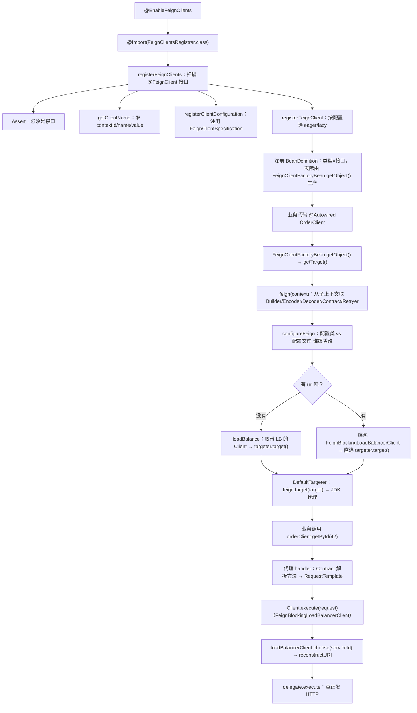
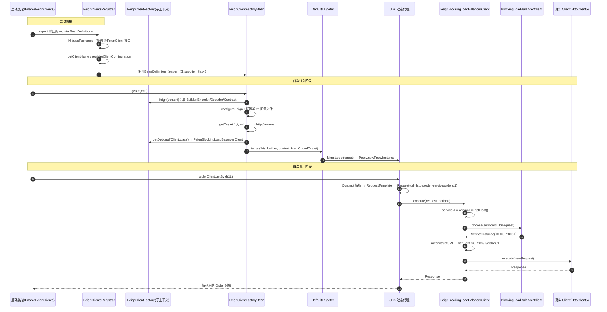

# Spring Cloud 源码精读 03-2：OpenFeign —— 一个接口是怎么变成 HTTP 请求的

> **一句话结论**：`@FeignClient` 接口本身没有任何实现类。Spring 在启动时用 `FeignClientsRegistrar` 扫描到它，注册一个 `FeignClientFactoryBean`；这个 `FactoryBean.getObject()` 在需要注入时**现场组装**出一个 JDK 动态代理——代理对象把每次方法调用翻译成 `Request Template`（URL + 方法 + 头 + 体），再交给 `Client`（默认带负载均衡的 `FeignBlockingLoadBalancerClient`）发出去。
>
> | 项目 | 说明 |
> | --- | --- |
> | 阅读前置 | 读完 [03-1 LoadBalancer](01-loadbalancer-负载均衡与轮询策略源码.md)；知道 `FactoryBean` 是"生产 Bean 的 Bean"；知道 JDK 动态代理（`Proxy.newProxyInstance`）大概是怎么回事 |
> | 预计阅读 | 60–75 分钟 |
> | 源码基线 | `org.springframework.cloud:spring-cloud-openfeign-core:5.1.0`（已入库；feign-core 的 `ReflectiveFeign`/`SynchronousMethodHandler`/`SpringMvcContract` **未入库**，涉及处会标注"未逐行验证"） |
> | 配套阅读 | [04-1 Gateway 路由](../04-网关Gateway/01-route-路由断言与过滤器链.md)（网关是"服务端的路由"，Feign 是"客户端的路由"） |

---

## 0. 先看现象

### 0.1 新人的第一份 Feign 代码

```java
// 示意（≤8 行）
@FeignClient(name = "order-service", path = "/orders")
public interface OrderClient {
    @GetMapping("/{id}")
    Order getById(@PathVariable("id") Long id);
}
```

加上 `@EnableFeignClients`，然后直接 `@Autowired OrderClient`，就能调到远端。新人常见的困惑：

| # | 现象 | 第一反应（通常是错的） | 真正原因（本文会讲） |
| --- | --- | --- | --- |
| 1 | 启动报 `No Feign Client for loadBalancing defined. Did you forget to include spring-cloud-starter-loadbalancer?` | "Feign 没引入？" | Feign 引入了，但 **LoadBalancer** 没引入：`name` 模式下 Feign 要靠 LoadBalancer 解析服务名 |
| 2 | 报 `Either 'name' or 'value' must be provided in @FeignClient` | "注解写错位置了" | `@FeignClient` 漏写 `name`/`value`（`getClientName` 的断言） |
| 3 | 报 `@FeignClient can only be specified on an interface` | "我写的就是接口啊" | 扫描到了一个被 `@FeignClient` 标注的**类**（或者是 `@FeignClient` 写在了内部类/注解类上） |
| 4 | 注入时报 `The bean 'order-service.FeignClientSpecification' could not be registered` | "Bean 冲突" | 两个 `@FeignClient` 用了同一个 `name` 却配了不同 `configuration`——它们共用一个子上下文，配置类撞车。用 `contextId` 区分 |
| 5 | 写了 `url` 后，Nacos 里的实例反而不走了 | "负载均衡失效" | 这是**设计如此**：有 `url` 就直连，且会把 `FeignBlockingLoadBalancerClient` **解包**成原始 `Client` |
| 6 | 调用返回 **503** 且没有异常栈 | "服务端挂了" | 是客户端侧 `FeignBlockingLoadBalancerClient` 在"没有实例"时**自己构造**的 503（不是服务端返回的） |
| 7 | `@RequestMapping` 上的 `params`/`headers`/`consumes` 被忽略 | "Feign 不支持" | 默认 `SpringMvcContract` 只实现了 Spring MVC 注解的一个子集 |

### 0.2 术语

| 术语 | 大白话 | 类比 |
| --- | --- | --- |
| **FactoryBean** | Spring 里"用来生产其他 Bean 的 Bean"；`getObject()` 返回什么，容器里就是什么 | 模具：你要的是零件，容器里登记的是模具 |
| **ImportBeanDefinitionRegistrar** | 在配置类解析阶段被回调，可以手动往容器里注册 Bean 定义 | 前台代办：还没开门营业就能先把会员登记好 |
| **JDK 动态代理** | 运行时生成一个实现了你接口的类，方法调用统一转发到 `InvocationHandler` | 替身演员：台词由导演（handler）现场给 |
| **Contract** | "注解翻译官"：把 `@GetMapping`/`@PathVariable` 翻译成 Feign 自己的 `RequestTemplate` | 翻译官 |
| **RequestTemplate** | 一次 HTTP 请求的"草稿"：URL 模板、方法、头、体 | 快递单 |
| **Target** | "发给谁"：接口类型 + 名字 + 基础 URL | 收件地址 |
| **Client** | 真正把请求发出去的东西 | 快递员 |
| **Targeter** | "怎么造代理"的策略：直接 `feign.target()`，还是包一层熔断 | 选哪家快递公司 |
| **子上下文（NamedContextFactory）** | 每个 Feign 客户端一个独立小容器，装它自己的 Encoder/Decoder/Contract 等 | 每个客户一个独立档案袋（与 03-1 相同机制） |

---

## 1. 整体地图

### 1.1 从 `@EnableFeignClients` 到一次调用



### 1.2 读图说明

- 上半部分（A→E）发生在**容器启动**阶段：`FeignClientsRegistrar` 只登记"模具"（`FeignClientFactoryBean`），**不生成代理**。
- 中间（F→M）发生在**第一次注入**时：`FactoryBean.getObject()` 现场组装代理。
- 下半部分（N→R）发生在**每次调用**时：代理把方法调用翻成请求，`Client` 选实例、改写 URL、发送。
- 两个分支 `K`/`L` 的区别只有一个 `url` 属性；`K` 分支要求容器里有带负载均衡的 `Client`，否则抛出 1 号坑的异常。

---

## 2. 关键类

| 类 | 所在包 | 一句话职责 |
| --- | --- | --- |
| `@EnableFeignClients` | `org.springframework.cloud.openfeign` | 开关：`@Import(FeignClientsRegistrar.class)`，可指定 `basePackages` |
| `FeignClientsRegistrar` | 同上 | 扫描 `@FeignClient`、注册配置与 `FeignClientFactoryBean` |
| `@FeignClient` | 同上 | 声明一个客户端：`name`（服务名）、`url`、`path`、`configuration`、`fallback`… |
| `FeignClientFactoryBean` | 同上 | 真正的"模具"：`getObject()` → `getTarget()` 组装代理 |
| `FeignClientFactory` | 同上 | 子上下文工厂（`NamedContextFactory`），每个客户端一个小容器 |
| `FeignClientsConfiguration` | 同上 | 子上下文默认配置：`SpringMvcContract`、Encoder/Decoder、`Retryer.NEVER_RETRY` |
| `FeignAutoConfiguration` | 同上 | 主上下文配置：`DefaultTargeter` / `FeignCircuitBreakerTargeter`、`Client` |
| `DefaultTargeter` | 同上 | 最简单的 Targeter：`feign.target(target)` |
| `FeignBlockingLoadBalancerClient` | 同上 | 实现 feign `Client`：选实例 → 改写 URL → 委托真正 HTTP 客户端 |
| `FeignClientProperties` | 同上 | `spring.cloud.openfeign.client.*` 配置 |

---

## 3. 源码逐段精读

### 3.1 开关：`@EnableFeignClients`

```java (src: EnableFeignClients.java#L40-L61)
@Documented
@Import(FeignClientsRegistrar.class)
public @interface EnableFeignClients {

...
	String[] basePackages() default {};
```

**在干什么**：注解本身只做一件事——把 `FeignClientsRegistrar` 导入容器。`basePackages` 不填时，默认扫描**启动类所在包**及子包。

**为什么这么写**：这是 Spring 处理"扫描型注解"的标准三件套：注解 + `@Import(Registrar)` + `Registrar` 实现 `ImportBeanDefinitionRegistrar`。MyBatis 的 `@MapperScan`、Spring Data 的 `@EnableJpaRepositories` 都是这个套路。

**改成别的会怎样**：若用 `BeanPostProcessor` 而不是 `Registrar`，注册时机太晚——`FactoryBean` 的定义必须在 `BeanFactory` 冻结前放进去，否则其他 Bean 注入时找不到。

**常见坑**：`@EnableFeignClients` 放在启动类上却能扫到其他模块的接口，是因为它们都在同一个根包下；一旦接口所在包不是启动类的子包，必须显式 `basePackages`。

### 3.2 声明：`@FeignClient` 的关键属性

```java (src: FeignClient.java#L42-L117)
public @interface FeignClient {

	/**
	 * The name of the service with optional protocol prefix. Synonym for {@link #name()
	 * name}. A name must be specified for all clients, whether or not a url is provided.
	 * Can be specified as property key, eg: ${propertyKey}.
	 * @return the name of the service with optional protocol prefix
	 */
	@AliasFor("name")
	String value() default "";

	/**
	 * This will be used as the bean name instead of name if present, but will not be used
	 * as a service id.
	 * @return bean name instead of name if present
	 */
	String contextId() default "";
...
	String url() default "";
...
	Class<?>[] configuration() default {};
...
	String path() default "";
...
	boolean primary() default true;
```

**在干什么**：`name`/`value` 互为别名，是服务名（也是子上下文名）；`contextId` 只当 Bean 名/子上下文名，**不当服务名**；`url` 给了就直连；`configuration` 是这个客户端专属的配置类；`path` 是所有方法的前缀；`primary` 默认 `true`，让你 `@Autowired` 接口时优先拿到 Feign 代理而不是你自己写的实现。

**为什么这么写**：`contextId` 的存在是为了解决"同一个服务名、不同配置"的场景（例如同一服务既要 JSON 客户端又要 XML 客户端）。`primary=true` 是为了在"接口既有 Feign 代理又有 fallback 实现 Bean"时不产生歧义。

**改成别的会怎样**：没有 `contextId`，两个同名客户端的 `FeignClientSpecification` 会以同一个名字注册——4 号坑。

**常见坑**：`name` 带协议前缀（`http://order-service`）也可以，`getName` 会用 `new URI(url).getHost()` 把协议剥掉；但 `url` 里写服务名则**不会**走负载均衡（它是"绝对地址"语义）。

### 3.3 扫描与注册：`FeignClientsRegistrar.registerFeignClients`

```java (src: FeignClientsRegistrar.java#L172-L204)
	public void registerFeignClients(AnnotationMetadata metadata, BeanDefinitionRegistry registry) {
		LinkedHashSet<BeanDefinition> candidateComponents = new LinkedHashSet<>();
		Map<String, Object> attrs = metadata.getAnnotationAttributes(EnableFeignClients.class.getName());
		final Class<?>[] clients = attrs == null ? null : (Class<?>[]) attrs.get("clients");
		if (clients == null || clients.length == 0) {
			ClassPathScanningCandidateComponentProvider scanner = getScanner();
			scanner.setResourceLoader(this.resourceLoader);
...
			for (Class<?> clazz : clients) {
				candidateComponents.add(new AnnotatedGenericBeanDefinition(clazz));
			}
		}

		for (BeanDefinition candidateComponent : candidateComponents) {
			if (candidateComponent instanceof AnnotatedBeanDefinition beanDefinition) {
				// verify annotated class is an interface
				AnnotationMetadata annotationMetadata = beanDefinition.getMetadata();
				Assert.isTrue(annotationMetadata.isInterface(), "@FeignClient can only be specified on an interface");

				Map<String, Object> attributes = annotationMetadata
					.getAnnotationAttributes(FeignClient.class.getCanonicalName());

				String name = getClientName(attributes);
				String className = annotationMetadata.getClassName();
				registerClientConfiguration(registry, name, className, attributes.get("configuration"));

				registerFeignClient(registry, annotationMetadata, attributes);
```

### 3.4 名字：`getClientName` 与 `getName`

```java (src: FeignClientsRegistrar.java#L440-L456)
	private String getClientName(Map<String, Object> client) {
		if (client == null) {
			return null;
		}
		String value = (String) client.get("contextId");
		if (!StringUtils.hasText(value)) {
			value = (String) client.get("value");
		}
		if (!StringUtils.hasText(value)) {
			value = (String) client.get("name");
		}
		if (!StringUtils.hasText(value)) {
			value = (String) client.get("serviceId");
		}
		if (StringUtils.hasText(value)) {
			return value;
		}
```

**在干什么**：按 `contextId → value → name → serviceId`（老属性）的顺序找第一个非空的，都没有就抛 `IllegalStateException`。

**为什么这么写**：`getClientName` 返回的名字同时用作**子上下文名**和**Bean 名**，必须非空。

**改成别的会怎样**：允许空名字，多个客户端会共用一个叫 `""` 的子上下文，配置互相污染。

**常见坑**：注意这里返回的**可能是 `contextId`**！而 `getName(attributes)` 才是真正的服务名。后面 `registerFeignClient` 里两者分别使用，别混。

### 3.5 两条注册路径：eager 与 lazy

```java (src: FeignClientsRegistrar.java#L208-L220)

	private void registerFeignClient(BeanDefinitionRegistry registry, AnnotationMetadata annotationMetadata,
			Map<String, Object> attributes) {
		String className = annotationMetadata.getClassName();
		if (String.valueOf(false)
			.equals(environment.getProperty("spring.cloud.openfeign.lazy-attributes-resolution",
					String.valueOf(false)))) {
			eagerlyRegisterFeignClientBeanDefinition(className, attributes, registry);
		}
		else {
			lazilyRegisterFeignClientBeanDefinition(className, attributes, registry);
		}
	}
```

**在干什么**：读 `spring.cloud.openfeign.lazy-attributes-resolution`，**默认（不配置）走 eager 分支**；显式设为 `true` 才走 lazy。

**为什么这么写**：eager 分支在注册时就把 `name`/`url`/`path` 等从注解属性算好，塞进 `BeanDefinition` 的 `propertyValues`；lazy 分支把这些属性的解析推迟到 Bean 实例化时的 supplier lambda 里——这样注解属性里的 `${占位符}` 可以在**刷新后**重新解析，支持 `@RefreshScope` 场景。

**改成别的会怎样**：全部 lazy 会拖慢首次注入（要现算），且 AOT/原生镜像场景不友好；全部 eager 则占位符刷新失效。

**常见坑**：lazy 分支里 `BeanDefinitionBuilder.genericBeanDefinition(clazz, () -> {...})` 的 Bean 类型是**接口本身**，但真正干活的是 lambda 里 `new` 出来的 `FeignClientFactoryBean`，它被塞进 `attribute("feignClientsRegistrarFactoryBean")` 里——这就是为什么调试时在容器里找不到 `FeignClientFactoryBean` 类型的 Bean。

#### lazy 分支的核心：supplier 里现造 FactoryBean

```java (src: FeignClientsRegistrar.java#L271-L300)
		String name = getName(attributes);
		FeignClientFactoryBean factoryBean = new FeignClientFactoryBean();
		factoryBean.setBeanFactory(beanFactory);
		factoryBean.setName(name);
		factoryBean.setContextId(contextId);
		factoryBean.setType(clazz);
		factoryBean.setRefreshableClient(isClientRefreshEnabled());
		BeanDefinitionBuilder definition = BeanDefinitionBuilder.genericBeanDefinition(clazz, () -> {
			factoryBean.setUrl(getUrl(beanFactory, attributes));
			factoryBean.setPath(getPath(beanFactory, attributes));
			factoryBean.setDismiss404(Boolean.parseBoolean(String.valueOf(attributes.get("dismiss404"))));
			Object fallback = attributes.get("fallback");
			if (fallback != null) {
				factoryBean.setFallback(fallback instanceof Class ? (Class<?>) fallback
						: ClassUtils.resolveClassName(fallback.toString(), null));
...
			if (fallbackFactory != null) {
				factoryBean.setFallbackFactory(fallbackFactory instanceof Class ? (Class<?>) fallbackFactory
						: ClassUtils.resolveClassName(fallbackFactory.toString(), null));
...
		beanDefinition.setAttribute("feignClientsRegistrarFactoryBean", factoryBean);

```

**在干什么**：先 `new FeignClientFactoryBean()` 并设好 name/contextId/type；`genericBeanDefinition(clazz, supplier)` 声明"这个 Bean 的类型是接口，实例由 supplier 产生"；supplier 里把 `url`/`path`/`dismiss404`/`fallback` 等补上，最后 `return factoryBean.getObject()`。`setLazyInit(true)` 让它直到被注入才创建。

**为什么这么写**：这样容器里登记的 Bean **类型是接口**，`@Autowired OrderClient` 按类型能找到；同时所有属性解析都在 lambda 里，拿到的是**当时的** `BeanFactory`，占位符可刷新。

**改成别的会怎样**：若直接 `genericBeanDefinition(FeignClientFactoryBean.class)`（eager 分支的做法），容器登记的类型是 `FactoryBean`，靠 `OBJECT_TYPE_ATTRIBUTE` 告诉容器实际类型——两种做法等价，只是时机不同。

**常见坑**：`feignClientsRegistrarFactoryBean` 这个 attribute 名是内部实现，别在业务代码里依赖。

### 3.6 组装：`FeignClientFactoryBean.getObject()` 与 `getTarget()`

```java (src: FeignClientFactoryBean.java#L473-L500)
	@Override
	public Object getObject() {
		return getTarget();
	}
...
	<T> T getTarget() {
		FeignClientFactory feignClientFactory = beanFactory != null ? beanFactory.getBean(FeignClientFactory.class)
				: applicationContext.getBean(FeignClientFactory.class);
		Feign.Builder builder = feign(feignClientFactory);
		if (!StringUtils.hasText(url) && !isUrlAvailableInConfig(contextId)) {

			if (LOG.isInfoEnabled()) {
				LOG.info("For '" + name + "' URL not provided. Will try picking an instance via load-balancing.");
			}
			if (!name.startsWith("http://") && !name.startsWith("https://")) {
				url = "http://" + name;
			}
			else {
				url = name;
			}
			url += cleanPath();
			return (T) loadBalance(builder, feignClientFactory, new HardCodedTarget<>(type, name, url));
```

**在干什么**：日志提示，然后 `url = "http://" + name`（如果 name 没带协议），拼上 `cleanPath()`，`new HardCodedTarget<>(type, name, url)` 作为"发给谁"，调 `loadBalance(...)`。

**为什么这么写**：`HardCodedTarget` 里的 URL 是 `http://order-service/orders`——**host 是服务名**，这个"假 URL"会在每次调用时被 `FeignBlockingLoadBalancerClient` 替换成真实 ip:port。这样 `Contract` 解析方法时拿到的 base URL 是稳定的，不依赖具体实例。

**改成别的会怎样**：若在这里就 `choose` 一个实例写死 URL，那就没有负载均衡了。

**常见坑**：`name` 里若带 `http://` 前缀，`getName` 已经剥掉了；但若 `url` 属性写的是 `${order.url:}` 这种空默认值，`StringUtils.hasText` 为 false 也会走这条路——注意区分"没配"和"配成空"。

#### 有 url：直连并解包

```java (src: FeignClientFactoryBean.java#L505-L518)
		// NOTE: The Client bean should ideally be configured as a singleton.
		// Repeated resolution of Client instances may lead to resource exhaustion
		// (e.g., connection pools, threads) if not properly managed.
		Client client = getOptional(feignClientFactory, Client.class);
		if (client != null) {
			warnIfAlreadyResolved();
			if (client instanceof FeignBlockingLoadBalancerClient) {
				// not load balancing because we have a url,
				// but Spring Cloud LoadBalancer is on the classpath, so unwrap
				client = ((FeignBlockingLoadBalancerClient) client).getDelegate();
			}
			if (client instanceof RetryableFeignBlockingLoadBalancerClient) {
				// not load balancing because we have a url,
				// but Spring Cloud LoadBalancer is on the classpath, so unwrap
```

**在干什么**：有 `url` 时不希望再走负载均衡，但容器里的 `Client` 可能是 `FeignBlockingLoadBalancerClient`（因为它在 classpath 上就被自动配置了），所以**把里面的原始 `Client` 取出来**用。`RetryableFeignBlockingLoadBalancerClient` 同理。

**为什么这么写**：保证 `url` 语义是"绝对直连"。

**改成别的会怎样**：若不解包，`FeignBlockingLoadBalancerClient.execute` 会把 `url` 的 host 当服务名去注册中心查，查不到就 503。

**常见坑**：源码注释明确提醒 `Client` 应为单例，重复解析会耗尽连接池（L505–L507 的 NOTE）。

#### `loadBalance`：没有 LoadBalancer 就炸

```java (src: FeignClientFactoryBean.java#L445-L456)

	protected <T> T loadBalance(Feign.Builder builder, FeignClientFactory context, HardCodedTarget<T> target) {
		Client client = getOptional(context, Client.class);
		if (client != null) {
			builder.client(client);
			applyBuildCustomizers(context, builder);
			Targeter targeter = get(context, Targeter.class);
			return targeter.target(this, builder, context, target);
		}

		throw new IllegalStateException(
				"No Feign Client for loadBalancing defined. Did you forget to include spring-cloud-starter-loadbalancer?");
```

**在干什么**：从子上下文取 `Client`，为 `null` 抛异常；否则 `client == null ? null : targeter.target(this, builder, context, target)`。

**为什么这么写**：LoadBalancer 是可选依赖，Spring Cloud OpenFeign 不强制引入。

**改成别的会怎样**：静默返回 `null` 会让注入时得到 `null`，错误更难查。

**常见坑**：1 号坑。解法：加 `spring-cloud-starter-loadbalancer`，或者改用 `url` 直连。

#### `feign(context)` 与 `configureFeign`：谁覆盖谁

```java (src: FeignClientFactoryBean.java#L148-L195)
	protected Feign.Builder feign(FeignClientFactory context) {
		FeignLoggerFactory loggerFactory = get(context, FeignLoggerFactory.class);
		Logger logger = loggerFactory.create(type);

		// @formatter:off
		Feign.Builder builder = get(context, Feign.Builder.class)
				// required values
				.logger(logger)
				.encoder(get(context, Encoder.class))
				.decoder(get(context, Decoder.class))
				.contract(get(context, Contract.class));
		// @formatter:on

		configureFeign(context, builder);

		return builder;
	}

...
	protected void configureFeign(FeignClientFactory context, Feign.Builder builder) {
		FeignClientProperties properties = beanFactory != null ? beanFactory.getBean(FeignClientProperties.class)
				: applicationContext.getBean(FeignClientProperties.class);

		FeignClientConfigurer feignClientConfigurer = getOptional(context, FeignClientConfigurer.class);
		setInheritParentContext(feignClientConfigurer.inheritParentConfiguration());

		if (properties != null && inheritParentContext) {
			if (properties.isDefaultToProperties()) {
				configureUsingConfiguration(context, builder);
				configureUsingProperties(properties.getConfig().get(properties.getDefaultConfig()),
						properties.getConfig().get(contextId), builder);
			}
			else {
				configureUsingProperties(properties.getConfig().get(properties.getDefaultConfig()),
						properties.getConfig().get(contextId), builder);
				configureUsingConfiguration(context, builder);
```

**在干什么**：`feign()` 从子上下文取 `Feign.Builder`、Logger、Encoder、Decoder、Contract，组装成 Builder，然后 `configureFeign` 决定**先应用配置类**（`@FeignClient(configuration=…)` 里的 Bean）**还是先应用配置文件**（`spring.cloud.openfeign.client.config.<name>.*`），后应用的覆盖先应用的。`defaultToProperties=true`（默认）时先配置类后配置文件 → **配置文件优先**。

**为什么这么写**：配置文件可以在不改代码的情况下调整（连接超时、日志级别），适合运维兜底；配置类适合写复杂逻辑（自定义 Encoder）。

**改成别的会怎样**：`spring.cloud.openfeign.client.default-to-properties=false` 可反转，让配置类优先。

**常见坑**：`FeignClientsConfiguration` 里 `Retryer.NEVER_RETRY`——Feign 默认**不重试**（`Retryer` 的 `continueOrPropagate` 对所有异常都返回 -1 直接抛）。想重试要么自己配 `Retryer` Bean，要么用 Spring Retry 的 `RetryableFeignBlockingLoadBalancerClient`。

### 3.7 Targeter：最薄的一层

```java (src: DefaultTargeter.java#L26-L31)

	@Override
	public <T> T target(FeignClientFactoryBean factory, Feign.Builder feign, FeignClientFactory context,
			Target.HardCodedTarget<T> target) {
		return feign.target(target);
	}
```

**在干什么**：直接 `feign.target(target)`——这是 feign-core 的 `ReflectiveFeign.target()`，内部 `Proxy.newProxyInstance` 生成代理（**未入库，未逐行验证**）。

**为什么这么写**：把"要不要包熔断"这一层抽出来，`FeignCircuitBreakerTargeter` 走另一条路。

**改成别的会怎样**：没有 Targeter 这层抽象，熔断逻辑就得写在 `FactoryBean` 里。

**常见坑**：`spring.cloud.openfeign.circuitbreaker.enabled=true` 时会换成 `FeignCircuitBreakerTargeter`，它需要 `fallback`/`fallbackFactory` Bean 存在于子上下文。

```java (src: FeignAutoConfiguration.java#L150-L160)
	@Conditional(FeignCircuitBreakerDisabledConditions.class)
	protected static class DefaultFeignTargeterConfiguration {

		@Bean
		@ConditionalOnMissingBean
		public Targeter feignTargeter() {
			return new DefaultTargeter();
		}

	}

```

### 3.8 默认配置：`FeignClientsConfiguration` 里有什么

```java (src: FeignClientsConfiguration.java#L135-L151)
	public Contract feignContract(ConversionService feignConversionService) {
		return new SpringMvcContract(parameterProcessors, feignConversionService, feignClientProperties);
...
	public Retryer feignRetryer() {
		return Retryer.NEVER_RETRY;
```

**在干什么**：子上下文默认用 `SpringMvcContract`（能读 `@GetMapping`/`@PathVariable`/`@RequestParam`/`@RequestHeader`/`@RequestBody`），默认不重试。

**为什么这么写**：让 Feign 接口写起来跟 Spring MVC Controller 一样。

**改成别的会怎样**：换成 feign 原生 `Contract.Default` 就得写 `@RequestLine("GET /orders/{id}")`。

**常见坑**：`SpringMvcContract` 不支持 `@RequestMapping(method=…)` 以外的 `params`、`consumes`、`produces` 条件——7 号坑。

### 3.9 每次调用：`FeignBlockingLoadBalancerClient.execute`

```java (src: FeignBlockingLoadBalancerClient.java#L79-L111)
	public Response execute(Request request, Request.Options options) throws IOException {
		final URI originalUri = URI.create(request.url());
		String serviceId = originalUri.getHost();
		Assert.state(serviceId != null, "Request URI does not contain a valid hostname: " + originalUri);
		String hint = getHint(serviceId);
		DefaultRequest<RequestDataContext> lbRequest = new DefaultRequest<>(
				new RequestDataContext(buildRequestData(request), hint));
		Set<LoadBalancerLifecycle> supportedLifecycleProcessors = LoadBalancerLifecycleValidator
			.getSupportedLifecycleProcessors(
					loadBalancerClientFactory.getInstances(serviceId, LoadBalancerLifecycle.class),
					RequestDataContext.class, ResponseData.class, ServiceInstance.class);
		supportedLifecycleProcessors.forEach(lifecycle -> lifecycle.onStart(lbRequest));
		ServiceInstance instance = loadBalancerClient.choose(serviceId, lbRequest);
...
		if (instance == null) {
			String message = "Load balancer does not contain an instance for the service " + serviceId;
			if (LOG.isWarnEnabled()) {
				LOG.warn(message);
			}
			supportedLifecycleProcessors.forEach(lifecycle -> lifecycle
				.onComplete(new CompletionContext<ResponseData, ServiceInstance, RequestDataContext>(
						CompletionContext.Status.DISCARD, lbRequest, lbResponse)));
			return Response.builder()
				.request(request)
				.status(HttpStatus.SERVICE_UNAVAILABLE.value())
...
		String reconstructedUrl = loadBalancerClient.reconstructURI(instance, originalUri).toString();
		Request newRequest = buildRequest(request, reconstructedUrl, instance);
		return executeWithLoadBalancerLifecycleProcessing(delegate, options, newRequest, lbRequest, lbResponse,
				supportedLifecycleProcessors);
```

**在干什么**：每次 Feign 调用都会走进这里。三步：① 把请求 URL 的 host 当服务名；② `loadBalancerClient.choose(serviceId, lbRequest)` 选一个实例；③ `reconstructURI` 把 `http://order-service/orders/1` 改写成 `http://10.0.0.7:8081/orders/1`，再交给被包装的真实 `Client`（`delegate`）发出。选不到实例时**不抛异常**，而是直接返回一个 503 响应。

**为什么这么写**：`Client` 是 feign-core 留给使用方的扩展点，Spring Cloud LoadBalancer 用"装饰器"的方式挂进来——真正的 HTTP 客户端（Apache HttpClient 5）完全不知道负载均衡的存在。返回 503 而不是抛异常，是为了让 feign 的 `ErrorDecoder`/fallback 机制按"正常错误响应"处理它。

**改成别的会怎样**：如果在这里选实例失败就 `throw`，那么 `fallback` 不会生效（fallback 只处理 `RetryableException`/解码后的异常类型），调用方会直接拿到 `IllegalStateException`。

**常见坑**：
- `originalUri.getHost()` 拿不到主机名（比如 URL 写成 `http:///x`）会在 `Assert.state` 处直接炸，日志是 `Request URI does not contain a valid hostname`。
- 503 的 body 是 `Load balancer does not contain an instance for the service xxx`——看到它说明服务名对了但**注册中心里没有这个服务**，或者服务名大小写/拼写不一致。
- `LoadBalancerLifecycle`（`onStart`/`onComplete`）在这里被调用：想记录"这次请求选了哪个实例"，实现 `LoadBalancerLifecycle<RequestDataContext, ResponseData, ServiceInstance>` 注册成 Bean 即可。

---

## 4. 完整时序

把上面各段串起来，一次 `orderClient.getById(1L)` 从启动到返回的全过程：



读图要点：
- 三个阶段之间隔着"首次注入"这个懒触发点——`@FeignClient` 接口在容器里只是 `FactoryBean`，**没人注入就不会创建代理**。
- `HardCodedTarget` 的 URL 里 host 是**服务名**，这个值在代理对象创建时就固定了；每次调用都重新 `choose`，所以实例扩缩容对代理透明。
- `DefaultTargeter` 只有一行 `feign.target(target)`，feign-core 在里面完成 `Proxy.newProxyInstance`（**未入库，未逐行验证**）。

---

## 5. 设计模式

| 模式 | 落在哪里 | 解决什么问题 | 取舍 |
| --- | --- | --- | --- |
| 工厂模式 + `FactoryBean` | `FeignClientFactoryBean.getObject()` | 把"如何造一个代理"交给容器生命周期 | 代理只造一次（单例），不能按调用变化 |
| 动态代理 | `feign.target()` 返回的 JDK Proxy | 接口零实现，方法调用统一拦截 | 只能代理接口；JDK Proxy 性能略低于字节码生成 |
| 策略模式 | `Targeter` / `Client` / `Contract` / `Encoder` / `Decoder` | 每个客户端可独立替换某一步 | 子上下文数量 = 客户端数量，Bean 多 |
| 装饰器 | `FeignBlockingLoadBalancerClient(delegate)` | 不改真实 HTTP 客户端就加上负载均衡 | 有 `url` 时必须"拆开"再重新包装（解包逻辑 L505–L518） |
| 模板方法 | `FeignClientFactoryBean.feign()` 先 `get(...)` 再 `configureFeign` | 固定组装顺序，开放配置 | 覆盖顺序由 `defaultToProperties` 决定，容易搞混 |
| 注册器模式 | `FeignClientsRegistrar implements ImportBeanDefinitionRegistrar` | 在 Bean 定义阶段就介入容器 | 需要自己处理 `@Configuration` 的 `proxyBeanMethods=false` 等细节 |

**取舍总结**：Spring Cloud 选的是"**小容器 + 可替换件**"：每个客户端一个子上下文，每个零件都能换。代价是 Bean 数量随客户端数线性增长，且父子上下文调试时容易看花眼（`FeignClientFactory` 的 `getInstance(name)` 断点最直观）。

---

## 6. 踩坑调试

| 症状 | 可能原因 | 定位方法 |
| --- | --- | --- |
| 启动报 `No Feign Client for loadBalancing defined. Did you forget to include spring-cloud-starter-loadbalancer?` | 子上下文里没有 `Client` Bean，通常是漏了 `spring-cloud-starter-loadbalancer` 依赖 | 看 `FeignClientFactoryBean.loadBalance` 的 `getOptional(context, Client.class)` 返回 null |
| 调用返回 503，body 是 `Load balancer does not contain an instance for the service xxx` | 注册中心没有该服务；`name` 拼错；`url` 属性误填了服务名却没走负载均衡（不会，有 `url` 就不走） | 在 `FeignBlockingLoadBalancerClient.execute` 的 `choose` 行打断点看 `serviceId` |
| 注入时报 "required a single bean, but 2 were found" | 同名客户端注册了两次 `FeignClientSpecification` | 用不同 `contextId`；看 `registerClientConfiguration` 的 Bean 名 `name.FeignClientSpecification` |
| `@FeignClient can only be specified on an interface` | 把注解贴到了类上 | `registerFeignClients` 里的 `Assert.isTrue(isInterface)` |
| `Either 'name' or 'value' must be provided in @FeignClient` | 什么都没填 | `getClientName` 的 `IllegalStateException` |
| 配置类里的 `RequestInterceptor` 没生效 | `@FeignClient(configuration=X)` 的 X 被放在了主上下文扫描包下，变成全局配置 | 配置类必须**不被** `@ComponentScan` 扫到，或加 `@Configuration` 但放在扫描包外 |
| 改了 `url` 配置，运行中不刷新 | 默认 eager 注册，`url` 在注册期就定了 | 开 `spring.cloud.openfeign.lazy-attributes-resolution=true` 并用 `RefreshableHardCodedTarget`（见 `resolveTarget`，**未逐行验证**） |

关键日志：

```yaml
logging:
  level:
    org.springframework.cloud.openfeign: DEBUG
    org.springframework.cloud.loadbalancer: DEBUG
```

三条最有用的日志关键字：`Creating a FeignClientFactoryBean.`（开始造代理）、`For 'xxx' URL not provided. Will try picking an instance via load-balancing.`（走了负载均衡分支）、`Load balancer does not contain an instance for the service`（选不到实例）。

---


---

## 7. ⚠️版本差异

| 版本 | 变化 | 影响 |
| --- | --- | --- |
| Spring Cloud **2020.0** | 移除 Ribbon → `FeignRibbonClientAutoConfiguration` 没了，换成 `FeignBlockingLoadBalancerClient` | 自定义 `Client` Bean 的写法要改 |
| **2022.0** | 引入 `spring.cloud.openfeign.lazy-attributes-resolution`；`FeignClientBuilder` 支持 `refreshableClient` | 需要 `@RefreshScope` 刷 URL 的开 lazy |
| **2023.0 / 2024.0** | `FeignCircuitBreakerTargeter` 需要显式 `spring.cloud.openfeign.circuitbreaker.enabled=true`；默认 `DefaultTargeter` | 从老版本升级若依赖熔断要补配置 |
| **2026.0（5.1.x，本文基线）** | 与 Boot 4 对齐；默认 `Client` 基于 Apache HttpClient 5（`feignClient(httpClient5)`）；`@ConditionalOnMissingBean(Client.class)` | 自定义 `Client` 只需声明一个 `Client` Bean |
| 4.x → 5.x | `Request.Options` 改为通过 `OptionsFactoryBean` 可刷新注册 | 超时配置支持运行时刷新 |

> 表中"引入版本"为经验值，仅 5.1.0 的源码入库可对照；其他版本请以官方 Release Notes 为准。

---

## 8. 面试问答

**Q1：`@FeignClient` 接口没有实现类，Spring 注入的是什么？**
A：一个 JDK 动态代理。启动时 `FeignClientsRegistrar` 注册的是 `FeignClientFactoryBean`（或以接口为类型、supplier 内部调用 `factoryBean.getObject()` 的 Bean 定义）；首次注入时 `getObject()` → `getTarget()` → `feign.target()` 生成代理。

**Q2：Feign 是怎么找到接口的？**
A：`@EnableFeignClients` 导入 `FeignClientsRegistrar`，它用 `ClassPathScanningCandidateComponentProvider` 扫 `basePackages`（默认启动类所在包），只收 `@FeignClient` 标注且 `isIndependent && !isAnnotation` 的候选者。

**Q3：`name`、`value`、`contextId` 的区别？**
A：`name`/`value` 互为别名，是服务名（注册中心里的名字）；`contextId` 只当 Bean 名与子上下文名，不是服务名。配置文件 `spring.cloud.openfeign.client.config.<key>` 里的 `<key>` 用的是 **contextId**。

**Q4：写了 `url` 之后 Feign 还走负载均衡吗？**
A：不走。`getTarget()` 有 `url` 分支会把 `FeignBlockingLoadBalancerClient` 解包成原始 `Client` 直连。

**Q5：Feign 调用时"没有实例"返回什么？**
A：`FeignBlockingLoadBalancerClient` 自己构造一个 **503 SERVICE_UNAVAILABLE** 响应（body 是错误消息），不抛异常，让 `ErrorDecoder`/`fallback` 有机会处理。

**Q6：配置类和配置文件谁优先？**
A：默认 `defaultToProperties=true` → 先应用 `configuration` 类的 Bean，再应用配置文件，所以**配置文件优先**；设为 `false` 反转。

**Q7：`Targeter` 是什么？**
A："怎么造代理"的策略接口。`DefaultTargeter` 直接 `feign.target(target)`；开启熔断后换成 `FeignCircuitBreakerTargeter`，会为有 fallback 的客户端走 `FeignCircuitBreaker` 代理。

**Q8：Feign 默认重试吗？**
A：不重试。`FeignClientsConfiguration` 里 `feignRetryer()` 返回 `Retryer.NEVER_RETRY`。

**Q9：`FeignClientFactory` 为什么要给每个客户端建子上下文？**
A：让每个客户端可以有自己的 Encoder/Decoder/Contract/Logger/Retryer/RequestInterceptor，互不干扰。

**Q10：`spring.cloud.openfeign.lazy-attributes-resolution=true` 有什么用？**
A：让注解属性（url/path 等）的解析推迟到 Bean 实例化时，支持刷新后重新解析占位符。

**Q11：`FeignBlockingLoadBalancerClient` 怎么知道服务名？**
A：`URI.create(request.url()).getHost()`——因为 `HardCodedTarget` 的 URL 是 `http://服务名/...`，host 就是服务名。

**Q12：为什么 `@FeignClient` 的 `primary` 默认是 `true`？**
A：当接口既有 Feign 代理又有你手写的实现 Bean（例如 fallback 类）时，按类型注入优先拿代理，避免歧义。

---

## 9. 动手练习

### 练习 1：亲眼看到"模具"

**目标**：验证容器里登记的是 `FactoryBean` 而不是代理本身。

**步骤**：
1. 写一个 `@FeignClient(name = "order-service")` 接口。
2. 启动后访问 `/actuator/beans`，搜 `OrderClient`。
3. 用 `applicationContext.getBeanDefinitionNames()` 打印，找 `&orderClient` 或 `order-service.FeignClientSpecification`。

**验收标准**：
- 能看到类型为 `OrderClient` 的 Bean 定义，以及名为 `<contextId>.FeignClientSpecification` 的配置 Bean。
- `applicationContext.getBean("&orderClient")` 返回的对象是 `FactoryBean` 实例（或 supplier 包装）。

### 练习 2：`url` 直连 vs `name` 负载均衡

**目标**：观察两条分支的差异。

**步骤**：
1. 注册两个 `order-service` 实例。
2. 接口 A：`@FeignClient(name = "order-service")`；接口 B：`@FeignClient(name = "order-service", url = "http://127.0.0.1:8081", contextId = "direct")`。
3. 两个接口各连续调用 20 次，看服务端日志里命中的实例。

**验收标准**：
- A 的请求交替命中两个实例。
- B 的请求全部命中 8081。
- 去掉 LoadBalancer 依赖后，A 启动即报 `No Feign Client for loadBalancing defined`，B 仍能启动。

### 练习 3：配置文件覆盖配置类

**目标**：验证 `defaultToProperties` 的顺序。

**步骤**：
1. 在 `configuration` 类里 `@Bean Logger.Level feignLoggerLevel() { return Level.BASIC; }`。
2. 配置文件写 `spring.cloud.openfeign.client.config.order-service.loggerLevel: FULL`。
3. 开 `logging.level.<接口全名>: DEBUG`，发一次请求看日志详细程度。
4. 把 `spring.cloud.openfeign.client.default-to-properties` 改为 `false`，重启再看。

**验收标准**：
- 默认配置下日志为 FULL（配置文件赢）。
- 改为 `false` 后日志为 BASIC（配置类赢）。

---

## 小结

- `@EnableFeignClients` → `FeignClientsRegistrar` 扫描接口、断言是接口、算 `name`、注册配置与"模具"（`FeignClientFactoryBean`）。
- 默认 eager 注册（属性直接塞进 BeanDefinition）；`lazy-attributes-resolution=true` 走 supplier 懒解析。
- 首次注入时 `getObject()` → `getTarget()`：子上下文取 Builder/Encoder/Decoder/Contract → `configureFeign` 决定覆盖顺序 → 按"有无 url"分流 → `targeter.target()` 生成 JDK 代理。
- 每次调用：代理把方法翻成 `Request`，`FeignBlockingLoadBalancerClient` 用 URL 的 host 当服务名 `choose` → `reconstructURI` → 委托真实客户端；无实例时客户端自己返回 503。
- 扩展点：`Client`、`Targeter`、`Contract`、`Encoder/Decoder`、`RequestInterceptor`、`Retryer`、`ErrorDecoder`，全部通过子上下文按客户端替换。

---

## 自测题

**1. `FeignClientsRegistrar` 对扫描到的候选者做了什么断言？**
<details><summary>答案</summary>

`Assert.isTrue(annotationMetadata.isInterface(), "@FeignClient can only be specified on an interface")`——因为 Feign 基于 JDK 动态代理，只能代理接口。
</details>

**2. `getClientName` 找名字的顺序？**
<details><summary>答案</summary>

`contextId → value → name → serviceId`，都没有则抛 `Either 'name' or 'value' must be provided in @FeignClient`。
</details>

**3. `registerFeignClient` 默认走 eager 还是 lazy？**
<details><summary>答案</summary>

默认 **eager**：只有 `spring.cloud.openfeign.lazy-attributes-resolution=true` 时才走 lazy。
</details>

**4. lazy 分支里 Bean 定义的类型是什么？真正生产对象的是谁？**
<details><summary>答案</summary>

类型是**接口本身**（`genericBeanDefinition(clazz, supplier)`）；supplier 内部 `new FeignClientFactoryBean()` 并 `getObject()`。
</details>

**5. `getTarget()` 在无 `url` 时构造的 `HardCodedTarget` 的 URL 是什么？**
<details><summary>答案</summary>

`http://<name><cleanPath()>`——host 是服务名，等 `Client` 调用时再替换。
</details>

**6. 有 `url` 时为什么要 `getDelegate()`？**
<details><summary>答案</summary>

容器里的 `Client` 可能是 `FeignBlockingLoadBalancerClient`，不解包会把 url 的 host 当服务名去查注册中心。
</details>

**7. `loadBalance()` 在 `Client` 为 `null` 时抛什么？**
<details><summary>答案</summary>

`IllegalStateException("No Feign Client for loadBalancing defined. Did you forget to include spring-cloud-starter-loadbalancer?")`。
</details>

**8. `configureFeign` 默认谁覆盖谁？**
<details><summary>答案</summary>

`defaultToProperties=true`：先配置类后配置文件，**配置文件覆盖配置类**。
</details>

**9. `DefaultTargeter.target()` 只做了一件什么事？**
<details><summary>答案</summary>

`return feign.target(target);`
</details>

**10. `FeignClientsConfiguration` 默认的 `Contract` 和 `Retryer` 是？**
<details><summary>答案</summary>

`SpringMvcContract` 与 `Retryer.NEVER_RETRY`。
</details>

**11. `FeignBlockingLoadBalancerClient.execute` 如何得到服务名？**
<details><summary>答案</summary>

`URI.create(request.url()).getHost()`。
</details>

**12. Feign 侧"没有实例"与 `RestTemplate` 侧的表现差异？**
<details><summary>答案</summary>

Feign 返回客户端构造的 **503 响应**（不抛异常）；`RestTemplate` 侧 `BlockingLoadBalancerClient` 抛 `IllegalStateException("No instances available for ...")`。
</details>

