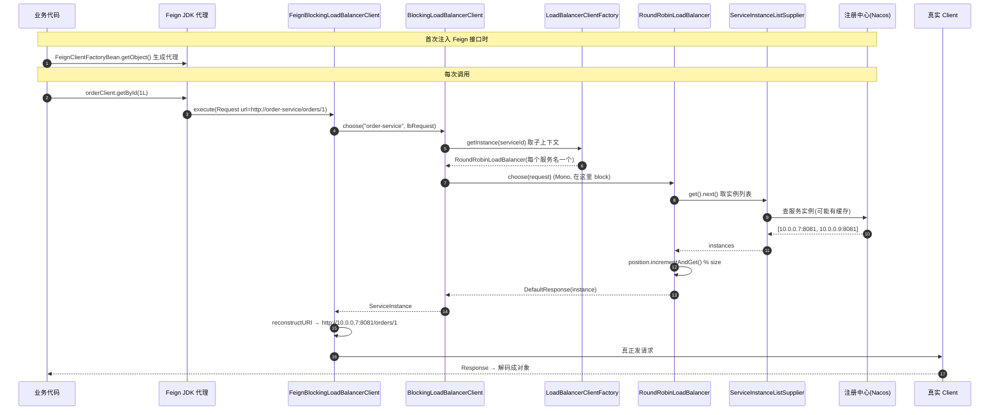

# 03 · 负载均衡与调用

> **本组定位**：搞清楚"一个服务名怎么变成一次真实的 HTTP 调用"。两篇正文分别讲 Spring Cloud LoadBalancer（选哪台机器）与 OpenFeign（一个接口怎么变成 HTTP 请求）。网关侧的 `lb://` 也复用同一个 LoadBalancer，见 [`../04-网关Gateway`](../04-网关Gateway/README.md)。
>
> | 项目 | 说明 |
> | --- | --- |
> | 源码基线 | `org.springframework.cloud:spring-cloud-loadbalancer:5.1.0`、`org.springframework.cloud:spring-cloud-openfeign-core:5.1.0` |
> | 预计阅读 | 两篇合计 90–120 分钟 |
> | 前置 | 知道注册中心里存的是"服务名 → 实例列表"；知道 `FactoryBean` 与 JDK 动态代理是什么 |

---

## 一、学习目标

| # | 目标 | 验收方式 |
| --- | --- | --- |
| 1 | 说清 `@LoadBalancerClient` 注解背后注册了哪些 Bean | 能默画 `LoadBalancerClientFactory` → 子上下文 → `RoundRobinLoadBalancer` 的层级 |
| 2 | 读懂轮询算法，解释 `position` 为什么用 `AtomicInteger` 且要 `& Integer.MAX_VALUE` | 能回答 [01 篇](./01-loadbalancer-负载均衡与轮询策略源码.md) 自测题第 3、4 题 |
| 3 | 知道 `RestTemplate`/`WebClient` 发 `http://服务名/...` 时是谁把服务名换成 ip:port | 在 `LoadBalancerInterceptor` 与 `ReactiveLoadBalancerClientFilter` 上打断点能走通 |
| 4 | 能自己写一个 `RandomLoadBalancer` 并只对某个服务生效 | 完成 01 篇练习 2，`@LoadBalancerClient(serviceName, configuration=...)` 生效 |
| 5 | 说清 `@FeignClient` 接口为什么没有实现类却能被注入 | 能按顺序讲出 `FeignClientsRegistrar` → `FeignClientFactoryBean` → `Targeter` → JDK 代理 |
| 6 | 区分 `name`/`contextId`/`url`/`path` 四个属性 | 能解释"写了 `url` 为什么不走负载均衡" |
| 7 | 知道每次调用时 Feign 和 LoadBalancer 的衔接点 | 能指到 `FeignBlockingLoadBalancerClient.execute` 的 `choose` 与 `reconstructURI` |
| 8 | 会定位"503 但没有异常栈"的问题 | 知道这个 503 是客户端自己构造的，不是服务端返回的 |

---

## 二、整体地图

**读图说明**：

1. **左半边（第 6–13 步）全是 Spring Cloud LoadBalancer**，对应 [`01-loadbalancer-负载均衡与轮询策略源码.md`](./01-loadbalancer-负载均衡与轮询策略源码.md)。它对调用方暴露的唯一入口是 `LoadBalancerClient.choose/execute`。
2. **第 3、14、15 步是 OpenFeign**，对应 [`02-openfeign-动态代理与请求拼接.md`](./02-openfeign-动态代理与请求拼接.md)。Feign 自己不懂负载均衡，它只是把 `Client` 这个接口交给 LoadBalancer 装饰。
3. 两边的"接缝"是 `FeignBlockingLoadBalancerClient`：把 URL 的 host 当服务名，把选中的实例重新拼回 URL。看懂这一行，两边就通了。
4. 图里 `RR` 是响应式 `Mono`，但阻塞调用方用 `block()` 等它——这是 LoadBalancer "一套核心、两套门面"（阻塞 `LoadBalancerClient` / 响应式 `ReactiveLoadBalancer`）的设计。

---

## 三、两篇摘要

### 01 [`01-loadbalancer-负载均衡与轮询策略源码.md`](./01-loadbalancer-负载均衡与轮询策略源码.md)

| 关键词 | 一句话 |
| --- | --- |
| `RoundRobinLoadBalancer` | 一个 `AtomicInteger position`，每次 `incrementAndGet()` 后取模；初始位置随机 |
| `ReactorLoadBalancer` | 响应式选择器接口，`choose(Request)` 返回 `Mono<Response<T>>` |
| `ServiceInstanceListSupplier` | 实例列表的来源，`Supplier<Flux<List<ServiceInstance>>>`；带缓存/发现两种装饰 |
| `BlockingLoadBalancerClient` | 阻塞门面：`choose` 里 `block()`，`execute` 先选实例再执行回调 |
| `LoadBalancerClientFactory` | 每个服务名一个子上下文，里面装该服务的 LoadBalancer 与 Supplier |
| `LoadBalancerClientConfiguration` | 默认装配：没有自定义就 `new RoundRobinLoadBalancer` |
| `LoadBalancerInterceptor` | `RestTemplate` 发请求前的拦截器，把 host 当服务名调 `execute` |

### 02 [`02-openfeign-动态代理与请求拼接.md`](./02-openfeign-动态代理与请求拼接.md)

| 关键词 | 一句话 |
| --- | --- |
| `@EnableFeignClients` | `@Import(FeignClientsRegistrar.class)`，默认扫启动类所在包 |
| `FeignClientsRegistrar` | 扫描接口、断言"必须是接口"、算名字、注册 `FeignClientFactoryBean` |
| `FeignClientFactoryBean` | "模具"：`getObject()` → `getTarget()` 组装代理；无 `url` 时走负载均衡 |
| `Targeter` | 最后一层：`DefaultTargeter` 只有一行 `feign.target(target)` |
| `FeignBlockingLoadBalancerClient` | 装饰真实 HTTP 客户端：选实例 → 改写 URL → 委托 |
| `FeignClientsConfiguration` | 子上下文默认配置：`SpringMvcContract`、`Retryer.NEVER_RETRY` |

---

## 四、前置知识检查点

- [ ] `FactoryBean<T>` 的 `getObject()` 什么时候被调用？（提示：按需，首次 `getBean` 时）
- [ ] JDK 动态代理为什么只能代理接口？
- [ ] `NamedContextFactory`（Feign 的子上下文）与 Spring 父子容器的关系？→ [`01-Spring框架`](../../01-Spring框架/)
- [ ] 注册中心里的实例列表是怎么拉到本地的？→ `02-注册中心Nacos`

---

## 五、读完之后的自检

1. 两个服务 `order-service`、`user-service` 各自用自己的负载策略，要写几个配置类？注解贴在哪里？
2. `RoundRobinLoadBalancer` 的 `position` 为什么初始值是随机的？
3. 一个 `@FeignClient(name = "a", url = "http://x")` 还需要 LoadBalancer 依赖吗？为什么？
4. 调用返回 503，响应体是 `Load balancer does not contain an instance for the service xxx`，这是谁返回的？

答案都在两篇正文的 §8 面试问答与自测题里。

---

## 六、本组文件清单

| 文件 | 内容 |
| --- | --- |
| `README.md` | 本文件 |
| [`01-loadbalancer-负载均衡与轮询策略源码.md`](./01-loadbalancer-负载均衡与轮询策略源码.md) | 轮询算法、`choose/execute`、子上下文工厂、实例列表供给 |
| [`02-openfeign-动态代理与请求拼接.md`](./02-openfeign-动态代理与请求拼接.md) | 扫描注册、`FactoryBean` 组装、Targeter、`Client` 装饰器 |

> **相邻分组**：[`../04-网关Gateway`](../04-网关Gateway/README.md) 的 `lb://` 路由用的是同一套 LoadBalancer；[`../05-配置中心与Bus`](../05-配置中心与Bus/README.md) 讲 Feign 的 `url` 怎么动态刷新。总览见 [`../README.md`](../README.md)。
