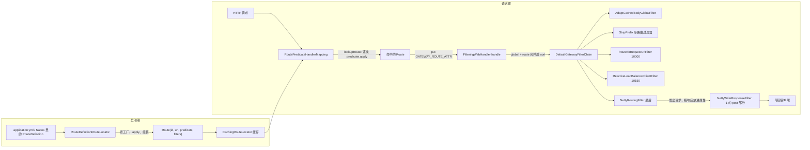
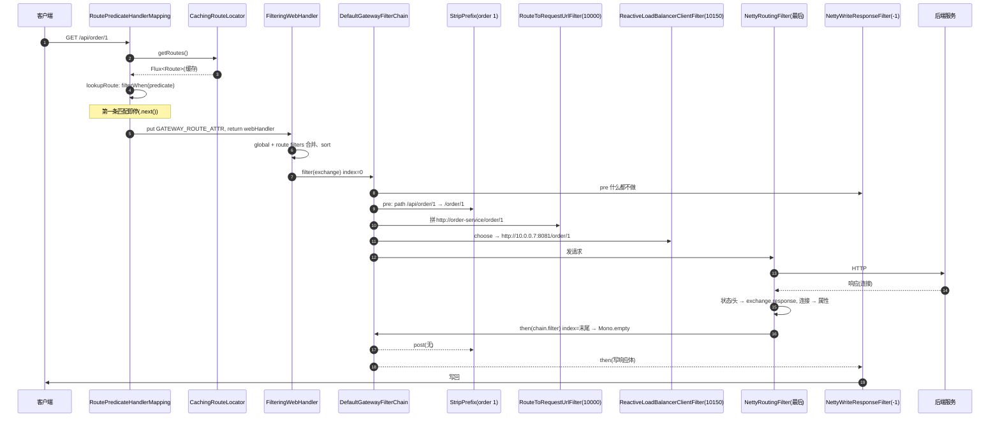

# Spring Cloud 源码精读 04-1：Gateway 路由 —— 断言怎么选路，过滤器链怎么跑

> **一句话结论**：Gateway 把"一个请求该转发到哪里"拆成三样东西——`Route`（转去哪）、`Predicate`（什么条件下走这条路由）、`Filter`（转发前后做什么）。一次请求的流程是：`RoutePredicateHandlerMapping` 逐条问路由"你匹配吗"，命中的 `Route` 塞进 exchange 属性，然后 `FilteringWebHandler` 把**全局过滤器**和**这条路由的过滤器**合并、按 order 排序，用一条"责任链"依次执行。
>
> | 项目 | 说明 |
> | --- | --- |
> | 阅读前置 | 知道 WebFlux 的 `HandlerMapping` → `WebHandler` 模型；知道 `Mono`/`Flux` 是什么、`flatMap` 大致怎么用；读过 [03-1 LoadBalancer](../03-负载均衡与调用/01-loadbalancer-负载均衡与轮询策略源码.md)（`lb://` 路由会用到） |
> | 预计阅读 | 60–75 分钟 |
> | 源码基线 | `org.springframework.cloud:spring-cloud-gateway-server-webflux:5.1.0`（已入库；`RouteDefinition`、`PropertiesRouteDefinitionLocator`、`WeightCalculatorWebFilter` 未入库，涉及处会标注） |
> | 配套阅读 | [04-2 常用断言与限流](./02-predicate与filter-常用断言与限流.md)（具体某个断言/过滤器怎么用） |

---

## 0. 先看现象

### 0.1 新人的第一份路由配置

```yaml
spring:
  cloud:
    gateway:
      server:
        webflux:
          routes:
            - id: order-route
              uri: lb://order-service
              predicates:
                - Path=/api/order/**
              filters:
                - StripPrefix=1
```

意思是：路径以 `/api/order/` 开头的请求，去掉第一段 `/api`，按 `order-service` 这个服务名做负载均衡转发。`/api/order/1` → `http://10.0.0.7:8081/order/1`。

### 0.2 术语

| 术语 | 解释 |
| --- | --- |
| `Route` | 一条路由规则：id + 目标 uri + 断言 + 过滤器 + 元数据 |
| `Predicate`（断言） | "这个请求符不符合条件"的判断，比如 Path、Method、Header、After |
| `GatewayFilter` | 路由级别的过滤器，只对配置了它的路由生效 |
| `GlobalFilter` | 全局过滤器，对所有路由生效（比如转发、写响应） |
| `FilterChain`（过滤器链） | 过滤器排成一队，每个过滤器调 `chain.filter(exchange)` 把请求交给下一个 |
| `ServerWebExchange` | WebFlux 对"一次请求 + 一次响应 + 一袋属性"的封装，相当于 Servlet 里的 `Request+Response+Context` |
| `order` | 排序数字，越小越先执行"pre"部分、越晚执行"post"部分 |
| `AsyncPredicate` | 返回 `Publisher<Boolean>` 的断言，因为有些断言（如 Weight）要异步算 |
| `RouteDefinition` | 配置文件里的路由原文（`id/predicates/filters` 三个字段的 Java 表示） |
| `RouteLocator` | 路由的来源接口，`getRoutes()` 返回 `Flux<Route>` |

### 0.3 新人最常撞的墙

| # | 现象 | 第一反应（通常是错的） | 真正原因（本文会讲） |
| --- | --- | --- | --- |
| 1 | 配了两条路由，明明第二条更具体却总走第一条 | "Gateway 会选最匹配的" | 不会。`lookupRoute` 是**按顺序问，第一个说匹配就用**（`filterWhen(...).next()`） |
| 2 | 自定义 `GlobalFilter` 没生效 | "没注册上" | 注册上了，但 order 很大，排在 `NettyRoutingFilter` 后面——它执行时请求已经发出去了 |
| 3 | 路由里的 `StripPrefix` 和全局过滤器谁先执行？ | "路由的先" | 看 order。路由过滤器默认 order 是 `i+1`，`RouteToRequestUrlFilter` 是 10000，所以路由过滤器先 |
| 4 | `uri: lb://order-service` 报 `Invalid host: order_service` | "服务名写错" | 服务名带下划线不是合法 host，`URI.getHost()` 返回 null，`RouteToRequestUrlFilter` 直接抛 |
| 5 | 改了 Nacos 里的路由配置没生效 | "Gateway 不支持动态路由" | 要发布 `RefreshRoutesEvent` 让 `CachingRouteLocator` 重新拉 |
| 6 | 日志里有 `will be ignored. Definition has invalid configs` | "启动失败了" | 没有。默认 `failOnRouteDefinitionError=false`，坏路由被跳过，其余照常 |
| 7 | 过滤器里拿到的 body 是空的 | "Gateway 把 body 吃了" | body 是流，读一次就没了；要读必须先经过 `AdaptCachedBodyGlobalFilter` 缓存 |

---

## 1. 整体地图

### 1.1 一次请求经过哪些人



### 1.2 读图说明

1. **启动期只做"翻译"**：把配置里的 `RouteDefinition` 翻译成可执行的 `Route`——断言文本变成 `AsyncPredicate` 对象，过滤器文本变成 `GatewayFilter` 对象。翻译工作由 `RouteDefinitionRouteLocator` 完成，再由 `CachingRouteLocator` 缓存。
2. **请求期分两步**：先"选路"（`RoutePredicateHandlerMapping.lookupRoute`），再"执行链"（`FilteringWebHandler.handle`）。两步之间靠 exchange 属性 `GATEWAY_ROUTE_ATTR` 传递命中的 `Route`。
3. **链上没有"pre/post"标记**，但每个过滤器内部的代码天然分成两段：调 `chain.filter(exchange)` **之前**的是 pre，`.then(...)`/`.map(...)` **之后**的是 post。order 越小，pre 越早、post 越晚——像洋葱。
4. **`NettyRoutingFilter` 是最后一个**（`LOWEST_PRECEDENCE`），它真正发请求但不写响应；写响应是 `NettyWriteResponseFilter` 的 post 部分，因为它 order 是 -1，所以它的 post 跑在所有 post 的最后。

---

## 2. 关键类

| 类 | 所在包（`org.springframework.cloud.gateway`） | 一句话职责 |
| --- | --- | --- |
| `Route` | `route` | 不可变路由对象，`implements Ordered` |
| `AsyncPredicate` | `handler` | 异步断言接口，提供 `and/or/negate` 组合子 |
| `RouteLocator` | `route` | 路由来源接口，`Flux<Route> getRoutes()` |
| `CachingRouteLocator` | `route` | 缓存层，监听 `RefreshRoutesEvent` 重拉 |
| `RouteDefinitionRouteLocator` | `route` | 把 `RouteDefinition` 翻译成 `Route` |
| `RoutePredicateHandlerMapping` | `handler` | 选路：遍历路由找第一个匹配的 |
| `FilteringWebHandler` | `handler` | 合并过滤器、排序、启动责任链 |
| `GatewayFilter` / `GlobalFilter` | `filter` | 路由级 / 全局过滤器接口 |
| `GatewayFilterChain` | `filter` | 链的接口，只有一个 `filter(exchange)` |
| `OrderedGatewayFilter` | `filter` | 给没实现 `Ordered` 的过滤器包一层 order |
| `RouteToRequestUrlFilter` | `filter` | 用路由 uri 和请求拼出目标 URL，放进 `GATEWAY_REQUEST_URL_ATTR` |
| `ReactiveLoadBalancerClientFilter` | `filter`（commons 包） | `lb://` 时选实例替换 host |
| `NettyRoutingFilter` | `filter` | 真正发 HTTP 请求 |
| `NettyWriteResponseFilter` | `filter` | 把响应写回客户端 |
| `AdaptCachedBodyGlobalFilter` | `filter` | 缓存请求 body，让后面的过滤器能重复读 |

---

## 3. 源码逐段精读

### 3.1 `Route`：三样东西装在一个不可变对象里

```java (src: Route.java#L46-L58)
public class Route implements Ordered {

	private final String id;

	private final URI uri;

	private final int order;

	private final AsyncPredicate<ServerWebExchange> predicate;

	private final List<GatewayFilter> gatewayFilters;

	private final Map<String, Object> metadata;
```

**在干什么**：`Route` 只有 6 个 `final` 字段——`id`、`uri`、`order`、`predicate`、`gatewayFilters`、`metadata`。没有 setter，只能通过 Builder 造。

**为什么这么写**：路由在运行期是"读多写零"的——每次请求都要读它，改路由是整体替换（刷新缓存），不是原地改。不可变对象无需加锁，也不会被某个过滤器误改。

**改成别的会怎样**：如果 `Route` 可变，一个过滤器改了 `uri`，下一个请求就转发到别处了——所有请求共享同一个 `Route` 实例（缓存里只有一份）。

**常见坑**：想在过滤器里"改目标地址"，不是改 `Route.uri`，而是改 exchange 属性 `GATEWAY_REQUEST_URL_ATTR`（见 3.6）。

### 3.2 `Route.build()`：三个必填项

```java (src: Route.java#L253-L260)
		public Route build() {
			Objects.requireNonNull(this.id, "id can not be null");
			Objects.requireNonNull(this.uri, "uri can not be null");
			AsyncPredicate<ServerWebExchange> predicate = getPredicate();
			Objects.requireNonNull(predicate, "predicate can not be null");

			return new Route(this.id, this.uri, this.order, predicate, this.gatewayFilters, this.metadata);
		}
```

**在干什么**：`id`、`uri`、`predicate` 缺一个就抛 NPE，否则 `new Route(...)`。

**为什么这么写**：`id` 用于日志、限流 key、刷新事件定位；`uri` 决定转发目标；`predicate` 决定"要不要走这条路由"。没有 `predicate` 的路由等于"永远匹配"，作者选择不允许（但 `RouteDefinitionRouteLocator` 在配置没写断言时会补一个 `exchange -> true`，见 3.4）。

**改成别的会怎样**：允许 `predicate` 为 null，`lookupRoute` 里 `route.getPredicate().apply(exchange)` 会 NPE，整条链路挂掉。

**常见坑**：`Route.async(routeDefinition)` 这个重载会把 `RouteDefinition` 的 `id/uri/order/metadata` 先复制进 Builder，所以自己用 Builder 时别忘了 `.id()`。

### 3.3 `AsyncPredicate`：断言为什么是异步的，怎么组合

第 1 段是接口和同步断言的适配入口：

```java (src: AsyncPredicate.java#L34-L58)
public interface AsyncPredicate<T> extends Function<T, Publisher<Boolean>>, HasConfig {

	default AsyncPredicate<T> and(AsyncPredicate<? super T> other) {
		return new AndAsyncPredicate<>(this, other);
	}

	default AsyncPredicate<T> negate() {
		return new NegateAsyncPredicate<>(this);
	}

	default AsyncPredicate<T> not(AsyncPredicate<? super T> other) {
		return new NegateAsyncPredicate<>(other);
	}

	default AsyncPredicate<T> or(AsyncPredicate<? super T> other) {
		return new OrAsyncPredicate<>(this, other);
	}

	default void accept(Visitor visitor) {
		visitor.visit(this);
	}

	static AsyncPredicate<ServerWebExchange> from(Predicate<? super ServerWebExchange> predicate) {
		return new DefaultAsyncPredicate<>(GatewayPredicate.wrapIfNeeded(predicate));
	}
```

第 2 段是同步断言返回布尔结果的包装：

```java (src: AsyncPredicate.java#L60-L71)
	class DefaultAsyncPredicate<T> implements AsyncPredicate<T> {

		private final Predicate<T> delegate;

		public DefaultAsyncPredicate(Predicate<T> delegate) {
			this.delegate = delegate;
		}

		@Override
		public Publisher<Boolean> apply(T t) {
			return Mono.just(delegate.test(t));
		}
```

第 3 段是 AND 组合的短路实现：

```java (src: AsyncPredicate.java#L108-L124)
	class AndAsyncPredicate<T> implements AsyncPredicate<T> {

		private final AsyncPredicate<? super T> left;

		private final AsyncPredicate<? super T> right;

		public AndAsyncPredicate(AsyncPredicate<? super T> left, AsyncPredicate<? super T> right) {
			Objects.requireNonNull(left, "Left AsyncPredicate must not be null");
			Objects.requireNonNull(right, "Right AsyncPredicate must not be null");
			this.left = left;
			this.right = right;
		}

		@Override
		public Publisher<Boolean> apply(T t) {
			return Mono.from(left.apply(t)).flatMap(result -> !result ? Mono.just(false) : Mono.from(right.apply(t)));
		}
```

**在干什么**：`AsyncPredicate<T>` 是 `Function<T, Publisher<Boolean>>`——给一个 exchange，返回一个"将来会告诉你 true/false"的发布者。`and()` 返回 `AndAsyncPredicate`，它的 `apply` 先算左边，左边 false 直接 `Mono.just(false)`，否则再算右边。`from(Predicate)` 把普通同步断言包成 `Mono.just(delegate.test(t))`。

**为什么这么写**：有些断言需要异步——比如 `Weight` 要等 `WeightCalculatorWebFilter` 先算好权重，再比如以后可能出现的"查注册中心才决定"的断言。统一成 `Publisher<Boolean>` 后，同步断言用 `Mono.just` 包一下就能混用。`and` 的短路写法（左边 false 不算右边）与 Java `&&` 语义一致，省掉不必要的计算。

**改成别的会怎样**：如果用同步 `Predicate<ServerWebExchange>`，`lookupRoute` 里就不能 `filterWhen`，所有断言必须同步完成；权重断言就没法实现。"用 `Flux` 而不是 `Mono`"也可以，但语义上断言只需要 0 或 1 个结果，`Mono` 更准确。

**常见坑**：
- `and()` 要求左边非 null（`Objects.requireNonNull(this.predicate, "can not call and() on null predicate")`，见 `Route.AsyncBuilder.and` L288–L292）。
- 断言抛异常时 `lookupRoute` 会捕获并当成 false（见 3.5），日志关键字 `Error applying predicate for route`。
- 多个断言写在一条路由里是 **AND**；要 OR 必须拆成多条路由。

### 3.4 `RouteDefinitionRouteLocator`：把配置翻译成 `Route`

第 1 段是转换入口：

```java (src: RouteDefinitionRouteLocator.java#L131-L136)
	private Route convertToRoute(RouteDefinition routeDefinition) {
		AsyncPredicate<ServerWebExchange> predicate = combinePredicates(routeDefinition);
		List<GatewayFilter> gatewayFilters = getFilters(routeDefinition);

		return Route.async(routeDefinition).asyncPredicate(predicate).replaceFilters(gatewayFilters).build();
	}
```

第 2 段是默认过滤器和路由过滤器的合并：

```java (src: RouteDefinitionRouteLocator.java#L181-L197)
	private List<GatewayFilter> getFilters(RouteDefinition routeDefinition) {
		List<GatewayFilter> filters = new ArrayList<>();
		Objects.requireNonNull(routeDefinition.getId(), "Route id must be set");
		// TODO: support option to apply defaults after route specific filters?
		if (!this.gatewayProperties.getDefaultFilters().isEmpty()) {
			filters.addAll(loadGatewayFilters(routeDefinition.getId(),
					new ArrayList<>(this.gatewayProperties.getDefaultFilters())));
		}

		final List<FilterDefinition> definitionFilters = routeDefinition.getFilters();
		if (!CollectionUtils.isEmpty(definitionFilters)) {
			filters.addAll(loadGatewayFilters(routeDefinition.getId(), definitionFilters));
		}

		AnnotationAwareOrderComparator.sort(filters);
		return filters;
	}
```

第 3 段是断言列表的 AND 组合：

```java (src: RouteDefinitionRouteLocator.java#L199-L209)
	private AsyncPredicate<ServerWebExchange> combinePredicates(RouteDefinition routeDefinition) {
		List<PredicateDefinition> predicates = routeDefinition.getPredicates();
		if (predicates == null || predicates.isEmpty()) {
			// this is a very rare case, but possible, just match all
			return AsyncPredicate.from(exchange -> true);
		}

		return predicates.stream()
			.map(nextPredicate -> lookup(routeDefinition, nextPredicate))
			.reduce(AsyncPredicate.from(exchange -> true), AsyncPredicate::and);
	}
```

**在干什么**：`convertToRoute` 做三件事——`combinePredicates` 把配置里的断言列表 AND 起来；`getFilters` 把 `defaultFilters` 和路由自己的 `filters` 各自翻译成 `GatewayFilter` 后合并排序；`Route.async(...).asyncPredicate(...).replaceFilters(...).build()` 造出 `Route`。

**为什么这么写**：断言和过滤器都是"文本 + 参数"（`Path=/api/order/**`），要靠各自的 `Factory` 翻译。`combinePredicates` 用 `reduce(AsyncPredicate.from(exchange -> true), AsyncPredicate::and)`——起始值是"永远 true"，然后依次 AND，等价于 `true && p1 && p2 && ...`。`getFilters` 先放默认过滤器再放路由过滤器，然后统一排序，所以**谁先执行由 order 决定，不由书写位置决定**。

**改成别的会怎样**：如果 `getFilters` 不排序，直接按配置顺序执行，那么 `defaultFilters` 里写一个 `StripPrefix` 永远在路由过滤器前——无法用 order 覆盖。排序之后，路由过滤器默认 order 是 `i+1`（见 3.4 下面的 `loadGatewayFilters`），默认过滤器也是按它们在 `defaultFilters` 里的位置 `i+1`，于是两组会交错。

**常见坑**：
- `Objects.requireNonNull(routeDefinition.getId(), "Route id must be set")`——路由不写 `id` 直接炸。
- 没写断言时 `combinePredicates` 返回 `AsyncPredicate.from(exchange -> true)`，这条路由匹配一切——注意它排在前面会"吃掉"所有请求。

```java (src: RouteDefinitionRouteLocator.java#L138-L179)
	@SuppressWarnings("unchecked")
	List<GatewayFilter> loadGatewayFilters(String id, List<FilterDefinition> filterDefinitions) {
		ArrayList<GatewayFilter> ordered = new ArrayList<>(filterDefinitions.size());
		for (int i = 0; i < filterDefinitions.size(); i++) {
			FilterDefinition definition = filterDefinitions.get(i);
			GatewayFilterFactory factory = this.gatewayFilterFactories.get(definition.getName());
			if (factory == null) {
				throw new IllegalArgumentException(
						"Unable to find GatewayFilterFactory with name " + definition.getName());
			}
			if (logger.isDebugEnabled()) {
				logger.debug("RouteDefinition " + id + " applying filter " + definition.getArgs() + " to "
						+ definition.getName());
			}

			// @formatter:off
			Object configuration = this.configurationService.with(factory)
					.name(definition.getName())
					.properties(definition.getArgs())
					.eventFunction((bound, properties) -> new FilterArgsEvent(
							// TODO: why explicit cast needed or java compile fails
							RouteDefinitionRouteLocator.this, id, (Map<String, Object>) properties))
					.bind();
			// @formatter:on

			// some filters require routeId
			// TODO: is there a better place to apply this?
			if (configuration instanceof HasRouteId hasRouteId) {
				hasRouteId.setRouteId(id);
			}

			GatewayFilter gatewayFilter = factory.apply(configuration);
			if (gatewayFilter instanceof Ordered) {
				ordered.add(gatewayFilter);
			}
			else {
				ordered.add(new OrderedGatewayFilter(gatewayFilter, i + 1));
			}
		}

		return ordered;
	}
```

**在干什么**：`loadGatewayFilters` 按名字找 `GatewayFilterFactory`，找不到抛 `IllegalArgumentException("Unable to find GatewayFilterFactory with name ...")`；找到后用 `configurationService` 把 `args` 绑定成配置对象（这一步会发 `FilterArgsEvent`，支持占位符解析），然后 `factory.apply(configuration)` 得到 `GatewayFilter`。如果过滤器自己没实现 `Ordered`，就包成 `OrderedGatewayFilter(gatewayFilter, i + 1)`——**order = 它在列表里的下标 + 1**。

**为什么这么写**：用 `i+1` 而不是 `i`，是为了让默认 order 从 1 开始，留给 `0` 和负数给"必须在所有路由过滤器之前"的全局过滤器（如 `RemoveCachedBodyFilter` 是 `HIGHEST_PRECEDENCE`，`AdaptCachedBodyGlobalFilter` 是 `HIGHEST_PRECEDENCE + 1000`，`NettyWriteResponseFilter` 是 -1）。

**改成别的会怎样**：如果路由过滤器默认 order 是 0，会和 `XForwardedHeadersFilter`（默认 0）等全局过滤器并列，顺序退化为不稳定。

**常见坑**：想精确控制某个过滤器的位置，用配置里的 `order` 参数（如果该工厂的 Config 实现了 `Ordered`/`HasOrder`），或者自己实现 `GlobalFilter` + `Ordered`。配置名写错（比如 `StripPrefix` 写成 `StripPrefixFilter`）就会看到 `Unable to find GatewayFilterFactory with name`。

```java (src: RouteDefinitionRouteLocator.java#L110-L129)
	private Flux<Route> getRoutes(Flux<RouteDefinition> routeDefinitions) {
		Flux<Route> routes = routeDefinitions.map(this::convertToRoute);

		if (!gatewayProperties.isFailOnRouteDefinitionError()) {
			// instead of letting error bubble up, continue
			routes = routes.onErrorContinue((error, obj) -> {
				if (logger.isWarnEnabled()) {
					logger.warn("RouteDefinition id " + ((RouteDefinition) obj).getId()
							+ " will be ignored. Definition has invalid configs, " + error.getMessage());
				}
			});
		}

		return routes.map(route -> {
			if (logger.isDebugEnabled()) {
				logger.debug("RouteDefinition matched: " + route.getId());
			}
			return route;
		});
	}
```

**在干什么**：`failOnRouteDefinitionError=false`（默认）时，一条路由翻译出错只打 warn 并跳过，其余路由照常。

**为什么这么写**：网关的路由可能来自配置中心，一条写错不该拖垮整个网关。

**改成别的会怎样**：设 `spring.cloud.gateway.server.webflux.fail-on-route-definition-error=true`，启动时直接失败——生产环境建议开着，免得坏路由悄悄消失。

**常见坑**：日志 `RouteDefinition id xxx will be ignored. Definition has invalid configs` 是 warn 级别，默认日志配置下容易漏看。

### 3.5 `RoutePredicateHandlerMapping`：选路

第 1 段是 HandlerMapping 入口，管理端口排除和匹配结果的属性传递都在这里：

```java (src: RoutePredicateHandlerMapping.java#L79-L110)
	@Override
	protected Mono<?> getHandlerInternal(ServerWebExchange exchange) {
		// don't handle requests on management port if set and different than server port
		if (this.managementPortType == DIFFERENT && this.managementPort != null
				&& exchange.getRequest().getLocalAddress() != null
				&& exchange.getRequest().getLocalAddress().getPort() == this.managementPort) {
			return Mono.empty();
		}
		exchange.getAttributes().put(GATEWAY_HANDLER_MAPPER_ATTR, getSimpleName());

		return Mono.deferContextual(contextView -> {
			exchange.getAttributes().put(GATEWAY_REACTOR_CONTEXT_ATTR, contextView);
			return lookupRoute(exchange)
				// .log("route-predicate-handler-mapping", Level.FINER) //name this
				.map((Function<Route, ?>) r -> {
					exchange.getAttributes().remove(GATEWAY_PREDICATE_ROUTE_ATTR);
					if (logger.isDebugEnabled()) {
						logger.debug("Mapping [" + getExchangeDesc(exchange) + "] to " + r);
					}

					exchange.getAttributes().put(GATEWAY_ROUTE_ATTR, r);
					return webHandler;
				})
				.switchIfEmpty(Mono.empty().then(Mono.fromRunnable(() -> {
					exchange.getAttributes().remove(GATEWAY_PREDICATE_ROUTE_ATTR);
					ServerWebExchangeUtils.clearCachedRequestBody(exchange);
					if (logger.isTraceEnabled()) {
						logger.trace("No RouteDefinition found for [" + getExchangeDesc(exchange) + "]");
					}
				})));
		});
	}
```

第 2 段是真正选路的过程；源码只有一次 `.next()`：

```java (src: RoutePredicateHandlerMapping.java#L131-L157)
	protected Mono<Route> lookupRoute(ServerWebExchange exchange) {
		return this.routeLocator.getRoutes().filterWhen(route -> {
			// add the current route we are testing
			exchange.getAttributes().put(GATEWAY_PREDICATE_ROUTE_ATTR, route.getId());
			try {
				return route.getPredicate().apply(exchange);
			}
			catch (Exception e) {
				logger.error("Error applying predicate for route: " + route.getId(), e);
			}
			return Mono.just(false);
		})
			.next()
			// TODO: error handling
			.map(route -> {
				if (logger.isDebugEnabled()) {
					logger.debug("Route matched: " + route.getId());
				}
				validateRoute(route, exchange);
				return route;
			});

		/*
		 * TODO: trace logging if (logger.isTraceEnabled()) {
		 * logger.trace("RouteDefinition did not match: " + routeDefinition.getId()); }
		 */
	}
```

**在干什么**：
- `getHandlerInternal`：管理端口不同且请求打到管理端口时返回空（不处理）；否则调 `lookupRoute`，命中则 `put(GATEWAY_ROUTE_ATTR, route)` 并返回 `webHandler`（即 `FilteringWebHandler`）；未命中清理属性。
- `lookupRoute`：`routeLocator.getRoutes().filterWhen(route -> route.getPredicate().apply(exchange))`，断言抛异常当 false，然后 `.next()`——**取第一个匹配的**。

**为什么这么写**：`HandlerMapping` 是 WebFlux 的标准入口，Gateway 复用它，好处是和 `DispatcherHandler`、CORS、管理端口隔离等机制天然兼容。`filterWhen` 是"异步过滤"——每个路由的断言返回 `Publisher<Boolean>`，算完一个再算下一个，找到 true 后 `next()` 立即完成，后面的路由不再评估。这就是"第一条匹配的路由生效"的来源。

**改成别的会怎样**：如果想"最具体的优先"，要自己写 `RouteLocator` 把路由按特异性排序后再返回（`CachingRouteLocator.fetch` 已经按 `AnnotationAwareOrderComparator` 排过一次，依据是 `Route.order`，所以可以给路由配 `order`）。

**常见坑**：
- `exchange.getAttributes().put(GATEWAY_PREDICATE_ROUTE_ATTR, route.getId())` 在**每个**断言评估前都会放，所以断言内部能知道"我现在在为哪条路由服务"（`PathRoutePredicateFactory` 用它填 `GATEWAY_PREDICATE_MATCHED_PATH_ROUTE_ID_ATTR`，限流也用它取 routeId）。
- 断言顺序就是性能：把最常命中的路由放前面，把开销大的断言（如查远程）放后面。
- `Route matched: xxx` 是 debug 日志，看不到不代表没匹配。

### 3.6 `FilteringWebHandler`：合并、排序、启动链

第 1 段先看构造期使用的全局过滤器适配方法：

```java (src: FilteringWebHandler.java#L74-L89)
	private static List<GatewayFilter> loadFilters(List<GlobalFilter> filters) {
		return filters.stream().map(filter -> {
			GatewayFilterAdapter gatewayFilter = new GatewayFilterAdapter(filter);
			if (filter instanceof Ordered ordered) {
				int order = ordered.getOrder();
				return new OrderedGatewayFilter(gatewayFilter, order);
			}
			else {
				Order order = AnnotationUtils.findAnnotation(filter.getClass(), Order.class);
				if (order != null) {
					return new OrderedGatewayFilter(gatewayFilter, order.value());
				}
			}
			return gatewayFilter;
		}).collect(Collectors.toList());
	}
```

第 2 段再看请求期的合并、可选缓存和排序：

```java (src: FilteringWebHandler.java#L98-L125)
	@Override
	public Mono<Void> handle(ServerWebExchange exchange) {
		Route route = exchange.getRequiredAttribute(GATEWAY_ROUTE_ATTR);
		List<GatewayFilter> combined = getCombinedFilters(route);

		if (logger.isDebugEnabled()) {
			logger.debug("Sorted gatewayFilterFactories: " + combined);
		}

		return new DefaultGatewayFilterChain(combined).filter(exchange);
	}

	protected List<GatewayFilter> getCombinedFilters(Route route) {
		if (this.routeFilterCacheEnabled) {
			return routeFilterMap.computeIfAbsent(route, this::getAllFilters);
		}
		else {
			return getAllFilters(route);
		}
	}

	protected List<GatewayFilter> getAllFilters(Route route) {
		List<GatewayFilter> gatewayFilters = route.getFilters();
		List<GatewayFilter> combined = new ArrayList<>(this.globalFilters);
		combined.addAll(gatewayFilters);
		AnnotationAwareOrderComparator.sort(combined);
		return combined;
	}
```

**在干什么**：`handle` 从属性取 `Route`，`getCombinedFilters` 拿合并后的过滤器列表（可缓存），`new DefaultGatewayFilterChain(combined).filter(exchange)` 开跑。`getAllFilters` 把 `globalFilters` 和 `route.getFilters()` 放进一个 `ArrayList`，`AnnotationAwareOrderComparator.sort` 排序。`loadFilters` 在构造期把每个 `GlobalFilter` 包成 `GatewayFilterAdapter`（因为接口不同），并按 `Ordered` 接口或 `@Order` 注解取 order。

**为什么这么写**：`GlobalFilter` 和 `GatewayFilter` 是两个接口（前者标明"全局"语义，后者是链的通用契约），用一个适配器统一后，排序和执行逻辑只需写一份。`AnnotationAwareOrderComparator` 同时认 `Ordered` 接口和 `@Order` 注解，与 Spring 其他地方一致。

**改成别的会怎样**：如果分两条链（先全局再路由），就没法让某个路由过滤器插到两个全局过滤器之间——比如在 `RouteToRequestUrlFilter` 之前改 path。

**常见坑**：
- 自定义 `GlobalFilter` 既没实现 `Ordered` 也没加 `@Order` → order 是 `Ordered.LOWEST_PRECEDENCE`，排在 `NettyRoutingFilter` 之前一点点或并列（并列时顺序不稳定）。想在转发前改请求，给个明确的 order（如 -100 ~ 9999）。
- `routeFilterCacheEnabled` 开启时，合并结果按 `Route` 对象缓存；路由刷新后 `Route` 对象换了，缓存自然失效（`onApplicationEvent` 也会清）。
- debug 日志 `Sorted gatewayFilterFactories: [...]` 会打印最终的执行顺序——**调顺序问题的第一入口**。

第 3 段是链本身，注意 `index` 是 `final`，下一个位置由新链对象表示：

```java (src: FilteringWebHandler.java#L127-L161)
	private static class DefaultGatewayFilterChain implements GatewayFilterChain {

		private final int index;

		private final List<GatewayFilter> filters;

		DefaultGatewayFilterChain(List<GatewayFilter> filters) {
			this.filters = filters;
			this.index = 0;
		}

		private DefaultGatewayFilterChain(DefaultGatewayFilterChain parent, int index) {
			this.filters = parent.getFilters();
			this.index = index;
		}

		public List<GatewayFilter> getFilters() {
			return filters;
		}

		@Override
		public Mono<Void> filter(ServerWebExchange exchange) {
			return Mono.defer(() -> {
				if (this.index < filters.size()) {
					GatewayFilter filter = filters.get(this.index);
					DefaultGatewayFilterChain chain = new DefaultGatewayFilterChain(this, this.index + 1);
					return filter.filter(exchange, chain);
				}
				else {
					return Mono.empty(); // complete
				}
			});
		}

	}
```

第 4 段是适配器的字段、构造器和过滤方法：

```java (src: FilteringWebHandler.java#L163-L174)
	private static class GatewayFilterAdapter implements GatewayFilter, DecoratingProxy {

		private final GlobalFilter delegate;

		GatewayFilterAdapter(GlobalFilter delegate) {
			this.delegate = delegate;
		}

		@Override
		public Mono<Void> filter(ServerWebExchange exchange, GatewayFilterChain chain) {
			return this.delegate.filter(exchange, chain);
		}
```

**在干什么**：`DefaultGatewayFilterChain.filter` 用 `index` 记住"该轮到谁"：`index < size` 就取出第 `index` 个过滤器，并造一个 `index+1` 的新链传给它；到末尾返回 `Mono.empty()`。`GatewayFilterAdapter.filter` 只是 `delegate.filter(exchange, chain)`。

**为什么这么写**：链是**不可变**的——每前进一个位置就 new 一个新 chain 对象，而不是在同一个对象上 `index++`。因为 `Mono` 是响应式的，同一个 chain 对象可能被订阅多次（如 retry），可变 index 会导致第二次订阅从中间开始。`Mono.defer` 保证每次订阅时才读 `index` 和列表。

**改成别的会怎样**：用可变 `index++` 的链，配合 `Retry` 过滤器重试时会出现"跳过前几个过滤器"的 bug。

**常见坑**：
- 过滤器**不调** `chain.filter(exchange)` 就是"短路"——请求到此为止，必须自己写响应（如限流拒绝时 `setComplete()`），否则客户端一直挂起。
- 在 `chain.filter(...)` 返回的 `Mono` 上用 `.then()`/`.map()` 写 post 逻辑；如果写成在 `chain.filter` **之前**执行，那就是 pre 逻辑。

### 3.7 `RouteToRequestUrlFilter`：拼目标 URL

第 1 段定义 order，实际 `getOrder()` 返回同一个常量：

```java (src: RouteToRequestUrlFilter.java#L44-L60)
	public static final int ROUTE_TO_URL_FILTER_ORDER = 10000;

	private static final Log log = LogFactory.getLog(RouteToRequestUrlFilter.class);

	private static final String SCHEME_REGEX = "[a-zA-Z]([a-zA-Z]|\\d|\\+|\\.|-)*:.*";
	static final Pattern schemePattern = Pattern.compile(SCHEME_REGEX);

	/* for testing */
	static boolean hasAnotherScheme(URI uri) {
		return schemePattern.matcher(uri.getSchemeSpecificPart()).matches() && uri.getHost() == null
				&& uri.getRawPath() == null;
	}

	@Override
	public int getOrder() {
		return ROUTE_TO_URL_FILTER_ORDER;
	}
```

第 2 段拼接请求目标 URL：

```java (src: RouteToRequestUrlFilter.java#L62-L96)
	@Override
	public Mono<Void> filter(ServerWebExchange exchange, GatewayFilterChain chain) {
		Route route = exchange.getAttribute(GATEWAY_ROUTE_ATTR);
		if (route == null) {
			return chain.filter(exchange);
		}
		log.trace("RouteToRequestUrlFilter start");
		URI uri = exchange.getRequest().getURI();
		boolean encoded = containsEncodedParts(uri);
		URI routeUri = route.getUri();

		if (hasAnotherScheme(routeUri)) {
			// this is a special url, save scheme to special attribute
			// replace routeUri with schemeSpecificPart
			exchange.getAttributes().put(GATEWAY_SCHEME_PREFIX_ATTR, routeUri.getScheme());
			routeUri = URI.create(routeUri.getSchemeSpecificPart());
		}

		if ("lb".equalsIgnoreCase(routeUri.getScheme()) && routeUri.getHost() == null) {
			// Load balanced URIs should always have a host. If the host is null it is
			// most likely because the host name was invalid (for example included an
			// underscore)
			throw new IllegalStateException("Invalid host: " + routeUri.toString());
		}

		URI mergedUrl = UriComponentsBuilder.fromUri(uri)
			// .uri(routeUri)
			.scheme(routeUri.getScheme())
			.host(routeUri.getHost())
			.port(routeUri.getPort())
			.build(encoded)
			.toUri();
		exchange.getAttributes().put(GATEWAY_REQUEST_URL_ATTR, mergedUrl);
		return chain.filter(exchange);
	}
```

**在干什么**：拿 `Route.uri` 的 scheme/host/port 替换请求 URL 的 scheme/host/port，path 和 query 保留，结果放进 `GATEWAY_REQUEST_URL_ATTR`。对 `lb://xxx` 做合法性检查（host 为 null 抛异常）。

**为什么这么写**：之前的过滤器（如 `StripPrefix`、`RewritePath`）只改 **path**；这个过滤器在 order 10000 处统一把"目标主机"定下来。之后 `ReactiveLoadBalancerClientFilter`（10150）只替换 host:port，`NettyRoutingFilter`（最后）直接拿这个属性发请求。分三步后每个过滤器职责单一。

**改成别的会怎样**：如果 `StripPrefix` 直接把完整 URL 拼好放进属性，那 `Route.uri` 改成 `lb://` 时它不知道怎么处理服务名。

**常见坑**：
- 服务名含下划线 → `Invalid host: lb://order_service`，这是 `java.net.URI` 的限制（下划线不是合法 host 字符）。
- `hasAnotherScheme` 处理 `lb:ws://...` 这种"前缀 + 真协议"写法，把 `lb` 存到 `GATEWAY_SCHEME_PREFIX_ATTR`，`ReactiveLoadBalancerClientFilter` 靠它识别。

### 3.8 `ReactiveLoadBalancerClientFilter`：`lb://` 换成真实地址

第 1 段是 order 和协议判断：

```java (src: ReactiveLoadBalancerClientFilter.java#L70-L93)
	public static final int LOAD_BALANCER_CLIENT_FILTER_ORDER = 10150;

	private final LoadBalancerClientFactory clientFactory;

	private final GatewayLoadBalancerProperties properties;

	public ReactiveLoadBalancerClientFilter(LoadBalancerClientFactory clientFactory,
			GatewayLoadBalancerProperties properties) {
		this.clientFactory = clientFactory;
		this.properties = properties;
	}

	@Override
	public int getOrder() {
		return LOAD_BALANCER_CLIENT_FILTER_ORDER;
	}

	@Override
	public Mono<Void> filter(ServerWebExchange exchange, GatewayFilterChain chain) {
		URI url = exchange.getAttribute(GATEWAY_REQUEST_URL_ATTR);
		String schemePrefix = exchange.getAttribute(GATEWAY_SCHEME_PREFIX_ATTR);
		if (url == null || (!"lb".equals(url.getScheme()) && !"lb".equals(schemePrefix))) {
			return chain.filter(exchange);
		}
```

第 2 段是选择实例、重建 URL 和继续过滤器链：

```java (src: ReactiveLoadBalancerClientFilter.java#L101-L141)
		URI requestUri = exchange.getAttribute(GATEWAY_REQUEST_URL_ATTR);
		Objects.requireNonNull(requestUri, "requestUri can not be null");
		String serviceId = requestUri.getHost();
		Set<LoadBalancerLifecycle> supportedLifecycleProcessors = LoadBalancerLifecycleValidator
			.getSupportedLifecycleProcessors(clientFactory.getInstances(serviceId, LoadBalancerLifecycle.class),
					RequestDataContext.class, ResponseData.class, ServiceInstance.class);
		DefaultRequest<RequestDataContext> lbRequest = new DefaultRequest<>(new RequestDataContext(
				new RequestData(exchange.getRequest(), exchange.getAttributes()), getHint(serviceId)));
		return choose(lbRequest, serviceId, supportedLifecycleProcessors).doOnNext(response -> {

			if (!response.hasServer()) {
				supportedLifecycleProcessors.forEach(lifecycle -> lifecycle
					.onComplete(new CompletionContext<>(CompletionContext.Status.DISCARD, lbRequest, response)));
				throw NotFoundException.create(properties.isUse404(), "Unable to find instance for " + url.getHost());
			}

			ServiceInstance retrievedInstance = response.getServer();

			URI uri = exchange.getRequest().getURI();

			// if the `lb:<scheme>` mechanism was used, use `<scheme>` as the default,
			// if the loadbalancer doesn't provide one.
			Objects.requireNonNull(retrievedInstance, "retrievedInstance can not be null");
			String overrideScheme = retrievedInstance.isSecure() ? "https" : "http";
			if (schemePrefix != null) {
				overrideScheme = url.getScheme();
			}

			DelegatingServiceInstance serviceInstance = new DelegatingServiceInstance(retrievedInstance,
					overrideScheme);

			URI requestUrl = reconstructURI(serviceInstance, uri);

			if (log.isTraceEnabled()) {
				log.trace("LoadBalancerClientFilter url chosen: " + requestUrl);
			}
			exchange.getAttributes().put(GATEWAY_REQUEST_URL_ATTR, requestUrl);
			exchange.getAttributes().put(GATEWAY_LOADBALANCER_RESPONSE_ATTR, response);
			supportedLifecycleProcessors.forEach(lifecycle -> lifecycle.onStartRequest(lbRequest, response));
		})
			.then(chain.filter(exchange))
```

**在干什么**：不是 `lb` scheme 也没有 `lb` 前缀 → 直接放行；否则从 URL 取服务名，`loadBalancer.choose(...)` 选实例，`reconstructURI` 替换 host:port 后重新 `put GATEWAY_REQUEST_URL_ATTR`，再 `chain.filter(exchange)`。

**为什么这么写**：order 10150 刚好在 `RouteToRequestUrlFilter`（10000）之后、`NettyRoutingFilter` 之前——此时 URL 已经定了 scheme，只差把服务名换成 ip。

**改成别的会怎样**：不做缓存的话每个请求都查注册中心——`ServiceInstanceListSupplier` 默认带缓存（见 [03-1](../03-负载均衡与调用/01-loadbalancer-负载均衡与轮询策略源码.md)）。

**常见坑**：选不到实例时抛 `NotFoundException`，默认 404；`spring.cloud.loadbalancer.use404=false` 时变 503。日志关键字 `Unable to find instance for`。

### 3.9 `NettyRoutingFilter` 与 `NettyWriteResponseFilter`：发请求、写响应

第 1 段给出排序常量；它与其他过滤器的相对位置仍由合并后的排序结果决定：

```java (src: NettyRoutingFilter.java#L81-L81)
	public static final int ORDER = Ordered.LOWEST_PRECEDENCE;
```

第 2 段检查协议、发起请求并保存后端响应连接：

```java (src: NettyRoutingFilter.java#L113-L158)
	@Override
	@SuppressWarnings("Duplicates")
	public Mono<Void> filter(ServerWebExchange exchange, GatewayFilterChain chain) {
		URI requestUrl = exchange.getRequiredAttribute(GATEWAY_REQUEST_URL_ATTR);

		String scheme = requestUrl.getScheme();
		if (isAlreadyRouted(exchange) || (!"http".equalsIgnoreCase(scheme) && !"https".equalsIgnoreCase(scheme))) {
			return chain.filter(exchange);
		}
		setAlreadyRouted(exchange);

		ServerHttpRequest request = exchange.getRequest();

		final HttpMethod method = HttpMethod.valueOf(request.getMethod().name());
		final String url = requestUrl.toASCIIString();

		HttpHeaders filtered = filterRequest(getHeadersFilters(), exchange);

		final DefaultHttpHeaders httpHeaders = new DefaultHttpHeaders();
		filtered.forEach(httpHeaders::set);

		boolean preserveHost = exchange.getAttributeOrDefault(PRESERVE_HOST_HEADER_ATTRIBUTE, false);
		Route route = exchange.getAttribute(GATEWAY_ROUTE_ATTR);
		Objects.requireNonNull(route, "route must not be null");
		Flux<HttpClientResponse> responseFlux = getHttpClientMono(route, exchange)
			.flatMapMany(httpClient -> httpClient.headers(headers -> {
				headers.add(httpHeaders);
				// Will either be set below, or later by Netty
				headers.remove(HttpHeaders.HOST);
				if (preserveHost) {
					String host = request.getHeaders().getFirst(HttpHeaders.HOST);
					headers.add(HttpHeaders.HOST, host);
				}
			}).request(method).uri(url).send((req, nettyOutbound) -> {
				if (log.isTraceEnabled()) {
					nettyOutbound.withConnection(connection -> log.trace("outbound route: "
							+ connection.channel().id().asShortText() + ", inbound: " + exchange.getLogPrefix()));
				}
				return nettyOutbound.send(request.getBody().map(this::getByteBuf));
			}).responseConnection((res, connection) -> {

				// Defer committing the response until all route filters have run
				// Put client response as ServerWebExchange attribute and write
				// response later NettyWriteResponseFilter
				exchange.getAttributes().put(CLIENT_RESPONSE_ATTR, res);
				exchange.getAttributes().put(CLIENT_RESPONSE_CONN_ATTR, connection);
```

第 3 段处理响应头、连接清理和响应超时，再继续链：

```java (src: NettyRoutingFilter.java#L171-L213)
				setResponseStatus(res, response);

				// make sure headers filters run after setting status so it is
				// available in response
				HttpHeaders filteredResponseHeaders = HttpHeadersFilter.filter(getHeadersFilters(), headers, exchange,
						Type.RESPONSE);

				if (!filteredResponseHeaders.containsHeader(HttpHeaders.TRANSFER_ENCODING)
						&& filteredResponseHeaders.containsHeader(HttpHeaders.CONTENT_LENGTH)) {
					// It is not valid to have both the transfer-encoding header and
					// the content-length header.
					// Remove the transfer-encoding header in the response if the
					// content-length header is present.
					response.getHeaders().remove(HttpHeaders.TRANSFER_ENCODING);
				}

				exchange.getAttributes().put(CLIENT_RESPONSE_HEADER_NAMES, filteredResponseHeaders.headerNames());

				response.getHeaders().addAll(filteredResponseHeaders);

				return Mono.just(res);
			})
				// A cancelled exchange discards this response before anything subscribes
				// to it, and the cleanup in NettyWriteResponseFilter has already run
				// without finding a connection to dispose. Dispose it here instead.
				//
				// Must stay on the inner publisher: doOnDiscard writes a context entry
				// that only upstream operators see. Downstream of the then() below it
				// would also fire for successful exchanges, closing live connections.
				.doOnDiscard(Connection.class, Connection::dispose));

		Duration responseTimeout = getResponseTimeout(route);
		if (responseTimeout != null) {
			responseFlux = responseFlux
				.timeout(responseTimeout,
						Mono.defer(() -> Mono
							.error(new TimeoutException("Response took longer than timeout: " + responseTimeout))))
				.onErrorMap(TimeoutException.class,
						th -> new ResponseStatusException(HttpStatus.GATEWAY_TIMEOUT, th.getMessage(), th));
		}

		return responseFlux.then(chain.filter(exchange));
	}
```

**在干什么**：order 是 `LOWEST_PRECEDENCE`（最后一个）。拿 `GATEWAY_REQUEST_URL_ATTR`，非 http/https 或已被别的过滤器标记 `alreadyRouted` 就放行（比如 `ForwardRoutingFilter` 已处理）；否则用 Netty `HttpClient` 发请求，把响应连接放进 `CLIENT_RESPONSE_CONN_ATTR`、状态和头写进 `exchange.getResponse()`（但不提交），再 `responseFlux.then(chain.filter(exchange))`——**先让后面的 post 逻辑有机会改响应头**，响应体由别人写。配置了 `response-timeout` 时，超时映射为 504。

**为什么这么写**：响应头先进 `exchange.getResponse()` 而不提交，是为了让 order 比 `NettyRoutingFilter` 小的过滤器在 post 阶段还能加头（如 `X-Response-Time`）；响应体留在 Netty 连接里流式转发，不在内存里攒完整 body。

**改成别的会怎样**：如果在这里直接 `writeWith`，所有 post 过滤器都改不了响应头；如果把 body 全读进内存再写，大文件会 OOM。

**常见坑**：
- `getRequiredAttribute(GATEWAY_REQUEST_URL_ATTR)` 缺属性直接抛——说明前面的 `RouteToRequestUrlFilter` 没跑（通常是被某个过滤器短路了）。
- 响应超时默认不设（跟 `spring.cloud.gateway.httpclient.response-timeout`），设了之后超时是 **504** 不是 502。

第 1 段是写响应过滤器的 order：

```java (src: NettyWriteResponseFilter.java#L55-L55)
	public static final int WRITE_RESPONSE_FILTER_ORDER = -1;
```

第 2 段在下游完成后读取连接并写响应，也处理已提交、取消和异常的情况：

```java (src: NettyWriteResponseFilter.java#L84-L141)
	@Override
	public Mono<Void> filter(ServerWebExchange exchange, GatewayFilterChain chain) {
		// NOTICE: nothing in "pre" filter stage as CLIENT_RESPONSE_CONN_ATTR is not added
		// until the NettyRoutingFilter is run
		// @formatter:off
		return chain.filter(exchange)
				.then(Mono.defer(() -> {
					Connection connection = exchange.getAttribute(CLIENT_RESPONSE_CONN_ATTR);

					if (connection == null) {
						return Mono.empty();
					}
					ServerHttpResponse response = exchange.getResponse();
					if (response.isCommitted()) {
						if (log.isDebugEnabled()) {
							log.debug("NettyWriteResponseFilter response already committed, discarding inbound: "
									+ connection.channel().id().asShortText() + ", outbound: "
									+ exchange.getLogPrefix());
						}
						cleanup(exchange);
						return Mono.empty();
					}
					if (log.isTraceEnabled()) {
						log.trace("NettyWriteResponseFilter start inbound: "
								+ connection.channel().id().asShortText() + ", outbound: "
								+ exchange.getLogPrefix());
					}

					// TODO: needed?
					final Flux<DataBuffer> body = connection
							.inbound()
							.receive()
							.retain()
							.map(byteBuf -> wrap(byteBuf, response));

					MediaType contentType = null;
					try {
						contentType = response.getHeaders().getContentType();
					}
					catch (Exception e) {
						if (log.isTraceEnabled()) {
							log.trace("invalid media type", e);
						}
					}

					HttpClientResponse httpClientResponse = exchange.getAttribute(CLIENT_RESPONSE_ATTR);
					Mono<Void> write = (isStreamingMediaType(contentType)
							? response.writeAndFlushWith(body.map(Flux::just))
							: response.writeWith(body));
					return write.then(TrailerHeadersFilter.filter(getHeadersFilters(), exchange, httpClientResponse)).then();
				}))
				.doFinally(signalType -> {
					if (signalType == SignalType.CANCEL || signalType == SignalType.ON_ERROR) {
						cleanup(exchange);
					}
				});
		// @formatter:on
	}
```

**在干什么**：order 是 -1，所以它**最先**执行 pre 部分（什么都不做），`chain.filter(exchange).then(...)` 等整条链跑完（此时 `NettyRoutingFilter` 已经把响应连接放进属性），再把 `connection.inbound().receive()` 写到 `exchange.getResponse()`。

**为什么这么写**：它必须在链的**最前面**进入，才能在链的**最后面**收尾——洋葱模型。pre/post 不对称是响应式过滤器链的核心。

**改成别的会怎样**：如果 order 给大了，`NettyRoutingFilter` 之后的 post 过滤器（如 `RemoveHopByHopHeadersFilter`）就没机会改响应头——因为响应已经写出去了。

**常见坑**：自己写的过滤器里如果已经 `response.setComplete()`（如限流拒绝），`NettyWriteResponseFilter` 看到没有 `CLIENT_RESPONSE_CONN_ATTR` 就直接 `Mono.empty()`，不会重复写。

### 3.10 `AdaptCachedBodyGlobalFilter`：让 body 可以读两次

```java (src: AdaptCachedBodyGlobalFilter.java#L41-L77)
	@Override
	public void onApplicationEvent(EnableBodyCachingEvent event) {
		this.routesToCache.putIfAbsent(event.getRouteId(), true);
	}

	@Override
	public Mono<Void> filter(ServerWebExchange exchange, GatewayFilterChain chain) {
		// the cached ServerHttpRequest is used when the ServerWebExchange can not be
		// mutated, for example, during a predicate where the body is read, but still
		// needs to be cached.
		ServerHttpRequest cachedRequest = exchange.getAttribute(CACHED_SERVER_HTTP_REQUEST_DECORATOR_ATTR);
		if (cachedRequest != null) {
			exchange.getAttributes().remove(CACHED_SERVER_HTTP_REQUEST_DECORATOR_ATTR);
			return chain.filter(exchange.mutate().request(cachedRequest).build());
		}

		//
		DataBuffer body = exchange.getAttribute(CACHED_REQUEST_BODY_ATTR);
		Route route = exchange.getAttribute(GATEWAY_ROUTE_ATTR);

		if (body != null || route == null || !this.routesToCache.containsKey(route.getId())) {
			return chain.filter(exchange);
		}

		return ServerWebExchangeUtils.cacheRequestBody(exchange, (serverHttpRequest) -> {
			// don't mutate and build if same request object
			if (serverHttpRequest == exchange.getRequest()) {
				return chain.filter(exchange);
			}
			return chain.filter(exchange.mutate().request(serverHttpRequest).build());
		});
	}

	@Override
	public int getOrder() {
		return Ordered.HIGHEST_PRECEDENCE + 1000;
	}
```
```java (src: RemoveCachedBodyFilter.java#L27-L35)
	@Override
	public Mono<Void> filter(ServerWebExchange exchange, GatewayFilterChain chain) {
		return chain.filter(exchange).doFinally(s -> ServerWebExchangeUtils.clearCachedRequestBody(exchange));
	}

	@Override
	public int getOrder() {
		return HIGHEST_PRECEDENCE;
	}
```

**在干什么**：`RemoveCachedBodyFilter`（`HIGHEST_PRECEDENCE`）在链结束后 `clearCachedRequestBody`；`AdaptCachedBodyGlobalFilter`（`HIGHEST_PRECEDENCE + 1000``）对声明了 `cacheRequestBody` 的路由（由 `AbstractGatewayFilterFactory.enableBodyCaching` 发事件登记）把请求 body 读成字节缓存，后续 `ModifyRequestBody` 等过滤器才能读。

**为什么这么写**：WebFlux 的 body 是 `Flux<DataBuffer>`，只能订阅一次。读body的过滤器要先缓存，用完要清，否则内存泄漏。

**改成别的会怎样**：全局对所有请求缓存 body → 每个请求多一份内存拷贝，大上传会 OOM。所以只对需要的路由开启。

**常见坑**：自定义过滤器要读 body，继承 `AbstractGatewayFilterFactory` 并调用 `enableBodyCaching(config)`，否则拿到空流。

### 3.11 `CachingRouteLocator`：路由缓存与刷新

第 1 段是缓存入口和按路由 order 排序的 fetch：

```java (src: CachingRouteLocator.java#L59-L66)
	public CachingRouteLocator(RouteLocator delegate) {
		this.delegate = delegate;
		routes = CacheFlux.lookup(cache, CACHE_KEY, Route.class).onCacheMissResume(this::fetch);
	}

	private Flux<Route> fetch() {
		return this.delegate.getRoutes().sort(AnnotationAwareOrderComparator.INSTANCE);
	}
```

第 2 段对比手动清缓存和事件触发的主动重拉：

```java (src: CachingRouteLocator.java#L81-L106)
	public Flux<Route> refresh() {
		this.cache.remove(CACHE_KEY);
		return this.routes;
	}

	@Override
	public void onApplicationEvent(RefreshRoutesEvent event) {
		try {
			if (this.cache.containsKey(CACHE_KEY) && event.isScoped()) {
				final Mono<List<Route>> scopedRoutes = fetch(event.getMetadata()).collect(Collectors.toList())
					.onErrorResume(s -> Mono.just(List.of()));

				scopedRoutes.subscribe(scopedRoutesList -> {
					updateCache(Flux.concat(Flux.fromIterable(scopedRoutesList), getNonScopedRoutes(event))
						.sort(AnnotationAwareOrderComparator.INSTANCE));
				}, this::handleRefreshError);
			}
			else {
				final Mono<List<Route>> allRoutes = fetch().collect(Collectors.toList());
				allRoutes.subscribe(list -> updateCache(Flux.fromIterable(list)), this::handleRefreshError);
			}
		}
		catch (Throwable e) {
			handleRefreshError(e);
		}
	}
```

第 3 段把刷新结果写入缓存，再发布结果事件：

```java (src: CachingRouteLocator.java#L108-L118)
	private synchronized void updateCache(Flux<Route> routes) {
		routes.materialize()
			.collect(Collectors.toList())
			.subscribe(this::publishRefreshEvent, this::handleRefreshError);
	}

	private void publishRefreshEvent(List<Signal<Route>> signals) {
		cache.put(CACHE_KEY, signals);
		Objects.requireNonNull(applicationEventPublisher, "ApplicationEventPublisher is required");
		applicationEventPublisher.publishEvent(new RefreshRoutesResultEvent(this));
	}
```

**在干什么**：`CacheFlux.lookup(cache, "routes", Route.class).onCacheMissResume(this::fetch)`——有缓存读缓存，没有就调下游 `fetch` 并按 order 排序。`refresh()` 清缓存键，下次 `getRoutes()` 自然重拉。收到 `RefreshRoutesEvent` 时调 `updateCache` 重拉后发布 `RefreshRoutesResultEvent`。

**为什么这么写**：每个请求都要 `getRoutes()`，不能每次都去配置中心读一遍；缓存放在一个 `Map` 里，刷新靠事件。

**改成别的会怎样**：不缓存 → 每个请求重新翻译所有 `RouteDefinition`，CPU 浪费在字符串解析上。

**常见坑**：`refresh()` 只是清缓存（懒刷新），`onApplicationEvent` 才是立刻重拉；Nacos 动态路由要自己发布 `RefreshRoutesEvent`（或用 `RouteRefreshListener` 监听 `EnvironmentChangeEvent`）。

---

## 4. 完整时序



**读图要点**：
- 第 3 步"第一条匹配即停"——路由顺序就是优先级。
- 第 6 步之后所有东西都在一条 `Mono` 链上，**没有线程切换的显式代码**，并发靠 Reactor 调度。
- `NettyRoutingFilter` 的 `then(chain.filter(exchange))` 看起来多余（后面没过滤器了），但它是让 post 逻辑逆序执行的钩子。

---

## 5. 设计模式

| 模式 | 落在哪里 | 解决什么问题 | 取舍 |
| --- | --- | --- | --- |
| 责任链 | `DefaultGatewayFilterChain` | 过滤器任意增减、顺序可配 | 一个过滤器忘记调 `chain.filter` 就断链 |
| 适配器 | `GatewayFilterAdapter` | `GlobalFilter` 接口 → `GatewayFilter` | 多一层包装，调试时 toString 要看 delegate |
| 建造者 | `Route.async(...)...build()` | 不可变对象多字段 | 字段多时链式调用较长 |
| 组合模式 | `AsyncPredicate.and/or/negate` | 多断言任意组合 | `toString` 嵌套深时难读 |
| 工厂方法 | `RoutePredicateFactory` / `GatewayFilterFactory` | 配置文本 → 可执行对象 | 每个断言/过滤器都要写一个 Factory 类 |
| 模板方法 | `AbstractGatewayFilterFactory` | 提供 `enableBodyCaching`、`shortcutFieldOrder` 等公共能力 | 子类容易误用 |
| 装饰器 | `OrderedGatewayFilter` | 给无 order 的过滤器加 order | 排序时要拆开看真实类型 |
| 缓存 + 事件 | `CachingRouteLocator` | 路由读多写少 | 刷新是全量重拉，路由多时有抖动 |

**取舍总结**：Gateway 选的是"**一切皆过滤器**"——路由匹配后的所有逻辑（包括转发本身）都是链上的一个节点。好处是任意插入、顺序可控；代价是执行顺序不直观，必须理解"order 决定 pre 顺序，post 反过来"。

---

## 6. 踩坑调试

| 症状 | 可能原因 | 定位方法 |
| --- | --- | --- |
| 请求 404，日志没有 `Route matched` | 没有路由匹配 | 开 debug 看 `No RouteDefinition found for`；检查 Path 大小写、尾斜杠 |
| 走了不该走的路由 | 路由顺序 | `lookupRoute` 是第一条匹配即停；给路由配 `order` 或调整顺序 |
| `Invalid host: lb://xxx_yyy` | 服务名含下划线 | 改服务名，或 `uri` 用 `http://` + 自己做 LB |
| `Unable to find GatewayFilterFactory with name X` | 过滤器名拼写错 | 对照 `GatewayFilterFactory.name()`（类名去掉 `GatewayFilterFactory` 后缀） |
| `Unable to find RoutePredicateFactory with name X` | 断言名拼写错 | 同上，去掉 `RoutePredicateFactory` |
| 自定义 `GlobalFilter` 不生效 | order 太大 / 没调 `chain.filter` | 看 debug 日志 `Sorted gatewayFilterFactories`，确认它在 `NettyRoutingFilter` 前 |
| 过滤器里读 body 为空 | 没开 body 缓存 | 继承 `AbstractGatewayFilterFactory`，调 `enableBodyCaching` |
| 改了路由配置没生效 | 没刷新缓存 | 发布 `RefreshRoutesEvent`；看 `RefreshRoutesResultEvent` 日志 |
| 路由悄悄消失 | `failOnRouteDefinitionError=false` 跳过了坏路由 | 搜 warn `will be ignored. Definition has invalid configs` |
| 响应头加不上 | 加头逻辑在 `NettyWriteResponseFilter` 的 post 之后 | 给你的过滤器更小的 order |

关键日志配置：

```yaml
logging:
  level:
    org.springframework.cloud.gateway: DEBUG
    reactor.netty: DEBUG
```

三个最有用的关键字：`Route matched:`（选路结果）、`Sorted gatewayFilterFactories:`（最终执行顺序）、`Mapping [GET /api/order/1] to Route(id=order-route...)`。

---

## 7. ⚠️版本差异

| 版本 | 变化 | 影响 |
| --- | --- | --- |
| Spring Cloud **2022.0** 之前 | `spring-cloud-starter-gateway`（WebFlux 版）与 `spring-cloud-starter-gateway-mvc`（Servlet 版）并存，包名 `org.springframework.cloud.gateway` | 两者过滤器实现不同，文档混用会踩坑 |
| **2023.0** | `RoutePredicateHandlerMapping`/`FilteringWebHandler` 包移到 `handler`；`Route`/`RouteLocator` 移到 `route` | 自定义类 import 路径要改 |
| **2024.0** | 引入 `spring.cloud.gateway.mvc` 独立 artifact；`server.webflux` 前缀开始出现 | 配置前缀从 `spring.cloud.gateway.routes` 变成 `spring.cloud.gateway.server.webflux.routes`（旧前缀仍兼容） |
| **2026.0（5.1.x，本文基线）** | `Route` 包 `route`、`AsyncPredicate` 包 `handler`；`PathRoutePredicateFactory` 里 `matchTrailingSlash` 标 FIXME（L89–L90），即该开关**当前不生效** | 尾斜杠匹配行为与老版本可能不同 |
| 4.x → 5.x | `CachingRouteLocator` 的 `fetch` 增加 `sort(AnnotationAwareOrderComparator)` | 路由 `order` 字段现在真正影响匹配优先级 |

> 除 5.1.0 外的版本行为为经验总结，请以对应版本源码与官方 Release Notes 为准。

---

## 8. 面试问答

**Q1：Gateway 一个请求的完整流程？**
A：`RoutePredicateHandlerMapping.getHandlerInternal` → `lookupRoute` 遍历 `RouteLocator.getRoutes()` 用 `filterWhen` 逐条评估断言、`.next()` 取第一个 → 命中的 `Route` 放进 `GATEWAY_ROUTE_ATTR` → 返回 `FilteringWebHandler` → 合并全局与路由过滤器、排序 → `DefaultGatewayFilterChain` 依次执行 → `NettyRoutingFilter` 发请求 → `NettyWriteResponseFilter` 写响应。源码：[[源码:RoutePredicateHandlerMapping.java#L131-L157]]、[[源码:FilteringWebHandler.java#L98-L125]]。

**Q2：多条路由都匹配时走哪条？**
A：按 `RouteLocator` 返回顺序第一条匹配的。`CachingRouteLocator.fetch` 已按 `order` 排序，所以可以给路由配 `order`。

**Q3：`GlobalFilter` 和 `GatewayFilter` 的区别？**
A：接口不同（`GlobalFilter` 不依赖某条路由），但执行时 `FilteringWebHandler.loadFilters` 用 `GatewayFilterAdapter` 把前者适配成后者，合并进同一条链排序执行。

**Q4：过滤器链是怎么实现的？为什么每次都 new 一个新 chain？**
A：`DefaultGatewayFilterChain` 持有 `filters` 和 `index`；`filter()` 用 `Mono.defer` 读 `index`，取第 `index` 个过滤器并传 `index+1` 的新 chain。不可变是为了 retry/多次订阅时 index 不被污染。源码：[[源码:FilteringWebHandler.java#L148-L159]]。

**Q5：过滤器 order 的 pre/post 规则？**
A：order 小的先执行 pre、后执行 post（洋葱）。`NettyWriteResponseFilter` order -1 → pre 最先、post 最后；`NettyRoutingFilter` `LOWEST_PRECEDENCE` → pre 最后。

**Q6：`RouteToRequestUrlFilter` 做了什么？order 是多少？**
A：10000。把请求 URL 的 scheme/host/port 换成 `Route.uri` 的，path/query 保留，放进 `GATEWAY_REQUEST_URL_ATTR`；`lb://` 无 host 时抛 `Invalid host`。源码：[[源码:RouteToRequestUrlFilter.java#L62-L96]]。

**Q7：`lb://order-service` 是怎么变成 `http://10.0.0.7:8081` 的？**
A：`ReactiveLoadBalancerClientFilter`（order 10150）看 scheme 是 `lb` 就调 `loadBalancer.choose(serviceId)`，`reconstructURI` 替换 host:port 后重新写回 `GATEWAY_REQUEST_URL_ATTR`。

**Q8：断言为什么是 `AsyncPredicate` 而不是 `Predicate`？**
A：返回 `Publisher<Boolean>`，支持需要异步计算的断言（如 Weight 等待权重计算）；同步断言用 `AsyncPredicate.from` 包成 `Mono.just`。多个断言用 `AndAsyncPredicate` 组合，左边 false 短路。源码：[[源码:AsyncPredicate.java#L108-L124]]。

**Q9：路由配置怎么动态刷新？**
A：`CachingRouteLocator` 缓存 `Route`；发布 `RefreshRoutesEvent` → `onApplicationEvent` → `updateCache` 重拉并发 `RefreshRoutesResultEvent`；`FilteringWebHandler` 也监听该事件清过滤器缓存。源码：[[源码:CachingRouteLocator.java#L108-L118]]。

**Q10：断言里抛异常会怎样？**
A：`lookupRoute` 的 try/catch 把它当 false，打 error 日志 `Error applying predicate for route`，继续评估下一条路由。

**Q11：想在转发前改请求头，怎么写过滤器？**
A：实现 `GlobalFilter` + `Ordered`，order 给 0~9999 之间（在 `RouteToRequestUrlFilter` 之前）或 10001~10149（URL 已定、LB 之前）。用 `exchange.mutate().request(req -> ...).build()` 造新 exchange 传给 `chain.filter`。

**Q12：`Route` 为什么是不可变的？**
A：所有请求共享缓存里的同一个 `Route` 实例；改路由 = 整体替换。运行期想改目标地址应该改 `GATEWAY_REQUEST_URL_ATTR`，不是改 `Route`。

---

## 9. 动手练习

### 练习 1：亲眼看到执行顺序

1. 开 `org.springframework.cloud.gateway=DEBUG`。
2. 配一条路由带 `StripPrefix=1` 和 `AddResponseHeader=X-Test, 1`。
3. 请求一次，找到日志 `Sorted gatewayFilterFactories: [...]`。

**验收**：能指出 `NettyWriteResponseFilter` 在列表第一个、`NettyRoutingFilter` 在最后一个、`StripPrefix` 的 order 是 1（`OrderedGatewayFilter` 包装）。

### 练习 2：自定义 `GlobalFilter` 观察 pre/post

1. 写一个 `GlobalFilter`，`getOrder` 返回 5000，`filter` 里在 `chain.filter` 前后各打一行日志。
2. 再写一个 order 为 20000 的，同样打日志。
3. 请求一次，对比两组日志的先后。

**验收**：order 5000 的 pre 在 20000 的 pre 之前，post 在 20000 的 post 之后；能解释为什么。

### 练习 3：两条路由的优先级

1. 配两条路由：A `Path=/api/**`，B `Path=/api/order/**`，A 写在前面。
2. 请求 `/api/order/1`，看命中哪条。
3. 给 B 加 `order: -1`，重启再试。

**验收**：第一次命中 A；加 order 后命中 B；能用 `lookupRoute` 的 `.next()` 和 `CachingRouteLocator.fetch` 的 sort 解释。

---

## 小结

- **三大组件**：`Route`（不可变，id/uri/order/predicate/filters/metadata）、`Predicate`（`AsyncPredicate`，可 AND/OR/NOT）、`Filter`（`GatewayFilter`/`GlobalFilter`，经适配器合并）。
- **选路**：`RoutePredicateHandlerMapping.lookupRoute` 用 `filterWhen(...).next()` 取第一条匹配，断言异常当 false。
- **翻译**：`RouteDefinitionRouteLocator` 用 Factory 把文本变成对象；路由过滤器默认 order = 下标 + 1；坏路由默认跳过。
- **执行**：`FilteringWebHandler` 合并全局与路由过滤器、`AnnotationAwareOrderComparator` 排序、`DefaultGatewayFilterChain` 不可变链逐个执行；不调 `chain.filter` 即短路。
- **关键 order**：`RemoveCachedBodyFilter` HIGHEST → `NettyWriteResponseFilter` -1 → 路由过滤器 1..n → `RouteToRequestUrlFilter` 10000 → `ReactiveLoadBalancerClientFilter` 10150 → `NettyRoutingFilter` LOWEST。
- **刷新**：`CachingRouteLocator` 缓存 + `RefreshRoutesEvent`。

---

## 自测题

**1. `lookupRoute` 匹配到第一条路由后还会评估后面的断言吗？**
<details><summary>答案</summary>

不会。`filterWhen(...).next()` 取到第一个 `true` 即完成，后续路由不再评估。所以路由顺序就是优先级。
</details>

**2. `Route` 的哪三个字段是 `build()` 时强制非空的？**
<details><summary>答案</summary>

`id`、`uri`、`predicate`（`Route.build()` L254–L257 三个 `requireNonNull`）。
</details>

**3. 路由里配了两个断言，它们之间是什么关系？**
<details><summary>答案</summary>

AND。`combinePredicates` 用 `reduce(AsyncPredicate.from(exchange -> true), AsyncPredicate::and)`，得到 `AndAsyncPredicate`，左边 false 时右边不评估。
</details>

**4. 一条路由没写任何断言会怎样？**
<details><summary>答案</summary>

`combinePredicates` 返回 `AsyncPredicate.from(exchange -> true)`，这条路由匹配所有请求。
</details>

**5. 路由过滤器的默认 order 是多少？**
<details><summary>答案</summary>

它在列表里的下标 + 1（`loadGatewayFilters` 中 `new OrderedGatewayFilter(gatewayFilter, i + 1)`），除非过滤器自己实现了 `Ordered`。
</details>

**6. `FilteringWebHandler.getAllFilters` 用什么排序？**
<details><summary>答案</summary>

`AnnotationAwareOrderComparator.sort(combined)`，同时认 `Ordered` 接口和 `@Order` 注解。
</details>

**7. 自定义 `GlobalFilter` 既没实现 `Ordered` 也没加 `@Order`，它的 order 是多少？**
<details><summary>答案</summary>

`Ordered.LOWEST_PRECEDENCE`，和 `NettyRoutingFilter` 并列——它的 pre 逻辑会在请求发出后才执行（或者顺序不稳定）。应显式给 order。
</details>

**8. `RouteToRequestUrlFilter` 的 order 和它写进 exchange 的属性名？**
<details><summary>答案</summary>

10000；`GATEWAY_REQUEST_URL_ATTR`。
</details>

**9. `lb://order_service` 为什么报 `Invalid host`？**
<details><summary>答案</summary>

`java.net.URI` 不把下划线当合法 host 字符，`routeUri.getHost()` 返回 null，`RouteToRequestUrlFilter` L80–L85 抛 `IllegalStateException`。
</details>

**10. 过滤器不调 `chain.filter(exchange)` 会怎样？**
<details><summary>答案</summary>

链在此中断。必须自己结束响应（如 `exchange.getResponse().setComplete()`），否则客户端请求一直挂起直到超时。
</details>

**11. `NettyWriteResponseFilter` order 是 -1，为什么它的"写响应"在最后执行？**
<details><summary>答案</summary>

-1 让它 pre 最先执行，但写响应逻辑在 `chain.filter(exchange).then(...)` 里，即 post 部分；洋葱模型下 post 顺序与 pre 相反，所以最后执行。
</details>

**12. `failOnRouteDefinitionError=false` 时一条路由写错会怎样？**
<details><summary>答案</summary>

`RouteDefinitionRouteLocator.getRoutes` 用 `onErrorContinue` 跳过它并打 warn `will be ignored. Definition has invalid configs`，其余路由正常。
</details>
