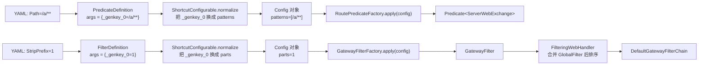
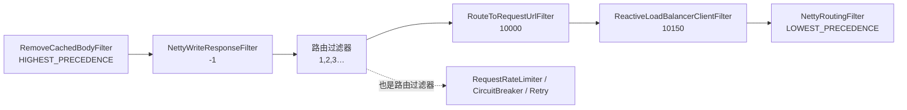
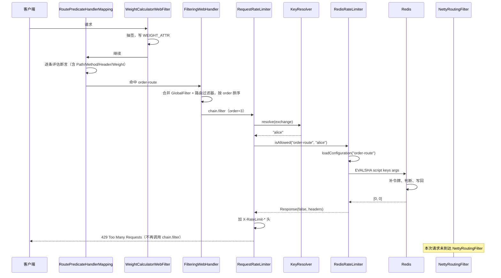

# Spring Cloud 源码精读 04-2：Predicate 与 Filter —— 常用断言怎么写、过滤器顺序怎么算、限流怎么接

> **一句话结论**：Gateway 里所有断言工厂都长一个样——"一个配置类 + 一个 `apply(config)` 返回判断逻辑"；所有过滤器最后被放进**同一个列表**按 `order` 从小到大排序执行，`NettyRoutingFilter` 永远排在最后负责真正发请求；限流只是链上一个普通的过滤器，它把"按谁限"交给 `KeyResolver`，把"让不让过"交给 `RateLimiter`，Redis 实现用的是**令牌桶**。
>
> | 项目 | 说明 |
> | --- | --- |
> | 阅读前置 | 读过 [04-1 路由与过滤器链](./01-route-路由断言与过滤器链.md)（知道 `Route` 三要素、`FilteringWebHandler` 怎么合并过滤器）；知道 `Mono`/`Flux` 是什么 |
> | 预计阅读 | 60–75 分钟 |
> | 源码基线 | `org.springframework.cloud:spring-cloud-gateway-server-webflux:5.1.0`（本文引用的类均已入库；`ConfigurationService`、`AbstractNameValueGatewayFilterFactory` 之外的绑定细节未展开；Redis 集群下的限流行为未实测） |
> | 配套阅读 | [04-1 路由与过滤器链](./01-route-路由断言与过滤器链.md)（整体流程）、[06 熔断限流与容错](../06-熔断限流与容错/README.md)（`CircuitBreaker` 背后的熔断器原理） |

---

## 0. 先看现象

### 0.1 一段四种写法都有的配置

下面是一段**示例**配置（不是源码），里面用了 4 个断言和 5 个过滤器：

```yaml
spring:
  cloud:
    gateway:
      server:
        webflux:
          routes:
            - id: order-route
              uri: lb://order-service
              predicates:
                - Path=/api/order/**, /api/orders/**
                - Method=GET,POST
                - Header=X-Channel, ^(web|app)$
              filters:
                - StripPrefix=1
                - AddRequestHeader=X-From, gateway
                - name: RequestRateLimiter
                  args:
                    redis-rate-limiter.replenishRate: 10
                    redis-rate-limiter.burstCapacity: 20
                - name: CircuitBreaker
                  args:
                    name: orderCb
            - id: v1-route
              uri: lb://order-service-v1
              predicates:
                - Weight=gray, 8
            - id: v2-route
              uri: lb://order-service-v2
              predicates:
                - Weight=gray, 2
```

把网关跑起来，你会看到这些现象：

| 你做了什么 | 你看到什么 |
| --- | --- |
| 访问 `GET /api/order/1` | 转发到 order-service 的 `/order/1`（`StripPrefix=1` 去掉了第一段），请求头多了 `X-From: gateway` |
| 访问 `DELETE /api/order/1` | 404（`Method` 断言不匹配，没有路由可用） |
| 访问 `GET /api/order/1` 但没带 `X-Channel` 头 | 404（`Header` 断言不匹配） |
| 1 秒内连续访问 21 次 | 前 20 次成功，之后返回 **429**，响应头里有 `X-RateLimit-Remaining: 0` |
| 两条 Weight 路由都匹配同一路径时访问 100 次 | 大约 80 次到 v1、20 次到 v2 |

这些现象背后有四个问题，就是本篇要讲的内容：

1. `Path=/a,/b` 没写 `patterns=`，框架怎么知道第一个参数是路径？（§3.2）
2. `Weight=gray, 8` 的 8 是怎么变成"80% 流量"的？（§3.4）
3. 这 5 个过滤器 + 一堆内置全局过滤器，谁先谁后？（§3.5、§3.6）
4. 限流为什么返回 429，Redis 里存了什么？（§3.7、§3.8）

### 0.2 术语

| 术语 | 解释 |
| --- | --- |
| **Predicate（断言）** | 一个"判断条件"，输入是这次请求，输出 true/false。true 表示"这条路由匹配" |
| **RoutePredicateFactory（断言工厂）** | 造断言的地方。你写 `Path=...`，它负责造出一个"检查路径"的断言对象 |
| **Config（配置对象）** | 一个普通 Java 类，字段对应配置里的参数。工厂先把你写的参数填进这个对象，再根据它造断言/过滤器 |
| **Shortcut（简写）** | 配置里偷懒的写法。`Header=X-Channel, web` 其实是 `Header.header=X-Channel, Header.regexp=web` 的简写 |
| **`Ordered` / `getOrder()`** | Spring 的排序接口，返回一个 int。**数字越小越先执行** |
| **`GlobalFilter`** | 全局过滤器，是一个 Spring Bean，对所有匹配到网关路由的请求生效 |
| **`GatewayFilter`** | 路由过滤器，属于某一条路由，由路由配置里的 `filters` 生成 |
| **pre / post** | 过滤器在 `chain.filter(exchange)` **之前**做的叫 pre，**之后**（`.then(...)` 里）做的叫 post。order 小的 pre 先执行、post 后执行（像洋葱，一层层进去再一层层出来） |
| **令牌桶（Token Bucket）** | 一种限流算法：桶里放令牌，每秒往里补 `replenishRate` 个，桶最多装 `burstCapacity` 个；每个请求要拿走 1 个令牌，拿不到就拒绝 |
| **`KeyResolver`** | 限流时"按谁限"的规则：按 IP、按用户、按接口……返回一个字符串当作限流的 key |
| **`RateLimiter`** | 限流器接口，只有一个方法 `isAllowed(routeId, key)`，返回"允许/拒绝 + 剩余额度" |
| **Lua 脚本** | Redis 内置的脚本语言。一段 Lua 在 Redis 里**原子执行**，中间不会插进别的命令 |

### 0.3 新人最常撞的墙

| # | 现象 | 一句话原因 | 详见 |
| --- | --- | --- | --- |
| 1 | 配了 `Header=X-Token`（只有一个参数）没生效 | `Header` 的第一个参数是头名，第二个才是正则；只写一个表示"只要存在" | §3.3 |
| 2 | 两条 Weight 路由流量不是 8:2 | `Weight` 断言只比对"本次抽中的是不是我"，两条路由的其它断言必须一样 | §6 |
| 3 | 自定义 `GlobalFilter` 里改请求头没生效 | 没实现 `Ordered`，order 默认最大，和 `NettyRoutingFilter` 并列 | §6 |
| 4 | 限流返回 **403** 而不是 429 | `KeyResolver` 返回了空 key，`denyEmptyKey=true` 默认生效 | §6 |
| 5 | `Retry` 配了但 POST 请求不重试 | `Retry` 默认只重试 GET | §3.9 |
| 6 | 配置名写错启动报 `Unable to find GatewayFilterFactory with name` | 配置名 = 类名去掉 `GatewayFilterFactory` 后缀 | §3.1 |

---

## 1. 整体地图

### 1.1 一行配置是怎么变成断言/过滤器的



**读图说明**：

1. **上下两条线完全对称**：断言和过滤器走的是同一套流程——"解析参数 → 简写换成字段名 → 绑定成 Config → 工厂 `apply` → 得到可执行对象"。差别只在最后：断言用于选路，过滤器进责任链。
2. **最关键的一格是中间的 `normalize`**：你在 YAML 里写的 `Path=/a/**` 被解析后键名其实是临时名 `_genkey_0`，是 `ShortcutConfigurable` 按工厂声明的 `shortcutFieldOrder()` 把它换成了真正的字段名 `patterns`。

### 1.2 过滤器链上的 order 数轴



**读图说明**：

1. **数轴方向就是 pre 的执行顺序**；post 阶段反过来（洋葱模型）。所以 `NettyWriteResponseFilter`（-1）pre 最先、写响应最后。
2. **`RequestRateLimiter`、`CircuitBreaker`、`Retry` 都只是普通的路由过滤器**，order 是它们在 `filters` 列表里的下标 + 1。所以它们天然排在 URL 拼接（10000）和真正发请求（最后）**之前**——限流当然要在转发前做。

---

## 2. 关键类

| 类 | 包 | 作用 |
| --- | --- | --- |
| `RoutePredicateFactory<C>` | `handler.predicate` | 断言工厂接口：`apply(config)` 返回 `Predicate<ServerWebExchange>` |
| `AbstractRoutePredicateFactory<C>` | `handler.predicate` | 抽象父类，把 `newConfig()` 实现成"反射 new 一个 Config" |
| `ShortcutConfigurable` | `support` | 简写解析规则：`shortcutFieldOrder()`、`shortcutType()` |
| `NameUtils` | `support` | 类名 ↔ 配置名的转换（去掉 `RoutePredicateFactory`/`GatewayFilterFactory` 后缀） |
| `PredicateDefinition` | `handler.predicate` | 一行断言配置的对象形式：`name + args` |
| `MethodRoutePredicateFactory` | `handler.predicate` | `Method=GET,POST` |
| `HeaderRoutePredicateFactory` | `handler.predicate` | `Header=X-Channel, ^(web\|app)$` |
| `PathRoutePredicateFactory` | `handler.predicate` | `Path=/a/**` |
| `WeightRoutePredicateFactory` + `WeightCalculatorWebFilter` | `handler.predicate` / `filter` | `Weight=group, weight`；后者是 **WebFilter**，负责真正抽随机数 |
| `GatewayFilterFactory<C>` | `filter.factory` | 过滤器工厂接口 |
| `GatewayFilter` / `GlobalFilter` | `filter` | 两种过滤器接口，方法签名完全一样 |
| `OrderedGatewayFilter` | `filter` | 装饰器：给没有 order 的过滤器加一个 order |
| `FilteringWebHandler` | `handler` | 合并 + 排序 + 启动链 |
| `NettyRoutingFilter` | `filter` | 链尾，真正用 Netty 发请求 |
| `RequestRateLimiterGatewayFilterFactory` | `filter.factory` | 限流过滤器工厂 |
| `KeyResolver` / `RateLimiter` / `RedisRateLimiter` | `filter.ratelimit` | 限流的两个扩展点接口 + Redis 令牌桶实现 |
| `request_rate_limiter.lua` | `META-INF/scripts` | 令牌桶的真正算法（Lua，在 Redis 里执行） |

---

## 3. 源码逐段精读

### 3.1 配置名 ↔ 类名：`NameUtils`

先解决最直观的问题：为什么写 `Path` 就能找到 `PathRoutePredicateFactory`？

```java (src: NameUtils.java#L43-L49)
	public static String generateName(int i) {
		return GENERATED_NAME_PREFIX + i;
	}

	public static String normalizeRoutePredicateName(Class<? extends RoutePredicateFactory> clazz) {
		return removeGarbage(clazz.getSimpleName().replace(RoutePredicateFactory.class.getSimpleName(), ""));
	}
```

```java (src: NameUtils.java#L55-L57)
	public static String normalizeFilterFactoryName(Class<? extends GatewayFilterFactory> clazz) {
		return removeGarbage(clazz.getSimpleName().replace(GatewayFilterFactory.class.getSimpleName(), ""));
	}
```

[[源码:NameUtils.java#L43-L57]]

**在干什么**：`generateName(i)` 生成临时键 `_genkey_0`、`_genkey_1`……；`normalizeRoutePredicateName` 把类名里的 `RoutePredicateFactory` 子串删掉再"去垃圾"，得到 `Path`、`Method`；`normalizeFilterFactoryName` 同理删掉 `GatewayFilterFactory`。

**为什么这么写**：配置名和类名用一条规则绑定，新增一个断言只要起名 `XxxRoutePredicateFactory`，不用额外注册名字。

**改成别的会怎样**：如果自己写工厂不按这个后缀命名（比如叫 `MyCheckFactory`），`name()` 会得到 `MyCheckFactory`，配置里就得写全名；最稳妥是按后缀命名，或者覆盖 `name()`。

**常见坑**：`CircuitBreaker` 是例外——它的抽象类把 `name()` 覆盖成常量，否则类名去掉后缀会得到 `SpringCloudCircuitBreaker`（见 §3.9）。

### 3.2 一行断言怎么变成 Config：`PredicateDefinition` + `ShortcutConfigurable`

**第 1 段：字符串切开。**

```java (src: PredicateDefinition.java#L44-L57)
	public PredicateDefinition(String text) {
		int eqIdx = text.indexOf('=');
		if (eqIdx <= 0) {
			throw new ValidationException(
					"Unable to parse PredicateDefinition text '" + text + "'" + ", must be of the form name=value");
		}
		setName(text.substring(0, eqIdx));

		String[] args = tokenizeToStringArray(text.substring(eqIdx + 1), ",");

		for (int i = 0; i < args.length; i++) {
			this.args.put(NameUtils.generateName(i), args[i]);
		}
	}
```

**在干什么**：找到第一个 `=`，左边是名字，右边按逗号切成数组；每个值用 `_genkey_下标` 当键放进 `args`（`_genkey_0=/a/**`、`_genkey_1=/b/**`）。

**为什么这么写**：配置格式允许多个位置参数，用下标当键最简单；真正的字段名稍后再换。

**常见坑**：没有 `=` 直接抛 `ValidationException`，提示 `must be of the form name=value`。

**第 2 段：临时键换成真字段名。**

```java (src: ShortcutConfigurable.java#L58-L66)
	static String normalizeKey(String key, int entryIdx, ShortcutConfigurable argHints, Map<String, String> args) {
		// RoutePredicateFactory has name hints and this has a fake key name
		// replace with the matching key hint
		if (key.startsWith(NameUtils.GENERATED_NAME_PREFIX) && !argHints.shortcutFieldOrder().isEmpty()
				&& entryIdx < args.size() && entryIdx < argHints.shortcutFieldOrder().size()) {
			key = argHints.shortcutFieldOrder().get(entryIdx);
		}
		return key;
	}
```

**在干什么**：如果键是 `_genkey_` 开头的临时名，就按它在参数列表里的下标，从工厂声明的 `shortcutFieldOrder()` 里取真正的字段名。

**改成别的会怎样**：想跳过简写直接写全名也行：`Header.header=X-Channel, Header.regexp=web`，此时键名本来就是全名，不走下标替换。

**第 3 段：`#{...}` 是 SpEL。** SpEL 是 Spring 的表达式语言，可以写 `#{request.headers['X-User']}` 这种运行时求值的式子。

```java (src: ShortcutConfigurable.java#L68-L84)
	static Object getValue(SpelExpressionParser parser, BeanFactory beanFactory, String entryValue) {
		Object value;
		String rawValue = entryValue;
		if (rawValue != null) {
			rawValue = rawValue.trim();
		}
		if (rawValue != null && rawValue.startsWith("#{") && entryValue.endsWith("}")) {
			// assume it's spel
			GatewayEvaluationContext context = new GatewayEvaluationContext(beanFactory);
			Expression expression = parser.parseExpression(entryValue, new TemplateParserContext());
			value = expression.getValue(context);
		}
		else {
			value = entryValue;
		}
		return value;
	}
```

**在干什么**：参数值如果以 `#{` 开头并以 `}` 结尾，就当 SpEL 解析求值，否则原样当字符串。

**常见坑**：参数值里恰好有 `#{`（比如某个正则）会被误当表达式而报错。

#### 三种简写类型

同一个工厂用不同断言时，"多个参数"的含义不同：`Method=GET,POST` 是一个列表；`Path=/a,/b,true` 是"列表 + 最后一个布尔开关"。由 `shortcutType()` 决定：

```java (src: ShortcutConfigurable.java#L86-L100)
	default ShortcutType shortcutType() {
		return ShortcutType.DEFAULT;
	}

	/**
	 * Returns hints about the number of args and the order for shortcut parsing.
	 * @return the list of hints
	 */
	default List<String> shortcutFieldOrder() {
		return Collections.emptyList();
	}

	default String shortcutFieldPrefix() {
		return "";
	}
```

| 类型 | 含义 | 谁在用 |
| --- | --- | --- |
| `DEFAULT` | 按下标一一对上 `shortcutFieldOrder` 的字段 | `Header`、`Weight`、`StripPrefix`、`AddRequestHeader` |
| `GATHER_LIST` | 所有参数收进**一个**列表字段 | `Method` |
| `GATHER_LIST_TAIL_FLAG` | 最后一个值是 `true`/`false` 时当作第二个字段，其余进列表 | `Path` |

`GATHER_LIST` 的实现：

```java (src: ShortcutConfigurable.java#L127-L143)
		GATHER_LIST {
			@Override
			public Map<String, Object> normalize(Map<String, String> args, ShortcutConfigurable shortcutConf,
					SpelExpressionParser parser, BeanFactory beanFactory) {
				Map<String, Object> map = new HashMap<>();
				// field order should be of size 1
				List<String> fieldOrder = shortcutConf.shortcutFieldOrder();
				Assert.isTrue(fieldOrder != null && fieldOrder.size() == 1,
						"Shortcut Configuration Type GATHER_LIST must have shortcutFieldOrder of size 1");
				String fieldName = fieldOrder.get(0);
				map.put(fieldName,
						args.values()
							.stream()
							.map(value -> getValue(parser, beanFactory, value))
							.collect(Collectors.toList()));
				return map;
			}
```

**在干什么**：要求 `shortcutFieldOrder` 只有一个字段名，把所有参数值收成 `List` 放进这个字段。

**为什么这么写**：`Method=GET,POST` 这种"个数不定"的参数用列表最自然。

**改成别的会怎样**：用了 `GATHER_LIST` 却声明两个字段的工厂，启动时 `Assert.isTrue` 直接报错。

**常见坑**：`GATHER_LIST_TAIL_FLAG` 的报错文案里写的是 `GATHER_LIST_HEAD`（原文如此，是个笔误），搜日志时别被误导。[[源码:ShortcutConfigurable.java#L149-L176]]

### 3.3 断言的共同骨架与两个具体实现

#### 共同骨架：`RoutePredicateFactory` + `AbstractRoutePredicateFactory`

接口核心只有一个方法：

```java (src: RoutePredicateFactory.java#L68-L76)
	Predicate<ServerWebExchange> apply(C config);

	default AsyncPredicate<ServerWebExchange> applyAsync(C config) {
		return toAsyncPredicate(apply(config));
	}

	default String name() {
		return NameUtils.normalizeRoutePredicateName(getClass());
	}
```

```java (src: AbstractRoutePredicateFactory.java#L21-L28)
public abstract class AbstractRoutePredicateFactory<C> extends AbstractConfigurable<C>
		implements RoutePredicateFactory<C> {

	public AbstractRoutePredicateFactory(Class<C> configClass) {
		super(configClass);
	}

}
```

```java (src: AbstractConfigurable.java#L35-L38)
	@Override
	public C newConfig() {
		return BeanUtils.instantiateClass(this.configClass);
	}
```

**在干什么**：工厂必须实现 `apply(C config)` 返回断言；`applyAsync` 默认把同步断言包成异步；`name()` 默认取类名去掉后缀。抽象父类把 `newConfig()` 实现成"反射 new 一个配置类实例"。

**为什么这么写**：把"造配置对象"这件机械的事放进父类，子类只需写两样——**配置类** + **`apply`**。所有内置断言都是这个形状，读一个就等于读了全部。

**改成别的会怎样**：如果 Config 没有无参构造器，`BeanUtils.instantiateClass` 会抛异常；Config 类要保留无参构造。接口默认的 `newConfig()` 直接抛 `UnsupportedOperationException`（L61–L63），就是不希望你自己手写。[[源码:RoutePredicateFactory.java#L60-L63]]

**常见坑**：`apply` 是**启动时**执行一次，`test` 是**每个请求**执行。重活（编译正则、解析路径模式）要放在 `apply` 里，`test` 里只留最轻的比较。

#### 具体实现 1：`MethodRoutePredicateFactory`

```java (src: MethodRoutePredicateFactory.java#L43-L67)
	@Override
	public List<String> shortcutFieldOrder() {
		return List.of(METHODS_KEY);
	}

	@Override
	public ShortcutType shortcutType() {
		return ShortcutType.GATHER_LIST;
	}

	@Override
	public Predicate<ServerWebExchange> apply(Config config) {
		return new GatewayPredicate() {
			@Override
			public boolean test(ServerWebExchange exchange) {
				HttpMethod requestMethod = exchange.getRequest().getMethod();
				return stream(config.getMethods()).anyMatch(httpMethod -> httpMethod == requestMethod);
			}

			@Override
			public String toString() {
				return String.format("Methods: %s", Arrays.toString(config.getMethods()));
			}
		};
	}
```

**在干什么**：声明"我的参数全收进 `methods` 字段"（`GATHER_LIST`）；`apply` 返回一个匿名 `GatewayPredicate`，`test` 里拿请求方法，和配置里的方法列表逐个用 `==` 比较，任意一个相等就返回 true。

**为什么这么写**：方法在 Spring 里是常量对象，`==` 比引用比 `equals` 更快；`stream().anyMatch` 找到第一个就停。

**改成别的会怎样**：如果每次 `test` 都去解析字符串，QPS 高时白白浪费 CPU。

**常见坑**：`toString()` 被覆盖成 `Methods: [GET, POST]`——这个字符串就是开启 debug 日志时你看到的断言描述，排障时很有用。

#### 具体实现 2：`HeaderRoutePredicateFactory`

```java (src: HeaderRoutePredicateFactory.java#L54-L94)
	@Override
	public Predicate<ServerWebExchange> apply(Config config) {
		Pattern pattern = (StringUtils.hasText(config.regexp)) ? Pattern.compile(config.regexp) : null;

		return new GatewayPredicate() {
			@Override
			public boolean test(ServerWebExchange exchange) {
				if (!StringUtils.hasText(config.header)) {
					return false;
				}
				List<String> values = exchange.getRequest().getHeaders().getValuesAsList(config.header);
				if (values.isEmpty()) {
					return false;
				}
				// values is now guaranteed to not be empty
				if (pattern != null) {
					// check if a header value matches
					for (int i = 0; i < values.size(); i++) {
						String value = values.get(i);
						if (pattern.asMatchPredicate().test(value)) {
							return true;
						}
					}
					return false;
				}

				// there is a value and since regexp is empty, we only check existence.
				return true;
			}

			@Override
			public Object getConfig() {
				return config;
			}

			@Override
			public String toString() {
				return String.format("Header: %s regexp=%s", config.header, config.regexp);
			}
		};
	}
```

**在干什么**：`apply` 阶段把正则**编译一次**放在返回对象外面；`test` 阶段取请求头所有值，逐个用 `pattern.asMatchPredicate().test(value)` 做**全值匹配**，任一命中即 true；没配正则时只检查头是否存在。

**为什么这么写**：正则编译很贵，必须只在启动时做一次；HTTP 允许同名头出现多次，所以要遍历。

**改成别的会怎样**：把 `Pattern.compile` 挪进 `test`，每个请求都要重新编译一次——功能不变，性能明显变差。

**常见坑**：`asMatchPredicate()` 要求**整个值**完全匹配。头值是 `web,app` 时，正则 `web` 不匹配，要写 `web.*` 或 `^(web|app)$`。

#### 具体实现 3：`PathRoutePredicateFactory`

`Path` 是最常用的断言，它声明"参数是一组路径模式，最后可以是布尔开关"：

```java (src: PathRoutePredicateFactory.java#L75-L83)
	@Override
	public List<String> shortcutFieldOrder() {
		return Arrays.asList("patterns", MATCH_TRAILING_SLASH);
	}

	@Override
	public ShortcutType shortcutType() {
		return ShortcutType.GATHER_LIST_TAIL_FLAG;
	}
```

然后 `apply` 在启动时把字符串模式编译成 `PathPattern` 对象（Spring 自带的路径匹配器，比 Ant 风格正则快）：

```java (src: PathRoutePredicateFactory.java#L85-L104)
	@Override
	public Predicate<ServerWebExchange> apply(Config config) {
		final ArrayList<PathPattern> pathPatterns = new ArrayList<>();
		synchronized (this.pathPatternParser) {
			// FIXME: 5.0.0 setMatchOptionalTrailingSeparator missing
			// pathPatternParser.setMatchOptionalTrailingSeparator(config.isMatchTrailingSlash());
			config.getPatterns().forEach(pattern -> {
				String basePath = webFluxProperties.getBasePath();
				boolean basePathIsNotBlank = StringUtils.hasText(basePath);
				String pathPatternStr = pattern;
				if (basePathIsNotBlank) {
					if (pattern.length() > 1 && !pattern.startsWith("/")) {
						basePath += ("/");
					}
					pathPatternStr = basePath + pattern;
				}
				PathPattern pathPattern = this.pathPatternParser.parse(pathPatternStr);
				pathPatterns.add(pathPattern);
			});
		}
```

**在干什么**：在 `synchronized (pathPatternParser)` 里把每个模式（拼上 `basePath` 前缀）解析成 `PathPattern`。

**为什么这么写**：`PathPatternParser` 解析时会改内部状态，不是线程安全的，所以加锁。

**常见坑**：L89–L90 有个 `FIXME`：`matchTrailingSlash` 开关**当前没接线**——`pathPatternParser.setMatchOptionalTrailingSeparator(...)` 那行被注释掉了。你配 `Path=/api/**, false` 里的 `false` 不起作用，尾斜杠行为取决于 `PathPatternParser` 的默认行为（未验证）。[[源码:PathRoutePredicateFactory.java#L89-L90]]

接着看请求时的匹配逻辑：

```java (src: PathRoutePredicateFactory.java#L105-L139)
		return new GatewayPredicate() {
			@Override
			public boolean test(ServerWebExchange exchange) {
				PathContainer path = (PathContainer) exchange.getAttributes()
					.computeIfAbsent(GATEWAY_PREDICATE_PATH_CONTAINER_ATTR,
							s -> parsePath(exchange.getRequest().getURI().getRawPath()));

				PathPattern match = null;
				for (int i = 0; i < pathPatterns.size(); i++) {
					PathPattern pathPattern = pathPatterns.get(i);
					if (pathPattern.matches(path)) {
						match = pathPattern;
						break;
					}
				}

				if (match != null) {
					traceMatch("Pattern", match.getPatternString(), path, true);
					PathMatchInfo pathMatchInfo = match.matchAndExtract(path);
					if (pathMatchInfo != null) {
						putUriTemplateVariables(exchange, pathMatchInfo.getUriVariables());
					}
					exchange.getAttributes().put(GATEWAY_PREDICATE_MATCHED_PATH_ATTR, match.getPatternString());
					String routeId = (String) exchange.getAttributes().get(GATEWAY_PREDICATE_ROUTE_ATTR);
					if (routeId != null) {
						// populated in RoutePredicateHandlerMapping
						exchange.getAttributes().put(GATEWAY_PREDICATE_MATCHED_PATH_ROUTE_ID_ATTR, routeId);
					}
					return true;
				}
				else {
					traceMatch("Pattern", config.getPatterns(), path, false);
					return false;
				}
			}
```

**在干什么**：从 exchange 属性里取（没有就解析并缓存）请求路径；逐个模式 `matches`，第一个命中的就停；命中后 `matchAndExtract` 把 `/a/{id}` 里的 `{id}` 提取出来放进 exchange 属性（后面的过滤器可以用），并把命中的**模式串**放进 `GATEWAY_PREDICATE_MATCHED_PATH_ATTR`。

**为什么这么写**：`computeIfAbsent` 把解析结果缓存在 exchange 里——一次请求要逐条评估多条路由，路径只需解析一次。

**改成别的会怎样**：去掉缓存，评估 N 条路由就要解析 N 次路径。

**常见坑**：`GATEWAY_PREDICATE_MATCHED_PATH_ATTR` 里存的是模式串（如 `/api/order/**`），不是实际请求路径。

### 3.4 `Weight`：断言自己不算权重

`Weight` 是唯一一个"自己不做判断"的断言。它分两半：`WeightRoutePredicateFactory` 只负责登记和比对，真正抽随机数的是 `WeightCalculatorWebFilter`。

**第 1 段：声明两个字段，并在 `apply` 之前发事件。**

```java (src: WeightRoutePredicateFactory.java#L68-L83)
	@Override
	public List<String> shortcutFieldOrder() {
		return Arrays.asList(GROUP_KEY, WEIGHT_KEY);
	}

	@Override
	public String shortcutFieldPrefix() {
		return WeightConfig.CONFIG_PREFIX;
	}

	@Override
	public void beforeApply(WeightConfig config) {
		if (publisher != null) {
			publisher.publishEvent(new WeightDefinedEvent(this, config));
		}
	}
```

**在干什么**：`shortcutFieldOrder` 声明两个位置参数：`weight.group`、`weight.weight`；`beforeApply` 在造断言之前发布 `WeightDefinedEvent`，把"这条路由在这个组里权重多少"广播出去。

**为什么这么写**：断言评估是每请求发生的，而权重区间只需要在路由定义确定时算一次。用 Spring 事件把"登记"这件事交给别人做，断言工厂本身不需要知道谁在算。

**第 2 段：断言只做比对。**

```java (src: WeightRoutePredicateFactory.java#L85-L116)
	@Override
	public Predicate<ServerWebExchange> apply(WeightConfig config) {
		return new GatewayPredicate() {
			@Override
			public boolean test(ServerWebExchange exchange) {
				Map<String, String> weights = exchange.getAttributeOrDefault(WEIGHT_ATTR, Collections.emptyMap());

				String routeId = exchange.getAttribute(GATEWAY_PREDICATE_ROUTE_ATTR);

				if (routeId == null) {
					return false;
				}

				// all calculations and comparison against random num happened in
				// WeightCalculatorWebFilter
				String group = config.getGroup();
				if (weights.containsKey(group)) {

					String chosenRoute = weights.get(group);
					if (log.isTraceEnabled()) {
						log.trace("in group weight: " + group + ", current route: " + routeId + ", chosen route: "
								+ chosenRoute);
					}

					return routeId.equals(chosenRoute);
				}
				else if (log.isTraceEnabled()) {
					log.trace("no weights found for group: " + group + ", current route: " + routeId);
				}

				return false;
			}
```

**在干什么**：从 exchange 属性 `WEIGHT_ATTR` 取出"每个组本次抽中的路由 id"，判断 `weights.get(group)` 是否等于当前路由 id。

**为什么这么写**：一次请求可能评估多条带 `Weight` 的路由，如果每条都自己抽一次随机数，比例就不准了。所以随机数在更早的 `WebFilter` 里**每请求每组只抽一次**，所有同组路由比对同一个结果。

**常见坑**：`routeId == null` 直接返回 false——`GATEWAY_PREDICATE_ROUTE_ATTR` 是由 `RoutePredicateHandlerMapping` 在评估每条路由前放进去的，用 Java DSL 时如果漏了这一步，Weight 断言永远不匹配。

**第 3 段：谁接收事件、谁抽随机数。** `WeightCalculatorWebFilter` 同时实现 `WebFilter`、`Ordered`、`SmartApplicationListener`：

```java (src: WeightCalculatorWebFilter.java#L59-L64)
public class WeightCalculatorWebFilter implements WebFilter, Ordered, SmartApplicationListener {

	/**
	 * Order of Weight Calculator Web filter.
	 */
	public static final int WEIGHT_CALC_FILTER_ORDER = 10001;
```

```java (src: WeightCalculatorWebFilter.java#L133-L140)
	@Override
	public void onApplicationEvent(ApplicationEvent event) {
		if (event instanceof PredicateArgsEvent) {
			handle((PredicateArgsEvent) event);
		}
		else if (event instanceof WeightDefinedEvent) {
			addWeightConfig(((WeightDefinedEvent) event).getWeightConfig());
		}
```

**在干什么**：收到 `WeightDefinedEvent` 就 `addWeightConfig`；收到 `RouteDeletedEvent` 就移除。它的 order 是 10001——注意这是 **WebFilter 的 order**，不在网关过滤器链上。

**为什么这么写**：`WeightCalculatorWebFilter` 必须在 `RoutePredicateHandlerMapping`（它负责选路）之前跑完，才能把抽签结果放进 exchange。WebFlux 里 `WebFilterChain` 先于 `HandlerMapping`，所以它能做到。

**第 4 段：权重区间怎么算。**

```java (src: WeightCalculatorWebFilter.java#L178-L231)
	/* for testing */ void addWeightConfig(WeightConfig weightConfig) {
		String group = weightConfig.getGroup();
		GroupWeightConfig config;
		// only create new GroupWeightConfig rather than modify
		// and put at end of calculations. This avoids concurency problems
		// later during filter execution.
		if (groupWeights.containsKey(group)) {
			config = new GroupWeightConfig(groupWeights.get(group));
		}
		else {
			config = new GroupWeightConfig(group);
		}

		config.weights.put(weightConfig.getRouteId(), weightConfig.getWeight());
...
		// normalize weights
		int weightsSum = 0;

		for (Integer weight : config.weights.values()) {
			weightsSum += weight;
		}

		final AtomicInteger index = new AtomicInteger(0);
		for (Map.Entry<String, Integer> entry : config.weights.entrySet()) {
			String routeId = entry.getKey();
			Integer weight = entry.getValue();
			Double nomalizedWeight = weight / (double) weightsSum;
			config.normalizedWeights.put(routeId, nomalizedWeight);

			// recalculate rangeIndexes
			config.rangeIndexes.put(index.getAndIncrement(), routeId);
		}
...
		// TODO: calculate ranges
		config.ranges.clear();

		config.ranges.add(0.0);

		List<Double> values = new ArrayList<>(config.normalizedWeights.values());
		for (int i = 0; i < values.size(); i++) {
			Double currentWeight = values.get(i);
			Double previousRange = config.ranges.get(i);
			Double range = previousRange + currentWeight;
			config.ranges.add(range);
		}
...
		// only update after all calculations
		groupWeights.put(group, config);
	}
```

**在干什么**：对同一个 group，新建一份 `GroupWeightConfig`（不修改旧的），把权重归一化（每个权重 ÷ 总和），然后累加得到区间边界。例如 v1=8、v2=2 → 归一化 0.8、0.2 → 区间 `[0, 0.8)`、`[0.8, 1.0)`。

**为什么这么写**：注释说得很清楚——"只创建新的、不改旧的，最后一步才 `put`"，这样正在处理请求的线程看到的永远是一份完整的配置，不需要加锁。

**常见坑**：变量名 `nomalizedWeight` 是原文拼写（少了一个 r），不是文档笔误。

**第 5 段：每请求抽签。**

```java (src: WeightCalculatorWebFilter.java#L247-L284)
	@Override
	public Mono<Void> filter(ServerWebExchange exchange, WebFilterChain chain) {
		Map<String, String> weights = getWeights(exchange);

		for (String group : groupWeights.keySet()) {
			GroupWeightConfig config = groupWeights.get(group);
...
			// Usually, multiple threads accessing the same random object will have some
			// performance problems, so we can use ThreadLocalRandom by default
			double r = randomFunction.apply(exchange);

			List<Double> ranges = config.ranges;
...
			for (int i = 0; i < ranges.size() - 1; i++) {
				if (r >= ranges.get(i) && r < ranges.get(i + 1)) {
					String routeId = config.rangeIndexes.get(i);
					weights.put(group, routeId);
					break;
				}
			}
		}
...
		return chain.filter(exchange);
```

**在干什么**：对每个组取一个 `[0,1)` 随机数 `r`，落在哪个区间就把该区间的路由 id 放进 `weights.put(group, routeId)`。

**为什么这么写**：用 `ThreadLocalRandom` 而不是共享 `Random`（L261–L262 注释），避免多线程竞争同一个随机数生成器。

**改成别的会怎样**：把抽签挪进断言的 `test`，每条路由各抽一次，8:2 会变成约 80%×(1−20%) 的纠缠结果，比例失真。

**完整链路**：配置 → `beforeApply` 发 `WeightDefinedEvent` → `WeightCalculatorWebFilter.addWeightConfig` 算区间 → 请求来 → `filter` 抽签写 `WEIGHT_ATTR` → `RoutePredicateHandlerMapping` 逐条评估 → `WeightRoutePredicateFactory.test` 比对。

```java (src: GatewayAutoConfiguration.java#L467-L472)
	@Bean
	@ConditionalOnEnabledPredicate(WeightRoutePredicateFactory.class)
	public WeightCalculatorWebFilter weightCalculatorWebFilter(ConfigurationService configurationService,
			ObjectProvider<RouteLocator> routeLocator) {
		return new WeightCalculatorWebFilter(routeLocator, configurationService);
	}
```

注意 `@ConditionalOnEnabledPredicate(WeightRoutePredicateFactory.class)`：没有启用 Weight 断言时，这个 WebFilter 也不会创建。反向的依赖也存在——`weightRoutePredicateFactory` 这个 Bean 上有 `@DependsOn("weightCalculatorWebFilter")`，保证先有接收者再发事件。[[源码:GatewayAutoConfiguration.java#L557-L560]]

### 3.5 过滤器顺序：两种接口、一个列表、一次排序

#### 两种过滤器接口长得一模一样

```java (src: GatewayFilter.java#L34-L55)
public interface GatewayFilter extends ShortcutConfigurable {

	/**
	 * Name key.
	 */
	String NAME_KEY = "name";

	/**
	 * Value key.
	 */
	String VALUE_KEY = "value";

	/**
	 * Process the Web request and (optionally) delegate to the next {@code WebFilter}
	 * through the given {@link GatewayFilterChain}.
	 * @param exchange the current server exchange
	 * @param chain provides a way to delegate to the next filter
	 * @return {@code Mono<Void>} to indicate when request processing is complete
	 */
	Mono<Void> filter(ServerWebExchange exchange, GatewayFilterChain chain);

}
```

```java (src: GlobalFilter.java#L35-L46)
public interface GlobalFilter {

	/**
	 * Process the Web request and (optionally) delegate to the next {@code GatewayFilter}
	 * through the given {@link GatewayFilterChain}.
	 * @param exchange the current server exchange
	 * @param chain provides a way to delegate to the next filter
	 * @return {@code Mono<Void>} to indicate when request processing is complete
	 */
	Mono<Void> filter(ServerWebExchange exchange, GatewayFilterChain chain);

}
```

**在干什么**：两个接口都只有一个 `filter(exchange, chain)` 方法，返回 `Mono<Void>`。区别只在"是谁造出来的"：`GatewayFilter` 由路由配置里的 `filters` 生成，`GlobalFilter` 是一个 Spring Bean。

**为什么这么写**：方法签名一致，才能在运行时丢进同一个 `List<GatewayFilter>` 里统一排序——`GlobalFilter` 通过一个适配器（`GatewayFilterAdapter`）变成 `GatewayFilter`。

**常见坑**：javadoc 第 39–40 行明确说：`GlobalFilter` **只对已经匹配到某条路由的请求**生效，不是"所有进网关的请求"。404 的请求不会经过任何 `GlobalFilter`。

#### 过滤器工厂：和断言工厂对称

```java (src: GatewayFilterFactory.java#L69-L80)
	default GatewayFilter apply(@Nullable String routeId, C config) {
		if (config instanceof HasRouteId) {
			HasRouteId hasRouteId = (HasRouteId) config;
			hasRouteId.setRouteId(routeId);
		}
		return apply(config);
	}

	default String name() {
		// TODO: deal with proxys
		return NameUtils.normalizeFilterFactoryName(getClass());
	}
```

**在干什么**：`apply(config)` 返回 `GatewayFilter`；如果 Config 实现了 `HasRouteId`，就先把路由 id 塞进去（限流、熔断都要用路由 id 当命名空间）；`name()` 同样取类名去后缀。

#### order 从哪来：`OrderedGatewayFilter` 装饰器

路由过滤器在配置里是按**列表顺序**生成的，生成的位置就是它的 order。`RouteDefinitionRouteLocator` 在装配时给每个过滤器编号：[[源码:RouteDefinitionRouteLocator.java#L169-L175]]

```java
// 示例（非源码，说明编号规则）：filters 列表 [StripPrefix, AddRequestHeader, RequestRateLimiter, CircuitBreaker]
// → order 依次为 1, 2, 3, 4
```

全局过滤器如果没有实现 `Ordered`，就由 `FilteringWebHandler` 包一层：

```java (src: OrderedGatewayFilter.java#L27-L50)
public class OrderedGatewayFilter implements GatewayFilter, Ordered {

	private final GatewayFilter delegate;

	private final int order;

	public OrderedGatewayFilter(GatewayFilter delegate, int order) {
		this.delegate = delegate;
...
	}

	public GatewayFilter getDelegate() {
		return delegate;
	}

	@Override
	public Mono<Void> filter(ServerWebExchange exchange, GatewayFilterChain chain) {
		return this.delegate.filter(exchange, chain);
	}

	@Override
	public int getOrder() {
		return this.order;
	}
```

```java (src: FilteringWebHandler.java#L74-L89)
	private static List<GatewayFilter> loadFilters(List<GlobalFilter> filters) {
		return filters.stream().map(filter -> {
			GatewayFilterAdapter gatewayFilter = new GatewayFilterAdapter(filter);
			if (filter instanceof Ordered ordered) {
				int order = ordered.getOrder();
				return new OrderedGatewayFilter(gatewayFilter, order);
			}
			else {
				Order order = AnnotationUtils.findAnnotation(filter.getClass(), Order.class);
				if (order != null) {
					return new OrderedGatewayFilter(gatewayFilter, order.value());
				}
			}
			return gatewayFilter;
		}).collect(Collectors.toList());
	}
```

**在干什么**：`OrderedGatewayFilter` 是装饰器，保存一个被包装的过滤器和它的 order，`getOrder()` 返回 order，`filter()` 直接委托。`loadFilters` 的优先级是：实现了 `Ordered` 用 `getOrder()`；否则找类上的 `@Order` 注解；否则不包（没有 order）。

**为什么这么写**：Spring 自身已经有 `@Order`/`Ordered` 这套约定，复用它就不需要再造一套"过滤器优先级"概念。

**改成别的会怎样**：自定义 `GlobalFilter` 既不实现 `Ordered` 也不加 `@Order`，它的 order 就是"无"，排序时被当成最低优先级（见下一段 `AnnotationAwareOrderComparator` 的行为），排在 `NettyRoutingFilter` 附近——此时请求头已经发出去了，再改也没用。

#### 合并 + 排序：只有三行

```java (src: FilteringWebHandler.java#L119-L125)
	protected List<GatewayFilter> getAllFilters(Route route) {
		List<GatewayFilter> gatewayFilters = route.getFilters();
		List<GatewayFilter> combined = new ArrayList<>(this.globalFilters);
		combined.addAll(gatewayFilters);
		AnnotationAwareOrderComparator.sort(combined);
		return combined;
	}
```

**在干什么**：`globalFilters`（启动时收集好的全局过滤器）+ `route.getFilters()`（本条路由的）合并成一个列表，`AnnotationAwareOrderComparator.sort` 排一次。

**为什么这么写**：这是整个"顺序"问题的全部答案——**没有分类、没有阶段，就是按数字从小到大**。内置全局过滤器的数字是故意挑的：`RemoveCachedBodyFilter` 用最高优先级（最前），`NettyWriteResponseFilter` 是 -1，`RouteToRequestUrlFilter` 是 10000，`ReactiveLoadBalancerClientFilter` 是 10150，`NettyRoutingFilter` 是最低优先级（最后）。路由过滤器默认 1、2、3……，于是天然落在"写响应过滤器之后、拼 URL 之前"。

**常见坑**：想让某个路由过滤器排在负载均衡**之后**（拿到真实 IP 再处理），必须自己返回一个实现了 `Ordered` 的过滤器，把 order 设成大于 10150。

```java (src: FilteringWebHandler.java#L147-L159)
		@Override
		public Mono<Void> filter(ServerWebExchange exchange) {
			return Mono.defer(() -> {
				if (this.index < filters.size()) {
					GatewayFilter filter = filters.get(this.index);
					DefaultGatewayFilterChain chain = new DefaultGatewayFilterChain(this, this.index + 1);
					return filter.filter(exchange, chain);
				}
				else {
					return Mono.empty(); // complete
				}
			});
		}
```

**在干什么**：链的执行就是按下标取下一个过滤器调用；`Mono.defer` 让"取第几个"延迟到订阅时才决定，所以过滤器内部修改 `index`（比如熔断器 fallback 重置链）是生效的。

### 3.6 链尾：`NettyRoutingFilter`

```java (src: NettyRoutingFilter.java#L76-L81)
public class NettyRoutingFilter implements GlobalFilter, Ordered {

	/**
	 * The order of the NettyRoutingFilter. See {@link Ordered#LOWEST_PRECEDENCE}.
	 */
	public static final int ORDER = Ordered.LOWEST_PRECEDENCE;
```

```java (src: NettyRoutingFilter.java#L108-L124)
	@Override
	public int getOrder() {
		return ORDER;
	}

	@Override
	@SuppressWarnings("Duplicates")
	public Mono<Void> filter(ServerWebExchange exchange, GatewayFilterChain chain) {
		URI requestUrl = exchange.getRequiredAttribute(GATEWAY_REQUEST_URL_ATTR);

		String scheme = requestUrl.getScheme();
		if (isAlreadyRouted(exchange) || (!"http".equalsIgnoreCase(scheme) && !"https".equalsIgnoreCase(scheme))) {
			return chain.filter(exchange);
		}
		setAlreadyRouted(exchange);

		ServerHttpRequest request = exchange.getRequest();
```

**在干什么**：`ORDER = Ordered.LOWEST_PRECEDENCE`——int 最大值，保证在同一个列表里排最后。`filter` 第一步取 `GATEWAY_REQUEST_URL_ATTR`（由 `RouteToRequestUrlFilter` 等前面的过滤器放进去的目标地址）；如果已经转发过、或者协议不是 http/https（比如 `lb://` 还没被解析、`forward://` 交给别人处理），就原样 `chain.filter` 往后传；否则先 `setAlreadyRouted` 标记，再发请求。

**为什么这么写**：`alreadyRouted` 标记是为了防止重复转发——`Retry`、`CircuitBreaker` 的 fallback 都可能让链**重跑**，第二次跑到这里必须能识别出"这次已经发过了"。另外"只认 http/https"意味着别的协议由专门的过滤器处理，这个过滤器主动让路。

**改成别的会怎样**：把 `setAlreadyRouted` 去掉，`Retry` 重试时会在同一个 exchange 上再发一次请求，而旧的连接资源可能还没释放。

L125–L199 是构造 Netty 请求、处理 `Host` 头、建立连接、把响应写回 exchange 的细节（响应连接放进 `CLIENT_RESPONSE_CONN_ATTR`，由 `NettyWriteResponseFilter` 真正写出），这里只看结尾：

```java (src: NettyRoutingFilter.java#L200-L213)
				.doOnDiscard(Connection.class, Connection::dispose));

		Duration responseTimeout = getResponseTimeout(route);
		if (responseTimeout != null) {
			responseFlux = responseFlux
				.timeout(responseTimeout,
						Mono.defer(() -> Mono
							.error(new TimeoutException("Response took longer than timeout: " + responseTimeout))))
				.onErrorMap(TimeoutException.class,
						th -> new ResponseStatusException(HttpStatus.GATEWAY_TIMEOUT, th.getMessage(), th));
		}

		return responseFlux.then(chain.filter(exchange));
	}
```

**在干什么**：响应流加一个超时（`responseTimeout` 配置），超时映射成 **504 GATEWAY_TIMEOUT**；最后 `responseFlux.then(chain.filter(exchange))`——**等响应拿到之后**，再调用 `chain.filter`。

**为什么这么写**：这是"链尾"最巧妙的一处。它虽然排在最后，但仍然调用了 `chain.filter(exchange)`，而此时链里已经没有下一个过滤器了，`chain.filter` 实际上什么也不做。真正的作用是：**所有排在它前面的过滤器的 post 逻辑（`.then(...)` 里的部分）现在才执行**，并且此时响应已经在 exchange 里了。洋葱模型在这里"到底"。

**常见坑**：`responseTimeout` 只对"等响应头/第一个数据"生效，不是整个响应体下载完的超时。

### 3.7 限流过滤器：`RequestRateLimiterGatewayFilterFactory`

限流拆成三块：**过滤器**（编排）、**`KeyResolver`**（按谁限）、**`RateLimiter`**（让不让过）。

```java (src: KeyResolver.java#L26-L30)
public interface KeyResolver {

	Mono<String> resolve(ServerWebExchange exchange);

}
```

```java (src: RateLimiter.java#L30-L39)
public interface RateLimiter<C> extends StatefulConfigurable<C> {

	Mono<Response> isAllowed(String routeId, String id);

	class Response {

		private final boolean allowed;

		private final long tokensRemaining;

```

**在干什么**：`KeyResolver.resolve` 返回一个字符串 key；`RateLimiter.isAllowed(routeId, id)` 返回 `Response`（是否允许 + 要加到响应上的头）。两个方法都返回 `Mono`——因为取用户信息、查 Redis 都可能是异步的。

**为什么这么写**：把"按谁限"和"怎么限"拆成两个接口，就可以自由组合：按 IP + Redis 令牌桶、按用户 + 本地 Bucket4j……过滤器代码不用改。

过滤器本身：

```java (src: RequestRateLimiterGatewayFilterFactory.java#L109-L151)
	@SuppressWarnings("unchecked")
	@Override
	public GatewayFilter apply(Config config) {
		KeyResolver resolver = getOrDefault(config.keyResolver, defaultKeyResolver);
		RateLimiter<Object> limiter = getOrDefault(config.rateLimiter, defaultRateLimiter);
		boolean denyEmpty = getOrDefault(config.denyEmptyKey, this.denyEmptyKey);
		HttpStatusHolder emptyKeyStatus = HttpStatusHolder
			.parse(getOrDefault(config.emptyKeyStatus, this.emptyKeyStatusCode));
		boolean throwLimit = getOrDefault(config.throwOnLimit, this.throwOnLimit);

		return (exchange, chain) -> resolver.resolve(exchange).defaultIfEmpty(EMPTY_KEY).flatMap(key -> {
			if (EMPTY_KEY.equals(key)) {
				if (denyEmpty) {
					setResponseStatus(exchange, emptyKeyStatus);
					return exchange.getResponse().setComplete();
				}
				return chain.filter(exchange);
			}
			String routeId = config.getRouteId();
			if (routeId == null) {
				Route route = exchange.getAttribute(ServerWebExchangeUtils.GATEWAY_ROUTE_ATTR);
				routeId = Objects.requireNonNull(route, "Route not found").getId();
			}
			return limiter.isAllowed(routeId, key).flatMap(response -> {

				for (Map.Entry<String, String> header : response.getHeaders().entrySet()) {
					exchange.getResponse().getHeaders().add(header.getKey(), header.getValue());
				}

				if (response.isAllowed()) {
					return chain.filter(exchange);
				}

				if (throwLimit) {
					return Mono.error(HttpClientErrorException.create(config.getStatusCode(), "Too Many Requests",
							exchange.getResponse().getHeaders(), null, null));
				}

				setResponseStatus(exchange, config.getStatusCode());
				return exchange.getResponse().setComplete();
			});
		});
	}
```

[[源码:RequestRateLimiterGatewayFilterFactory.java#L109-L151]]

**在干什么**（分 5 步）：

1. **解析 key**（L119）：`resolver.resolve(exchange).defaultIfEmpty(EMPTY_KEY)`——拿不到 key 就用空串。
2. **空 key 处理**（L120–L125）：如果 `denyEmptyKey`（默认 `true`）且 key 为空，直接返回 `emptyKeyStatusCode`（默认 **403**），**不往下走**。
3. **确定 routeId**（L127–L131）：配置里写了就用配置的，否则取当前路由 id。
4. **问限流器**（L132）：`limiter.isAllowed(routeId, key)`，拿到 `Response`。
5. **加头 + 放行或拒绝**（L134–L148）：把 `Response` 里的头加到响应上；允许就 `chain.filter`；拒绝时如果 `throwOnLimit` 就抛 `HttpClientErrorException.TooManyRequests`（交给异常处理），否则直接 `setResponseStatus` + `setComplete`——**不调用 chain.filter**，链在这里断掉，响应直接返回客户端。

**为什么这么写**：拒绝时"不调用 `chain.filter`"是责任链的标准短路方式；同时限流头（剩余额度等）无论允许还是拒绝都加，客户端才知道自己还能发多少。

**改成别的会怎样**：把空 key 改成默认放行（`deny-empty-key: false`），所有拿不到 key 的请求会共用空串这一个桶，等于一个匿名大桶，限流形同虚设。

**常见坑**：

- 默认 `statusCode` 是 **429 TOO_MANY_REQUESTS**，但空 key 是 **403**——看到 403 别以为是权限问题。
- `KeyResolver` 是**每请求调用**的，里面不要做重活。

#### 装配条件

```java (src: GatewayAutoConfiguration.java#L677-L691)
	@Bean(name = PrincipalNameKeyResolver.BEAN_NAME)
	@ConditionalOnBean(RateLimiter.class)
	@ConditionalOnMissingBean(KeyResolver.class)
	@ConditionalOnEnabledFilter(RequestRateLimiterGatewayFilterFactory.class)
	public PrincipalNameKeyResolver principalNameKeyResolver() {
		return new PrincipalNameKeyResolver();
	}

	@Bean
	@ConditionalOnBean({ RateLimiter.class, KeyResolver.class })
	@ConditionalOnEnabledFilter
	public RequestRateLimiterGatewayFilterFactory requestRateLimiterGatewayFilterFactory(RateLimiter rateLimiter,
			KeyResolver resolver) {
		return new RequestRateLimiterGatewayFilterFactory(rateLimiter, resolver);
	}
```

**在干什么**：只有容器里**已经有 `RateLimiter` Bean** 时，才创建默认的 `PrincipalNameKeyResolver`（且用户没有自己定义 `KeyResolver`）；限流过滤器工厂需要同时有 `RateLimiter` 和 `KeyResolver` 两个 Bean。

**为什么这么写**：网关核心包不强制依赖 Redis。你引入 `spring-cloud-starter-data-redis-reactive` + 网关的 Redis 限流自动配置后，`RedisRateLimiter` Bean 才会出现，限流过滤器才会被装配。

**常见坑**：没加 Redis 依赖就配 `RequestRateLimiter`，启动报找不到 `RequestRateLimiterGatewayFilterFactory`——根因是缺 `RateLimiter` Bean，不是过滤器名写错。

默认的 key 解析器按**登录用户名**限流：

```java (src: PrincipalNameKeyResolver.java#L23-L35)
public class PrincipalNameKeyResolver implements KeyResolver {

	/**
	 * {@link PrincipalNameKeyResolver} bean name.
	 */
	public static final String BEAN_NAME = "principalNameKeyResolver";

	@Override
	public Mono<String> resolve(ServerWebExchange exchange) {
		return exchange.getPrincipal().flatMap(p -> Mono.justOrEmpty(p.getName()));
	}

}
```

**常见坑**：没接 Spring Security 时 `getPrincipal()` 是空的，默认解析器返回空 key → 403。所以实际项目几乎一定要自定义 `KeyResolver`（例如按 IP）。

#### 每条路由不同限额是怎么装进去的

`AbstractRateLimiter` 监听 `FilterArgsEvent`，把某条路由 `args` 里以自己名字开头的参数绑定成这条路由专属的配置：

```java (src: AbstractRateLimiter.java#L51-L69)
	@Override
	public void onApplicationEvent(FilterArgsEvent event) {
		Map<String, Object> args = event.getArgs();

		if (args.isEmpty() || !hasRelevantKey(args)) {
			return;
		}

		String routeId = event.getRouteId();

		C routeConfig = newConfig();
		if (this.configurationService != null) {
			this.configurationService.with(routeConfig)
				.name(this.configurationPropertyName)
				.normalizedProperties(args)
				.bind();
		}
		getConfig().put(routeId, routeConfig);
	}
```

**在干什么**：路由配置里 `redis-rate-limiter.replenishRate: 10` 这种参数，被按 `configurationPropertyName`（`redis-rate-limiter.`）前缀筛出来，绑定后 `getConfig().put(routeId, config)`——**每个路由 id 一份配置**。

**为什么这么写**：`RedisRateLimiter` 是单例 Bean，但不同路由需要不同限额，所以配置要按 routeId 分开存。

### 3.8 Redis 令牌桶：`RedisRateLimiter` + Lua

#### key 长什么样

```java (src: RedisRateLimiter.java#L160-L171)
	static List<String> getKeys(String id, String routeId) {
		// use `{}` around keys to use Redis Key hash tags
		// this allows for using redis cluster

		// Make a unique key per user and route.
		String prefix = "request_rate_limiter.{" + routeId + "." + id + "}.";

		// You need two Redis keys for Token Bucket.
		String tokenKey = prefix + "tokens";
		String timestampKey = prefix + "timestamp";
		return Arrays.asList(tokenKey, timestampKey);
	}
```

**在干什么**：每个 (路由, key) 组合生成两个 Redis key：`request_rate_limiter.{routeId.id}.tokens`（桶里当前令牌数）和 `….timestamp`（上次补充时间）。

**为什么这么写**：花括号 `{...}` 是 Redis Cluster 的 **hash tag**——同一个花括号内的 key 保证落在同一个槽/节点，Lua 脚本才能同时操作这两个 key（跨槽会报错）。

#### 算法思路与入口

```java (src: RedisRateLimiter.java#L238-L245)
	/**
	 * This uses a basic token bucket algorithm and relies on the fact that Redis scripts
	 * execute atomically. No other operations can run between fetching the count and
	 * writing the new count.
	 */
	@Override
	@SuppressWarnings("unchecked")
	public Mono<Response> isAllowed(String routeId, String id) {
```

**在干什么**：javadoc 直接说明：用**基础令牌桶**算法，依赖"Redis 脚本原子执行"——读取令牌数和写入新令牌数之间不可能插进别的请求，所以不需要分布式锁。

```java (src: RedisRateLimiter.java#L250-L298)
		Config routeConfig = loadConfiguration(routeId);

		// How many requests per second do you want a user to be allowed to do?
		int replenishRate = routeConfig.getReplenishRate();

		// How much bursting do you want to allow?
		long burstCapacity = routeConfig.getBurstCapacity();

		// How many tokens are requested per request?
		int requestedTokens = routeConfig.getRequestedTokens();
...
		try {
			List<String> keys = getKeys(id, routeId);

			// The arguments to the LUA script. time() returns unixtime in seconds.
			List<String> scriptArgs = Arrays.asList(replenishRate + "", burstCapacity + "", "", requestedTokens + "");
...
			Flux<List<Long>> flux = this.redisTemplate.execute(this.script, keys, scriptArgs);
			// .log("redisratelimiter", Level.FINER);
			return flux.onErrorResume(throwable -> {
				log.error("Error calling rate limiter lua", throwable);
				return Flux.just(Arrays.asList(1L, -1L));
			}).reduce(new ArrayList<Long>(), (longs, l) -> {
				longs.addAll(l);
				return longs;
			}).map(results -> {
				boolean allowed = results.get(0) == 1L;
				Long tokensLeft = results.get(1);
...
		catch (Exception e) {
			/*
			 * We don't want a hard dependency on Redis to allow traffic. Make sure to set
			 * an alert so you know if this is happening too much. Stripe's observed
			 * failure rate is 0.01%.
			 */
			log.error("Error determining if user allowed from redis", e);
		}
		return Mono.just(new Response(true, getHeaders(routeConfig, -1L)));
	}
```

**在干什么**（分 4 步）：

1. **取配置**（L246）：`loadConfiguration(routeId)`——路由级配置 → `defaultConfig` → `default-filters` 里配的 → 都没有抛 `IllegalArgumentException`。
2. **拼脚本参数**（L250–L256）：补充速率、桶容量、空串（时间，让 Redis 自己取）、本次要拿的令牌数。
3. **执行脚本**（L257–L267）：`reactiveStringRedisTemplate.execute(script, keys, args)`，拿到 `List` 结果。
4. **判读结果**（L268–L291）：`results.get(0) == 1L` 即允许；`-1` 表示"不知道还剩多少"（Redis 出错时的降级值）。

**为什么这么写**：时间参数传空串，由脚本里 `redis.call('TIME')` 取 **Redis 服务器时间**——各网关实例时钟不一致也不会算错。

**改成别的会怎样**：第 271–L273 行 `onErrorResume` 把 Redis 异常吞掉并返回"允许 + 剩余 -1"；最外层 L297 行 catch 兜底也返回 `Response(true, -1)`。也就是说 **Redis 挂了限流会全部放行**（注释原话："不想硬依赖 Redis"）。对安全类限流不可接受的话，需要自己实现 `RateLimiter` 做失败拒绝。

**常见坑**：`allowed == 1` 才算允许；脚本返回的 `new_tokens` 可能是小数，转成 `long` 后作为 `X-RateLimit-Remaining` 头返回。

#### 真正的算法：Lua 脚本

脚本 `META-INF/scripts/request_rate_limiter.lua` 已入库，共 27 行（[[源码:request_rate_limiter.lua#L1-L27]]）。下面是原文：

```lua
redis.replicate_commands()

local tokens_key = KEYS[1]
local timestamp_key = KEYS[2]

local rate = tonumber(ARGV[1])
local capacity = tonumber(ARGV[2])
local now = tonumber(ARGV[3]) or redis.call('TIME')[1]
local requested = tonumber(ARGV[4])

local fill_time = capacity / rate
local ttl = math.floor(fill_time * 2)

local last_tokens = tonumber(redis.call("get", tokens_key)) or capacity
local last_refreshed = tonumber(redis.call("get", timestamp_key)) or 0

local delta = math.max(0, now-last_refreshed)
local filled_tokens = math.min(capacity, last_tokens+(delta*rate))
local allowed = filled_tokens >= requested
local new_tokens = allowed and filled_tokens - requested or filled

if ttl > 0 then
  redis.call("setex", tokens_key, ttl, new_tokens)
  redis.call("setex", timestamp_key, ttl, now)
end

return { allowed and 1 or 0, new_tokens }
```

**在干什么**（逐步翻译）：

| 行 | 代码 | 意思 |
| --- | --- | --- |
| 6–9 | `rate / capacity / now / requested` | Java 传来的四个参数：每秒补几个、桶多大、当前时间（秒）、这次要拿几个 |
| 11–12 | `fill_time = capacity / rate`，`ttl = fill_time*2` | 桶从空到满要多久；key 过期时间设为它的 2 倍——很久没人访问就自动清理 |
| 14–15 | `last_tokens` / `last_refreshed` | 上次剩下的令牌数（第一次访问当作满桶）、上次补充时间（第一次当作 0） |
| 17–18 | `delta`，`filled_tokens` | 距上次过了多少秒，补 `delta*rate` 个，但不超过 `capacity` |
| 19–20 | `allowed`，`new_tokens` | 够不够 `requested` 个？够就扣掉，不够原样不动 |
| 22–25 | `setex` 两次 | 写回两个 key 并设过期 |
| 27 | `return {1/0, new_tokens}` | 返回"是否允许 + 剩余数" |

**打个比方**：桶像一个自动补水的水杯——每秒滴入 `rate` 毫升，最多 `capacity` 毫升；每个请求要喝 `requested` 毫升。`replenishRate=10, burstCapacity=20` 的意思是：长期平均每秒 10 个请求，但空闲一段时间后允许瞬间涌进 20 个。

**为什么这么写**：令牌桶不是"每秒清零重新计数"，而是按时间**连续补充**，所以允许突发流量、也能平滑限速，这是它比"固定窗口计数"好的地方。整个脚本在 Redis 里一次执行完，多个网关实例共享同一个桶，限流是**全集群**的。

**改成别的会怎样**：把算法换成"每秒重新 set 计数器"（固定窗口），窗口交界处会有 2 倍突刺；把脚本拆成 Java 里"先 GET 再 SET"两条命令，两个实例同时读到同一个值，限流就会超发。

**常见坑**：

- `burstCapacity` 设成 0 时 `fill_time` 为 0，`ttl` 为 0，不写 key——L22 `if ttl > 0` 就是为了避免 `setex` 报错。
- `Config` 里校验 `burstCapacity >= replenishRate`，否则启动报错。[[源码:RedisRateLimiter.java#L351-L352]]
- `requestedTokens` 默认 1，可以按接口设大一点（例如删除类接口算 5 个）。

#### 剩余额度响应头

```java (src: RedisRateLimiter.java#L314-L323)
	public Map<String, String> getHeaders(Config config, Long tokensLeft) {
		Map<String, String> headers = new HashMap<>();
		if (isIncludeHeaders()) {
			headers.put(this.remainingHeader, tokensLeft.toString());
			headers.put(this.replenishRateHeader, String.valueOf(config.getReplenishRate()));
			headers.put(this.burstCapacityHeader, String.valueOf(config.getBurstCapacity()));
			headers.put(this.requestedTokensHeader, String.valueOf(config.getRequestedTokens()));
		}
		return headers;
	}
```

**在干什么**：返回 4 个头：`X-RateLimit-Remaining`（还剩几个）、`Replenish-Rate`（每秒补几个）、`Burst-Capacity`（桶大小）、`Requested-Tokens`（这次拿了几个）。

**常见坑**：Redis 出错时 `allowed=-1`，`Remaining` 头的值就是 **-1**——看到 -1 就知道 Redis 没连上，而不是限流真的用光。

### 3.9 内置过滤器：配置名怎么映射到工厂类

配置名 → 类名的规则在 §3.1 已经说过（去掉 `GatewayFilterFactory` 后缀）。下面看四个常用的，重点关注"参数怎么绑定、pre/post 在哪"。

#### `AddRequestHeader`：最简单的 pre 过滤器

```java (src: AbstractNameValueGatewayFilterFactory.java#L36-L39)
	@Override
	public List<String> shortcutFieldOrder() {
		return Arrays.asList(GatewayFilter.NAME_KEY, GatewayFilter.VALUE_KEY);
	}
```

```java (src: AddRequestHeaderGatewayFilterFactory.java#L36-L61)
	@Override
	public GatewayFilter apply(NameValueConfig config) {
		return new GatewayFilter() {
			@Override
			public Mono<Void> filter(ServerWebExchange exchange, GatewayFilterChain chain) {
				String name = Objects.requireNonNull(config.getName(), "name must not be null");
				String rawValue = Objects.requireNonNull(config.getValue(), "value must not be null");
				String value = ServerWebExchangeUtils.expand(exchange, rawValue);
				ServerHttpRequest request = exchange.getRequest()
					.mutate()
					.headers(httpHeaders -> httpHeaders.add(name, value))
					.build();

				return chain.filter(exchange.mutate().request(request).build());
			}

			@Override
			public String toString() {
				String name = config.getName();
				String value = config.getValue();
				return filterToStringCreator(AddRequestHeaderGatewayFilterFactory.this)
					.append(name != null ? name : "", value != null ? value : "")
					.toString();
			}
		};
	}
```

**在干什么**：父类声明两个字段 `name`、`value`，所以 `AddRequestHeader=X-From, gateway` 第一个参数是头名、第二个是值。`apply` 先展开（支持 `#{...}` 和占位符），返回的过滤器里把请求 `mutate()` 加一个头，再 `chain.filter`。

**为什么这么写**：请求对象不可变，要改就 `mutate()` 出一个新对象、用 `exchange.mutate().request(newRequest).build()` 造一个新 exchange 往下传——避免多线程共享可变状态。

**常见坑**：`exchange.getRequest()` 拿到的仍是**旧请求**；下游过滤器要用 `chain` 传下去的那个 exchange 才能看到新头。

同类：`AddResponseHeader` 的写法是 `chain.filter(exchange).then(Mono.fromRunnable(() -> addHeader(...)))`——post 逻辑写在 `.then` 里。[[源码:AddResponseHeaderGatewayFilterFactory.java#L57-L81]]

#### `StripPrefix`：改路径并重写目标 URL

```java (src: StripPrefixGatewayFilterFactory.java#L52-L55)
	@Override
	public List<String> shortcutFieldOrder() {
		return Arrays.asList(PARTS_KEY);
	}
```

```java (src: StripPrefixGatewayFilterFactory.java#L57-L86)
	@Override
	public GatewayFilter apply(Config config) {
		return new GatewayFilter() {
			@Override
			public Mono<Void> filter(ServerWebExchange exchange, GatewayFilterChain chain) {
				ServerHttpRequest request = exchange.getRequest();
				addOriginalRequestUrl(exchange, request.getURI());
				String path = request.getURI().getRawPath();
				String[] originalParts = StringUtils.tokenizeToStringArray(path, "/");

				// all new paths start with /
				StringBuilder newPath = new StringBuilder("/");
				for (int i = 0; i < originalParts.length; i++) {
					if (i >= config.getParts()) {
						// only append slash if this is the second part or greater
						if (newPath.length() > 1) {
							newPath.append('/');
						}
						newPath.append(originalParts[i]);
					}
				}
				if (newPath.length() > 1 && path.endsWith("/")) {
					newPath.append('/');
				}

				ServerHttpRequest newRequest = request.mutate().path(newPath.toString()).build();

				exchange.getAttributes().put(GATEWAY_REQUEST_URL_ATTR, newRequest.getURI());

				return chain.filter(exchange.mutate().request(newRequest).build());
```

**在干什么**：一个参数 `parts`（默认 1）。把请求路径按 `/` 切开，去掉前 `parts` 段，拼回新路径；然后把新 URL 放进 `GATEWAY_REQUEST_URL_ATTR`，再 `chain.filter`。

**为什么这么写**：直接改 `GATEWAY_REQUEST_URL_ATTR` 而不是只改请求路径——因为后面 `RouteToRequestUrlFilter` 拼目标 URL 时用的是请求路径，两者要一致；`NettyRoutingFilter` 最终用的就是这个属性。

**常见坑**：`parts` 大于路径段数时路径变成空串，等于转发到根路径。

#### `Retry`：默认只重试 GET

```java (src: RetryGatewayFilterFactory.java#L75-L79)
	@Override
	public List<String> shortcutFieldOrder() {
		return Arrays.asList("retries", "statuses", "methods", "backoff.firstBackoff", "backoff.maxBackoff",
				"backoff.factor", "backoff.basedOnPreviousValue", "jitter.randomFactor", "timeout");
	}
```

```java (src: RetryGatewayFilterFactory.java#L81-L110)
	@Override
	public GatewayFilter apply(RetryConfig retryConfig) {
		retryConfig.validate();
		enableBodyCaching(retryConfig.getRouteId());

		boolean hasStatusCodeRepeat = !retryConfig.getStatuses().isEmpty() || !retryConfig.getSeries().isEmpty();
		boolean hasExceptionRetry = !retryConfig.getExceptions().isEmpty();

		GatewayFilter gatewayFilter = (exchange, chain) -> {
			trace("Entering retry-filter");

			// chain.filter returns a Mono<Void>
			Publisher<Void> publisher = chain.filter(exchange)
				// .log("retry-filter", Level.INFO)
				.doOnSuccess(aVoid -> updateIteration(exchange))
				.doOnError(throwable -> updateIteration(exchange));

			if (hasExceptionRetry) {
				// retryWhen returns a Mono<Void>
				// retry needs to go before repeat
				publisher = ((Mono<Void>) publisher).retryWhen(buildExceptionRetry(exchange, retryConfig));
			}
			if (hasStatusCodeRepeat) {
				// repeatWhen returns a Flux<Void>
				// so this needs to be last and the variable a Publisher<Void>
				publisher = ((Mono<Void>) publisher).repeatWhen(buildStatusCodeRepeat(exchange, retryConfig));
			}

			return Mono.fromDirect(publisher);
		};
```

```java (src: RetryGatewayFilterFactory.java#L376-L384)
		private int retries = 3;

		private List<Series> series = toList(Series.SERVER_ERROR);

		private List<HttpStatus> statuses = new ArrayList<>();

		private List<HttpMethod> methods = toList(HttpMethod.GET);

		private List<Class<? extends Throwable>> exceptions = toList(IOException.class, TimeoutException.class);
```

**在干什么**：先 `enableBodyCaching(routeId)`（重试要重新发 body，所以第一次就得缓存）；然后两条重试路径——**异常重试**用 `retryWhen`，**状态码重试**用 `repeatWhen`；外面套 `Mono.fromDirect`。

**为什么这么写**：body 是流，只能读一次，不缓存的话第二次重试发出去的是空 body。默认 `methods=[GET]`，因为 GET 幂等；POST 重试可能导致重复下单。

**改成别的会怎样**：把 `methods` 加上 POST，就必须保证下游接口幂等，否则网络抖动一次就多一笔订单。

**常见坑**：`Retry` 和 `CircuitBreaker` 一起用时顺序很重要——Retry 在前会重试熔断器的 fallback 结果。

#### `CircuitBreaker`：抽象基类 + Resilience4j 实现

`CircuitBreaker` 的配置名不是类名去后缀得来的，而是显式常量：

```java (src: SpringCloudCircuitBreakerFilterFactory.java#L56-L60)
public abstract class SpringCloudCircuitBreakerFilterFactory
		extends AbstractGatewayFilterFactory<SpringCloudCircuitBreakerFilterFactory.Config> {

	/** CircuitBreaker component name. */
	public static final String NAME = "CircuitBreaker";
```

```java (src: SpringCloudCircuitBreakerFilterFactory.java#L86-L96)
	@Override
	public List<String> shortcutFieldOrder() {
		return singletonList(NAME_KEY);
	}

	@Override
	public GatewayFilter apply(Config config) {
		if (config.getFallbackUri() != null) {
			enableBodyCaching(config.getRouteId());
		}
		ReactiveCircuitBreaker cb = reactiveCircuitBreakerFactory.create(config.getId());
```

```java (src: SpringCloudCircuitBreakerFilterFactory.java#L104-L113)
		return new GatewayFilter() {
			@Override
			public Mono<Void> filter(ServerWebExchange exchange, GatewayFilterChain chain) {
				return cb.run(chain.filter(exchange).doOnSuccess(v -> {
					if (statuses.contains(exchange.getResponse().getStatusCode())) {
						HttpStatusCode status = java.util.Objects.requireNonNull(exchange.getResponse().getStatusCode(),
								"statusCode must not be null");
						throw new CircuitBreakerStatusCodeException(status);
					}
				}), t -> {
```

```java (src: SpringCloudCircuitBreakerFilterFactory.java#L168-L171)
	@Override
	public String name() {
		return NAME;
	}
```

**在干什么**：`NAME = "CircuitBreaker"`；`shortcutFieldOrder` 只有 `name` 一个字段，所以 `CircuitBreaker=myCb` 的第一个参数是熔断器实例名。`apply` 时按 `config.getId()`（name 为空时用 routeId）向 `ReactiveCircuitBreakerFactory` 要一个熔断器；过滤器里用 `cb.run(...)` 包住"整个后半段链"，把下游异常交给熔断器记录；配置了 `statusCodes` 时，下游返回这些状态码也被当作失败（抛 `CircuitBreakerStatusCodeException`）。

**为什么这么写**：基类只定义"包住链 + fallback 路由怎么走"的骨架，`handleErrorWithoutFallback` 留成抽象方法——Spring Cloud CircuitBreaker 抽象层可以接 Resilience4j、 Sentinel 等不同实现，错误映射各自不同。`name()` 覆盖是因为类名是 `SpringCloudCircuitBreakerFilterFactory`，按默认规则会得到 `SpringCloudCircuitBreaker` 这个又长又没必要的名字。

**常见坑**：`fallbackUri` 是 `forward:` 或 `http:` 开头都行；配置了 fallback 会自动 `enableBodyCaching`（fallback 重跑链需要 body）。

Resilience4j 实现的错误映射：

```java (src: SpringCloudCircuitBreakerResilience4JFilterFactory.java#L32-L54)
public class SpringCloudCircuitBreakerResilience4JFilterFactory extends SpringCloudCircuitBreakerFilterFactory {

	public SpringCloudCircuitBreakerResilience4JFilterFactory(
			ReactiveCircuitBreakerFactory reactiveCircuitBreakerFactory,
			ObjectProvider<DispatcherHandler> dispatcherHandlerProvider) {
		super(reactiveCircuitBreakerFactory, dispatcherHandlerProvider);
	}

	@Override
	protected Mono<Void> handleErrorWithoutFallback(Throwable t, boolean resumeWithoutError) {
		if (java.util.concurrent.TimeoutException.class.isInstance(t)) {
			return Mono.error(new ResponseStatusException(HttpStatus.GATEWAY_TIMEOUT, t.getMessage(), t));
		}
		if (CallNotPermittedException.class.isInstance(t)) {
			return Mono.error(new ServiceUnavailableException());
		}
		if (resumeWithoutError) {
			return Mono.empty();
		}
		return Mono.error(t);
	}

}
```

**在干什么**：没有 fallback 时——超时 → **504**；熔断器打开（`CallNotPermittedException`）→ **503**；配置了 `resumeWithoutError` → 直接返回空响应；其它错误原样抛出。

**常见坑**：看到网关返回 503 且响应头/日志里有 `CallNotPermitted`，不是后端挂了，是熔断器**主动拒绝**。

#### 小结：四个过滤器的"位置"

| 配置 | 工厂类 | pre 还是 post | 一句话 |
| --- | --- | --- | --- |
| `AddRequestHeader` | `AddRequestHeaderGatewayFilterFactory` | pre | 改请求头后 `chain.filter` |
| `StripPrefix` | `StripPrefixGatewayFilterFactory` | pre | 改路径并重写 `GATEWAY_REQUEST_URL_ATTR` |
| `Retry` | `RetryGatewayFilterFactory` | 包住后半段 | 用 `retryWhen/repeatWhen` 重跑 `chain.filter` |
| `CircuitBreaker` | `SpringCloudCircuitBreakerResilience4JFilterFactory` | 包住后半段 | `cb.run(chain.filter(...))`，失败走 fallback |

---

## 4. 完整时序：一次被限流的请求



**读图说明**：

1. **最关键的两个箭头是 `R->>L: isAllowed` 和 `R-->>C: 429`**：限流过滤器既不在 `KeyResolver` 里做判断，也不自己算数——它只负责编排，并把"拒绝"实现为**不调用 `chain.filter`**。
2. `WeightCalculatorWebFilter` 排在 `RoutePredicateHandlerMapping` **之前**（它是 WebFilter），所以断言评估时抽签结果已经在 exchange 里了。

---

## 5. 设计模式

| 模式 | 在哪里 | 解决什么问题 |
| --- | --- | --- |
| **工厂方法 + 模板方法** | `RoutePredicateFactory.apply` / `AbstractRoutePredicateFactory.newConfig` | 子类只写"配置类 + apply"，造配置、起名字由父类/接口默认方法完成 |
| **策略 + 简写解析** | `ShortcutConfigurable.ShortcutType` 三个枚举值 | "多参数怎么对应字段"有三种规则，各自一个策略，工厂声明用哪种 |
| **适配器 + 装饰器** | `GatewayFilterAdapter`（把 `GlobalFilter` 变成 `GatewayFilter`）、`OrderedGatewayFilter`（加 order） | 两种接口统一成一个列表；没有 order 的对象也能排序 |
| **责任链** | `DefaultGatewayFilterChain` | 一串过滤器按序执行，任一环节可以短路（限流拒绝）或重跑（Retry） |
| **观察者（Spring 事件）** | `WeightDefinedEvent` → `WeightCalculatorWebFilter` | 断言工厂只广播"我登记了一个权重"，不关心谁来算 |
| **写时复制（Copy-on-Write）** | `WeightCalculatorWebFilter.addWeightConfig` 新建配置最后一步才 `put` | 无锁并发读 |
| **策略接口拆分** | `KeyResolver` 与 `RateLimiter` 分开 | "按谁限"和"怎么限"独立替换 |
| **桥接 / 抽象骨架** | `SpringCloudCircuitBreakerFilterFactory` 抽象 + Resilience4j 子类 | 骨架不变，错误映射随实现变化 |
| **外部脚本原子执行** | Redis Lua 令牌桶 | 把"读-算-写"三步合成一步，无需分布式锁 |

---

## 6. 踩坑与调试

| # | 现象 | 根因 | 怎么查 / 怎么修 |
| --- | --- | --- | --- |
| 1 | 自定义 `GlobalFilter` 加的请求头后端收不到 | 没实现 `Ordered`，排在 `NettyRoutingFilter` 旁边，请求已经发出 | 给过滤器加 `getOrder()` 返回小于 10000 的值；开 `logging.level.org.springframework.cloud.gateway=trace` 看 `Sorted gatewayFilterFactories` 日志 |
| 2 | 限流返回 403 | 默认 `PrincipalNameKeyResolver` 在无登录信息时返回空 key，`denyEmptyKey=true` | 自定义 `KeyResolver` Bean（按 IP 等）；或 `deny-empty-key: false` |
| 3 | 限流"不生效"，剩余额度头一直是 -1 | Redis 连接失败，`isAllowed` 的 `onErrorResume` 返回允许 + (-1) | 查 Redis 连通性；对可靠性有要求就自定义 `RateLimiter` 改成失败拒绝 |
| 4 | Weight 两条路由比例不对 | 一条路由多了一个别的断言（如 `Header`），只有部分请求能同时评估两条 | 两条 Weight 路由的其它断言必须完全一样，只差 `uri` 和 `weight` |
| 5 | Weight 路由永远不匹配 | 用 Java DSL 自定义了 `RouteLocator` 但评估前没写 `GATEWAY_PREDICATE_ROUTE_ATTR` | 用标准 `RoutePredicateHandlerMapping`；或确保评估前 put 路由 id |
| 6 | `Header=X-Token, token` 不匹配 `token,other` | `asMatchPredicate` 全值匹配 | 正则写 `token.*` |
| 7 | `Retry` 对 POST 无效 | 默认 `methods=[GET]` | 加 `methods: GET,POST`，并确保下游幂等 |
| 8 | 配了 `CircuitBreaker` 启动报找不到工厂 | 没引 `spring-cloud-starter-circuitbreaker-reactor-resilience4j` | 加依赖；`CircuitBreaker` 的工厂 Bean 由 resilience4j 自动配置提供 |
| 9 | 所有路由共享一个限流桶 | 自定义 `KeyResolver` 返回了常量 | key 里要包含区分维度（IP/用户/接口） |
| 10 | 限流重启后 Redis 里还有旧 key | key 过期时间是 `2 × capacity / rate` 秒 | 正常现象；不需要清理 |

调试技巧：

- `logging.level.org.springframework.cloud.gateway: debug` 会打印每条路由的断言与过滤器描述（`toString()` 被各工厂覆盖过），例如 `Predicates: [Paths: [/api/order/**], ...Methods: [GET, POST]]`。
- 直接看 Redis：`KEYS request_rate_limiter.*`、`GET request_rate_limiter.{order-route.alice}.tokens`。
- 想确认顺序，在自定义过滤器里打印 `chain.getClass()` 与 `exchange.getAttributes().get(GATEWAY_REQUEST_URL_ATTR)`。

---

## 7. ⚠️ 版本差异

| 版本 | 变化 | 对你的影响 |
| --- | --- | --- |
| Spring Cloud Gateway **4.1 及之前** | 配置前缀 `spring.cloud.gateway.routes`；只有一个同时含阻塞式（Mvc）与 WebFlux 的 Starter | 旧文章/旧项目的配置前缀是 `spring.cloud.gateway.*` |
| **4.2 / 5.x** | 拆成 `spring-cloud-gateway-server-webflux` 与 `spring-cloud-gateway-server-mvc` 两个独立项目，WebFlux 版配置前缀变为 `spring.cloud.gateway.server.webflux.*` | 本文示例配置用的是 5.1.0 的新前缀；照抄旧文章的配置会不生效 |
| **5.0** | `GlobalFilter` javadoc 明确"只对已匹配路由的请求生效"（自 5.0 起） | 404 请求不再经过 `GlobalFilter`；想做"全入口"鉴权要用 `WebFilter` |
| **5.x** | `Path` 的 `matchTrailingSlash` 在 5.1.0 源码里仍是 FIXME 未接线 | 别依赖这个开关 |

> 以上版本差异中，4.x 配置前缀与 Starter 拆分依据 Spring Cloud 官方发布说明的记忆整理，未在本文入库源码中逐条验证；"5.0 GlobalFilter 范围"与"FIXME 未接线"两条来自已入库源码的 javadoc/注释。生产升级前请以对应版本的官方 Release Notes 为准。

---

## 8. 面试常见问题

**1. Gateway 的断言和过滤器有什么区别？**

断言（Predicate）决定"这条路由匹配不匹配"，在选路阶段执行，全部为 true 才选中；过滤器（GatewayFilter/GlobalFilter）在选中之后执行，负责改请求/响应、转发。两者都是"工厂 + Config + apply"的结构，但断言返回 `Predicate<ServerWebExchange>`，过滤器返回 `GatewayFilter`。

**2. `GlobalFilter` 和 `GatewayFilter` 的区别？顺序怎么决定？**

作用域不同：`GatewayFilter` 属于一条路由，`GlobalFilter` 是 Bean 对所有匹配路由的请求生效。运行时两者被放进**同一个列表**，用 `AnnotationAwareOrderComparator` 按 order 从小到大排：实现了 `Ordered` 用 `getOrder()`，否则看 `@Order`，路由过滤器按配置顺序编号 1、2、3…。

**3. 为什么 `NettyRoutingFilter` 排最后？它在最后还调用 `chain.filter` 有什么意义？**

`ORDER = Ordered.LOWEST_PRECEDENCE` 保证它最后执行，这样前面所有过滤器（改头、改路径、限流、负载均衡解析出真实 IP）都已经完成。它最后调用 `chain.filter(exchange)` 是责任链的约定，此时虽然链里没有下一个过滤器，但 `Mono.then` 的语义让前面过滤器的 post 逻辑（`.then(...)` 里的部分）在**响应拿到之后**才执行——洋葱模型在这里触底。

**4. 自己写一个断言工厂需要实现什么？**

继承 `AbstractRoutePredicateFactory<Config>`，写一个有无参构造的 `Config` 类，覆盖 `apply(Config)` 返回 `Predicate<ServerWebExchange>`；需要简写就覆盖 `shortcutFieldOrder()`（必要时 `shortcutType()`）。类名以 `RoutePredicateFactory` 结尾并注册成 Bean，配置里就能用。

**5. `Path=/a/**, false` 最后那个 `false` 是怎么绑到 Config 的？**

`PathRoutePredicateFactory.shortcutType()` 返回 `GATHER_LIST_TAIL_FLAG`，`shortcutFieldOrder()` 是 `[patterns, matchTrailingSlash]`。`ShortcutConfigurable.normalize` 发现最后一个值是 `true/false` 就把它绑到第二个字段，其余值收成列表绑到第一个字段。（但在 5.1.0 里这个开关实际未接线。）

**6. `Weight` 断言是怎么保证 8:2 的？为什么不在断言里直接抽随机数？**

`WeightRoutePredicateFactory.beforeApply` 发 `WeightDefinedEvent`，`WeightCalculatorWebFilter` 接收后按组归一化权重算出区间表。每个请求到达时该 WebFilter 对每个组抽**一次**随机数，把命中的路由 id 写进 exchange；`Weight` 断言只比对"抽中的是不是我"。如果每条路由的断言各抽一次，比例会失真且无法保证唯一命中。

**7. Gateway 限流的 `KeyResolver` 和 `RateLimiter` 分别做什么？**

`KeyResolver` 决定"按谁限"（返回字符串 key，如 IP、用户名）；`RateLimiter` 决定"让不让过"（`isAllowed(routeId, key)` 返回是否允许和要加的响应头）。过滤器只负责编排：先解析 key、再问限流器、加头、放行或短路。

**8. Redis 令牌桶的 key 为什么带花括号？**

`request_rate_limiter.{routeId.key}.tokens` 中的 `{...}` 是 Redis Cluster 的 hash tag，保证同一组的 `tokens` 和 `timestamp` 两个 key 落在同一个槽，Lua 脚本才能原子地同时读写它们。

**9. Redis 挂了，Gateway 的限流会怎样？**

会**全部放行**。`RedisRateLimiter.isAllowed` 的 `onErrorResume` 和外层 catch 都返回 `Response(true, -1)`，注释原话是不想硬依赖 Redis。如果业务要求"Redis 不可用时拒绝"，要自己实现 `RateLimiter`。

**10. 令牌桶的 `replenishRate` 和 `burstCapacity` 是什么关系？**

`replenishRate` 是每秒补充的令牌数（长期平均速率），`burstCapacity` 是桶容量（允许的瞬时突发）。脚本里按时间差补令牌并封顶到 `capacity`；Config 校验 `burstCapacity >= replenishRate`。

**11. 限流被拒时返回什么状态码？为什么我看到的是 403？**

被限流返回 `statusCode`（默认 **429**）。403 是另一个分支：`KeyResolver` 返回空 key 且 `denyEmptyKey=true`（默认）时返回 `emptyKeyStatusCode`（默认 403）。

**12. `Retry` 和 `CircuitBreaker` 为什么都要 `enableBodyCaching`？**

它们都会让链**重跑**（重试下一次、fallback 走另一条链）。请求 body 是只能读一次的流，第一次读的时候必须缓存下来，第二次才能再发。`enableBodyCaching` 发布 `EnableBodyCachingEvent`，让 `AdaptCachedBodyGlobalFilter` 这类过滤器先把 body 读进内存。

---

## 9. 动手练习

1. **打印过滤器顺序**：把 `logging.level.org.springframework.cloud.gateway` 设为 `debug`，访问一次，从日志里抄下 `Sorted gatewayFilterFactories: [...]`，标出每个过滤器的 order，和 §1.2 的数轴对照。
2. **自定义 `KeyResolver`**：写一个按客户端 IP 限流的 `KeyResolver` Bean（提示：`exchange.getRequest().getRemoteAddress()`），用 `ab` 或循环 `curl` 验证不同 IP 各有独立额度。
3. **观察令牌桶**：配 `replenishRate=1, burstCapacity=5`，连发 7 次请求，记录每次的 `X-RateLimit-Remaining`；等 3 秒再发，验证补了 3 个令牌。用 `redis-cli GET request_rate_limiter.{route.key}.tokens` 看剩余值。
4. **验证 Weight**：配两条 `Weight=gray, 8` / `Weight=gray, 2` 的路由，指向两个不同的后端（或两个 `AddResponseHeader` 标记），发 1000 次请求统计比例。
5. **自定义断言**：写一个 `EnabledRoutePredicateFactory`，`Enabled=true` 时只当请求头 `X-Debug: 1` 存在才匹配；覆盖 `shortcutFieldOrder()` 体验简写解析。
6. **让 `GlobalFilter` 排在负载均衡之后**：实现 `Ordered` 返回 `10151`，在过滤器里打印 `GATEWAY_REQUEST_URL_ATTR`，确认已经是真实 IP:端口。

---

## 小结

- **断言和过滤器是同一套骨架**：配置行 → `_genkey_` 临时键 → `ShortcutConfigurable` 按工厂声明的字段顺序/类型换名 → 绑定 Config → 工厂 `apply(config)` → 可执行对象。
- **三种简写类型**：`DEFAULT`（按下标对字段）、`GATHER_LIST`（全收一个列表，如 `Method`）、`GATHER_LIST_TAIL_FLAG`（列表 + 尾部布尔，如 `Path`）。
- **写断言的口诀**：重活在 `apply`（启动时做一次），`test`（每请求）只留最轻的比较——`Header` 编译正则、`Path` 解析 `PathPattern` 都是这样。
- **`Weight` 是两个半件**：断言只发事件、比对结果；`WeightCalculatorWebFilter`（WebFilter，order 10001）每请求每组抽一次随机数。
- **顺序只有一个规则**：所有过滤器进同一个列表，按 order 升序；路由过滤器默认 1、2、3…；内置全局过滤器用的是 -1、10000、10150、`LOWEST_PRECEDENCE`。
- **`NettyRoutingFilter` 是链尾**：只认 http/https，用 `alreadyRouted` 防重复转发，`responseFlux.then(chain.filter(exchange))` 让前面的 post 逻辑在拿到响应后执行。
- **限流 = 编排 + `KeyResolver` + `RateLimiter`**：拒绝的实现是"不调用 `chain.filter`"；空 key 默认 403，限流默认 429。
- **Redis 令牌桶**：两个 key（tokens / timestamp），hash tag 保同槽；Lua 原子执行"读-补-判-写"；Redis 异常时放行并返回 -1。
- **内置过滤器映射**：配置名 = 类名去 `GatewayFilterFactory` 后缀（`CircuitBreaker` 例外，显式常量）；`AddRequestHeader`/`StripPrefix` 是 pre，`Retry`/`CircuitBreaker` 包住后半段链并可重跑。

---

## 自测题

**1. `Header=X-Channel, web` 中第一个参数和第二个参数分别绑定到 Config 的哪个字段？由哪段代码决定？**

<details><summary>答案</summary>

分别是 `header` 和 `regexp`。由 `HeaderRoutePredicateFactory.shortcutFieldOrder()` 返回的列表顺序决定，`ShortcutConfigurable.normalizeKey` 把 `_genkey_0/_genkey_1` 按下标替换成这两个名字。

</details>

**2. `Method=GET,POST` 用的是哪种 `ShortcutType`？它对 `shortcutFieldOrder` 有什么要求？**

<details><summary>答案</summary>

`GATHER_LIST`。要求 `shortcutFieldOrder()` 恰好有一个字段名（`methods`），所有参数收成 `List` 绑到这个字段；不是 1 个会在启动时 `Assert.isTrue` 失败。

</details>

**3. 断言工厂的 `apply(Config)` 和返回的 `Predicate.test()` 分别在什么时候执行？应该把正则编译放在哪里？**

<details><summary>答案</summary>

`apply` 在路由定义装配时执行一次；`test` 每个请求、每条候选路由执行。正则编译放 `apply`（启动时一次），`test` 里只做匹配。

</details>

**4. `Weight` 断言自己抽随机数吗？随机数在哪个类里抽？它的 order 是多少、属于哪条链？**

<details><summary>答案</summary>

不抽。`WeightCalculatorWebFilter.filter` 每请求每组抽一次并写入 `WEIGHT_ATTR`；它实现 `WebFilter`、`Ordered`，`ORDER = 10001`，属于 WebFlux 的 `WebFilterChain`，**不在**网关的 `GatewayFilter` 链上。

</details>

**5. `RoutePredicateHandlerMapping` 在评估每条路由之前往 exchange 里放了什么？`Weight` 断言用它做什么？**

<details><summary>答案</summary>

放 `GATEWAY_PREDICATE_ROUTE_ATTR = route.getId()`。`Weight` 断言从 `WEIGHT_ATTR` 取出本组抽中的路由 id，与之比较，相等才返回 true；为 null 直接 false。

</details>

**6. 路由配置 `filters` 里有 4 个过滤器，它们的 order 分别是多少？`RouteToRequestUrlFilter`（10000）排在它们前面还是后面？**

<details><summary>答案</summary>

1、2、3、4（按配置顺序编号）。`RouteToRequestUrlFilter` 排在它们**后面**，所以路由过滤器改路径能在拼 URL 之前生效。

</details>

**7. 一个 `GlobalFilter` 既没实现 `Ordered` 也没加 `@Order`，`FilteringWebHandler.loadFilters` 怎么处理它？它会排在哪？**

<details><summary>答案</summary>

不包 `OrderedGatewayFilter`，直接用 `GatewayFilterAdapter`，没有 order 值；排序时被当成最低优先级，排在列表末尾、`NettyRoutingFilter` 附近。

</details>

**8. `NettyRoutingFilter` 遇到 `scheme` 是 `lb://` 时会怎么做？**

<details><summary>答案</summary>

它只认 http/https；非 http/https 时直接 `return chain.filter(exchange)`，不做任何转发、也不设 `alreadyRouted`。实际中 `ReactiveLoadBalancerClientFilter`（10150）会在它之前把 `lb://` 换成真实地址。

</details>

**9. `NettyRoutingFilter.setAlreadyRouted` 标记的目的是什么？**

<details><summary>答案</summary>

防止同一次请求被重复转发。`Retry`/`CircuitBreaker` fallback 会让过滤器链重跑，第二次到达链尾时通过 `isAlreadyRouted` 识别并直接放行。

</details>

**10. `RequestRateLimiterGatewayFilterFactory` 在什么情况下返回 403？什么情况下返回 429？**

<details><summary>答案</summary>

`KeyResolver` 返回空 key 且 `denyEmptyKey=true`（默认）→ `emptyKeyStatusCode`，默认 403。限流器返回不允许 → `statusCode`，默认 429。

</details>

**11. `RedisRateLimiter` 为每个 (routeId, key) 生成哪两个 Redis key？为什么用 `{...}` 包起来？**

<details><summary>答案</summary>

`request_rate_limiter.{routeId.key}.tokens` 与 `request_rate_limiter.{routeId.key}.timestamp`。花括号是 Redis Cluster hash tag，保证两个 key 同槽，Lua 脚本能原子地一起操作。

</details>

**12. 令牌桶 Lua 脚本里 `ttl` 是怎么算的？为什么需要它？**

<details><summary>答案</summary>

`ttl = floor(2 × capacity / rate)` 秒。桶从空到满需要 `capacity/rate` 秒，超过两倍这个时间没访问，桶肯定已经满了，旧数据没有意义，设过期让 Redis 自动清理。

</details>

**13. Redis 连接失败时 `RedisRateLimiter.isAllowed` 返回什么？这带来什么风险？**

<details><summary>答案</summary>

返回 `Response(true, -1)`——允许通过、剩余额度未知（响应头 `X-RateLimit-Remaining: -1`）。风险是 Redis 故障时限流完全失效、流量全部放行。

</details>

**14. 为什么 `RedisRateLimiter` 把时间参数（ARGV[3]）传成空字符串，让脚本用 `redis.call('TIME')`？**

<details><summary>答案</summary>

用 Redis 服务器时间而不是各网关实例的本地时间。多个实例时钟不一致时，若各自传本地时间，`delta` 可能出现负数或偏大，令牌补充会算错。

</details>

**15. 配置名 `CircuitBreaker` 对应哪个类？它的 `name()` 为什么和其它过滤器不一样？**

<details><summary>答案</summary>

Resilience4j 场景下是 `SpringCloudCircuitBreakerResilience4JFilterFactory`（继承抽象的 `SpringCloudCircuitBreakerFilterFactory`）。抽象基类把 `name()` 覆盖为常量 `NAME = "CircuitBreaker"`，因为按默认规则去后缀会得到 `SpringCloudCircuitBreaker`。

</details>