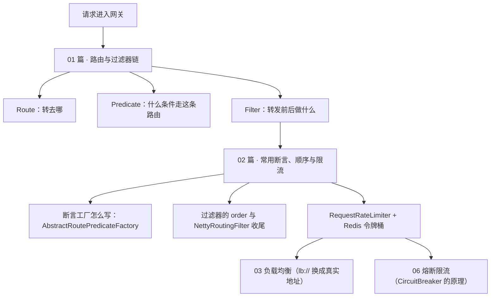

# 04 · 网关 Gateway

> **本组定位**：搞清楚"一个请求进到网关后，怎么被选中一条路由、又怎么被一层层过滤器处理后再转发出去"。两篇正文分别讲路由模型与过滤器链的整体流程（01），以及常用断言、过滤器顺序与限流（02）。
>
> | 项目 | 说明 |
> | --- | --- |
> | 源码基线 | `org.springframework.cloud:spring-cloud-gateway-server-webflux:5.1.0`（基于 Spring Boot 4 / Spring Framework 7 的 WebFlux 版网关） |
> | 预计阅读 | 两篇合计 120–150 分钟 |
> | 前置 | 知道 WebFlux 的 `HandlerMapping` → `WebHandler` 模型；知道 `Mono`/`Flux` 是什么 |

---

## 一、学习目标

| # | 目标 | 验收方式 |
| --- | --- | --- |
| 1 | 说清 `Route` = `id` + `uri` + `predicate` + `filters`，一次请求怎么从断言匹配走到过滤器链 | 能按顺序讲出 `RoutePredicateHandlerMapping` → `FilteringWebHandler` → `NettyRoutingFilter` |
| 2 | 知道 YAML 里一行 `Path=/a/**` 是怎么变成配置对象再变成 `Predicate` 的 | 能解释 `ShortcutConfigurable` 的 `_genkey_0` 被换成 `patterns` 的过程 |
| 3 | 背下关键 order：路由过滤器 1..n、`RouteToRequestUrlFilter` 10000、`WeightCalculatorWebFilter` 10001、`ReactiveLoadBalancerClientFilter` 10150、`NettyRoutingFilter` 最后 | 能回答 01 篇自测题第 7 题 |
| 4 | 分清 `GatewayFilter`（属于某条路由）和 `GlobalFilter`（对所有路由生效），知道两者合并后排序 | 能说出自定义 `GlobalFilter` 不写 `getOrder()` 会发生什么 |
| 5 | 说清 `Weight` 断言为什么需要一个 `WebFilter` 帮忙算权重 | 能画出 `WeightDefinedEvent` → `WeightCalculatorWebFilter` → 随机数选路由的时序 |
| 6 | 说清 `RequestRateLimiter` 的 `KeyResolver` 与 `RateLimiter` 两个扩展点，以及 Redis 令牌桶的两个 key | 能写出按 IP 限流的配置并解释 `X-RateLimit-*` 响应头 |
| 7 | 知道内置过滤器 `AddRequestHeader`/`StripPrefix`/`Retry`/`CircuitBreaker` 各自对应哪个工厂类 | 拿到配置名能直接说出类名 |

---

## 二、整体地图：两篇怎么读

**读图说明**：

1. **先读 01**：它回答"整体怎么跑"——一条路由由哪几部分组成、请求进来后谁选路、过滤器链怎么启动。不懂这一层，02 篇里讲的"order 决定先后"就没有参照物。
2. **再读 02**：它把 01 篇里一笔带过的三样东西拆开讲细——具体某个断言（`Path`/`Method`/`Header`/`Weight`）怎么实现、过滤器顺序怎么算、限流怎么接进去。
3. **左下角的出口**：`lb://` 路由依赖 [03 负载均衡](../03-负载均衡与调用/README.md)，`CircuitBreaker` 过滤器的熔断原理在 [06 熔断限流与容错](../06-熔断限流与容错/README.md)。网关本身不实现负载均衡和熔断，只是调用它们。

---

## 三、两篇摘要

### 01 [`01-route-路由断言与过滤器链.md`](./01-route-路由断言与过滤器链.md)

| 关键词 | 一句话 |
| --- | --- |
| `Route` | 不可变路由对象：`id`、`uri`、`predicate`、`filters`、`metadata` |
| `RouteDefinitionRouteLocator` | 把 YAML 配置翻译成 `Route`：按名字找断言工厂 / 过滤器工厂，绑定参数 |
| `RoutePredicateHandlerMapping` | 选路：逐条问路由"你匹配吗"，取第一条匹配的，放进 `GATEWAY_ROUTE_ATTR` |
| `FilteringWebHandler` | 把全局过滤器和这条路由的过滤器合并、按 order 排序，启动责任链 |
| `RouteToRequestUrlFilter` | order 10000，把目标 `uri` 拼成完整 URL 放进 `GATEWAY_REQUEST_URL_ATTR` |
| `ReactiveLoadBalancerClientFilter` | order 10150，`lb://服务名` 换成真实 ip:port |
| `NettyWriteResponseFilter` | order -1，pre 最先、写响应在最后 |

### 02 [`02-predicate与filter-常用断言与限流.md`](./02-predicate与filter-常用断言与限流.md)

| 关键词 | 一句话 |
| --- | --- |
| `AbstractRoutePredicateFactory` | 所有断言工厂的父类：只需要写"配置类 + `apply(config)`" |
| `ShortcutConfigurable` | 简写解析：`Path=/a/**,/b/**` 这种位置参数怎么对上配置字段 |
| `Method` / `Header` / `Path` | 三个最常用的断言：按请求方法、请求头、路径模式匹配 |
| `Weight` + `WeightCalculatorWebFilter` | 按比例分流：一个 `WebFilter` 先抽随机数选定路由，断言只做比对 |
| `Ordered` / `getOrder()` | 过滤器链的排序依据；没写 order 的全局过滤器会排到最后 |
| `NettyRoutingFilter` | 链尾：真正用 Netty 发请求，把响应放进 exchange 属性 |
| `RequestRateLimiter` + `RedisRateLimiter` | 限流：`KeyResolver` 定"按谁限"，`RateLimiter` 定"怎么限"（Redis 令牌桶） |
| `AddRequestHeader` 等 | 内置过滤器配置名 → 工厂类的对应关系 |

---

## 四、前置依赖

| 依赖 | 为什么需要 | 链接 |
| --- | --- | --- |
| 注册中心 Nacos | 网关把请求转发到 `lb://服务名`，服务名对应的实例列表来自注册中心 | [`../02-注册中心Nacos/README.md`](../02-注册中心Nacos/README.md) |
| 负载均衡与调用 | `ReactiveLoadBalancerClientFilter` 复用同一套 LoadBalancer，把服务名换成 ip:port | [`../03-负载均衡与调用/README.md`](../03-负载均衡与调用/README.md) |

**相邻分组**：熔断的内部原理见 [`../06-熔断限流与容错/README.md`](../06-熔断限流与容错/README.md)；网关在 Spring Cloud 体系里的位置见 [`../01-总览与版本/README.md`](../01-总览与版本/README.md)；总目录见 [`../README.md`](../README.md)。

---

## 五、读前检查点

开始之前，先确认下面几件事（答不上来不影响阅读，但要知道去哪补）：

- [ ] 知道 `Mono<Void>` 表示"一个异步动作，完成后不返回值"，`flatMap` 是"上一步完成后做下一步"。
- [ ] 知道 WebFlux 里一次请求 + 响应的上下文叫 `ServerWebExchange`，可以通过 `getAttributes()` 在过滤器之间传数据。
- [ ] 知道 `Ordered` 接口的 `getOrder()` 返回 int，数值越小优先级越高。
- [ ] 知道 `lb://` 是网关里表示"去注册中心找服务名对应实例"的伪协议（见 03 组）。

---

## 六、读完检查点

读完两篇后，用下面这张表自检。每一项都能在对应篇的小结或自测题里找到答案。

- [ ] 能说出一条 `Route` 里四个必填/可选部分，以及 `Route.build()` 强制非空的是哪三个（01 篇 §3.1、§3.2）。
- [ ] 能画出"请求 → `RoutePredicateHandlerMapping` → `FilteringWebHandler` → 过滤器链 → `NettyRoutingFilter` → `NettyWriteResponseFilter`"的顺序（01 篇 §4）。
- [ ] 能解释 `Path=/a/**` 这一行为什么不写 `patterns=` 也能生效（02 篇 §3.2）。
- [ ] 能说出 `Weight` 断言自己不算权重，算权重的是谁（02 篇 §3.4）。
- [ ] 能说出自定义 `GlobalFilter` 不实现 `Ordered` 时的 order 是多少（01 篇 §6、02 篇 §6）。
- [ ] 能解释限流时 Redis 里存了哪两个 key、`{}` 是干什么的（02 篇 §3.7）。
- [ ] 能列出 `AddRequestHeader`、`StripPrefix`、`Retry`、`CircuitBreaker` 对应的工厂类（02 篇 §3.9）。

---

## 小结

- Gateway 把"请求该怎么转发"拆成 **`Route`（转去哪）+ `Predicate`（什么条件）+ `Filter`（前后做什么）** 三部分；选路是逐条问、取第一个匹配；过滤器是全局 + 路由合并后按 order 排序的责任链。
- **断言和过滤器都是"工厂 + 配置对象"的套路**：YAML 里的简写位置参数靠 `ShortcutConfigurable` 对上字段名，类名去掉 `RoutePredicateFactory` / `GatewayFilterFactory` 后缀就是配置名。
- **顺序靠 order**：路由过滤器默认 1..n，URL 拼接 10000，负载均衡 10150，`NettyRoutingFilter` 收尾，`NettyWriteResponseFilter` 负责把响应写回去。
- **限流是两个扩展点**：`KeyResolver` 决定"按谁限"，`RateLimiter` 决定"怎么限"；Redis 实现是令牌桶，两个 key 带 `{hash tag}` 以兼容集群。

---

## 自测题

**1. 一条路由有哪三个必填项？分别对应 YAML 里的什么？**

答案

`id`、`uri`、`predicate`。对应 YAML 路由的 `id`、`uri`、`predicates`；`filters` 可以不写（没有过滤器也能转发）。

**2. YAML 里 `predicates: - Path=/order/**` 没有写 `patterns=`，框架怎么知道 `/order/**` 是路径模式？**

答案

`PathRoutePredicateFactory` 通过 `shortcutFieldOrder()` 声明第一个位置参数叫 `patterns`。解析时 `ShortcutConfigurable.normalizeKey` 把临时键 `_genkey_0` 换成 `patterns`，再绑定到 `Config.patterns` 字段。

**3. `GatewayFilter` 和 `GlobalFilter` 有什么区别？**

答案

`GatewayFilter` 属于某一条路由（由路由的 `filters` 生成），`GlobalFilter` 对所有匹配到网关路由的请求生效（是一个 Spring Bean）。执行时 `FilteringWebHandler` 把全局过滤器适配成 `GatewayFilter`，和路由过滤器合并成一个列表排序后依次执行。

**4. 自定义一个 `GlobalFilter` 但没有实现 `Ordered`、也没加 `@Order`，它会排在链的什么位置？**

答案

按 `Ordered.LOWEST_PRECEDENCE` 处理，和 `NettyRoutingFilter` 并列排在最后，`pre` 逻辑可能要到请求发出后才执行。应该显式实现 `Ordered` 并返回一个明确的 order。

**5. `NettyRoutingFilter` 发出请求后，响应是谁写给客户端的？**

答案

`NettyWriteResponseFilter`。`NettyRoutingFilter` 只是把响应连接放进 `CLIENT_RESPONSE_CONN_ATTR` 等属性，然后 `chain.filter(exchange)` 继续；`NettyWriteResponseFilter` 的 order 是 -1，它的"写响应"逻辑在 `chain.filter(...).then(...)` 里，所以整条链的 post 阶段它最后执行。

**6. `Weight=group1, 8` 里的 8 表示什么？权重是在断言里算的吗？**

答案

8 是这条路由在 `group1` 分组里的相对权重（和同组其它路由的权重相加后归一化）。权重**不是**在断言里算的：`WeightRoutePredicateFactory.beforeApply` 发布 `WeightDefinedEvent`，`WeightCalculatorWebFilter` 收到后计算区间；每次请求时由它抽一个随机数选出一条路由，断言只比较"选中的是不是我"。

**7. 限流时 Redis 里为什么要存两个 key？**

答案

令牌桶需要两个状态：当前剩余令牌数（`tokens`）和上次补充令牌的时间戳（`timestamp`）。每次请求用"现在的时间 − 上次时间 × 速率"算出要补多少令牌，再扣掉本次请求的令牌。

**8. 配置名 `StripPrefix`、`AddRequestHeader`、`Retry`、`CircuitBreaker` 分别对应哪个类？**

答案

`StripPrefixGatewayFilterFactory`、`AddRequestHeaderGatewayFilterFactory`、`RetryGatewayFilterFactory`、`SpringCloudCircuitBreakerFilterFactory`（配合 Resilience4j 时由 `SpringCloudCircuitBreakerResilience4JFilterFactory` 提供实现）。规则是类名去掉 `GatewayFilterFactory` 后缀。

