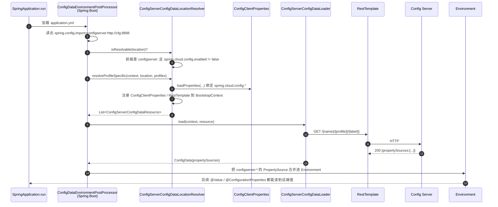
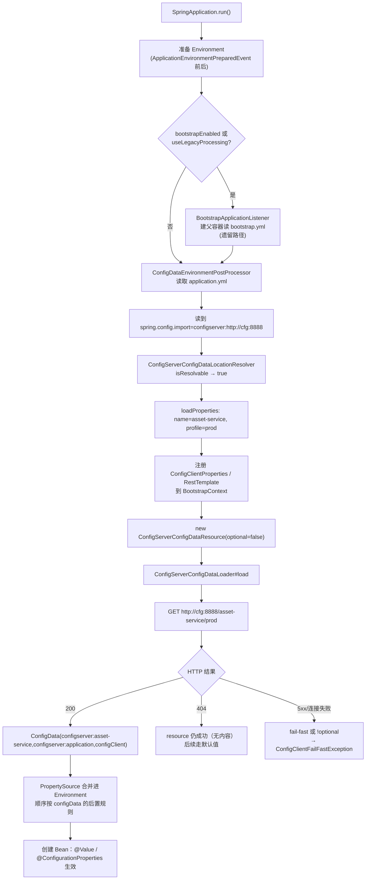
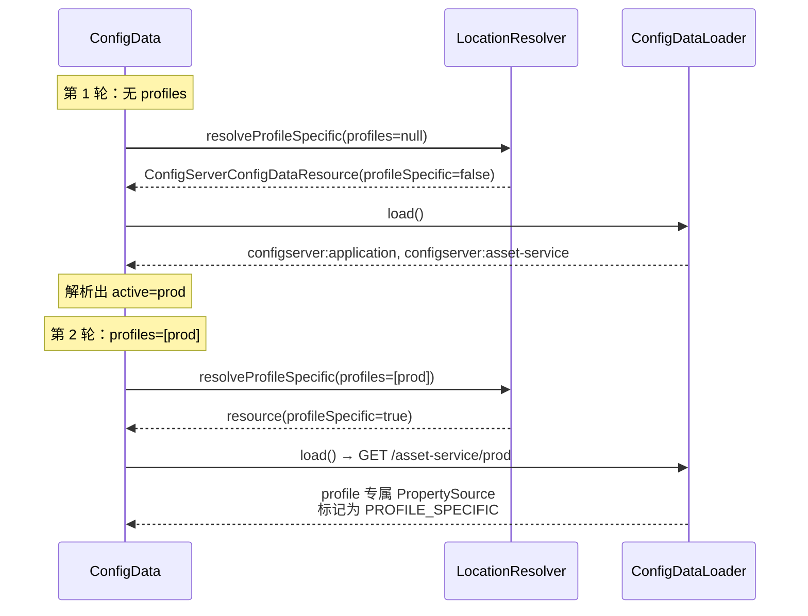

# Spring Cloud 源码精读 05-1：Config Client 配置拉取原理（ConfigData 时代）

> **一句话结论**：在 Spring Cloud 5.1.0 + Boot 4.2.0 下，配置中心的拉取**不再走 bootstrap 父上下文**，而是由 `spring.config.import=configserver:http://...` 触发 Boot 的 ConfigData 机制：`ConfigServerConfigDataLocationResolver#resolveProfileSpecific` 负责"解析地址 + 准备 `ConfigClientProperties`"，`ConfigServerConfigDataLoader#doLoad` 负责"真的发一次 HTTP GET `/应用名/环境名`"，返回的每个 PropertySource 被 ConfigData 合并进 `Environment`；老的 `BootstrapApplicationListener` 类虽然在 jar 里，但默认 `spring.cloud.bootstrap.enabled=false`，只在遗留模式下才生效。
>
> **阅读前置**：读过 [`02-SpringBoot/01-启动原理`](../../02-SpringBoot/01-启动原理/)（知道 `Environment`、`PropertySource`、`ApplicationContextInitializer`）；知道什么是配置中心即可，不需要跑过 Config Server。
>
> **预计阅读**：50 分钟。
>
> **源码基线**：`org.springframework.cloud:spring-cloud-config-client:5.1.0`、`org.springframework.cloud:spring-cloud-context:5.1.0`、Spring Boot `4.2.0`。

---

## 0. 先看现象

新同事把一个从 Spring Cloud 2020 时代继承下来的服务升级到 Spring Cloud 5.1.0，启动日志这样打：

```
***************************
APPLICATION FAILED TO START
***************************

Description:

No spring.config.import property has been defined

Action:

Add a spring.config.import=configserver: property to your configuration.
	If configuration is not required add spring.config.import=optional:configserver: instead.
	To disable this check, set spring.cloud.config.enabled=false or
	spring.cloud.config.import-check.enabled=false.
```

他完全不理解：**"我 `pom.xml` 里明明引了 `spring-cloud-starter-config`，`bootstrap.yml` 里也写了 `spring.cloud.config.uri`，为什么说我没配？"**

答案藏在 Boot 2.4 那次"配置文件加载机制重写"里，而 Spring Cloud 5.1.0 已经完全站在新机制上：

| 现象 | 真实原因 |
| --- | --- |
| `bootstrap.yml` 不生效 | bootstrap 上下文默认关闭（`spring.cloud.bootstrap.enabled` 默认 `false`，见下文的 `PropertyUtils`），文件根本没人读 |
| 启动直接失败，报 `No spring.config.import property has been defined` | `ConfigServerConfigDataMissingEnvironmentPostProcessor` 主动做了"import 检查" |
| 加了 `spring.config.import` 后 `spring.cloud.config.uri` 也不生效 | 新机制里 uri 可以写在 `configserver:` 后面，也可以仍用 `spring.cloud.config.uri`，但**必须在 `spring.config.import` 出现之后**才能被绑定 |

本篇就沿着"一次启动到底怎么把远端配置读进 `Environment`"这条线，把 5.1.0 的源码逐段拆开。

---

## 1. 整体地图



**读图说明**：

1. 全流程发生在 `Environment` 准备阶段（`ApplicationEnvironmentPreparedEvent` 前后），**Bean 还没创建**，所以这里拿不到任何业务 Bean，只能用 `Binder` 直接绑定。
2. 横切了一个关键角色：Boot 的 `ConfigDataEnvironmentPostProcessor`。Spring Cloud 只是给它写了两个 SPI 实现（Resolver + Loader），并没有自己的调度器——这是理解"为什么 bootstrap 不再需要"的核心。
3. 图里 `RestTemplate` 不是普通 Bean，而是放在 `BootstrapContext`（Boot 4 的"启动期临时容器"）里，通过 `addCloseListener` 在容器创建完成后再"晋升"为单例。
4. `ConfigServerConfigDataResource` 只是"一次待执行请求的描述"，`OPTIONAL` 标记、profiles、retry 参数都在里面。

---

## 2. 关键类逐个拆

| 类 | 所在模块 | 职责 | 记住一句话 |
| --- | --- | --- | --- |
| `BootstrapApplicationListener` | spring-cloud-context | 遗留的 bootstrap 父上下文引导 | **默认不干活**，见 `PropertyUtils#bootstrapEnabled` |
| `ConfigServerConfigDataLocationResolver` | spring-cloud-config-client | 解析 `configserver:` 前缀，准备请求参数 | "把字符串变成一个待执行资源" |
| `ConfigServerConfigDataLoader` | spring-cloud-config-client | 真发 HTTP，把返回体转 `ConfigData` | "唯一真正联网的地方" |
| `ConfigClientProperties` | spring-cloud-config-client | `spring.cloud.config.*` 全部参数 | uri / name / profile / label / failFast |
| `ConfigServerConfigDataMissingEnvironmentPostProcessor` | spring-cloud-config-client | 启动期检查有没有 import | 就是 §0 报错的出处 |
| `ConfigServicePropertySourceLocator` | spring-cloud-config-client | **旧机制**的拉取入口（`PropertySourceLocator`） | 只在 bootstrap / 手动调用时用 |
| `ConfigDataContextRefresher` | spring-cloud-context | 刷新时重跑一遍 ConfigData | 见下一篇 |

### 2.1 先搞清"bootstrap 到底还在不在"

任务书里特别点名要核实这个问题，我们直接用源码回答：**类还在，但默认关闭**。

```java (src:  PropertyUtils.java#L48-L54)
	public static boolean bootstrapEnabled(Environment environment) {
		return environment.getProperty(BOOTSTRAP_ENABLED_PROPERTY, Boolean.class, false) || MARKER_CLASS_EXISTS;
	}

	public static boolean useLegacyProcessing(Environment environment) {
		return environment.getProperty(USE_LEGACY_PROCESSING_PROPERTY, Boolean.class, false);
	}
```

**读这段**：

- `getProperty(..., false)` 的默认值是 `false`，即 **`spring.cloud.bootstrap.enabled` 不写就是不启用**。
- `MARKER_CLASS_EXISTS` 判断类路径上有没有 `org.springframework.cloud.bootstrap.marker.Marker`——这是 Spring Cloud 2020 时代给"想要 bootstrap 行为"的人留的开关（加一个空类/依赖即可）。5.1.0 里这条路径存在但属于兼容保留。
- 所以 `bootstrap.yml` 在 5.1.0 默认是**死文件**。第 7 节会给出完整迁移对照表。

### 2.2 `BootstrapApplicationListener` 还在做什么

看它的入口第一行：

```java (src: BootstrapApplicationListener.java#L98-L121)
	@Override
	public void onApplicationEvent(ApplicationEnvironmentPreparedEvent event) {
		ConfigurableEnvironment environment = event.getEnvironment();
		if (!bootstrapEnabled(environment) && !useLegacyProcessing(environment)) {
			return;
		}
		// don't listen to events in a bootstrap context
		if (environment.getPropertySources().contains(BOOTSTRAP_PROPERTY_SOURCE_NAME)) {
			return;
		}
		ConfigurableApplicationContext context = null;
		String configName = environment.resolvePlaceholders("${spring.cloud.bootstrap.name:bootstrap}");
		for (ApplicationContextInitializer<?> initializer : event.getSpringApplication().getInitializers()) {
			if (initializer instanceof ParentContextApplicationContextInitializer contextInitializer) {
				context = findBootstrapContext(contextInitializer, configName);
			}
		}
		if (context == null) {
			context = bootstrapServiceContext(environment, event.getSpringApplication(), configName);
			event.getSpringApplication().addListeners(new CloseContextOnFailureApplicationListener(context));
		}

		apply(context, event.getSpringApplication(), environment);
	}
```

**在干什么**：监听 `ApplicationEnvironmentPreparedEvent`（`Environment` 已建好、容器还没建），若 bootstrap 被启用，则**再启动一个 `SpringApplication`** 作为父上下文（`bootstrapServiceContext`），把 `bootstrap.yml` / `ApplicationContextInitializer` Bean 先跑一遍，再通过 `apply(...)` 把父上下文里的 `ApplicationContextInitializer` 拷进主应用。

**为什么要有它**：2013 年的 Spring Cloud 需要一个"比 `Environment` 更早"的阶段，因为配置中心地址、解密密钥这些东西必须在主容器创建前就位。当时的办法就是"先跑一个父亲"。

**改成新机制会怎样**：Boot 2.4 的 ConfigData 把"配置文件"抽象成"可导入的 location 列表"，天然支持"边读边扩展"，于是不再需要一个父亲上下文；代价是**所有 `EnvironmentPostProcessor`/`ApplicationContextInitializer` 里依赖"父容器已有 Bean"的写法都要改**——这就是升级时最常见的炸点（`@RefreshScope` 失效、`@ConditionalOnProperty` 读不到远端值等）。

**常见坑**：留着老的 `bootstrap.yml` 但没开 `spring.cloud.bootstrap.enabled=true`，症状是"配置中心连通、日志无异常、但所有值都是默认值"——因为请求压根没发。

### 2.3 `bootstrapServiceContext` 的"造父容器"细节

```java (src:  BootstrapApplicationListener.java#L149-L171)
	private ConfigurableApplicationContext bootstrapServiceContext(ConfigurableEnvironment environment,
			final SpringApplication application, String configName) {
		ConfigurableEnvironment bootstrapEnvironment = new AbstractEnvironment() {
		};
		MutablePropertySources bootstrapProperties = bootstrapEnvironment.getPropertySources();
		String configLocation = environment.resolvePlaceholders("${spring.cloud.bootstrap.location:}");
		String configAdditionalLocation = environment
			.resolvePlaceholders("${spring.cloud.bootstrap.additional-location:}");
		Map<String, Object> bootstrapMap = new HashMap<>();
		bootstrapMap.put("spring.config.name", configName);
		// if an app (or test) uses spring.main.web-application-type=reactive, bootstrap
		// will fail
		// force the environment to use none, because if though it is set below in the
		// builder
		// the environment overrides it
		bootstrapMap.put("spring.main.web-application-type", "none");
		if (StringUtils.hasText(configLocation)) {
			bootstrapMap.put("spring.config.location", configLocation);
		}
		if (StringUtils.hasText(configAdditionalLocation)) {
			bootstrapMap.put("spring.config.additional-location", configAdditionalLocation);
		}
		bootstrapProperties.addFirst(new MapPropertySource(BOOTSTRAP_PROPERTY_SOURCE_NAME, bootstrapMap));
```

**在干什么**：给父上下文单独造一个 `Environment`，把 `spring.config.name` 改成 `bootstrap`（所以读 `bootstrap.yml` 而不是 `application.yml`），强制 `web-application-type=none`（父容器不启 Web 服务器）。

**为什么**：父容器只负责"准备配置"，不该再起一个 Tomcat；`spring.config.name` 改名是"父读 bootstrap、子读 application"的物理隔离。

**改别的会怎样**：如果这里不强制 `none`，reactive 应用会因为 reacvtive 与非 reactive 上下文混用直接启动失败（源码注释就是记录这个 bug）。

**常见坑**：`bootstrap.yml` 与 `application.yml` 里同时写了 `spring.application.name`，老版本里前者赢（因为父容器先加载），新版本里只剩 `application.yml` 有效——迁移时 application name 变了会导致 Config Server 上取不到文件。

---

## 3. 源码逐段精读（ConfigData 主线）

### 3.1 启动期检查：为什么会报 "No spring.config.import"

```java (src:  ConfigServerConfigDataMissingEnvironmentPostProcessor.java#L42-L61)
	@Override
	protected String getPrefix() {
		return PREFIX;
	}

	@Override
	protected boolean shouldProcessEnvironment(Environment environment) {
		// don't run if using bootstrap or legacy processing
		if (bootstrapEnabled(environment) || useLegacyProcessing(environment)) {
			return false;
		}
		boolean configEnabled = environment.getProperty(ConfigClientProperties.PREFIX + ".enabled", Boolean.class,
				true);
		boolean importCheckEnabled = environment.getProperty(ConfigClientProperties.PREFIX + ".import-check.enabled",
				Boolean.class, true);
		if (!configEnabled || !importCheckEnabled) {
			return false;
		}
		return true;
	}
```

**在干什么**：这是 `spring-cloud-commons` 里 `ConfigDataMissingEnvironmentPostProcessor` 的子类，父类负责"classpath 上有配置中心 starter 却没写 import 就报错"，子类只提供前缀 `configserver:` 和"是否跳过"的判断。

**为什么**：云端配置中心最坑的问题是"以为引了就生效"。Boot 的 ConfigData 是完全声明式的，不写 import 就真的不会去拉——与其让人在生产上排查半天，不如启动就失败。

**改别的会怎样**：把 `spring.cloud.config.enabled=false` 关掉检查，你的服务会"顺利启动但全部走默认值"——这是更危险的沉默失败。

**常见坑**：

- 单测里只引了 `spring-cloud-starter-config` 但不起 Config Server，会因这条检查失败。解决办法：单测 profile 里 `spring.cloud.config.enabled=false`，或 import 写成 `optional:configserver:`。
- 想"有就用、没有也能起"，正确写法是 `spring.config.import=optional:configserver:http://...`，`optional:` 是 **Boot 的通用前缀**，不是 Spring Cloud 的。

配套的报错文案在同一个文件里：

```java (src:  ConfigServerConfigDataMissingEnvironmentPostProcessor.java#L63-L81)
	static class ImportExceptionFailureAnalyzer extends AbstractFailureAnalyzer<ImportException> {

		@Override
		protected FailureAnalysis analyze(Throwable rootFailure, ImportException cause) {
			String description;
			if (cause.missingPrefix) {
				description = "The spring.config.import property is missing a " + PREFIX + " entry";
			}
			else {
				description = "No spring.config.import property has been defined";
			}
			String action = "Add a spring.config.import=configserver: property to your configuration.\n"
					+ "\tIf configuration is not required add spring.config.import=optional:configserver: instead.\n"
					+ "\tTo disable this check, set spring.cloud.config.enabled=false or \n"
					+ "\tspring.cloud.config.import-check.enabled=false.";
			return new FailureAnalysis(description, action, cause);
		}

	}
```

**在干什么**：`AbstractFailureAnalyzer` 是 Boot 的"报错美化"扩展点，把普通异常翻译成 §0 里那种 `Description/Action` 结构。

**为什么**：这段话直接给了三种解法，减少无效沟通成本。注意 `cause.missingPrefix` 分支——写了 `spring.config.import` 但值是别的（例如 `spring.config.import=nacos:`），也会被这条检查抓到。

### 3.2 第一步：Resolver 判断"这个 location 归我管吗"

```java (src:  ConfigServerConfigDataLocationResolver.java#L218-L235)
	@Override
	public boolean isResolvable(ConfigDataLocationResolverContext context, ConfigDataLocation location) {
		if (!location.hasPrefix(getPrefix())) {
			return false;
		}
		return context.getBinder().bind(ConfigClientProperties.PREFIX + ".enabled", Boolean.class).orElse(true);
	}

	protected String getPrefix() {
		return PREFIX;
	}

	@Override
	public List<ConfigServerConfigDataResource> resolve(ConfigDataLocationResolverContext context,
			ConfigDataLocation location)
			throws ConfigDataLocationNotFoundException, ConfigDataResourceNotFoundException {
		return resolveProfileSpecific(context, location, null);
	}
```

**在干什么**：Boot 把所有 `spring.config.import` 值拆成若干 `ConfigDataLocation`，依次问每个 `ConfigDataLocationResolver#isResolvable`。这里做两件事：前缀必须是 `configserver:`（`PREFIX` 常量，L67 附近定义为 `"configserver:"`），且 `spring.cloud.config.enabled` 不为 `false`。

**为什么**：同一个 `spring.config.import` 可以有多个条目（`configserver:...,nacos:...,optional:file:./x.yml`），每个 Resolver 认领自己的前缀，天然可扩展。

**改别的会怎样**：`spring.cloud.config.enabled=false` 时 Resolver 直接不认领，**并且不会报缺失错误**（因为 §3.1 的检查也被关掉了），结果是"静默降级"。

**常见坑**：很多人写成 `spring.config.import: http://cfg:8888`（漏了 `configserver:`）——Boot 会把它当普通 URL 去读，报 `Unknown config data location protocol` 之类，看不懂的错。

### 3.3 第二步：Resolver 准备参数（uri / name / profile / retry）

```java (src:  ConfigServerConfigDataLocationResolver.java#L156-L170)
		if (!StringUtils.hasText(configClientProperties.getName())
				|| "application".equals(configClientProperties.getName())) {
			// default to spring.application.name if name isn't set
			String applicationName = binder.bind("spring.application.name", Bindable.of(String.class), bindHandler)
				.orElse("application");
			configClientProperties.setName(applicationName);
		}

		PropertyHolder holder = new PropertyHolder();
		holder.properties = configClientProperties;
		// bind retry, override later
		holder.retryProperties = binder.bind(RetryProperties.PREFIX, RetryProperties.class)
			.orElseGet(RetryProperties::new);

		if (StringUtils.hasText(uris)) {
```

**在干什么**：绑定 `spring.cloud.config.*` 到 `ConfigClientProperties`；`name` 为空或还是 `application` 时，回落到 `spring.application.name`。随后把 `configserver:` 后面那串 `uris` 拆成数组。

**为什么**：Config Server 的 REST 契约是 `GET /{application}/{profile}[/{label}]`，`name` 就是 `/application/` 这一段。做这个回落是为了"99% 的服务用 `spring.application.name` 就够了"。

**改别的会怎样**：如果代码里没做强校验，`name` 留成 `application`，你就会去 Config Server 上读 `application.yml`（全局公共配置）——恰好这也是**共享配置**的官方玩法，所以这个"坑"有时是特性。

**常见坑**：`spring.cloud.config.name` 一旦显式设成 `""`，会走到 `orElseGet(ConfigClientProperties::new)` 的默认 `application`；想读多个共享配置文件的语法是 `spring.cloud.config.name=a,b,myapp`（逗号分隔，顺序有讲究：**越靠后优先级越高**）。

接着是 `configserver:` 后面的 query 参数解析：

```java (src:  ConfigServerConfigDataLocationResolver.java#L170-L206)
		if (StringUtils.hasText(uris)) {
			String[] uri = StringUtils.commaDelimitedListToStringArray(uris);
			String paramStr = null;
			for (int i = 0; i < uri.length; i++) {
				int paramIdx = uri[i].indexOf('?');
				if (paramIdx > 0) {
					if (i == 0) {
						// only gather params from first uri
						paramStr = uri[i].substring(paramIdx + 1);
					}
					uri[i] = uri[i].substring(0, paramIdx);
				}
			}
			if (StringUtils.hasText(paramStr)) {
				Properties properties = StringUtils
					.splitArrayElementsIntoProperties(StringUtils.delimitedListToStringArray(paramStr, "&"), "=");
				if (properties != null) {
					PropertyMapper map = PropertyMapper.get();
					map.from(() -> properties.getProperty("fail-fast"))
						.as(Boolean::valueOf)
						.to(configClientProperties::setFailFast);
					map.from(() -> properties.getProperty("max-attempts"))
						.as(Integer::valueOf)
						.to(holder.retryProperties::setMaxAttempts);
					map.from(() -> properties.getProperty("max-interval"))
						.as(Long::valueOf)
						.to(holder.retryProperties::setMaxInterval);
					map.from(() -> properties.getProperty("multiplier"))
						.as(Double::valueOf)
						.to(holder.retryProperties::setMultiplier);
					map.from(() -> properties.getProperty("initial-interval"))
						.as(Long::valueOf)
						.to(holder.retryProperties::setInitialInterval);
				}
			}
			configClientProperties.setUri(uri);
		}
```

**在干什么**：支持 `spring.config.import=configserver:http://cfg:8888?fail-fast=true&max-attempts=6&initial-interval=1000` 这种"把参数写在 import 里"的写法；`?` 之后只从**第一个** uri 取参数（多 uri 时其他 uri 的 query 被忽略）。

**为什么**：ConfigData 阶段 `Environment` 还不完整，把参数塞进 import 字符串是最快、最不会被覆盖的方式；而 retry 参数必须在这里生效（否则第一次拉取就失败，根本没机会重试）。

**改别的会怎样**：注意 `configClientProperties.setUri(uri)` 在 if 末尾——**import 里写的 uri 会覆盖 `spring.cloud.config.uri`**。两条都配时，以 import 为准。

### 3.4 第三步：注册到 BootstrapContext（Boot 4 的关键细节）

```java (src:  ConfigServerConfigDataLocationResolver.java#L246-L271)
		if (!ApplicationNameValidator.validate(properties, log)) {
			return new ArrayList<>();
		}
		ConfigurableBootstrapContext bootstrapContext = resolverContext.getBootstrapContext();
		bootstrapContext.register(ConfigClientProperties.class,
				InstanceSupplier.of(properties).withScope(BootstrapRegistry.Scope.PROTOTYPE));
		bootstrapContext.addCloseListener(event -> event.getApplicationContext()
			.getBeanFactory()
			.registerSingleton(PROPERTIES_BEAN_NAME, event.getBootstrapContext().get(ConfigClientProperties.class)));

		bootstrapContext.registerIfAbsent(ConfigClientRequestTemplateFactory.class, context -> {
			ConfigClientRequestTemplateFactory factory = new ConfigClientRequestTemplateFactory(log,
					context.get(ConfigClientProperties.class));
			ConfigClientOAuth2Support.registerInterceptor(bootstrapContext, resolverContext.getBinder(),
					getBindHandler(resolverContext), factory);
			return factory;
		});

		bootstrapContext.registerIfAbsent(RestTemplate.class, context -> {
			ConfigClientRequestTemplateFactory factory = context.get(ConfigClientRequestTemplateFactory.class);
			return factory.create();
		});
		bootstrapContext.addCloseListener(this::registerRestClientHolder);

		bootstrapContext.registerIfAbsent(PropertyResolver.class,
				context -> new PropertyResolver(resolverContext.getBinder(), getBindHandler(resolverContext)));
```

**在干什么**：把"这次拉取需要的一切"登记到 `ConfigurableBootstrapContext`：

1. `ConfigClientProperties` —— 参数，`PROTOTYPE` 作用域（每次 `get` 都是新的副本，避免被下游改脏）。
2. `addCloseListener` 里注册单例 `configDataConfigClientProperties` —— 等容器建好后再放进 BeanFactory，**业务代码仍能注入 `ConfigClientProperties` Bean**。
3. `ConfigClientRequestTemplateFactory` + `RestTemplate` —— 真正发起 HTTP 的客户端，工厂负责超时、认证、自定义 header。
4. `PropertyResolver` —— 给后续 import（例如 `configserver:...` 里再引用别的 key）做占位符解析。

**为什么**：Boot 4 的 `BootstrapContext` 就是"容器创建前的临时注册表"，生命周期与启动绑定；`addCloseListener` 是唯一"转正"通道。这替代了老的"bootstrap 父容器"角色——**一句话：ConfigData 用注册表 + 关闭回调，取代了父容器的继承关系**。

**改别的会怎样**：如果不注册 `RestTemplate`，`ConfigServerConfigDataLoader` 里 `context.getBootstrapContext().get(RestTemplate.class)` 会抛异常，表现为启动直接失败在 ConfigData 阶段（栈里没有业务代码，非常难定位）。

**常见坑**：自定义 `RestTemplate`（比如公司要求加 traceId 拦截器）时，要用 `ConfigServerBootstrapper`/`BootstrapRegistryInitializer` 里的 `registerIfAbsent` 覆盖，而不是在业务 `@Configuration` 里定义 Bean——那时 Bean 还没存在。

最后生成"待执行资源"：

```java (src:  ConfigServerConfigDataLocationResolver.java#L273-L275)
		ConfigServerConfigDataResource resource = new ConfigServerConfigDataResource(properties, location.isOptional(),
				profiles);
		resource.setProfileSpecific(!ObjectUtils.isEmpty(profiles));
```

**在干什么**：`location.isOptional()` 把 `optional:` 前缀的结果记录在 resource 上；`profiles` 非空表示这是"profile 专门的一轮解析"（Boot 会为每个新激活 profile 再来一次）。

**为什么**：ConfigData 是**两阶段**的（先解析 base，再按 active profiles 解析 profile-specific），Resolver 的 `resolveProfileSpecific` 会被调用多次，所以必须能区分。

### 3.5 第四步：Loader 真正发请求

```java (src:  ConfigServerConfigDataLoader.java#L277-L312)
	protected Environment getRemoteEnvironment(ConfigDataLoaderContext context, ConfigServerConfigDataResource resource,
			String label, String state) {
		ConfigClientProperties properties = resource.getProperties();
		RestTemplate restTemplate = context.getBootstrapContext().get(RestTemplate.class);

		String path = "/{name}/{profile}";
		String name = properties.getName();
		String profile = resource.getProfiles();
		String token = properties.getToken();
		String[] uris;
		boolean discoveryEnabled = properties.getDiscovery().isEnabled();
		ConfigClientProperties bootstrapConfigClientProperties = context.getBootstrapContext()
			.get(ConfigClientProperties.class);
		// In the case where discovery is enabled we need to extract the config server
		// uris, username, and password
		// from the properties from the context. These are set in
		// ConfigServerInstanceMonitor.refresh which will only
		// be called the first time we fetch configuration.
		if (discoveryEnabled) {
			uris = bootstrapConfigClientProperties.getUri();
		}
		else {
			uris = properties.getUri();
		}
		int noOfUrls = uris.length;
		if (uris.length > 1) {
			logger.info("Multiple Config Server Urls found listed.");
		}

		Object[] args = new String[] { name, profile };
		if (StringUtils.hasText(label)) {
			// workaround for Spring MVC matching / in paths
			label = Environment.denormalize(label);
			args = new String[] { name, profile, label };
			path = path + "/{label}";
		}
```

**在干什么**：拼出请求路径 `/应用名/环境名` 或 `/应用名/环境名/分支`，并选好 uri 列表。`discoveryEnabled` 为真时（`spring.cloud.config.discovery.enabled=true`），uri 来自服务发现而不是静态配置。

**为什么**：`label` 是 git 分支/SVN 目录概念，只有服务端才有意义；`denormalize` 是因为 Boot 的 ConfigData 会把 location 里的 `/` 转义（避免被当作路径分隔），这里要还原。

**改别的会怎样**：`profile` 取自 `resource.getProfiles()`（Resolver 阶段合并好的 active + default profiles 串），**不是**直接读 `spring.profiles.active`——这也是"为什么远端 profile 与我本地 profile 不一致"类问题的根源。

**常见坑**：

- 本地跑 `-Dspring.profiles.active=dev` 后没拉到 `dev` 的配置：检查是否写死了 `spring.cloud.config.profile`（显式写了就以它为准，不再自动合并）。
- Config Server 端 404 不代表文件不存在，可能是 label 不存在；源码里对 404 有特殊处理（见下）。

继续看请求发送与错误分层：

```java (src:  ConfigServerConfigDataLoader.java#L335-L371)
			logger.info("Fetching config from server at : " + uri);

			try {
				HttpHeaders headers = new HttpHeaders();
				headers.setAccept(acceptHeader);
				headers.setAcceptCharset(acceptCharsetHeader);
				requestTemplateFactory.addAuthorizationToken(headers, username, password);
				if (StringUtils.hasText(token)) {
					headers.add(TOKEN_HEADER, token);
				}
				if (StringUtils.hasText(state) && properties.isSendState()) {
					headers.add(STATE_HEADER, state);
				}

				final HttpEntity<Void> entity = new HttpEntity<>(null, headers);
				response = restTemplate.exchange(uri + path, HttpMethod.GET, entity, Environment.class, args);
			}
			catch (HttpClientErrorException | HttpServerErrorException e) {
				if (i < noOfUrls - 1 && properties.getMultipleUriStrategy() == MultipleUriStrategy.ALWAYS) {
					logger.info("Failed to fetch configs from server at  : " + uri
							+ ". Will try the next url if available. Error : " + e.getMessage());
					continue;
				}

				if (e.getStatusCode() != HttpStatus.NOT_FOUND) {
					throw e;
				}
			}
			catch (ResourceAccessException e) {
				logger.info("Exception on Url - " + uri + ":" + e + ". Will be trying the next url if available");
				if (i == noOfUrls - 1) {
					throw e;
				}
				else {
					continue;
				}
			}
```

**在干什么**：发 GET。三个 header 值得记：`X-Config-Token`（Vault token 透传）、`X-Config-State`（续拉状态，用于长轮询/一致性）、`Authorization`（Basic，由 `addAuthorizationToken` 加）。异常分三种：4xx/5xx 中 **404 被吞掉**（当作"没有这个 label/应用"），连接失败 `ResourceAccessException` 在多 uri 时切换下一个。

**为什么**：404 语义上是"这个环境没有配置"，不算故障；连接失败才是故障。`MultipleUriStrategy.ALWAYS` 让"多注册中心"场景可以轮换。

**改别的会怎样**：`MultipleUriStrategy` 改成 `NO` 后，第一个 uri 失败就整体失败——这是"配置中心主备"场景要小心的开关。

**常见坑**：`ResourceAccessException` 在**最后一个** uri 仍会抛出，所以即使没开 `fail-fast`，Config Server 完全连不上时也会启动失败（与"服务端返回 404"不同）。这个区别在排查时极其有用：

| 现象 | 含义 |
| --- | --- |
| 启动 OK，但值是默认值 | Config Server 返回 404（应用名/profile 不存在） |
| 启动失败，栈里有 `ResourceAccessException` | 网络/端口/地址不通 |
| 启动失败，`ConfigClientFailFastException` | 服务端 5xx 或校验失败，且 fail-fast / 非 optional |

### 3.6 第五步：返回体怎么变成 PropertySource

```java (src:  ConfigServerConfigDataLoader.java#L130-L156)
			for (String label : labels) {
				Environment result = getRemoteEnvironment(context, resource, label.trim(), state);
				if (result != null) {
					log(result);

					// result.getPropertySources() can be null if using xml
					if (result.getPropertySources() != null) {
						for (org.springframework.cloud.config.environment.PropertySource source : result
							.getPropertySources()) {
							@SuppressWarnings("unchecked")
							Map<String, Object> map = translateOrigins(source.getName(),
									(Map<String, Object>) source.getSource());
							propertySources.add(0,
									new OriginTrackedMapPropertySource("configserver:" + source.getName(), map, true));
						}
					}

					HashMap<String, Object> map = new HashMap<>();
					if (StringUtils.hasText(result.getState())) {
						putValue(map, "config.client.state", result.getState());
					}
					if (StringUtils.hasText(result.getVersion())) {
						putValue(map, "config.client.version", result.getVersion());
					}
					// the existence of this property source confirms a successful
					// response from config server
					propertySources.add(0, new MapPropertySource(CONFIG_CLIENT_PROPERTYSOURCE_NAME, map));
```

**在干什么**：把服务端返回的 `List<PropertySource>` 逐个转成 Boot 的 `OriginTrackedMapPropertySource`，名字统一加 `configserver:` 前缀；并且**用 `add(0, ...)` 逆序插入**，因为服务端返回顺序是"优先级从高到低"，而 PropertySources 列表是"从头到尾优先级递减"，需要翻转。最后插一个 `configClient` 源记录 `state` / `version`。

**为什么**：`config.client.version` 是 Config Server 的 git 提交 SHA，`ConfigClientStateHolder` 靠它判断"配置是否变了"，是 `/actuator/refresh` 的优化依据；`configserver:` 前缀则是刷新时**定位并替换**旧 PropertySource 的锚点（下一篇 `ConfigDataContextRefresher` 会用到）。

**改别的会怎样**：若不加 `configserver:` 前缀，刷新时旧值删不掉，会出现"改了配置但新值旧值都还在、取决于谁在前"的诡异现象。

### 3.7 失败处理：fail-fast 与 optional 的分工

```java (src:  ConfigServerConfigDataLoader.java#L210-L224)
		if (properties.isFailFast() || !resource.isOptional()) {
			String reason;
			if (properties.isFailFast()) {
				reason = "the fail fast property is set";
			}
			else {
				reason = "the resource is not optional";
			}
			throw new ConfigClientFailFastException("Could not locate PropertySource and " + reason + ", failing"
					+ (errorBody == null ? "" : ": " + errorBody), error);
		}
		logger.warn("Could not locate PropertySource (" + resource + "): "
				+ (error != null ? error.getMessage() : errorBody));
		return null;
	}
```

**在干什么**：两种失败策略的并集。`!resource.isOptional()` 意味着**只要没写 `optional:` 前缀，默认就是 fail-fast**——这是 5.x 与老版本最大的行为差异之一。

**为什么**：ConfigData 时代取消 bootstrap 后，"配置中心挂了服务还能不能起"必须显式表态。默认严格，避免"配置中心故障 → 全站静默跑默认值"。

**常见坑**：本地开发想"没起 Config Server 也能跑"，必须写 `spring.config.import=optional:configserver:http://localhost:8888`；只写 `spring.cloud.config.fail-fast=false` 是**不够的**（因为 `!resource.isOptional()` 仍然为真）。

### 3.8 旧入口 `ConfigServicePropertySourceLocator#locate`

即使在新机制下，这个类也没死——`spring.cloud.config.initialize-on-context-refresh=true` 或 bootstrap 模式下仍会用它。

```java (src:  ConfigServicePropertySourceLocator.java#L120-L144)
	@Override
	public org.springframework.core.env.PropertySource<?> locate(org.springframework.core.env.Environment environment) {
		ConfigClientProperties properties = this.defaultProperties.override(environment);
		if (!StringUtils.hasText(properties.getProfile())) {
			properties.setProfile(String.join(",", combineProfiles(properties, environment)));
		}

		if (!ApplicationNameValidator.validate(properties, logger)) {
			return null;
		}

		CompositePropertySource composite = new OriginTrackedCompositePropertySource("configService");
		ConfigClientRequestTemplateFactory requestTemplateFactory = new ConfigClientRequestTemplateFactory(logger,
				properties, this.additionalInterceptors);

		Exception error = null;
		String errorBody = null;
		try {
			String[] labels = new String[] { "" };
			if (StringUtils.hasText(properties.getLabel())) {
				labels = StringUtils.commaDelimitedListToStringArray(properties.getLabel());
			}
			String state = ConfigClientStateHolder.getState();
			// Try all the labels until one works
			for (String label : labels) {
```

**在干什么**：`PropertySourceLocator` 是 Spring Cloud 自己的 SPI，"给我一个 Environment，还你一个 PropertySource"。这里做 profile 合并（`combineProfiles`：active 优先，active 为空才用 default），然后走和 Loader 几乎一样的请求逻辑。

**为什么**：保留它是为了兼容 `PropertySourceBootstrapConfiguration`（bootstrap 模式下的装配点）以及"Nacos 等其它 locator 共存"的统一抽象。

**与 Loader 的差异**（升级时最容易踩）：

| 维度 | `ConfigServicePropertySourceLocator` | `ConfigServerConfigDataLoader` |
| --- | --- | --- |
| 触发者 | `PropertySourceBootstrapConfiguration`（bootstrap）/ 手动 | Boot `ConfigDataEnvironmentPostProcessor` |
| PropertySource 名前缀 | `configService` 组合源 | `configserver:` + 原名字 |
| 失败策略 | 只看 `isFailFast()` | `isFailFast() || !isOptional()` |
| 优先级控制 | `spring.cloud.config.override-*` 系列 | ConfigData 的 import 顺序 + `PROFILE_SPECIFIC` Option |

### 3.9 `ConfigClientProperties#override`：为什么每次都要"复制一份"

```java (src:  ConfigClientProperties.java#L440-L451)
	public ConfigClientProperties override(org.springframework.core.env.Environment environment) {
		ConfigClientProperties override = new ConfigClientProperties();
		BeanUtils.copyProperties(this, override);
		override.setName(environment.resolvePlaceholders(NAME_PLACEHOLDER));
		if (environment.containsProperty(ConfigClientProperties.PREFIX + ".profile")) {
			override.setProfile(environment.getProperty(ConfigClientProperties.PREFIX + ".profile"));
		}
		if (environment.containsProperty(ConfigClientProperties.PREFIX + ".label")) {
			override.setLabel(environment.getProperty(ConfigClientProperties.PREFIX + ".label"));
		}
		return override;
	}
```

**在干什么**：基于已绑定的默认值再套一层"当前 `Environment` 的覆盖"，特别是 `NAME_PLACEHOLDER`（`${spring.cloud.config.name:${spring.application.name:application}}`）的占位符解析。

**为什么**：`ConfigClientProperties` 是**单例 Bean**，被多次刷新共用；直接改它会让下一次刷新用到上次的脏数据。复制一份是"不可变快照"思路。

**常见坑**：在 `@RefreshScope` Bean 里写 `@Value("${spring.cloud.config.name}")` 想读到自己配置的名字——拿到的可能是占位符原串，因为解析发生在 locator 内部而不是 Bean 绑定阶段。

---

## 4. 一次完整执行时序

以"服务 `asset-service`、profile 为 `prod`、Config Server 在 `http://cfg:8888`"为例，把上面的片段串成一条时间线：



**读图说明**：

1. 左半边（`C -- 是`）是老路径，右半边是新路径；两条路径最后都汇到 `E`，因为遗留模式下 ConfigData 同样会跑。
2. `404` 不等于启动失败——这点在图上单列了一支，因为它是"线上配置不生效"的头号原因。
3. 顺序敏感：`ConfigData` 的合并发生在 `Environment` 构造完成之后、`BeanFactory` 后处理之前；因此**用 `EnvironmentPostProcessor` 读远端值** 必须把自己排在 ConfigData 之后（`Ordered` 大于 `ConfigDataEnvironmentPostProcessor.ORDER`）。
4. `configserver:asset-service` 排在 `configserver:application` 前面，正好对应"服务专属配置覆盖全局配置"。

**profile 的两轮解析**（容易被忽略，单独画出来）：



**读图说明**：第 2 轮才把 profile 专属的数据加进来，且被标记为 `PROFILE_SPECIFIC`——意味着它能覆盖第 1 轮的同名 key。如果代理/网关层只放行了第一轮请求（罕见的按次数限流场景），你会看到"通用配置有、profile 配置没有"，这时查 ConfigData 的 profile 解析日志最快（`logging.level.org.springframework.boot.context.config=TRACE`）。

---

## 5. 设计模式与取舍

| 设计点 | 模式/手法 | 好处 | 代价 |
| --- | --- | --- | --- |
| Resolver / Loader 拆分 | 单一职责 + SPI | 解析与执行分离，`ConfigData` 可缓存/可重排 | 两个类都要懂才能调通 |
| `BootstrapContext` 注册表 | 服务定位器 | 启动早期也能拿到"准 Bean"，结束后自动转正 | 注册顺序、`registerIfAbsent` 语义要记牢 |
| `BootstrapApplicationListener` 保留 | 兼容层 + 开关 | 老项目平滑迁移 | 两套机制并存，排查成本上升 |
| `ConfigClientProperties#override` | 不可变快照 | 刷新安全、可并发 | 每次多一次对象拷贝 |
| `optional:` 前缀复用 Boot | 约定优于配置 | 客户端不必发明新语法 | 与 `fail-fast` 语义交叉，易混淆 |
| 默认 fail-fast | 失败快速 | 避免静默跑默认值 | 本地开发体验差，必须显式 optional |

**取舍核心**：Spring Cloud 5.x 把"配置中心是基础设施"摆到明面上——**不配就是错**。这与 Nacos 这类"客户端内嵌、默认宽松"的配置中心形成对比（见下一篇 §5 的取舍表）。

---

## 6. 踩坑与调试手法

### 6.1 打开关键日志

```yaml
logging:
  level:
    org.springframework.boot.context.config: TRACE   # ConfigData 解析全过程（import、profile 轮次）
    org.springframework.cloud.config.client: DEBUG    # 找到的环境、请求的 uri
    org.springframework.cloud.bootstrap: DEBUG        # bootstrap 是否被启用
```

`ConfigServerConfigDataLoader#log` 会打出：

```
Located environment: name=asset-service, profiles=[prod], label=null, version=3f2a1c9..., state=null
```

**没有这行日志 = 请求根本没发**（去看 import 是否被识别、Resolver 是否认领）。

### 6.2 常见症状 → 定位顺序

| 症状 | 第一步查 | 第二步查 | 第三步查 |
| --- | --- | --- | --- |
| 启动报 `No spring.config.import property` | 是否引了 `spring-cloud-starter-config` | 是否写了 `spring.config.import` | 是否 `spring.cloud.config.enabled=false` |
| 启动 OK 但值全默认 | 有无 `Located environment` 日志 | 服务端是否有该 name/profile 文件 | 本地 `application.yml` 同名 key 是否覆盖了远端 |
| 配置改了不生效 | 是否调 `/actuator/refresh` | `config.client.version` 是否变化 | 消费方是否 `@RefreshScope`（下一篇） |
| `UnknownHostException` | 地址是否写全 `http://` | DNS / 网络策略 | 是否多 uri 中前几个都失败 |
| 生产环境读到开发配置 | `spring.profiles.active` 来源 | Config Server 端 profile 匹配规则 | `spring.cloud.config.profile` 是否写死 |

### 6.3 用 `/actuator/env` 看真实优先级

```
GET /actuator/env
```

返回的 `propertySources` 数组**顺序即优先级**（前面的赢）。远端配置应出现在 `bootstrapProperties-*`（旧）或 `configserver:*`（新）名下。若你看到远端源排在 `applicationConfig: [classpath:/application.yml]` **之后**，那就是"本地覆盖远端"，属于配置问题而非 bug。

### 6.4 手动先验证服务端契约

在应用机器上用 curl 打一次，能排除 80% 的锅：

```bash
curl -s "http://cfg:8888/asset-service/prod" -H "Accept: application/json" | head -50
```

返回 404 说明服务端没有这个文件/分支；返回 401 说明认证没配；返回 200 但字段是旧的，说明 git 仓库没刷新。

---

## 7. ⚠️ 版本差异

### 7.1 「bootstrap 是否还需要」的三代对照

| 版本 | 机制 | 必配项 | 备注 |
| --- | --- | --- | --- |
| Spring Cloud ≤ 2020.0.0（Hoxton） | bootstrap 父上下文 | `bootstrap.yml` + `spring-cloud-starter-bootstrap`（后期） | 无 `spring.config.import` 概念 |
| 2021.0.x ~ 2024.0.x | ConfigData 为主，bootstrap 需显式开启 | `spring.config.import=configserver:...` | 加 `spring-cloud-starter-bootstrap` 可回退 |
| **5.1.0（本仓库基线）** | **ConfigData 唯一默认路径** | `spring.config.import=configserver:...` | `BootstrapApplicationListener` 保留但默认 `bootstrapEnabled=false`；`useLegacyProcessing` 属于最后兜底 |

> **核实说明**：`org.springframework.cloud.bootstrap.BootstrapApplicationListener` **在 `spring-cloud-context:5.1.0` 中存在**（本仓库已入库原文，见 `[[源码:BootstrapApplicationListener.java#L79-L121]]`），但受 `PropertyUtils#bootstrapEnabled` 控制，默认 `false`（`[[源码:PropertyUtils.java#L48-L50]]`）。因此"Boot 2.4+ 默认禁用 bootstrap 上下文"这一说法在 5.1.0 依然成立。

### 7.2 被删除/改名的老配置

| 老配置 | 5.1.0 状态 | 替代 |
| --- | --- | --- |
| `spring.cloud.bootstrap.enabled=true` | 仍存在，属兼容开关 | 建议改用 `spring.config.import` |
| `spring.cloud.config.uri` | 仍可用 | 也可写在 `configserver:` 后，且 import 值优先 |
| `spring.cloud.config.fail-fast=false` | 仍可用 | 但 `!optional` 仍会 fail-fast，必须配合 `optional:` |
| `bootstrap.yml` | 默认不再加载 | 把内容搬到 `application.yml` |
| `spring.cloud.config.discovery.*` | 仍可用（`ConfigServerInstanceMonitor`） | 与 Nacos 注册中心联动时要保证 bootstrap 或 ConfigData 早期能查到实例 |

---

## 8. 面试高频问与答

**Q1：Spring Cloud 为什么放弃 bootstrap 上下文？**
A：bootstrap 本质是"再起一个 SpringApplication 当父亲"，成本高（二次启动、二次日志、事件交叉），且与 Boot 的 ConfigData 功能重复。ConfigData 用"location 列表 + SPI"实现了同样的"早期扩展配置"，还天然支持 import 嵌套与 profile 分轮解析。（源码证据：`BootstrapApplicationListener#onApplicationEvent` 开头的短路判断。）

**Q2：`spring.config.import=configserver:` 与 `spring.cloud.config.uri` 谁优先？**
A：import 里的 uri 优先。`ConfigServerConfigDataLocationResolver#loadProperties` 末尾会 `configClientProperties.setUri(uri)`，直接覆盖绑定值。

**Q3：`optional:` 和 `fail-fast` 是什么关系？**
A：两者是"与"关系，任一为真就失败：`if (properties.isFailFast() || !resource.isOptional()) throw ...`。所以想让服务"没配置中心也能起"，必须写 `optional:`。

**Q4：为什么配置文件里写的 `spring.cloud.config.profile` 会覆盖本地 active profile？**
A：`ConfigServicePropertySourceLocator#locate` 里 `if (!StringUtils.hasText(properties.getProfile()))` 才去 `combineProfiles`；显式配了就跳过合并。

**Q5：远端配置为什么能覆盖本地 `application.yml`？**
A：因为 ConfigData 把远端源插在本地源之前（`addFirst` 语义），或者通过 `PROFILE_SPECIFIC` Option 提升。用 `/actuator/env` 看顺序最直观。

**Q6：`config.client.version` 有什么用？**
A：它是服务端 git 的版本号（或其它后端的 revision），`ConfigClientStateHolder` 用它判断"是否需要重新拉取"，也是 `/actuator/refresh` 能否做增量的依据。

**Q7：`BootstrapContext` 和 `ApplicationContext` 有什么区别？**
A：`BootstrapContext` 是 Boot 4 的启动期临时注册表，生命周期早于容器、终止于容器创建（`BootstrapContextClosedEvent`）；`ApplicationContext` 才是真正的 Bean 容器。Config Client 用它传 `RestTemplate`。

**Q8：多注册中心（多 uri）时失败如何处理？**
A：`MultipleUriStrategy.ALWAYS`（默认）下逐个尝试；遇到 404 直接跳过（当作无配置）；`ResourceAccessException` 在非最后一个 uri 时 `continue`，最后一个仍抛出。

**Q9：Config Server 返回 XML 支持吗？**
A：源码有注释 `result.getPropertySources() can be null if using xml` —— 即旧版 XML 响应格式下可能只有空列表，代码用 `if (result.getPropertySources() != null)` 兜住。

**Q10：如何自定义 Config Client 的 HTTP 客户端？**
A：在 `BootstrapContext` 里 `registerIfAbsent(RestTemplate.class, ...)`，通过 `ConfigServerBootstrapper`（`BootstrapRegistryInitializer`）扩展，而不是定义 `@Bean`。

**Q11：`spring.cloud.config.name=a,b` 的优先级顺序？**
A：逗号前低、逗号后高（后加的在前面），官方文档描述为"later wins"，实践中最后面那个是服务专属文件。

**Q12：为什么测试里起不来？**
A：`ConfigServerConfigDataMissingEnvironmentPostProcessor` 在纯测试类路径上也会执行。用 `@TestPropertySource(properties = "spring.cloud.config.enabled=false")` 或 `spring.cloud.config.import-check.enabled=false`。

---

## 9. 动手练习

### 练习 1：定位"配置文件没被读"的元凶（基础）

任务：用一份最小工程复现 §0 的报错，然后分别用三种方式修好，并记录日志差异。

验收标准：

- 能复现 `No spring.config.import property has been defined`；
- 三种修法（加 import / 加 `optional:` / 关 `spring.cloud.config.enabled`）都能启动；
- 能说出三种修法在"配置没拉到"时的行为差异（失败 / 跳过 / 静默）；
- 提交 `logging.level.org.springframework.boot.context.config=TRACE` 的日志截图片段。

### 练习 2：观察两轮 profile 解析（进阶）

任务：本地起一个假的 Config Server（用 `MockRestServiceServer` 或一个 Controller 模拟 `/asset-service/prod`），在日志里数出 `Fetching config from server at` 出现了几次，并解释每次对应的 `profiles` 参数。

验收标准：

- 给出日志（含 `resolveProfileSpecific` 的两次调用与 `profiles` 值）；
- 能解释为什么第二轮的 PropertySource 优先级更高；
- 能说明若 `spring.cloud.config.profile` 被显式设置为 `prod`，是否会改变解析轮次。

### 练习 3：给 Config Client 加 traceId 透传（挑战）

任务：让配置拉取请求带上 `X-Trace-Id`，且不影响业务 `RestTemplate`。

验收标准：

- 通过 `BootstrapRegistryInitializer` 注册带拦截器的 `RestTemplate`，而不是 `@Bean`；
- 用 `curl`/抓包证明请求头存在；
- 能说明为什么在 `@Configuration` 里定义的 `RestTemplate` 不会被用到（提示：§3.4 的 `registerIfAbsent` 时机）。

---

## 小结

- 5.1.0 的配置拉取主线是 **Boot ConfigData**：`spring.config.import=configserver:...` → `ConfigServerConfigDataLocationResolver`（解析 + 备参）→ `ConfigServerConfigDataLoader`（发 HTTP）→ ConfigData 合并。
- `BootstrapApplicationListener` 仍然存在但默认不工作，是否启用由 `PropertyUtils#bootstrapEnabled`（`spring.cloud.bootstrap.enabled`，默认 `false`）决定；`bootstrap.yml` 默认是死文件。
- 失败语义的关键一行是 `if (properties.isFailFast() || !resource.isOptional())`，`optional:` 前缀是"宽松启动"的唯一正确姿势。
- 请求契约是 `GET /{name}/{profile}[/{label}]`，`404` 被当作"无配置"而非故障。
- 远端 PropertySource 的前缀是 `configserver:`，它是刷新机制的锚点，下一篇会用到。

## 自测题

**1.** `spring-cloud-starter-config` 已引入但没写 `spring.config.import`，启动会发生什么？
<details><summary>答案</summary>启动失败，`ConfigServerConfigDataMissingEnvironmentPostProcessor` 抛 `ImportException`，经 `ImportExceptionFailureAnalyzer` 美化为 "No spring.config.import property has been defined"。可通过 `spring.cloud.config.enabled=false` 或 `import-check.enabled=false` 关闭检查。</details>

**2.** 5.1.0 里 `BootstrapApplicationListener` 还存在吗？什么情况下才会生效？
<details><summary>答案</summary>存在（`spring-cloud-context:5.1.0`），但 `onApplicationEvent` 第一行即 `if (!bootstrapEnabled(env) && !useLegacyProcessing(env)) return;`，默认 `spring.cloud.bootstrap.enabled=false`，因此必须显式开启或 classpath 上存在 Marker 类。</details>

**3.** 为什么 `spring.cloud.config.fail-fast=false` 不能保证服务能启动？
<details><summary>答案</summary>因为 `ConfigServerConfigDataLoader#doLoad` 的条件是 `isFailFast() || !resource.isOptional()`，没写 `optional:` 时第二项为真，依旧抛 `ConfigClientFailFastException`。</details>

**4.** Config Client 请求的 URL 是如何拼的？
<details><summary>答案</summary>`path = "/{name}/{profile}"`，有 label 时追加 `/{label}`；`name` 来自 `spring.cloud.config.name`（否则回落 `spring.application.name`），`profile` 来自 `resource.getProfiles()`（active + default 合并）。</details>

**5.** `ConfigServerConfigDataLocationResolver` 和 `ConfigServerConfigDataLoader` 各负责什么？
<details><summary>答案</summary>Resolver 负责 `isResolvable` 前缀识别、`loadProperties` 绑定参数、把 `ConfigClientProperties`/`RestTemplate` 注册进 `BootstrapContext`、生成 `ConfigServerConfigDataResource`；Loader 负责 `getRemoteEnvironment` 发 GET 并把结果转成 `ConfigData`。</details>

**6.** 响应里每个 PropertySource 的 name 为什么要加 `configserver:` 前缀？
<details><summary>答案</summary>一是与本地源区分，二是作为刷新时"定位并替换旧源"的锚点（`ConfigDataContextRefresher` 依据它判断哪些源来自配置中心）。</details>

**7.** 为什么 `ConfigClientProperties` 需要 `override(Environment)` 复制一份？
<details><summary>答案</summary>它是单例 Bean，多次刷新/多次 locate 共用；直接修改会污染下一次调用。复制一份成为快照，还能重新解析 `NAME_PLACEHOLDER` 与 `spring.cloud.config.profile/label`。</details>

**8.** 启动日志里完全没有 `Fetching config from server at`，说明什么？
<details><summary>答案</summary>说明 Loader 没被执行：可能 import 未被识别（漏 `configserver:` 前缀）、`spring.cloud.config.enabled=false`、或仍走在 bootstrap 遗留路径且 bootstrap 未启用。</details>

**9.** 服务端返回 404 时，客户端行为如何？
<details><summary>答案</summary>`getRemoteEnvironment` 捕获 `HttpClientErrorException/HttpServerErrorException` 后对 404 不重新抛出，返回 null；`doLoad` 汇总后若无任何 label 命中，就按 fail-fast/optional 规则决定抛异常或仅 warn。</details>

**10.** `MultipleUriStrategy.ALWAYS` 的语义是什么？
<details><summary>答案</summary>`spring.cloud.config.multiple-uri-strategy=ALWAYS`（默认）时，任一 uri 出现 4xx/5xx、内容类型异常或空响应都会尝试下一个 uri；设为 `NO` 则只试第一个。</details>

**11.** `config.client.version` 与 `config.client.state` 分别代表什么？
<details><summary>答案</summary>`version` 是服务端配置库的版本（如 git commit SHA），用于判断是否需要更新；`state` 与 `X-Config-State` 头配合，用于连续拉取/一致性校验。</details>

**12.** 如何让配置拉取请求带上自定义头，同时不影响业务 HTTP 客户端？
<details><summary>答案</summary>使用 `BootstrapRegistryInitializer`（`ConfigServerBootstrapper` 体系）在启动期 `registerIfAbsent(RestTemplate.class, ...)`，注入带拦截器的 RestTemplate；业务侧的 `@Bean RestTemplate` 此时还不存在，无法被 Config Client 使用。</details>