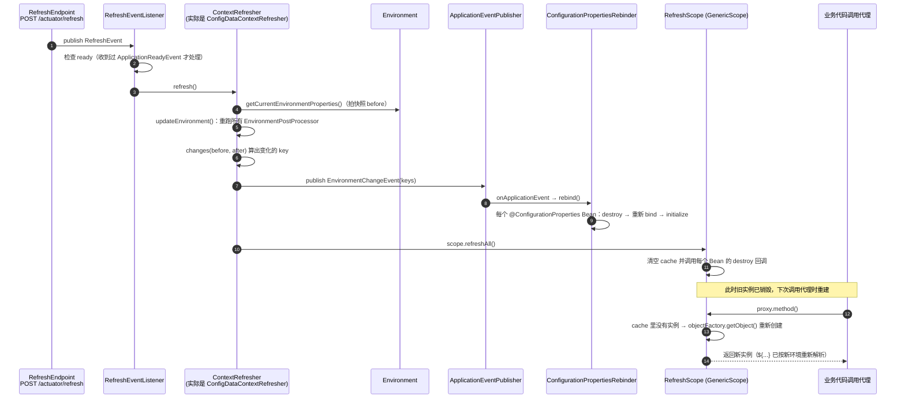
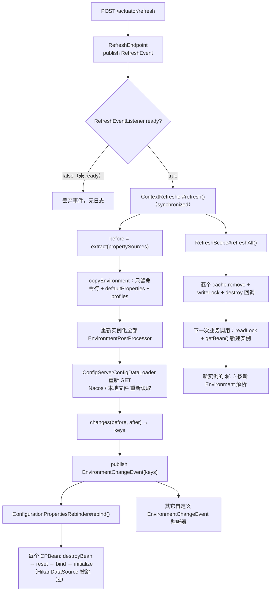

# Spring Cloud 源码精读 05-2：配置刷新 —— RefreshScope、Rebinder 与 Bus

> **一句话结论**：Spring Cloud 的"配置刷新"不是"改字段值"，而是**把 `Environment` 重建一遍 + 把 `refresh` 作用域里的 Bean 全部销毁**；`@RefreshScope` Bean 之所以能刷新，是因为容器里真正被注入的是一个 **scoped proxy**，方法调用时才去 scope 里取"当前实例"，销毁后下一次调用会从原始 `BeanDefinition` 重新创建并重新解析 `${...}`；`@ConfigurationProperties` Bean 则由 `ConfigurationPropertiesRebinder` 监听 `EnvironmentChangeEvent` 主动 rebind；想把刷新广播到整个集群，就用 Spring Cloud Bus 或 Nacos 原生推送。
>
> **阅读前置**：读过本组 [`01-config-client-配置拉取原理.md`](./01-config-client-配置拉取原理.md) 与 [`01-Spring框架/02-AOP与代理`](../../01-Spring框架/)（知道 JDK 动态代理与 CGLIB、`MethodInterceptor`）；知道 Spring 的 `Scope` 概念即可。
>
> **预计阅读**：55 分钟。
>
> **源码基线**：`org.springframework.cloud:spring-cloud-context:5.1.0`。

---

## 0. 先看现象

线上改了一个 Nacos 里的超时时间，运维点了"刷新"，然后发现：

| 现象 | 你可能的第一反应 | 真正原因 |
| --- | --- | --- |
| 日志打 `Refresh keys changed: [order.timeout]` 但接口还是老超时 | "刷新没生效" | 那个 Bean 没有 `@RefreshScope`，是启动时一次性注入的 |
| 加了 `@RefreshScope` 还是不生效 | "注解没用" | 注入方式是 `new`，或者字段是 `static`，或者自己 `@Bean` 返回了 `@RefreshScope` 但被同类内部调用 |
| `@ConfigurationProperties` 的类刷新了一半 | "并发问题" | 确实：rebind 期间集合属性会短暂为空（源码 Javadoc 明确记录） |
| 多实例只刷新了一台 | "我只点了一台的 endpoint" | 需要 Bus / Nacos 推送广播，逐台点是运维事故 |

本篇把这些现象都对应回源码。

---

## 1. 整体地图



**读图说明**：

1. 触发点在最上面：`/actuator/refresh` 只是"发布一个 `RefreshEvent`"，真正干活的是 `RefreshEventListener`，所以你也可以在代码里自己 `publishEvent(new RefreshEvent(...))`。
2. **顺序很关键**：`refreshEnvironment()` 先跑（改 `Environment` + 发 `EnvironmentChangeEvent`，让 rebinder 先动），然后才 `scope.refreshAll()`（销毁 `@RefreshScope` Bean）。顺序反了会导致 `@ConfigurationProperties` 读到旧环境。
3. 最后一支 `User->>RS` 是理解 `@RefreshScope` 的核心：**刷新时并不"重建"对象，只是"销毁"**；重建是懒的，发生在下一次方法调用时。所以刷新后如果没人调用，你会在 `/actuator/beans` 之外看不到任何"新对象"的痕迹。
4. `ConfigDataContextRefresher` 才是 5.1.0 里真正被装配的实现（`ContextRefresher` 已改为抽象类），`updateEnvironment()` 的实现细节在 §3.2。

---

## 2. 关键类逐个拆

| 类 | 职责 | 一句话 |
| --- | --- | --- |
| `RefreshEndpoint` | actuator 端点 | 发布 `RefreshEvent` |
| `RefreshEventListener` | 事件监听 | 等应用 `ready` 后调 `refresh.refresh()` |
| `ContextRefresher`（抽象） | 刷新编排 | `refreshEnvironment()` + `scope.refreshAll()` |
| `ConfigDataContextRefresher` | 具体实现 | 用 ConfigData 重跑 `EnvironmentPostProcessor` |
| `RefreshScope`（继承 `GenericScope`） | 自定义 Scope | 名字 `refresh`，提供 `refreshAll()` / `refresh(name)` |
| `GenericScope` | Scope 通用实现 | 缓存 + 每 Bean 读写锁 + scoped proxy |
| `ConfigurationPropertiesRebinder` | 监听 `EnvironmentChangeEvent` | 重新绑定 `@ConfigurationProperties` |
| `EnvironmentChangeEvent` | 事件 | 携带"变化了哪些 key" |
| `RefreshScopeRefreshedEvent` | 事件 | 单个 Bean 刷新完成 |
| `RemoteApplicationEvent`（Bus） | 事件 | 可跨进程传输的事件基类 |

### 2.1 `ContextRefresher#refresh`：编排只有三行

```java (src:  ContextRefresher.java#L97-L109)
	public synchronized Set<String> refresh() {
		Set<String> keys = refreshEnvironment();
		this.scope.refreshAll();
		return keys;
	}

	public synchronized Set<String> refreshEnvironment() {
		Map<String, Object> before = getCurrentEnvironmentProperties();
		updateEnvironment();
		Set<String> keys = changes(before, getCurrentEnvironmentProperties()).keySet();
		this.context.publishEvent(new EnvironmentChangeEvent(this.context, keys));
		return keys;
	}
```

**在干什么**：`refresh()` 两件事——先 `refreshEnvironment()`（重建环境 + 发事件），再 `scope.refreshAll()`（销毁所有 refresh 作用域 Bean）。两者都是 `synchronized`，防止两个 `/actuator/refresh` 并发互相踩。

**为什么**：`synchronized` 加在 `ContextRefresher` 实例上，粒度是"整个刷新"，粗暴但正确；细粒度锁在 `GenericScope` 里另有实现（见 §2.4）。

**改别的会怎样**：如果把 `scope.refreshAll()` 放到 `refreshEnvironment()` 之前，`@ConfigurationProperties` Bean 会先被销毁重建（用旧环境），然后环境才变——表现为"刷新后配置属性还是旧值，要再刷一次"。

**常见坑**：`refresh()` 返回的 `keys` 是**变化了的 key 集合**，`{}` 空集合表示"配置没变"，此时 `scope.refreshAll()` 仍然会执行（源码没有短路判断），也就是说 **`/actuator/refresh` 一定会重建所有 refresh Bean**，与"配置有没有变"无关。

### 2.2 `changes` / `extract`：怎么算出"变了哪些"

```java (src:  ContextRefresher.java#L143-L159)
	private Map<String, Object> changes(Map<String, Object> before, Map<String, Object> after) {
		Map<String, Object> result = new HashMap<>();
		for (String key : before.keySet()) {
			if (!after.containsKey(key)) {
				result.put(key, null);
			}
			else if (!equal(before.get(key), after.get(key))) {
				result.put(key, after.get(key));
			}
		}
		for (String key : after.keySet()) {
			if (!before.containsKey(key)) {
				result.put(key, after.get(key));
			}
		}
		return result;
	}
```

**在干什么**：双向 diff——删除的 key 记为 `null`，修改的记录新值，新增的也记录。

**为什么**：`EnvironmentChangeEvent` 携带的 `keys` 是给 rebinder 判断"要不要 rebind"用的（虽然当前实现是无脑全量 rebind，见 §2.5），同时也是 `/actuator/refresh` 的返回值，运维能直接看到"这次刷新动了什么"。

**常见坑**：`extract` 会**跳过 `standardSources`**（systemProperties、systemEnvironment、JNDI、`configurationProperties` 等，见 `ContextRefresher` 的 `standardSources` 字段），所以 `-D` 参数的改动不会被算进 diff，也不会触发 rebind。

```java (src:  ContextRefresher.java#L190-L202)
	private Map<String, Object> extract(MutablePropertySources propertySources) {
		Map<String, Object> result = new HashMap<>();
		List<PropertySource<?>> sources = new ArrayList<>();
		for (PropertySource<?> source : propertySources) {
			sources.add(0, source);
		}
		for (PropertySource<?> source : sources) {
			if (!this.standardSources.contains(source.getName())) {
				extract(source, result);
			}
		}
		return result;
	}
```

**在干什么**：把 `MutablePropertySources` 倒序（因为第一个是最高优先级，要最后写，才能"低优先级先铺、高优先级覆盖"），然后排除标准源逐个展开。

**为什么**：`CompositePropertySource`（例如老的 `configService`）需要递归展开；倒序保证最终 map 里的值等于 `Environment#getProperty` 的语义。

**改别的会怎样**：不正序/倒序遍历，`changes` 的 diff 就会大量误报（同一个 key 在不同源里值不同时）。这是"刷新返回一堆不该变的 key"的经典原因。

### 2.3 `copyEnvironment`：为什么刷新要"重造一个 Environment"

```java (src:  ContextRefresher.java#L119-L141)
	protected StandardEnvironment copyEnvironment(ConfigurableEnvironment sourceEnv) {
		StandardEnvironment environment = new StandardEnvironment();
		MutablePropertySources capturedPropertySources = environment.getPropertySources();
		// Only copy the default property source(s) and the profiles over from the main
		// environment (everything else should be pristine, just like it was on startup).
		List<String> propertySourcesToRetain = new ArrayList<>(Arrays.asList(DEFAULT_PROPERTY_SOURCES));
		if (!CollectionUtils.isEmpty(additionalPropertySourcesToRetain)) {
			propertySourcesToRetain.addAll(additionalPropertySourcesToRetain);
		}

		propertySourcesToRetain.stream().filter(s -> sourceEnv.getPropertySources().contains(s)).forEach(s -> {
			if (capturedPropertySources.contains(s)) {
				capturedPropertySources.replace(s, sourceEnv.getPropertySources().get(s));
			}
			else {
				capturedPropertySources.addLast(sourceEnv.getPropertySources().get(s));
			}
		});

		environment.setActiveProfiles(sourceEnv.getActiveProfiles());
		environment.setDefaultProfiles(sourceEnv.getDefaultProfiles());
		return environment;
	}
```

**在干什么**：造一个**全新的** `StandardEnvironment`，只把命令行参数（`commandLineArgs`）和 `defaultProperties` 搬过来，并继承 active/default profiles。其它所有源（`application.yml`、`configserver:*`、Nacos 源…）**都不搬**，等着 `EnvironmentPostProcessor` 重新加载。

**为什么**：这是"像启动时一样重新加载配置"的唯一干净做法。如果直接在主 `Environment` 上就地改，旧的远端源删不掉、顺序会乱，`config.client.version` 之类的状态也没法重算。源码注释写得很直白：`everything else should be pristine, just like it was on startup`。

**改别的会怎样**：把 `DEFAULT_PROPERTY_SOURCES` 里的命令行参数漏掉，刷新后 `--server.port=8081` 就丢了；漏掉 profiles，刷新后 `@Profile` 相关的配置全部错位。

**常见坑**：自定义了 `PropertySource`（比如从数据库读的），刷新后会**消失**，除非配置 `spring.cloud.refresh.additional-property-sources-to-retain`（对应构造函数里的 `additionalPropertySourcesToRetain`）。

### 2.4 `ConfigDataContextRefresher#updateEnvironment`：重跑所有 EnvironmentPostProcessor

```java (src:  ConfigDataContextRefresher.java#L67-L93)
	@Override
	protected void updateEnvironment() {
		if (logger.isTraceEnabled()) {
			logger.trace("Re-processing environment to add config data");
		}
		StandardEnvironment environment = copyEnvironment(getContext().getEnvironment());
		ConfigurableBootstrapContext bootstrapContext = getContext().getBeanProvider(ConfigurableBootstrapContext.class)
			.getIfAvailable(DefaultBootstrapContext::new);

		// run thru all EnvironmentPostProcessor instances. This lets things like vcap and
		// decrypt happen after refresh. The hard coded call to
		// ConfigDataEnvironmentPostProcessor.applyTo() is now automated as well.
		DeferredLogFactory logFactory = new PassthruDeferredLogFactory();
		List<String> classNames = SpringFactoriesLoader.loadFactoryNames(EnvironmentPostProcessor.class,
				getClass().getClassLoader());
		Instantiator<EnvironmentPostProcessor> instantiator = new Instantiator<>(EnvironmentPostProcessor.class,
				(parameters) -> {
					parameters.add(DeferredLogFactory.class, logFactory);
					parameters.add(Log.class, logFactory::getLog);
					parameters.add(ConfigurableBootstrapContext.class, bootstrapContext);
					parameters.add(BootstrapContext.class, bootstrapContext);
					parameters.add(BootstrapRegistry.class, bootstrapContext);
				});
		List<EnvironmentPostProcessor> postProcessors = instantiator.instantiate(classNames);
		for (EnvironmentPostProcessor postProcessor : postProcessors) {
			postProcessor.postProcessEnvironment(environment, application);
		}
```

**在干什么**：三步——① `copyEnvironment` 造裸环境；② 从 `META-INF/spring.factories`（`SpringFactoriesLoader`）里把**所有** `EnvironmentPostProcessor` 找出来实例化（用 `Instantiator` 注入 `DeferredLogFactory`/`BootstrapContext` 等构造参数）；③ 逐个 `postProcessEnvironment`。

**为什么**：Boot 启动时正是这样加载配置的（`ConfigDataEnvironmentPostProcessor` 就是其中之一）。刷新时"再跑一遍"，就等价于"重启一次的配置加载"，包括 Config Server 拉取、解密、`spring.config.import` 全部重来。源码注释点名了 `ConfigDataEnvironmentPostProcessor.applyTo() is now automated`——5.1.0 不再硬编码调用它，而是走统一 SPI。

**改别的会怎样**：如果你注册了自定义 `EnvironmentPostProcessor` 且它有副作用（比如写库、发 HTTP），刷新时也会被执行一次——这常被忽略。

**常见坑**：`SpringFactoriesLoader.loadFactoryNames` 加载的是**类路径上全部**实现，包括测试里的；单元测试中触发刷新可能意外执行测试专用的 post processor。另外 `application` 字段来自 `ContextRefreshedWithApplicationEvent`（`onApplicationEvent` 里赋值），如果事件没到，`application` 为 `null`，某些 `EnvironmentPostProcessor` 会 NPE。

### 2.5 新环境怎么合回主环境

```java (src:  ConfigDataContextRefresher.java#L95-L118)
		MutablePropertySources target = getContext().getEnvironment().getPropertySources();
		String targetName = null;
		for (PropertySource<?> source : environment.getPropertySources()) {
			String name = source.getName();
			if (target.contains(name)) {
				targetName = name;
			}
			if (!this.standardSources.contains(name)) {
				if (target.contains(name)) {
					target.replace(name, source);
				}
				else {
					if (targetName != null) {
						target.addAfter(targetName, source);
					}
					else {
						// targetName was null so we are at the start of the list
						target.addFirst(source);
					}
					// update targetName to preserve ordering
					targetName = name;
				}
			}
		}
```

**在干什么**：遍历新环境的源（顺序即优先级），同名就 `replace` 掉主环境里的旧源，新名就"插在上一个处理过的源之后"，从而**保持原有顺序**；`standardSources`（系统属性等）跳过不动。

**为什么**：`replace` 保证了 `configserver:*` 旧值被彻底删除，避免"新旧两份都在、谁在前谁赢"的混乱（这正是 05-1 §3.6 强调 `configserver:` 前缀的原因）。

**改别的会怎样**：如果改用 `addFirst` 而无脑插到最前，远端配置就会意外覆盖命令行参数——运维改不动的"幽灵配置"。

### 2.6 `RefreshScope`：只做三件事

```java (src:  RefreshScope.java#L68-L85)
@ManagedResource
public class RefreshScope extends GenericScope
		implements ApplicationContextAware, ApplicationListener<ContextRefreshedEvent>, Ordered {

	private ApplicationContext context;

	private BeanDefinitionRegistry registry;

	private boolean eager = true;

	private int order = Ordered.LOWEST_PRECEDENCE - 100;

	/**
	 * Creates a scope instance and gives it the default name: "refresh".
	 */
	public RefreshScope() {
		super.setName("refresh");
	}
```

**在干什么**：Scope 名字固定为 `"refresh"`；`eager=true` 表示启动后把 refresh 作用域 Bean 全部提前实例化一次（这样启动期就能校验配置）；`order` 让它在 `ContextRefreshedEvent` 里排得比较靠后。

**为什么**：`eager` 是为了"启动就报错"而不是"第一次请求才报错"。

对应实现：

```java (src:  RefreshScope.java#L111-L133)
	@Override
	public void onApplicationEvent(ContextRefreshedEvent event) {
		start(event);
	}

	public void start(ContextRefreshedEvent event) {
		if (event.getApplicationContext() == this.context && this.eager && this.registry != null) {
			eagerlyInitialize();
		}
	}

	@SuppressWarnings("ReturnValueIgnored")
	private void eagerlyInitialize() {
		for (String name : this.context.getBeanDefinitionNames()) {
			BeanDefinition definition = this.registry.getBeanDefinition(name);
			if (this.getName().equals(definition.getScope()) && !definition.isLazyInit()) {
				Object bean = this.context.getBean(name);
				if (bean != null) {
					bean.getClass();
				}
			}
		}
	}
```

**在干什么**：容器刷新完成后，遍历所有 BeanDefinition，凡是 `scope == "refresh"` 且非 lazy 的，`getBean(name)` 强制实例化；`bean.getClass()` 是个"防止 JIT/编译器优化掉 getBean 结果"的惯用小技巧。

**常见坑**：`@RefreshScope` + `@Lazy` 会跳过 eager 初始化；`event.getApplicationContext() == this.context` 这个判断意味着**子上下文刷新事件不触发**（Spring Cloud 的 `BootstrapApplicationListener` 建的是父上下文，方向相反，所以没问题）。

刷新单个/全部：

```java (src:  RefreshScope.java#L141-L163)
	public boolean refresh(Class type) {
		String[] beanNamesForType = BeanFactoryUtils.beanNamesForTypeIncludingAncestors(this.context, type);
		if (beanNamesForType.length > 0) {
			return refresh(beanNamesForType[0]);
		}
		return false;
	}

	@ManagedOperation(description = "Dispose of the current instance of bean name "
			+ "provided and force a refresh on next method execution.")
	public boolean refresh(String name) {
		if (!ScopedProxyUtils.isScopedTarget(name)) {
			// User wants to refresh the bean with this name but that isn't the one in the
			// cache...
			name = ScopedProxyUtils.getTargetBeanName(name);
		}
		// Ensure lifecycle is finished if bean was disposable
		if (super.destroy(name)) {
			this.context.publishEvent(new RefreshScopeRefreshedEvent(name));
			return true;
		}
		return false;
	}
```

**在干什么**：`refresh(String)` 先把业务 bean 名转成 **scopedTarget 名**（`ScopedProxyUtils.getTargetBeanName` 会加 `scopedTarget.` 前缀），因为 scope 的缓存 key 是目标 bean 名而不是代理名；然后 `super.destroy(name)` 销毁实例、发 `RefreshScopeRefreshedEvent`。

**为什么**：这一步解释了 90% 的"refresh 返回 false"——你传的名字在 cache 里找不到。`refreshAll()`（`GenericScope` 里的同名方法）则是遍历 cache 全部销毁。

**常见坑**：`refresh(name)` 只清缓存 + 调 destroy 回调，**不会**重算 `Environment`！想连环境一起刷新必须走 `ContextRefresher#refresh()`。

### 2.7 `RefreshScopeRefreshedEvent`：一个"字符串载荷"的事件

```java (src:  RefreshScopeRefreshedEvent.java#L24-L32)
@SuppressWarnings("serial")
public class RefreshScopeRefreshedEvent extends ApplicationEvent {

	/**
	 * Default name for the refresh scope refreshed event.
	 */
	public static final String DEFAULT_NAME = "__refreshAll__";

	private String name;
```

**在干什么**：携带刷新了的 bean 名；全量刷新时是常量 `"__refreshAll__"`。

**为什么**：留给业务做"刷新后重建连接池/重新预热缓存"的钩子，监听这个事件比监听 `EnvironmentChangeEvent` 更精确（后者在 `refresh(name)` 时不会发）。

### 2.8 `GenericScope`：`@RefreshScope` 为什么必须是代理

先看它注册自己为 Scope：

```java (src:  GenericScope.java#L233-L238)
	@Override
	public void postProcessBeanFactory(ConfigurableListableBeanFactory beanFactory) throws BeansException {
		this.beanFactory = beanFactory;
		beanFactory.registerScope(this.name, this);
		setSerializationId(beanFactory);
	}
```

**在干什么**：`GenericScope` 同时是 `BeanFactoryPostProcessor` 和 `BeanDefinitionRegistryPostProcessor`，在 BeanFactory 就绪时把自己注册成名为 `refresh` 的 `Scope`。

然后是"偷换代理类"的关键一步：

```java (src:  GenericScope.java#L240-L257)
	@Override
	public void postProcessBeanDefinitionRegistry(BeanDefinitionRegistry registry) throws BeansException {
		for (String name : registry.getBeanDefinitionNames()) {
			BeanDefinition definition = registry.getBeanDefinition(name);
			if (definition instanceof RootBeanDefinition root) {
				if (root.getDecoratedDefinition() != null && root.hasBeanClass()
						&& root.getBeanClass() == ScopedProxyFactoryBean.class) {
					if (getName().equals(root.getDecoratedDefinition().getBeanDefinition().getScope())) {
						root.setBeanClass(LockedScopedProxyFactoryBean.class);
						root.getConstructorArgumentValues().addGenericArgumentValue(this);
						// surprising that a scoped proxy bean definition is not already
						// marked as synthetic?
						root.setSynthetic(true);
					}
				}
			}
		}
	}
```

**在干什么**：Spring 给非 singleton 作用域的 Bean 生成代理时，会用 `ScopedProxyFactoryBean` 这个 `FactoryBean`。Spring Cloud 遍历所有 BeanDefinition，凡是被 `@RefreshScope` 包出来、且 scope 为 `refresh` 的代理定义，把 `beanClass` 换成自己的 `LockedScopedProxyFactoryBean`，并把自己作为构造参数传进去。

**为什么**：要加"读写锁"+"更友好的异常处理"，原生的 `ScopedProxyFactoryBean` 做不到。这就是**为什么 `@RefreshScope` 必须靠 AOP 代理**的第一层答案：Spring 的 `Scope` 机制天然要求"每次取 Bean 都问 scope 要"，而 singleton 注入只能拿到一个固定引用，所以必须插一个"永远转发给当前实例"的代理。

**改别的会怎样**：如果不换成 `LockedScopedProxyFactoryBean`，刷新与业务线程会撞上，出现"用到半销毁的 Bean"（`UndeclaredThrowableException` / 半初始化状态）。

再看 Scope 的 `get`：

```java (src:  GenericScope.java#L172-L183)
	@Override
	public Object get(String name, ObjectFactory<?> objectFactory) {
		BeanLifecycleWrapper value = this.cache.put(name, new BeanLifecycleWrapper(name, objectFactory));
		this.locks.putIfAbsent(name, new ReentrantReadWriteLock());
		try {
			return value.getBean();
		}
		catch (RuntimeException e) {
			this.errors.put(name, e);
			throw e;
		}
	}
```

**在干什么**：`cache.put(name, new BeanLifecycleWrapper(...))` 是"putIfAbsent 式"的缓存：如果已有 wrapper 就返回旧的，没有就放新的。然后 `wrapper.getBean()` 拿到实例。

**为什么**：`BeanLifecycleWrapper` 自己做了双重检查锁：

```java (src:  GenericScope.java#L377-L386)
		public Object getBean() {
			if (this.bean == null) {
				synchronized (this) {
					if (this.bean == null) {
						this.bean = this.objectFactory.getObject();
					}
				}
			}
			return this.bean;
		}
```

**在干什么**：经典的 DCL（`bean` 字段是 `volatile`）。`objectFactory` 由 Spring 传入，作用是"按原始 BeanDefinition 造一个新实例"，包括重新解析 `${...}` 占位符、重新走 `@Autowired`、重新执行 `@PostConstruct`。

**常见坑**：DCL 的 `getBean()` 只保证**实例创建**不重复，不保证"业务方法执行期间实例不被销毁"——那是下面 `LockedScopedProxyFactoryBean` 的活。

销毁：

```java (src:  GenericScope.java#L155-L170)
	protected boolean destroy(String name) {
		BeanLifecycleWrapper wrapper = this.cache.remove(name);
		if (wrapper != null) {
			Lock lock = this.locks.get(wrapper.getName()).writeLock();
			lock.lock();
			try {
				wrapper.destroy();
			}
			finally {
				lock.unlock();
			}
			this.errors.remove(name);
			return true;
		}
		return false;
	}
```

**在干什么**：先从缓存移除（这样后续 `get` 一定新建），再用**写锁**保护地调 `wrapper.destroy()`。

**为什么**：先移除再加写锁，保证"移除的一瞬间"新请求会走"缓存 miss → 新建"路径，而不是继续拿旧引用；写锁则等待正在执行的读（业务方法）结束。

`wrapper.destroy()` 本身：

```java (src:  GenericScope.java#L388-L400)
		public void destroy() {
			if (this.callback == null) {
				return;
			}
			synchronized (this) {
				Runnable callback = this.callback;
				if (callback != null) {
					callback.run();
				}
				this.callback = null;
				this.bean = null;
			}
		}
```

**在干什么**：`callback` 是 Spring 在 `registerDestructionCallback` 时传入的，一般为 `DisposableBeanAdapter#destroy`（执行 `@PreDestroy`、`destroy-method`、关闭连接池等）。执行完把 `bean` 置 `null`。

**常见坑**：`if (this.callback == null) return;` —— 如果 Bean 没有任何销毁回调（没有 `@PreDestroy`、没有 `destroyMethod`、不是 `DisposableBean`），`callback` 为 `null`，**`bean` 字段不会被置 null**！但 `cache.remove` 已把它从缓存踢出，所以下次 `get` 会新建另一个 wrapper，旧实例变成垃圾。功能上没问题，但注意"看起来没被 destroy"的日志缺失是正常的。

最后是代理的拦截器：
```java (src:  GenericScope.java#L467-L506)
		@Override
		public Object invoke(MethodInvocation invocation) throws Throwable {
			Method method = invocation.getMethod();
			if (AopUtils.isEqualsMethod(method) || AopUtils.isToStringMethod(method)
					|| AopUtils.isHashCodeMethod(method) || isScopedObjectGetTargetObject(method)) {
				return invocation.proceed();
			}
			Object proxy = getObject();
			Lock lock = null;
			if (this.scope.requiresProxyLocking()) {
				ReadWriteLock readWriteLock = this.scope.getLock(this.targetBeanName);
				if (readWriteLock == null) {
					if (logger.isDebugEnabled()) {
						logger.debug("For bean with name [" + this.targetBeanName
								+ "] there is no read write lock. Will create a new one to avoid NPE");
					}
					readWriteLock = new ReentrantReadWriteLock();
				}
				lock = readWriteLock.readLock();
				lock.lock();
			}
			try {
				if (proxy instanceof Advised advised) {
					ReflectionUtils.makeAccessible(method);
					return ReflectionUtils.invokeMethod(method, advised.getTargetSource().getTarget(),
							invocation.getArguments());
				}
				return invocation.proceed();
			}
			// see gh-349. Throw the original exception rather than the
			// UndeclaredThrowableException
			catch (UndeclaredThrowableException e) {
				throw e.getUndeclaredThrowable();
			}
			finally {
				if (lock != null) {
					lock.unlock();
				}
			}
		}
```
```

**在干什么**：每次业务方法调用，先跳过 `equals/hashCode/toString/getTargetObject`（这些不能触发实例化），然后 `getObject()` 取当前实例、加**读锁**、反射调用目标方法（绕过代理自身的转发，避免二次代理），最后把 `UndeclaredThrowableException` 拆包成原始受检异常。

**为什么**：读锁与 §2.7 的写锁构成"刷新时等业务调用结束"的语义；不加锁的话，刷新可能正好在方法执行到一半时销毁 Bean（关闭 DataSource），导致不可复现的诡异错误。

**改别的会怎样**：`requiresProxyLocking()` 关掉（可配置）后性能略好，但刷新期间的并发风险回来了。

**常见坑**：`@RefreshScope` 类**不能**依赖"字段持有状态"（比如计数器、缓存），因为刷新后是**另一个对象**；也不能在 `@PostConstruct` 里做昂贵操作，每次刷新都会再执行一次。

### 2.9 `ConfigurationPropertiesRebinder`：非代理类怎么刷新

```java (src:  ConfigurationPropertiesRebinder.java#L101-L116)
@Component
@ManagedResource
public class ConfigurationPropertiesRebinder
		implements ApplicationContextAware, ApplicationListener<EnvironmentChangeEvent> {

	private static final Log logger = LogFactory.getLog(ConfigurationPropertiesRebinder.class);

	private ConfigurationPropertiesBeans beans;

	private ApplicationContext applicationContext;

	private Map<String, Exception> errors = new ConcurrentHashMap<>();

	private final ConcurrentMap<String, Lock> rebindLocks = new ConcurrentHashMap<>();

	private final Set<String> neverResetNestedTypes;
```

**在干什么**：它是个普通 `@Component`，靠 `ConfigurationPropertiesBeans`（Spring Cloud 提供的 `BeanPostProcessor`，记录所有 `@ConfigurationProperties` Bean 名）知道自己该管哪些 Bean；`rebindLocks` 防并发重绑。

监听事件：

```java (src:  ConfigurationPropertiesRebinder.java#L627-L634)
	@Override
	public void onApplicationEvent(EnvironmentChangeEvent event) {
		if (this.applicationContext.equals(event.getSource())
				// Backwards compatible
				|| event.getKeys().equals(event.getSource())) {
			rebind();
		}
	}
```

**在干什么**：收到 `EnvironmentChangeEvent` 就全量 `rebind()`。

**为什么**：注意它**不看 `event.getKeys()` 内容**，只是拿它做"是不是自己这个上下文"的兼容判断（老构造函数把 keys 当 source）。所以哪怕只改了一个 key，所有 `@ConfigurationProperties` Bean 都会重绑。

```java (src:  ConfigurationPropertiesRebinder.java#L155-L178)
	@ManagedOperation
	public void rebind() {
		this.errors.clear();
		for (String name : this.beans.getBeanNames()) {
			rebind(name);
		}
	}

	@ManagedOperation
	public boolean rebind(String name) {
		if (!this.beans.getBeanNames().contains(name)) {
			return false;
		}
		ApplicationContext appContext = this.applicationContext;
		while (appContext != null) {
			if (appContext.containsLocalBean(name)) {
				return rebind(name, appContext);
			}
			else {
				appContext = appContext.getParent();
			}
		}
		return false;
	}
```

**在干什么**：`rebind()` 遍历全部；`rebind(name)` 沿上下文层级往上找（兼容 bootstrap 父子结构）。

真正干活的方法：

```java (src:  ConfigurationPropertiesRebinder.java#L198-L256)
	private boolean rebind(String name, ApplicationContext appContext) {
		// Serialize concurrent rebinds of the *same* bean (for example a manual
		// rebind(name) racing with an EnvironmentChangeEvent-triggered rebind()) so
		// their destroy/reset/re-initialize steps cannot interleave on the live bean.
		// This does not protect concurrent readers of the bean; see the class Javadoc.
		Lock lock = this.rebindLocks.computeIfAbsent(name, key -> new ReentrantLock());
		lock.lock();
		try {
			try {
				Object bean = appContext.getBean(name);
				if (bean != null && !AopUtils.isAopProxy(bean)) {
					// A BeanPostProcessor may have replaced the bean with a wrapper after
					// the properties were bound (for example Boot's lazy connection fetch
					// wraps the DataSource). Rebind what the properties were bound to,
					// not
					// the wrapper, which could not be bound to the bean's declared type.
					Object bound = this.beans.getInstance(name);
					if (bound != null) {
						bean = bound;
					}
				}
				if (bean != null) {
					// The class behind every proxy layer, not just the outermost one
					Class<?> targetClass = AopProxyUtils.ultimateTargetClass(bean);
					// TODO: determine a more general approach to fix this.
					// see
					// https://github.com/spring-cloud/spring-cloud-commons/issues/571
					if (getNeverRefreshable().contains(targetClass.getName()) || getNeverRefreshable().contains(name)) {
						return false; // ignore
					}
					if (AopUtils.isAopProxy(bean) && bean instanceof Advised advised) {
						Object target = ProxyUtils.getTargetObject(bean);
						if (target != bean && !targetClass.isInterface()
								&& !Modifier.isAbstract(targetClass.getModifiers())) {
							Object freshBean = appContext.getAutowireCapableBeanFactory().createBean(targetClass);
							Object freshTarget = AopUtils.isAopProxy(freshBean) ? ProxyUtils.getTargetObject(freshBean)
									: freshBean;
							// Keep the advice of every proxy layer
							innermostAdvised(advised).setTargetSource(new SingletonTargetSource(freshTarget));
							appContext.getAutowireCapableBeanFactory().destroyBean(target);
						}
						else {
							Object boundDefaults = bindFreshInstance(target, name, appContext);
							appContext.getAutowireCapableBeanFactory().destroyBean(target);
							resetBeanToDefaults(target, boundDefaults);
							appContext.getAutowireCapableBeanFactory().autowireBean(target);
							appContext.getAutowireCapableBeanFactory().initializeBean(target, name);
						}
					}
					else {
						Object boundDefaults = bindFreshInstance(bean, name, appContext);
						appContext.getAutowireCapableBeanFactory().destroyBean(bean);
						resetBeanToDefaults(bean, boundDefaults);
						appContext.getAutowireCapableBeanFactory().autowireBean(bean);
						appContext.getAutowireCapableBeanFactory().initializeBean(bean, name);
					}
					return true;
				}
			}
```

**在干什么**：核心分两支——如果 Bean 是 AOP 代理且目标类是具体类，就**造一个新实例并换掉代理的 TargetSource**（连代理后的 advice 都保留）；否则**在同一个对象上**依次 `destroyBean → resetBeanToDefaults → autowireBean → initializeBean`，也就是"先把字段清回默认值，再重新绑定一遍，再走一遍初始化回调"。

**为什么**：`@ConfigurationProperties` Bean 通常是单例、被别处注入着引用，**不能换对象**（换了引用的人还拿着旧的），所以只能"就地重灌"；而 reset 是为了避免"新配置里没有这个 key"时旧值残留（例如把 `timeout` 从 `30s` 删掉，不 reset 就还是 30s）。

**改别的会怎样**：不做 `resetBeanToDefaults`，就会出现"配置删掉了但生效值还在"的幽灵配置。

**常见坑（源码自己都写了）**：

- `never-refreshable` 默认包含 `com.zaxxer.hikari.HikariDataSource`（见下），意味着**改了数据库连接串，`HikariDataSource` 不会被重绑**——这是刻意设计，避免运行时换库。
- 类 Javadoc 明确写了：**集合属性在 rebind 期间会短暂为空**，因为 Binder 更新已有集合是先 clear 再 add。`@ConfigurationProperties` 里放 `List<String>` 的 Bean 在高并发下可能读到一个空列表。需要"读一致性"的场景应改用 `@RefreshScope`。

```java (src:  ConfigurationPropertiesRebinder.java#L615-L620)
	@ManagedAttribute
	public Set<String> getNeverRefreshable() {
		String neverRefresh = this.applicationContext.getEnvironment()
			.getProperty("spring.cloud.refresh.never-refreshable", "com.zaxxer.hikari.HikariDataSource");
		return StringUtils.commaDelimitedListToSet(neverRefresh);
	}
```

### 2.10 `RefreshEventListener`：为什么"刷新要等应用 ready"

```java (src:  RefreshEventListener.java#L37-L75)
public class RefreshEventListener implements SmartApplicationListener {

	private static Log log = LogFactory.getLog(RefreshEventListener.class);

	private ContextRefresher refresh;

	private AtomicBoolean ready = new AtomicBoolean(false);

	public RefreshEventListener(ContextRefresher refresh) {
		this.refresh = refresh;
	}

	@Override
	public boolean supportsEventType(Class<? extends ApplicationEvent> eventType) {
		return ApplicationReadyEvent.class.isAssignableFrom(eventType)
				|| RefreshEvent.class.isAssignableFrom(eventType);
	}

	@Override
	public void onApplicationEvent(ApplicationEvent event) {
		if (event instanceof ApplicationReadyEvent applicationReadyEvent) {
			handle(applicationReadyEvent);
		}
		else if (event instanceof RefreshEvent refreshEvent) {
			handle(refreshEvent);
		}
	}

	public void handle(ApplicationReadyEvent event) {
		this.ready.compareAndSet(false, true);
	}

	public void handle(RefreshEvent event) {
		if (this.ready.get()) { // don't handle events before app is ready
			log.debug("Event received " + event.getEventDesc());
			Set<String> keys = this.refresh.refresh();
			log.info("Refresh keys changed: " + keys);
		}
	}
```

**在干什么**：`ready` 标志位，只有收到 `ApplicationReadyEvent` 之后才处理 `RefreshEvent`。

**为什么**：类注释解释了——`RefreshEvent` 可能来得很早（Bus 在启动期间就收到广播，或者 Config Server 下发），此时 Bean 还没建全，刷新会炸。

**常见坑**：启动过程中（ready 之前）收到的 `RefreshEvent` 会被**静默丢弃**，日志里不会有任何提示。Nacos/Bus 广播恰好落在启动窗口时，就会出现"明明点了刷新却没反应"。

### 2.11 `EnvironmentChangeEvent`：为什么有两个构造函数

```java (src:  EnvironmentChangeEvent.java#L30-L47)
@SuppressWarnings("serial")
public class EnvironmentChangeEvent extends ApplicationEvent {

	private final Set<String> keys;

	/**
	 * @param keys Key set that represents the difference between old and new versions of
	 * the {@link Environment}.
	 */
	public EnvironmentChangeEvent(Set<String> keys) {
		// Backwards compatible constructor with less utility (practically no use at all)
		this(keys, keys);
	}

	public EnvironmentChangeEvent(Object context, Set<String> keys) {
		super(context);
		this.keys = keys;
	}
```

**在干什么**：老的构造函数把 `keys` 本身当作 `source`（所以 `ConfigurationPropertiesRebinder` 里会有 `event.getKeys().equals(event.getSource())` 这么一个奇怪的兼容判断）；新构造函数用真正的 `ApplicationContext` 作 `source`。

**为什么**：`source` 用来判断事件来源，防止别的上下文的刷新误触发本上下文的 rebind。

---

## 3. 一次完整执行时序

把 `/actuator/refresh` 到"业务拿到新值"的全过程画成时序图，并把异常分支也标出来：



**读图说明**：

1. `C` 分支是最容易被忽略的失败点：**ready 之前的事件被静默丢弃**。
2. `G` 是"为什么自定义 PropertySource 会丢"的原因：只有白名单里的源被保留。
3. `I` 是"刷新等于重启式加载"的体现，所有 `EnvironmentPostProcessor` 都会重跑，**包括 Nacos/Config Server 的拉取**。
4. `L` 与 `O` 是两条并行支路：`@ConfigurationProperties` 走 rebind（同一个对象重灌），`@RefreshScope` 走销毁重建（换对象）。
5. `Q` 说明刷新后**没有"新对象"**，直到有调用者触碰代理。

### 3.1 两个"看起来一样"的刷新路径

```mermaid
sequenceDiagram
    participant Ops as 运维/自动化
    participant End as RefreshEndpoint
    participant Bus as Spring Cloud Bus
    participant MQ as 消息中间件(Rabbit/Kafka)
    participant Other as 其它实例

    rect rgb(235,245,255)
    Note over Ops,End: 方式 A：单机刷新
    Ops->>End: POST /actuator/refresh
    End->>End: 本地 refresh()
    end

    rect rgb(245,255,235)
    Note over Ops,Other: 方式 B：广播刷新
    Ops->>End: POST /actuator/busrefresh
    End->>Bus: publish RefreshRemoteApplicationEvent
    Bus->>MQ: 序列化后发到 destination
    MQ->>Bus: 每个实例消费
    Bus->>Other: 本地 publish RefreshEvent
    Other->>Other: 本地 refresh()
    end
```

**读图说明**：方式 A 只动当前实例；方式 B 通过消息中间件把 `RefreshRemoteApplicationEvent`（`RemoteApplicationEvent` 的子类）广播出去，**每个实例本地走一遍同样的 `refresh()`**。注意 Bus 自己**不做任何配置更新**，它只是个"事件搬运工"——真正的拉取仍由每个实例自己做。

---

## 4. 设计模式与取舍

| 设计点 | 模式 | 好处 | 代价 |
| --- | --- | --- | --- |
| `@RefreshScope` | 代理 + 自定义 Scope | 不换注入引用即可热替换实例 | 所有方法调用多一层代理与锁 |
| `GenericScope` 缓存 | 对象池（单元素） | 懒创建、可销毁 | 状态型 Bean 行为诡异 |
| `ConfigurationPropertiesRebinder` | 事件驱动 + 就地重灌 | 保持单例引用不变 | 集合短暂为空；不可 reset 的字段会残留 |
| `ContextRefresher` 全量重跑 | 幂等重放 | 与启动完全一致 | 刷新较重（一次全量拉配置） |
| Bus 广播 | 事件总线（发布订阅） | 集群一致刷新 | 依赖 MQ，且没有"行不行"的确认 |
| Nacos 原生推送 | 长轮询 + 本地回调 | 无需 MQ，延迟低 | 只覆盖 Nacos 配置，不统一事件模型 |

**取舍结论**：

- **单机 → `/actuator/refresh`**：简单，无额外依赖。
- **集群 + 已有 MQ → Bus**：语义清晰，所有配置源统一。
- **纯 Nacos 技术栈 → Nacos 原生监听**：`NacosContextRefresher` 监听 `ConfigDataChangeEvent`，直接触发 `RefreshScope#refreshAll()`，不需要 MQ；但**它不发 `EnvironmentChangeEvent` 的那种"全通道"语义**，`@ConfigurationProperties` 的刷新靠 Nacos 自己的 `NacosConfigurationPropertiesRebinder`。
- **重要服务 → 加灰度和确认**：Bus 广播是"尽力而为"，没有 ack；真正生产建议用发布平台逐批滚动。

---

## 5. 踩坑与调试手法

### 5.1 三句话定位"为什么没刷新"

1. **看日志有没有 `Refresh keys changed: [...]`**：没有 → 事件没到（ready 前丢弃 / 端点没暴露 / 触发的是别的实例）。
2. **keys 为空 `[]`**：说明环境 diff 为空（配置根本没变，或变的 key 在 `standardSources` 里，或你的自定义源没被重跑）。
3. **keys 有值但业务没变**：Bean 不是 `@RefreshScope`、不是 `@ConfigurationProperties`，或者字段是 `static`/`final`、或者是启动时通过 `new`/构造器算出来的值。

### 5.2 为什么 `@Value` 字段能刷新，静态字段不能

| 字段形态 | 能否刷新 | 原因 |
| --- | --- | --- |
| `@Value("${x}") private String x;` + 类有 `@RefreshScope` | ✅ | 实例销毁重建，`@Value` 在 `AutowiredAnnotationBeanPostProcessor` 里重新解析 |
| 同上但没有 `@RefreshScope` | ❌ | 单例不销毁，`@Value` 只在创建时解析一次 |
| `@Value` 注入到构造器参数 | ✅（配合 `@RefreshScope`） | 重建时重新走构造器 |
| `static` 字段（含 `@Value` 静态注入） | ❌ | 静态注入往往发生在首次类加载/`set` 方法里，实例重建不会重设静态字段；**静态字段属于类，不属于实例** |
| `final` 字段 + 构造器赋值 | ✅（配合 `@RefreshScope`） | 重建会走构造器 |
| `@ConfigurationProperties` 类字段 | ✅（rebind） | 就地重绑，无需代理 |
| `@ConfigurationProperties` 里的 `static` 字段 | ❌ | Binder 只处理实例属性 |

**一句话**：`@RefreshScope` 的刷新语义是"**造一个新对象**"，所以**只有"在创建对象时才会被赋值"的东西**能刷新；被赋值的动作如果是"类级别的、一次性的"（static 初始化）或者"跟对象生命周期无关的"（静态 setter），就永远不会重跑。

### 5.3 用 `/actuator` 端点辅助排查

```
GET  /actuator/env                    → 看 propertySources 顺序与真实值
GET  /actuator/beans                  → 确认 scope 是 "refresh"，以及 scopedTarget.xxx 是否存在
POST /actuator/refresh                → 全量刷新（返回变化的 key）
POST /actuator/refresh/{beanName}     → 只刷某个 Bean（Spring Cloud 5.x 起提供，见版本差异）
GET  /actuator/configprops            → 看 @ConfigurationProperties 当前绑定值
GET  /actuator/refreshScope（JMX）     → RefreshScope 上的 @ManagedOperation
POST /actuator/busrefresh             → Bus 广播刷新
```

**关键**：`/actuator/beans` 里如果某个类**没有** `scopedTarget.xxx` 这个条目，说明它没被 `@RefreshScope` 代理（你可能把它写在了 `@Bean` 方法上但被同类内部调用绕过了）。

### 5.4 三个高频错误写法

```java
// ❌ 错误 1：在同一个类里调用自己的 @RefreshScope Bean，代理被绕过
@Configuration
public class Cfg {
    @Bean @RefreshScope Foo foo() { return new Foo(); }
    void use() { foo(); }   // 这是 this.foo()，直接调工厂方法，不走代理
}
```

```java
// ❌ 错误 2：用 new 创建"本该被注入的" refresh Bean
Foo foo = new Foo();        // 无论怎么刷新，这个对象都不会变
```

```java
// ❌ 错误 3：把配置缓存在 static 字段里
public class Const {
    public static final String TIMEOUT = "${order.timeout}"; // 永远不会被解析
}
```

### 5.5 刷新风暴

`/actuator/refresh` 是全量重跑 `EnvironmentPostProcessor`，如果 100 个实例同时收到 Bus 广播，就是对 Config Server/Nacos 的 100 次并发全量请求。排查手法：

- 看 Config Server 的 QPS 尖峰是否与发布时刻吻合；
- 给 Bus 广播加 jitter（延迟分批），或改用 Nacos 长轮询（天然带抖动）；
- **不要**把 `/actuator/refresh` 暴露到公网（默认不暴露，`management.endpoints.web.exposure.include` 要显式加）。

---

## 6. ⚠️ 版本差异

| 项 | 老版本（≤ 2020） | 5.1.0（本仓库基线） |
| --- | --- | --- |
| `ContextRefresher` | 具体类，直接 `refresh()` | **抽象类**，`updateEnvironment()` 抽象；实际实现是 `ConfigDataContextRefresher` |
| 刷新环境的方式 | 硬编码调用 `ConfigDataEnvironmentPostProcessor.applyTo`（或 bootstrap 重新加载） | 通过 `SpringFactoriesLoader` 重跑**全部** `EnvironmentPostProcessor` |
| `bootstrap.yml` 里的 refresh 配置 | 生效 | 默认不读（见 05-1） |
| Spring Cloud Bus | 需引 `spring-cloud-starter-bus-amqp`，端点 `/actuator/bus-refresh` | 端点重命名为 `/actuator/busrefresh`（kebab-case 后的新名，旧的 `bus-refresh` 已移除） |
| Bus 的目的地 | `spring.cloud.bus.destination` | 仍可用，但需配合 `spring.cloud.stream.*` 绑定 |
| `@RefreshScope` 代理类 | `ScopedProxyFactoryBean` | 被替换为 `LockedScopedProxyFactoryBean`（读写锁） |
| `refresh/{beanName}` 端点 | 无 | 5.x 提供 `RefreshEndpoint` 的 bean 级刷新能力（`@Selector` 支持），具体路径以你的 actuator 暴露配置为准（**未在本仓库源码中逐行验证**） |
| Nacos 配置刷新 | 通过 Bus 或手动 | Nacos Client 3.x 原生长轮询直接回调 `RefreshScope` |

> **未验证声明**：上表中"Spring Cloud Bus 的具体类与方法（`BusAutoConfiguration`、`RemoteApplicationEvent`、`PathServiceMatcher`）"**未在本仓库入库**，本仓库只入库了 `spring-cloud-context` 与 `spring-cloud-config-client`；Bus 相关的类名与端点路径来自官方文档记忆，**未做源码逐行验证**。写代码前请以 `spring-cloud-bus` 对应版本的源码为准。

### 6.1 Bus 工作原理（概念级，未附源码）

- `RemoteApplicationEvent` 是可跨进程传输的事件基类，`RefreshRemoteApplicationEvent`、`EnvironmentChangeRemoteApplicationEvent`、`AckRemoteApplicationEvent` 是它的子类。
- `BusAutoConfiguration` 把"本地 `ApplicationEvent`"与"Spring Cloud Stream 消息"双向桥接：本地事件 → 序列化发到 `spring.cloud.bus.destination`；收到消息 → 反序列化成事件 → 本地 `publishEvent`。
- `PathServiceMatcher`（`ServiceMatcher` 实现）用 `spring.cloud.bus.id`（形如 `app:index:id`）与 `spring.cloud.bus.destination` 里的通配符匹配"这条消息是不是发给我的"，实现"只刷某几个实例"（`destination=**:8081` 之类）。
- `AckRemoteApplicationEvent` 支持"刷新完成回执"，但需要显式开启。

---

## 7. 面试高频问与答

**Q1：`@RefreshScope` 是怎么做到刷新的？**
A：`GenericScope` 把 `ScopedProxyFactoryBean` 换成 `LockedScopedProxyFactoryBean`，业务代码持有的是代理；代理每次方法调用都向 scope 要"当前实例"。刷新时只 `cache.remove` + destroy，下一次调用时 `objectFactory.getObject()` 按原 BeanDefinition 重建，`${...}` 重新解析。

**Q2：为什么 `@RefreshScope` 必须依赖 AOP？**
A：Spring 的 singleton 注入是一次性的引用传递，普通单例无法"换对象"。只有代理能保持引用不变而把调用转发给新实例。

**Q3：刷新时 `Environment` 是原地修改还是重建？**
A：重建。`ContextRefresher#copyEnvironment` 造一个新的 `StandardEnvironment`，只保留命令行参数、`defaultProperties` 与 profiles，然后重跑 `EnvironmentPostProcessor` 重新加载；再把新源按原顺序 `replace`/`addAfter` 合回主环境。

**Q4：`@ConfigurationProperties` 和 `@RefreshScope` 的刷新机制有什么不同？**
A：前者由 `ConfigurationPropertiesRebinder` 监听 `EnvironmentChangeEvent`，在**同一个对象**上 destroy→reset→bind→initialize；后者是**销毁对象**、下次调用重建。前者保持单例引用（被注入方不用改），后者换实现。

**Q5：`@Value` 写在 static 字段上为什么不刷新？**
A：`@RefreshScope` 的语义是"重建实例"；静态字段属于类，重建实例不会重新赋值。同理 `final static` 常量更是编译期确定。

**Q6：`refresh(name)` 为什么不刷新环境？**
A：`RefreshScope#refresh(String)` 只 `super.destroy(name)` 并发 `RefreshScopeRefreshedEvent`，不调用 `ContextRefresher`。要连环境一起刷，必须走 `ContextRefresher#refresh()`。

**Q7：为什么 `HikariDataSource` 默认不刷新？**
A：`spring.cloud.refresh.never-refreshable` 默认含 `com.zaxxer.hikari.HikariDataSource`（`ConfigurationPropertiesRebinder#getNeverRefreshable`），避免运行期换数据源导致连接池状态不一致。

**Q8：刷新过程中集合属性为什么会短暂为空？**
A：Boot Binder 更新已存在的可变集合时先 clear 再逐项 add，这段区间对外可见。源码 Javadoc 有明确记录，需要强一致的场景用 `@RefreshScope`。

**Q9：为什么刷新必须在 `ApplicationReadyEvent` 之后？**
A：启动期 Bean 未建全，`refresh()` 会尝试销毁尚未初始化的 Bean 并重跑 post processor，容易 NPE 或状态错乱。`RefreshEventListener` 用 `ready` 标志位保证。

**Q10：Bus 广播刷新与 Nacos 原生推送怎么选？**
A：Bus 依赖 MQ、事件模型统一（可广播任意 `RemoteApplicationEvent`）、但只覆盖"能发事件"的场景；Nacos 原生长轮询延迟低、无额外中间件、但只服务 Nacos 配置。混合栈可用 Bus 统一入口。

**Q11：`copyEnvironment` 里为什么必须保留命令行参数？**
A：命令行参数优先级最高且不可重建（`--x=y` 只在启动时存在），丢了就"刷新后启动参数消失"。源码注释 `order matters, if cli args aren't first, things get messy`。

**Q12：`/actuator/refresh` 一定要全量重拉配置吗？**
A：目前是的——`updateEnvironment()` 会重跑所有 `EnvironmentPostProcessor`。若要优化，可基于 `config.client.version` 做条件加载，但 Spring Cloud 默认没有做这个短路。

---

## 8. 动手练习

### 练习 1：亲眼看到"销毁而非重建"（基础）

任务：写一个 `@RefreshScope` Bean，`@PostConstruct` 打印实例 hash，提供方法打印 hash；然后调 `/actuator/refresh`，观察日志顺序。

验收标准：

- 能证明 `refresh` 只打印了销毁日志（`@PreDestroy`），**没有**立即打印新的 `@PostConstruct`；
- 下一次调用方法时才出现新的 `@PostConstruct` 与新 hash；
- 能画出 §1 时序图并用日志逐条对上。

### 练习 2：验证 static 字段不刷新（基础）

任务：同一个类里放 `@Value` 实例字段、`static` 字段（通过 `@Value` setter 静态注入），刷新后对比。

验收标准：

- 实例字段变化、static 字段不变；
- 能解释 `@RefreshScope` 的"重建实例"语义为什么解释了这个结果；
- 提交 `/actuator/env` 里该 key 确实变了的证据（排除"配置没变"的可能）。

### 练习 3：给 `@ConfigurationProperties` 加刷新保护（进阶）

任务：写一个带 `List<String>` 的 `@ConfigurationProperties`，高并发读、同时频繁刷新，观察是否读到空集合。

验收标准：

- 能复现短暂空集合（或给出源码依据说明为何无法稳定复现）；
- 用 `@RefreshScope` + 不可变集合的方案修复，并说明代价；
- 能引用 `ConfigurationPropertiesRebinder` 类 Javadoc 的说明。

### 练习 4：只刷一个 Bean（挑战）

任务：不使用全量刷新，只让某个 `@RefreshScope` Bean 重建（提示：`RefreshScope#refresh(String)` 或 actuator 的 bean 级端点）。

验收标准：

- 该 Bean 的实例变了，其它 refresh Bean 的实例**没变**；
- 能说明这种情况下 `Environment` 是否变化（答案：不变，需自己先更新环境）；
- 能解释 `ScopedProxyUtils.getTargetBeanName` 那一步的作用。

---

## 小结

- 刷新 = **环境重建 + refresh 作用域销毁**：`ContextRefresher#refresh()` 两行编排，`synchronized` 保证串行。
- `copyEnvironment` 只保留命令行参数、`defaultProperties` 与 profiles，其余源全部重跑 `EnvironmentPostProcessor` 重建；`ConfigDataContextRefresher#updateEnvironment` 负责把新源按原顺序合回。
- `@RefreshScope` 能刷新，是因为容器里放的是 `LockedScopedProxyFactoryBean` 生成的代理，业务持有引用不变；刷新只销毁，重建是懒的（下次方法调用）。
- `@ConfigurationProperties` 走 `ConfigurationPropertiesRebinder`，就地 destroy→reset→bind→initialize，单例引用不变；`never-refreshable` 名单（默认 `HikariDataSource`）与"集合短暂为空"是两个已知限制。
- `RefreshEventListener` 只在 `ApplicationReadyEvent` 之后处理刷新事件；之前的事件被静默丢弃。
- `@Value` 能刷新的前提是"重建实例时会被重新赋值"，所以 `static` 字段永远不刷新。
- Bus 提供事件广播与 `busrefresh` 端点，Nacos 提供原生推送；前者统一、依赖 MQ，后者轻量、只覆盖 Nacos。

## 自测题

**1.** `ContextRefresher#refresh()` 里两步的顺序是什么？反过来会怎样？
<details><summary>答案</summary>先 `refreshEnvironment()`（重建环境并发 `EnvironmentChangeEvent`），再 `scope.refreshAll()`（销毁 refresh Bean）。反过来会让 `@ConfigurationProperties` 用旧环境重绑，表现为"刷一次不生效、再刷一次才对"。</details>

**2.** `copyEnvironment` 保留哪些 PropertySource？
<details><summary>答案</summary>`DEFAULT_PROPERTY_SOURCES`（`commandLineArgs`、`defaultProperties`）+ `spring.cloud.refresh.additional-property-sources-to-retain` 配置的额外源，并继承 active/default profiles。其余全部丢弃、重跑 `EnvironmentPostProcessor` 重建。</details>

**3.** `ConfigDataContextRefresher#updateEnvironment` 如何重新加载配置？
<details><summary>答案</summary>用 `SpringFactoriesLoader.loadFactoryNames(EnvironmentPostProcessor.class, …)` 找出全部实现，用 `Instantiator` 注入 `DeferredLogFactory`/`BootstrapContext` 等参数后实例化，逐个 `postProcessEnvironment(newEnv, application)`。</details>

**4.** 新环境合并回主环境时，同名的源为什么用 `replace`？
<details><summary>答案</summary>为了避免"新旧两份源同时存在"，让 `configserver:*` 的旧值被彻底删除、顺序不变；否则会出现取值依赖源顺序的"幽灵配置"。</details>

**5.** `GenericScope#postProcessBeanDefinitionRegistry` 做了哪件"偷换"的事？
<details><summary>答案</summary>把 refresh 作用域里由 `ScopedProxyFactoryBean` 生成的代理 BeanDefinition，`setBeanClass` 换成 `LockedScopedProxyFactoryBean`，并把 scope 作为构造参数注入，最后 `setSynthetic(true)`。</details>

**6.** `LockedScopedProxyFactoryBean#invoke` 里为什么要加读锁？
<details><summary>答案</summary>与 `GenericScope#destroy` 的写锁配对，保证刷新（销毁）不会发生在业务方法执行中，避免用到半销毁的 Bean。`equals/hashCode/toString` 直接放行，避免误触发实例化。</details>

**7.** `@RefreshScope` Bean 刷新后，`@PostConstruct` 什么时候执行？
<details><summary>答案</summary>延迟到下一次通过代理调用方法、`BeanLifecycleWrapper#getBean` 里 `objectFactory.getObject()` 时执行，而不是在 `refresh()` 返回前。</details>

**8.** `ConfigurationPropertiesRebinder#rebind(name, ctx)` 中非代理分支的四步是什么？
<details><summary>答案</summary>`bindFreshInstance`（先绑一份默认值快照）→ `destroyBean` → `resetBeanToDefaults` → `autowireBean` + `initializeBean`。reset 是为了让新配置里已删除的 key 不残留旧值。</details>

**9.** 为什么 `ConfigurationPropertiesRebinder#onApplicationEvent` 不看 `event.getKeys()` 的内容？
<details><summary>答案</summary>它只做"来源判定"（老构造函数把 keys 当 source），判定通过就全量 `rebind()`；`keys` 内容仅用于日志/`/actuator/refresh` 返回值。</details>

**10.** `RefreshEventListener` 为什么需要 `ready` 标志位？
<details><summary>答案</summary>Bus 或配置中心可能在启动期间发出 `RefreshEvent`，此时 Bean 未建全，刷新会异常。`ready` 只在 `ApplicationReadyEvent` 后置真，之前的事件被丢弃。</details>

**11.** `static` 字段为什么不会随 `@RefreshScope` 刷新？
<details><summary>答案</summary>刷新语义是"销毁并重建实例"，静态字段属于类，重建实例不会重新赋值；`final static` 更是编译期常量。配置应放在实例字段或 `@ConfigurationProperties` 中。</details>

**12.** Bus 广播刷新时，真正"更新配置"的是谁？
<details><summary>答案</summary>每个实例自己的 `ContextRefresher#refresh()`。Bus 只负责把 `RefreshRemoteApplicationEvent` 通过 Spring Cloud Stream 广播出去，并在各实例本地转成 `RefreshEvent`。</details>

**13.** 为什么 `/actuator/refresh` 返回空集合时 Bean 还是被重建了？
<details><summary>答案</summary>`ContextRefresher#refresh()` 无条件调用 `scope.refreshAll()`，不判断 `keys` 是否为空；所以只要触发刷新，所有 refresh 作用域 Bean 都会销毁重建。</details>

**14.** 自定义的 `PropertySource` 刷新后消失，怎么办？
<details><summary>答案</summary>把它的名字加到 `spring.cloud.refresh.additional-property-sources-to-retain`，让 `copyEnvironment` 保留它；或者把数据源实现成 `EnvironmentPostProcessor`，让刷新时重新加载。</details>