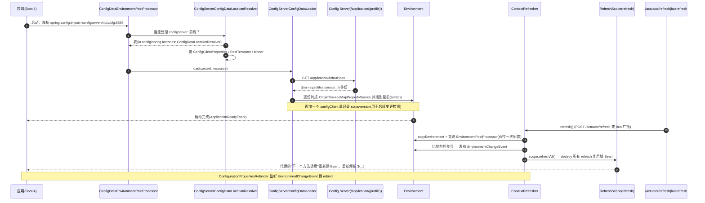

# 05 · 配置中心与 Bus

> **本组定位**：Spring Cloud Config 的**客户端**（拉配置）与 Spring Cloud 的**刷新机制**（`/actuator/refresh`、`ContextRefresher`、`RefreshScope`）以及"刷新怎么广播到整个集群"（Spring Cloud Bus / Nacos 原生推送）。
>
> **源码基线**：`org.springframework.cloud:spring-cloud-context:5.1.0`、`org.springframework.cloud:spring-cloud-config-client:5.1.0`；运行环境 Spring Boot 4.2.0。
>
> **预计阅读**：2 篇 × 50 分钟 ≈ 100 分钟。

---

## 一、学习目标

读完本组，你应该能回答／做到：

| # | 目标 | 验收方式 |
| --- | --- | --- |
| 1 | 说清 Boot 2.4 之后 `bootstrap.yml` 为什么"不管用了"，以及 Boot 4 下 `spring.config.import=configserver:` 的完整调用链 | 能背出 ConfigData → `ConfigServerConfigDataLocationResolver` → `ConfigServerConfigDataLoader` 三段 |
| 2 | 知道 `BootstrapApplicationListener` 在 5.1.0 里**还在**，但默认不生效（`spring.cloud.bootstrap.enabled=false` 且无 legacy 标记） | 能指出 `PropertyUtils#bootstrapEnabled` 的短路逻辑 |
| 3 | 分清 `fail-fast=true` 与 `spring.config.import=optional:configserver:` 的语义差别 | 能各自给出一次启动失败/成功的例子 |
| 4 | 说清"远端配置 vs 本地配置"谁覆盖谁，以及 `spring.cloud.config.override-none` 的作用 | 能画优先级链条 |
| 5 | 说清 `@RefreshScope` 为什么必须是**代理**，不是重新赋值 | 能解释"为什么 `static` 字段、`new` 出来的对象刷不了" |
| 6 | 说清 `@ConfigurationProperties` 刷新走的是另一条路（`ConfigurationPropertiesRebinder`） | 能解释它为什么不依赖代理 |
| 7 | 说清刷新广播的两种方案：Spring Cloud Bus（`RemoteApplicationEvent`）与 Nacos 原生推送 | 能对比两者的依赖、可靠性、坑 |
| 8 | 线上排障：改了配置没生效，能按序定位到"没拉 / 拉了没覆盖 / 覆盖了但 Bean 没重建 / 重建了但字段是静态的" | 见 §6 排障表 |

---

## 二、整体地图：一次"配置拉取 + 刷新"的时序

**读图说明**：

1. **前 7 步是"启动时拉配置"**（对应 [`01-config-client-配置拉取原理.md`](./01-config-client-配置拉取原理.md)）。注意主角是 Boot 的 `ConfigDataEnvironmentPostProcessor`，不是 Spring Cloud 的 `BootstrapApplicationListener`——这是 Boot 2.4 之后最大的认知切换点。
2. **`Res` 阶段**只做"准备工作"：解析 `configserver:` 后面那段 URL 的查询参数（`fail-fast`、`profile`…），并把 `ConfigClientProperties` 注册成 Bean，方便后面被 `@ConfigurationProperties` 绑定。
3. **`Ldr` 阶段**才是真正发 HTTP。它把 Config Server 返回的 JSON 数组转成一个个 `PropertySource`，**倒序插到最前面**（源码里是循环 `add(0, ...)`），于是"最后一个 profile 优先级最高"。
4. **刷新阶段**（对应 [`02-配置刷新-refreshscope与bus.md`](./02-配置刷新-refreshscope与bus.md)）不是"改字段值"，而是"**重建 Environment + 销毁 Bean**"。所以如果你写的 Bean 没走 `refresh` 作用域代理，配置变了它也不会变——第 4 篇的现象 90% 出在这里。
5. 图里 `HK`（`/actuator/refresh`、`/actuator/busrefresh`、Nacos 推送）只是"触发器"，三种触发器最终都落到同一个 `ContextRefresher#refresh()`。

---

## 三、两篇摘要

### 01 [`01-config-client-配置拉取原理.md`](./01-config-client-配置拉取原理.md)

| 关键词 | 一句话 |
| --- | --- |
| `BootstrapApplicationListener` | 5.1.0 里仍然存在，但 `onApplicationEvent` 第一行就 `if (!bootstrapEnabled(env) && !useLegacyProcessing(env)) return;` —— **默认直接返回** |
| `ConfigData` API | Boot 的 `ConfigDataLocationResolver` / `ConfigDataLoader` 两段式 SPI，`configserver:` 前缀由 spring-cloud-config 扩展 |
| `ConfigServicePropertySourceLocator` | 老的 bootstrap 路线用的定位器；`spring.config.import` 路线**不走它**，但它的 `getRemoteEnvironment` 逻辑与 ConfigData 路线基本同构 |
| `fail-fast` vs `optional:` | 一个决定"拉不到就抛"，一个决定"这个 import 可缺失"；两者组合有 4 种结果，见文中表 |
| 覆盖优先级 | 远端默认**低于**本地 `application.yml`？——不，看 `allowOverride/overrideNone/overrideSystemProperties` 三个开关，文中给链条 |

### 02 [`02-配置刷新-refreshscope与bus.md`](./02-配置刷新-refreshscope与bus.md)

| 关键词 | 一句话 |
| --- | --- |
| `ContextRefresher#refresh` | `synchronized`，先 `refreshEnvironment()` 再 `scope.refreshAll()` |
| `ConfigDataContextRefresher` | 5.x 的子类，`updateEnvironment` 会把**所有** `EnvironmentPostProcessor` 重跑一遍（等于再拉一次 Config Server） |
| `RefreshScope` | `name="refresh"`，启动后 eager 初始化所有非懒加载的 refresh Bean |
| `GenericScope` | 真正的代理逻辑：`LockedScopedProxyFactoryBean` 包裹目标 Bean，调用时 `getObject()` 取当前实例，`destroy` 时只清缓存 |
| `@ConfigurationProperties` | 不走代理，靠 `ConfigurationPropertiesRebinder` 监听 `EnvironmentChangeEvent` 主动 rebind |
| Bus | `RemoteApplicationEvent` + `/actuator/busrefresh`；Nacos 原生推送可替代但**语义不同**（无 `RefreshScopeRefreshedEvent`/无事件栅栏） |

---

## 四、前置知识检查点

先自问，答不上来先去补对应文章：

- [ ] Spring 的 `Scope` 是什么？`ScopedProxyFactoryBean` 干什么用？→ [`01-Spring框架/02-AOP与代理`](../../01-Spring框架/)
- [ ] Boot 启动时 `Environment` 是怎么被 `EnvironmentPostProcessor` 增强的？→ [`02-SpringBoot/01-启动原理`](../../02-SpringBoot/01-启动原理/)
- [ ] `@ConfigurationProperties` 的绑定是谁做的？`Binder` 还是 `BeanPostProcessor`？→ [`02-SpringBoot`](../../02-SpringBoot/)
- [ ] Nacos 配置中心的 `dataId/group/namespace` 三元组？（`02-注册中心Nacos` 一篇，由同批其他作者撰写）

---

## 五、读完之后的自检

1. 你在 `pom.xml` 里加了 `spring-cloud-starter-config`，但只写了 `bootstrap.yml`，Boot 4 启动报 `No spring.config.import property has been defined`。**这是哪段代码抛的？想让它变成"可选"该怎么写？**
2. `/actuator/refresh` 返回 `[]`（空数组），说明什么？（提示：`ContextRefresher#changes` 与实际 `Environment` 差异）
3. 同一个类里，`@Value("${a}")` 字段刷新了，`@Value("${b}") static` 字段没刷新。为什么？
4. 你有一台网关 + 20 个服务实例，怎么让第 3 篇讲的 Bus 方案只刷新"订单服务"，而不是全集群？（提示：`RemoteApplicationEvent` 的 `destinationService`）

答案都在两篇正文的 §8 面试高频问与答里。

---

## 六、本组文件清单

| 文件 | 内容 |
| --- | --- |
| `README.md` | 本文件 |
| [`01-config-client-配置拉取原理.md`](./01-config-client-配置拉取原理.md) | ConfigData 路线、`BootstrapApplicationListener` 兼容、fail-fast、优先级 |
| [`02-配置刷新-refreshscope与bus.md`](./02-配置刷新-refreshscope与bus.md) | `ContextRefresher`、`RefreshScope`/`GenericScope` 代理、`ConfigurationPropertiesRebinder`、Bus |

> **相邻分组**：`06-熔断限流与容错`、`07-分布式事务与链路追踪`、`08-Alibaba生态详解`（同属 `04-SpringCloud`，见 [`../README.md`](../README.md) 的子目录表）。
> `01-总览与版本`、`02-注册中心Nacos`、`03-负载均衡与调用`、`04-网关Gateway` 为前置分组，见同一张表。
