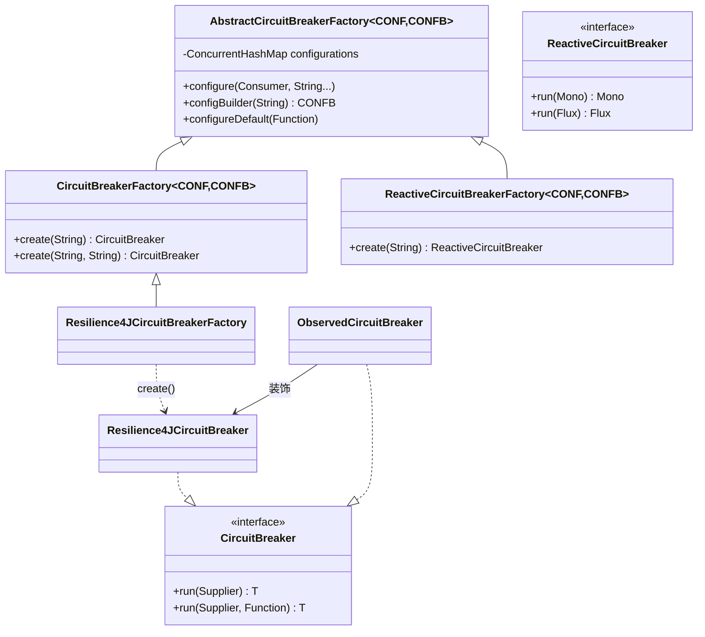
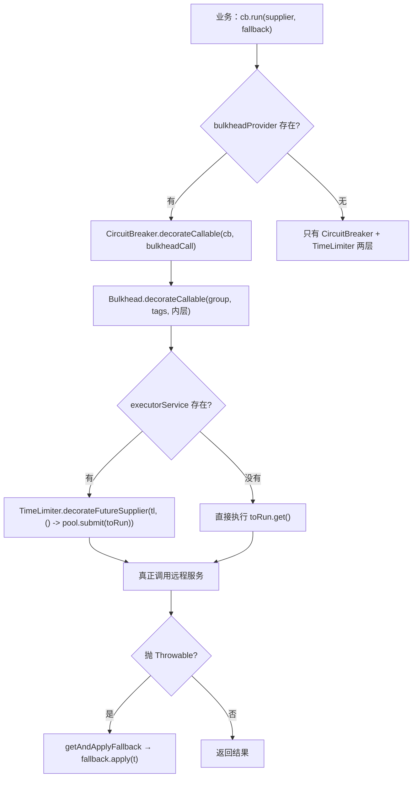
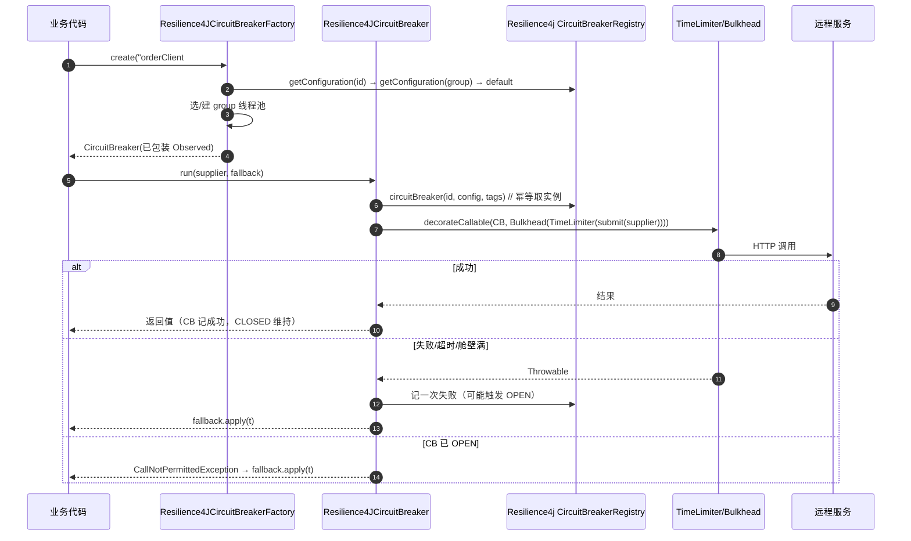
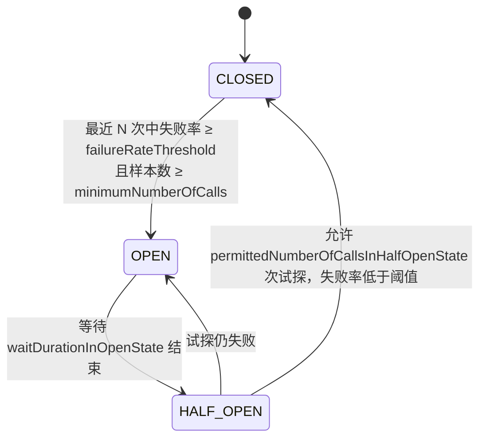

# Spring Cloud 源码精读 06-1：熔断抽象与 Resilience4j 实现

> **一句话结论**：Spring Cloud 的熔断是"**一个抽象 + 多个实现**"：业务代码只依赖 `CircuitBreakerFactory` → `CircuitBreaker#run(Supplier, fallback)` 这两个接口，底层换成 Resilience4j 还是 Sentinel 都不改代码；Resilience4j 实现里真正执行的是"**TimeLimiter（超时）→ Bulkhead（舱壁）→ CircuitBreaker（熔断）**"三层装饰器的洋葱包裹，最后任何 `Throwable` 都会落到你给的 `fallback` 函数。
>
> **阅读前置**：读过 [`05-配置中心与Bus`](../05-配置中心与Bus/README.md)（知道 Spring Cloud 的自动配置套路）、[`01-Spring框架/02-AOP与代理`](../../01-Spring框架/)（知道 AOP 代理与 `MethodInterceptor`）。会写 `Supplier` / `Function` lambda。
>
> **预计阅读**：55 分钟。
>
> **源码基线**：`org.springframework.cloud:spring-cloud-commons:5.1.0`（抽象层）、`org.springframework.cloud:spring-cloud-circuitbreaker-resilience4j:5.1.0`（实现层）。

---

## 0. 先看现象

| 现象 | 你可能的第一反应 | 真正常见的原因 |
| --- | --- | --- |
| 服务 B 挂了，A 的接口全部 500，而且日志刷屏 | "熔断没开" | 熔断**只包住了你写进 `run()` 的那段**；被 `@FeignClient` 直接调用的方法不一定经过 `CircuitBreaker` |
| 开了熔断，但请求还是等 30 秒才失败 | "熔断阈值没用" | `TimeLimiter` 的默认超时是 **1 秒**，但如果你 `disable-thread-pool: true`，超时器就不生效了 |
| 加了一个 `fallback`，结果异常被"吃掉"了，监控没告警 | "fallback 有 bug" | `getAndApplyFallback` 是 `catch (Throwable t)`，**连 `Error` 都会被吞**，必须自己上报 |
| 服务本来就慢，加了熔断后上游 QPS 翻了三倍 | "熔断有 bug" | 你把 **Retry** 叠在 CircuitBreaker 内层，一次失败重试 3 次 → 熔断统计快速打满 → 更快 OPEN → 更多重试 |
| 日志 `No timeLimiterConfig found for 'xxx' in time limiter registry` | "配置写错了" | 这条是 **WARN** 级别，说明你在用默认 `1s` 超时，几乎肯定要显式配 |
| `BlockingCircuitBreakerFactory` 编译不过 | "依赖少了" | 这个类**在 5.1.0 中不存在**，见 §7 版本差异 |

本篇把上面每一条都对应回源码。

---

## 1. 整体地图

### 1.1 类型关系



**读图说明**：

1. **左边是"造熔断器"，右边是"用熔断器"**。`*Factory` 是"工厂"（`create(id)`），`CircuitBreaker` 是"执行器"（`run()`）。业务代码一般只用后者，框架代码（Feign / `@HttpExchange` / Gateway）用前者。
2. `AbstractCircuitBreakerFactory` 存了 `id → 配置` 的 `ConcurrentHashMap`，并提供 `configure(...)` 让用户按 id 定制——这就是 `Customizer<CircuitBreakerFactory>` 的落点。
3. `ReactiveCircuitBreaker` 是**独立的一套接口**（返回 `Mono`/`Flux`），但它和 `CircuitBreakerFactory` 共享同一个配置基类，因此 `configure(...)` 的写法在两边一致。
4. `ObservedCircuitBreaker` 是"装饰器"：一旦容器里有 `ObservationRegistry`（Boot 4 默认有），工厂就会把普通 `CircuitBreaker` 包一层，**在熔断调用外面再开一个 Observation（= 指标 + 追踪）**。这一层由 `Resilience4JAutoConfiguration` 里的 `ObservationRegistryCustomizerResilience4jCustomizer` 注入。

### 1.2 一次 `run()` 的洋葱结构



**读图说明**：

1. **装饰顺序 = 从内往外**：`toRun` 最内层是"真正的远程调用"；`TimeLimiter` 用它决定"多久算超时"（必须异步才能中断，所以要看有没有 `executorService`）；`Bulkhead` 限制并发；`CircuitBreaker` **最外层**统计成功率并决定"放不放行"。
2. **为什么 CircuitBreaker 放最外层**：如果它在内层，被 Bulkhead 拒绝的请求就不会被统计成失败；放最外层能保证"所有失败都会计入熔断统计"（包括舱壁拒绝、超时）。
3. `executorService == null` 这条分支（图中 `E -- 没有`）就是 `disableThreadPool=true` 的路径——此时**没有 TimeLimiter**，只有 `CircuitBreaker.decorateSupplier`。这是"超时不生效"的根因。
4. 最外面还有一层"不在图里"的 `ObservedCircuitBreaker`（如果有 `ObservationRegistry`），它套在整个 `Resilience4JCircuitBreaker#run` 外面。

---

## 2. 关键类逐个拆

| 类 | 包 | 职责 | 一句话记忆 |
| --- | --- | --- | --- |
| `CircuitBreaker` | `spring-cloud-commons` `client.circuitbreaker` | 命令式熔断执行接口：`run(Supplier, Function)` | "我要执行这段，失败给我兜底" |
| `ReactiveCircuitBreaker` | 同上 | 响应式版：`run(Mono)` / `run(Flux)` | 同上，只是 `Mono/Flux` |
| `AbstractCircuitBreakerFactory` | 同上 | 配置容器 + `configure(consumer, ids...)` | "按 id 定制" |
| `CircuitBreakerFactory` | 同上 | 抽象工厂：`create(id)` / `create(id, groupName)` | "给我一个熔断器" |
| `ReactiveCircuitBreakerFactory` | 同上 | 响应式工厂 | 同上 |
| `CircuitBreakerAdapterDecorator` | `client.circuitbreaker.httpservice` | 给 `@HttpExchange` 接口自动套熔断（Boot 4 的声明式 HTTP 客户端） | "不用 Feign 也能熔断" |
| `Resilience4JCircuitBreaker` | `circuitbreaker.resilience4j` | 真正干活：TimeLimiter + Bulkhead + CB 三层装饰 | "洋葱" |
| `Resilience4JCircuitBreakerFactory` | 同上 | 组装配置：配置查找（id → group → default）、线程池、Observation | "配置三级回退" |
| `Resilience4JAutoConfiguration` | 同上 | 自动配置：注册工厂 Bean、Bulkhead、Micrometer、Observation | "装配总闸" |

> ⚠️ **注意**：任务描述里提到的 `BlockingCircuitBreakerFactory` 在 `spring-cloud-commons:5.1.0` 中**不存在**（已用 `list-jar` 核实），真正的命令式工厂就是上面的 `CircuitBreakerFactory`。详见 §7。

---

## 3. 源码逐段精读

### 3.1 抽象层：`CircuitBreaker` 只有两个方法

```java (src: CircuitBreaker.java#L29-L39)
public interface CircuitBreaker {

	default <T> T run(Supplier<T> toRun) {
		return run(toRun, throwable -> {
			throw new NoFallbackAvailableException("No fallback available.", throwable);
		});
	}

	<T> T run(Supplier<T> toRun, Function<@Nullable Throwable, T> fallback);

}
```

**在干什么**：只有一个"必须实现"的方法 `run(Supplier, Function)`；另一个是便捷重载，默认把失败包装成 `NoFallbackAvailableException` 抛出。

**为什么**：这是"最小接口"原则。Spring Cloud 想支持 Resilience4j / Sentinel / Spring Retry 多种实现，接口越小越好实现。`Supplier` 而不是 `Callable`，是为了**不强制你处理受检异常**——代价是 `toRun` 里不能直接 `throw` 受检异常（要包一层）。

**改别的会怎样**：如果把 `run` 设计成 `run(Supplier, Supplier)`（fallback 也拿不到异常），你就无法根据异常类型做差异化降级（超时回缓存、业务异常回默认值），所以这里必须是 `Function<Throwable, T>`。

**常见坑**：
- `throwable` 可能是 `null`？签名上 `@Nullable Throwable` 说明**理论允许 null**（比如某些实现的取消/中断路径），你的 fallback 里别直接 `t.getMessage()`。
- `NoFallbackAvailableException` 不是 `RuntimeException` 的子类之外的特殊类型，它继承 `NestedRuntimeException`，`@Transactional` 的回滚规则里要显式包含它。

### 3.2 工厂：`configure` 的按 id 定制

```java (src: AbstractCircuitBreakerFactory.java#L28-L45)
public abstract class AbstractCircuitBreakerFactory<CONF, CONFB extends ConfigBuilder<CONF>> {

	private final ConcurrentHashMap<String, CONF> configurations = new ConcurrentHashMap<>();

	/**
	 * Adds configurations for circuit breakers.
	 * @param ids The id of the circuit breaker
	 * @param consumer A configuration builder consumer, allows consumers to customize the
	 * builder before the configuration is built
	 */
	public void configure(Consumer<CONFB> consumer, String... ids) {
		for (String id : ids) {
			CONFB builder = configBuilder(id);
			consumer.accept(builder);
			CONF conf = builder.build();
			getConfigurations().put(id, conf);
		}
	}
```

**在干什么**：对每个 `id`：`configBuilder(id)` 造一个 builder → 用户 `consumer` 改它 → `build()` 成不可变配置 → 存进 map。

**为什么用 `Consumer<CONFB>` 而不是直接传配置对象**：`ConfigBuilder` 是**可变 builder**，用 `Consumer` 可以在 `build()` 之前做任意链式设置，且框架不需要知道有哪些字段。这是典型的"构建者 + 回调"组合。

**改别的会怎样**：如果不 `build()` 而是直接存 builder，用户后续再改 builder 会影响已创建的熔断器——`build()` 就是"快照"边界。

**常见坑**：`configure(...)` **必须在 `create(id)` 之前调用**（或被 `Customizer<CircuitBreakerFactory>` 在启动时调用）。运行时再 `configure` 只影响**之后**新建的熔断器，已在 `CircuitBreakerRegistry` 里注册的实例不会变。

```java (src: CircuitBreakerFactory.java#L25-L34)
public abstract class CircuitBreakerFactory<CONF, CONFB extends ConfigBuilder<CONF>>
		extends AbstractCircuitBreakerFactory<CONF, CONFB> {

	public abstract CircuitBreaker create(String id);

	public CircuitBreaker create(String id, String groupName) {
		return create(id);
	}

}
```

**在干什么**：默认 `create(id, groupName)` **忽略 groupName**，直接退化成 `create(id)`。

**为什么**：不是所有实现都支持"分组"（把一个服务的所有方法归到一组统计）。Resilience4j 实现**重写了**这个方法去用 group 的线程池与配置（见 3.4）。

**改别的会怎样**：如果抽象层就把 `groupName` 拼进 id（如 `id = service + ":" + method`），那所有实现都会"看起来支持 group"，但语义各异，反而更乱——所以选择"默认忽略，实现自定"。

**常见坑**：`Feign` 集成里 id 通常是 `FeignClientName + "#" + methodName`，groupName 是"服务名"。**只配 group 级配置时**，`resilience4j.circuitbreaker.configs.<group>` 才会被命中；配到 `instances.<id>` 优先级更高。这个三级回退在 3.4 的源码里能看到。

### 3.3 响应式：`ReactiveCircuitBreaker` 是另一套接口

```java (src: ReactiveCircuitBreaker.java#L29-L45)
public interface ReactiveCircuitBreaker {

	default <T> Mono<T> run(Mono<T> toRun) {
		return run(toRun, throwable -> {
			throw new NoFallbackAvailableException("No fallback available.", throwable);
		});
	}

	<T> Mono<T> run(Mono<T> toRun, Function<Throwable, Mono<T>> fallback);

	default <T> Flux<T> run(Flux<T> toRun) {
		return run(toRun, throwable -> {
			throw new NoFallbackAvailableException("No fallback available.", throwable);
		});
	}

	<T> Flux<T> run(Flux<T> toRun, Function<Throwable, Flux<T>> fallback);
```

**在干什么**：与命令式完全对称，但 fallback 返回 `Mono<T>`/`Flux<T>` 而不是 `T`。

**为什么**：命令式 fallback 是"值"，响应式 fallback 必须是"另一个流"，否则无法参与背压与订阅链。

**改别的会怎样**：如果用 `onErrorResume` 简单实现（不经过熔断器统计），是**最常见的错误实现**——`ReactiveCircuitBreaker` 实现里必须把 `Mono` 的订阅"融进"熔断状态机，否则永远是 CLOSED。

**常见坑**：`Flux` 特别容易犯"重试放大"的错：`flux.retry(3)` 会让**一次订阅**产生 4 次下游调用，而熔断器只看到 1 次"成功/失败"（取决于你放在哪一层）。正确顺序是 **retry 在外、熔断在内**。

### 3.4 实现层：`Resilience4JCircuitBreaker#run` 的洋葱

```java (src: Resilience4JCircuitBreaker.java#L97-L141)
	@Override
	public <T> T run(Supplier<T> toRun, Function<@Nullable Throwable, T> fallback) {
		final Map<String, String> tags = Map.of(CIRCUIT_BREAKER_GROUP_TAG, this.groupName);
		Optional<TimeLimiter> timeLimiter = loadTimeLimiter();
		io.github.resilience4j.circuitbreaker.CircuitBreaker defaultCircuitBreaker = registry.circuitBreaker(this.id,
				this.circuitBreakerConfig, tags);
		circuitBreakerCustomizer.ifPresent(customizer -> customizer.customize(defaultCircuitBreaker));
		if (bulkheadProvider != null) {

			if (executorService != null) {
				Supplier<Future<T>> futureSupplier = () -> executorService.submit(toRun::get);
				/* conditionally wrap in time-limiter */
				Callable<T> timeLimitedCall = timeLimiter
					.map(tl -> TimeLimiter.decorateFutureSupplier(tl, futureSupplier))
					.orElse(() -> futureSupplier.get().get());
				Callable<T> bulkheadCall = bulkheadProvider.decorateCallable(this.groupName, tags, timeLimitedCall);
				Callable<T> circuitBreakerCall = io.github.resilience4j.circuitbreaker.CircuitBreaker
					.decorateCallable(defaultCircuitBreaker, bulkheadCall);
				return getAndApplyFallback(circuitBreakerCall, fallback);
			}
			else {
				Callable<T> bulkheadCall = bulkheadProvider.decorateCallable(this.groupName, tags, toRun::get);
				Callable<T> circuitBreakerCall = io.github.resilience4j.circuitbreaker.CircuitBreaker
					.decorateCallable(defaultCircuitBreaker, bulkheadCall);
				return getAndApplyFallback(circuitBreakerCall, fallback);
			}
		}
		else {
			if (executorService != null) {
				Supplier<Future<T>> futureSupplier = () -> executorService.submit(toRun::get);
				/* conditionally wrap in time-limiter */
				Callable<T> restrictedCall = timeLimiter
					.map(tl -> TimeLimiter.decorateFutureSupplier(tl, futureSupplier))
					.orElse(() -> futureSupplier.get().get());
				Callable<T> callable = io.github.resilience4j.circuitbreaker.CircuitBreaker
					.decorateCallable(defaultCircuitBreaker, restrictedCall);
				return getAndApplyFallback(callable, fallback);
			}
			else {
				Supplier<T> decorator = io.github.resilience4j.circuitbreaker.CircuitBreaker
					.decorateSupplier(defaultCircuitBreaker, toRun);
				return getAndApplyFallback(decorator, fallback);
			}
		}
	}
```

**在干什么**：4 个分支 = `bulkhead 有/无` × `线程池 有/无`。每个分支都把"用户代码 (`toRun`)"一层层包起来，最外层调用 `getAndApplyFallback` 捕获 `Throwable` 并转成 fallback 结果。

**为什么**：
- `registry.circuitBreaker(id, config, tags)` 是**幂等获取**：同一个 id 反复调用拿到的是同一个 `CircuitBreaker` 实例，所以状态（CLOSED/OPEN）是跨请求共享的。这是熔断能"记住"失败率的前提。
- `timeLimiter.map(...)` 的 `orElse(() -> future.get().get())` 是"没有超时器就退化为阻塞等"，所以**必须有线程池**才能用 `TimeLimiter`。
- `TimeLimiter.decorateFutureSupplier(tl, futureSupplier)` 会在超时时 **`future.cancel(true)`** 中断线程——这要求被调用的代码响应中断，否则线程还是"卡着"。所以"超时"在 HTTP 客户端这一层（连接/读超时）配置才是根本，TimeLimiter 只是保险。

**改别的会怎样**：如果只包 `CircuitBreaker.decorateSupplier(cb, toRun)`（就是最后一个 else 分支），那**没有并发限制、没有超时**，一个慢依赖能拖垮整个线程池——熔断器只能"事后不开门"，不能"事前不进去"。

**常见坑**：
- 走 `executorService` 分支时，`fallback` 若返回一个对象，调用线程是**原来的请求线程**（`future.get()` 阻塞返回），并不是异步——不要以为"有线程池 == 异步"。
- `bulkheadProvider.decorateCallable(groupName, ...)` 用的是 **groupName**，也就是说**同一个服务的所有方法共享一个舱壁**。这通常是你想要的，但如果你给两套不同 SLA 的接口配同一个 group，它们会互相抢并发。
- 抛出 `Error`（如 `OutOfMemoryError`）也会被 `getAndApplyFallback` 吞掉转成 fallback，生产上要警惕。

### 3.5 fallback 的唯一出口

```java (src: Resilience4JCircuitBreaker.java#L143-L159)
	private static <T> T getAndApplyFallback(Supplier<T> supplier, Function<@Nullable Throwable, T> fallback) {
		try {
			return supplier.get();
		}
		catch (Throwable t) {
			return fallback.apply(t);
		}
	}

	private static <T> T getAndApplyFallback(Callable<T> callable, Function<@Nullable Throwable, T> fallback) {
		try {
			return callable.call();
		}
		catch (Throwable t) {
			return fallback.apply(t);
		}
	}
```

**在干什么**：`catch (Throwable)` —— **所有**异常（含 `Error`、含 `InterruptedException`、含 `CallNotPermittedException`）都进 fallback。

**为什么**："熔断打开时"抛出的 `CallNotPermittedException` 必须也走 fallback，否则熔断一开，用户就看到 500 而不是降级数据。用 `Throwable` 是为了不漏掉 `Error` 型的中断（如 `TimeoutException` 的子类）。

**改别的会怎样**：如果改成 `catch (Exception)`，那么 `CallNotPermittedException`（继承 `RuntimeException`，还是会被捕获）没问题，但 `Error` 会被漏出——这大概是更"正确"的工程选择，但会破坏"fallback 一定兜底"的承诺。

**常见坑**：**fallback 里的异常会原样抛给调用方**（这里没有二次 try/catch）。所以 fallback 必须极简（返回缓存/默认值），不要在里面再发远程调用。

### 3.6 工厂的"配置三级回退"

```java (src: Resilience4JCircuitBreakerFactory.java#L177-L213)
	private Resilience4JCircuitBreaker create(String id, String groupName,
			ExecutorService circuitBreakerExecutorService) {
		Resilience4JConfigBuilder.Resilience4JCircuitBreakerConfiguration defaultConfig = getConfigurations()
			.computeIfAbsent(id, defaultConfiguration);
		CircuitBreakerConfig circuitBreakerConfig = this.circuitBreakerRegistry.getConfiguration(id)
			.orElseGet(() -> this.circuitBreakerRegistry.getConfiguration(groupName)
				.orElseGet(defaultConfig::getCircuitBreakerConfig));
		TimeLimiterConfig timeLimiterConfig = this.timeLimiterRegistry.getConfiguration(id)
			.orElseGet(() -> this.timeLimiterRegistry.getConfiguration(groupName).orElseGet(() -> {
				TimeLimiterConfig defaultTimeLimiterConfig = defaultConfig.getTimeLimiterConfig();
				if (loggedTimeLimiterIds.add(id)) {
					boolean hasUserDefault = this.timeLimiterRegistry.getConfiguration("default").isPresent();
					if (hasUserDefault) {
						LOG.debug("No specific timeLimiterConfig found for '" + id
								+ "' in time limiter registry, using default config: " + defaultTimeLimiterConfig);
					}
					else {
						LOG.warn("No timeLimiterConfig found for '" + id + "' in time limiter registry, using "
								+ defaultTimeLimiterConfig);
					}
				}
				return defaultTimeLimiterConfig;
			}));
		if (resilience4JConfigurationProperties.isDisableThreadPool()) {
			return new Resilience4JCircuitBreaker(id, groupName, circuitBreakerConfig, timeLimiterConfig,
					circuitBreakerRegistry, timeLimiterRegistry, Optional.ofNullable(circuitBreakerCustomizers.get(id)),
					bulkheadProvider);
		}
		else {
			boolean isDisableTimeLimiter = ConfigurationPropertiesUtils
				.isDisableTimeLimiter(this.resilience4JConfigurationProperties, id, groupName);
			return new Resilience4JCircuitBreaker(id, groupName, circuitBreakerConfig, timeLimiterConfig,
					circuitBreakerRegistry, timeLimiterRegistry, circuitBreakerExecutorService,
					Optional.ofNullable(circuitBreakerCustomizers.get(id)), bulkheadProvider, isDisableTimeLimiter);
		}

	}
```

**在干什么**：
1. 配置查找顺序 `id` → `groupName` → 默认；
2. 找不到 TimeLimiter 配置时打**一次**日志（`loggedTimeLimiterIds` 去重）；用户没配 `default` 时升级为 WARN；
3. 根据 `disable-thread-pool` 决定给不给 `executorService`（决定 TimeLimiter 能不能用）；
4. 再算 `isDisableTimeLimiter`（按 id/group 单独关闭），传给构造器。

**为什么**：这就是 Resilience4j 的"三级配置模型"在 Spring Cloud 里的落地：`instances.<id>` > `configs.<group>` > `default`。日志降噪（只打一次）很重要，否则每次请求都 WARN。

**改别的会怎样**：如果直接 `registry.circuitBreaker(id)` 不传 config，就会静默用 `default`，用户"配了但没生效"将毫无线索——那条 WARN 就是给这种情况准备的。

**常见坑**：`getConfigurations().computeIfAbsent(id, defaultConfiguration)` —— 你在 `configureDefault(...)` 之后改 `defaultConfiguration`，**只会影响后续新 id**，已有 id 已被缓存。

> 说明：上面这段源码里 `ConfigurationPropertiesUtils.isDisableTimeLimiter(...)` 的具体实现未入库，本文不展开其内部行号；只按 `Resilience4JCircuitBreaker#loadTimeLimiter` 的 `disableTimeLimiter` 字段说明效果。

```java (src: Resilience4JCircuitBreaker.java#L161-L168)
	private Optional<TimeLimiter> loadTimeLimiter() {
		if (disableTimeLimiter) {
			return Optional.empty();
		}
		return Optional.of(this.timeLimiterRegistry.find(this.id)
			.orElseGet(() -> this.timeLimiterRegistry.find(this.groupName)
				.orElseGet(() -> this.timeLimiterRegistry.timeLimiter(this.id, this.timeLimiterConfig, this.tags))));
	}
```

**在干什么**：`disableTimeLimiter` 为真直接返回空；否则同样按 `id` → `groupName` → 新建 三级查找 `TimeLimiter`。

**为什么**：`registry.find(id)` 只找**已注册**的实例。如果用户通过 `Customizer<TimeLimiterRegistry>` 注册过 `id` 对应的 `TimeLimiter`，这里就能复用（保留其内部状态/指标）。

**常见坑**：`timeLimiter(id, config, tags)` 创建时不带 `cancelRunningFuture` 语义设置——`cancelRunningFuture` 在 `TimeLimiterConfig` 里，默认 `true`。

### 3.7 自动配置总闸

```java (src: Resilience4JAutoConfiguration.java#L57-L77)
@Configuration(proxyBeanMethods = false)
@EnableConfigurationProperties(Resilience4JConfigurationProperties.class)
@ConditionalOnProperty(name = { "spring.cloud.circuitbreaker.resilience4j.enabled",
		"spring.cloud.circuitbreaker.resilience4j.blocking.enabled" }, matchIfMissing = true)
@AutoConfigureAfter(CircuitBreakerMetricsAutoConfiguration.class)
public class Resilience4JAutoConfiguration {

	@Autowired(required = false)
	private List<Customizer<Resilience4JCircuitBreakerFactory>> customizers = new ArrayList<>();

	@Bean
	@ConditionalOnMissingBean(CircuitBreakerFactory.class)
	public Resilience4JCircuitBreakerFactory resilience4jCircuitBreakerFactory(
			CircuitBreakerRegistry circuitBreakerRegistry, TimeLimiterRegistry timeLimiterRegistry,
			@Autowired(required = false) @Nullable Resilience4jBulkheadProvider bulkheadProvider,
			Resilience4JConfigurationProperties resilience4JConfigurationProperties) {
		Resilience4JCircuitBreakerFactory factory = new Resilience4JCircuitBreakerFactory(circuitBreakerRegistry,
				timeLimiterRegistry, bulkheadProvider, resilience4JConfigurationProperties);
		customizers.forEach(customizer -> customizer.customize(factory));
		return factory;
	}
```

**在干什么**：`matchIfMissing = true` 表示**默认开启**；两个属性名任一为 `false` 即关闭（历史兼容）。`@ConditionalOnMissingBean(CircuitBreakerFactory.class)` 意味着**你自己定义工厂就会顶掉它**——这也是"切到 Sentinel"的方式之一。

**为什么**：`@AutoConfigureAfter(CircuitBreakerMetricsAutoConfiguration.class)` 是为了让 Micrometer 的 `CircuitBreakerRegistry` 先建好（它带指标装饰）。

**常见坑**：`Resilience4JConfigurationProperties` 前缀是 `spring.cloud.circuitbreaker.resilience4j`，`disable-thread-pool` 就在这里。它和 Resilience4j 自己的 `resilience4j.circuitbreaker.*` **是两套配置**，别写错前缀。

```java (src: Resilience4JAutoConfiguration.java#L124-L160)
	@Configuration(proxyBeanMethods = false)
	@ConditionalOnBean({ MeterRegistry.class })
	@ConditionalOnClass(name = { "io.github.resilience4j.micrometer.tagged.TaggedCircuitBreakerMetrics",
			"io.github.resilience4j.micrometer.tagged.TaggedCircuitBreakerMetricsPublisher" })
	@ConditionalOnMissingBean({ TaggedCircuitBreakerMetricsPublisher.class })
	public static class MicrometerResilience4JCustomizerConfiguration {

		@Autowired(required = false)
		private @Nullable Resilience4JCircuitBreakerFactory factory;

		@Autowired(required = false)
		private @Nullable Resilience4jBulkheadProvider bulkheadProvider;

		@Autowired(required = false)
		private @Nullable TaggedCircuitBreakerMetrics taggedCircuitBreakerMetrics;

		@Autowired
		private MeterRegistry meterRegistry;

		@PostConstruct
		public void init() {
			if (factory != null) {
				if (taggedCircuitBreakerMetrics == null) {
					taggedCircuitBreakerMetrics = TaggedCircuitBreakerMetrics
						.ofCircuitBreakerRegistry(factory.getCircuitBreakerRegistry());
				}
				taggedCircuitBreakerMetrics.bindTo(meterRegistry);
			}
			if (bulkheadProvider != null) {
				TaggedBulkheadMetrics.ofBulkheadRegistry(bulkheadProvider.getBulkheadRegistry()).bindTo(meterRegistry);
				TaggedThreadPoolBulkheadMetrics
					.ofThreadPoolBulkheadRegistry(bulkheadProvider.getThreadPoolBulkheadRegistry())
					.bindTo(meterRegistry);
			}
		}

	}
```

**在干什么**：把 `CircuitBreakerRegistry` / `BulkheadRegistry` / `ThreadPoolBulkheadRegistry` 里的所有实例绑定到 Micrometer，于是你有了 `resilience4j_circuitbreaker_state`、`resilience4j_circuitbreaker_calls`、`resilience4j_bulkhead_available_concurrent_calls` 等指标。

**为什么**：熔断是"不可见的策略"，没有指标就无法调参。用 `@PostConstruct` 而不是 `@Bean`，是因为它只想"绑定一次"，不需要暴露新 Bean。

**常见坑**：如果该配置类的 `@ConditionalOnMissingBean(TaggedCircuitBreakerMetricsPublisher.class)` 被你的自定义 publisher 命中，就不会绑定默认指标——"为什么没有 resilience4j 指标"多半是这个。

### 3.8 声明式：`@HttpExchange` 也能自动熔断

```java (src: CircuitBreakerAdapterDecorator.java#L57-L80)
public class CircuitBreakerAdapterDecorator extends HttpExchangeAdapterDecorator {

	private static final Log LOG = LogFactory.getLog(CircuitBreakerAdapterDecorator.class);

	private final CircuitBreaker circuitBreaker;

	private final Map<String, Class<?>> fallbackClasses;

	private volatile Map<String, Object> fallbackProxies;

	public CircuitBreakerAdapterDecorator(HttpExchangeAdapter delegate, CircuitBreaker circuitBreaker,
			Map<String, Class<?>> fallbackClasses) {
		super(delegate);
		this.circuitBreaker = circuitBreaker;
		this.fallbackClasses = fallbackClasses;
	}

	@Override
	public void exchange(HttpRequestValues requestValues) {
		circuitBreaker.run(() -> {
			super.exchange(requestValues);
			return null;
		}, createFallbackHandler(requestValues));
	}
```

**在干什么**：Boot 4 的声明式 HTTP 客户端（`@HttpExchange`）走 `HttpExchangeAdapter`，这个装饰器把**每个 adapter 调用**包进 `circuitBreaker.run(...)`，fallback 由 `fallbackClasses` 里声明的类（`@HttpServiceFallback`）生成代理。

**为什么**：Boot 4 把 `@HttpExchange` 客户端作为 Feign 的替代品，Spring Cloud 必须给出对等能力。用 `HttpExchangeAdapterDecorator` 而不是 AOP，是因为 adapter 本身就是"所有调用的唯一入口"，装饰器更精准。

**常见坑**：`fallback` 类与方法**必须 `public`**（源码 Javadoc L49-L50 明说），且方法签名匹配规则是"同名同参数"或"同名同参数 + 前导 `Throwable`"——签名不对就静默找不到，最后把原始异常抛出去。

---

## 4. 一次完整执行时序



**读图说明**：

1. **第 2~4 步是"造熔断器"**，通常发生在 Feign 客户端第一次被调用或启动时；`create` 之后熔断器实例就住在 `CircuitBreakerRegistry` 里，跨请求共享状态。
2. **第 6 步 `circuitBreaker(id, config, tags)` 是幂等的**——每次 `run` 都调用，但拿回同一个实例。所以千万不要以为 `run` 每次都新建熔断器。
3. **第 7 步的装饰顺序**（CB 在外、Bulkhead 中、TimeLimiter 内）决定了统计口径：超时、舱壁拒绝都算失败。
4. **`alt` 三个分支**分别对应 CLOSED 成功、CLOSED 失败、OPEN 短路。第三个分支里 `toRun` **根本没有被执行**，你的日志里看不到"请求出去了"，这是判断"是不是熔断打开"的关键特征。

### CLOSED / OPEN / HALF_OPEN 三态判定



**读图说明**：

1. **CLOSED → OPEN 的判定是"滑动窗口 + 最小样本量"**：Resilience4j 默认 `slidingWindowType=COUNT_BASED`、`slidingWindowSize=100`、`minimumNumberOfCalls=100`、`failureRateThreshold=50`。也就是说**前 100 次调用里失败率过半才开**——如果 QPS 只有 1，要等 100 秒，这时候"熔断没开"其实是样本不够。
2. **OPEN 是"时间窗"**：`waitDurationInOpenState` 默认 **60 秒**。这段时间里所有请求都直接 `CallNotPermittedException`，不会真的打到下游。
3. **HALF_OPEN 是"试探"**：只放 `permittedNumberOfCallsInHalfOpenState`（默认 10）个请求通过，用这 10 个的失败率决定是回 CLOSED 还是回 OPEN。所以"HALF_OPEN 时下游还没恢复"会被立刻打回 OPEN，形成"每 60 秒锤一次"的节奏。
4. Resilience4j 另有两个把"慢"当失败的口子：`slowCallRateThreshold`（慢调用比例阈值）与 `slowCallDurationThreshold`（多慢算慢，默认 60s）。**只配"异常率"不配"慢调用"是很常见的漏配**。

---

## 5. 设计模式与取舍

| 模式/机制 | 出现在哪 | 解决什么 | 代价 |
| --- | --- | --- | --- |
| 抽象工厂 | `CircuitBreakerFactory#create` | 屏蔽底层实现（R4j/Sentinel） | 抽象层只能暴露共性，R4j 独有能力要用 `Customizer` 兜 |
| 装饰器（洋葱） | `CircuitBreaker.decorateCallable`、`Bulkhead/TimeLimiter.decorate*` | 组合"超时 + 舱壁 + 熔断" | 顺序错一层，语义全变（重试放大就是典型） |
| 构建者 + 回调 | `configure(Consumer<CONFB>, ids...)` | 不改框架代码即可定制 | 配置在 `build()` 时快照，运行时改不生效 |
| 缓存/幂等获取 | `registry.circuitBreaker(id, ...)` | 熔断状态跨请求共享 | id 命名一旦不稳定（含随机数/时间），永远不会熔断 |
| 条件装配 | `@ConditionalOnMissingBean(CircuitBreakerFactory.class)` | 一行自定义 Bean 就能换实现 | 两个实现同时在 classpath 时行为取决于装配顺序 |
| 观察者/装饰 | `ObservedCircuitBreaker` + `ObservationRegistry` | 熔断调用自动带指标 + trace | 多一层包装，栈更深 |

**核心取舍：熔断、限流、重试、舱壁不是"四个开关"，而是一条链**。四者的正确嵌套顺序（从内到外通常建议）：

```
限流(网关/Sentinel)  →  熔断  →  舱壁  →  超时  →  重试(最内, 且只对幂等)
```

但 Spring Cloud 的 `Resilience4JCircuitBreaker` 把 **超时放在最内层、熔断在最外层**（见 3.4），并且**不自带 Retry**——Retry 由 `spring-retry` 或 Feign 的 `Retryer` 提供，如果你在外面再套 `@Retry`，就变成了 `Retry(CircuitBreaker(Timeout(call)))`：**每次重试都会经过熔断器**，一次请求最多产生 `1+retries` 次熔断统计。

---

## 6. 踩坑与调试手法

### 6.1 四个高频坑

| 坑 | 现象 | 根因 | 处置 |
| --- | --- | --- | --- |
| ✅坑1 重试放大流量 | 依赖抖动时，下游 QPS 反升、熔断更快 OPEN | `Retry` 在 `CircuitBreaker` 外层，一次业务请求变 N 次下游调用 | 优先用"一次调用 + 快速失败 + 缓存兜底"；确需重试则只对幂等读接口、限制 `maxAttempts=2`、加退避 |
| ✅坑2 `disable-thread-pool: true` | `TimeLimiter` 配置了也不生效 | `loadTimeLimiter` 里 `disableTimeLimiter`/无 `executorService` 双保险都会绕过超时 | 保持线程池开启，并把 `read-timeout` 也配上（HTTP 层才是根本） |
| ✅坑3 熔断开得太慢 | 下游已经雪崩，熔断迟迟不开 | `minimumNumberOfCalls` 默认 100，低 QPS 下永远攒不够样本 | 按 QPS 调小 `slidingWindowSize`/`minimumNumberOfCalls`（如 20/10），并配 `slowCallRateThreshold` |
| ✅坑4 fallback 吞异常 | 监控无告警，故障静默 | `catch (Throwable)` 全兜 | fallback 内**必须**打日志 + 打点（`MeterRegistry.counter("fallback.total", "cb", id)`），并只返回可接受的降级值 |

### 6.2 组合陷阱：一个"重试 → 熔断"的真实数字

假设：下游正常 50ms，抖动期 2s 超时率 100%；上游 `@Retry(maxAttempts=3)` 在 `CircuitBreaker` 外层，`TimeLimiter=1s`。

| 阶段 | 一次业务请求 | 下游收到的调用数 | 线程占用 |
| --- | --- | --- | --- |
| 抖动前 | 1 次（<1s） | 1 | 50ms |
| 抖动开始 | 3 次，每次 1s 超时 → 共 3s | 3 | 3s（**放大 3 倍**） |
| 累计 100 次失败后 | 熔断 OPEN | 3 次重试都被 `CallNotPermittedException` 快速拒绝 | ~0（好） |
| 60s 后 HALF_OPEN | 放 10 个，每个还是 3 次重试 | 30 次 | 3s×10 |

结论：**重试把"熔断打开前的时间窗"里的伤害放大了 N 倍**，而熔断打开后反而"救了"。所以重试必须谨慎，且**重试次数越大，`minimumNumberOfCalls` 越要小**。

### 6.3 调试手法

```text
# 1) 看熔断状态（Micrometer）
curl -s localhost:8080/actuator/metrics/resilience4j_circuitbreaker_state
#    会返回 state=closed/open/half_open 的 gauge

# 2) 看调用统计
curl -s localhost:8080/actuator/metrics/resilience4j_circuitbreaker_calls
#    tag: name=<id>, kind=successful|failed|not_permitted|ignored

# 3) 打开 R4j 事件日志（application.yml）
resilience4j.circuitbreaker.instances.orderClient.register-health-indicator: true
resilience4j.circuitbreaker.instances.orderClient.automatic-transition-from-open-to-half-open-enabled: true
logging.level.io.github.resilience4j=DEBUG
```

- `kind=not_permitted` 持续增长 = **熔断真的打开了**（不是下游 500）；`kind=ignored` 增长说明异常类型被 `ignoreExceptions` 忽略了，**不计入失败率**——"怎么都不熔断"多半是这个。
- 想看"到底哪一层抛的"，在 fallback 里打 `Throwable` 的类名：`CallNotPermittedException`（熔断打开）、`BulkheadFullException`（舱壁满）、`TimeoutException`（超时）、`IOException`（网络）。

---

## 7. ⚠️ 版本差异

| 项 | 旧版本（≤ 4.x / Hoxton 等） | 5.1.0（本篇基线） | 影响 |
| --- | --- | --- | --- |
| `BlockingCircuitBreakerFactory` | 某些旧文档/文章里出现 | **不存在**（`list-jar` 核实）；命令式工厂是 `CircuitBreakerFactory` | 照旧文写代码会编译失败 |
| `Hystrix` | `@HystrixCommand`、`spring-cloud-starter-netflix-hystrix` | **已移除**（Netflix 栈在 2020 年退出 release train） | 迁移到 `CircuitBreakerFactory` 或 Resilience4j 注解 |
| `@CircuitBreaker` 注解本体 | Resilience4j 自己的 `io.github.resilience4j.spring6.circuitbreaker.annotation.CircuitBreaker` | 依旧来自 **Resilience4j 项目**，不是 Spring Cloud | Spring Cloud 只提供 `CircuitBreakerFactory` 抽象；注解式要走 `resilience4j-spring-boot3/4` + `@EnableAspectJAutoProxy` |
| 注解 AOP 切面 | `CircuitBreakerAspect`（`io.github.resilience4j.spring6.circuitbreaker.configure`） | 同上，属 Resilience4j 项目（**本仓库未入库**，类名与行号未验证） | 本文不给出该类源码行号 |
| 声明式 HTTP | Feign 为主 | Boot 4 引入 `@HttpExchange` 客户端，Spring Cloud 提供 `CircuitBreakerAdapterDecorator`（5.0.0 起，见类注释 `@since 5.0.0`） | 新项目可以不用 Feign 也能熔断 |
| 指标/追踪 | 各自埋点 | 统一走 `Observation`（`ObservedCircuitBreaker`） | 一个开关同时出 metrics + trace |
| `@Retry` | `spring-retry` 的 `@Retryable` | 未变，仍在 `spring-retry` | 与熔断叠加时的顺序要自己控制 |

> **关于 `feign.circuitbreaker.enabled`**：这是 `spring-cloud-openfeign-core` 里 `FeignCircuitBreaker` 相关配置的开关，用来让 Feign 客户端把每次调用包进 `CircuitBreakerFactory`，并支持 `@FeignClient(fallback=...)`。**该配置类（`FeignCircuitBreakerAutoConfiguration` / `FeignCircuitBreakerTargeter` 等）未在本仓库入库，本文不对其行号做任何声明**——只说明行为契约：开关打开后，Feign 的 `InvocationHandler` 会被替换成"先 `circuitBreakerFactory.create(contextId)` 再 `run(...)`"的版本，`fallback`/`fallbackFactory` 就是传给 `run` 的第二个参数；因此**没有 openfeign + circuitbreaker 依赖时，`fallback` 属性会被忽略且不报错**（这是最常见的"fallback 不生效"）。

---

## 8. 面试高频问与答

**Q1：Spring Cloud 为什么要搞 `CircuitBreakerFactory` 抽象，而不是直接依赖 Resilience4j？**

A：为了"实现可替换"。业务/框架代码只依赖 `CircuitBreaker#run`，切换 Resilience4j ↔ Sentinel ↔ 自研只需换一个 `CircuitBreakerFactory` Bean（`@ConditionalOnMissingBean` 允自定义覆盖）。代价是抽象层只能表达共性，实现特有的能力要靠 `Customizer`。

**Q2：`CircuitBreaker#run` 的 fallback 参数为什么是 `Function<Throwable, T>`？**

A：要让降级逻辑能"看异常类型"做决策（超时→缓存、业务异常→默认值、熔断打开→兜底页）。若是 `Supplier<T>` 就看不到原因。

**Q3：Resilience4j 的三层装饰为什么 CircuitBreaker 在最外层？**

A：为了让"所有类型的失败"（含超时、舱壁拒绝）都计入熔断统计，否则超时永远不计入失败率，熔断形同虚设。

**Q4：CLOSED/OPEN/HALF_OPEN 的判定参数有哪些？默认值？**

A：`slidingWindowType`(COUNT_BASED)、`slidingWindowSize`(100)、`minimumNumberOfCalls`(100)、`failureRateThreshold`(50%)、`slowCallRateThreshold`(100%)、`slowCallDurationThreshold`(60s)、`waitDurationInOpenState`(60s)、`permittedNumberOfCallsInHalfOpenState`(10)。注意：这些是 **Resilience4j 项目**的默认值，非 Spring Cloud 定义；以 `io.github.resilience4j.circuitbreaker.CircuitBreakerConfig` 为准（该类未入库）。

**Q5：为什么"加了熔断但请求还是等很久"？**

A：三种可能：① `disable-thread-pool: true`（无 TimeLimiter）；② HTTP 客户端的连接/读超时比 TimeLimiter 大得多，而 TimeLimiter 只在"有线程池"时生效；③ 熔断还没 OPEN（样本不够），所以每次都真打。

**Q6：重试和熔断该怎么组合？**

A：优先"不重试"；必须重试时：只对幂等接口、`maxAttempts=2`、指数退避 + 抖动、且**把重试放在熔断内层**（`CircuitBreaker(Retry(call))`）——但 Spring Cloud 的 Resilience4j 实现**不内置 Retry**，所以要自己保证外层不再叠，或者接受"重试被计入熔断"并调小 `minimumNumberOfCalls`。

**Q7：`BulkheadFullException` 和 `CallNotPermittedException` 有什么区别？**

A：前者是"并发/排队超限"（舱壁模式，保护自己的线程池），后者是"熔断器 OPEN 短路"。两者都会走 fallback，但指标 `kind` 不同（`failed` vs `not_permitted`，后者不计入失败率）。

**Q8：`@CircuitBreaker`、`@Retry`、`@Bulkhead` 注解是怎么生效的？**

A：它们来自 **Resilience4j 项目**（`resilience4j-spring-boot3/4`），通过 `@Aspect` 切面（如 `CircuitBreakerAspect`）在方法调用外围用 `decorate*` 包装。前提是 Spring AOP 生效（bean 被代理、方法 `public`、非同类内部调用）——这一点与 [`01-Spring框架/02-AOP与代理`](../../01-Spring框架/) 的"自调用失效"完全同源。**这些切面类未入库，行号未验证。**

**Q9：`feign.circuitbreaker.enabled=true` 之后，`@FeignClient(fallback=...)` 为什么还不生效？**

A：常见三个原因：① 没有 `spring-cloud-starter-circuitbreaker-*` 实现依赖（只有开关没有实现，`CircuitBreakerFactory` 不存在）；② `fallback` 类不是 Spring Bean 或不可实例化；③ fallback 类的方法签名与接口不一致（参数/返回值要对得上）。另外 `fallbackFactory` 可以拿到异常，排查时更推荐。

**Q10：`CircuitBreaker` id 是怎么生成的？为什么要关心？**

A：Feign 路线通常是 `服务名#方法名`（具体字符串由 `FeignCircuitBreaker` 那侧决定，**未入库，未验证**）；`@HttpExchange` 路线由 `CircuitBreakerAdapterDecorator` 的构造方决定。要关心的原因：**配置按 id 匹配**，id 不稳定 → 你的 `resilience4j.circuitbreaker.instances.xxx` 永远不命中 → 默认 100 次样本，看起来"熔断根本不工作"。

**Q11：熔断器状态存在哪？多实例共享吗？**

A：存在**本 JVM 的 `CircuitBreakerRegistry`** 里（每个进程一份），**不跨实例共享**。所以"10 台机器，3 台熔断 7 台没熔断"是正常现象——这是设计如此（本地快速失败），而不是 bug。

**Q12：为什么 `Resilience4JCircuitBreaker` 每次 `run` 都要 `registry.circuitBreaker(id, ...)`？不会很慢吗？**

A：`registry` 内部是 `ConcurrentHashMap`，取已存在的实例是 O(1)。这种"每次取一次"的写法避免了"熔断器被缓存到字段里"导致配置刷新（比如 group 名变了）不生效。

---

## 9. 动手练习

### 练习 1：看到 CLOSED → OPEN → HALF_OPEN 的完整过程（必做）

**目标**：在一个真实进程里，用日志观察三态切换。

**步骤**：

1. 新建 Spring Boot 4 应用，加 `spring-cloud-starter-circuitbreaker-resilience4j`。
2. `application.yml`：
   ```yaml
   resilience4j.circuitbreaker.instances.demo:
     sliding-window-size: 6
     minimum-number-of-calls: 4
     failure-rate-threshold: 50
     wait-duration-in-open-state: 5s
     permitted-number-of-calls-in-half-open-state: 2
   spring.cloud.circuitbreaker.resilience4j.disable-thread-pool: false
   logging.level.io.github.resilience4j.circuitbreaker=DEBUG
   ```
3. 写一个 `CircuitBreakerFactory` 注入 + `cb.run(() -> { if (flag) throw new RuntimeException("boom"); return "ok"; }, t -> "fallback:" + t.getClass().getSimpleName())`。
4. 连续调用 4 次（flag=true），再调用 2 次（flag=false），再等 5s，再调用 2 次。

**验收标准**：

- [ ] 日志里出现 `CircuitBreaker 'demo' recordFailure` 至少 4 次；
- [ ] 出现 `CircuitBreakerStateTransition` 从 `CLOSED` 到 `OPEN`；
- [ ] OPEN 期间返回值是 `fallback:CallNotPermittedException`；
- [ ] 5s 后出现 `OPEN -> HALF_OPEN`，2 次成功后 `HALF_OPEN -> CLOSED`；
- [ ] `/actuator/metrics/resilience4j_circuitbreaker_calls` 能看到 `not_permitted` 计数。

### 练习 2：亲手复现"重试放大流量"

**目标**：用数据证明 6.2 的表格。

**步骤**：给练习 1 的远程调用加 `@Retryable(maxAttempts = 3, backoff = @Backoff(delay = 100))`，在被调用的 `Supplier` 里计数（`AtomicInteger`）。用 `wrk`/`curl` 打 10 次业务请求，观察计数。

**验收标准**：

- [ ] 失败状态下计数 = 30（10 次请求 × 3 次重试），而不是 10；
- [ ] 去掉 `@Retryable` 后计数 = 10，且熔断更快进入 OPEN；
- [ ] 能口述"为什么重试会加速熔断打开、但也放大伤害"。

### 练习 3：把 fallback 变成"可观测的"

**目标**：消除"fallback 吞异常"。

**步骤**：给 fallback 加 `MeterRegistry.counter("demo.fallback", "cause", t.getClass().getSimpleName()).increment();` + `log.warn("fallback id=demo cause={}", t.toString())`。

**验收标准**：

- [ ] `/actuator/metrics/demo.fallback` 能按 `cause` 维度区分 `CallNotPermittedException` / `BulkheadFullException` / `TimeoutException`；
- [ ] 知道该在告警规则里用 `not_permitted` 单独设一条（区别于下游真挂）。

---

## 小结

1. Spring Cloud 的熔断是 **抽象（`CircuitBreakerFactory` + `CircuitBreaker#run`）+ 实现（Resilience4j / Sentinel）**；`BlockingCircuitBreakerFactory` 在 5.1.0 中不存在。
2. `Resilience4JCircuitBreaker#run` 是 **4 分支的洋葱**：`CircuitBreaker(Bulkhead(TimeLimiter(heap.submit(toRun))))`，最外层 `catch (Throwable)` 统一交给 `fallback`。
3. 配置查找是 **`instances.<id>` → `configs.<group>` → `default`** 三级回退；`disable-thread-pool: true` 会让超时器整体失效。
4. 三态切换由 `minimumNumberOfCalls`、`failureRateThreshold`、`waitDurationInOpenState`、`permittedNumberOfCallsInHalfOpenState` 四个参数主导；低 QPS 下"样本不够"是最常见的"熔断不工作"。
5. `@CircuitBreaker/@Retry/@Bulkhead` 注解来自 Resilience4j 项目，靠 AOP 生效，与 Spring 的"自调用失效"规则一致。
6. **重试 + 熔断必须一起设计**：重试放大流量，熔断保护自己，顺序与参数要配套。
7. `CircuitBreakerAdapterDecorator` 让 Boot 4 的 `@HttpExchange` 客户端也能自动熔断，不用 Feign。

---

## 自测题

**1. `CircuitBreaker#run(Supplier, Function)` 里的 fallback 为什么不能是 `Supplier<T>`？**

<details><summary>答案</summary>

因为 fallback 需要根据**失败原因**做不同降级（超时走缓存、熔断打开走兜底页、业务异常抛出去）。`Function<Throwable, T>` 能拿到异常，`Supplier<T>` 拿不到。

</details>

**2. 5.1.0 里命令式熔断工厂的类名是什么？`BlockingCircuitBreakerFactory` 存在吗？**

<details><summary>答案</summary>

`org.springframework.cloud.client.circuitbreaker.CircuitBreakerFactory`。`BlockingCircuitBreakerFactory` 在 5.1.0 **不存在**（`list-jar` 核实），是旧资料里的说法。

</details>

**3. `Resilience4JCircuitBreaker#run` 里，为什么 `executorService == null` 时 TimeLimiter 就不生效？**

<details><summary>答案</summary>

`TimeLimiter.decorateFutureSupplier(tl, futureSupplier)` 需要一个 `Future` 才能"等超时后取消"。没有线程池就没有 `Future`，源码走 `decorateSupplier` 分支，只包熔断，不包超时。`disable-thread-pool: true` 就是这个分支。

</details>

**4. 熔断打开时，`toRun` 会被执行吗？你会在日志里看到什么？**

<details><summary>答案</summary>

不会执行。`CircuitBreaker.decorate*` 直接抛 `CallNotPermittedException`，被 `getAndApplyFallback` 捕获转成 fallback。日志里**看不到**"请求已经发出"的痕迹，只有 fallback 的日志。这是判断"熔断打开"的关键特征。

</details>

**5. 默认配置下，QPS=1 的服务要多久才可能进入 OPEN？**

<details><summary>答案</summary>

`minimumNumberOfCalls=100`（Resilience4j 默认），QPS=1 且全部失败也要 **100 秒**才可能触发判定。这就是"熔断没开"的常见原因，必须按实际 QPS 调小 `slidingWindowSize`/`minimumNumberOfCalls`。

</details>

**6. `getAndApplyFallback` 用的是 `catch (Throwable)`，有什么风险？**

<details><summary>答案</summary>

`Error`（如 `OutOfMemoryError`、`StackOverflowError`）也会被捕获并转成 fallback 结果，掩盖严重问题；同时 fallback 里的异常没有被二次捕获，会直接抛给调用方。工程上应在 fallback 里打点告警。

</details>

**7. 配置 `resilience4j.circuitbreaker.instances.foo` 后不生效，最可能是什么原因？**

<details><summary>答案</summary>

熔断器的 **id 与 `foo` 不一致**。id 由框架生成（Feign 通常是 `服务名#方法名`），必须用 `/actuator/metrics/resilience4j_circuitbreaker_calls` 的 `name` 标签看到真实 id，再照着配。

</details>

**8. `BulkheadFullException` 与 `CallNotPermittedException` 在指标上有什么区别？**

<details><summary>答案</summary>

前者计入 `kind=failed`（属于真实失败），后者是 `kind=not_permitted`（短路，不计入失败率）。所以"熔断打开后失败率不会继续涨"。

</details>

**9. `@CircuitBreaker` 注解为什么在同类内部调用时不生效？**

<details><summary>答案</summary>

它由 Resilience4j 的 AOP 切面实现，同类内部 `this.method()` 调用不走代理，切面不会执行。与 Spring 的 `@Transactional`/`@Async` 失效规则一致。**该切面类未入库，行号未验证。**

</details>

**10. `CircuitBreakerAdapterDecorator` 是给什么用的？**

<details><summary>答案</summary>

给 Boot 4 的声明式 HTTP 客户端（`@HttpExchange` + `HttpExchangeAdapter`）用：它继承 `HttpExchangeAdapterDecorator`，把每个 adapter 调用包进 `circuitBreaker.run(...)`，fallback 由 `@HttpServiceFallback` 指定的类生成代理（类与方法须 `public`）。

</details>

**11. 熔断器状态在集群里共享吗？**

<details><summary>答案</summary>

不共享。状态在各自 JVM 的 `CircuitBreakerRegistry` 里。多实例状态不一致是正常的。

</details>

**12. `configure(consumer, "id1", "id2")` 在运行时（启动之后）调用还有效吗？**

<details><summary>答案</summary>

只对**之后新建**的熔断器有效。已在 `CircuitBreakerRegistry` 里注册的实例不会改变（`create` 时配置已快照进实例）。

</details>

**13. 为什么说"重试次数越大，`minimumNumberOfCalls` 越要小"？**

<details><summary>答案</summary>

重试使一次业务请求变成 N 次下游调用，`minimumNumberOfCalls` 按**调用次数**计数，所以重试会更快攒够样本 → 更快 OPEN；如果不希望熔断"过早开"，就要相应调小窗口；反之如果希望快速保护，就保留默认并接受"伤害放大 N 倍"。

</details>

**14. 你怎么只靠指标判断"是下游挂了"还是"熔断打开了"？**

<details><summary>答案</summary>

看 `resilience4j_circuitbreaker_calls` 的 `kind`：`failed` 增长 → 下游真挂；`not_permitted` 增长 → 熔断打开；同时 `resilience4j_circuitbreaker_state` 的 gauge 值给出当前状态。再配合 `http_client_requests` 类指标判断请求有没有真的发出去。

</details>
