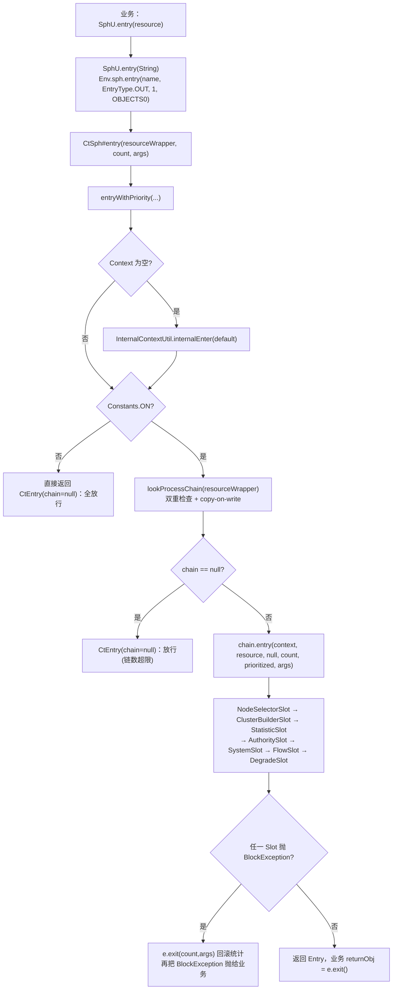
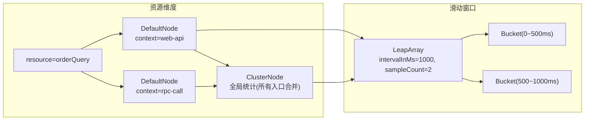
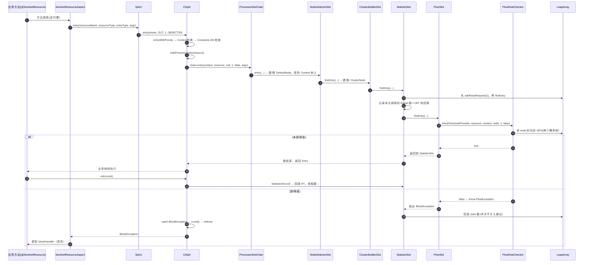
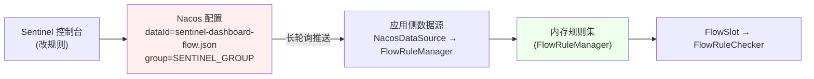

# Spring Cloud 源码精读 06-2：Sentinel 限流降级原理

> **一句话结论**：Sentinel 的全部魔法只发生在**一行** `SphU.entry("resource")` 里——它从 `CtSph` 拿到资源对应的**一条责任链** `ProcessorSlotChain`，沿链依次经过"选节点 → 建簇点 → 统计 → 限流 → 熔断 → 系统保护"，任一 Slot 判定不通过就抛 `BlockException`，业务代码捕获后走 `blockHandler`；而所有判定依赖的"当前 QPS / 线程数 / RT"来自一个**环形数组滑动窗口** `LeapArray`（默认 2 个桶 × 500ms）。
>
> **阅读前置**：读过 [`06-1 熔断抽象与 Resilience4j`](./01-circuitbreaker-抽象与resilience4j.md)（知道"熔断是策略不是配置"）、[`05-配置中心与Bus`](../05-配置中心与Bus/README.md)（规则持久化要落 Nacos）、[`01-Spring框架/02-AOP与代理`](../../01-Spring框架/)（`@SentinelResource` 靠切面生效）。
>
> **预计阅读**：60 分钟。
>
> **源码基线**：`com.alibaba.csp:sentinel-core:1.8.10`。⚠️ 本文**只对已入库并逐行核对过的 6 个类给出源码摘录与行号**（`SphU`、`CtSph`、`ProcessorSlotChain`、`FlowRuleChecker`、`LeapArray`、`DefaultNode`）；其余类（各 `Slot` 实现、`SentinelResourceAspect`、Nacos 数据源）**未入库**，文中出现时一律标注"未验证"。

---

## 0. 先看现象

| 现象 | 你可能的第一反应 | 真正常见的原因 |
| --- | --- | --- |
| 配了 QPS=10，实际放过去 20 | "Sentinel 不生效" | 规则没被 `FlowRuleManager.loadRules` 加载（只在控制台配了、应用没拉），或者资源名写错（实际资源名是 URL 而不是方法名） |
| 日志里 `BlockException` 一堆，但业务接口返回 200 | "@SentinelResource 没生效" | `blockHandler` 把异常吞了（正常），但**没有打点/打日志**，看起来"什么都没发生" |
| 接口报 `UndeclaredThrowableException` | "Sentinel 有 bug" | 方法**没有** `blockHandler`/`fallback`，`BlockException`（受检异常）从代理方法里抛出，被 JDK 代理包成 `UndeclaredThrowableException` |
| `fallback` 和 `blockHandler` 都写了，结果走了 `fallback` | "顺序写反了" | `blockHandler` **只管** `BlockException`；业务异常走 `fallback`。两者都命中时 `blockHandler` 优先 |
| 明明配了降级规则，熔断不触发 | "阈值太大" | 降级规则依赖 `LeapArray` 的统计窗口；窗口内**没有请求**或**样本不足**（`minRequestAmount`）时不会触发 |
| 刷新规则后要重启才生效 | "Nacos 没推" | 规则数据源没配 `flow` 类型，或者 `@SentinelResource` 里的资源名与规则里的 `resource` 不一致 |
| 开了 `@SentinelResource` 但同类内部调用不生效 | "版本问题" | 同 [`06-1`](./01-circuitbreaker-抽象与resilience4j.md) 一样：**Spring AOP 自调用不经过代理** |

---

## 1. 整体地图

### 1.1 一次 `SphU.entry` 里发生了什么



**读图说明**：

1. **整条链只有一次"查表"**：`CtSph` 用 `chainMap`（`ResourceWrapper → ProcessorSlotChain`）缓存"每个资源一条链"。链是**懒创建**的：第一次访问某资源时才 `SlotChainProvider.newSlotChain()` 造出来并放进 map。
2. **`Constants.ON` 是总开关**（`-Dcsp.sentinel.enabled=false` 或 `SphU` 相关系统属性），关掉后 `entryWithPriority` 直接返回一个不统计的 `CtEntry`——这是"Sentinel 零成本接入"的降级路径。
3. **`Context` 是"调用入口"的概念**：一个 HTTP 请求进入时创建一个 `Context`（名字通常是入口名），同一个 `Context` 内多次 `entry` 会形成**调用树**（`DefaultNode#addChild`），"链路限流"就靠这棵树。
4. **`BlockException` 抛出前要先 `exit`**：`catch (BlockException e1) { e.exit(count, args); throw e1; }`——如果不回滚，被拦截的请求会被算成"已经在执行"，线程数和 QPS 都会虚高。
5. 图中 Slot 顺序是 Sentinel 的**默认顺序**（`NodeSelectorSlot → ClusterBuilderSlot → StatisticSlot → AuthoritySlot → SystemSlot → FlowSlot → DegradeSlot`）。**未入库**这 7 个 Slot 的实现类，本文只讲它们各自的职责；顺序以 [官方文档](https://sentinelguard.io/zh-cn/docs/basic-implementation.html) 与 `ProcessorSlotChain#addLast` 的调用顺序为准（**类与行号未验证**）。

### 1.2 统计数据长什么样



**读图说明**：

1. **两层统计**：`DefaultNode` 按"资源 + Context"统计（入口级），`ClusterNode` 按"资源"统计（全局级）。`DefaultNode` 的每个 `increase*` / `addPassRequest` 都会**同时**调 `clusterNode` 的同名方法（见 §3.6 源码）。
2. **真正的数字在 `LeapArray`**：一个 `DefaultNode`/`ClusterNode` 内部持有若干 `LeapArray`（QPS 用一个、RT 用一个、线程数用计数器），每个槽里是 `MetricBucket`。
3. **默认窗口 = 1000ms，2 个桶**（每个 500ms）。所以"QPS"其实是"最近 1 秒内两个桶的 pass 数之和 / 1s"，而不是严格的一秒计数器——这就是"限流有毛刺"的数学来源。
4. 图中 `B0`/`B1` 是**环形数组的两个槽**：时间前进到下一轮时会被**复用并重置**（`resetWindowTo`），不是新建对象，因此没有 GC 压力。

---

## 2. 关键类逐个拆

| 类 | 包 | 职责 | 一句话记忆 | 是否入库 |
| --- | --- | --- | --- | --- |
| `SphU` | `com.alibaba.csp.sentinel` | 对外 API 门面（`entry`/`entryWithType`/`asyncEntry`） | "我要进这道门" | ✅ `SphU.java` |
| `CtSph` | 同上 | `Sph` 实现：查链、建 `CtEntry`、调链 | "找到这个资源的流水线" | ✅ `CtSph.java` |
| `ProcessorSlotChain` | `slotchain` | 责任链抽象（`addFirst`/`addLast`） | "流水线本体" | ✅ `ProcessorSlotChain.java` |
| `FlowRuleChecker` | `slots.block.flow` | 判断某条限流规则放不放行（直接/关联/链路、集群/本地） | "这条规则过不过" | ✅ `FlowRuleChecker.java` |
| `LeapArray` | `slots.statistic.base` | 环形滑动窗口数据结构 | "秒级统计的存储结构" | ✅ `LeapArray.java` |
| `DefaultNode` | `node` | 资源 + Context 维度统计节点，含子节点调用树 | "入口级统计" | ✅ `DefaultNode.java` |
| `NodeSelectorSlot` / `ClusterBuilderSlot` / `StatisticSlot` / `AuthoritySlot` / `SystemSlot` / `FlowSlot` / `DegradeSlot` | `slots.*` | 七个处理槽 | "选节点/建簇点/记账/授权/系统保护/限流/熔断" | ❌ **未入库**（行号未验证） |
| `DefaultController` / `RateLimiterController` / `WarmUpController` / `ThrottlingController` | `slots.block.flow.controller` | 限流算法实现（`TrafficShapingController`） | "怎么算放几个" | ❌ **未入库**（行号未验证） |
| `SentinelResourceAspect` | `sentinel-annotation-aspectj` | `@SentinelResource` 的 AOP 切面 | "注解 → `SphU.entry`" | ❌ **未入库**（行号未验证） |

> ⚠️ **本文的诚实边界**：所有 `(src: ...)` 代码块都来自上表标 ✅ 的 6 个文件，行号经过 `tools/check-doc.mjs` 逐行比对；标 ❌ 的类名出现在正文中只作为**行为说明**，我**没有**它们的源码，因此不给任何行号。

---

## 3. 源码逐段精读

### 3.1 `SphU`：门面 + 默认参数

```java (src: SphU.java#L71-L86)
public class SphU {

    private static final Object[] OBJECTS0 = new Object[0];

    private SphU() {}

    /**
     * Record statistics and perform rule checking for the given resource.
     *
     * @param name the unique name of the protected resource
     * @return the {@link Entry} of this invocation (used for mark the invocation complete and get context data)
     * @throws BlockException if the block criteria is met (e.g. metric exceeded the threshold of any rules)
     */
    public static Entry entry(String name) throws BlockException {
        return Env.sph.entry(name, EntryType.OUT, 1, OBJECTS0);
    }
```

**在干什么**：`SphU` 是个**纯静态门面**，所有重载最终都转给 `Env.sph`（默认是 `CtSph` 的单例）。

**为什么**：门面把"默认参数"固化下来——`EntryType.OUT`（出口资源）、`count=1`（占 1 个配额）、`OBJECTS0`（无参数，避免每次 `new Object[0]`）。

**改别的会怎样**：如果把 `OBJECTS0` 换成 `new Object[]{}`，每次调用都会分配一个空数组；Sentinel 处在每个请求的热路径上，这种小分配在高 QPS 下就是 GC 压力。

**常见坑**：`SphU.entry(name)` 抛的是**受检异常** `BlockException`，所以调用方必须 `try-catch`。这就是"没有 `blockHandler` 时会看到 `UndeclaredThrowableException`"的根源。

```java (src: SphU.java#L281-L330)
    /**
     * Record statistics and perform rule checking for the given resource.
     *
     * @param name         the unique name for the protected resource
     * @param resourceType classification of the resource (e.g. Web or RPC)
     * @param trafficType  the traffic type (inbound, outbound or internal). This is used
     *                     to mark whether it can be blocked when the system is unstable,
     *                     only inbound traffic could be blocked by {@link SystemRule}
     * @return the {@link Entry} of this invocation (used for mark the invocation complete and get context data)
     * @throws BlockException if the block criteria is met (e.g. metric exceeded the threshold of any rules)
     * @since 1.7.0
     */
    public static Entry entry(String name, int resourceType, EntryType trafficType) throws BlockException {
        return Env.sph.entryWithType(name, resourceType, trafficType, 1, OBJECTS0);
    }

    /**
     * Record statistics and perform rule checking for the given resource.
     *
     * @param name         the unique name for the protected resource
     * @param trafficType  the traffic type (inbound, outbound or internal). This is used
     *                     to mark whether it can be blocked when the system is unstable,
     *                     only inbound traffic could be blocked by {@link SystemRule}
     * @param resourceType classification of the resource (e.g. Web or RPC)
     * @param args         args for parameter flow control or customized slots
     * @return the {@link Entry} of this invocation (used for mark the invocation complete and get context data)
     * @throws BlockException if the block criteria is met (e.g. metric exceeded the threshold of any rules)
     * @since 1.7.0
     */
    public static Entry entry(String name, int resourceType, EntryType trafficType, Object[] args)
        throws BlockException {
        return Env.sph.entryWithType(name, resourceType, trafficType, 1, args);
    }

    /**
     * Record statistics and perform rule checking for the given resource that indicates an async invocation.
     *
     * @param name         the unique name for the protected resource
     * @param trafficType  the traffic type (inbound, outbound or internal). This is used
     *                     to mark whether it can be blocked when the system is unstable,
     *                     only inbound traffic could be blocked by {@link SystemRule}
     * @param resourceType classification of the resource (e.g. Web or RPC)
     * @return the {@link Entry} of this invocation (used for mark the invocation complete and get context data)
     * @throws BlockException if the block criteria is met (e.g. metric exceeded the threshold of any rules)
     * @since 1.7.0
     */
    public static AsyncEntry asyncEntry(String name, int resourceType, EntryType trafficType)
        throws BlockException {
        return Env.sph.asyncEntryWithType(name, resourceType, trafficType, 1, false, OBJECTS0);
    }
```

**在干什么**：带 `resourceType` 的重载把资源类型（`Constants.RES_TYPE_COMMON`/`WEB`/`RPC` 等）与流量类型（`EntryType.IN/OUT`）透传给 `entryWithType`；`asyncEntry` 则走 `asyncEntryWithType`，返回 `AsyncEntry`。

**为什么**：`trafficType` 决定"能否被系统规则（`SystemRule`）拦截"——源码注释明确写 "only inbound traffic could be blocked by SystemRule"；`resourceType` 让控制台按类型分组展示。

**常见坑**：`args` 参数是给"热点参数限流"（`ParamFlowSlot`）用的。`SphU.entry(name)` 传的 `OBJECTS0` 空数组**不会走热点统计**——热点规则必须用带 `args` 的重载（或注解方式，由切面自动填）。

### 3.2 `CtSph#entryWithPriority`：整条链的唯一入口

```java (src: CtSph.java#L117-L157)
    private Entry entryWithPriority(ResourceWrapper resourceWrapper, int count, boolean prioritized, Object... args)
        throws BlockException {
        Context context = ContextUtil.getContext();
        if (context instanceof NullContext) {
            // The {@link NullContext} indicates that the amount of context has exceeded the threshold,
            // so here init the entry only. No rule checking will be done.
            return new CtEntry(resourceWrapper, null, context);
        }

        if (context == null) {
            // Using default context.
            context = InternalContextUtil.internalEnter(Constants.CONTEXT_DEFAULT_NAME);
        }

        // Global switch is close, no rule checking will do.
        if (!Constants.ON) {
            return new CtEntry(resourceWrapper, null, context);
        }

        ProcessorSlot<Object> chain = lookProcessChain(resourceWrapper);

        /*
         * Means amount of resources (slot chain) exceeds {@link Constants.MAX_SLOT_CHAIN_SIZE},
         * so no rule checking will be done.
         */
        if (chain == null) {
            return new CtEntry(resourceWrapper, null, context);
        }

        Entry e = new CtEntry(resourceWrapper, chain, context, count, args);
        try {
            chain.entry(context, resourceWrapper, null, count, prioritized, args);
        } catch (BlockException e1) {
            e.exit(count, args);
            throw e1;
        } catch (Throwable e1) {
            // This should not happen, unless there are errors existing in Sentinel internal.
            RecordLog.info("Sentinel unexpected exception", e1);
        }
        return e;
    }
```

**在干什么**：这是"能看见所有分支"的关键方法。四条"不检查直接放行"的路径：① `NullContext`（context 数量超限）；② `Constants.ON == false`；③ `chain == null`（资源数超 `MAX_SLOT_CHAIN_SIZE`）；④ 内部异常（`Throwable` 只记日志）。

**为什么**：
- **Sentinel 的优先级是"宁可放行不可误杀"**。限流组件的 bug 绝不能变成业务不可用，所以所有异常路径都"放行"。
- `NullContext` 是防 OOM 的：`ContextUtil` 对 context 数量有上限，超了就返回一个不统计的 `NullContext`。
- `MAX_SLOT_CHAIN_SIZE` 是防"资源名爆炸"（比如把 URL 里的参数/id 拼进资源名）——每个不同名字都会新建一条链。

**改别的会怎样**：如果 `catch (Throwable e1)` 改成 `throw`，那么 Sentinel 内部任何空指针都会导致业务 500——这在实际项目中会造成比限流大得多的故障面。

**常见坑**：
- 你"配了规则却不生效"，而且日志里有 `Sentinel unexpected exception`，说明是 **Sentinel 内部**报错（多半是规则对象为 null 或自定义扩展 Slot 抛错），去搜 `RecordLog` 输出。
- 资源名动态生成（`order/query?id=123`）会导致 `chainMap` 爆炸，最终 `chain == null` 全部放行——**限流静默失效**。资源名必须稳定。

### 3.3 `lookProcessChain`：双重检查 + copy-on-write

```java (src: CtSph.java#L194-L215)
    ProcessorSlot<Object> lookProcessChain(ResourceWrapper resourceWrapper) {
        ProcessorSlotChain chain = chainMap.get(resourceWrapper);
        if (chain == null) {
            synchronized (LOCK) {
                chain = chainMap.get(resourceWrapper);
                if (chain == null) {
                    // Entry size limit.
                    if (chainMap.size() >= Constants.MAX_SLOT_CHAIN_SIZE) {
                        return null;
                    }

                    chain = SlotChainProvider.newSlotChain();
                    Map<ResourceWrapper, ProcessorSlotChain> newMap = new HashMap<ResourceWrapper, ProcessorSlotChain>(
                        chainMap.size() + 1);
                    newMap.putAll(chainMap);
                    newMap.put(resourceWrapper, chain);
                    chainMap = newMap;
                }
            }
        }
        return chain;
    }
```

**在干什么**：经典 DCL（双重检查锁）+ **整体替换 map**（copy-on-write），而不是 `chainMap.put(...)`。

**为什么**：`chainMap` 是 `static volatile` 的 `HashMap`。**读**路径完全无锁（`volatile` 读 + `HashMap.get`），**写**路径用 `LOCK` 串行 + 新建 `HashMap` 再整体赋值。这样读线程永远看不到"正在被修改的 HashMap"，避免了并发 put 引发的死循环（JDK 7 的经典问题）或读到不一致状态。

**改别的会怎样**：改成 `ConcurrentHashMap` 当然也能工作，但 Sentinel 选择整体替换是为了让**读操作零同步开销**（`ConcurrentHashMap.get` 虽然也很快，但仍有 volatile 读与 hash 计算判断）；对于一个"每请求都要查一次"的结构，能省则省。

**常见坑**：`lookProcessChain` 在**第一次访问某资源**时才会新建链，也就是说 **SlotChain 是懒加载**的。因此：① 改 Slot 扩展要重启（链已建好）；② 启动后第一波请求会集中抢 `LOCK`（有轻微抖动，可忽略）。

### 3.4 `ProcessorSlotChain`：责任链只有两个方法

```java (src: ProcessorSlotChain.java#L23-L38)
public abstract class ProcessorSlotChain extends AbstractLinkedProcessorSlot<Object> {

    /**
     * Add a processor to the head of this slot chain.
     *
     * @param protocolProcessor processor to be added.
     */
    public abstract void addFirst(AbstractLinkedProcessorSlot<?> protocolProcessor);

    /**
     * Add a processor to the tail of this slot chain.
     *
     * @param protocolProcessor processor to be added.
     */
    public abstract void addLast(AbstractLinkedProcessorSlot<?> protocolProcessor);
}
```

**在干什么**：`ProcessorSlotChain` 自己**就是**一个 `AbstractLinkedProcessorSlot`，只是额外提供"从头/尾插入"的能力。

**为什么**：这是"链式调用"的极简实现——`AbstractLinkedProcessorSlot` 持有 `next` 指针，`entry()` 里先处理自己再 `fireEntry()` 转给下一个。`addFirst` 用于"扩展 Slot 插到最前面"，`addLast` 用于追加。

**改别的会怎样**：如果设计成 `List<Slot>` 加 for 循环，每个 Slot 就无法在中间"短路+回滚"——Sentinel 需要 `StatisticSlot` 在异常时反向 `exit()`，链式结构天然支持这种"栈式"语义。

**常见坑**：默认链是 `DefaultSlotChainBuilder` 拼的（**该类未入库**），顺序为 `NodeSelectorSlot`→`ClusterBuilderSlot`→`StatisticSlot`→`SystemSlot`→`AuthoritySlot`→`FlowSlot`→`DegradeSlot`（部分版本含 `ParamFlowSlot`）。**顺序决定语义**：改顺序 = 改行为，例如把 `StatisticSlot` 放到 `FlowSlot` 后面，限流就看不到被拦截的请求数。

### 3.5 `FlowRuleChecker#canPassCheck`：限流规则怎么判

```java (src: FlowRuleChecker.java#L44-L86)
    public void checkFlow(Function<String, Collection<FlowRule>> ruleProvider, ResourceWrapper resource,
                          Context context, DefaultNode node, int count, boolean prioritized) throws BlockException {
        if (ruleProvider == null || resource == null) {
            return;
        }
        Collection<FlowRule> rules = ruleProvider.apply(resource.getName());
        if (rules != null) {
            for (FlowRule rule : rules) {
                if (!canPassCheck(rule, context, node, count, prioritized)) {
                    throw new FlowException(rule.getLimitApp(), rule);
                }
            }
        }
    }

    public boolean canPassCheck(/*@NonNull*/ FlowRule rule, Context context, DefaultNode node,
                                                    int acquireCount) {
        return canPassCheck(rule, context, node, acquireCount, false);
    }

    public boolean canPassCheck(/*@NonNull*/ FlowRule rule, Context context, DefaultNode node, int acquireCount,
                                                    boolean prioritized) {
        String limitApp = rule.getLimitApp();
        if (limitApp == null) {
            return true;
        }

        if (rule.isClusterMode()) {
            return passClusterCheck(rule, context, node, acquireCount, prioritized);
        }

        return passLocalCheck(rule, context, node, acquireCount, prioritized);
    }

    private static boolean passLocalCheck(FlowRule rule, Context context, DefaultNode node, int acquireCount,
                                          boolean prioritized) {
        Node selectedNode = selectNodeByRequesterAndStrategy(rule, context, node);
        if (selectedNode == null) {
            return true;
        }

        return rule.getRater().canPass(selectedNode, acquireCount, prioritized);
    }
```

**在干什么**：
1. 从一个"规则提供者"函数（`ruleProvider`，即 `FlowRuleManager::getFlowRuleMap` 之类）拿到该资源的**所有**限流规则；
2. 逐条判，**任一不通过就抛 `FlowException`**（`FlowException` 是 `BlockException` 的子类，`未入库`）；
3. `canPassCheck` 先分**集群模式 / 本地模式**，再分**限流对象**（按 `limitApp` + `strategy` 选节点）；
4. `passLocalCheck` 最后把"节点 + 配额"交给 `rule.getRater().canPass(...)` —— **真正的算法在 `TrafficShapingController` 里**（`DefaultController` 等，**未入库，行号未验证**）。

**为什么**：把"限流规则的判定"与"限流算法"分离：`FlowRuleChecker` 决定"用哪个节点、算不算集群"，`controller` 决定"怎么算放几个"。所以同一个 `Direct` 策略可以配 `快速失败`/`WarmUp`/`排队等待` 三种算法。

**改别的会怎样**：如果 `checkFlow` 用"任一规则通过就放行"（OR 语义），那多条规则就变成"取最宽松的"，用户配了两条不同阈值的规则会莫名其妙。这里选择 AND（`!canPassCheck → throw`），符合"约束叠加"的直觉。

**常见坑**：
- **多条规则的语义是"全部满足"**。如果你给同一资源配了 `limitApp=default`（100 QPS）和 `limitApp=other`（10 QPS），那么来自 `other` 的请求要**同时**满足两条：`limitApp=other` 的 10 与 `default` 的 100 中先到的那条会拦。
- `limitApp == null` 直接 `return true`：规则对象不完整（比如从 Nacos 反序列化时字段缺失）会**静默放行**。这是"规则配了但没效果"的一大来源。
- `prioritized` 参数（`SphU.entry` 之外的 `EntryType.IN`/异步场景）会让控制器**预留**配额等一会儿，而不是立刻拒绝；默认 `false`。

### 3.6 限流策略：直接 / 关联 / 链路

```java (src: FlowRuleChecker.java#L88-L145)
    static Node selectReferenceNode(FlowRule rule, Context context, DefaultNode node) {
        String refResource = rule.getRefResource();
        int strategy = rule.getStrategy();

        if (StringUtil.isEmpty(refResource)) {
            return null;
        }

        if (strategy == RuleConstant.STRATEGY_RELATE) {
            return ClusterBuilderSlot.getClusterNode(refResource);
        }

        if (strategy == RuleConstant.STRATEGY_CHAIN) {
            if (!refResource.equals(context.getName())) {
                return null;
            }
            return node;
        }
        // No node.
        return null;
    }

    private static boolean filterOrigin(String origin) {
        // Origin cannot be `default` or `other`.
        return !RuleConstant.LIMIT_APP_DEFAULT.equals(origin) && !RuleConstant.LIMIT_APP_OTHER.equals(origin);
    }

    static Node selectNodeByRequesterAndStrategy(/*@NonNull*/ FlowRule rule, Context context, DefaultNode node) {
        // The limit app should not be empty.
        String limitApp = rule.getLimitApp();
        int strategy = rule.getStrategy();
        String origin = context.getOrigin();

        if (limitApp.equals(origin) && filterOrigin(origin)) {
            if (strategy == RuleConstant.STRATEGY_DIRECT) {
                // Matches limit origin, return origin statistic node.
                return context.getOriginNode();
            }

            return selectReferenceNode(rule, context, node);
        } else if (RuleConstant.LIMIT_APP_DEFAULT.equals(limitApp)) {
            if (strategy == RuleConstant.STRATEGY_DIRECT) {
                // Return the cluster node.
                return node.getClusterNode();
            }

            return selectReferenceNode(rule, context, node);
        } else if (RuleConstant.LIMIT_APP_OTHER.equals(limitApp)
            && FlowRuleManager.isOtherOrigin(origin, rule.getResource())) {
            if (strategy == RuleConstant.STRATEGY_DIRECT) {
                return context.getOriginNode();
            }

            return selectReferenceNode(rule, context, node);
        }

        return null;
    }
```

**在干什么**：这是 Sentinel 限流"看起来复杂"的核心，其实只有**两个维度**：

| 维度 | 取值 | 含义 |
| --- | --- | --- |
| `limitApp`（针对谁限流） | 具体调用方名 / `default` / `other` | 只限某个来源 / 限所有来源合并 / 限"未单独列出的其他来源" |
| `strategy`（按什么统计） | `STRATEGY_DIRECT`(0) / `STRATEGY_RELATE`(1) / `STRATEGY_CHAIN`(2) | 按自己 / 按关联资源 / 按链路入口 |

组合出来的"统计节点"是：

1. **直接（`DIRECT`）**：`limitApp=default` → `node.getClusterNode()`（**全局限流**，所有入口合并算）；`limitApp=具体来源` → `context.getOriginNode()`（**按调用方限流**）。
2. **关联（`RELATE`）**：`ClusterBuilderSlot.getClusterNode(refResource)` → **拿"另一个资源"的统计来限自己**。典型场景：写接口忙时，限读接口（`refResource` 配写接口名，`strategy=RELATE`）。
3. **链路（`CHAIN`）**：只有 `context.getName().equals(refResource)` 时才返回 `node`，否则返回 `null`（= 放行）。也就是"**只对本入口的流量限流**"，同一个资源被别的入口调用不受影响。

**为什么**：三个策略对应三种真实需求——保护自己（直接）、保护别人（关联）、保护某个入口（链路）。用同一个 `Node` 抽象统一表达，是因为"限流的本质是读某个 Node 的统计值，跟阈值比"。

**改别的会怎样**：如果 `STRATEGY_CHAIN` 不判 `context.getName()`，那链路限流就退化成直接限流，`@SentinelResource` 里"入口 A 限 10、入口 B 不限"的需求无法表达。

**常见坑**：
- **`limitApp=other` 只在"有具体来源规则"时才有意义**：`FlowRuleManager.isOtherOrigin` 的判断依赖"该资源的规则集合里没有这个 origin"。一条规则都没配来源时，`other` 等于 `default`。
- **关联/链路模式必须配 `refResource`**，否则 `selectReferenceNode` 返回 `null` → 放行 → "规则完全没效果"。
- `ClusterBuilderSlot.getClusterNode(refResource)` 要求 `refResource` **已经被统计过**（至少被访问过一次），否则拿到 `null`。

### 3.7 集群限流的兜底：`passClusterCheck`

```java (src: FlowRuleChecker.java#L147-L184)
    private static boolean passClusterCheck(FlowRule rule, Context context, DefaultNode node, int acquireCount,
                                            boolean prioritized) {
        try {
            TokenService clusterService = pickClusterService();
            if (clusterService == null) {
                return fallbackToLocalOrPass(rule, context, node, acquireCount, prioritized);
            }
            long flowId = rule.getClusterConfig().getFlowId();
            TokenResult result = clusterService.requestToken(flowId, acquireCount, prioritized);
            return applyTokenResult(result, rule, context, node, acquireCount, prioritized);
            // If client is absent, then fallback to local mode.
        } catch (Throwable ex) {
            RecordLog.warn("[FlowRuleChecker] Request cluster token unexpected failed", ex);
        }
        // Fallback to local flow control when token client or server for this rule is not available.
        // If fallback is not enabled, then directly pass.
        return fallbackToLocalOrPass(rule, context, node, acquireCount, prioritized);
    }

    private static boolean fallbackToLocalOrPass(FlowRule rule, Context context, DefaultNode node, int acquireCount,
                                                 boolean prioritized) {
        if (rule.getClusterConfig().isFallbackToLocalWhenFail()) {
            return passLocalCheck(rule, context, node, acquireCount, prioritized);
        } else {
            // The rule won't be activated, just pass.
            return true;
        }
    }

    private static TokenService pickClusterService() {
        if (ClusterStateManager.isClient()) {
            return TokenClientProvider.getClient();
        }
        if (ClusterStateManager.isServer()) {
            return EmbeddedClusterTokenServerProvider.getServer();
        }
        return null;
    }
```

**在干什么**：集群模式下，本机不再自己算，而是**向 Token Server 申请令牌**（`requestToken`）。拿不到（没配 server、网络失败、异常）时，按 `clusterConfig.fallbackToLocalWhenFail` 决定：**降级为本地限流**还是**直接放行**。

**为什么**：集群限流必须"可用性优先"——Token Server 挂了不能让全站限流失效（那会雪崩），也不能把全站请求都拒绝。所以给一个显式开关让用户选。

**常见坑**：`fallbackToLocalWhenFail` **默认 `false`**（`ClusterFlowConfig` 默认值，**未入库未验证**）。也就是说：集群限流器一挂，限流就**完全失效**，集群流量会瞬间打到后端。生产上要评估"挂了更糟还是限流失效更糟"，通常建议 `true`。

### 3.8 `LeapArray`：滑动窗口的存储结构

```java (src: LeapArray.java#L41-L72)
public abstract class LeapArray<T> {

    protected int windowLengthInMs;
    protected int sampleCount;
    protected int intervalInMs;
    private double intervalInSecond;

    protected final AtomicReferenceArray<WindowWrap<T>> array;

    /**
     * The conditional (predicate) update lock is used only when current bucket is deprecated.
     */
    private final ReentrantLock updateLock = new ReentrantLock();

    /**
     * The total bucket count is: {@code sampleCount = intervalInMs / windowLengthInMs}.
     *
     * @param sampleCount  bucket count of the sliding window
     * @param intervalInMs the total time interval of this {@link LeapArray} in milliseconds
     */
    public LeapArray(int sampleCount, int intervalInMs) {
        AssertUtil.isTrue(sampleCount > 0, "bucket count is invalid: " + sampleCount);
        AssertUtil.isTrue(intervalInMs > 0, "total time interval of the sliding window should be positive");
        AssertUtil.isTrue(intervalInMs % sampleCount == 0, "time span needs to be evenly divided");

        this.windowLengthInMs = intervalInMs / sampleCount;
        this.intervalInMs = intervalInMs;
        this.intervalInSecond = intervalInMs / 1000.0;
        this.sampleCount = sampleCount;

        this.array = new AtomicReferenceArray<>(sampleCount);
    }
```

**在干什么**：构造时分配**固定长度**的 `AtomicReferenceArray`，长度 = `sampleCount`，每个槽覆盖 `windowLengthInMs = intervalInMs / sampleCount` 毫秒。

**为什么**：
- **固定数组 + 环形复用**：永远不扩容、不新建数组，内存恒定，无 GC。
- **`AtomicReferenceArray` + 单槽 CAS**：不同线程写不同槽时几乎无竞争。
- **`updateLock` 是"条件锁"**：只在"当前槽已过期需要重置"时用（见 3.9），99% 的请求走无锁的快速路径。
- **`intervalInMs % sampleCount == 0` 的断言**：保证每个桶等宽，简化时间计算。

**常见坑**：`sampleCount=1` 时窗口就是"1 个 1000ms 桶"，这叫"固定窗口"——会有**临界突刺**（0.9s 放 100 个 + 1.1s 放 100 个 = 200ms 内 200 个）。Sentinel 默认 2 个桶缓解但不消除，需要严格的话把 `sampleCount` 调大（≤ 可配的最大值）。

### 3.9 `currentWindow`：四级分支

```java (src: LeapArray.java#L100-L108)
    private int calculateTimeIdx(/*@Valid*/ long timeMillis) {
        long timeId = timeMillis / windowLengthInMs;
        // Calculate current index so we can map the timestamp to the leap array.
        return (int)(timeId % array.length());
    }

    protected long calculateWindowStart(/*@Valid*/ long timeMillis) {
        return timeMillis - timeMillis % windowLengthInMs;
    }
```


```java (src: LeapArray.java#L132-L154)
        while (true) {
            WindowWrap<T> old = array.get(idx);
            if (old == null) {
                /*
                 *     B0       B1      B2    NULL      B4
                 * ||_______|_______|_______|_______|_______||___
                 * 200     400     600     800     1000    1200  timestamp
                 *                             ^
                 *                          time=888
                 *            bucket is empty, so create new and update
                 *
                 * If the old bucket is absent, then we create a new bucket at {@code windowStart},
                 * then try to update circular array via a CAS operation. Only one thread can
                 * succeed to update, while other threads yield its time slice.
                 */
                WindowWrap<T> window = new WindowWrap<T>(windowLengthInMs, windowStart, newEmptyBucket(timeMillis));
                if (array.compareAndSet(idx, null, window)) {
                    // Successfully updated, return the created bucket.
                    return window;
                } else {
                    // Contention failed, the thread will yield its time slice to wait for bucket available.
                    Thread.yield();
                }
```

**在干什么**：第 1 分支——槽为空（**进程刚启动**或该槽从未用过）：CAS 放一个新的 `WindowWrap` 进去；CAS 失败说明别的线程抢先了，`Thread.yield()` 让出 CPU 再重试。注意最后一行 `} else if (windowStart == old.windowStart()) {` 是第 2 分支的开头，真正的分支体在下一个代码块里。

**为什么**：用 `Thread.yield()` 而不是 `synchronized`，是因为这里"竞争极短"（只是几个字段赋值），让出时间片后通常立刻就能读到对方写好的槽。

**改别的会怎样**：如果这里用 `synchronized`，QPS 高时每次首次访问都要进重量级锁；如果用 `Arrays.fill` 预分配所有槽，则要处理"预分配但有多个 `WindowWrap` 共享"的问题，反而更慢。

```java (src: LeapArray.java#L155-L202)
            } else if (windowStart == old.windowStart()) {
                /*
                 *     B0       B1      B2     B3      B4
                 * ||_______|_______|_______|_______|_______||___
                 * 200     400     600     800     1000    1200  timestamp
                 *                             ^
                 *                          time=888
                 *            startTime of Bucket 3: 800, so it's up-to-date
                 *
                 * If current {@code windowStart} is equal to the start timestamp of old bucket,
                 * that means the time is within the bucket, so directly return the bucket.
                 */
                return old;
            } else if (windowStart > old.windowStart()) {
                /*
                 *   (old)
                 *             B0       B1      B2    NULL      B4
                 * |_______||_______|_______|_______|_______|_______||___
                 * ...    1200     1400    1600    1800    2000    2200  timestamp
                 *                              ^
                 *                           time=1676
                 *          startTime of Bucket 2: 400, deprecated, should be reset
                 *
                 * If the start timestamp of old bucket is behind provided time, that means
                 * the bucket is deprecated. We have to reset the bucket to current {@code windowStart}.
                 * Note that the reset and clean-up operations are hard to be atomic,
                 * so we need a update lock to guarantee the correctness of bucket update.
                 *
                 * The update lock is conditional (tiny scope) and will take effect only when
                 * bucket is deprecated, so in most cases it won't lead to performance loss.
                 */
                if (updateLock.tryLock()) {
                    try {
                        // Successfully get the update lock, now we reset the bucket.
                        return resetWindowTo(old, windowStart);
                    } finally {
                        updateLock.unlock();
                    }
                } else {
                    // Contention failed, the thread will yield its time slice to wait for bucket available.
                    Thread.yield();
                }
            } else if (windowStart < old.windowStart()) {
                // Should not go through here, as the provided time is already behind.
                return new WindowWrap<T>(windowLengthInMs, windowStart, newEmptyBucket(timeMillis));
            }
        }
    }
```

**在干什么**：
- **第 2 分支（`windowStart == old.windowStart()`）**：时间还在同一个桶里，**直接返回**——这是 99% 的请求走的路径，零锁。
- **第 3 分支（`windowStart > old.windowStart()`）**：槽里的数据已经过期（属于上一轮），需要**重置**。重置不是原子的（要清空 `MetricBucket`），所以用 `updateLock.tryLock()`；抢不到就 `yield` 重试。
- **第 4 分支（`windowStart < old.windowStart()`）**：时间比槽还旧（时钟回拨或调用方传了历史时间戳），返回一个新的临时 `WindowWrap`（不写回数组）。

**为什么**：把"只读"和"重置"分开，让重置成为极少数事件（每 `windowLengthInMs` 才发生一次）。这就是 Sentinel 能有"百万级 QPS 统计"性能的原因。

**常见坑**：
- **`resetWindowTo` 会清空整个桶**，所以一个请求正好在"跨桶瞬间"可能看到"上一个桶刚被重置"——统计会有极短暂的"低估"。这是滑动窗口固有误差。
- **时钟回拨**（NTP 校时）会走第 4 分支，导致统计错乱几分钟。Sentinel 用 `TimeUtil`（单调时钟，`未入库未验证`）来尽量避免。

### 3.10 读窗口：`isWindowDeprecated` 与 `list`

```java (src: LeapArray.java#L244-L297)
    public T getWindowValue(long timeMillis) {
        if (timeMillis < 0) {
            return null;
        }
        int idx = calculateTimeIdx(timeMillis);

        WindowWrap<T> bucket = array.get(idx);

        if (bucket == null || !bucket.isTimeInWindow(timeMillis)) {
            return null;
        }

        return bucket.value();
    }

    /**
     * Check if a bucket is deprecated, which means that the bucket
     * has been behind for at least an entire window time span.
     *
     * @param windowWrap a non-null bucket
     * @return true if the bucket is deprecated; otherwise false
     */
    public boolean isWindowDeprecated(/*@NonNull*/ WindowWrap<T> windowWrap) {
        return isWindowDeprecated(TimeUtil.currentTimeMillis(), windowWrap);
    }

    public boolean isWindowDeprecated(long time, WindowWrap<T> windowWrap) {
        return time - windowWrap.windowStart() > intervalInMs;
    }

    /**
     * Get valid bucket list for entire sliding window.
     * The list will only contain "valid" buckets.
     *
     * @return valid bucket list for entire sliding window.
     */
    public List<WindowWrap<T>> list() {
        return list(TimeUtil.currentTimeMillis());
    }

    public List<WindowWrap<T>> list(long validTime) {
        int size = array.length();
        List<WindowWrap<T>> result = new ArrayList<WindowWrap<T>>(size);

        for (int i = 0; i < size; i++) {
            WindowWrap<T> windowWrap = array.get(i);
            if (windowWrap == null || isWindowDeprecated(validTime, windowWrap)) {
                continue;
            }
            result.add(windowWrap);
        }

        return result;
    }
```

**在干什么**：`list(now)` 遍历数组，跳过 `null` 与"过期超过一整个窗口"的桶，返回有效桶集合——**限流的"当前 QPS"就是对这批桶求和**。

**为什么**：桶是环形的，"过期"不能靠"下标",必须靠 **`windowStart` 时间戳**判断：`now - windowStart > intervalInMs` 才算过期（丢掉）。

**常见坑**：`list()` 返回的桶数量**不一定是 `sampleCount`**——刚启动时大部分桶是 `null`，所以"当前 QPS"会**逐渐逼近**真实值（前 1 秒低估）。这也解释了"压测刚开始的 1 秒不触发限流"。

### 3.11 `DefaultNode`：统计向上汇总

```java (src: DefaultNode.java#L109-L143)
    @Override
    public void increaseBlockQps(int count) {
        super.increaseBlockQps(count);
        this.clusterNode.increaseBlockQps(count);
    }

    @Override
    public void increaseExceptionQps(int count) {
        super.increaseExceptionQps(count);
        this.clusterNode.increaseExceptionQps(count);
    }

    @Override
    public void addRtAndSuccess(long rt, int successCount) {
        super.addRtAndSuccess(rt, successCount);
        this.clusterNode.addRtAndSuccess(rt, successCount);
    }

    @Override
    public void increaseThreadNum() {
        super.increaseThreadNum();
        this.clusterNode.increaseThreadNum();
    }

    @Override
    public void decreaseThreadNum() {
        super.decreaseThreadNum();
        this.clusterNode.decreaseThreadNum();
    }

    @Override
    public void addPassRequest(int count) {
        super.addPassRequest(count);
        this.clusterNode.addPassRequest(count);
    }
```

**在干什么**：每个统计动作都"**先记自己，再记 `clusterNode`**"。所以 `ClusterNode` 是所有 `DefaultNode` 的汇总。

**为什么**：`StatisticSlot` 里只需要调 `node.increaseXxx()`，汇总就自动完成——这就是"直接限流用 `node.getClusterNode()`，按来源限流用 `context.getOriginNode()`"都能拿到正确统计的原因。

**改别的会怎样**：如果只记自己，那"全局限流"就要遍历所有 `DefaultNode` 求和，O(n) 且并发不一致。

**常见坑**：`clusterNode` 为 `null` 时会 NPE——但只发生在 `DefaultNode` 未经过 `ClusterBuilderSlot` 初始化的场景。**所以自定义 Slot 扩展千万不要在 `ClusterBuilderSlot` 之前调 `increase*`**（`未入库的 slot 顺序说明`）。

```java (src: DefaultNode.java#L80-L96)
    public void addChild(Node node) {
        if (node == null) {
            RecordLog.warn("Trying to add null child to node <{}>, ignored", id.getName());
            return;
        }
        if (!childList.contains(node)) {
            synchronized (this) {
                if (!childList.contains(node)) {
                    Set<Node> newSet = new HashSet<>(childList.size() + 1);
                    newSet.addAll(childList);
                    newSet.add(node);
                    childList = newSet;
                }
            }
            RecordLog.info("Add child <{}> to node <{}>", ((DefaultNode)node).id.getName(), id.getName());
        }
    }
```

**在干什么**：把"调用我在内的下游节点"加进 `childList`（**copy-on-write**，`childList` 是 `volatile Set`）。

**为什么**：这是**调用树**的构建方式（`NodeSelectorSlot` 在 `entry` 时调用）。"链路限流"能回答"从哪个入口进来的"就靠这棵树。用 copy-on-write 是为了让遍历（`visitTree`、链路统计）无锁。

**常见坑**：**父子关系是"第一次调用时"建立的**，之后同一 `Context` 内再次调用不会再变。如果资源是动态生成的（同一入口调用了 N 个不同资源名的下游），`childList` 会无限增长——又一条"资源名要稳定"的理由。

---

## 4. 一次完整执行时序



**读图说明**：

1. **`StatisticSlot` 的位置是"先记账再判"**：它在 `FlowSlot` 之前把 `pass` 数 +1，所以 `FlowSlot` 判的"当前 QPS"**已经包含本次请求**。这解释了为什么 QPS=10 时第 11 个被拦（而不是第 10 个）。
2. **`entry.exit()` 是必须的**：只有 `exit` 才会回填 RT（`addRtAndSuccess`）并 `decreaseThreadNum`。**忘了 exit = RT 永远 0、线程数永远在涨 → 熔断降级规则永远不触发**（因为 RT 规则看的就是 `avgRt`）。
3. **`BlockException` 的传播路径是"反向"的**：`FlowSlot` 抛出 → 沿链反向经过 `StatisticSlot`（它会做回滚）→ 到 `CtSph` 的 `catch` → 再抛给切面 → 切面调到 `blockHandler`。
4. 图中 `Asp` 是 `SentinelResourceAspect`（**未入库**），它的职责就三件：`SphU.entry(...)`、`entry.exit()` in `finally`、`catch (BlockException)` 时调 `blockHandler`/`fallback`。
5. **集群模式**下，`FS→FC` 这一步会变成"向 Token Server 请求令牌"（见 3.7），时序里多一次 RPC，但本地 `StatisticSlot` 的记账依然进行（用于 fallback 到本地限流）。

---

## 5. 设计模式与取舍

| 模式/机制 | 出现在哪 | 解决什么 | 代价 |
| --- | --- | --- | --- |
| 门面（Facade） | `SphU` 静态方法 | 一行 API，隐藏 `Env.sph`/默认参数 | 全局单例，多应用上下文隔离需额外处理 |
| 责任链（Chain of Responsibility） | `ProcessorSlotChain` + 7 个 Slot | 可插拔的处理阶段（限流/熔断/授权/热点） | 顺序即语义，改顺序容易出错 |
| 双重检查锁 + copy-on-write | `CtSph#lookProcessChain` | 读无锁、写安全 | 每次新增资源都复制整个 map（资源数少时无所谓） |
| 环形数组（Ring Buffer） | `LeapArray` | O(1) 时间定位、零 GC | 桶宽固定，跨桶瞬间统计有误差 |
| 条件锁 | `LeapArray#updateLock.tryLock()` | 只在重置桶时加锁 | 重置期间其他线程 `yield` 空转（极短） |
| 抽象工厂/多态 | `FlowRule#getRater()`（`TrafficShapingController`） | 同一规则配不同算法（快速失败/预热/排队） | 算法类`未入库`，行为需靠文档 |
| 降级优先（Fail-Open） | `entryWithPriority` 全部异常分支 | 限流 bug 不拖垮业务 | 出问题时"限流静默失效"，难发现 |

**核心取舍：Sentinel 选择"嵌入式 + 无中心依赖"**，和 06-1 的 Resilience4j 有本质差异：

| 维度 | Sentinel | Resilience4j（06-1） |
| --- | --- | --- |
| 数据统计 | 自己实现 `LeapArray` 滑动窗口 | 内部 `SlidingWindow`（COUNT/TIME 两种） |
| 限流能力 | 强（直接/关联/链路/热点/集群/系统自适应） | 只有 `RateLimiter`（简单令牌桶） |
| 熔断降级条件 | 慢调用比例 / 异常比例 / 异常数 | 失败率 / 慢调用率 |
| 规则来源 | 代码 / 控制台 / Nacos / Apollo / ZooKeeper（Data source 扩展） | 配置文件（`resilience4j.*`） |
| 动态改规则 | ✅ 推送即时生效（不改 Bean） | 部分支持（`@RefreshScope` 刷新 registry） |
| Spring Cloud 集成 | `spring-cloud-starter-alibaba-sentinel` | `spring-cloud-starter-circuitbreaker-resilience4j` |
| 额外依赖 | 控制台（独立部署）+ 数据源 | 无 |

---

## 6. 踩坑与调试手法

### 6.1 `blockHandler` vs `fallback`：语义与优先级

| | `blockHandler` | `fallback` |
| --- | --- | --- |
| 处理的异常 | **只有** `BlockException`（限流/熔断/授权/系统保护） | **所有** `Throwable`（含业务异常），但**不含** `BlockException`（由 `blockHandler` 优先处理） |
| 方法签名 | 与原方法**参数列表一致** + 末尾多一个 `BlockException` | 与原方法参数一致 + 末尾多一个 `Throwable` |
| 返回值 | 必须与原方法一致 | 必须与原方法一致 |
| 所在类 | 默认同类（可用 `blockHandlerClass` 指定） | 默认同类（可用 `fallbackClass` 指定） |
| 方法可见性 | 必须 `public`（跨类时 `static`） | 必须 `public`（跨类时 `static`） |
| 优先级 | **高**（`BlockException` 先给它） | 低（`BlockException` 之外才给它） |

```text
调用顺序（切面内部，未入库的实现，仅描述契约）：
  1. SphU.entry() 抛 BlockException
       → 有 blockHandler: 调 blockHandler（原异常不再上抛）
       → 无 blockHandler: 有 fallback 且 exceptionsToIgnore 不含 BlockException?
            → 调 fallback
       → 都没有: 直接抛 BlockException（受检）→ JDK 代理包成 UndeclaredThrowableException
  2. 业务方法抛 RuntimeException
       → 有 fallback: 调 fallback
       → 无 fallback: 原样上抛（且已计入 StatisticSlot 的 exception 统计）
```

**常见坑清单**：

| 坑 | 现象 | 根因 | 处置 |
| --- | --- | --- | --- |
| ✅坑1 只写 `fallback` 不写 `blockHandler` | 限流时仍然 500 | `fallback` 默认**不处理** `BlockException`（`exceptionsToIgnore` 默认含它） | 两个都写，或者 `exceptionsToIgnore = {}` |
| ✅坑2 签名不匹配 | 降级没生效，异常照旧 | `blockHandler` 少写/多写了参数，或不是 `public` | 严格按"原参数 + BlockException"写，并打开 `-Dcsp.sentinel.log.level=debug` 看告警 |
| ✅坑3 `fallbackClass` 写成非静态方法 | `IllegalStateException` / 找不到方法 | 跨类时必须 `static` | 加 `static` |
| ✅坑4 资源名不一致 | 规则完全不生效 | 注解 `value` 与规则 `resource` 不同（含大小写、空格） | 用控制台"簇点链路"看真实资源名 |
| ✅坑5 自调用 | 注解不生效 | Spring AOP 代理不拦截 `this.method()` | 拆类 / 注入自身代理 / `AopContext.currentProxy()` |
| ✅坑6 `@SentinelResource` 放在接口上 | 不生效 | 注解 `@Target` 只有 `METHOD`/`TYPE`（`未入库未验证`），且切面按实现类匹配 | 注解写在**实现类方法**上 |
| ✅坑7 熔断规则永不触发 | 慢调用阈值配了没用 | `StatisticSlot.exit` 没执行（异步/异常吞了）→ `avgRt` 恒为 0 | 检查是否有 `entry.exit()` 漏调；异步必须用 `SphU.asyncEntry` + `entry.exit()` |

### 6.2 三大降级条件怎么选

| 规则类型 | 判定依据 | 默认关键参数 | 适用 |
| --- | --- | --- | --- |
| 慢调用比例 `SLOW_RATIO` | `rt > maxAllowedRtMs` 的占比 > `count` | `slowRatioThreshold`、`timeWindow`、`minRequestAmount`、`statIntervalMs` | 依赖"变慢但没报错"（典型：DB 慢查询、下游线程池打满） |
| 异常比例 `ERROR_RATIO` | 异常占比 > `count` | 同上 | 下游明确抛错 |
| 异常数 `ERROR_COUNT` | 分钟级异常数 > `count` | `timeWindow`、`minRequestAmount`、`statIntervalMs` | 低 QPS 接口（比例法样本不够） |

> ⚠️ `DegradeSlot` / `DegradeRule` 的具体字段与默认值**未入库，行号未验证**；上表参数名以 Sentinel 官方文档与 Sentinel 控制台字段为准。若要精确到源码，需要另行 `fetch-source` `sentinel-core` 的 `slots/block/degrade/*`。

**为什么要有三种**：低 QPS 接口用"比例"永远攒不够样本（比如 QPS=1，`minRequestAmount=5` 要 5 秒），所以提供"异常数"。而"慢调用"是唯一能提前发现"雪崩前兆"的指标。

### 6.3 与 Nacos 规则持久化配合



**读图说明**：

1. **控制台的改动默认只到控制台内存**——重启应用就丢。所谓"规则持久化"，是让控制台把规则**写到 Nacos**，应用侧再从 Nacos **读回来并注册**到 `FlowRuleManager`。
2. 应用侧的桥梁是 `ReadableDataSource`（`NacosDataSource`，**未入库，行号未验证**）：它在启动时拉一次 + 注册监听器，规则变化时调 `FlowRuleManager.loadRules(...)`。
3. **`FlowRuleManager` 是全局单例**，`FlowSlot` 通过它拿规则（`FlowRuleChecker#checkFlow` 的 `ruleProvider` 参数就是它）。所以"改规则即时生效"= 改内存里的 `Map<String, List<FlowRule>>`，不需要重启、不需要 `@RefreshScope`。
4. **`@SentinelResource` 的 `blockHandler` 不会因为规则刷新而重建 Bean**——这就是 Sentinel 规则能"热生效"、而配置刷新要"重建 Bean"的根本差异。

**常见坑**：
- **dataId / group / namespace 三处必须一致**（控制台、应用配置、Nacos 实际配置），任一处不一致就"推了不生效"。
- 规则 JSON 的**字段名要与 `FlowRule` 的字段对应**（`resource`、`grade`、`count`、`strategy`、`refResource`、`controlBehavior`...），不清楚时**让控制台写**，不要手写。
- **集群流控规则**还需要 `clusterMode`/`clusterConfig`（含 `flowId`、`thresholdType`），漏了会变成"本地限流"。

### 6.4 调试手法

```text
# 1) 确认资源名（最常出错的一步）
curl -s localhost:8719/api/tree?type=root        # 命令端口（默认 8719）
#    或者用 sentinel-dashboard 的"簇点链路"页面看真实资源名

# 2) 看规则有没有进去
curl -s localhost:8719/getRules?type=flow
#    返回空数组 = 规则没加载（数据源没配/资源名不匹配）

# 3) 看实时统计（是否真的被拦）
curl -s localhost:8719/metric?startTime=<ts>&endTime=<ts>&refetch=true

# 4) 打日志看 BlockException 从哪个 Slot 出
#    代码里 blockHandler 内：log.warn("blocked by {}", ex.getClass().getSimpleName(), ex)
#    FlowException=限流, DegradeException=熔断, SystemBlockException=系统保护, AuthorityException=授权

# 5) 打印调用树（DefaultNode 自带方法）
#    defaultNode.printDefaultNode() → "-orderQuery(thread:1 pq:10 ...)"
```

- **`pq`（pass Qps）不涨** = 请求没进 Sentinel（切面没生效 / 资源名不对）。
- **`bq`（block Qps）涨** = 规则真的在拦。
- **`rt` 恒为 0** = `entry.exit()` 没执行（异步/异常路径漏调）。
- **`UndeclaredThrowableException`** = 没有 `blockHandler`/`fallback`。

---

## 7. ⚠️ 版本差异

| 项 | 旧版本 | 1.8.10（本篇基线） | 影响 |
| --- | --- | --- | --- |
| 熔断降级 API | `@SentinelResource` + 控制台配"降级规则" | 同上；官方推荐用 `CircuitBreaker`（`sentinel-circuitbreaker`）对接 Spring Cloud 抽象 | 想接 `CircuitBreakerFactory` 要用 `spring-cloud-starter-alibaba-sentinel`（**未入库未验证**） |
| 限流效果（`controlBehavior`） | — | `快速失败`(0) / `Warm Up`(1) / `排队等待`(2) | 排队等待会**阻塞线程**，在 Servlet 容器里慎用 |
| `sentinel-transport` 心跳 | 简化 | 端口自动探测（8719 起，被占用则 +1） | 找不到端口的应用无法在控制台显示 |
| Sentinel 控制台 | 独立部署 | 仍需独立部署（`sentinel-dashboard`），**规则默认存内存** | 必须自建持久化（Nacos/Apollo/ZK） |
| Spring Boot 兼容 | `sentinel-spring-boot-starter` | `spring-cloud-alibaba` 2023.x+ 提供 Boot 3/4 适配（**未入库未验证**） | Boot 4 需确认 nacos/sentinel starter 版本 |
| `@SentinelResource` 的 `fallback` 对 `BlockException` | — | 默认 `exceptionsToIgnore` **含 `BlockException`**（`未入库未验证`） | 见坑 1：只写 fallback 不够 |
| 集群限流 fallback | — | `fallbackToLocalWhenFail` 默认 `false` | Token Server 挂了 = 限流失效 |

---

## 8. 面试高频问与答

**Q1：`SphU.entry()` 到底做了什么？**

A：门面转给 `CtSph#entry` → `entryWithPriority`。后者做四件事：拿 `Context`（没有就建默认）、检查 `Constants.ON` 总开关、`lookProcessChain` 取/建该资源的 `ProcessorSlotChain`、调用 `chain.entry(...)`。链上各 Slot 依次处理，任一步判定不通过就抛 `BlockException`，并在抛出前 `e.exit()` 回滚统计。

**Q2：为什么 `entryWithPriority` 里所有异常分支都"放行"？**

A：Sentinel 的设计原则是"**不能因为限流组件自身故障导致业务不可用**"。`NullContext`（context 数超限）、`Constants.ON=false`、`chain==null`（资源数超 `MAX_SLOT_CHAIN_SIZE`）、内部 `Throwable`——全部返回一个不统计的 `CtEntry`。代价是"限流静默失效"，所以要有监控（`bq`、资源数、`RecordLog`）。

**Q3：`lookProcessChain` 为什么用 copy-on-write 而不是 `ConcurrentHashMap`？**

A：让**读路径完全无锁**：`volatile` 读 `HashMap` + `get`，没有 `ConcurrentHashMap` 的 hash/size 检查开销。写路径有 `LOCK` 串行，且 `HashMap` 整体替换保证读线程永远看到完整 map（避免 JDK7 HashMap 并发 put 死循环）。资源数通常几十到几百，复制成本可忽略。

**Q4：限流的"直接/关联/链路"到底差在哪？**

A：差在**读哪个 Node 的统计**。直接 = 自己的 `ClusterNode`（全局限）或 `OriginNode`（按来源限）；关联 = **另一个资源**的 `ClusterNode`（保护别人）；链路 = 只有当 `context.getName()` 等于 `refResource` 时才用自己这个 `DefaultNode`（只限某个入口）。

**Q5：`LeapArray` 默认 2 个桶、1000ms，这个设计的误差在哪？**

A：它是"滑动窗口"的近似。桶内数据不可细分，所以一个请求在 `[0,500)` 和 `[500,1000)` 之间移动时，统计的"窗口"会随之滑动，但**滑动粒度是 500ms**。表现为：限流在某个 500ms 内可能放过略多于 `qps/2` 的请求，另一个 500ms 内少放。要更平滑就增大 `sampleCount`。

**Q6：为什么"忘了 `entry.exit()`"会导致熔断规则失效？**

A：`exit` 里才做 `addRtAndSuccess(rt, successCount)` 与 `decreaseThreadNum()`。不调 `exit` 则：`avgRt` 恒 0（慢调用比例永不达标）、`threadNum` 只增不减（线程数规则立刻永久触发）。所以异步场景必须 `SphU.asyncEntry(...)` + 在回调里 `entry.exit()`。

**Q7：`blockHandler` 和 `fallback` 同时配置，谁先执行？**

A：`BlockException`（限流/熔断/系统保护/授权）走 `blockHandler`（优先级高）；其他 `Throwable`（业务异常）走 `fallback`。`fallback` 的 `exceptionsToIgnore` 默认包含 `BlockException`，所以"限流了却走了 fallback"通常不是因为两个都配了，而是因为**没配 `blockHandler`** 且 **`exceptionsToIgnore` 被改过**。

**Q8：`@SentinelResource` 是怎么生效的？为什么同类调用失效？**

A：由 `SentinelResourceAspect`（`sentinel-annotation-aspectj`，**未入库未验证**）切在方法上：`try { entry = SphU.entry(...); return pjp.proceed(); } catch (BlockException e) { return blockHandler(...) } finally { entry.exit(); }`。同类内部 `this.method()` 不经过 Spring 代理，切面不执行——与 `@Transactional`/`@Async` 完全同源。

**Q9：Sentinel 的规则为什么能"即时生效"？**

A：规则存在 `FlowRuleManager`/`DegradeRuleManager` 的**静态并发 Map** 里，`FlowSlot` 每次调用都通过 `ruleProvider` 现取。数据源（Nacos）变了只需 `loadRules()` 替换 Map 内容，不需要重建 Bean、不需要 `@RefreshScope`。这与 Spring Cloud 配置刷新（销毁并重建 Bean）是两条不同的路。

**Q10：集群限流中 Token Server 挂了会怎样？**

A：`passClusterCheck` 里 `clusterService == null` 或抛异常 → `fallbackToLocalOrPass`。`fallbackToLocalWhenFail=true` 则降级为本地限流（每台按本地阈值）；`false`（默认）则**直接放行**。要显式选，别用默认。

**Q11：Sentinel 的限流和网关限流（Gateway）应该怎么分工？**

A：网关层（`SentinelGatewayFilter`，**未入库未验证**）做"入口级、按 route/API 分组"的粗粒度限流，挡住无意义流量、保护整个后端；服务内 `@SentinelResource` 做"资源级（DB 查询/第三方调用）"细粒度限流 + 熔断降级。两层阈值要**递减**（网关 1000 → 服务 200 → 下游依赖 50）。

**Q12：`Warm Up` 和 `排队等待` 分别适合什么场景？**

A：`Warm Up`（冷启动预热）：让刚启动/刚扩容的实例慢慢接量，避免冷 JIT/冷缓存被打垮。`排队等待`（匀速通过）：把突发流量"削峰"成匀速，适合**消息队列消费**类场景；在同步 HTTP 场景会**占用请求线程**，QPS 高时直接把线程池占满，慎用。

**Q13：一条规则里 `limitApp` 写 `other` 是什么效果？**

A：只对"**没有被任何规则明确列出的来源**"生效（`FlowRuleManager.isOtherOrigin`）。常用于"白名单之外的来源限得严一点"。注意：如果该资源没有任何"具体来源"的规则，`other` 等价于 `default`。

**Q14：怎么判断一次请求是被限流还是被熔断拦的？**

A：看 `BlockException` 的具体子类：`FlowException`（限流）、`DegradeException`（熔断）、`SystemBlockException`（系统保护）、`AuthorityException`（授权）、`ParamFlowException`（热点参数）。或者看 `/metrics` 里对应资源各 Slot 的 block 计数。**这些异常类均未入库，类名以官方包 `com.alibaba.csp.sentinel.slots.block.*` 为准，行号未验证。**

---

## 9. 动手练习

### 练习 1：让 QPS=5 的限流"看得见"（必做）

**目标**：用 `SphU` 原生 API 手写一次限流，并观察 `FlowException`。

**步骤**：

1. 加依赖 `com.alibaba.csp:sentinel-core:1.8.10`（不要 starter，避免自动配置干扰）。
2. 写代码：
   ```java
   FlowRule rule = new FlowRule();
   rule.setResource("demo");
   rule.setGrade(RuleConstant.FLOW_GRADE_QPS);
   rule.setCount(5);
   FlowRuleManager.loadRules(List.of(rule));

   for (int i = 0; i < 20; i++) {
       try (Entry e = SphU.entry("demo")) {   // try-with-resources 自动 exit
           Thread.sleep(5);
       } catch (BlockException be) {
           System.out.println("blocked: " + be.getClass().getSimpleName());
       }
   }
   ```
3. 把 `Thread.sleep(5)` 改成 `Thread.sleep(300)`，再跑一次。

**验收标准**：

- [ ] 第一轮 20 次里，前几次通过、后面大量 `FlowException`（不是全部通过、也不是全部被拦）；
- [ ] 第二轮（每次 300ms）几乎全通过——因为"最近 1 秒内的请求数"没超 5；
- [ ] 能解释"为什么第一轮不是恰好放 5 个"（`LeapArray` 2 桶 × 500ms，且判定时本次请求已计入）。

### 练习 2：证明 `entry.exit()` 的必要性

**目标**：复现"漏 exit → RT 恒 0 / 线程数只增"。

**步骤**：写出两个版本：A 版正常 `exit()`；B 版故意不 `exit()`（`SphU.entry(...)` 后直接返回，不关 `Entry`）。各自用 `DefaultNode` 打印 `avgRt`、`curThreadNum`。

**验收标准**：

- [ ] A 版的 `rt` 与 sleep 时间接近（如 100ms）；
- [ ] B 版的 `rt` 恒 0，`curThreadNum` 只涨不降；
- [ ] 在 B 版上配"慢调用比例"降级规则，观察它**永不触发**；配"线程数"规则，观察它**立刻永久触发**。

### 练习 3：对比 `blockHandler` 与 `fallback`

**目标**：搞清优先级与签名。

**步骤**：写 `@SentinelResource(value="x", blockHandler="bh", fallback="fb")`，让 `bh` 返回 `"BH"`、`fb` 返回 `"FB"`，方法体里根据开关 `throw new RuntimeException()`。分别配一条极低 QPS 的限流规则跑。

**验收标准**：

- [ ] 限流时返回 `"BH"`（不是 `"FB"`）；
- [ ] 业务抛异常时返回 `"FB"`；
- [ ] 删掉 `blockHandler` 后，限流时**抛 `UndeclaredThrowableException`**（因为你没写 `exceptionsToIgnore`）；
- [ ] 能口述"签名必须 `public` + 原参数 + `BlockException`/`Throwable`"。

### 练习 4（进阶）：给 `LeapArray` 写一个单测

**目标**：亲手验证"跨桶"和"过期"。

**步骤**：写一个 `LeapArray<LongAdder>` 的子类（实现 `newEmptyBucket` 与 `resetWindowTo`），在 `t=0..1500ms` 逐步调用 `currentWindow(t)`，打印 `idx`、`windowStart`、`list(t).size()`。

**验收标准**：

- [ ] `t=0` 与 `t=400` 返回**同一个** `WindowWrap`（同桶）；
- [ ] `t=600` 与 `t=400` 是**不同对象**（`idx` 不同）；
- [ ] `t=1200` 与 `t=0` 的 `idx` 相同但 `windowStart` 已被重置；
- [ ] `list(1500)` 只包含未过期的桶（≤ `sampleCount` 个）。

---

## 小结

1. **一切从一个 `chainMap` 查表开始**：`SphU.entry` → `CtSph#entryWithPriority` → `lookProcessChain`（DCL + copy-on-write）→ `ProcessorSlotChain.entry`。
2. **`entryWithPriority` 的所有异常/边界分支都放行**（NullContext / `Constants.ON` / 链数超限 / 内部异常），这是"限流组件不拖垮业务"的设计承诺，代价是"静默失效"。
3. **`BlockException` 抛出前必须 `e.exit()` 回滚统计**，否则 QPS/线程数虚高。
4. **职责链的 7 个 Slot 顺序即语义**：选节点 → 建簇点 → 记账 → 授权 → 系统保护 → 限流 → 熔断。
5. **限流判定 = 选 Node + 比阈值**。`FlowRuleChecker#selectNodeByRequesterAndStrategy` 用 `limitApp`（谁）× `strategy`（怎么算）决定读哪个 Node：直接→自己/来源；关联→别人；链路→仅当入口名匹配。
6. **统计存在 `LeapArray` 环形数组**（默认 2 桶 × 500ms）：`currentWindow` 四分支（空槽 CAS / 同桶直返 / 过期 `tryLock` 重置 / 时钟回退新建），只有"重置"才加锁。
7. **`DefaultNode` 每次统计都同步到 `ClusterNode`**，这是"全局限流"能 O(1) 拿到汇总数的原因；`childList`（copy-on-write）构成调用树，支撑链路限流。
8. **`blockHandler` 只管 `BlockException`，`fallback` 管其他 `Throwable`**；两者都写时 `blockHandler` 优先；都不写则抛受检 `BlockException` → JDK 代理包成 `UndeclaredThrowableException`。
9. **规则热生效靠 `FlowRuleManager` 的内存 Map 替换**，与 Spring Cloud 的"重建 Bean"刷新机制完全不同；Nacos 数据源只是"把规则写进那个 Map 的搬运工"。
10. **未入库清单要牢记**：7 个 Slot 实现、`TrafficShapingController` 各算法、`SentinelResourceAspect`、`NacosDataSource`、各类 `BlockException` 子类——**本篇未给其行号**，需要时再 `fetch-source`。

---

## 自测题

**1. `SphU.entry("x")` 内部把 `count` 和 `args` 分别传了什么？为什么？**

<details><summary>答案</summary>

`count=1`（占 1 个配额）、`args=OBJECTS0`（一个静态空数组）。传 1 是因为一次调用默认算一个请求；传静态空数组是为了避免每次调用分配新数组（热路径省 GC）。热点参数限流需要真实 `args`，所以要用带 `args` 的重载或注解方式。

</details>

**2. `entryWithPriority` 里有几条"不检查直接放行"的路径？分别是什么？**

<details><summary>答案</summary>

四条：① `context instanceof NullContext`（context 数量超限）；② `!Constants.ON`（总开关关闭）；③ `lookProcessChain` 返回 `null`（资源数超 `MAX_SLOT_CHAIN_SIZE`）；④ 链执行时抛非 `BlockException` 的 `Throwable`（只 `RecordLog.info` 后返回）。

</details>

**3. `lookProcessChain` 的 map 为什么是 `volatile` + 整体替换？**

<details><summary>答案</summary>

为了让读路径完全无锁且永远看到一致的 map（copy-on-write）。写路径用 `LOCK` 串行 + 新建 `HashMap` 再赋值给 `volatile` 字段，避免并发 `put` 引发的 `HashMap` 结构破坏（JDK7 死循环问题）。

</details>

**4. `FlowRuleChecker#canPassCheck` 在 `limitApp == null` 时返回什么？后果是什么？**

<details><summary>答案</summary>

返回 `true`（放行）。后果：规则对象不完整（如反序列化丢字段）时**静默放行**，"规则配了没效果"。排查时先确认规则对象字段完整。

</details>

**5. "关联限流"里 `refResource` 取的是谁的统计？**

<details><summary>答案</summary>

`ClusterBuilderSlot.getClusterNode(refResource)`，即**另一个资源**的全局 `ClusterNode`。典型用法：`refResource` 配写接口，`strategy=RELATE`，用它来限读接口。

</details>

**6. "链路限流"为什么能只限某个入口？**

<details><summary>答案</summary>

`selectReferenceNode` 里 `STRATEGY_CHAIN` 分支先判 `refResource.equals(context.getName())`，不等就返回 `null`（放行）；相等才返回当前 `DefaultNode`（入口级统计）。所以只有那个入口的流量被限。

</details>

**7. `LeapArray` 的 `currentWindow` 四个分支分别处理什么情况？**

<details><summary>答案</summary>

① `old == null`：槽空 → CAS 新建 `WindowWrap`；② `windowStart == old.windowStart()`：同一桶 → 直接返回（无锁快路径）；③ `windowStart > old.windowStart()`：桶过期 → `updateLock.tryLock()` 后 `resetWindowTo`；④ `windowStart < old.windowStart()`：时间回退 → 新建临时桶（不写回）。

</details>

**8. 为什么"QPS=10 时第 11 个请求会被拦"？**

<details><summary>答案</summary>

因为 `StatisticSlot` 在 `FlowSlot` **之前**就 `addPassRequest(1)`，所以 `FlowSlot` 判定时"当前 QPS"已包含本次请求，达到 11 > 10 即拦。（严格说是最近 2 个 500ms 桶内 pass 数之和，会因跨桶有 ±1~2 的误差。）

</details>

**9. `DefaultNode#addPassRequest` 为什么要调用 `clusterNode.addPassRequest`？**

<details><summary>答案</summary>

为了让 `ClusterNode` 成为所有 `DefaultNode` 的汇总，这样"全局限流（`limitApp=default`）"能 O(1) 拿到全资源统计，而不必遍历所有入口节点。

</details>

**10. 忘记调用 `entry.exit()` 会导致哪些现象？**

<details><summary>答案</summary>

`rt` 恒为 0（慢调用比例规则永不触发）、`curThreadNum` 只增不减（线程数规则立刻永久触发）、`pass` 数虚高（可能误限流）。异步场景必须 `SphU.asyncEntry` + 回调里 `entry.exit()`。

</details>

**11. `blockHandler` 和 `fallback` 的选择规则是什么？**

<details><summary>答案</summary>

`BlockException`（限流/熔断/系统保护/授权/热点）→ `blockHandler`（优先）；其他 `Throwable`（业务异常）→ `fallback`。`fallback` 默认忽略 `BlockException`，所以"只写 fallback"时限流会直接抛 `UndeclaredThrowableException`。

</details>

**12. 为什么 `@SentinelResource` 在同类内部调用不生效？**

<details><summary>答案</summary>

它靠 `SentinelResourceAspect`（AOP 切面）实现，`this.method()` 不经过 Spring 代理，切面不执行。与 `@Transactional`/`@Async` 的失效规则完全一致。**该类未入库，行号未验证。**

</details>

**13. 集群限流 Token Server 不可用时默认行为是什么？**

<details><summary>答案</summary>

`fallbackToLocalWhenFail` 默认 `false` → `fallbackToLocalOrPass` 直接 `return true`（**放行**）。也就是"集群限流器挂了 = 限流失效"，必须在 `ClusterFlowConfig` 里显式设 `fallbackToLocalWhenFail=true` 才能降级为本地限流。

</details>

**14. Sentinel 规则为什么不需要 `@RefreshScope` 就能热生效？**

<details><summary>答案</summary>

规则存在 `FlowRuleManager`/`DegradeRuleManager` 的静态 Map 里，`FlowSlot` 每次调用通过 `ruleProvider` 现取。数据源推送时只替换 Map 内容（`loadRules`），不涉及 Bean 生命周期，所以无需重建 Bean。

</details>

**15. `MAX_SLOT_CHAIN_SIZE` 被撑满后会发生什么？怎么避免？**

<details><summary>答案</summary>

`lookProcessChain` 返回 `null`，`entryWithPriority` 返回不统计的 `CtEntry` = **所有资源都不再限流**。避免方式：资源名必须稳定（不要把 URL 参数、用户 id、时间戳拼进资源名），必要时合并资源或用"热点参数限流"。

</details>
