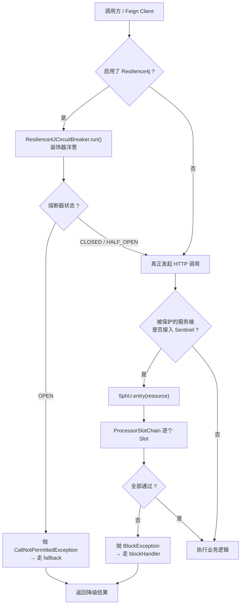

# 06 · 熔断限流与容错

> 一句话：**"服务不稳时，是让它拖死整条链路，还是快速失败？"** 这一组文章回答两个问题——Spring Cloud 5.1.0 提供的那层 **融断器抽象**（`CircuitBreakerFactory`）到底抽象了什么、Resilience4j 怎么把它落地；以及 **Sentinel 1.8.10** 那条从 `SphU.entry()` 开始的责任链，是如何在**几十纳秒**内决定"放行/拒绝"的。
>
> 预计阅读：**3~4 小时**（两篇长文，各 40~60 分钟精读 + 练习）。

---

## 学完你能

1. 说清 Spring Cloud 的 `CircuitBreakerFactory` / `CircuitBreaker` / `ReactiveCircuitBreaker` 三层抽象各自负责什么，为什么**只有一个 `run(...)` 方法**。
2. 逐行读懂 `Resilience4JCircuitBreaker#run`：**装饰器洋葱**（限流 → 舱壁 → 时间限制 → 重试 → 熔断）的包裹顺序，以及"顺序换一下会发生什么"。
3. 解释 **CLOSED / OPEN / HALF_OPEN** 三态与 `slidingWindowSize`、`failureRateThreshold`、`minimumNumberOfCalls`、`waitDurationInOpenState` 的相互作用，并算清 **"重试放大流量"** 的倍数。
4. 说清 `feign.circuitbreaker.enabled=true` 之后，`fallback` 函数与 `feign.CircuitBreaker` 装饰器、与 Resilience4j 的 `CallNotPermittedException` 之间的**调用链**。
5. 从 `SphU.entry("res")` 一路追到 `FlowRuleChecker#canPassCheck`：`NodeSelectorSlot → ClusterBuilderSlot → StatisticSlot → FlowSlot → DegradeSlot → SystemSlot` 每个 Slot 干什么。
6. 讲清 **滑动窗口** `LeapArray` 的"两桶 500ms"默认配置意味着什么、`currentWindow` 的四个分支分别处理什么边界场景。
7. 区分 **`blockHandler`（限流/降级触发的 `BlockException`）** 与 **`fallback`（业务异常）** 的触发条件与优先级。
8. 知道 Sentinel 规则为什么默认"重启即丢"，以及如何用 **Nacos 数据源**做持久化、如何排查规则没生效。

---

## 目录

| # | 文章 | 主线 | 源码入库情况 |
|---|---|---|---|
| 1 | [01-circuitbreaker-抽象与resilience4j.md](./01-circuitbreaker-抽象与resilience4j.md) | `spring-cloud-commons` 的 `CircuitBreaker` 抽象 → `spring-cloud-circuitbreaker-resilience4j` 的实现 → Feign 装饰器 | ✅ 已入库 10 个类（含 `Resilience4JCircuitBreaker`） |
| 2 | [02-sentinel-限流降级原理.md](./02-sentinel-限流降级原理.md) | `SphU` → `CtSph` → `ProcessorSlotChain` → `FlowRuleChecker` / `LeapArray` | ✅ 已入库 6 个类；各 `Slot` 实现类**未入库，文中标注"未验证"** |

延伸阅读：
- 上游总目录：[../README.md](../README.md)
- 配置刷新（规则从 Nacos 推送过来的那一段）：[../05-配置中心与Bus/README.md](../05-配置中心与Bus/README.md)
- 代理与 AOP（`@CircuitBreaker` / `@SentinelResource` 都靠 AOP 生效）：[../../01-Spring框架/](../../01-Spring框架/)

---

## 两篇摘要

### 01 · 熔断限流与容错之 Spring Cloud 抽象 + Resilience4j

Spring Cloud 自己**不实现熔断**，它只定义了一个极薄的抽象：

```text
CircuitBreakerFactory#create(id)  →  CircuitBreaker（命令式，run/run+fallback）
                                 →  ReactiveCircuitBreaker（响应式，Mono/Flux）
```

`Resilience4JCircuitBreaker#run` 是最值得逐行读的一段——因为它用**函数装饰**把一个 `Supplier<T>` 一层层包起来：

```text
bulkhead → timeLimiter → circuitBreaker → retry → (真正执行)
```

这个包裹顺序并不是随便排的：**重试必须在熔断器"外面"**（这样一次用户请求的多次重试都能被熔断器看到并计入失败率），**时间限制必须在熔断器"里面"**（超时才算一次失败）。顺序错了，你会得到"熔断器永远打不开"或"一次超时被记成 N 次失败"这类灵异现象。

文章还会讲清 **`BlockingCircuitBreakerFactory` 并不存在于 5.1.0**（这是网上大量 2020 年前后教程里的旧名字），5.1.0 里对应的是 `CircuitBreakerFactory` + `AbstractCircuitBreakerFactory`。

### 02 · Sentinel 1.8.10 限流降级原理

Sentinel 的入口只有一行：

```java
Entry entry = SphU.entry("my-resource");
try { /* 业务 */ } finally { entry.exit(); }
```

但这一行内部做了五件事：拿到资源包装 → 找到该资源的**唯一一条 SlotChain**（懒加载、全局共享）→ 沿链执行 → 任一 Slot 抛 `BlockException` 就回滚这次 Entry → 把统计写进 `DefaultNode`（进而汇总到 `ClusterNode`）的 `LeapArray` 环形数组。

本组文章用**逐行源码**讲清：
- `CtSph#lookProcessChain` 为什么用"`volatile` 引用 + copy-on-write 整表替换"而不是 `ConcurrentHashMap`；
- `FlowRuleChecker` 如何用 `limitApp + strategy` 二维组合选出"该看哪个节点的统计"（直接/关联/链路三种）；
- `LeapArray#currentWindow` 的四个分支如何在无锁情况下处理"空槽 / 同桶 / 过期重置 / 时钟回退"。

---

## 一张总图：请求进来时的两道闸门



**读图说明**：

1. 图里刻意画出**两个不同的"闸门位置"**：Resilience4j 的熔断在**调用方进程内**，它只知道"我调它失败了"；Sentinel 的限流在**被调用方进程内**，它知道"我这个接口现在 QPS 多少"。
2. `feign.circuitbreaker.enabled` 只影响左边那一半——它是"客户端侧"的保护。
3. 一个常见的架构是：**两边都开**。客户端用熔断避免被下游拖死，服务端用 Sentinel 保护自己的数据库连接池。此时一次失败可能**同时**体现在两端（客户端记一次熔断失败，服务端记一次 `BlockException`），排查时要分清日志里的异常类型。
4. 图中 `D -- OPEN` 分支直接抛异常、**根本不发请求**——这就是"熔断"和"超时"的本质差别（熔断几乎零延迟，超时要等满超时时间）。
5. 最下方的 `M` 汇聚点说明：**无论哪道闸门拒绝，最终都要给调用方一个"合理的返回值"**，这就是 `fallback` / `blockHandler` 的存在意义。

---

## 学习检查点

做完下面这些打勾，说明这一组真的学会了：

- [ ] 能画出 `Resilience4JCircuitBreaker#run` 的装饰器包裹顺序，并说出**为什么重试在熔断外层**。
- [ ] 能算出"`maxAttempts=3` + 熔断 `minimumNumberOfCalls=10`"时，**3 个用户请求**会不会打开熔断器（提示：会，因为失败采样是 9 次）。
- [ ] 能解释 `waitDurationInOpenState` 到期后**只有一次**（或配置的 `permittedNumberOfCallsInHalfOpenState` 次）试探请求，而不是全部放行。
- [ ] 能默写 `SphU.entry()` 内部至少 5 个步骤。
- [ ] 能说出 `NodeSelectorSlot` 与 `ClusterBuilderSlot` 的分工（前者为每个 `Context` 建 `DefaultNode`，后者为每个资源建全局 `ClusterNode`）。
- [ ] 能解释为什么 `LeapArray` 默认"2 个桶 × 500ms"时，限流 QPS 判定会有**跨桶边界误差**。
- [ ] 能说出 `blockHandler` 与 `fallback` 三个层面的区别：**触发异常类型**、**方法签名**、**优先级**。
- [ ] 能说出 Sentinel 规则持久化的三种方式，以及为什么"推模式（Nacos）"优于"拉模式"。
- [ ] 知道哪些类本仓库**没有源码入库**（各 `Slot` 实现、`SentinelResourceAspect`、Nacos 数据源、Feign 的熔断装饰器），以及文中如何标注"未验证"。

---

## 约定与红线

- 本组文章的**所有行号**都来自本仓库 `assets/source/` 下已入库的 `.java.md` 文件，逐行核对过。
- 凡是**没有入库**的类，文中只描述"它做什么"，并显式标注 **"未入库，类名/行号未验证"**——绝不编造行号。
- 版本基线：Spring Cloud **5.1.0**、Spring Boot **4.2.0**、Sentinel **1.8.10**、Resilience4j（由 `spring-cloud-circuitbreaker-resilience4j:5.1.0` 传递引入）。
