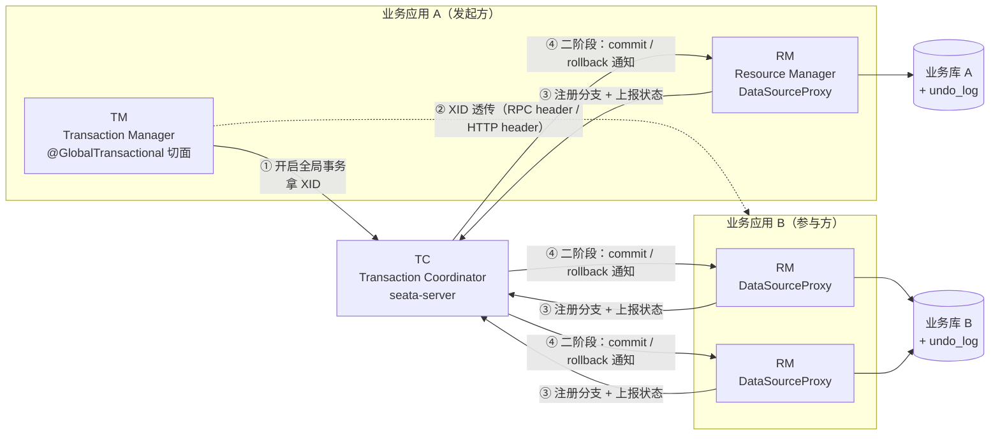
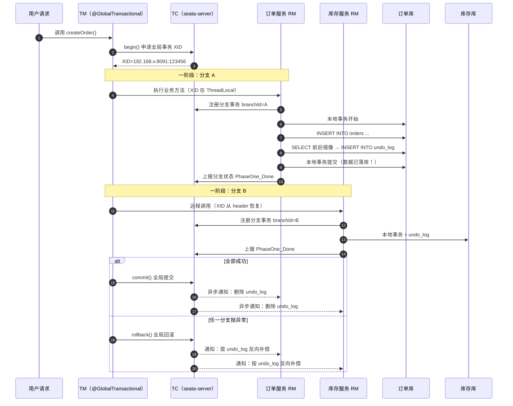
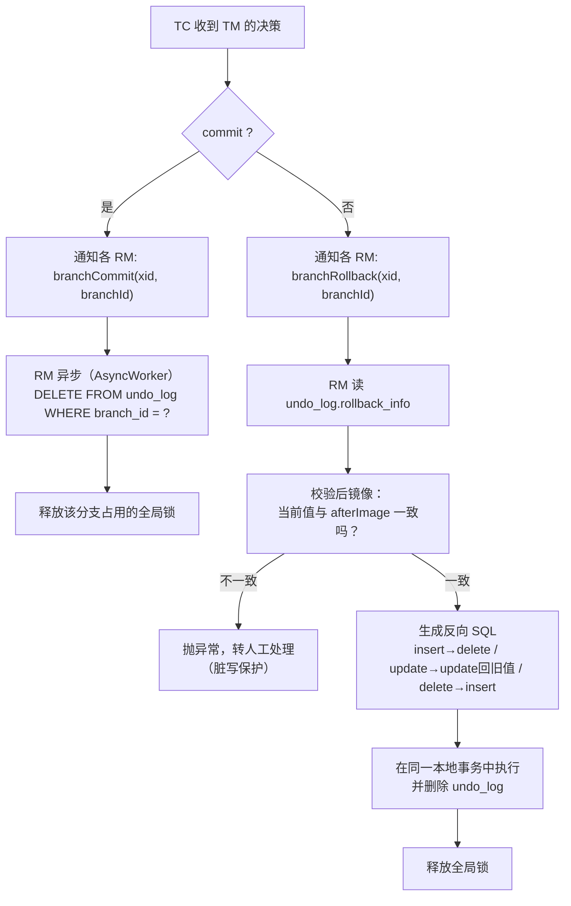
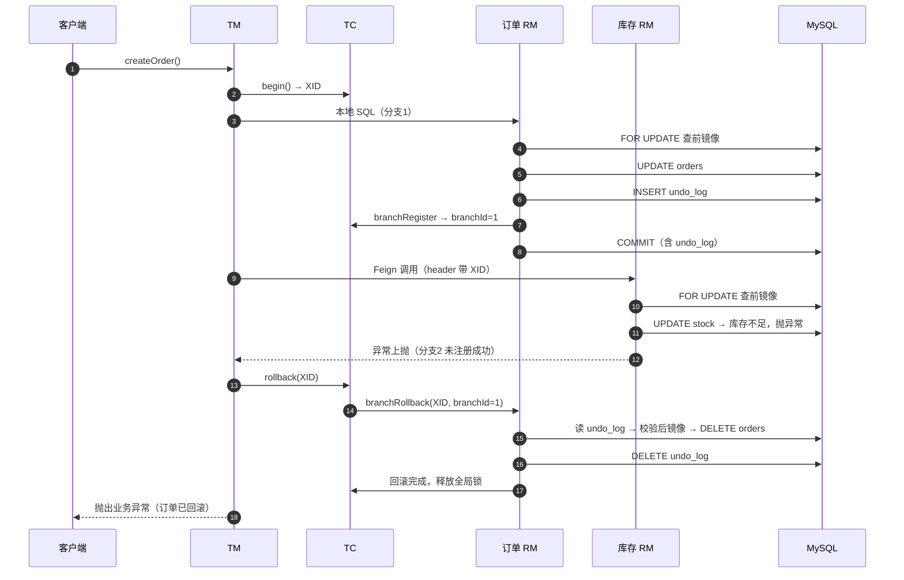

# Spring Cloud 源码精读 07-1：分布式事务 Seata AT 模式原理

> **一句话结论**：Seata AT 模式的本质是"**一个全局锁 + 一张 undo_log 表 + 两阶段异步提交**"——`@GlobalTransactional` 通过 AOP 打开全局事务，把 XID 放进 ThreadLocal 并透传到下游；每个分支事务在执行真实 SQL 的**同一条本地事务**里顺手写一份 `undo_log`（前后镜像）；全部成功后 TC 通知各分支异步删除 undo_log（提交），任一失败则 TC 通知各分支用 undo_log 反向补偿（回滚）。
>
> **阅读前置**：读过 [../05-配置中心与Bus/README.md](../05-配置中心与Bus/README.md)（知道 Nacos 配置中心在干什么）、[../../01-Spring框架/](../../01-Spring框架/)（知道 AOP 代理与 `@Transactional` 的拦截时机）。不需要你懂分布式共识算法。
>
> **预计阅读**：**60~75 分钟**。
>
> **源码基线**：Seata **2.7.0**。
>
> ⚠️ **本章未附源码摘录，因 sources jar 不可得；行号与类名以官方 GitHub v2.7.0 为准，未在本仓库验证。**
> 本仓库的 `node tools/list-jar.mjs io.seata:seata-all:2.7.0`、`io.seata:seata-spring-boot-starter:2.7.0`、`io.seata:seata-spring:2.7.0` 三次尝试均返回 `sources jar 下载失败`（Maven Central 上这三个坐标的 `-sources.jar` 为 404）。因此本章**只讲原理、类名与流程**，不写 `(src: ...)` 行号标注——凡出现具体类名，都只表示"官方实现里有这么一个类"，**不提供已验证的行号**。

---

## 0. 先看现象

| 现象 | 你可能的第一反应 | 真正常见的原因 |
|---|---|---|
| 订单创建成功，库存没扣，但订单状态是"已完成" | "代码写错了" | 库存服务抛了异常被 `try-catch` 吞掉了；Seata 只在**异常向上抛出到 `@GlobalTransactional` 切面**时才回滚 |
| 回滚了，但下游服务的数据没回滚 | "Seata 坏了" | 下游方法没有被 `@GlobalTransactional` 的事务传播覆盖（跨线程、MQ 异步、未注册 RM），XID 没传过去 |
| 报 `io.seata.common.exception.ShouldNeverHappenException: no available service 'null' found` | "注册中心挂了" | 应用没配 `seata.registry`（或 Nacos 里 `seata-server` 未注册），TC 地址拿不到 |
| 启动报 `Table 'xxx.undo_log' doesn't exist` | "建表脚本没执行" | AT 模式要求**每个业务库**都有 `undo_log` 表 |
| 高并发下大量 `LockConflictException` | "Seata 性能不行" | 全局锁竞争：同一行数据被多个全局事务改。AT 模式**不能**替代业务上的幂等与顺序设计 |
| `@GlobalTransactional` 加了但不生效 | "注解没扫到" | 方法内部 `this.b()` 自调用——AOP 代理被绕过；或方法不是 `public` |
| 有的分支回滚了，有的没回滚，数据半新半旧 | "事务没生效" | 空回滚/悬挂/幂等三大坑之一（见 §6） |

---

## 1. 整体地图

### 1.1 三大角色：TC / TM / RM



**读图说明**：

1. **TC 是独立进程**（`seata-server`），不存业务数据，只存"全局事务 → 分支事务"的会话与**全局锁**。它挂掉期间业务仍能跑一阶段，但二阶段推进会卡住（2.7.0 有 TC 高可用集群与重试机制，但**不是无状态**）。
2. **TM 与 RM 都在业务进程里**。TM 是"全局事务的发起者与决策者"（决定 commit 还是 rollback），RM 是"数据源的代理人"（`DataSourceProxy` 就是 RM 的入口）。
3. 注意 ② 那条**虚线**：XID 不是 Seata 偷偷传的，它要靠 **RPC/HTTP 框架的 header 透传**（Dubbo 用 `Attachment`，Spring Cloud 用 `RequestInterceptor` / `RestTemplate` 拦截器）。**这条线断了，全局事务就断成两个独立本地事务**。
4. ④ 是二阶段：**只有 TC 发通知，业务代码无感知**。这是 AT 模式"对业务零侵入"的关键。
5. 一个业务库可以注册多个 RM（多数据源），但**每个数据源都要单独被 `DataSourceProxy` 包一层**，否则那条 SQL 不受 Seata 管。

### 1.2 AT 模式两阶段：先本地提交，再反向补偿



**读图说明**：

1. **最关键的一点**：一阶段结束时**业务数据已经真实提交到数据库了**（图中"本地事务提交（数据已落库！）"）。AT 模式不是 XA 那种"prepare 阶段不提交"，而是"**先提交，错了再补偿**"。所以：
   - 好处：一阶段不长时间持有数据库锁，性能远高于 XA；
   - 代价：**中间态是可见的**——在全局提交/回滚之前，别的读请求可能读到"已扣库存但订单未建"的数据。这是 AT 模式最大的语义差异，必须靠业务上的"状态机 + 幂等 + 对账"兜底。
2. **undo_log 与业务 SQL 在同一个本地事务里**——这是保证"业务有变更必有 undo_log"的唯一办法（原子性）。
3. 二阶段 **commit 只是删 undo_log**，非常轻；因此 Seata 可以把它做成**异步**的。
4. 二阶段 **rollback 才是真活儿**：RM 用 undo_log 里的**前镜像**生成反向 SQL（insert 的反向是 delete、update 的反向是按主键 update 回旧值），并且要先**校验后镜像**（`SELECT ... FOR UPDATE` 比对当前值是否与 afterImage 一致），防止"别人在我之后又改了这一行"。
5. 图中 `alt` 分支说明：TM 只做决策，真正的推进由 TC 逐个通知 RM 完成。

---

## 2. 关键类逐个拆

> 下表所有类名来自 Seata 官方 v2.7.0 的实现，**但本仓库未入库对应源码，行号未验证**。列"职责"是工作原理层面的描述，不是从源码逐行抄的。

| 类 | 所在模块（官方） | 职责 | 一句话记忆 |
|---|---|---|---|
| `GlobalTransactional` | `seata-spring`（注解包） | 方法级注解，标记全局事务边界；属性 `name`/`rollbackFor`/`timeoutMills`/`lockRetryInterval` 等 | "全局事务的开关" |
| `GlobalTransactionScanner` | `seata-spring` | 实现 `BeanPostProcessor` + `AbstractAutoProxyCreator`，为带 `@GlobalTransactional` 的 Bean 创建 AOP 代理 | "给 Service 套一层 TM 代理" |
| `GlobalTransactionalInterceptor` | `seata-spring` | 真正的方法拦截器：`begin → 执行业务 → commit/rollback` | "TM 的大脑" |
| `TransactionalTemplate` | `seata-tm`（`io.seata.tm.api`） | 把 `begin/commit/rollback` 抽象成模板方法，统一处理超时与异常 | "事务的模板方法" |
| `GlobalTransaction` / `DefaultGlobalTransaction` | `seata-tm` | 持有 XID、状态、超时时间 | "全局事务句柄" |
| `RootContext` | `seata-common` 契约层 | 用 `ThreadLocal`/`ContextCore` 保存当前 XID | "**XID 的家**" |
| `DataSourceProxy` | `seata-rm-datasource` | 包装 `javax.sql.DataSource`，把 `getConnection()` 返回的 `Connection` 换成 `ConnectionProxy` | "RM 的入口" |
| `ConnectionProxy` | `seata-rm-datasource` | 拦截 `prepareStatement`，把 `Statement` 换成 `StatementProxy` | "SQL 拦截点" |
| `ExecuteTemplate` / `AbstractDMLBaseExecutor` | `seata-rm-datasource` | 按 SQL 类型分发到 `InsertExecutor`/`UpdateExecutor`/`DeleteExecutor`/`SelectForUpdateExecutor` | "SQL 分类执行器" |
| `BaseTransactionalExecutor#buildUndoItem` | `seata-rm-datasource` | 查前镜像（`selectForUpdate`）、执行 SQL、查后镜像，生成 `TableRecords` | "生成 undo_log 的核心" |
| `UndoLogManager` | `seata-rm-datasource` | 写/删 undo_log，以及回滚时"反序列化 + 生成反向 SQL" | "补偿的执行者" |
| `AbstractUndoExecutor` 及其子类（`UndoInsertExecutor`/`UndoUpdateExecutor`/`UndoDeleteExecutor`） | `seata-rm-datasource` | 每种 DML 对应的反向操作 | "反向 SQL 工厂" |
| `ConnectionProxy#doCommit` | `seata-rm-datasource` | 本地提交前**注册分支**（`branchRegister`）并上报 `PhaseOne_Done` | "一阶段的收尾" |
| `TransactionManager`（接口）/ `DefaultTransactionManager` | `seata-core` | 封装与 TC 的 RPC：`begin`/`commit`/`rollback`/`branchRegister`/`branchReport`/`globalLock` | "和 TC 说话的人" |
| `ResourceManager` / `DefaultResourceManager` | `seata-core` | 管理 RM 资源（`AsyncWorker` 处理 TC 的二阶段请求） | "二阶段的接收者" |
| `UndoLogTable`（`undo_log` 表） | 业务库 | 存前后镜像（`rollback_info` 序列化字节） | "补偿的凭据" |

---

## 3. 原理逐段拆

> 本节按"执行顺序"拆成 8 段。每段的结构是：**在干什么 / 为什么这么设计 / 改别的会怎样 / 常见坑**。因为没有源码可引，所有描述都停留在"设计意图 + 关键调用点"级别，**不给行号**。

### 3.1 `@GlobalTransactional` 如何变成一次全局事务

```java
// 业务代码（示意，非源码摘录）
@GlobalTransactional(name = "create-order", rollbackFor = Exception.class, timeoutMills = 30000)
public void createOrder(OrderDTO dto) {
    orderMapper.insert(dto.toOrder());      // 分支 1：本地库
    stockClient.deduct(dto.getSkuId(), 1);  // 分支 2：远程调用
}
```

**在干什么**：`GlobalTransactionScanner` 在 Bean 初始化后，扫描所有被 `@GlobalTransactional` 标注的类/方法，为它们创建 CGLIB/JDK 代理；方法调用时进入 `GlobalTransactionalInterceptor#invoke`，后者委托给 `TransactionalTemplate#execute`。

**为什么**：Seata 要"零侵入"，就不能要求你改业务方法签名，只能用 AOP。这与 Spring 的 `@Transactional` 完全同一套思路（见 [../../01-Spring框架/](../../01-Spring框架/)），只是拦截器不同。

**改别的会怎样**：如果不用 AOP 而用"显式 API"（`GlobalTransaction tx = GlobalTransactionContext.getCurrentOrCreate(); tx.begin(); ... tx.commit();`），代码污染大但**没有自调用失效问题**——这是排查"注解不生效"时最后的退路。

**常见坑**：
- **同类自调用**：`this.createOrderInner()` 不走代理，注解形同虚设。
- **方法非 `public`**：CGLIB 代理无法覆盖 `private`/`final` 方法。
- **异常被吞**：`try { ... } catch (Exception e) { log.error(...); }` 之后，切面看到的是"正常返回"，于是**提交**。想回滚必须让异常抛出去，或者显式标记回滚。
- `rollbackFor` 默认只对 `RuntimeException` 回滚（与 Spring 一致），受检异常要显式配置。

### 3.2 `TransactionalTemplate#execute`：全局事务的生命周期骨架

伪代码（**根据官方设计整理，非源码摘录**）：

```text
execute(business, xid) {
    tx = getCurrentOrCreate()
    tx.begin(timeout)                        // ① TM 向 TC 申请 XID
    RootContext.bind(tx.getXid())            // ② XID 放进 ThreadLocal
    try {
        business.execute()                   // ③ 执行业务（内含 N 个分支）
        tx.commit()                          // ④ 全部成功 → 全局提交
    } catch (Throwable e) {
        if (isRollbackNeeded(e)) tx.rollback()   // ⑤ 任一失败 → 全局回滚
        throw e
    } finally {
        RootContext.unbind()                 // ⑥ 清理 ThreadLocal
    }
}
```

**在干什么**：把"开事务—绑定上下文—跑业务—按结果提交/回滚—清理上下文"这五步固定下来。

**为什么**：如果业务代码自己管 `begin`/`commit`，一定会有人在某个 `catch` 分支忘了 `rollback`，导致 TC 上的会话泄漏、全局锁不释放。模板方法把"必须配对"的操作锁在一个方法里。

**改别的会怎样**：如果去掉 `finally` 里的 `unbind`，线程池复用线程时，下个请求会**继承上一个请求的 XID**——这是生产事故级别的 bug（表现为"毫不相关的两个请求被卷进同一个全局事务"）。

**常见坑**：`tx.begin` 失败（TC 不可达）时，有些版本会把 `begin` 异常包装后继续执行本地事务，造成"以为是全局事务其实是本地事务"。生产上必须监控 TC 连通性。

### 3.3 XID 的透传：全局事务"活下来"的唯一通道

| 调用方式 | 透传机制（官方提供） | 断链原因 |
|---|---|---|
| Dubbo | RPC `Attachment` 里的 `TX_XID` key（`DubboTransactionPropagationFilter`） | 自定义 Filter 顺序把它清掉了；或用了 `async` 但没处理 |
| Spring Cloud OpenFeign | `RequestInterceptor`（`SeataFeignClientAutoConfiguration` 系） | Feign 客户端被别的 `RequestInterceptor` 覆盖；或用了原生 `RestTemplate` 但没装拦截器 |
| RestTemplate | `SeataRestTemplateInterceptor`（需显式注册） | **最常见**：直接 `new RestTemplate()` 不会带 XID |
| WebClient / 响应式 | 通过 Reactor Context 传播 | 手动 `publishOn`/`subscribeOn` 切换线程后 Context 丢失 |
| 线程池 / `@Async` | **默认不传播** | 子线程 `RootContext` 为空 → 该分支不受全局事务管理 |
| MQ | 需要业务自己在消息头里塞 XID，消费端再 `RootContext.bind` | 忘绑 → 消费端变成独立本地事务 |

**在干什么**：把 `RootContext` 里的 XID 序列化进远程调用的 header。

**为什么**：Seata 没有"全局事务上下文服务器"，XID 只能**跟着调用链走**。这也是为什么 Seata 有"XID 断链"这个高频故障类。

**改别的会怎样**：如果想省事，可以让下游服务"所有本地事务都自动加入当前 XID"（`seata.enable-auto-data-source-proxy`），但**前提仍是 XID 能到**——数据源代理不会帮你跨网络传 XID。

**常见坑**：一次请求里既有 Feign 又有 MQ，Feign 那段有 XID、MQ 那段没有，结果 MQ 消费失败不回滚、也不影响全局——**事务语义被悄悄削弱**。

### 3.4 一阶段：`DataSourceProxy` + `ConnectionProxy` 如何偷梁换柱

```java
// 配置方式（示意）
@Bean
public DataSource dataSource() {
    DruidDataSource ds = new DruidDataSource();
    // ... 配置 url / username / password
    return new DataSourceProxy(ds);   // 关键：包一层
}
```

**在干什么**：
1. `DataSourceProxy#getConnection()` 先判断"当前有没有 XID"（`RootContext.inGlobalTransaction()`）；
2. 有 XID → 返回 `ConnectionProxy`（内部持有真实连接），否则直接返回真实连接；
3. `ConnectionProxy#prepareStatement(sql)` 按 SQL 首关键字创建对应的 `StatementProxy`；
4. `StatementProxy#execute` 交给 `ExecuteTemplate#execute`，`ExecuteTemplate` 用 `SQLRecognizer` 识别出 `INSERT/UPDATE/DELETE/SELECT_FOR_UPDATE`，分发到对应 `Executor`。

**为什么**：Seata 要在**不改业务 SQL** 的前提下拿到"这条 SQL 改了什么"。唯一可行的办法是在 JDBC 层做代理——`java.sql` 接口足够窄（`Connection`/`Statement`/`PreparedStatement`/`ResultSet`），代理成本可控。

**改别的会怎样**：如果只包了主数据源、漏了从库或分库分表的多个 `DataSource`，那条链路就没有 undo_log；表现为"部分数据能回滚，部分不能"。

**常见坑**：
- **重复包装**：`new DataSourceProxy(new DataSourceProxy(ds))` 会导致 SQL 被拦截两次。
- **与分库分表中间件冲突**：ShardingSphere 与 Seata 都实现 `DataSource`，谁包谁决定了事务与路由的先后。
- **连接池健康检查**：某些连接池的 `validationQuery` 走了代理之外的真实连接，日志里会出现"undo_log 未生成"的错觉。

### 3.5 一阶段核心：`buildUndoItem` 与 undo_log 的写入

以一条 `UPDATE stock SET count = count - 1 WHERE id = 1` 为例，一阶段的**真实动作序列**（官方设计）：

```text
1. SQL 解析：得到表名 stock、主键 id=1、set 列 count
2. 前镜像（beforeImage）：
   SELECT id, count FROM stock WHERE id = 1 FOR UPDATE
   → 拿到 {id:1, count:10}，并借此加行锁（防止并发改写）
3. 执行原 SQL：UPDATE stock SET count = count - 1 WHERE id = 1
4. 后镜像（afterImage）：
   SELECT id, count FROM stock WHERE id = 1
   → {id:1, count:9}
5. 组装 undo_log：
   INSERT INTO undo_log(branch_id, xid, rollback_info, log_status, log_created, log_modified)
   VALUES (?, ?, <序列化(beforeImage+afterImage+SQL类型+表元数据)>, 0, now(), now())
6. 注册分支：TC.branchRegister(xid, resourceId, lockKeys="stock:1") → 拿 branchId
7. 本地事务 COMMIT（业务变更 + undo_log 一起落库）
8. 上报 TC：branchReport(branchId, PhaseOne_Done)
```

**在干什么**：用"查前镜像 → 改 → 查后镜像 → 写 undo_log"这套**四步曲**，把"业务变更"变成"可逆的变更"。

**为什么**：
- 前镜像用 `FOR UPDATE` 查，一次拿两样东西：**旧值** + **行锁**（保证查完到改完之间别人改不了）；
- undo_log 与业务 SQL 放在**同一本地事务**，天然保证"要么都有要么都没有"；
- 镜像以**主键为定位条件**（`afterImage` 里也带主键），这样回滚时 `UPDATE ... WHERE id = ?` 是精确的。

**改别的会怎样**：如果不用镜像而用"反向 SQL"（比如记下 `count = count - 1` 就生成 `count = count + 1`），遇到"非幂等 SQL"（`SET count = 9`、`INSERT ... ON DUPLICATE KEY UPDATE`）就无法还原——所以 AT 模式**必须**用镜像。

**常见坑**：
- **大字段/宽表**：前后镜像会把整行相关列序列化进 `rollback_info`，`TEXT/LONGTEXT/BLOB` 会让 undo_log 暴涨。Seata 有 `undo.data.validation`、列过滤等配置，但根本办法是**别把大字段放进事务表**。
- **无主键表**：AT 模式**要求业务表有主键**，否则镜像无法定位行（官方明确不支持）。
- **`log_status`**：0=正常，1=防御性（全局锁保护），理解这两个状态对排查"悬挂"很关键。

### 3.6 二阶段：commit 是"删日志"，rollback 是"反向补偿"



**读图说明**：

1. **两个阶段的工作量极不对称**：commit 只是删行（甚至能异步批量删），rollback 才要读 + 校验 + 生成 + 执行 SQL。这意味着 **AT 模式在正常路径上几乎零额外开销**——这是它比 XA 快的主要原因。
2. `R3` 的"校验后镜像"是 AT 模式的**脏写保护**：如果在我改完之后，又有别人（非全局事务）把这一行改成了别的值，那"回滚到旧值"就会覆盖别人的修改。此时 Seata 选择**报错而不是覆盖**，把问题抛给人。
3. `R5` 三种反向操作的细节：
   - `INSERT` 的反向 = `DELETE WHERE 主键 = ?`（用 afterImage 的主键）；
   - `UPDATE` 的反向 = `UPDATE SET 所有列 = beforeImage ... WHERE 主键 = ? AND 所有列 = afterImage`；
   - `DELETE` 的反向 = `INSERT INTO ... VALUES (beforeImage...)`。
   注意反向 `UPDATE` 的 `WHERE` 同时带主键与后镜像，是为了**幂等**（重复回滚不会重复生效）。
4. `R6` 要求"执行反向 SQL 与删除 undo_log"在同一个本地事务里——否则可能"补偿成功但没删日志"，下次重试又补偿一次。
5. `C3`/`R7` 的"释放全局锁"是 TC 侧动作：全局锁释放后，其他全局事务才能改这一行。

### 3.7 `undo_log` 表结构

官方建表脚本（MySQL 版本，字段名与含义**与官方 `mysql.sql` 一致**）：

```sql
CREATE TABLE IF NOT EXISTS `undo_log`
(
    `branch_id`     BIGINT       NOT NULL COMMENT 'branch transaction id',
    `xid`           VARCHAR(128) NOT NULL COMMENT 'global transaction id',
    `context`       VARCHAR(128) NOT NULL COMMENT 'undo_log context,such as serialization',
    `rollback_info` LONGBLOB     NOT NULL COMMENT 'rollback info',
    `log_status`    INT(11)      NOT NULL COMMENT '0:normal status,1:defense status',
    `log_created`   DATETIME(6)  NOT NULL COMMENT 'create datetime',
    `log_modified`  DATETIME(6)  NOT NULL COMMENT 'modify datetime',
    UNIQUE KEY `ux_undo_log` (`xid`, `branch_id`)
) ENGINE = InnoDB
  AUTO_INCREMENT = 1
  DEFAULT CHARSET = utf8mb4 COMMENT ='AT transaction mode undo table';
```

| 字段 | 作用 | 排查时会怎么用 |
|---|---|---|
| `branch_id` | 分支事务 ID（TC 分配） | 与 TC 日志里的 `branchId` 对账 |
| `xid` | 全局事务 ID | 全链路排查的**唯一线索**，也是日志里搜的东西 |
| `context` | 序列化方式标记（如 `serializer=jackson`） | 换序列化器后老数据可能解析失败 |
| `rollback_info` | 前后镜像的序列化字节 | 里面能解出具体表、主键、旧值新值 |
| `log_status` | `0` 正常 / `1` 防御性状态 | 出现 `1` 说明有悬挂/延迟回滚风险 |
| `log_created`/`log_modified` | 时间 | 判断"日志停留多久"→ TC 卡住还是 RM 卡住 |
| `ux_undo_log(xid, branch_id)` | 唯一索引 | 防止同一分支重复写 undo_log（**幂等**的第一道防线） |

**常见坑**：
- **唯一索引被删掉**：重复回滚时会重复插入，导致补偿执行两次。
- **每个业务库都要建**：包括分库分表的每个物理库、读写分离的主库。
- **历史数据清理**：正常提交后行会被删除；如果发现 undo_log 大量堆积，说明二阶段没推进（TC 不可达 / RM 掉线）。

### 3.8 与 Nacos 的配合：TC 地址与配置从哪来

```yaml
seata:
  enabled: true
  application-id: order-service
  tx-service-group: my_tx_group          # 事务分组名
  service:
    vgroup-mapping:
      my_tx_group: default               # 分组 → TC 集群名
    grouplist:
      default: 127.0.0.1:8091            # 直连（可选）
  registry:
    type: nacos
    nacos:
      application: seata-server
      server-addr: 127.0.0.1:8848
      namespace: ""
      group: SEATA_GROUP
  config:
    type: nacos
    nacos:
      server-addr: 127.0.0.1:8848
      group: SEATA_GROUP
      data-id: seataServer.properties
```

**在干什么**：
- `registry`：Seata 客户端/服务端把 `seata-server` 注册到 Nacos，客户端按 `tx-service-group → vgroup-mapping → 集群名` 找到可用的 TC 地址列表（返回的是 **netty 端口**，不是 HTTP）。
- `config`：`seata-server` 自己的配置（存储模式、锁配置、超时）从 Nacos 拉，改完 **推模式** 生效。

**为什么**：Seata 早期用 file 配置 + 直连 IP，扩缩容要改所有应用；换 Nacos 后 TC 集群 Address 由注册中心动态提供，天然支持多节点与故障摘除。

**改别的会怎样**：只用 `grouplist` 直连不走注册中心，TC 扩容后新节点不会被发现；只用注册中心不配 `tx-service-group`/`vgroup-mapping`，会出现 `no available service 'null' found`（图里 `null` 就是分组名为空）。

**常见坑**：
- Nacos 的 **namespace/group 与 seata-server 不一致** → 客户端查不到实例（控制台能看到，客户端看不到）。
- **注册的是 HTTP 端口而客户端要 netty 端口**（3.x/2.x 端口语义变化），表现为"能连上但一直 `connect timeout`"。
- `tx-service-group` 名字拼错一个字母 → 上面那个 `null` 异常。

---

## 4. 一次完整执行时序（含失败回滚）



**读图说明**：

1. 注意第 8 步：**订单已经在数据库里了**（一阶段已提交），客户端此刻如果直接查库，是能看到这条订单的。这就是 §1.2 讲的"中间态可见"。
2. 库存分支在 `UPDATE stock` 时失败——如果它**已经写了 undo_log 但没提交**，本地事务回滚会连 undo_log 一起回滚，不需要补偿；如果它提交后才失败，就必须靠补偿。
3. `branchRollback` 只发给"**已注册成功**"的分支（branchId=1）。未注册成功的分支无需补偿——这正是"**空回滚**"要解决的问题的反面：TC 有时无法判断某分支到底注册没注册。
4. 整个回滚期间，**订单行上还挂着全局锁**（TC 侧），其他全局事务改不了它；但**普通本地事务能改**——这是 AT 模式与"数据库行锁"的区别。
5. 最后一步客户收到的是**原始业务异常**（Seata 不会把异常吃掉），这点和 `@Transactional` 一致。

---

## 5. 四种模式对比：AT / TCC / SAGA / XA

| 维度 | **AT**（自动补偿） | **TCC**（Try-Confirm-Cancel） | **SAGA**（长事务编排） | **XA**（数据库两阶段提交） |
|---|---|---|---|---|
| 一阶段是否提交 | **提交**（本地事务真提交） | 只做"资源预留"（Try） | 直接提交（每个正向步骤） | **不提交**（`XA PREPARE`） |
| 二阶段 | 删 undo_log / 反向补偿 | Confirm / Cancel（**要写 3 个接口**） | 依次执行补偿步骤 | `XA COMMIT` / `XA ROLLBACK` |
| 业务侵入性 | **极低**（加个注解 + 数据源代理） | **高**（每个服务 3 个方法 + 幂等 + 幂等表） | 中（每步一个补偿方法） | 极低（改数据源 + 驱动支持） |
| 隔离性 | **读未提交级别**（中间态可见） | 由业务自己保证（资源已冻结） | 无隔离（最终一致） | 接近**串行化**（锁一直持有到二阶段） |
| 性能 | 高（一阶段不占锁，二阶段异步） | 高 | 高 | **低**（长事务、连接占用） |
| 实现难度 | 无 | 高 | 中 | 中 |
| 失效风险 | 脏写、空回滚、悬挂 | 空回滚、悬挂、幂等 | 补偿不幂等、编排错误 | 长时间锁 → 连接池耗尽 |
| 适用场景 | 普通 CRUD 的跨服务事务 | 资金、库存等**需要预留**的场景 | 长流程（多个外部系统、无法回滚的动作） | 强一致、低并发（银行账务） |
| 数据库要求 | 有主键 + `undo_log` 表 | 无特殊要求 | 无特殊要求 | 支持 XA（MySQL `InnoDB` 支持） |

**一句话选型**：
- 90% 的互联网业务用 **AT** 够了（本文重点）；
- 金额类、需要"预扣额度"的用 **TCC**；
- 有"不可回滚步骤"（发短信、调外部接口）或流程很长（几分钟）用 **SAGA**；
- 金融核心、强一致、并发不高用 **XA**。

---

## 6. 三大经典问题：空回滚 / 悬挂 / 幂等

这三个问题**不只属于 TCC**，AT 模式同样存在（只是 Seata 用 `log_status`、全局锁与全局事务状态帮你兜了一部分）。

| 问题 | 产生过程 | 危害 | Seata/AT 的处理 | TCC 业务侧的处理 |
|---|---|---|---|---|
| **空回滚** | 分支事务**没执行**（Try 没到 / 一阶段失败），却收到了回滚通知 | 补偿逻辑误删/误加数据 | RM 侧发现没有 undo_log，直接返回成功（什么都不做） | Cancel 方法要先查"Try 是否执行过"，没执行就**直接返回成功** |
| **悬挂** | 回滚通知**先到**，Try 请求**后到**（网络延迟/RPC 乱序） | 回滚之后 Try 又把资源扣了，这笔资源**永久悬挂** | TC 拒绝"已回滚的全局事务"再注册分支 | Try 方法执行前**检查/写入"是否已回滚"的记录**，已回滚则拒绝执行 |
| **幂等** | 同一分支的补偿被**重复调用**（TC 重试、网络重发） | 重复扣减、重复插入 | `undo_log` 的 `ux_undo_log(xid,branch_id)` 唯一索引 + 反向 SQL 带 afterImage 校验 | Cancel/Confirm 必须**幂等**（状态机 + 幂等表） |

**记忆口诀**：**"空回滚查有没有做，悬挂查要不要做，幂等查做过几次"**。

---

## 7. ⚠️ 版本差异 与 与本地 `@Transactional` 的关系

### 7.1 `@GlobalTransactional` 与 `@Transactional` 的先后

| 概念 | 层级 | 谁管 |
|---|---|---|
| `@GlobalTransactional` | **全局**（跨服务） | Seata TM/TC |
| `@Transactional` | **本地**（单库） | Spring `PlatformTransactionManager` |

**正确姿势**：

```text
方法调用
 └─ @GlobalTransactional 切面（外层）      ← 先开全局事务，bind XID
     └─ @Transactional 切面（内层）        ← 再开本地事务
         └─ 业务 SQL + undo_log
```

**为什么必须"全局在外、本地在内"**：
- 全局事务要覆盖整个方法（包括远程调用），所以必须是最外层；
- 每个本地事务只是全局事务的一个分支，所以必须在内层；
- 如果顺序反过来（全局在里、本地在外），本地事务会在全局提交之后才提交，**回滚信息来的太晚**——这是典型的"注解顺序错导致事务不生效"。

**Spring 里怎么保证顺序**：`GlobalTransactionalInterceptor` 通常以较高优先级（`Ordered.HIGHEST_PRECEDENCE` 附近）的 Advisor 参与，使全局事务的代理处于外层。若项目里自定义了 `@Transactional` 的 `order` 或用了多个 `TransactionInterceptor`，需要显式核对（**具体 order 数值本仓库未验证**）。

**常见坑**：
- 同一方法上两个注解都加是**正常且推荐**的；
- 但**只有** `@Transactional` 时，跨服务不会回滚；
- **只有** `@GlobalTransactional` 时，本地 SQL 仍然有本地事务（Seata 的 `ConnectionProxy` 会用它），但**事务传播行为**（`REQUIRES_NEW` 等）语义会变化，需要单独测试。

### 7.2 版本差异

| 项 | 旧版本 | 2.7.0 | 影响 |
|---|---|---|---|
| 配置前缀 | `seata.*` 一直保留，早期有 `spring.cloud.alibaba.seata.*` | 统一 `seata.*` | 老教程里的前缀会有警告 |
| 数据源自动代理开关 | `seata.enable-auto-data-source-proxy`（默认 true） | 同名保留；2.x 推荐显式声明 `DataSourceProxy`，避免与多数据源框架冲突 | 多数据源场景容易"只代理了一个" |
| 注册中心 | 早期支持 Eureka/Consul/ZK | 主推 Nacos | 配置项 `seata.registry.type` |
| 存储模式（TC 侧） | file / db / redis | file / **db** / redis（raft 模式已并入） | 生产必须用 db，否则 TC 重启会话丢失 |
| 事务分组 | `tx-service-group` + `vgroup-mapping` | 相同，但 2.x 支持 `service.vgroup-mapping.<group>: default` 简写 | 拼错即 `no available service 'null'` |
| API 包名 | 1.x 曾出现 `io.seata.*` 与 `com.alibaba.*` 混用 | 统一 `org.apache.seata.*`（2.x 迁移后） | **老代码 import 会编译失败** |

> ⚠️ 上面"API 包名"一行尤其要注意：2.x 之后官方包名从 `io.seata` 迁到 `org.apache.seata`，但 Maven 坐标仍是 `io.seata:seata-*`（这也是本章查 sources jar 失败时使用的坐标）。**具体哪些类改了包名、改到什么程度，本仓库未验证**，升级前请以官方升级指南为准。

---

## 8. 面试高频问与答

**Q1：AT 模式和 XA 有什么本质区别？**
A：XA 是**数据库层面**的两阶段提交：一阶段 `PREPARE` 不提交、锁一直持有到二阶段 `COMMIT`，隔离性强但性能和并发差。AT 是**应用层面**的"先提交 + 后补偿"：一阶段就把本地事务提交了（数据可见），靠 `undo_log` 在需要时反向补偿。AT 性能远好于 XA，但隔离性弱（中间态可见）。

**Q2：undo_log 为什么必须和业务 SQL 在同一个本地事务里？**
A：为了原子性。如果业务 SQL 提交了但 undo_log 没写成功，回滚时就**没有任何凭据**可以还原；反之如果 undo_log 写了但业务没提交，会留下"无对应变更的日志"。放同一事务里，二者要么都有要么都没有。

**Q3：为什么 AT 模式要求业务表有主键？**
A：回滚时要用"主键"精确定位到行。前镜像的 `SELECT ... FOR UPDATE` 需要主键/唯一索引才不会锁全表，反向 SQL 的 `WHERE` 也依赖主键。无主键表无法保证"回滚只影响我改过的那一行"。

**Q4：全局锁（TC 侧）和数据库行锁有什么区别？**
A：数据库行锁保护"本地事务之间"的互斥；全局锁保护"**跨服务的全局事务之间**对同一行的互斥"。一阶段提交后数据库行锁就释放了，此时靠 TC 的全局锁阻止另一个全局事务改同一行；但它**拦不住普通本地事务**（所以才有 §3.6 的"校验后镜像"）。

**Q5：`@GlobalTransactional` 加了但没生效，怎么排查？**
A：四步。① 看代理：`AopUtils.isAopProxy(bean)`，或断点进 `GlobalTransactionalInterceptor`；② 排除自调用（`this.xxx()`）与非 `public` 方法；③ 看日志有没有 `begin new global transaction`；④ 看 XID 是否传到下游（下游日志里 `RootContext.getXID()` 是否为 null）。

**Q6：一个全局事务里能不能嵌套另一个 `@GlobalTransactional`？**
A：默认会**加入外层全局事务**（不会新建），因为 `RootContext` 里已有 XID。要独立事务需要显式指定 `propagation = Propagation.REQUIRES_NEW`（Seata 支持），但语义复杂、容易死锁，生产不推荐。

**Q7：为什么 commit 阶段这么快？**
A：commit 只需要**删除 undo_log** 并释放全局锁，不涉及业务表。Seata 把它做成异步（`AsyncWorker` + 批量删除），所以正常路径的额外开销几乎只有"查镜像 + 写一行日志"。

**Q8：Seata 的 TC 挂了会怎样？**
A：一阶段可以继续（本地事务照常提交，但注册分支会失败/重试）；二阶段无法推进 → undo_log 堆积、全局锁不释放。生产必须用 **db 存储模式 + TC 集群**，并监控 undo_log 表增长。

**Q9：空回滚、悬挂、幂等分别怎么解决？**
A：空回滚——补偿时先查"是否有可补偿记录"，没有就直接返回成功；悬挂——在执行一阶段前先查"是否已被回滚"，已回滚则拒绝执行；幂等——每次补偿前查幂等表/唯一索引，已执行过就直接返回。AT 模式下 Seata 用 `undo_log` 唯一索引 + `log_status` 帮你兜底，TCC 必须业务自己写。

**Q10：AT 模式适合"调第三方支付接口"吗？**
A：不适合。第三方接口调用**不可补偿**（你没法"撤销一次转账"）。这类场景应该用 **SAGA**（正向步骤 + 显式补偿逻辑，例如"支付成功 → 记一笔待退款"）或者**对账 + 人工**，而不是指望 AT。

**Q11：为什么会有"中间态可见"？怎么缓解？**
A：因为一阶段就提交了。缓解手段：① 业务上用状态机（订单状态 `INIT → PAID → CLOSED`），任何"未到终态"的数据都不对外产生副作用；② 关键查询加"全局事务状态校验"（`@GlobalLock` 注解 + `SELECT FOR UPDATE`）；③ 对账任务兜底。

**Q12：`@GlobalLock` 是干什么的？**
A：给**只读/普通写入**方法加"检查全局锁"的能力：执行前先问 TC"这一行的全局锁是否被别的全局事务持有"，避免了 §3.6 里"本地事务脏写"的问题，代价是多一次 RPC。它**不开全局事务**，只是一个轻量保护。

**Q13：多数据源 / 分库分表怎么用 Seata？**
A：每个物理数据源都要被 `DataSourceProxy` 包装（或使用 Seata 提供的多数据源代理），且每个物理库都要建 `undo_log`。顺序上通常是"分库分表中间件在外、Seata 在内"或反之，取决于中间件的 `DataSource` 实现——**必须先验证 SQL 确实被 Seata 拦到了**（日志里有 `Branch Register`）。

**Q14：Seata 与本地消息表 / 事务消息怎么选？**
A：Seata AT 是**同步强一致（最终）**，调用链清晰、代码零侵入，但依赖 TC 与全局锁；本地消息表/MQ 事务消息是**异步最终一致**，吞吐更高、耦合更低，但要自己做重试与幂等，且"未发送的消息"需要定时补偿。选型看：是否要求"调用方立刻知道成败"。

---

## 9. 动手练习

### 练习 1：搭一个最小 AT 环境并观察 undo_log

**目标**：亲眼看到"一阶段提交后 undo_log 里有什么"。

**步骤**：
1. 用 Docker 跑 `seata-server`（2.7.0，db 模式，注册到 Nacos）；
2. 两个库各建 `undo_log` 表（复制 §3.7 的建表语句）；
3. 写一个"下单 + 扣库存"的最小工程，库存不足时抛异常；
4. 在 `UPDATE stock` 之后、抛异常之前**加一个 sleep**，然后 `SELECT * FROM undo_log`；
5. 把 `rollback_info` 字段导出，用 Seata 的序列化方式（默认 jackson）解出来看前后镜像。

**验收标准**：
- [ ] 能在 undo_log 里看到 `xid`、`branch_id`、`log_status=0` 的一行；
- [ ] 能解出 `beforeImage`/`afterImage` 的具体列值；
- [ ] 事务回滚后，那一行 undo_log 消失，业务表数据恢复。

### 练习 2：复现"XID 断链"

**目标**：理解为什么"全局事务有一半不回滚"。

**步骤**：
1. 在订单服务里用 `new RestTemplate()`（不注册 Seata 拦截器）调用库存服务；
2. 让库存服务扣减后抛异常；
3. 观察：订单回滚了，库存**没**回滚；
4. 修复：换成注入的、带 Seata 拦截器的 `RestTemplate`，重复实验。

**验收标准**：
- [ ] 能给出"断链"与"修复后"两次的库存表数据截图；
- [ ] 能在库存服务日志里看到 `RootContext.getXID()` 从 `null` 变为真实 XID；
- [ ] 能说出你项目里**所有**跨服务调用方式（Feign / RestTemplate / MQ / 线程池）各自该怎么传 XID。

### 练习 3：人为制造"空回滚"

**目标**：理解补偿为什么必须幂等。

**步骤**：
1. 在 TCC 风格的伪代码里（或直接写一个 `@TwoPhaseBusinessAction` 的 Try/Confirm/Cancel），让 Try 故意提前失败；
2. 观察 Cancel 是否被调用；
3. 让 Cancel 不加任何校验（直接扣减），观察数据被误改；
4. 加上"幂等表 + 是否已 Try"的校验后再跑一遍。

**验收标准**：
- [ ] 能画出"Try 失败 → Cancel 到达"的时序；
- [ ] 能说出"空回滚"与"悬挂"的**触发条件差异**（一个是"没做就回滚"，一个是"回滚完才做"）；
- [ ] 你的 Cancel 在重复调用 3 次后，数据只被改一次。

---

## 小结

1. Seata 三角色：**TC**（独立进程，管会话与全局锁）、**TM**（业务进程内，决策 commit/rollback）、**RM**（业务进程内，数据源代理，负责 undo_log 与补偿）。
2. `@GlobalTransactional` 通过 **AOP 代理**生效（`GlobalTransactionScanner` → `GlobalTransactionalInterceptor` → `TransactionalTemplate#execute`），自调用会失效。
3. **XID 靠 header 透传**（Dubbo Attachment / Feign Interceptor / RestTemplate Interceptor / Reactor Context），断链 = 分支脱管。
4. AT 一阶段：`FOR UPDATE` 查前镜像 → 执行 SQL → 查后镜像 → 写 undo_log → **本地提交**（数据可见！）→ 注册分支 → 上报 `PhaseOne_Done`。
5. AT 二阶段：commit = **删 undo_log**（可异步，极快）；rollback = 校验后镜像 → 生成反向 SQL → 在本地事务里执行并删日志。
6. 三大坑：**空回滚**（补偿前查有没有做）、**悬挂**（执行前查是否已回滚）、**幂等**（唯一索引 / 幂等表）。
7. 全局事务必须包在本地事务**外面**；`@GlobalTransactional` + `@Transactional` 是正常且推荐的组合。
8. 选型：AT 打底（CRUD 跨服务），TCC 用于预留类资源，SAGA 用于不可回滚的长流程，XA 用于强一致低并发。
9. Seata 的注册与配置都交给 Nacos：`tx-service-group → vgroup-mapping → 集群` 是找 TC 的路径，拼错就会出现 `no available service 'null'`。
10. ⚠️ 本章**没有源码摘录**——Seata 2.7.0 的 sources jar 在本仓库无法获取；上面的类名与流程基于官方实现与文档，**行号未验证**。

---

## 自测题

**1. AT 模式一阶段结束后，业务数据是否已经写入数据库？**
<details><summary>答案</summary>

是。AT 一阶段是"本地事务提交"，业务 SQL 与 undo_log 一起落库。这正是它与 XA 的最大差别，也带来"中间态可见"的问题。
</details>

**2. undo_log 里的前镜像和后镜像分别用来干什么？**
<details><summary>答案</summary>

前镜像用于生成反向 SQL 的"还原值"（update 回旧值、delete 反 insert）；后镜像用于回滚前的**校验**（当前行是否仍等于我改后的值，防止脏写）以及反向 update 的 `WHERE` 条件（保证幂等）。
</details>

**3. 为什么全局锁拦不住本地事务，Seata 怎么补这个洞？**
<details><summary>答案</summary>

全局锁在 TC 内存/存储里，只对"参与 Seata 的全局事务"起作用，普通 JDBC 连接不查它。Seata 在回滚时**校验后镜像**：若当前值与 afterImage 不一致就抛异常，不覆盖别人的修改；进阶手段是给只读/普通写入加 `@GlobalLock`，执行前先问 TC 全局锁状态。
</details>

**4. `@GlobalTransactional` 方法内部 `this.other()` 调用一个带 `@GlobalTransactional` 的方法，会发生什么？**
<details><summary>答案</summary>

`this` 是原始对象，不是代理，所以内层注解**不生效**（不会新建也不会增强全局事务）。若外层已开全局事务，内层 SQL 仍在这个全局事务里（因为 XID 一直在 ThreadLocal）；若外层没有，内层就是普通本地事务。
</details>

**5. 一个全局事务里，分支事务 A 成功、分支 B 抛异常被上层 catch 住了，全局会怎样？**
<details><summary>答案</summary>

B 的异常没有抛到 `GlobalTransactionalInterceptor`，模板方法看到"正常返回"，于是走 `commit`。A、B 的数据都保留。想让回滚必须让异常抛出，或显式 `GlobalTransactionContext.reload(xid).rollback()`。
</details>

**6. 为什么 `INSERT` 的反向操作是 `DELETE WHERE 主键 = ?`，而不是"删掉这一行所有内容"？**
<details><summary>答案</summary>

反向操作要精确到"我插入的那一行"。用 afterImage 记录的主键定位，删除该行；不能按其他列删，因为可能误删别人插入的相似行。
</details>

**7. 空回滚和悬挂有什么区别？**
<details><summary>答案</summary>

空回滚：一阶段**没执行**（或没成功），二阶段的回滚却到了 → 补偿逻辑什么都不该做；悬挂：回滚**先到**、一阶段请求**后到** → 补偿之后资源又被占用，永久悬挂。区别在"执行与补偿的先后顺序"。
</details>

**8. AT 模式下 `undo_log` 表在哪个库建？**
<details><summary>答案</summary>

**每个参与 AT 事务的业务库**都要建（含分库分表的每个物理库、读写分离的主库）。不是只在 TC 的库建。
</details>

**9. 为什么 Seata 要求业务表有主键？**
<details><summary>答案</summary>

前镜像用 `SELECT ... FOR UPDATE` 按主键定位并加行锁；反向 SQL 也用主键做 `WHERE`。无主键会导致全表扫描/全表锁，且无法保证只回滚自己改的行。
</details>

**10. `tx-service-group` 配错会报什么错？为什么？**
<details><summary>答案</summary>

典型报 `no available service 'null' found`。因为 `tx-service-group` 是查 `vgroup-mapping` 的 key，配错（或为空）就映射不到集群名，客户端拿不到 TC 地址列表，日志里集群名显示为 `null`。
</details>

**11. TCC 模式里 Confirm/Cancel 为什么必须幂等？**
<details><summary>答案</summary>

TC 在收不到响应时会**重复投递**二阶段指令（网络抖动、RM 重启）。若 Confirm/Cancel 不幂等，会重复扣款/重复退款。实现方式：状态机（只有 `TRY_SUCCESS` 才允许 `CONFIRMED`）+ 幂等表（唯一索引）。
</details>

**12. 什么场景应该选 SAGA 而不是 AT？**
<details><summary>答案</summary>

流程长（分钟级）、包含**不可回滚的外部动作**（调第三方支付/发短信）、或需要跨异构系统（老系统没有 JDBC 可供代理）。SAGA 用"每步 + 显式补偿"的方式编排，牺牲隔离性换取灵活性与长事务能力。
</details>

**13. 二阶段 commit 为什么可以异步？**
<details><summary>答案</summary>

它只做"删 undo_log + 释放全局锁"，不影响业务数据（数据在一阶段已提交）。异步化后正常路径的 RT 几乎不受影响；失败会重试，`undo_log` 堆积是可观测的告警信号。
</details>

**14. 本章为什么没有给出源码行号？**
<details><summary>答案</summary>

因为 Seata 2.7.0 的 sources jar 在本仓库无法获取（`io.seata:seata-all:2.7.0`、`seata-spring-boot-starter`、`seata-spring` 均 404）。为遵守"不编造行号"的红线，本章只讲原理与流程，类名以官方 GitHub v2.7.0 为准，**未在本仓库验证**。
</details>
