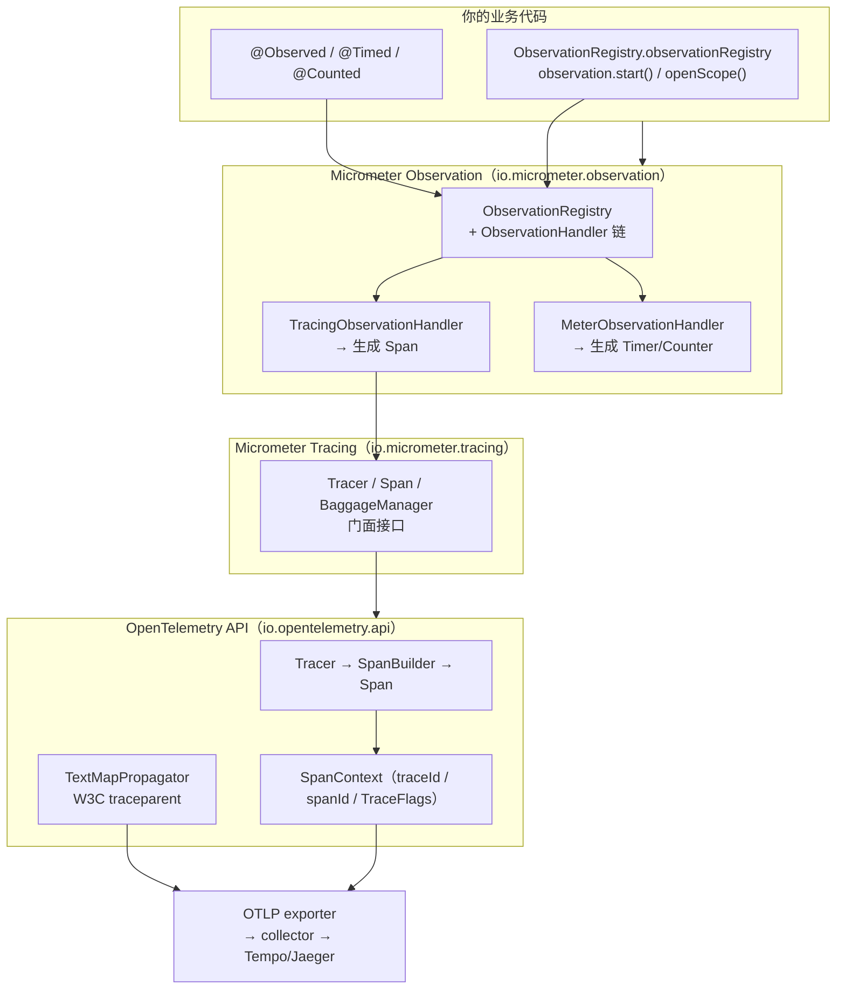
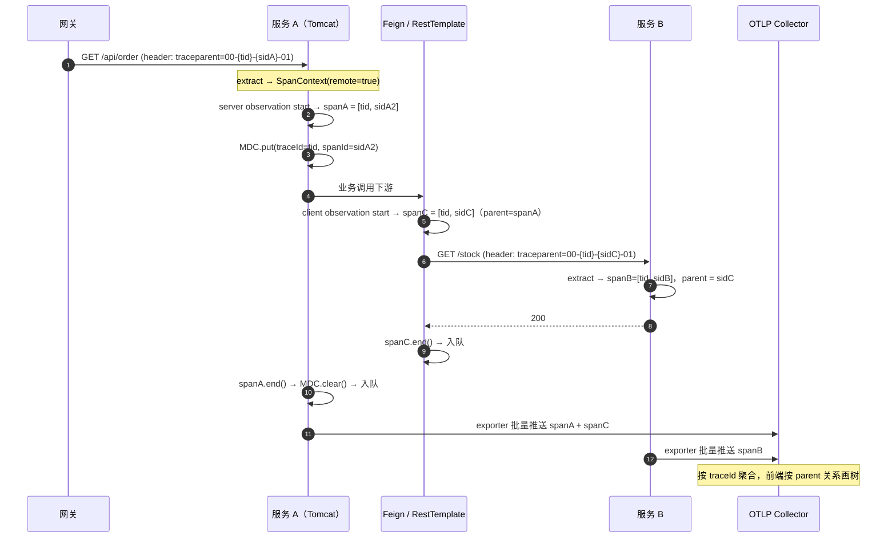

# Spring Cloud 源码精读 07-2：链路追踪 — Observation / Micrometer Tracing / OTLP

> **一句话结论**：Boot 4 + Spring Cloud 5.1 的链路追踪有**三层**——最上层是你写业务时该用的 **Observation API**（`ObservationRegistry` + `Observation`，一个 API 同时产出 Metric 与 Trace）；中间是 **Micrometer Tracing** 提供的 `Tracer`/`Span` 抽象（`io.micrometer.tracing`），它只是 **OpenTelemetry API 的门面**；最下面是 **OTel API**（`io.opentelemetry.api.trace.Span/Tracer/SpanContext`）与 **W3C `traceparent` 传播器**，最终由 OTLP exporter 把 span 推到 collector。「traceId 断链」99% 是**上下文没跨线程/跨进程传过去**，而不是埋点没写。
>
> **阅读前置**：[../05-配置中心与Bus/README.md](../05-配置中心与Bus/README.md)（知道 `@ConfigurationProperties` 怎么绑配置）、[../../01-Spring框架/](../../01-Spring框架/)（知道 AOP 代理与 `ThreadLocal`）、[../06-熔断限流与容错/README.md](../06-熔断限流与容错/README.md)（服务调用的两条闸门，能对上"哪一层埋的点"）。
>
> **预计阅读**：**50~65 分钟**。
>
> **源码基线**：Spring Boot **4.2.0**（内建 Micrometer Observation）、Spring Cloud **5.1.0**、`io.opentelemetry:opentelemetry-api:1.50.0`。
>
> ⚠️ **本章只对已入库的 3 个 OTel API 类给出源码摘录与行号**（`Span`、`Tracer`、`SpanContext`）。**Micrometer Observation / Micrometer Tracing / Spring Cloud 的 `ClientRequestObservationConvention`、`ObservationAutoConfiguration`、`Propagator` 实现、OTLP exporter 均未在本仓库入库**——文中出现时一律标注 **"未验证"**，不给行号。

---

## 0. 先看现象

| 现象 | 你可能的第一反应 | 真正常见的原因 |
|---|---|---|
| 日志里 `traceId` 是空的 | "没装 skywalking/zipkin" | 没引 `micrometer-tracing-bridge-otel`（或 `-brave`）；或日志 pattern 里没写 `%mdc{traceId}` |
| 网关有 traceId，下游服务没有 | "下游没配 tracing" | 下游没引入 tracing 依赖，或用了 `RestTemplate` 但它是 `new` 出来的（不经过自动配置的 `RestTemplateBuilder`，拦截器没挂上） |
| `@Async` 线程里 traceId 丢失 | "Micrometer 有 bug" | **线程池不传播 ThreadLocal**；需要 `ContextPropagatingTaskDecorator`（Boot 3.2+ 内建） |
| Reactor 链里 traceId 丢了 | "Reactor 不支持" | 手动 `publishOn`/`subscribeOn` 换了调度器且没启用 `Hooks.enableAutomaticContextPropagation()` |
| 有 traceId 但 Jaeger/Tempo 里查不到 | "采样率 0" | 默认采样率是 **10%**（`management.tracing.sampling.probability=0.1`）；调试时要设成 `1.0` |
| 一个请求在 UI 上分成两条 trace | "埋点重复" | 中间某一跳没传 `traceparent`（MQ、自研 HTTP 客户端、`WebClient` 裸用） |
| 每个 span 都叫 `http get`，看不出业务 | "命名太烂" | 没写 `ObservationConvention` / 没用 `@Observed`；span 名默认由 convention 从 URI 推导 |
| 指标（metric）和链路（trace）对不上 | "两套系统" | 没有统一走 `Observation`；老代码里用 `Timer.record(...)` 手动埋点，天然缺 span 关联 |

---

## 1. 整体地图

### 1.1 三层的分工



**读图说明**：

1. **Observation 是"唯一推荐入口"**。它把"一次操作"抽象成 `Observation`，然后在 `start()`/`stop()` 时把同一个上下文分发给一串 `ObservationHandler`：`TracingObservationHandler` 负责开/关 span，`MeterObservationHandler` 负责记耗时指标。**一套代码同时产出 metric 与 trace**——这是 Micrometer 1.10 之后的设计核心。
2. **Micrometer Tracing 是门面（facade）**：`io.micrometer.tracing.Tracer` 不是 OTel 的 `Tracer`。你可以选 `micrometer-tracing-bridge-otel`（底层 OTel）或 `-bridge-brave`（底层 Brave）。Spring 自家组件（`RestTemplate`、`WebClient`、`Feign`、`@Async`）只依赖这层门面。
3. **OTel API 是"契约"**：本章入库的 3 个类都在 `io.opentelemetry.api.trace` 包里，是**接口**，不含任何导出逻辑。真正干活的是 SDK（`opentelemetry-sdk`）与 exporter，它们**未入库**。
4. **`traceparent` 的传播发生在"进程边界"**：`TextMapPropagator#inject` 把当前 `SpanContext` 写进 HTTP header，`extract` 从 header 里恢复。这条线断了就断链。
5. 图中 `P1 → EXP` 与 `S2 → EXP` 两条线是说明：导出的每个 span 都自带完整 `SpanContext`，**traceId 是它的标识**，而传播器只是把这个标识搬过网络。

### 1.2 一个 HTTP 请求穿过你服务的完整埋点

```mermaid
flowchart LR
    A["Tomcat 收到请求"] --> B["ServerHttpObservationFilter /<br/>Servlet filter（Boot 自动配置）"]
    B --> C["Observation: http.server.requests<br/>（span 名 GET /api/order）"]
    C --> D["你的 Controller"]
    D --> E["Feign / RestTemplate 调用下游"]
    E --> F["Observation: http.client.requests<br/>（注入 traceparent）"]
    F --> G["下游服务"]
    G --> H["返回"]
    H --> I["client observation stop → span end"]
    I --> J["server observation stop → span end"]
    J --> K["OTLP exporter 批量推送"]
```



**读图说明**：

1. 服务端埋点**不需要你写代码**：Boot 的 `WebServerObservationAutoConfiguration`/Servlet 支持会自动在请求入口开一个 `http.server.requests` observation（**类名未验证**）。
2. **客户端埋点也不完全需要你写代码**，但有条件：必须使用 Spring 管的 `RestTemplate`（由 `RestTemplateBuilder` 构建并挂上 `ObservationInterceptor`）或 `WebClient.Builder` 或 OpenFeign（`FeignBlockingLoadBalancerClient` / `ObservationCapability`）。**`new RestTemplate()` 是没有埋点的**——这是最常见的断链原因。
3. 客户端 span 是服务端 span 的**子 span**（同一个 traceId，parent 指向服务端 span）。上下游能否连起来，取决于 `traceparent` 是否成功注入+提取。
4. `http.server.requests` 这个 observation 同时产出一个 **Timer metric**（`http_server_requests_seconds`）——这就是 §0 最后一行"指标和链路对不上"的解法：**统一走 Observation 就一致了**。
5. 图中"span end"发生在 `observation.stop()` 时，**必须在 `finally` 里保证执行**，否则 span 永不上报（表现为 UI 上该 span 缺失或时长异常）。

---

## 2. 关键类逐个拆

| 类 / 接口 | 包 | 职责 | 一句话记忆 | 入库? |
|---|---|---|---|---|
| `Span` | `io.opentelemetry.api.trace` | 一次操作的载体：属性、事件、状态、结束 | "一个时间片" | ✅ `Span.java` |
| `Tracer` | `io.opentelemetry.api.trace` | 通过 `spanBuilder(name)` 创建 `SpanBuilder` | "Span 工厂" | ✅ `Tracer.java` |
| `SpanContext` | `io.opentelemetry.api.trace` | 不可变的 `traceId` + `spanId` + `TraceFlags` + `TraceState` | "跨进程的那张小纸条" | ✅ `SpanContext.java` |
| `TraceId` / `SpanId` / `TraceFlags` / `TraceState` | `io.opentelemetry.api.trace` | 标识的合法性校验与位操作 | "id 的规则书" | ❌ 未入库 |
| `SpanBuilder` | `io.opentelemetry.api.trace` | 链式构造 span：`setParent`/`setSpanKind`/`setAttribute`/`startSpan` | "Span 的 builder" | ❌ 未入库 |
| `Context` | `io.opentelemetry.context` | 不可变的上下文容器（内含当前 `Span`） | "线程内的信封" | ❌ 未入库 |
| `ObservationRegistry` | `io.micrometer.observation` | 全局注册表：决定 observation 是否 no-op、分发 handler | "埋点总开关" | ❌ 未入库 |
| `Observation` / `Observation.Context` | `io.micrometer.observation` | 一次可观操作的句柄与载体 | "统一埋点门面" | ❌ 未入库 |
| `ObservationHandler` | `io.micrometer.observation` | `onStart`/`onStop`/`onError` 回调 | "谁关心这次操作" | ❌ 未入库 |
| `TracingObservationHandler` | `io.micrometer.tracing.handler` | 把 observation 生命周期转成 span 生命周期 | "observation→span 的桥" | ❌ 未入库 |
| `io.micrometer.tracing.Tracer` / `Span` | `io.micrometer.tracing` | 门面接口（`currentSpan()`/`nextSpan()`/`withSpan()`） | "Spring 只认这层" | ❌ 未入库 |
| `Propagator` / `TextMapPropagator` | `io.micrometer.tracing.propagation` / OTel | `inject`/`extract` `traceparent` | "跨进程搬运工" | ❌ 未入库 |
| `ClientRequestObservationConvention` | `org.springframework.http.client.observation`（示意） | 决定 client span 的**名字**与**低/高基数标签** | "span 怎么命名" | ❌ 未入库，包名未验证 |
| `ServerRequestObservationConvention` | `org.springframework.http.server.observation`（示意） | 同上，服务端版 | "server span 命名" | ❌ 未入库，包名未验证 |
| `ContextPropagatingTaskDecorator` | `org.springframework.core.task.support` | 把当前上下文抓到线程池任务里执行 | "线程池的搬运工" | ❌ 未入库，包名未验证（Boot 3.2+ 提供） |
| `@Observed` | `io.micrometer.observation.annotation` | 用 AOP 给方法套一层 observation | "注解式埋点" | ❌ 未入库 |

> ⚠️ 表中"未入库"的类：本文只用它们来解释**机制**，不提供源码行号。请以你本地依赖的实际源码为准。

---

## 3. 源码逐段精读

### 3.1 `Tracer`：整个 OTel API 里唯一"创建"入口

```java (src: Tracer.java#L60-L72)
@ThreadSafe
public interface Tracer {

  /**
   * Returns a {@link SpanBuilder} to create and start a new {@link Span}.
   *
   * <p>See {@link SpanBuilder} for usage examples.
   *
   * @param spanName The name of the returned Span.
   * @return a {@code Span.Builder} to create and start a new {@code Span}.
   */
  SpanBuilder spanBuilder(String spanName);
}
```

**在干什么**：`Tracer` 是一个**极窄**的接口——只有一个方法，返回 `SpanBuilder`。真正的能力（设置父 span、span kind、属性、链接）都在 builder 上。

**为什么**：**"创建"必须收口到一个地方**。如果允许直接 `new Span`，就无法保证 traceId/spanId 的唯一性与采样决策的一致性。builder 模式还带来一个好处：所有属性都能在 `startSpan()` 之前准备好，避免"span 已经开了才补标签"的时序问题。

**改别的会怎样**：如果 `spanBuilder` 直接返回 `Span`（不需要 `startSpan()`），那么"开始时间"就无法精确控制——对"测量某个准备阶段耗时"很不方便。builder 让 `startSpan()` 成为唯一的时间起点。

**常见坑**：`spanName` **必须是低基数**的（不能把 `userId` 拼进去）。OTel 的语义约定要求 span 名是"操作名"，如 `GET /orders/{id}`，而不是 `GET /orders/12345`——否则后端存储会被高基数打爆。这也是 `ObservationConvention` 存在的意义（§3.5）。

> 顺带一提：`Tracer.java` 的 Javadoc（本仓库 `Tracer.java.md` 的 L21-L58，含两段示例）直接给出了**官方推荐用法**：
> ```text
> Span span = tracer.spanBuilder("MyClass.DoWork").startSpan();
> try (Scope ignored = span.makeCurrent()) {   // ← 让当前上下文指向这个 span
>     Span.current().addEvent("Starting the work.");
>     doWorkInternal();
> } finally {
>     span.end();                              // ← 必须 end，否则不上报
> }
> ```
> `makeCurrent()` 是**关键**：它把 span 放进 `Context` 与 `ThreadLocal`，后续 `Span.current()`、以及子调用的自动埋点才能找到父 span。

### 3.2 `Span` 的静态方法：`current()` / `fromContext()` / `getInvalid()` / `wrap()`

```java (src: Span.java#L28-L85)
@ThreadSafe
public interface Span extends ImplicitContextKeyed {

  /**
   * Returns the {@link Span} from the current {@link Context}, falling back to a default, no-op
   * {@link Span} if there is no span in the current context.
   */
  static Span current() {
    Span span = Context.current().get(SpanContextKey.KEY);
    return span == null ? getInvalid() : span;
  }

  /**
   * Returns the {@link Span} from the specified {@link Context}, falling back to a default, no-op
   * {@link Span} if there is no span in the context.
   */
  static Span fromContext(Context context) {
    if (context == null) {
      ApiUsageLogger.log("context is null");
      return Span.getInvalid();
    }
    Span span = context.get(SpanContextKey.KEY);
    return span == null ? getInvalid() : span;
  }

  /**
   * Returns the {@link Span} from the specified {@link Context}, or {@code null} if there is no
   * span in the context.
   */
  @Nullable
  static Span fromContextOrNull(Context context) {
    if (context == null) {
      ApiUsageLogger.log("context is null");
      return null;
    }
    return context.get(SpanContextKey.KEY);
  }

  /**
   * Returns an invalid {@link Span}. An invalid {@link Span} is used when tracing is disabled,
   * usually because there is no OpenTelemetry SDK installed.
   */
  static Span getInvalid() {
    return PropagatedSpan.INVALID;
  }

  /**
   * Returns a non-recording {@link Span} that holds the provided {@link SpanContext} but has no
   * functionality. It will not be exported and all tracing operations are no-op, but it can be used
   * to propagate a {@link SpanContext} downstream.
   */
  static Span wrap(SpanContext spanContext) {
    if (spanContext == null) {
      ApiUsageLogger.log("context is null");
      return getInvalid();
    }
    return PropagatedSpan.create(spanContext);
  }
```

**在干什么**：四个"取 span"的入口，行为各不相同：

| 方法 | 上下文为空/无 span 时返回 | 是否记日志 | 典型用途 |
|---|---|---|---|
| `current()` | 无效 span（no-op） | 否 | **业务代码最常用**，永不 NPE |
| `fromContext(ctx)` | 无效 span | 是（`context is null`） | 手上已有 `Context` 对象时 |
| `fromContextOrNull(ctx)` | `null` | 是 | 需要区分"有/没有"时 |
| `getInvalid()` | 无效 span | 否 | 显式表示"我不需要" |
| `wrap(spanContext)` | —（入参 `null` 则无效） | 是 | 只有"纸条"（`SpanContext`）没有"活 span"时 |

**为什么**：**绝不让埋点代码抛 NPE，也绝不让埋点因为"没装 SDK"而失败**。这是可观测性库的第一原则——**可观测性本身不能成为故障源**。所以所有"取不到"的路径都返回一个 no-op 的 `PropagatedSpan.INVALID`，你调 `setAttribute`/`addEvent`/`end` 全部静默成功。

**改别的会怎样**：假如 `current()` 在无 span 时返回 `null`，那么每一处埋点都要写 `if (span != null)`；一旦漏写，生产上"关掉 tracing"就变成"空指针风暴"。这正是很多自研埋点框架踩过的坑。

**常见坑**：
- `getInvalid()` 返回的是 **`PropagatedSpan.INVALID`**（注意是"propagated"），说明它**可以携带 `SpanContext` 但不会记录/导出**。`wrap()` 也一样——如果你以为 `wrap` 之后 `setAttribute` 能生效，会发现什么都没上报。**`wrap` 只用于传播，不用于记录**（Javadoc 原话：`It will not be exported and all tracing operations are no-op`）。
- `fromContext(null)` 内部会调 `ApiUsageLogger.log("context is null")`——有些配置下这会**打印警告日志**，日志里出现这句话说明你在某处传了 `null` context。

### 3.3 `Span` 的记录型 API：属性 / 状态 / 异常 / 结束

```java (src: Span.java#L102-L104)
  default Span setAttribute(String key, @Nullable String value) {
    return setAttribute(AttributeKey.stringKey(key), value);
  }
```

> 这一小段只有 2 行有效代码，之所以单独拎出来，是因为它揭示了"**String 版 API 只是语法糖**"——真正实现的是下一层的 `setAttribute(AttributeKey<T>, T)`。**在热路径上应预创建 `AttributeKey`**（Javadoc 里重复强调 "It is strongly recommended to use `setAttribute(AttributeKey, Object)`, and pre-allocate your keys"），否则每次调用都要 `AttributeKey.stringKey(key)` 做一次校验与对象分配。

```java (src: Span.java#L309-L349)
  default Span setStatus(StatusCode statusCode) {
    return setStatus(statusCode, "");
  }

  /**
   * Sets the status to the {@code Span}.
   *
   * <p>If used, this will override the default {@code Span} status. Default status code is {@link
   * StatusCode#UNSET}.
   *
   * <p>Only the value of the last call will be recorded, and implementations are free to ignore
   * previous calls.
   *
   * @param statusCode the {@link StatusCode} to set.
   * @param description the description of the {@code Status}.
   * @return this.
   */
  Span setStatus(StatusCode statusCode, String description);

  /**
   * Records information about the {@link Throwable} to the {@link Span}.
   *
   * <p>Note that the EXCEPTION_ESCAPED value from the Semantic Conventions cannot be determined by
   * this function. You should record this attribute manually using {@link
   * #recordException(Throwable, Attributes)} if you know that an exception is escaping.
   *
   * @param exception the {@link Throwable} to record.
   * @return this.
   */
  default Span recordException(Throwable exception) {
    return recordException(exception, Attributes.empty());
  }

  /**
   * Records information about the {@link Throwable} to the {@link Span}.
   *
   * @param exception the {@link Throwable} to record.
   * @param additionalAttributes the additional {@link Attributes} to record.
   * @return this.
   */
  Span recordException(Throwable exception, Attributes additionalAttributes);
```

**在干什么**：
- `setStatus(StatusCode, String)`：把 span 标记为 `ERROR`/`OK`/`UNSET`（**默认 `UNSET`**），只有**最后一次**调用有效；
- `recordException(Throwable)`：把异常类型、message、堆栈作为 **event** 记录到 span 上（不是 status）。

**为什么**：状态与异常是两件事。**"有异常"不等于"这次调用失败"**——你可能捕获异常后降级成功（业务上是 OK 的）。所以 OTel 把 `recordException` 与 `setStatus` 拆开，由调用方决定最终状态。Javadoc 还专门提醒：`EXCEPTION_ESCAPED` 这个语义属性**没法自动判断**，需要你显式用带 `Attributes` 的重载传进去。

**改别的会怎样**：如果框架自动把任何 `recordException` 都当 `ERROR`，那么"熔断降级后正常返回"的 span 会被标成红色，告警噪音瞬间爆炸。**这正是 06 组讲的 `fallback` 与 `blockHandler` 场景在 tracing 上的投影**：降级成功就不该是 ERROR。

**常见坑**：
- 只 `recordException` 不 `setStatus(ERROR)` → UI 上看到异常堆栈但 span 是绿色；
- 只 `setStatus(ERROR)` 不 `recordException` → UI 上没有堆栈，排查要回去翻日志；
- 传播出去前就 `setStatus`，然后又被后续逻辑改成 OK → 只有最后一次生效（Javadoc 明确写了）。

```java (src: Span.java#L407-L469)
  /**
   * Marks the end of {@code Span} execution.
   *
   * <p>Only the timing of the first end call for a given {@code Span} will be recorded, and
   * implementations are free to ignore all further calls.
   */
  void end();

  /**
   * Marks the end of {@code Span} execution with the specified timestamp.
   *
   * <p>Only the timing of the first end call for a given {@code Span} will be recorded, and
   * implementations are free to ignore all further calls.
   *
   * <p>Use this method for specifying explicit end options, such as end {@code Timestamp}. When no
   * explicit values are required, use {@link #end()}.
   *
   * @param timestamp the explicit timestamp from the epoch, for this {@code Span}. {@code 0}
   *     indicates current time should be used.
   * @param unit the unit of the timestamp
   */
  void end(long timestamp, TimeUnit unit);

  /**
   * Marks the end of {@code Span} execution with the specified timestamp.
   *
   * <p>Only the timing of the first end call for a given {@code Span} will be recorded, and
   * implementations are free to ignore all further calls.
   *
   * <p>Use this method for specifying explicit end options, such as end {@code Timestamp}. When no
   * explicit values are required, use {@link #end()}.
   *
   * @param timestamp the explicit timestamp from the epoch, for this {@code Span}. {@code 0}
   *     indicates current time should be used.
   */
  default void end(Instant timestamp) {
    if (timestamp == null) {
      end();
      return;
    }
    end(SECONDS.toNanos(timestamp.getEpochSecond()) + timestamp.getNano(), NANOSECONDS);
  }

  /**
   * Returns the {@code SpanContext} associated with this {@code Span}.
   *
   * @return the {@code SpanContext} associated with this {@code Span}.
   */
  SpanContext getSpanContext();

  /**
   * Returns {@code true} if this {@code Span} records tracing events (e.g. {@link
   * #addEvent(String)}, {@link #setAttribute(String, long)}).
   *
   * @return {@code true} if this {@code Span} records tracing events.
   */
  boolean isRecording();

  @Override
  default Context storeInContext(Context context) {
    return context.with(SpanContextKey.KEY, this);
  }
}
```

**在干什么**：
- `end()`：结束 span，**只有第一次调用生效**，其余被忽略（因此重复 `end()` 是安全的）；
- `end(long, TimeUnit)`/`end(Instant)`：显式指定结束时间（回填历史数据时有用）；
- `getSpanContext()`：拿到不可变的 `SpanContext`（**传播用的就是它**）；
- `isRecording()`：true 表示这个 span 会真正记录与导出。**`PropagatedSpan.INVALID` 与 `wrap()` 出来的 span 都是 `isRecording()==false`**；
- `storeInContext(context)`：把自身塞进 `Context`（`ImplicitContextKeyed` 接口的实现），§3.2 的 `current()` 就是靠 `Context.get(SpanContextKey.KEY)` 取回来的。

**为什么**：**`end()` 幂等**是为了防"业务异常路径 + `finally` 都调了一次 `end`"导致重复上报；**`isRecording()`** 是为了让埋点代码能廉价地跳过"昂贵但没人看"的标签构造（例如只在 recording 时才序列化大对象）。

**改别的会怎样**：如果 `end()` 不幂等，SDK 会重复导出同一个 `spanId`——后端要么去重要么报错，UI 上会出现"一个 span 两条记录、时长翻倍"。

**常见坑**：
- **忘了 `end()`**：这是"UI 上查不到某个 span"最直接的原因（span 只存在于内存缓冲区）。
- 把 `end()` 放进 `try` 而不是 `finally` → 异常时不上报。
- `storeInContext` 返回的是**新** `Context`（不可变语义），**必须用返回值**：`Context c = span.storeInContext(Context.current());` 而不是 `span.storeInContext(c)` 丢弃返回值。

### 3.4 `SpanContext`：跨进程的那张"小纸条"

```java (src: SpanContext.java#L34-L61)
  static SpanContext getInvalid() {
    return ImmutableSpanContext.INVALID;
  }

  /**
   * Creates a new {@code SpanContext} with the given identifiers and options.
   *
   * <p>If the traceId or the spanId are invalid (ie. do not conform to the requirements for
   * hexadecimal ids of the appropriate lengths), both will be replaced with the standard "invalid"
   * versions (i.e. all '0's). See {@link SpanId#isValid(CharSequence)} and {@link
   * TraceId#isValid(CharSequence)} for details.
   *
   * @param traceIdHex the trace identifier of the {@code SpanContext}.
   * @param spanIdHex the span identifier of the {@code SpanContext}.
   * @param traceFlags the trace flags of the {@code SpanContext}.
   * @param traceState the trace state for the {@code SpanContext}.
   * @return a new {@code SpanContext} with the given identifiers and options.
   */
  static SpanContext create(
      String traceIdHex, String spanIdHex, TraceFlags traceFlags, TraceState traceState) {
    return ImmutableSpanContext.create(
        traceIdHex,
        spanIdHex,
        traceFlags,
        traceState,
        /* remote= */ false,
        /* skipIdValidation= */ false);
  }
```

**在干什么**：`create(...)` 用 32 位十六进制字符串构造 `SpanContext`，并**校验 id 合法性**（不合法就整对替换成全 0 的"无效"版本）。

**为什么**：`SpanContext` 是**不可变值对象**，因为它是**跨线程、跨进程传播**的。如果它可变，那么两个线程共享同一个 `SpanContext` 时，一个线程改了 `spanId` 会把另一个线程的链路搞乱。不可变 + 构造时校验 = 传播期间绝对安全。

**改别的会怎样**：如果允许传入非法 id（比如 `traceId` 只有 16 位），后端存储会把它们当成不同的 trace 或直接拒收，出现"有的链路能查、有的查不到"。

**常见坑**：`create` 与 `createFromRemoteParent` 的区别**只在 `remote` 标志位**：

```java (src: SpanContext.java#L78-L87)
  static SpanContext createFromRemoteParent(
      String traceIdHex, String spanIdHex, TraceFlags traceFlags, TraceState traceState) {
    return ImmutableSpanContext.create(
        traceIdHex,
        spanIdHex,
        traceFlags,
        traceState,
        /* remote= */ true,
        /* skipIdValidation= */ false);
  }
```

`isRemote()==true` 表示"这个 span 的父节点在别的进程"。**UI 上用它来决定是否画一个"跨服务箭头"**，采样器也会区别对待（远程父节点通常会**沿用**其采样决策，而不是重新掷骰子——否则同一个 trace 会一半有一半没有）。

```java (src: SpanContext.java#L95-L134)
  String getTraceId();

  /**
   * Returns the trace identifier associated with this {@link SpanContext} as 16-byte array.
   *
   * @return the trace identifier associated with this {@link SpanContext} as 16-byte array.
   */
  default byte[] getTraceIdBytes() {
    return OtelEncodingUtils.bytesFromBase16(getTraceId(), TraceId.getLength());
  }

  /**
   * Returns the span identifier associated with this {@link SpanContext} as 16 character lowercase
   * hex String.
   *
   * @return the span identifier associated with this {@link SpanContext} as 16 character lowercase
   *     hex (base16) String.
   */
  String getSpanId();

  /**
   * Returns the span identifier associated with this {@link SpanContext} as 8-byte array.
   *
   * @return the span identifier associated with this {@link SpanContext} as 8-byte array.
   */
  default byte[] getSpanIdBytes() {
    return OtelEncodingUtils.bytesFromBase16(getSpanId(), SpanId.getLength());
  }

  /** Whether the span in this context is sampled. */
  default boolean isSampled() {
    return getTraceFlags().isSampled();
  }

  /**
   * Returns the trace flags associated with this {@link SpanContext}.
   *
   * @return the trace flags associated with this {@link SpanContext}.
   */
  TraceFlags getTraceFlags();
```

**在干什么**：暴露 4 个核心信息——`traceId`（32 hex）、`spanId`（16 hex）、`TraceFlags`（其中最低位 `sampled`）、`TraceState`（厂商扩展键值）。

**为什么**：W3C `traceparent` 的格式就是这四样东西拼起来的：

```text
traceparent: 00-4bf92f3577b34da6a3ce929d0e0e4736-00f067aa0ba902b7-01
             │  │                                │                │
             │  │                                │                └─ trace-flags: 01 = sampled
             │  │                                └────────────────── span-id (16 hex)
             │  └─────────────────────────────────────────────────── trace-id (32 hex)
             └────────────────────────────────────────────────────── version 00
```

`getTraceIdBytes()`/`getSpanIdBytes()` 是把 hex 转成 16/8 字节数组（方便与二进制协议对接），且**每次调用都重新解析**（没有缓存）——所以热路径上应该缓存 `getTraceId()` 的字符串，别反复调 `getTraceIdBytes()`。

**常见坑**：`isSampled()` 是**默认方法**，直接读 `TraceFlags`。如果你手工构造了一个 `TraceFlags` 忘了置 `sampled` 位，这条链路会被采样器丢弃——**"传了 traceparent 但后端还是没有"**的经典原因。

```java (src: SpanContext.java#L148-L158)
  default boolean isValid() {
    return TraceId.isValid(getTraceId()) && SpanId.isValid(getSpanId());
  }

  /**
   * Returns {@code true} if the {@code SpanContext} was propagated from a remote parent.
   *
   * @return {@code true} if the {@code SpanContext} was propagated from a remote parent.
   */
  boolean isRemote();
}
```

**在干什么**：`isValid()` = `traceId` 合法 **且** `spanId` 合法；`isRemote()` 见上。

**为什么**：`extract` 到 header 后**必须先 `isValid()` 再使用**。攻击者可以随便发一个 `traceparent` 头，若不过滤，你的后端就会接受任意 traceId（污染数据、甚至被用来做"链路注入"制造假象）。

**常见坑**：全 0 的 `traceId` 是"无效"，`isValid()` 返回 `false`。日志里看到 `traceId=00000000000000000000000000000000` 就是**没取到有效上下文**。

### 3.5 `ObservationConvention`：span 命名与标签（未入库，机制说明）

> 下面这段是**机制描述**，相关类**未在本仓库入库，类名/包名/行号未验证**。

```text
// 示意代码，非源码摘录
public class MyOrderConvention extends DefaultClientRequestObservationConvention {
    @Override
    public KeyValues getLowCardinalityKeyValues(ClientRequestObservationContext ctx) {
        return super.getLowCardinalityKeyValues(ctx)
            .and("biz", "order");          // 低基数：枚举化，可做指标标签
    }
    @Override
    public KeyValues getHighCardinalityKeyValues(ClientRequestObservationContext ctx) {
        return super.getHighCardinalityKeyValues(ctx)
            .and("order.id", ctx.getCarrier().getOrderId());  // 高基数：只进 trace
    }
    @Override
    public String getContextualName(ClientRequestObservationContext ctx) {
        return "order.detail";         // span 显示名
    }
}
```

**在干什么**：约定（Convention）把"这次 HTTP 调用的原始信息"翻译成：
- **span 名**（`getContextualName`）：UI 上显示的名字；
- **低基数标签**（`getLowCardinalityKeyValues`）：会**同时成为 metric 标签**，必须枚举化（http.method、status、uri 模板）；
- **高基数标签**（`getHighCardinalityKeyValues`）：**只进 trace 不进 metric**（userId、orderId）。

**为什么**：**这是控制成本的关键机制**。如果把 `orderId` 放进 metric 标签，Prometheus 的时序数量会爆炸（每个订单一条时间线）。所以 Micrometer 用"两级标签"把"可聚合"与"可追溯"分开。

**改别的会怎样**：如果不写 Convention，`http.client.requests` 的 uri 标签会是**原始 URI**（`/orders/12345`），metric 基数同样是灾难。Spring 的默认 convention 会尽量用"模板化 uri"（`/orders/{id}`），但**自定义客户端/自研协议时必须自己实现**。

**常见坑**：
- span 名里带 id → 高基数，且 UI 上一堆同名不同值的 span 无法聚合；
- 把 userId 放低基数 → metric 爆炸；
- cluster 里 **metric 与 trace 对不上**：多半是两边用了不同的 convention。

### 3.6 传播器与 MDC：`traceparent` 与日志的接线（未入库，机制说明）

> `Propagator`、`MDC` 相关实现**均未入库，未验证**。以下为机制说明。

```text
# 出站（client）：inject
Context current = Context.current();                 // 里面已有当前 span
propagator.inject(current, carrier, setter);          // setter 把 traceparent 写进 header

# 入站（server）：extract
Context parent = propagator.extract(Context.root(), carrier, getter);
Span span = tracer.spanBuilder("GET /api/order").setParent(parent).startSpan();
```

日志与链路是怎么连上的？三个要素：

| 要素 | 说明 |
|---|---|
| MDC key | Micrometer Tracing 把 `traceId`/`spanId` 写进 SLF4J `MDC`（键名固定为 `traceId`、`spanId`；部分版本还有 `parentId`） |
| 日志 pattern | Boot 4 的 `logging.pattern.correlation` 默认包含 `[${spring.application.name:},%X{traceId:-},%X{spanId:-}]`（**属性名与默认值未在本仓库验证**，以你本地 `application.properties` 的实际生效值为准） |
| 生命周期 | MDC 的写入发生在 span `makeCurrent()` 时，清除在 `Scope#close()` 时——**必须 `try-with-resources`** |

**为什么**：MDC 是 `ThreadLocal`，而 `Context` 也是 `ThreadLocal`（OTel 的 `ContextStorage`）。两者必须在**同一个作用域**里被设置与清理，否则日志里的 traceId 与真实 span 会错位。

**改别的会怎样**：如果你自己在 filter 里 `MDC.put("traceId", ...)` 而不用框架的，**异步线程、线程池复用**时就会串味（A 请求的日志打出 B 的 traceId）。

**常见坑**：
- `logging.pattern.correlation` 里写了 `${traceId}` 而实际键是 `%X{traceId}`（SLF4J 语法）→ 打印不出来；
- 用了 logback 自定义 pattern **覆盖**了 `logging.pattern.console`，把 correlation 段丢了；
- `@Async`/线程池/`CompletableFuture` 里没有传播 → 日志里 traceId 为空（见 §6）。

---

## 4. 一次完整执行时序



**读图说明**：

1. **traceId 全程不变**（`tid`），每跳生成**新的 spanId**，parent 指向上游的 spanId——这就是"一棵树"的构造方式。
2. 网关那一跳的 `sidA` 是"网关 span 的 id"，服务 A 的 server span（`sidA2`）以它为 parent。**服务 A 自己不是"根"**，这一点在排查"链路被截断"时要注意：如果上游没传 `traceparent`，服务 A 就会**新建一个 traceId**（成为根），UI 上表现为两条独立 trace。
3. 客户端 span（`spanC`）与下游 server span（`spanB`）是**父子**关系；下游的 span 从 header 里 `extract` 到的是 `sidC`，不是 `sidA2`。**不要以为"下游的 parent 是上游 service span"**，中间还有 client span 这一层。
4. **MDC 的 put/clear 与 span 的 start/end 严格配对**（图中第 5 步与第 12 步）。异步化以后这个配对会被打破——这是 §6 的主体。
5. exporter 是**批量异步**推送，所以"请求已经返回了，UI 上还没看到 span"是正常的（有 flush 间隔）；反过来，**进程被 kill 时缓冲区里的 span 会丢**——生产上要配 `shutdown` 时的 flush。

---

## 5. 设计模式与取舍

| 模式 | 出现在哪 | 解决什么 | 代价 |
|---|---|---|---|
| **门面（Facade）** | `io.micrometer.tracing.Tracer` 包住 OTel `Tracer` | Spring 组件不直接依赖 OTel，可换 Brave 实现 | 多一层抽象，栈更深 |
| **建造者（Builder）** | `Tracer#spanBuilder` → `SpanBuilder#startSpan` | 属性在 start 前备齐；start 时间点唯一 | 略有样板代码 |
| **不可变值对象** | `SpanContext`、`Context` | 跨线程/跨进程安全共享 | 每次修改都要新建对象（`Context.with(...)`） |
| **责任链（Handler 链）** | `ObservationHandler` 链（tracing / metrics / logging） | 一套埋点同时产出多种信号 | 链长了有开销；handler 顺序影响结果 |
| **代理（AOP）** | `@Observed`、`@Timed`、`@Counted` | 零侵入埋点 | 自调用失效（同 `@Transactional`/`@GlobalTransactional`） |
| **ThreadLocal 存储** | OTel `ContextStorage`、SLF4J `MDC` | 免参数传递 | **跨线程自动失效**（最大坑源） |
| **两级标签** | `ObservationConvention` 低/高基数 | 控制 metric 基数 | 需要开发者理解语义约定 |
| **no-op 对象** | `Span.getInvalid()`、`PropagatedSpan.INVALID` | 可观测性绝不抛异常 | 埋点"看起来生效了其实没记" |

---

## 6. 踩坑与调试手法

### 6.1 断链的五个典型位置

| 断点位置 | 症状 | 检查方法 |
|---|---|---|
| ① 上游没注入（`new RestTemplate`） | 下游自建新 trace | 抓包看下游 request header 里有没有 `traceparent` |
| ② 下游没引入 tracing 依赖 | 下游日志无 traceId、无 span | `curl -s localhost:8080/actuator/beans \| grep Tracer` 或看 `pom` 有没有 `micrometer-tracing-bridge-otel` |
| ③ 线程池 / `@Async` | 子线程日志 traceId 为空 | 子线程里 `log.info("{}", Span.current().getSpanContext().getTraceId())` |
| ④ Reactor | `flatMap` 之后 traceId 丢失 | 是否启用 `Hooks.enableAutomaticContextPropagation()` |
| ⑤ MQ | 消费端自成一条 trace | 生产端有没有把 `traceparent` 写进消息头，消费端有没有 `extract` |

### 6.2 异步与线程池：为什么 ThreadLocal 一定会丢

```text
// ❌ 错误：线程池里的线程是复用的，未传播上下文
executor.execute(() -> orderService.doWork());   // Span.current() 这里是 invalid

// ✅ 方式 1：给线程池装 TaskDecorator（Boot 3.2+ 有现成的上下文传播装饰器，类名未验证）
ThreadPoolTaskExecutor ex = new ThreadPoolTaskExecutor();
ex.setTaskDecorator(new ContextPropagatingTaskDecorator());
ex.initialize();

// ✅ 方式 2：手工捕获再恢复
Context ctx = Context.current();
executor.execute(() -> {
    try (Scope s = ctx.makeCurrent()) {   // 关键：把上下文"带过去"
        orderService.doWork();
    }
});

// ✅ 方式 3：包装成 Callable / Supplier 交给框架
CompletableFuture.supplyAsync(Context.current().wrap(() -> orderService.doWork()), executor);
```

**为什么必须这样**：`Context.current()` 读的是**当前线程**的 `ThreadLocal`。线程池里的线程属于"别人"，它的 `ThreadLocal` 里要么是空（新线程），要么是**上一个任务残留的上下文**（复用线程）。后者更可怕——**会串到别人的 trace 上**，表现为"日志里的 traceId 属于另一个用户"。

**常见坑**：
- 用了 `@Async` 但线程池是 `SimpleAsyncTaskExecutor`（每次新建线程）→ 天然不传播，且**没有复用污染**，容易误判为"只丢不串"；
- 装饰器顺序错了（先 `wrap` 又 `makeCurrent` 两次）→ 出现"父 span 变成自己"的环；
- `CompletableFuture` 的 `thenApply` 不指定 executor → 用 `ForkJoinPool.commonPool()`，**上下文同样丢失**。

### 6.3 Reactor：`Hooks.enableAutomaticContextPropagation()`

```java
// 启动时开一次
Hooks.enableAutomaticContextPropagation();

// 之后就可以正常用 WebClient / flatMap，不用手动 contextWrite
webClient.get().uri("/stock").retrieve().bodyToMono(String.class)
         .flatMap(s -> Mono.fromCallable(() -> doWork(s)).subscribeOn(Schedulers.boundedElastic()))
         .subscribe();
```

**为什么**：Reactor 有**自己的上下文**（`ContextView`/`contextWrite`），它与 OTel 的 `Context` 是两套。开启自动传播后，Reactor 在**每次操作符切换调度器**时自动把 OTel `Context` 与 Reactor `Context` 同步。

**常见坑**：
- 开了之后仍在 `subscribeOn` 里手动 `contextWrite(Context.of(...))` 覆盖 → 冲突；
- 在 **WebFlux** 项目里但只有 `micrometer-tracing` 没有 `reactor-core` 的集成（版本不匹配）→ 静默失效；
- 阻塞代码混进 event loop → span 时长异常长，误判为"下游慢"。

### 6.4 采样率：为什么"明明有 traceId 却查不到"

```yaml
management:
  tracing:
    sampling:
      probability: 1.0     # 开发/压测用 1.0（全采）；生产一般 0.05 ~ 0.2
  otlp:
    tracing:
      endpoint: http://otel-collector:4318/v1/traces
```

| 采样方式 | 特点 | 适用 |
|---|---|---|
| 概率采样（`probability`） | 简单、无状态；**同一个 trace 的决策由根 span 决定并向下传递** | 绝大多数场景 |
| 尾部采样（collector 侧） | 只保留"慢/错"的 trace | 生产推荐（降低成本） |
| 全采（`1.0`） | 调试友好，成本高 | 开发、问题复现 |

**关键点**：`sampled` 标志在 `TraceFlags` 里，**跟着 `traceparent` 一起传**。上游决定不采，下游即使收到 traceId 也不会导出——所以"日志有 traceId，后端查不到"是**完全正常的**，去看 `traceparent` 最后一段是不是 `00`。

### 6.5 常用调试命令

```text
# 看当前 JVM 有没有把 trace 相关自动配置装上
curl -s localhost:8080/actuator/beans | grep -iE "tracer|observationRegistry|propagator"

# 看当前生效的采样率与 exporter 配置
curl -s localhost:8080/actuator/configprops | grep -iE "sampling|otlp"

# 抓一个请求，看链路相关的 header 有没有传下去（服务端视角）
curl -sv http://localhost:8080/api/order -H "traceparent: 00-4bf92f3577b34da6a3ce929d0e0e4736-00f067aa0ba902b7-01"

# 在日志里确认 traceId 已进 MDC（pattern 里 %X{traceId:-}）
# 期望看到类似：2026-01-01 12:00:00.000 INFO [order-service,4bf92f3577b34da6a3ce929d0e0e4736,00f067aa0ba902b7] ...

# 检查线程池传播：在任务里打印
# log.info("tid={}", Span.current().getSpanContext().getTraceId());
```

**排查顺序**（记住这条链）：
1. **有没有依赖**（`micrometer-tracing-bridge-otel` + `spring-boot-starter-actuator`）；
2. **服务端 span 有没有**（看日志 pattern 的 traceId）；
3. **出站 header 有没有**（抓包 / 下游日志）；
4. **是不是同步链路**（异步→查传播）；
5. **采样有没有开**（`traceparent` 最后两位）。

---

## 7. ⚠️ 版本差异

| 项 | 旧版本 | Boot 4.2 / Cloud 5.1 | 影响 |
|---|---|---|---|
| 埋点入口 | `spring-cloud-sleuth`（Brave 直连） | **Sleuth 已移除**，统一为 Micrometer Observation + Micrometer Tracing | 老代码里的 `sleuth.*` 配置**全部失效** |
| 追踪桥 | Sleuth 内置 Brave | 需显式引 `micrometer-tracing-bridge-otel` **或** `-bridge-brave` | 少了这个依赖 → 只有 metric 没有 trace |
| 注解 | `@NewSpan`/`@ContinueSpan`/`@SpanTag` | 推荐 `@Observed`（`io.micrometer.observation.annotation`），旧注解由 bridge 提供兼容 | 混用会出现"span 重复嵌套" |
| 配置前缀 | `spring.sleuth.*` | `management.tracing.*`（采样 `sampling.probability`）、`management.otlp.tracing.*` | 配置迁移是升级主要工作量 |
| 日志关联 | Sleuth 自动改 pattern | `logging.pattern.correlation`（Boot 默认已含） | 自定义 logback 时容易丢 |
| 传播格式 | B3（`X-B3-TraceId`）为主 | **W3C `traceparent`** 为主（`management.tracing.propagation.type` 可选 `w3c`/`b3`/`b3_multi`） | 与老系统对接要显式选 B3 |
| 线程池传播 | Sleuth 有 `LazyTraceExecutor` | `ContextPropagatingTaskDecorator`（**类名未验证**） | 手工 new 的线程池仍需自己装饰 |
| Mock/测试 | `spring-cloud-sleuth` 测试支持 | `micrometer-tracing-test` + `SimpleTracer` | 测试里断言 span 的方式变了 |

> ⚠️ 上表中 **`micrometer-tracing` / `micrometer-observation` 的具体类名、`ContextPropagatingTaskDecorator` 的包路径、`management.tracing.*` 的完整属性清单** 均**未在本仓库验证**（这些坐标未入库）。请以你本地 IDE 里跳转到的实际源码为准。

---

## 8. 面试高频问与答

**Q1：Observation、Micrometer Tracing、OpenTelemetry 三者什么关系？**
A：Observation 是**埋点门面**（一次操作 → 多个信号）；Micrometer Tracing 是**追踪门面**（`Tracer`/`Span`，可桥接 OTel 或 Brave）；OpenTelemetry 是**最底层的 API + SDK/协议标准**（含 W3C 传播与 OTLP 导出）。业务代码只该依赖第一层。

**Q2：为什么 `Span.getInvalid()` 返回一个 no-op 对象而不是 `null`？**
A：为了让埋点代码**永不 NPE、永不影响业务**。可观测性不能成为故障源；no-op 让"没装 SDK""采样关闭"等情况下的所有调用静默成功。

**Q3：`Span.wrap(spanContext)` 和正常 span 有什么区别？**
A：`wrap` 出来的 span 是**非记录型**（`isRecording()==false`），只携带 `SpanContext` 用于**传播**，所有记录操作都是 no-op，也不会被导出。

**Q4：`SpanContext.create` 与 `createFromRemoteParent` 的差别？**
A：只差 `isRemote` 标志。远程父节点意味着"父 span 在别的进程"，采样器据此沿用上游的采样决策，UI 据此画跨服务边界。

**Q5：为什么 `end()` 是幂等的？**
A：因为异常路径与 `finally` 可能都调 `end()`，重复导出会造成重复 span、时长错乱。Javadoc 明确"只有第一次 end 的时间被记录"。

**Q6：traceId 和 spanId 的长度与格式？**
A：`traceId` 32 位小写十六进制（16 字节），`spanId` 16 位小写十六进制（8 字节）。全 0 表示无效。

**Q7：`traceparent` 的格式？**
A：`00-<traceId 32hex>-<spanId 16hex>-<flags 2hex>`，`flags` 最低位 `01` 表示 sampled。`create` 里 `skipIdValidation=false` 就是按这个规则校验。

**Q8：为什么 `@Async` 里 traceId 会丢？**
A：`Span.current()` 读当前线程的 `ThreadLocal`（OTel `ContextStorage`），线程池的线程没有这个上下文。解决：`ContextPropagatingTaskDecorator`、`Context.current().wrap(...)` 或手工 `try (Scope s = ctx.makeCurrent())`。

**Q9：为什么线程池里不仅会"丢"，还会"串"？**
A：线程复用。如果任务结束时没有清理上下文（或传播实现不当），下一个任务会读到上一个任务残留的 `Context`——日志里出现别人的 traceId。这是比"丢"更严重的故障。

**Q10：Reactor 里怎么保证 traceId 不丢？**
A：开 `Hooks.enableAutomaticContextPropagation()`（启动时一次），让 Reactor 的 `ContextView` 与 OTel `Context` 在切换调度器时自动同步；同时避免在 `subscribeOn` 之后手工覆盖 context。

**Q11：低基数与高基数标签分别用在什么场景？**
A：低基数（http.method、status、uri 模板）→ 同时作为 metric 标签；高基数（userId、orderId）→ 只进 trace。混用会导致 metric 时序爆炸。

**Q12：为什么生产上不要 `sampling.probability=1.0`？**
A：全采会带来巨大的存储与网络成本（GB/分钟级）。生产一般 0.05~0.2，或者用 collector 侧**尾部采样**只保留慢/错链路。

**Q13：日志里的 traceId 是怎么来的？**
A：Micrometer Tracing 在 span `makeCurrent()` 时把 `traceId`/`spanId` 写入 SLF4J MDC，由 logback 的 pattern（`logging.pattern.correlation` 或自定义 `%X{traceId}`）打印；`Scope#close()` 时清除。

**Q14：为什么请求返回了，UI 上还查不到 span？**
A：exporter 是批量异步推送，有 flush 间隔；极端情况下（进程被 kill）缓冲区中的 span 会丢失。所以生产必须配置优雅停机时 flush。

---

## 9. 动手练习

### 练习 1：最小可用的 OTLP 链路

**目标**：端到端看到一条 trace。

**步骤**：
1. 起一个 OTel Collector（或直接用 Jaeger all-in-one 的 OTLP 端口）；
2. 引依赖：`spring-boot-starter-actuator`、`micrometer-tracing-bridge-otel`、`opentelemetry-exporter-otlp`；
3. 配 `management.otlp.tracing.endpoint` 与 `management.tracing.sampling.probability=1.0`；
4. 写一个 `@GetMapping("/hello")`，日志打印 `log.info("hello")`；
5. 访问一次，在 Jaeger 里按 service 名查。

**验收标准**：
- [ ] 日志行里有 `[app-name,<32hex>,<16hex>]` 这两个 id；
- [ ] Jaeger 里能看到 `GET /hello` 的 server span，且 tag 里有 `http.method`/`http.status_code`；
- [ ] 把 `probability` 改成 `0.0` 后日志里**仍有两个 id**（说明上下文仍在），但 Jaeger 里**查不到**（说明采样生效）。

### 练习 2：复现并修复"Feign 断链"

**目标**：理解"注入"与"提取"两端都要对。

**步骤**：
1. 服务 A 用 Feign 调服务 B，B 里也打日志；
2. 确认正常情况下 A、B 的 traceId **相同**、spanId **不同**；
3. 把 A 换成 `new RestTemplate()` 直接调 B（不经过 Spring 管理），观察 B 的 traceId 变化；
4. 修好后再用 `RestTemplateBuilder`，重复 3。

**验收标准**：
- [ ] 能给出 B 服务在两种情况下日志里的 traceId；
- [ ] 能用抓包或 `curl -sv` 证明 `traceparent` header 的**有无**；
- [ ] 能说清：`traceId` 相同（同一 trace）、`spanId` 不同（不同 span）、B 的 parentId 指向 A 的 **client span**。

### 练习 3：让 `@Async` 任务不丢也补串

**目标**：彻底理解 ThreadLocal 传播。

**步骤**：
1. 写一个 `@Async` 方法，在里面打印 `Span.current().getSpanContext().getTraceId()`；
2. 观察它是 `00000000000000000000000000000000`（无效）；
3. 给线程池装上 `ContextPropagatingTaskDecorator`（或 `Context.current().wrap(...)`），再打印；
4. **故意**去掉 `Scope#close()`（在装饰器里不 try-with-resources），让两个并发请求交替执行，观察是否出现"串号"。

**验收标准**：
- [ ] 修复前后两次的 traceId 输出对比；
- [ ] 能解释"为什么第 4 步会串号"（线程复用 + 未清理）；
- [ ] 能说清 `Context.makeCurrent()` 与 `try-with-resources` 的配对关系。

---

## 小结

1. 三层结构：**Observation（埋点门面）→ Micrometer Tracing（追踪门面）→ OTel API/SDK（标准实现）**；业务只该碰第一层。
2. `Tracer` 只有一个 `spanBuilder(name)`；**span 名必须低基数**，命名由 `ObservationConvention` 决定。
3. `Span.current()` 从 `Context`（ThreadLocal）里取；取不到返回 **no-op 的 `PropagatedSpan.INVALID`**，埋点永不抛异常。
4. `Span.wrap(SpanContext)` 出来的 span **只用于传播、不记录不导出**（`isRecording()==false`）。
5. `SpanContext` 是不可变值对象：`traceId`(32hex) + `spanId`(16hex) + `TraceFlags`(含 `sampled`) + `TraceState`；`createFromRemoteParent` 只多一个 `isRemote=true`。
6. `traceparent` = `00-traceId-spanId-flags`；`extract` 后**必须先 `isValid()`**。
7. `end()` 幂等（只有第一次生效），且**必须放在 `finally`**；`storeInContext` 返回新 `Context`，必须用返回值。
8. 断链五大位置：裸 `RestTemplate`、缺依赖、线程池/`@Async`、Reactor 调度器切换、MQ。
9. MDC 的 `traceId`/`spanId` 由 `makeCurrent()`/`Scope#close()` 配对维护，日志 pattern 用 `%X{traceId}`。
10. 采样决策**编码在 `traceparent` 的 flags 里**并向下传递：日志有 id 而 UI 查不到 = 上游没采。
11. ⚠️ 本章只对 `Span`/`Tracer`/`SpanContext` 三个 OTel API 类给出了已核对的源码与行号；Micrometer、Spring 埋点类、exporter **均未入库，标注"未验证"**。

---

## 自测题

**1. `Span.current()` 在没有任何 span 的线程里返回什么？**
<details><summary>答案</summary>

返回 `getInvalid()` 得到的 `PropagatedSpan.INVALID`——一个 no-op span，所有方法调用静默成功、不导出。绝不会返回 `null`。
</details>

**2. `Span.fromContext(null)` 与 `Span.fromContextOrNull(null)` 的差别？**
<details><summary>答案</summary>

都返回"无"（前者返回无效 span，后者返回 `null`），且都会调用 `ApiUsageLogger.log("context is null")` 记一条使用警告。
</details>

**3. 为什么 `wrap(SpanContext)` 出来的 span 上 `setAttribute` 什么都不显示？**
<details><summary>答案</summary>

因为 `wrap` 返回的是 `PropagatedSpan.create(spanContext)`——非记录型 span，`isRecording()` 为 false，所有记录操作都是 no-op，只为传播服务。
</details>

**4. `traceId` 与 `spanId` 的格式？全 0 表示什么？**
<details><summary>答案</summary>

`traceId`：32 位小写十六进制（16 字节）；`spanId`：16 位小写十六进制（8 字节）。全 0 表示无效（`isValid()` 为 false），通常意味着没有取到有效上下文。
</details>

**5. `create` 与 `createFromRemoteParent` 唯一区别是什么？为什么重要？**
<details><summary>答案</summary>

只差 `remote` 标志位。远程父节点说明父 span 在别的进程，采样器据此沿用上游采样决策（避免同一 trace 一半有、一半没有），UI 据此画跨服务边界。
</details>

**6. `traceparent: 00-4bf92f3577b34da6a3ce929d0e0e4736-00f067aa0ba902b7-00` 表示什么？**
<details><summary>答案</summary>

格式合法，但 flags=`00` 表示**未采样**。下游会沿用这个 traceId/spanId 作为父上下文，但不会导出 span——所以日志可能有 id，后端查不到链路。
</details>

**7. 为什么说"下游 server span 的 parent 不是上游 service span"？**
<details><summary>答案</summary>

因为中间还有一层 client span（`http.client.requests`）。下游从 header 里 extract 到的 spanId 是**上游 client span 的 id**，所以下游 server span 的 parent 是它。
</details>

**8. `end()` 调用两次会怎样？**
<details><summary>答案</summary>

只有第一次的结束时间被记录，后续调用被忽略（Javadoc 明确写了）。所以 `finally` 里再调一次是安全的。
</details>

**9. `storeInContext(Context)` 的正确用法？**
<details><summary>答案</summary>

必须使用返回值（`Context` 不可变）：`Context ctx = span.storeInContext(Context.current());`。忽略返回值等于什么都没做。
</details>

**10. 服务端收到请求后，为什么要先 `isValid()` 再使用 `extract` 出来的 `SpanContext`？**
<details><summary>答案</summary>

防止外部伪造/畸形的 `traceparent` 污染链路数据（被注入任意 traceId）。`isValid()` 校验 traceId 与 spanId 的格式合法性。
</details>

**11. `@Async` 方法里 traceId 为空，有哪三种修法？**
<details><summary>答案</summary>

① 给线程池装 `ContextPropagatingTaskDecorator`；② 手工 `Context.current()` 捕获后 `try (Scope s = ctx.makeCurrent())`；③ 用 `Context.current().wrap(callable)` 包装任务。核心都是"把上下文从提交线程带到执行线程"。
</details>

**12. 为什么线程池不仅会"丢"traceId，还会"串"traceId？**
<details><summary>答案</summary>

线程复用。若上下文未正确清理（没有 `Scope#close()`），下一个任务会读到上一个任务残留的 `ThreadLocal`——日志里出现别人的 traceId，这是更严重的故障。
</details>

**13. Reactor 里保证 traceId 不丢的关键一行配置？**
<details><summary>答案</summary>

启动时调用 `Hooks.enableAutomaticContextPropagation()`，让 Reactor 在切换调度器时自动同步 OTel `Context`。
</details>

**14. 低基数与高基数标签分别为什么用途？**
<details><summary>答案</summary>

低基数（http.method、status、uri 模板）→ 同时成为 metric 标签，可聚合；高基数（userId、orderId）→ 只进 trace，避免 metric 时序爆炸。由 `ObservationConvention` 的两个方法返回。
</details>

**15. 本章哪些内容是"未验证"的？**
<details><summary>答案</summary>

Micrometer Observation/Tracing 的具体类名与包路径、`ClientRequestObservationConvention`/`ServerRequestObservationConvention`、`ContextPropagatingTaskDecorator`、`Propagator` 实现、OTLP exporter、`management.tracing.*` 属性清单——这些坐标未在本仓库入库。已核对的是 `io.opentelemetry.api.trace` 的 `Span`/`Tracer`/`SpanContext` 三个类。
</details>
