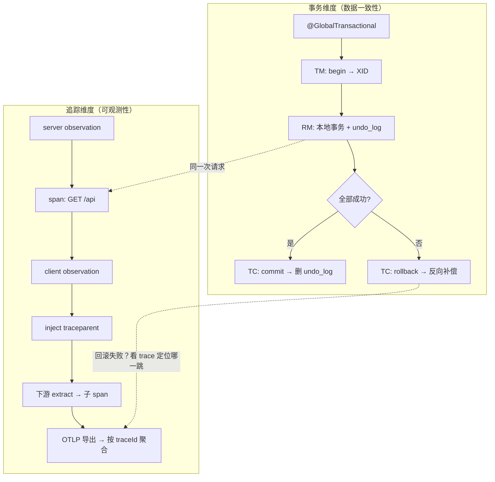

# 07 · 分布式事务与链路追踪

> 一句话：**分布式的两个"看不见的坑"是"数据不一致"和"调用链断掉"**。这一组用两篇文章分别把它们拆开——Seata AT 模式告诉你"跨服务的事务为什么能回滚"（先提交 + undo_log 反向补偿），Micrometer Tracing / OTel 告诉你"一个请求穿过 8 个服务后，怎么还能被串成一条线"（`traceparent` 传播 + 上下文传递）。
>
> 预计阅读：**2~2.5 小时**（01 约 40 分钟只讲原理，02 约 50 分钟含源码精读）。

---

## 学完你能

1. 说清 Seata 的 **TC / TM / RM** 三角色，以及为什么 TC 必须是独立进程。
2. 画出 AT 模式两阶段时序，并解释"**一阶段业务数据已经提交**"带来的隔离性代价。
3. 讲清 `undo_log` 的 7 个字段各有什么用，为什么 `ux_undo_log(xid, branch_id)` 是幂等的第一道防线。
4. 说清 **空回滚 / 悬挂 / 幂等** 三大问题的产生过程与各自解法。
5. 填出 **AT / TCC / SAGA / XA** 四模式对比表，并给出选型理由。
6. 说清 `@GlobalTransactional` 与 `@Transactional` 的**包裹顺序**为什么必须"全局在外、本地在内"。
7. 讲清 Observation → Micrometer Tracing → OTel API 的**三层分工**，以及为什么业务只该碰第一层。
8. 解释 `Span.current()` 为什么返回 no-op 而不是 `null`，`Span.wrap()` 出来的 span 为什么"记不住东西"。
9. 逐字节解释 `traceparent: 00-<traceId>-<spanId>-<flags>`，并说出 `create` 与 `createFromRemoteParent` 的区别。
10. 定位"traceId 断链"的五大位置（裸 `RestTemplate`、缺依赖、线程池、Reactor、MQ），并给出各自的修法。

---

## 目录

| # | 文章 | 主线 | 源码入库情况 |
|---|---|---|---|
| 1 | [01-分布式事务-seata-at模式源码.md](./01-分布式事务-seata-at模式源码.md) | TC/TM/RM → AT 两阶段 → undo_log → 三大坑 → 四模式对比 | ❌ **Seata sources jar 404，无源码摘录**；类名以官方 GitHub 为准，**行号未验证** |
| 2 | [02-链路追踪-micrometer-tracing-and-otel.md](./02-链路追踪-micrometer-tracing-and-otel.md) | Observation → Micrometer Tracing → OTel `Span/Tracer/SpanContext` → `traceparent` → OTLP | ✅ `io.opentelemetry:opentelemetry-api:1.50.0` 的 `Span`/`Tracer`/`SpanContext`；其余**未入库** |

延伸阅读：
- 上游总目录：[../README.md](../README.md)
- 事务的"服务发现"依赖（Seata 注册到 Nacos）：[../05-配置中心与Bus/README.md](../05-配置中心与Bus/README.md)
- 熔断/限流在 tracing 上的投影（降级成功不该是 ERROR span）：[../06-熔断限流与容错/README.md](../06-熔断限流与容错/README.md)
- AOP 与自调用失效（`@GlobalTransactional`、`@Observed` 共同坑）：[../../01-Spring框架/](../../01-Spring框架/)

---

## 两篇摘要

### 01 · 分布式事务：Seata AT 模式原理

AT 模式的一句话概括：**"先提交，错了再补偿"**。

```text
一阶段（业务执行时）：
  FOR UPDATE 查前镜像 → 执行 SQL → 查后镜像
  → INSERT undo_log（和业务 SQL 同一个本地事务）
  → 本地 COMMIT（数据已在库里！）→ 注册分支 → 上报 PhaseOne_Done

二阶段（TM 决策后由 TC 通知）：
  全局成功 → 各分支 DELETE undo_log（异步，极快）
  全局失败 → 各分支读 undo_log → 校验后镜像 → 生成反向 SQL → 执行 + 删日志
```

它比 XA 快得多（一阶段不长时间持有数据库锁），代价是**中间态可见**（读未提交级别）。文章用 8 段拆解 + 2 张 Mermaid 时序图 + 1 张 undo_log 建表语句 + 三大经典问题表 + 四模式对比表，把它讲透。

⚠️ **本章不附源码摘录**：`io.seata:seata-all:2.7.0`、`seata-spring-boot-starter:2.7.0`、`seata-spring:2.7.0` 的 sources jar 在 Maven Central 均 404（本仓库已实测三次）。因此文中**不给任何行号**，类名以官方 GitHub v2.7.0 为准，**未在本仓库验证**。

### 02 · 链路追踪：Observation / Micrometer Tracing / OTel

三层结构：

```text
你的代码  →  Observation（埋点门面，一次操作 → 同时产出 metric + trace）
          →  Micrometer Tracing（追踪门面，io.micrometer.tracing.Tracer/Span）
          →  OpenTelemetry API（标准契约，io.opentelemetry.api.trace.Span/Tracer/SpanContext）
          →  OTLP exporter → collector → Tempo/Jaeger
```

文章逐行精读了 OTel 三个核心类（`Tracer` 只有一个方法、`Span` 的 no-op 设计与幂等 `end()`、`SpanContext` 的不可变性与 `isRemote` 标志），并配 4 张 Mermaid 图讲清"一个请求的 span 是怎么变成一棵树的"。

最后用整整一节（§6）逐个拆解**断链的五个位置**与**三种异步传播修法**，并给出可直接复制的排障命令。

---

## 一张总图：两个"看不见"的东西怎么被可视化



**读图说明**：

1. 左右两个维度是**同一次请求的两条正交信息**：左边关心"数据最终对不对"，右边关心"这一次调用经过了谁、在哪慢、在哪错"。
2. 中间的虚线表示它们在同一时刻发生——**排查事务问题时，trace 是最好的地图**：你能看到"到底调到了哪个服务、哪个服务抛了异常、异常有没有越过 `@GlobalTransactional` 的边界"。
3. 右下那条虚线是实战经验：**"事务没回滚"十有八九不是 Seata 的问题，而是某一跳没带 XID**——而"哪一跳没带"这件事，正好由 trace 告诉你（对比两跳的 span 里有没有 XID 相关的属性）。
4. 反过来，**trace 断链也不影响事务**：XID 走的是 Seata 自己的 header（Dubbo Attachment / Feign Interceptor），与 `traceparent` 是**两套独立机制**。这一点很关键——很多人以为"trace 断了事务一定也断"，其实没有必然联系。
5. 两张图都只有"成功"与"失败"两个出口，这是刻意简化的结果：真实系统里还有"超时/未知/悬挂"这些灰色状态，分别在 01 的 §6 和 02 的 §6 里展开。

---

## 学习检查点

- [ ] 能在白纸上画出 AT 模式两阶段时序（含 undo_log 的写入与删除位置）。
- [ ] 能解释"为什么 undo_log 必须和业务 SQL 在同一个本地事务"。
- [ ] 能说出 AT 模式要求业务表的**两个前提**（有主键、每个库都有 undo_log）。
- [ ] 能用一句话区分**空回滚**与**悬挂**。
- [ ] 能说出 `@GlobalTransactional` + `@Transactional` 谁在外、谁在内，以及顺序写反后的症状。
- [ ] 能解释为什么 `Span.current()` 返回 no-op 而不是 `null`。
- [ ] 能写出 `traceparent` 的格式，并指出 `flags=00` 意味着什么。
- [ ] 能说出 `create` 与 `createFromRemoteParent` 唯一的差别。
- [ ] 能列出 traceId 断链的五个位置，并说出"线程池为什么会串号"。
- [ ] 知道哪些内容是**未验证**的（Seata 全部类名/行号、Micrometer 与 Spring 埋点类、exporter），并知道本章为什么这样做。

---

## 约定与红线

- **01 篇完全没有源码摘录**，因为 Seata 的 sources jar 在本仓库无法获取；类名以官方 GitHub v2.7.0 为准，**行号未在本仓库验证**。
- **02 篇只对 3 个 OTel API 类**（`Span`/`Tracer`/`SpanContext`）给出逐行核对过的源码与行号；Micrometer Observation/Tracing、Spring 的 `ObservationConvention`、`ContextPropagatingTaskDecorator`、OTLP exporter **均未入库，文中一律标注"未验证"**。
- 版本基线：Spring Boot **4.2.0**、Spring Cloud **5.1.0**、Seata **2.7.0**、`io.opentelemetry:opentelemetry-api` **1.50.0**。
