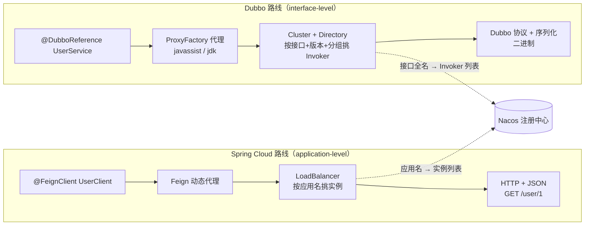
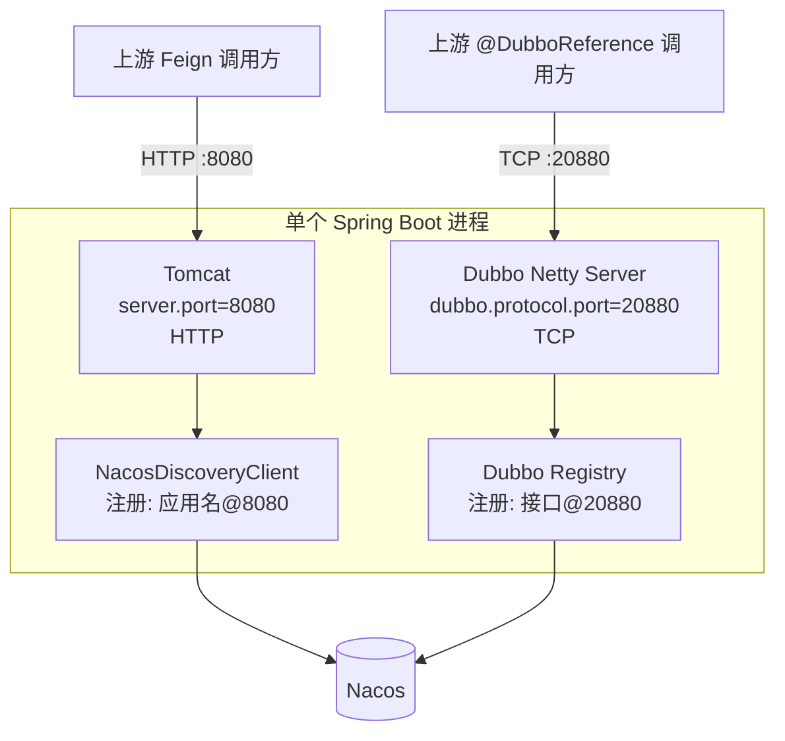
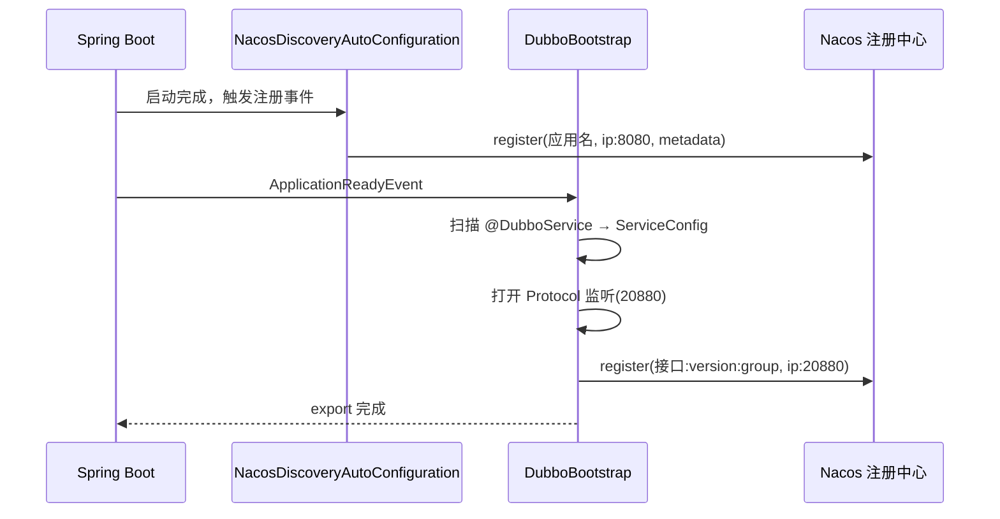
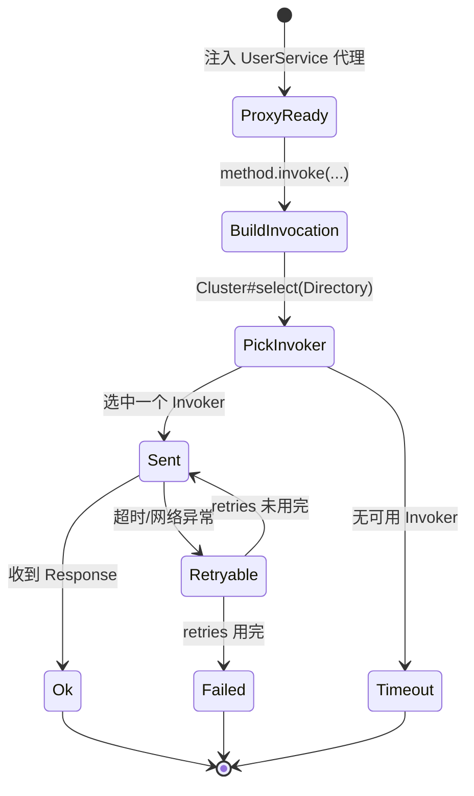

# Spring Cloud 源码精读 08-1：Dubbo 与 Spring Cloud 共存与对比

> **一句话结论**：Dubbo 与 Spring Cloud 不是竞争关系而是**两种"远程调用"的实现路线**——Dubbo 把"接口"当合同（interface-level，强类型 RPC + 二进制协议 + 自己的集群容错），Spring Cloud 把"应用"当合同（application-level，HTTP + 客户端负载均衡）。二者在同一个进程里共存**技术上完全可行**，真正的坑只有三个：**端口、注册模型、上下文传递**。
>
> **阅读前置**：看得懂 Java 注解与动态代理；建议先读 [../05-配置中心与Bus/README.md](../05-配置中心与Bus/README.md) 了解 Spring Cloud 侧的装配方式，以及 [../../01-Spring框架/](../../01-Spring框架/) 的 AOP 与代理一篇。
>
> **预计阅读**：**45 分钟**（源码精读部分约 20 分钟）
>
> **源码基线**：`org.apache.dubbo:dubbo:3.3.6`（`DubboReference` / `DubboService` / `JavassistProxyFactory` / `AbstractProxyFactory` 已入库）；Spring Cloud **5.1.0**、Spring Boot **4.2.0**、Nacos **3.3.0**。**注意**：Dubbo 的注册中心实现（`Directory`、`ServiceDiscovery`、`DubboProtocol`、`DubboBootstrap`、`@EnableDubbo` 处理器）**未入库**，文中提到它们时一律标注 **未验证**。

---

## 0. 先看现象

| 现象 | 你可能的第一反应 | 真正常见的原因 |
|---|---|---|
| 引入 dubbo 依赖后项目**启动不起来**，报 `Port 20880 already in use` | 端口被别的进程占了 | 同一台机器上多个 Dubbo 应用共用了默认 `20880`；Dubbo 的端口是**协议端口**，与 `server.port` 完全无关 |
| Dubbo 服务调不通，报 `No provider available for the service xxx` | 提供者没启动 | 提供者注册在 **interface-level** 目录（`providers:com.foo.UserService:1.0.0:...`），消费者查的 group/version 与之不一致，或消费者订阅的是另一套注册模型 |
| 同一个服务，Feign 能调到、Dubbo 调不到 | 网络问题 | **两套注册模型是两套命名空间**：Spring Cloud 在 Nacos 里注册成"应用名 + 实例"，Dubbo 注册成"接口全名 + 版本 + 分组"。互相看不见是**设计如此** |
| `@DubboReference` 注入的字段是 `null`，但没报错 | 注解没生效 | 字段被 `private` + 直接 `new` 出来、或类不是 Spring Bean、或作用域是 prototype 但在非托管类里使用 |
| Dubbo 调用成功，但**下游 traceId 断了** | 链路追踪坏了 | Dubbo 是自己的一套 filter/attachment 传递机制，`traceparent` 需要 **Dubbo 侧也装 tracing filter**，Spring Cloud 的 `RestTemplate` 拦截器管不到它 |
| 本地 `@Transactional` 里调 Dubbo，事务"看起来"生效了 | Dubbo 支持分布式事务 | 只是**碰巧**：Dubbo 调用发生在同一个 JVM 的本地事务里，跨进程的那一半**根本没有事务**。要跨进程必须上 Seata（见 [../07-分布式事务与链路追踪/01-分布式事务-seata-at模式源码.md](../07-分布式事务与链路追踪/01-分布式事务-seata-at模式源码.md)） |
| 想把 Feign 换成 Dubbo 就"提性能"，结果更慢 | RPC 一定比 HTTP 快 | 序列化/线程模型/连接数没调；而且**跨机房、大报文、网关后面的场景** HTTP 反而更稳 |

---

## 1. 整体地图

### 1.1 两条调用路线



**读图说明**：

1. 左边是 **HTTP 语义**：URL 由"应用名 + 路径"拼出来，负载均衡发生在**调用方进程内**（客户端负载均衡），中间没有代理进程。
2. 右边是 **RPC 语义**：调用方拿到的是一个**接口代理**，方法调用被翻译成"接口全名 + 方法名 + 参数类型"的调用描述，再由 `Cluster` 从 `Directory`（注册中心目录）里挑一个 `Invoker` 真正发出去。
3. 两条路线**都能从 Nacos 取数据**，但取的是**两种完全不同的数据**：左边是"应用 `user-service` 有哪些 IP:PORT"（application-level），右边是"接口 `com.foo.UserService:1.0.0:groupA` 有哪些 `Invoker`"（interface-level）。
4. 正因为"两种数据"，图中两个虚线箭头指向同一个注册中心**却互不相交**——这是本文最重要的一个认知：**Dubbo 服务对 Feign 不可见，反之亦然**。
5. 若要让两边互调，只有三条路：① 一边加协议适配（Sidecar/网关）；② 让 Dubbo 也暴露 REST（`rest` 协议），Spring Cloud 侧就能用 HTTP 调；③ 统一到同一套 spring-cloud-alibaba 的 `dubbo-registry-nacos` + `spring-cloud-starter-alibaba-nacos-discovery` 双注册（但仍是两套数据）。

### 1.2 一个进程里同时跑两套



**读图说明**：

1. 一个进程**开两个监听端口**：Tomcat 提供 HTTP（`server.port`），Dubbo 提供自定义二进制协议（`dubbo.protocol.port`，默认 20880）。**两者互不影响**，这就是"共存"的物理基础。
2. 两个注册器**各注册各的**：`NacosDiscoveryClient` 注册 `应用名/IP:8080`；Dubbo 的注册器注册 `接口全名:version:group → IP:20880`。
3. 于是"一个服务两个入口"：Feign 走 8080，Dubbo 消费者走 20880。这也意味着**监控、限流、鉴权、trace 都必须分别配一遍**——这是共存最大的隐性成本，图里没有画出来但必须记住。
4. 若你只让 Dubbo 提供者注册 `dubbo.registry.register=false`（消费者直连 `url=`），那这个进程就只剩下 HTTP 一个入口，图里右边那条链路断开。
5. 常见事故：容器里 `server.port=8080` 通过 Service 暴露，而 `20880` **忘记暴露**，导致"Feign 通、Dubbo 不通"——排查时先看端口有没有通，再怀疑代码。

---

## 2. 关键类逐个拆

| 类 | 包 | 职责 | 一句话记忆 |
|---|---|---|---|
| `DubboReference` ✅已入库 | `org.apache.dubbo.config.annotation` | 声明"我要消费一个远程服务"（字段/方法/注解类型上） | 消费端的**合同声明**：接口、版本、分组、集群策略 |
| `DubboService` ✅已入库 | `org.apache.dubbo.config.annotation` | 声明"我提供一个远程服务" | 提供端的**合同声明**：接口、版本、分组、注册开关 |
| `JavassistProxyFactory` ✅已入库 | `org.apache.dubbo.rpc.proxy.javassist` | 用 Javassist 生成接口代理类，也负责把实现类包成 `Invoker` | **生成字节码**的代理工厂（Dubbo 默认） |
| `JdkProxyFactory` ⛔未入库 | `org.apache.dubbo.rpc.proxy.jdk` | 用 JDK 动态代理实现同一接口 | `proxy="jdk"` 时使用，只是 fallback |
| `AbstractProxyFactory` ✅已入库 | `org.apache.dubbo.rpc.proxy` | 统一"要代理哪些接口"的决策（含 `EchoService`、`Destroyable`） | **接口清单装配器** |
| `InvokerInvocationHandler` ⛔未入库 | `org.apache.dubbo.rpc.proxy` | 把 `method.invoke` 转成 `invoker.invoke(Invocation)` | 代理 → RPC 调用的**翻译官** |
| `ReferenceBean` ⛔未入库 | `org.apache.dubbo.config.spring` | 消费端 Bean 的工厂（`FactoryBean`） | `@DubboReference` 最终落到它 |
| `ServiceBean` ⛔未入库 | `org.apache.dubbo.config.spring` | 提供端 Bean，负责 export | `@DubboService` 最终落到它 |
| `DubboBootstrap` ⛔未入库 | `org.apache.dubbo.config.bootstrap` | 统一启动/停止 Dubbo 的全部组件 | Dubbo 3 的"总开关" |
| `FeignClientFactoryBean` ⛔未入库 | `org.springframework.cloud.openfeign` | Feign 侧对应的 `FactoryBean` | Spring Cloud 的**对照物** |

> ✅ = 已入库到 `assets/source/`，本文给出逐行核对过的源码；⛔ = **未入库，未验证**，仅按官方文档/公开 API 说明用途。

---

## 3. 源码逐段精读

### 3.1 `@DubboReference`：消费端的合同

```java (src: DubboReference.java#L70-L83)
@Documented
@Retention(RetentionPolicy.RUNTIME)
@Target({ElementType.FIELD, ElementType.METHOD, ElementType.ANNOTATION_TYPE})
public @interface DubboReference {

    /**
     * Interface class, default value is void.class
     */
    Class<?> interfaceClass() default void.class;

    /**
     * Interface class name, default value is empty string
     */
    String interfaceName() default "";
```

**在干什么**：定义一个**运行期可见**的注解，可以打在字段、方法、以及"注解类型"上（最后一条允许你自定义组合注解，例如 `@MyUserServiceRef`）。

**为什么**：
- `RetentionPolicy.RUNTIME` 是硬性要求——Dubbo 需要**在运行时用反射读注解**去构建 `ReferenceConfig`；
- `ElementType.FIELD` 支持 `@DubboReference private UserService userService;` 这种"字段注入"；
- `ElementType.METHOD` 支持 `@Bean` 方法上标注（见下面 Javadoc 示例）；
- `ElementType.ANNOTATION_TYPE` 支持二次封装，这是大型项目收敛配置的标准做法。

**改别的会怎样**：如果把它改成 `CLASS` 保留策略，编译期就不报错，但**运行期读不到**，`@DubboReference` 会静默失效——症状是"字段为 `null`，无任何异常"，非常难查。

**常见坑**：`interfaceClass` 默认是 `void.class`，意味着"不指定就靠字段/方法签名推断"。若你在 `@Bean` 方法上标注且返回类型是 `ReferenceBean<GenericService>`，就必须显式写 `interfaceClass`，否则 Dubbo 推断不出你到底要哪个接口。

```java (src: DubboReference.java#L85-L103)
    /**
     * Service version, default value is empty string
     */
    String version() default "";

    /**
     * Service group, default value is empty string
     */
    String group() default "";

    /**
     * Service target URL for direct invocation, if this is specified, then registry center takes no effect.
     */
    String url() default "";

    /**
     * Client transport type, default value is "netty"
     */
    String client() default "";
```

**在干什么**：`url()` 是**直连**开关（点对点），`client()` 指定传输层实现（默认 netty）。

**为什么**：直连在**联调、压测、灰度**时极有用——不经过注册中心，直接打某个 IP:PORT。Javadoc 明写 "then registry center takes no effect"，即**注册中心彻底不生效**，包括订阅与推送。

**改别的会怎样**：生产环境**别**用 `url()`；一旦写了，服务发现、负载均衡、权重、熔断全套失效，而且**配置写死**在代码里，扩容时必然漏改。

**常见坑**：直连 `url` 里写的是 **Dubbo 协议端口**（默认 20880），不是 `server.port`。很多人写成了 HTTP 端口，报"连接成功但请求超时/协议错误"。

```java (src: DubboReference.java#L160-L179)
    /**
     * How the proxy is generated, legal values include: jdk, javassist
     */
    String proxy() default "";

    /**
     * Service stub name, use interface name + Stub if not set
     */
    String stub() default "";

    /**
     * Cluster strategy, legal values include: failover, failfast, failsafe, failback, forking
     * you can use {@link org.apache.dubbo.common.constants.ClusterRules#FAIL_FAST} ……
     */
    String cluster() default ClusterRules.EMPTY;

    /**
     * Maximum connections service provider can accept, default value is 0 - connection is shared
     */
    int connections() default -1;
```
**在干什么**：`proxy` 选代理方式，`stub` 是"本地存根"（在消费方先跑一段本地逻辑再发远程），`cluster` 选**集群容错策略**，`connections` 控制连接数。

**为什么**：
- `proxy` 留空 = 用 `dubbo.proxy` 配置或默认 **javassist**（见 §3.3），因为 javassist 生成的代理**没有"JDK 动态代理只能代理接口"的限制**，且调用更快；
- `cluster` 默认 `ClusterRules.EMPTY`（空串）意味着**交给上层配置**（`dubbo.consumer.cluster` 或提供方声明），这是一种"三级配置回退"设计：**方法级 → 引用级 → 全局**；
- `stub` 常用于"参数预校验/本地缓存穿透"，它是**消费方本地**执行的，不走网络。

**改别的会怎样**：`cluster="failover"` 默认 `retries=2`，即**一次失败重试两次**。对"非幂等写接口"这是灾难——用户点一次下单，网络抖动就下三单。所以写接口通常要 `failfast`。

**常见坑**：`failover` 的重试**只对 `RpcException` 里的可重试类型生效**；而超时（`TimeoutException`）是**会重试**的——所以"超时 + 重试"会放大下游压力，这一点和 Resilience4j 的 `Retry` 叠加会产生倍数效应（参看 [../06-熔断限流与容错/01-circuitbreaker-抽象与resilience4j.md](../06-熔断限流与容错/01-circuitbreaker-抽象与resilience4j.md) 里"重试放大流量"那张表）。

```java (src: DubboReference.java#L366-L386)
    /**
     * the scope for referring/exporting a service, if it's local, it means searching in current JVM only.
     *
     * @see org.apache.dubbo.rpc.Constants#SCOPE_LOCAL
     * @see org.apache.dubbo.rpc.Constants#SCOPE_REMOTE
     */
    String scope() default "";

    /**
     * Weather the reference is refer asynchronously
     */
    boolean referAsync() default false;

    /**
     * unload Cluster related in mesh mode
     *
     * @see ReferenceConfigBase#unloadClusterRelated
     * @since 3.1.0
     */
    boolean unloadClusterRelated() default false;
}
```
**在干什么**：`scope` 控制"local（只找同 JVM）/remote（只找远程）"，`referAsync` 让引用异步建立，`unloadClusterRelated` 是 Mesh 场景下卸载 Cluster 相关逻辑。

**为什么**：`scope` 取代了已 `@Deprecated` 的 `injvm()`（见 §3.1 上半段的 `injvm` 注解），语义更清晰：**"同 JVM 优先"和"只走本地"是两件事**，老 `injvm=true` 混在一起容易误解。

**改别的会怎样**：`referAsync=true` 在启动阶段**不等待服务可用**，能显著加快启动，但如果你的代码在 `ApplicationRunner` 里立刻调远程，会拿到"尚无 Invoker"的异常。

**常见坑**：`check()` 默认 `true`（`DubboReference.java#L124`），意味着**启动时若无提供者直接报错**。这就是很多人"本地开发非要起一半服务"的原因。正确做法是本地 profile 里 `dubbo.consumer.check=false`，而不是把 `check=false` 写死在注解上（那样生产也会"假装启动成功"）。

### 3.2 `@DubboService`：提供端的合同

```java (src: DubboService.java#L59-L95)
 * @since 2.7.7
 */
@Documented
@Retention(RetentionPolicy.RUNTIME)
@Target({ElementType.TYPE, ElementType.METHOD})
@Inherited
public @interface DubboService {

    /**
     * Interface class, default value is void.class
     */
    Class<?> interfaceClass() default void.class;

    /**
     * Interface class name, default value is empty string
     */
    String interfaceName() default "";

    /**
     * Service version, default value is empty string
     */
    String version() default "";

    /**
     * Service group, default value is empty string
     */
    String group() default "";

    /**
     * Service path, default value is empty string
     */
    String path() default "";

    /**
     * Whether to export service, default value is true
     */
    boolean export() default true;
```

**在干什么**：提供端注解，多了 `path`（服务路径，默认取接口全名）、`export`（是否导出）。

**为什么**：
- `@Inherited` 让子类**自动继承**父类的注解——Dubbo 允许你写一个抽象基类统一标注版本/分组，实现类直接继承；
- `version` + `group` + `interfaceName` 三者共同构成 Dubbo 服务的**唯一坐标**，这正是 interface-level 注册的"主键"；
- `path` 默认等于接口全名，改它能做"同一接口多路径"的灰度。

**改别的会怎样**：把 `version` 从 `"1.0.0"` 改成 `"2.0.0"`，消费者若还是 `1.0.0`——**注册中心里看得见但订阅不到**，报 `No provider available`。这是"Dubbo 调不通"最常见的原因，且从日志上看不出"版本不匹配"，只能靠注册中心面板对比。

**常见坑**：`@DubboService` 上写 `interfaceClass` 与 `interfaceName` **同时**指定会以后者为准（字符串优先），容易造成"看起来写了类，其实按字符串匹配"的错位。

```java (src: DubboService.java#L102-L140)
    /**
     * Whether the service is deprecated, default value is false
     */
    boolean deprecated() default false;

    /**
     * Whether the service is dynamic, default value is true
     */
    boolean dynamic() default true;

    /**
     * Access log for the service, default value is empty string
     */
    String accesslog() default "";

    /**
     * Maximum concurrent executes for the service, default value is -1 - no limits
     */
    int executes() default -1;

    /**
     * Whether to register the service to register center, default value is true
     */
    boolean register() default true;

    /**
     * Service weight value, default value is -1
     */
    int weight() default -1;

    /**
     * Service doc, default value is empty string
     */
    String document() default "";

    /**
     * Delay time for service registration, default value is -1
     */
    int delay() default -1;
```

**在干什么**：一组"非功能性"开关：`executes`（并发执行上限）、`register`（是否注册中心注册）、`weight`（权重）、`delay`（延迟注册毫秒）、`dynamic`（动态注册）。

**为什么**：
- `executes` 是 Dubbo **自带的服务端限流**（并发线程数），与 Sentinel 的 QPS 限流是**两个维度**：前者限并发，后者限速率；
- `weight` 参与**加权随机/加权轮询**，是 Dubbo 侧的"权重路由"；而 Spring Cloud 侧的权重来自 Nacos 实例元数据，两者**互不相通**；
- `delay` 用于"服务启动后延迟暴露"，避免容器还没热就接流量。

**改别的会怎样**：`register=false` 会让服务**不写注册中心**，只做本地导出——适用于"只给同 JVM 的直连/单元测试"；生产上误设会直接导致"消费者找不到提供者"。

**常见坑**：`executes` 超限时的异常是 `RpcException: Failed to invoke method ... , cause: java.util.concurrent.RejectedExecutionException`（**未验证**具体异常类型，以此方向排查），它不是网络错误，排查时别往网络方向走。

### 3.3 `JavassistProxyFactory`：代理是怎么"变"出来的

```text
JavassistProxyFactory.java#L37-L77（核心两行 L44-L46，其余为降级逻辑）
─────────────────────────────────────────────────────────────
37  public class JavassistProxyFactory extends AbstractProxyFactory {
38      private static final ErrorTypeAwareLogger logger = ...
40      private final JdkProxyFactory jdkProxyFactory = new JdkProxyFactory();
42      @Override
43      @SuppressWarnings("unchecked")
44      public <T> T getProxy(Invoker<T> invoker, Class<?>[] interfaces) {
45          try {
46              return (T) Proxy.getProxy(interfaces).newInstance(new InvokerInvocationHandler(invoker));
47          } catch (Throwable fromJavassist) {
48              // try fall back to JDK proxy factory
49              try {
50                  T proxy = jdkProxyFactory.getProxy(invoker, interfaces);
...
58                  return proxy;
59              } catch (Throwable fromJdk) {
...
74                  throw fromJavassist;   ← 两者都失败，抛的是 javassist 的原始异常
75              }
76          }
77      }
```

> 上面是**按原文行号重排的摘录视图**（`...` 表示省略），便于对照；原文逐字内容见 `assets/source/JavassistProxyFactory.java.md`。

**在干什么**：用 **Javassist 生成一个实现了 `interfaces` 全部接口的具体类**，然后用 `InvokerInvocationHandler` 实例化它。所有方法调用都会进到 handler 里。

**为什么**：
- 相比 JDK 动态代理（`Proxy.newProxyInstance`），Javassist 方案**生成的是真实类**，少了反射调用开销，也绕开了"只能代理接口"之外的某些限制（比如在某些场景下能更好地处理泛型签名）；
- 注意它内部**持有一个 `JdkProxyFactory` 实例**——说明这是"优先 javassist，失败降级 JDK"的设计，不是二选一。

**改别的会怎样**：如果换成纯 JDK 代理，行为一致但性能略差；更要紧的是——**两者生成的代理对象在"是否有真实类"上不同**，某些依赖类名的框架（如部分序列化/反射工具）会有差异。所以 `proxy` 配置**不要随意切换**，切换后要回归。

**常见坑**：Javassist 代理类名带 `$` 后缀（如 `UserService$Proxy11`），当你用 `getClass().getName()` 做业务判断（例如自己实现的 `@Transactional` 代理 key、SpEL 里的类名）时会踩空。§3.4 里有 Dubbo 自己的规避写法。

```java (src: JavassistProxyFactory.java#L79-L95)
    @Override
    public <T> Invoker<T> getInvoker(T proxy, Class<T> type, URL url) {
        try {
            // TODO Wrapper cannot handle this scenario correctly: the classname contains '$'
            final Wrapper wrapper =
                    Wrapper.getWrapper(proxy.getClass().getName().indexOf('$') < 0 ? proxy.getClass() : type);
            return new AbstractProxyInvoker<T>(proxy, type, url) {
                @Override
                protected Object doInvoke(T proxy, String methodName, Class<?>[] parameterTypes, Object[] arguments)
                        throws Throwable {
                    return wrapper.invokeMethod(proxy, methodName, parameterTypes, arguments);
                }
            };
        } catch (Throwable fromJavassist) {
            // try fall back to JDK proxy factory
            try {
                Invoker<T> invoker = jdkProxyFactory.getInvoker(proxy, type, url);
```

> 该块声明到 L98（`jdkProxyFactory.getInvoker(...)` 那行之后的降级逻辑继续到 L123 的 `}`，此处省略）。

**在干什么**：反向路径——把**提供者的实现类**包装成 `Invoker`。`doInvoke` 收到"方法名 + 参数类型 + 参数值"后，通过 `Wrapper.invokeMethod` 反射调到真实实现。

**为什么**：`proxy.getClass().getName().indexOf('$') < 0 ? proxy.getClass() : type` 这一行是**核心技巧**：类名里含 `$` 说明这是个**代理类**（内部类或 CGLIB/动态代理），此时必须**用接口 `type` 去构建 `Wrapper`**，否则 `Wrapper` 会把代理类的额外字段/方法也编进去，导致方法找不到。Dubbo 用**一行字符串判断**解决了"代理套代理"的问题。

**改别的会怎样**：去掉这个判断，在"提供者又挂了 Spring AOP 代理"时会出现 `NoSuchMethodException` 或参数类型不匹配——这类问题只在开启 AOP 时出现，非常隐蔽。

**常见坑**：`Wrapper` 是**按类缓存**的（`Wrapper.getWrapper` 只构建一次），因此如果实现类被热替换（devtools），会拿到旧 `Wrapper`，表现为"改了代码没生效"。

### 3.4 `AbstractProxyFactory`：到底要代理哪些接口

```java (src: AbstractProxyFactory.java#L41-L50)
public abstract class AbstractProxyFactory implements ProxyFactory {
    private static final Class<?>[] INTERNAL_INTERFACES = new Class<?>[] {EchoService.class, Destroyable.class};

    private static final ErrorTypeAwareLogger logger =
            LoggerFactory.getErrorTypeAwareLogger(AbstractProxyFactory.class);

    @Override
    public <T> T getProxy(Invoker<T> invoker) throws RpcException {
        return getProxy(invoker, false);
    }
```

**在干什么**：`getProxy(invoker)` 只是**便捷入口**，真正逻辑在 `getProxy(invoker, boolean generic)`。

**为什么**：`EchoService` 与 `Destroyable` 是 Dubbo 的**内置接口**，永远追加到代理接口列表末尾——前者用于"回声测试"（探活），后者用于"优雅下线"。这是"所有代理对象都额外具备的能力"，所以放在抽象基类统一处理。

**改别的会怎样**：删掉 `EchoService` 会让 `telnet` 式的 `echo` 健康检查失效；删掉 `Destroyable` 会让"注销时优雅释放"失效，看到的是"进程退了，注册中心还有半分钟脏数据"。

```java (src: AbstractProxyFactory.java#L52-L79)
    @Override
    public <T> T getProxy(Invoker<T> invoker, boolean generic) throws RpcException {
        // when compiling with native image, ensure that the order of the interfaces remains unchanged
        LinkedHashSet<Class<?>> interfaces = new LinkedHashSet<>();
        ClassLoader classLoader = getClassLoader(invoker);

        String config = invoker.getUrl().getParameter(INTERFACES);
        if (StringUtils.isNotEmpty(config)) {
            String[] types = COMMA_SPLIT_PATTERN.split(config);
            for (String type : types) {
                try {
                    interfaces.add(ReflectUtils.forName(classLoader, type));
                } catch (Throwable e) {
                    // ignore
                }
            }
        }

        Class<?> realInterfaceClass = null;
        if (generic) {
            try {
                // find the real interface from url
                String realInterface = invoker.getUrl().getParameter(Constants.INTERFACE);
                realInterfaceClass = ReflectUtils.forName(classLoader, realInterface);
                interfaces.add(realInterfaceClass);
            } catch (Throwable e) {
                // ignore
            }
```

**在干什么**：先从 URL 参数 `interfaces` 里读出"需要额外代理的接口名列表"并加载成 `Class`；再在 `generic` 模式下，从 URL 的 `interface` 参数里找出**真实业务接口**并加进去。

**为什么**：
- 一个服务可能**同时实现多个接口**，消费者只想代理其中一个，但提供者可能声明了多个。通过 URL 参数传递"接口清单"，可以让代理"恰好"具备调用方期望的方法集合；
- 泛化调用时 `invoker.getInterface()` 往往就是 `GenericService` 本身，所以必须**另想办法拿到真实接口**——URL 参数 `Constants.INTERFACE` 就是那个"另想办法"。

**改别的会怎样**：若这里直接用 `invoker.getInterface()` 而不是读 URL 参数，多接口服务在"泛化 + 多接口"场景会漏代理；若去掉 `realInterfaceClass` 的赋值，后面 catch 里的降级逻辑（`interfaces.remove(realInterfaceClass)`）就失去意义。

**常见坑**：这两处加载都在 `try/catch (Throwable)` 里**静默忽略**异常——接口类加载失败**不会报错**，只会"少代理一个接口"，最终表现为调用时 `NoSuchMethodException` 或 `ClassCastException`。排查泛化调用问题时，必须先确认消费方 classpath 里真的有那个接口类。

```java (src: AbstractProxyFactory.java#L86-L105)
            if (!GenericService.class.isAssignableFrom(invoker.getInterface())) {
                if (Dubbo2CompactUtils.isEnabled() && Dubbo2CompactUtils.isGenericServiceClassLoaded()) {
                    interfaces.add(Dubbo2CompactUtils.getGenericServiceClass());
                } else {
                    interfaces.add(org.apache.dubbo.rpc.service.GenericService.class);
                }
            }
        }

        interfaces.add(invoker.getInterface());
        interfaces.addAll(Arrays.asList(INTERNAL_INTERFACES));

        try {
            return getProxy(invoker, interfaces.toArray(new Class<?>[0]));
        } catch (Throwable t) {
            if (generic) {
                if (realInterfaceClass != null) {
                    interfaces.remove(realInterfaceClass);
                }
                interfaces.remove(invoker.getInterface());
```

**在干什么**：向接口清单里追加"真正的业务接口"与"内置接口"，然后委派给抽象方法 `getProxy(invoker, Class[] types)`（由 `JavassistProxyFactory` / `JdkProxyFactory` 实现）。

**为什么**：
- `generic=true` 时**同时**加业务接口和 `GenericService`，这样既支持强类型调用，又支持泛化调用（`$invoke`）；
- `Dubbo2CompactUtils` 是"兼容 Dubbo 2.x 的 `GenericService` 类"的开关（该工具类**未入库，未验证**具体实现），开启时加 2.x 版的 `GenericService`，否则加 3.x 的 `org.apache.dubbo.rpc.service.GenericService`；
- `interfaces.addAll(INTERNAL_INTERFACES)` 保证 `EchoService`/`Destroyable` 始终在列表里。

**改别的会怎样**：泛化调用时若只加 `GenericService` 不加真实接口，Dubbo 的 `EchoService` 探活就找不到方法签名；反之只加真实接口不加 `GenericService`，`$invoke` 泛化调用直接 `NoSuchMethodException`。

**常见坑**：`catch (Throwable t)` 分支的降级**只在 `generic` 模式下发生**（非泛化模式下 `throw t` 直接抛）。降级会 `interfaces.remove(realInterfaceClass)` 与 `interfaces.remove(invoker.getInterface())`，即"去掉真实接口再试一次"——所以"泛化调用能通、强类型调用报错"时，往往是真实接口类在消费方**加载不到**（依赖缺失/包名改了），而不是服务端问题。

### 3.5 与 Feign 的对照：两种动态代理

```text
@FeignClient("user-service")
public interface UserClient {
    @GetMapping("/user/{id}")
    UserDTO get(@PathVariable Long id);
}
```

Feign 的代理路径（Spring Cloud 侧，类**未入库未验证**）：

```text
@EnableFeignClients → FeignClientFactoryBean#getObject
  → Feign.Builder.target(apiType, url)
  → ReflectiveFeign#newInstance(target)
  → Proxy.newProxyInstance(...)  ← JDK 动态代理
  → MethodHandler.invoke → RequestTemplate → Encoder → Client.execute
```

对照表：

| 维度 | Feign（Spring Cloud） | Dubbo（`@DubboReference`） |
|---|---|---|
| 代理实现 | JDK 动态代理（`Proxy.newProxyInstance`） | Javassist 生成真实类，失败降级 JDK |
| 合同的载体 | **HTTP 方法 + 路径 + 参数注解** | **Java 接口本身**（方法签名即合同） |
| 传输 | HTTP/1.1、HTTP/2（需客户端支持） | Dubbo 协议（TCP 长连接、多路复用） |
| 序列化 | JSON（Jackson）为主 | hessian2 / fastjson2 / protobuf（可配） |
| 服务发现 | application-level（应用名 → 实例） | interface-level（接口:版本:分组 → Invoker） |
| 负载均衡位置 | 客户端（`LoadBalancerClient`） | 客户端（`Cluster` + `LoadBalance`） |
| 容错 | Resilience4j（需 `spring-cloud-starter-circuitbreaker-*`） | `cluster` 策略内置（failover/failfast/forking…） |
| 重试默认 | 无（需显式配置 `Retryer`） | `failover` 默认 `retries=2` |
| 超时默认 | 读超时（`feign.client.config.*.readTimeout`） | 1000ms（`dubbo.consumer.timeout`） |
| 优雅上下线 | 依赖注册中心 + 就绪探针 | `Destroyable` + `delay` |
| 泛化/动态调用 | 无内建（需 `@HttpExchange` 或手写） | `GenericService` 内建 |

> 表中 Dubbo 的默认值（1000ms 超时、hessian2 序列化、`retries=2`）来自官方文档，**未在本仓库源码中验证**。

**读表要点**：

1. **合同载体**不同导致"改接口的成本"完全不同：Feign 改路径是**改注解**，Dubbo 改方法是**改接口 = 改二进制兼容性**，所有实现方都要跟着发版。
2. **重试默认值**是最大的隐性差异：Dubbo 默认就重试，Feign 默认不重试。把 Feign 迁到 Dubbo 时，**幂等假设会被打破**。
3. 两者都是**客户端负载均衡**，都不需要 Nginx 那样的中间代理（但网关仍然存在，只是位置在外层）。

---

## 4. 一次完整执行时序

### 4.1 启动阶段：双注册



**读图说明**：

1. 两条注册**由两套完全独立的自动配置驱动**：Spring Cloud 侧看的是 `ApplicationReadyEvent`/`WebServerInitializedEvent`，Dubbo 侧看的是自己的 `DubboBootstrap` 生命周期（其中 `@EnableDubbo` 的处理器**未入库，未验证**具体类名）。
2. **顺序不保证**：Dubbo 可能先注册完，也可能晚于 Spring Cloud。所以"注册中心里只看到一半"在启动后的**几秒内是正常的**。
3. 每条注册写入的是**不同的 key**：左边 key 是应用名，右边 key 是接口全名 + 版本 + 分组。
4. 图中 `metadata` 是 Spring Cloud 侧的扩展点（可用 `NacosDiscoveryProperties#metadata` 携带 zone、version 等路由标签）；Dubbo 侧的标签走 `ProviderConfig#parameters`，**两套不共享**。
5. 停机时顺序**反过来更安全**：先 `Dubbo` 优雅下线（`Destroyable`），再让 Tomcat 停止接收。若一起 `SIGTERM`，下游可能收到"连接被重置"。

### 4.2 调用阶段：`@DubboReference` 一次调用的状态变化



**读图说明**：

1. `ProxyReady` 到 `BuildInvocation` 发生在**消费方进程内**，零网络开销；真正的分界点是 `Cluster#select`（**未入库，未验证**该类实现）。
2. `Timeout` 状态特指"**没有任何可用 Invoker**"（提供者全部下线/版本不匹配），它与你理解的"请求超时"是**两件不同的事**——前者是"没人接"，后者是"接了但没回"。
3. `Retryable → Sent` 这条自环就是 `failover` 的重试语义；每一次自环都是**一次真实的网络请求**，下游看到的 QPS 是调用方的 `1+retries` 倍。
4. 图中没有画"熔断"状态，因为 **Dubbo 内建没有熔断**——熔断要靠 Sentinel 的 Dubbo 适配器（`sentinel-apache-dubbo3-adapter`，**未入库未验证**），或者你自己在消费方包装 Resilience4j。
5. 这就是为什么"Dubbo 自带容错"不等于"有熔断"：它只有**重试与路由**，缺**断路**。生产上必须补。

---

## 5. 设计模式与取舍

| 模式 | 出现在哪 | 解决什么 | 代价 |
|---|---|---|---|
| 动态代理 | `JavassistProxyFactory#getProxy`、Feign 的 `ReflectiveFeign` | 让"远程调用"看起来像"本地方法调用" | 调试栈变长；代理类名带 `$` 影响反射工具 |
| 工厂 + `FactoryBean` | `ReferenceBean`、`ServiceBean`、`FeignClientFactoryBean` | 把"配置对象"变成"可注入的 Bean" | 启动期额外构建；懒加载时机难控 |
| 三级配置回退 | `cluster()`/`timeout`/`retries`（方法级 → 引用级 → 全局） | 允许"局部覆盖、全局兜底" | 排查时必须**三层都看**，只看注解会误判 |
| 装饰器/过滤器链 | Dubbo `Filter`（trace、sentinel、accesslog） | 横切逻辑可插拔 | 顺序敏感；`@Activate` 的 order 容易踩坑 |
| 模板方法 | `AbstractProxyFactory#getProxy(invoker)` → `getProxy(invoker, types)` | 固定"接口清单装配"流程，放开"生成方式" | 继承层次深，新人容易只读子类 |
| 服务目录（Directory） | Dubbo `Directory`（**未验证**） | 把注册中心的"推送"变成"内存列表" | 列表刷新有延迟，造成"刚下线还能调" |

**取舍总结**：

- **选 Dubbo**：内部服务、强类型契约、高 QPS 低延迟、调用双方都是 Java、需要泛化调用/多协议。
- **选 Spring Cloud HTTP**：对外开放、语言异构、需要网关统一策略、团队更熟悉 REST、调用频率不高。
- **共存**：老系统迁移期、集团内多技术栈、需要"对外 HTTP + 对内 RPC"。
- **共存不推荐**：新项目从零开始、团队小、没有强需求——双栈意味着**双份监控、双份熔断、双份 tracing、双份 SRE 手册**。

---

## 6. 踩坑与调试手法

### 6.1 端口与注册冲突清单

| 症状 | 定位命令/位置 | 处理 |
|---|---|---|
| `Port 20880 already in use` | `netstat -ano \| findstr 20880` | 每个 Dubbo 应用显式配 `dubbo.protocol.port`；容器内用 `-1` 让 Dubbo 自动选端口（仅限单机调试） |
| 注册中心看到同一个实例**注册两次**（不同 IP） | Nacos 控制台 "服务详情 → 实例" | 容器网络里 `dubbo.protocol.host` 与 `spring.cloud.nacos.discovery.ip` 要**同时**设置为宿主机/Service IP |
| Feign 能调、Dubbo 不能 | 目标 Pod 的 `20880` 是否在 Service 暴露 | 增加端口映射；或用 `kubectl exec` 侧 `telnet ip 20880` |
| 消费者报 `No provider available` 但面板上明明有 | 对比 **version/group/interface** 三元组 | 三个值任一不一致都订阅不到 |
| 一个进程两条注册**互相覆盖** | 检查是否误用了同一份 `NacosDiscoveryProperties` | Spring Cloud 3.x 后 Dubbo 有自己的 `dubbo.registry.address`，不要复用 |
| 应用启动极慢 | 看 `dubbo.consumer.check=true` 是否在等提供者 | 本地关 `check`，生产保留 |

### 6.2 关键日志关键字

```text
# 1) 注册与订阅
[DUBBO] Register: dubbo://10.0.0.12:20880/com.foo.UserService?...version=1.0.0&group=...
[DUBBO] Subscribe: provider://10.0.0.12:20880/com.foo.UserService?...
[DUBBO] Notify urls for subscribe url provider://..., urls: [dubbo://...]   ← 空列表 = 没订阅到

# 2) 调用失败
[DUBBO] Failed to invoke remote method: get, provider: dubbo://..., cause: ...
[DUBBO] Waiting server-side response timeout by scan timer.
[DUBBO] No provider available from registry ...
[DUBBO] Forbid consumer ... access service ... from registry ..., Please check registry access list (whitelist/blacklist).

# 3) 并发/线程池
[DUBBO] Thread pool is EXHAUSTED! Thread Name: DubboServerHandler-10.0.0.12:20880
```

排查顺序（**照这个顺序走，别跳步**）：

1. **看注册中心**：提供者是否在？三元组（interface/version/group）是否一致？
2. **看端口连通性**：`telnet <ip> 20880`。不通就是网络/Service/安全组。
3. **看消费方是否订阅到**：搜 `Notify urls`，空列表说明订阅失败（不是网络问题，是坐标问题）。
4. **看是否进到提供者**：提供方日志有没有接到请求。没有 = 网络层；有 = 业务异常。
5. **看线程池**：`EXHAUSTED` 说明服务端处理不过来，此时调大队列没用，要看慢在哪（结合 trace）。

### 6.3 双栈下 traceId 断链

Dubbo 不走 HTTP，因此 Spring Cloud 的 `RestTemplate`/`WebClient` 拦截器**管不到它**。需要在消费方与提供方都装 Dubbo 的 tracing filter（`dubbo-sentinel-tracing`/`dubbo-tracing-brave` 等，**未入库未验证**类名）。排查方法见 [../07-分布式事务与链路追踪/02-链路追踪-micrometer-tracing-and-otel.md](../07-分布式事务与链路追踪/02-链路追踪-micrometer-tracing-and-otel.md) §6。

---

## 7. ⚠️ 版本差异

| 项 | 旧版本 | 3.3.6 / 5.1.0 | 影响 |
|---|---|---|---|
| 服务注解 | `@Reference` / `@Service`（Apache Dubbo 2.x 前缀） | 推荐 `@DubboReference` / `@DubboService`（`@since 2.7.7`） | 新项目直接用新注解；老注解仍可用但易与 Spring 的 `@Service` 混淆 |
| `injvm` | `injvm=true` 表示"优先本地" | `@Deprecated`，改用 `scope="local"/"remote"` | 语义更明确，"同 JVM 优先"与"只走本地"被拆开 |
| `generic` | `generic=true` 表示泛化调用 | `@Deprecated`，按注入类型与 `interfaceClass` 自动判断 | 显式写 `generic` 可能反而出错 |
| 注册模型 | 早期只有 interface-level | 3.x 支持 **应用级服务发现**（`dubbo.application.register-mode`） | 应用级可与 Spring Cloud 的应用名**部分对齐**，但默认仍是接口级 |
| `preferSerialization` | 无 | ≥3.2 起 `preferSerialization` 优先于 `serialization` | 序列化升级时注意两个配置的优先级 |
| Spring Cloud 侧 | `Bootstrap` 上下文（Boot <2.4） | Boot 4 下 **bootstrap 默认禁用**，改 `spring.config.import` | 见 [../05-配置中心与Bus/01-config-client-配置拉取原理.md](../05-配置中心与Bus/01-config-client-配置拉取原理.md) |
| 熔断抽象 | `BlockingCircuitBreakerFactory`（老文档常见） | **5.1.0 中不存在**，只有 `CircuitBreakerFactory` / `AbstractCircuitBreakerFactory` | 见 [../06-熔断限流与容错/01-circuitbreaker-抽象与resilience4j.md](../06-熔断限流与容错/01-circuitbreaker-抽象与resilience4j.md) §7 |

**未验证清单（本篇）**：

- `ReferenceBean`、`ServiceBean`、`DubboBootstrap`、`@EnableDubbo` 处理器、`Directory`、`Cluster`、`LoadBalance`、`DubboProtocol`、`InvokerInvocationHandler`、`JdkProxyFactory`、`Dubbo2CompactUtils` 的**类路径与行为**：均**未入库，未验证**。
- Dubbo 的默认值（超时 1000ms、`retries=2`、hessian2 序列化、`connections` 共享语义）：来自官方文档，**未在本仓库源码中验证**。
- Nacos 中 Dubbo 与 Spring Cloud 各自的 key 格式细节：**未验证**（以控制台实际展示为准）。
- Sentinel/Seata 的 Dubbo 适配器类名：**未入库，未验证**。

---

## 8. 面试高频问与答

**Q1：Dubbo 和 Spring Cloud 是"替代关系"吗？**

不是。Dubbo 解决"服务之间怎么高效调用"，Spring Cloud 解决"一整套微服务基础设施"（配置、注册、网关、熔断、链路、消息）。严格说 Dubbo 是 Spring Cloud 体系里"RPC 调用"这一块的**另一种实现**，spring-cloud-alibaba 甚至把 Dubbo 当作"服务调用"的可选方案之一。

**Q2：interface-level 与 application-level 注册的本质差别？**

interface-level 把**每个接口**注册成一条记录，消费者按"接口 + 版本 + 分组"订阅；application-level 把**每个应用实例**注册成一条记录，消费者按"应用名"拿到实例列表，再自己拼请求。前者匹配精确、支持多版本并存，但注册数据量随接口数膨胀；后者数据量小、与 K8s/Spring Cloud 一致，但版本管理要靠应用名或元数据。

**Q3：`@DubboReference` 的代理是怎么生成的？为什么不默认用 JDK 动态代理？**

见 §3.3：`JavassistProxyFactory#getProxy` 用 `Proxy.getProxy(interfaces).newInstance(...)` 生成**真实类**。默认 javassist 是因为生成类无反射开销、且对大量方法调用更快；JDK 代理作为 fallback（`JavassistProxyFactory` 内部就持有一个 `JdkProxyFactory`）。

**Q4：`@DubboService` 的 `version` 与 `group` 有什么用？**

二者与 `interfaceName` 构成**服务唯一坐标**。`version` 用于不兼容升级（v1 与 v2 并存），`group` 用于同一接口的**业务隔离**（如 `group="gray"` 灰度、`group="tenantA"` 多租户）。

**Q5：Dubbo 的"集群容错"能代替熔断吗？**

不能。`failover`/`failfast`/`failsafe`/`failback`/`forking` 解决的是"一次调用选谁、失败后怎么再来"，属于**调用策略**；熔断解决的是"下游持续失败时**快速失败、不再请求**"，属于**保护下游**。Dubbo 内建无熔断，需要 Sentinel/Resilience4j 补。

**Q6：为什么同一进程里 Dubbo 和 Spring Cloud 不冲突？**

因为它们**用的端口不同、注册的数据不同、拦截链不同**。`server.port=8080` 由 Tomcat 监听，`dubbo.protocol.port=20880` 由 Dubbo 的 Netty 监听，互不干扰；注册中心里两套 key 互不相交，所以不会互相覆盖。

**Q7：共存后最容易出的三个问题？**

① 端口（20880 未暴露/被占）；② 注册坐标不一致（version/group/interface 任一不同就 `No provider available`）；③ 横切能力缺失（trace/熔断/鉴权只配了 HTTP 那一半）。

**Q8：`check()` 默认 `true` 是好事吗？**

开发期是坏事（必须等所有提供者就绪），生产期是好事（快速失败，避免"启动了但根本调不通"）。正确做法是分环境配置，而不是在注解上写死。

**Q9：Dubbo 的 `retries=2` + Resilience4j 的 `Retry(3)` + 网关重试，会发生什么？**

最坏情况下游收到 `3 × 4 × (1+2) = 36` 倍流量。所以**重试只能有一层**，且必须在**幂等**前提下。详见 [../06-熔断限流与容错/01-circuitbreaker-抽象与resilience4j.md](../06-熔断限流与容错/01-circuitbreaker-抽象与resilience4j.md) 的"重试放大流量"。

**Q10：怎么让 Dubbo 服务被 Feign 调到？**

三种方式：① 提供方增加 `rest` 协议（Dubbo 支持 REST 协议，会暴露 HTTP 端口），Feign 直接按路径调；② 前面加一个协议转换网关（如 Higress/Apache ShenYu）；③ 在 Feign 侧自己实现一个 `Client`，用 Dubbo 的泛化调用发请求（较重，不推荐）。

**Q11：为什么 `@DubboReference` 注入的字段可能是 `null` 却不报错？**

常见三种：注解打在**非 Spring 管理的类**上（容器不处理）；注解保存在 `CLASS`/`SOURCE` 级别（反射读不到）；或用了 `spring.main.allow-bean-definition-overriding` 让另一个同类型 Bean 覆盖了它。

**Q12：`AbstractProxyFactory` 里为什么要加 `EchoService` 和 `Destroyable`？**

前者提供 `$echo` 探活能力（不进入业务逻辑），后者在注销时被调用以**优雅释放**。把这两个内置接口统一追加到代理接口列表，保证所有 Dubbo 代理对象都具备"探活 + 优雅关闭"的基础能力。

**Q13：`AbstractProxyFactory#getProxy` 里的 `catch (Throwable t)` 降级重试，是好事还是坏事？**

是"容错"也是"隐藏故障"：它只对 `generic` 模式生效——此时若代理创建失败（常见原因是真实接口在消费方加载不到），就移除真实业务接口再建一次，于是**泛化调用照常工作、强类型调用却不可用**。非泛化模式不会降级，直接 `throw t`。排查"为什么强类型调不通"时，必须去看这条 catch 里打的 `PROXY_UNSUPPORTED_INVOKER` 日志。

**Q14：新项目该选哪个？**

若团队是清一色 Java、内部高 QPS、需要泛化/多协议/强契约——Dubbo（可叠加 spring-cloud-alibaba 提供注册与配置）；若需要多语言、对外开放、统一网关策略、团队更熟 REST——Spring Cloud HTTP。**不要因为"性能"盲选 Dubbo**，多数业务的瓶颈不在序列化。

---

## 9. 动手练习

### 练习 1：让一个进程同时被 Feign 与 Dubbo 调到

**目标**：同一个 Spring Boot 服务，既注册到 Nacos 的应用级，也注册 Dubbo 接口级；分别用 Feign 与 `@DubboReference` 调通。

**步骤**：

1. 引入 `spring-cloud-starter-alibaba-nacos-discovery` 与 `dubbo-spring-boot-starter`（**版本以 spring-cloud-alibaba 官方兼容矩阵为准，未在本仓库验证**）。
2. 配置 `server.port=8080`、`dubbo.protocol.port=20880`、`dubbo.registry.address=nacos://...`。
3. 提供方写 `@DubboService` 实现类 + 一个普通 `@RestController`。
4. 消费方分别注入 `UserService`（Dubbo）与 `UserClient`（Feign），调用同一个业务方法。
5. 打开 Nacos 控制台，对比"服务列表"与"Dubbo 服务"两个视图。

**验收标准**：

- [ ] 两个调用都返回成功，且日志里能看到**同一次请求的两个端口**（8080 与 20880）。
- [ ] Nacos 里能看到**一条应用级实例**与**一条接口级服务**，名字不同。
- [ ] 把 `dubbo.protocol.port` 改成 `20881`，Feign 调用**不受影响**（证明端口隔离）。
- [ ] 把 `version` 从 `1.0.0` 改成 `1.0.1`（只改提供方），Dubbo 调用失败而 Feign 正常（证明注册模型隔离）。

### 练习 2：验证 `check()` 与 `retries` 的真实行为

**目标**：亲眼看到"启动期快速失败"与"重试放大流量"。

**步骤**：

1. 消费方 `@DubboReference` 保持默认（`check=true`），**先起消费方**，观察启动日志与异常栈。
2. 改成 `dubbo.consumer.check=false` 再起，确认能启动成功（但调用失败）。
3. 提供方接口里加 `Thread.sleep(1500)`（超过默认 1000ms 超时），消费方 `retries` 默认 2，统计提供方日志里该方法**打印了几次**。

**验收标准**：

- [ ] 能指出 `check=true` 时异常出现在**哪个生命周期阶段**（Bean 创建期或 `ApplicationReadyEvent` 之后）。
- [ ] 提供方日志中方法被调用 **3 次**（1 次 + 2 次重试），这是"重试放大流量"的直接证据。
- [ ] 能写出一句话结论："超时 + failover 重试 = 下游流量 ×(1+retries)"。

### 练习 3：定位一次 `No provider available`

**目标**：掌握"坐标对比法"。

**步骤**：

1. 故意把消费方 `group` 改成 `"gray"`（提供方为 `""`）。
2. 触发一次调用，抓取消费方日志中的 `Notify urls` 与异常信息。
3. 打开注册中心查看该接口的 `providers:` 节点，记录完整 URL 里的 `version`/`group`/`interface`。
4. 逐字段与消费方注解对比。

**验收标准**：

- [ ] 能复现 `No provider available from registry`。
- [ ] 能从注册中心 URL 里**精确指出**哪个字段不一致。
- [ ] 能解释"面板上明明有服务，为什么还找不到"（面板按接口名分组展示，同组下 version/group 不同是不同节点）。

---

## 小结

1. Dubbo 与 Spring Cloud 是**两种调用路线**，不是互斥框架；共存的技术基础是"**不同端口 + 不同注册数据**"。
2. `@DubboReference` / `@DubboService` 是**运行期注解**，`interfaceClass + version + group` 构成服务唯一坐标，任一不一致就订阅不到。
3. Dubbo 的代理是 **Javassist 生成真实类**（`JavassistProxyFactory#getProxy`），JDK 动态代理只是 fallback；Feign 走的是 JDK 动态代理。
4. 提供端把实现类包成 `Invoker` 时，用 `$` 判断是否代理类来决定 `Wrapper` 的构建类型——这是"代理套代理"的关键一行。
5. `AbstractProxyFactory` 统一追加 `EchoService` / `Destroyable` 两个内置接口，这是"探活 + 优雅下线"的基础。
6. 配置是**三级回退**（方法 → 引用 → 全局），排查时必须三层都看；`cluster="failover"` 默认带 2 次重试。
7. Dubbo 内建**没有熔断**，只有容错策略；trace 也不走 HTTP 拦截器。共存 = 双份横切设施，这是最主要的隐性成本。

---

## 自测题

**1. `@DubboReference` 的 `@Retention` 为什么必须是 `RUNTIME`？**

<details><summary>答案</summary>

因为 Dubbo 要在**运行期用反射读取注解**（字段/方法上的 `@DubboReference`）来构建 `ReferenceConfig`、生成代理并注册到容器。若是 `CLASS` 或 `SOURCE`，编译期不报错但运行时读不到，症状是"字段为 `null` 且无异常"。
</details>

**2. Dubbo 服务的"唯一坐标"由哪三个属性构成？**

<details><summary>答案</summary>

`interfaceName`（接口全名）+ `version` + `group`。三者共同决定注册中心里的节点 key 与订阅匹配。任一不一致都会导致 `No provider available`，即使注册中心面板上"看得见这个服务"。
</details>

**3. `@DubboReference#url()` 配了之后会有什么后果？**

<details><summary>答案</summary>

Javadoc 明写 "then registry center takes no effect"：直连指定地址，**注册中心彻底不生效**（包括订阅与推送）。适合联调/压测，生产禁用——服务发现、负载均衡、权重全部失效且地址写死。注意 url 里应是 Dubbo 协议端口（默认 20880），不是 HTTP 端口。
</details>

**4. `JavassistProxyFactory#getProxy` 相比 JDK 动态代理有什么不同？**

<details><summary>答案</summary>

它用 `Proxy.getProxy(interfaces).newInstance(new InvokerInvocationHandler(invoker))` 生成一个**实现指定接口的真实类**（不是 `Proxy` 反射对象），方法调用直接进 `InvokerInvocationHandler`。优点是无反射开销、性能更好；代价是生成类名带 `$` 后缀，影响依赖类名的反射工具。该类内部还持有一个 `JdkProxyFactory`，用于失败降级。
</details>

**5. `JavassistProxyFactory#getInvoker` 里 `proxy.getClass().getName().indexOf('$') < 0 ? proxy.getClass() : type` 这一行在干什么？**

<details><summary>答案</summary>

判断传入的实现对象是不是**代理类**（类名含 `$` 通常是动态代理/内部类）。若是代理类，就用接口 `type` 构建 `Wrapper`，避免把代理类的额外字段与方法编进 `Wrapper` 导致方法找不到或参数不匹配。这是"代理套代理"（Dubbo + Spring AOP）场景下的关键处理。
</details>

**6. `AbstractProxyFactory` 里 `INTERNAL_INTERFACES` 包含哪两个接口，作用是什么？**

<details><summary>答案</summary>

`EchoService`（回声测试/探活，可远程调用 `$echo` 而不进业务逻辑）与 `Destroyable`（优雅下线时被调用以释放资源）。它们在 `getProxy(invoker, generic)` 末尾被无条件追加，保证所有代理对象都具备探活与优雅关闭能力。
</details>

**7. `generic=true` 时 `AbstractProxyFactory` 会往接口列表里加什么？**

<details><summary>答案</summary>

若接口本身就是 `GenericService`，只加 `GenericService`；否则加"真实业务接口 + `GenericService`"，从而同时支持强类型调用与泛化调用 `$invoke`。若只加其中一个，会出现"泛化能调、强类型报错"或反之。
</details>

**8. interface-level 与 application-level 注册，各自的优缺点？**

<details><summary>答案</summary>

interface-level：按"接口 + 版本 + 分组"精确订阅，天然支持多版本并存、灰度分组；缺点是注册数据量随接口数线性膨胀，且与 K8s/Spring Cloud 的"应用"心智不一致。application-level：按应用名注册实例列表，数据量小、与云原生一致；缺点是版本/分组要靠应用名或元数据表达，多租户隔离较弱。两者在同一个 Nacos 里是**不同的 key 空间**，互相不可见。
</details>

**9. 同一进程里 Dubbo 和 Spring Cloud 为什么不会端口冲突（在正确配置下）？**

<details><summary>答案</summary>

`server.port`（如 8080）由 Servlet 容器（Tomcat）监听 HTTP；`dubbo.protocol.port`（默认 20880）由 Dubbo 自己的 Netty Server 监听 TCP。两个独立监听器、不同协议、不同端口。冲突只发生在你**显式把两者配成同一个端口**，或一台机器起了多个 Dubbo 应用都用默认 20880。
</details>

**10. Dubbo 的 `cluster` 策略有哪些？为什么写接口不能用默认的 `failover`？**

<details><summary>答案</summary>

`failover`（失败重试，默认 `retries=2`）、`failfast`（失败立即报错）、`failsafe`（失败忽略）、`failback`（失败后台重试）、`forking`（并行调多个取最快）。`failover` 在超时/网络抖动时会重发，**非幂等写接口**会被重复执行（重复下单/重复扣款），所以写操作应选 `failfast` 或在业务层做幂等。
</details>

**11. Dubbo 的"集群容错"为什么不能替代熔断？**

<details><summary>答案</summary>

容错解决"失败后怎么再来"（重试、并行），是**放大**流量的；熔断解决"下游持续失败时快速失败、暂停请求"，是**削减**流量的。Dubbo 内建只有容错，无断路状态机；必须叠加 Sentinel 或 Resilience4j。叠加时还要注意重试与熔断的**顺序**，否则熔断统计会被重试污染。
</details>

**12. 共存场景下，最容易被忽略的"第三类成本"是什么？**

<details><summary>答案</summary>

横切设施的**双份维护**：trace（Dubbo 不走 HTTP 拦截器，需要 Dubbo filter）、熔断（Dubbo 无内建）、鉴权、限流、监控埋点、SRE 排障手册。端口与注册是显性成本，这一类是隐性成本，往往是"共存方案后来被推翻"的真正原因。
</details>

**13. 消费者报 `No provider available`，但注册中心面板显示服务在线，排查顺序是什么？**

<details><summary>答案</summary>

① 在面板里展开该接口的 `providers:` 节点，取一条完整 URL；② 逐字段比对 `interface`、`version`、`group` 与消费方注解/配置；③ 看消费方日志的 `Notify urls` 是否为空；④ 若订阅到但调用失败，再查端口连通性与防火墙（`telnet ip 20880`）。面板按接口名分组，同组不同 version/group 是不同节点，所以"看得见"不等于"订阅得到"。
</details>

**14. 想让 Dubbo 服务被 Feign 调用，可行方案有哪些？**

<details><summary>答案</summary>

① 提供方启用 Dubbo 的 `rest` 协议（暴露 HTTP），Feign 按路径调用；② 前面加协议转换网关（Higress、ShenYu 等）；③ 在 Feign 的 `Client` 层用 Dubbo 泛化调用做适配（工作量大，不推荐）。最不推荐的是"手写 HTTP 转发到 Dubbo 端口"——协议完全不同，必然失败。
</details>
