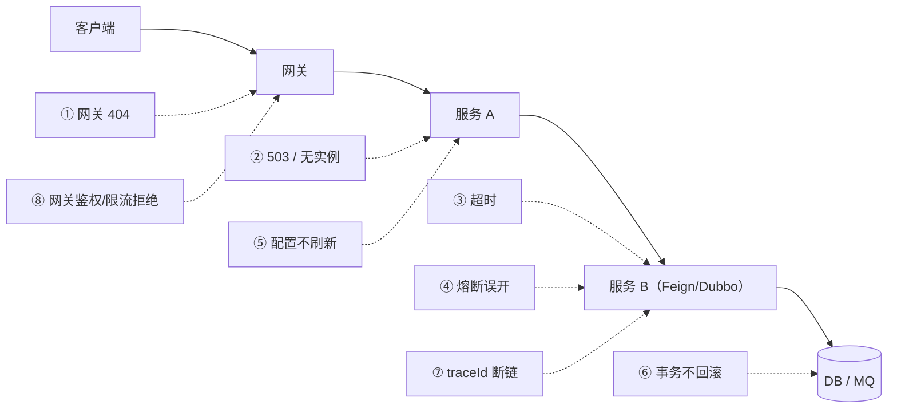
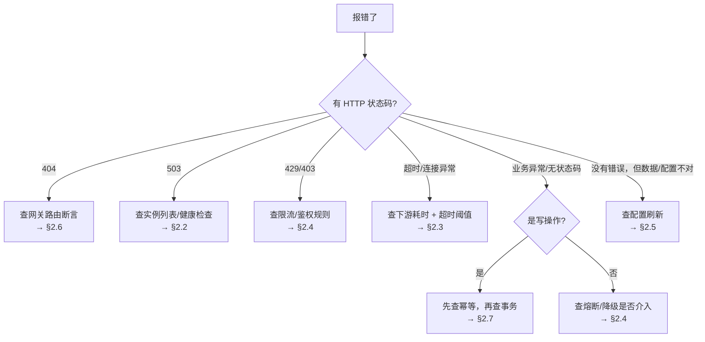
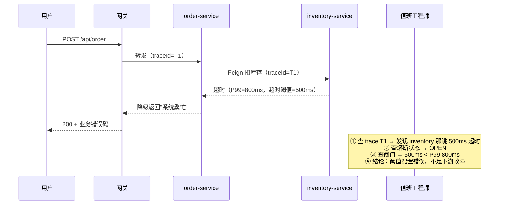

# Spring Cloud 源码精读 08-2：微服务落地清单与常见故障排查手册

> **一句话结论**：线上排障 90% 的时间不是花在"想方案"，而是花在"**不知道先去哪看**"。这一篇把 8 类最常见故障做成一页纸手册——每类只给三样东西：**排查顺序（按这个顺序敲命令）**、**关键日志（搜这些关键字）**、**对应源码位置（本套文档的哪一篇、哪个类）**。
>
> **阅读前置**：读过本套 05/06/07 任意一篇即可；不需要先读源码，本篇是"收口篇"。
>
> **预计阅读**：**30 分钟**（建议打印出来贴在值班工位）
>
> **源码基线**：Spring Cloud **5.1.0**、Spring Boot **4.2.0**、Nacos **3.3.0**、Sentinel **1.8.10**、Seata **2.7.0**、Dubbo **3.3.6**。**本篇不新引入源码摘录**，所有源码引用均指向前面的文章（链接已核对存在）。

---

## 0. 先看现象

| 你看到的现象 | 第一反应（通常错） | 10 秒定位动作 |
|---|---|---|
| `FeignException$ServiceUnavailable: 503` | "服务挂了" | 看 Nacos 实例列表有没有**健康实例**；再看调用方是否开了**同实例重试** |
| `No provider available` / `UnknownHostException` | "DNS 坏了" | 看注册中心里**坐标/应用名**是否与调用方一致 |
| `Read timed out` | "下游慢" | 看**哪一跳**慢（trace），再看超时阈值是不是比下游 P99 还小 |
| 熔断器一直 `OPEN` | "熔断器有 bug" | 看**降级是否被算作失败**、`minimumNumberOfCalls` 是否太小、`slowCall` 阈值是否过低 |
| 改了配置但没生效 | "Nacos 没推到" | 先确认**是不是 `@RefreshScope`/`@ConfigurationProperties`**，再确认监听是否收到 |
| 网关 404 | "路由写错了" | 看 `RoutePredicateHandlerMapping` 的 DEBUG 日志，逐条打印**哪个断言没通过** |
| 事务没回滚 | "Seata 挂了" | 搜 `XID`——**跨服务那一跳到底有没有带 XID** |
| traceId 断链 | "采集端坏了" | 看下游 span 的 **parentSpanId** 是否存在；多半是线程池/裸 HTTP 客户端 |

---

## 1. 整体地图

### 1.1 一次请求的"八个断点"



**读图说明**：

1. 图中把一次调用切成**网关 → A → B → 存储**四段，八个故障点分别挂在它最容易发生的那一段上。
2. `①` 与 `⑧` 都在网关，但性质完全不同：`①` 是**路由没匹配**（404），`⑧` 是**匹配到了但被拒**（403/429）。先看状态码能一秒分开。
3. `②` 与 `③` 都在"调用方"，但一个发生在**选实例阶段**（根本没有可用实例），一个发生在**已发出请求等响应阶段**（有实例但慢）。前者看注册中心，后者看下游耗时。
4. `④` 熔断是个**放大器**：它会把"偶发超时"变成"持续不可用"，所以它出现在图上 A→B 这段的**下游**，是"最后一道闸门"。
5. `⑤` 配置不刷新**不在请求链上**，它挂在 A 上是因为"刷新是应用自身行为"——排查时不要往网关/注册中心找。
6. `⑥` 事务挂在存储上，因为它的证据链终点是**数据库里的数据**（undo_log 有没有、数据有没有改）。
7. `⑦` traceId 断链与"请求能不能通"**完全无关**：千万别因为 trace 断了就去怀疑调用不通，它们是两条独立链路。
8. 记住这张图的**顺序价值**：排障永远从上往下走，不要在没确认"请求打到没打到"之前讨论业务代码。

### 1.2 决策树：从现象到第一个动作



**读图说明**：

1. 第一个判断点**只看状态码**，这是最快的信息源——比看日志早 10 秒。
2. `503` 与"超时"分两路，因为它们的排查对象完全不同：503 关注"有没有实例"，超时关注"实例慢不慢"。
3. `429/403` 这一路经常被忽略：网关限流返回 429、鉴权返回 403，都**不是**服务问题。
4. "业务异常/无状态码"再分叉：**写操作先考虑幂等**（可能已经成功但重试了），**读操作先考虑熔断**（可能根本没打出去）。
5. 右下角那条"没有错误但数据不对"的路，是配置刷新与事务排查的入口——它们**不会**在调用链上报错。
6. 整棵树故意**没有"重启试试"这个分支**：重启会掩盖证据，应放在最后一步。

---

## 2. 八类故障逐条排查

### 2.1 服务调不通（找不到 / 连不上）

**排查顺序**：

1. **看注册中心**：目标服务有没有实例？实例的 `IP:PORT` 是不是容器内网 IP（经典错误：注册了 `172.17.0.x`，调用方在其他网络）。
2. **看调用方解析结果**：`Feign` 是否真的经过 `LoadBalancer`（而不是写死了 `url`）。若 `@FeignClient(url="...")` 写了 `url`，**注册中心根本不参与**。
3. **看端口**：目标 Pod/主机端口是否可达（`telnet ip port`、`curl -v`）。Dubbo 场景注意 `20880` 是否暴露。
4. **看名称**：`spring.application.name` 与 `@FeignClient(name=...)` 是否**逐字符**一致（大小写、下划线、连字符）。
5. **看命名空间/分组**：Nacos 的 `namespace`、`group` 是否一致——不一致时"两边都在 Nacos 里"，却互相看不见。

**关键日志**：

```text
# Spring Cloud LoadBalancer：实例列表为空
[LoadBalancer] No servers available for service: user-service

# Nacos 客户端：注册/订阅失败
[nacos] failed to req API:/nacos/v1/ns/instance/list after all servers tried
[nacos] current service name: user-service, group: DEFAULT_GROUP

# Feign 报错（能连上但被拒）
feign.RetryableException: Connection refused executing GET http://user-service/user/1

# Dubbo
[DUBBO] No provider available from registry ...
[DUBBO] Notify urls for subscribe url provider://..., urls: []   ← 空列表 = 订阅不到
```

**对应源码位置**：

- 配置中心的"拉不到配置"也会表现为启动失败：见 [../05-配置中心与Bus/01-config-client-配置拉取原理.md](../05-配置中心与Bus/01-config-client-配置拉取原理.md) 的 `ConfigClientFailFastException` 一节。
- Dubbo 侧坐标不一致导致 `No provider available`：见 [./01-dubbo-与springcloud-共存与对比.md](./01-dubbo-与springcloud-共存与对比.md) §6.1 与 §3.2。
- 注册中心/负载均衡的源码在另一位作者的 `02-注册中心Nacos`、`03-负载均衡与调用` 两组中（本仓库该两组尚未落地，**暂不提供链接**）。

### 2.2 503：没有可用实例

**排查顺序**：

1. **区分两种 503**：Spring Cloud LoadBalancer 的"无实例"会抛 `ServiceInstanceNotFoundException`（500 或 503 取决于你的异常处理），网关的 503 多半是"上游不可达"。先看响应体与 `Server` 头。
2. **看实例数量**：Nacos 里该服务 `健康实例数` 是否为 0；若"实例存在但全部不健康"，看心跳是否停止（节点卡死/GC）。
3. **看就绪探针**：K8s 的 `readinessProbe` 失败会把实例从 Endpoints 摘掉，但**Nacos 里可能仍有**——这是"双注册源"的经典不一致。
4. **看权重/元数据**：`spring.cloud.loadbalancer.nacos` 之类的权重配置若把实例权重设为 0，也会"有实例但选不到"。
5. **看是否被熔断器整体短路**：熔断 `OPEN` 时会**直接拒绝**，不再选实例——此时根因不在注册中心。参 §2.4。

**关键日志**：

```text
[LoadBalancer] No servers available for service: order-service
[LoadBalancer] Selected instance: 10.0.0.12:8080 (weight=0)      ← 权重为 0 的隐形故障
[nacos] service order-service instance 10.0.0.12:8080 healthy: false
Resilience4JCircuitBreaker: circuit breaker 'orderClient' is OPEN, rejecting call
```

**对应源码位置**：

- 熔断器如何"直接拒绝"（`run()` 的三条分支之一）：见 [../06-熔断限流与容错/01-circuitbreaker-抽象与resilience4j.md](../06-熔断限流与容错/01-circuitbreaker-抽象与resilience4j.md) §3.1 与 §4。
- Sentinel 的 `SystemSlot` 在系统负载过高时会**阻断所有入口**，表现为"全部 503/BlockException"：见 [../06-熔断限流与容错/02-sentinel-限流降级原理.md](../06-熔断限流与容错/02-sentinel-限流降级原理.md) §1.1 的槽链说明。

### 2.3 超时：到底谁慢

**排查顺序**：

1. **先看 trace，不要先看日志**：找到最慢的那个 span，确认时间花在"等下游"还是"自己算"。
2. **对比超时阈值与下游 P99**：`feign.client.config.default.readTimeout` 若小于下游 P99，超时就是**必然事件**（不是偶发）。
3. **看连接是否复用**：连接池耗尽（`ConnectionPoolTimeoutException`）表现为"超时"，但根因是**连接数**，不是下游慢。
4. **看重试次数**：Dubbo `retries=2` 或 Resilience4j `Retry` 会让一次业务超时变成 3 次真实请求，**放大下游压力**，越重试越慢。
5. **看 GC / 线程池**：自己进程的 `STW` 或 `Tomcat` 线程耗尽，表现为"我方超时但下游很快"。

**关键日志**：

```text
feign.RetryableException: Read timed out executing GET http://user-service/user/1
org.apache.http.conn.ConnectionPoolTimeoutException: Timeout waiting for connection from pool
[DUBBO] Waiting server-side response timeout by scan timer.
[DUBBO] Thread pool is EXHAUSTED! Thread Name: DubboServerHandler-10.0.0.12:20880
```

**对应源码位置**：

- 重试放大流量的数学关系与 `Retry` 与熔断的顺序陷阱：见 [../06-熔断限流与容错/01-circuitbreaker-抽象与resilience4j.md](../06-熔断限流与容错/01-circuitbreaker-抽象与resilience4j.md) §5 与 §8 的 Q9。
- Dubbo 的 `failover` 默认重试：见 [./01-dubbo-与springcloud-共存与对比.md](./01-dubbo-与springcloud-共存与对比.md) §3.1。
- 异步/线程池导致的 trace 断链（超时排查时 trace 不完整）：见 [../07-分布式事务与链路追踪/02-链路追踪-micrometer-tracing-and-otel.md](../07-分布式事务与链路追踪/02-链路追踪-micrometer-tracing-and-otel.md) §6。

### 2.4 熔断误开 / 限流误伤

**排查顺序**：

1. **确认是不是熔断**：日志里搜 `is OPEN` / `CallNotPermittedException`（Resilience4j）或 `BlockException` 的子类名（Sentinel：`FlowException`/`DegradeException`/`SystemBlockException`）。
2. **看统计窗口与最小调用数**：`minimumNumberOfCalls` 默认 100（滑动窗口 `COUNT_BASED` 时），但如果你把窗口改成 `TIME_BASED` 且 `slidingWindowSize` 很小，**3 次失败就能打开**。
3. **看降级是否被算作失败**：`recordExceptions` 若包含业务异常（如 `BizException`），"正常业务失败"会被算成熔断失败——这是最常见的误开原因。
4. **看慢调用阈值**：`slowCallDurationThreshold` 设得比正常耗时还小，会持续累积"慢调用"从而打开熔断。
5. **看 sentinel 的 blockHandler 是否吞掉了异常**：`@SentinelResource(blockHandler=...)` 会**把 BlockException 吃成正常返回**，于是监控看不出限流，但业务数据少了。

**关键日志**：

```text
# Resilience4j
Resilience4JCircuitBreaker: CircuitBreaker 'userClient' recorded an error: 'java.net.SocketTimeoutException'
Resilience4JCircuitBreaker: CircuitBreaker 'userClient' changed state from CLOSED to OPEN
io.github.resilience4j.circuitbreaker.CallNotPermittedException: CircuitBreaker 'userClient' is OPEN

# Sentinel
com.alibaba.csp.sentinel.slots.block.flow.FlowException: null
com.alibaba.csp.sentinel.slots.block.degrade.DegradeException: null
# 命令端口（默认 8719）看实时规则与统计
curl http://localhost:8719/api/tree?type=root
curl http://localhost:8719/getRules?type=flow
curl http://localhost:8719/metric?resource=GET:/user
```

**对应源码位置**：

- 熔断三态的判定与参数：见 [../06-熔断限流与容错/01-circuitbreaker-抽象与resilience4j.md](../06-熔断限流与容错/01-circuitbreaker-抽象与resilience4j.md) §3.1、§5、§7。
- 抛 `BlockException` 的位置（`FlowRuleChecker#checkFlow` → `throw new FlowException(...)`）：见 [../06-熔断限流与容错/02-sentinel-限流降级原理.md](../06-熔断限流与容错/02-sentinel-限流降级原理.md) §3.5。
- `blockHandler` 与 `fallback` 的优先级：同上一篇 §6。

### 2.5 配置改了但不生效

**排查顺序**：

1. **先确认配置到底在哪一层生效**：`@Value` 字段 → 需要 `@RefreshScope`；`@ConfigurationProperties` → 需要 rebind；`static` 字段 → **永远不会**被刷新。
2. **确认远端配置真的被拉到**：`/actuator/env` 看到 `configserver:` 或 Nacos 的 `PropertySource` 吗？没有就是拉取失败（不是刷新失败）。
3. **确认刷新事件被触发**：`POST /actuator/refresh`（或 `/actuator/busrefresh`）返回 200 且列出变更的 key。返回 `[]` 说明**环境里没有差异**——即远端根本没变，或变了但没拉到。
4. **确认哪些 Bean 被重建**：`/actuator/refresh` 响应里的 `configprops` 与 `beans` 字段会告诉你 rebind 了谁。
5. **看是否命中"永不刷新"名单**：`spring.cloud.refresh.never-refreshable` 默认包含 `com.zaxxer.hikari.HikariDataSource`，数据源 URL 改了不会生效。

**关键日志**：

```text
# 刷新链路
RefreshEventListener: Received event RefreshEvent
ContextRefresher: Refresh keys changed: [user.timeout]
RefreshScope: Refreshing scope
ConfigurationPropertiesRebinder: Rebinding configuration properties: UserProperties
ConfigurationPropertiesRebinder: Could not rebind [userProperties] ...   ← 失败要重点看

# 拉取链路（fail-fast 相关）
ConfigClientFailFastException: Could not locate PropertySource and the fail fast property is set
```

**对应源码位置**：

- 拉取：`ConfigServerConfigDataLocationResolver#resolveProfileSpecific` → `ConfigServerConfigDataLoader#doLoad`：见 [../05-配置中心与Bus/01-config-client-配置拉取原理.md](../05-配置中心与Bus/01-config-client-配置拉取原理.md) §3.5。
- 刷新：`ContextRefresher#refresh` → `refreshEnvironment()` → `scope.refreshAll()`：见 [../05-配置中心与Bus/02-配置刷新-refreshscope与bus.md](../05-配置中心与Bus/02-配置刷新-refreshscope与bus.md) §3.1。
- 为什么 `@RefreshScope` 必须靠代理：同上一篇 §3.5（`GenericScope` 与 `LockedScopedProxyFactoryBean`）。
- `@ConfigurationProperties` rebind 与 never-refreshable：同上一篇 §3.8。

### 2.6 网关 404 / 路由不匹配

**排查顺序**：

1. **打开路由匹配日志**：把 `org.springframework.cloud.gateway` 调到 DEBUG，会打印每条路由的断言评估结果。
2. **看 Path 断言**：`/api/user/**` 与 `/api/user/{id}` 是不同的语义，`**` 才匹配多段。
3. **看 StripPrefix**：`StripPrefix=1` 会把 `/api/user/1` 变成 `/user/1`；若下游 controller 是 `/api/user/1`，就 404。
4. **看谓词顺序**：`Path` 之外还有 `Host`、`Header`、`Method`、`Query` 断言，**所有断言 AND** 才匹配。
5. **看是不是被 404 之外的代码吞了**：全局过滤器里 `chain.filter()` 没被调用、或自己写了 `response.setComplete()`，也会表现为"空 404"。

**关键日志**：

```text
# org.springframework.cloud.gateway DEBUG
Route matched: user-route
Mapping [Exchange: GET http://localhost:8080/api/user/1]
[PathRoutePredicateFactory] Path doesn't match: /api/user/1 vs pattern /user/**
```

**对应源码位置**：

- 网关的源码在另一位作者的 `04-网关Gateway` 组中（本仓库该组尚未落地，**暂不提供链接**）。
- 网关 404 与"服务调不通"容易混淆：先按 §2.1 确认服务侧是否正常，再看网关。

### 2.7 事务不回滚（Seata AT）

**排查顺序**：

1. **搜 XID**：`grep XID` 两跳日志。跨服务那一跳**没有 XID** = 根本没进全局事务，此时讨论 undo_log 没有意义。
2. **看 `@GlobalTransactional` 的边界**：是否打在 **public 方法**上？是否被**同类自调用**（自调用不走代理，注解失效）？
3. **看异常是否被吞**：`try { ... } catch (Exception e) { log.error(...); }` 不往外抛 → TM 认为成功 → **全局提交**。
4. **看分支注册**：RM 日志里有没有 `register branch`；没有说明数据源没被 `DataSourceProxy` 代理（Seata 没生效）。
5. **看 undo_log**：`SELECT * FROM undo_log WHERE xid='...'`。一阶段后应该有记录；若没有，说明本地事务与 undo_log 不在同一事务里（或表缺失/主键缺失）。
6. **看 TC 状态**：Seata Server 日志里该 `xid` 的全局状态是 `Committed` 还是 `Rollbacked`。

**关键日志**：

```text
# TM / RM / TC 三段都要看
[TM] Begin new global transaction [10.0.0.12:8091:1234567890]
[RM] Register branch successfully, xid = ..., branchId = ..., resourceId = jdbc:mysql://...
[RM] undo log condition: ...   /  [RM] xid ... branchId ... rollback
[TC] Global transaction commit / rollback: xid = ...
```

**对应源码位置**：

- AT 模式两阶段时序、`undo_log` 表结构与三大问题（空回滚/悬挂/幂等）：见 [../07-分布式事务与链路追踪/01-分布式事务-seata-at模式源码.md](../07-分布式事务与链路追踪/01-分布式事务-seata-at模式源码.md) §2、§3、§6。
- ⚠️ Seata 的 sources jar **不可得**，上述文章**未附源码摘录**，类名以官方 GitHub v2.7.0 为准，**行号未验证**。

### 2.8 traceId 断链

**排查顺序**：

1. **看下游 span 的 parentSpanId**：为空 = 上游没注入；有但 traceId 不同 = 中间重新开了根 span。
2. **枚举"发起调用的方式"**：`RestTemplate` 是否被 `@LoadBalanced` 增强过？`WebClient` 是否用了带 `ExchangeFilterFunction` 的 builder？`Feign` 是否装了 tracing 适配？**裸 `new RestTemplate()` 一定断**。
3. **看线程池**：`@Async` / `CompletableFuture.supplyAsync` / 自建 `ThreadPoolExecutor` 若没装饰 `TaskDecorator`，子线程拿不到父上下文，**并且会出现 traceId 串号**。
4. **看消息队列**：MQ 的生产/消费两端默认**不在同一线程**，必须在消息头里手工传递 `traceparent`。
5. **看采样率**：`management.tracing.sampling.probability` 若为 0.1，90% 的请求"看起来断链"其实只是没采；先临时调到 1.0 再查。
6. **看日志格式**：`logging.pattern.correlation` 未配置时，日志里根本没有 traceId 这一列，会被误认为"断链"。

**关键日志/命令**：

```text
# 正确的日志格式（Boot 3+ 起用 correlation 变量）
logging.pattern.correlation=[${spring.application.name:},%X{traceId:-},%X{spanId:-}]

# 打印效果
2026-01-01 10:00:00.123 INFO [user-service,4bf92f3577b34da6a3ce929d0e0e4736,00f067aa0ba902b7] ...

# 下游收到的头（装饰成日志或抓包看）
traceparent: 00-4bf92f3577b34da6a3ce929d0e0e4736-00f067aa0ba902b7-01
```

**对应源码位置**：

- `traceparent` 结构与 `create` / `createFromRemoteParent` 的区别：见 [../07-分布式事务与链路追踪/02-链路追踪-micrometer-tracing-and-otel.md](../07-分布式事务与链路追踪/02-链路追踪-micrometer-tracing-and-otel.md) §3.3。
- `Span.current()` 的 no-op 设计与 `span.end()` 幂等：同上一篇 §3.2、§3.4。
- 异步与线程池的传播修法：同上一篇 §6。

---

## 3. 落地检查清单（上线前逐项打勾）

| # | 检查项 | 不合格的典型症状 | 合格标准 |
|---|---|---|---|
| 1 | 每个服务都有 `spring.application.name` 且全局唯一 | 注册中心里实例互相覆盖 | 名称与网关路由、Feign name 三方一致 |
| 2 | `server.port` / `dubbo.protocol.port` 显式配置 | 多实例部署端口冲突 | 每个进程端口不冲突，容器内已暴露 |
| 3 | 超时阈值 > 下游 P99（含重试总数） | 稳态下持续超时 | `readTimeout ≥ P99 × 1.5`，且总时长 < 上游超时 |
| 4 | 只有一层重试 | 流量放大 3~36 倍 | 网关/Feign/Dubbo/Resilience4j 中只有一处开启重试 |
| 5 | 熔断只统计"技术失败" | 业务校验失败导致熔断误开 | `recordExceptions` 不含业务异常 |
| 6 | 限流值由压测得出 | 限流阈值拍脑袋，业务被误伤 | 有压测报告，阈值 = 实测容量 × 0.7 |
| 7 | `@RefreshScope` 只加在真正需要的 Bean 上 | 刷新后连接池/线程池泄漏 | 有状态资源（数据源、线程池）走 never-refreshable |
| 8 | 每个写接口都有幂等键 | 重试导致重复下单/重复扣款 | 唯一索引或幂等表，并验证过重试 |
| 9 | 全局事务边界内不回吞异常 | 事务"看起来成功"但数据不一致 | 异常必抛，或显式 `setRollbackOnly` |
| 10 | trace 采样率与日志格式统一 | 排查时找不到 traceId | 生产 10% 采样 + 100% ERROR 采样，日志含 `%X{traceId}` |
| 11 | 所有出站 HTTP 客户端都经过增强 | 断链、无负载均衡、无超时 | 统一封装 `RestClient`/`Feign`，禁止 `new RestTemplate()` |
| 12 | 线程池统一由框架创建并装饰 | 上下文丢失、traceId 串号 | 使用 `ThreadPoolTaskExecutor` + `TaskDecorator` |
| 13 | 每个服务有健康检查 + 就绪探针 | 实例已挂但仍在接流量 | `/actuator/health/readiness` 接入 K8s |
| 14 | 有降级方案的接口都验证过降级 | 降级代码从未执行，一执行就 NPE | 降级逻辑有单测，且验证过 `OPEN` 态 |

---

## 4. 一次完整排查演练

场景：用户反馈"下单偶尔失败，提示系统繁忙"。



**读图说明**：

1. 请求**没有报 5xx**，而是"200 + 业务错误码"——这正是排查难的原因：网关层面看全是成功。
2. 降级发生在 `O` 调 `I` 这一跳，`traceId=T1` 把所有 span 串起来，**一处就能看到哪一跳耗时 500ms**。
3. 第二步查熔断状态，确认熔断已 `OPEN`——此时即使 `I` 恢复了，`O` 也**不会立刻放流量**（要等 `HALF_OPEN` 试探）。
4. 第三步对比"超时阈值 vs 下游 P99"，发现阈值比 P99 还小——这是**系统性配置错误**，不是偶发。
5. 结论与动作：调大 `readTimeout`，并把熔断的 `slowCallDurationThreshold` 调到 P99 之上；同时**手动关闭**一次熔断（或等半开窗口）以恢复。
6. 这条演练的通用套路：**trace 定位 → 状态确认 → 阈值对比 → 结论**，适用于所有"偶发失败"类问题。

---

## 5. 设计模式与取舍

| 做法 | 好处 | 代价 | 什么时候别用 |
|---|---|---|---|
| 全链路统一封装出站客户端 | trace/超时/重试/负载均衡一次性对齐 | 需要治理存量代码 | 极少数必须裸调的场景（要显式 `@SuppressWarnings` 并注释原因） |
| 熔断 + 降级必须有默认值 | 下游挂了业务还能走"只读/缓存" | 降级逻辑需要维护、要考虑数据一致性 | 强一致写路径（宁可失败也不要写错） |
| 限流阈值来自压测 | 阈值可信、可解释 | 压测成本高 | 内部低流量服务（用 Sentinel 系统规则兜底即可） |
| 重试只留一层 | 行为可预测 | 需要治理多框架默认值 | 幂等性无法保证时 |
| trace 采样 + ERROR 全采 | 成本可控、错误必留 | 需要采集端支持尾部采样 | 排障窗口期（临时 100% 采样） |
| 配置分环境 + 中心化 | 改配置不用发版 | 中心化故障会放大成全局故障 | 关键开关（要有本地兜底） |

---

## 6. 踩坑与调试手法

### 6.1 通用"五分钟定位法"

```text
T+0s   看状态码与响应体 → 决定走哪条分支（§1.2 决策树）
T+30s  找 traceId（响应头 / 日志 correlation）→ 定位最慢或报错的 span
T+60s  看该 span 的 tags：http.status_code / exception.type / peer.address
T+90s  看该服务实例的日志（同一 traceId）→ 找第一条 ERROR
T+120s 看依赖状态：注册中心实例数、熔断状态、限流指标、DB 连接池
T+180s 形成假设 → 用一条命令验证（改阈值/重启单个实例/回滚一个配置）
T+300s 若未定位，升级并附上 traceId + 时间窗口 + 已排除项
```

### 6.2 必备命令清单

```text
# 1) 健康与就绪
curl -s localhost:8080/actuator/health | jq
curl -s localhost:8080/actuator/health/readiness | jq

# 2) 环境与配置来源（确认远端配置是否生效）
curl -s localhost:8080/actuator/env | jq '.propertySources[].name'
curl -s localhost:8080/actuator/configprops | jq 'keys'

# 3) 手动刷新（观察 changelog 里有没有你改的 key）
curl -s -X POST localhost:8080/actuator/refresh | jq

# 4) Sentinel 实时指标（默认命令端口 8719）
curl -s "localhost:8719/api/tree?type=root"
curl -s "localhost:8719/getRules?type=flow"

# 5) 端口连通性
nc -zv 10.0.0.12 20880

# 6) 抓一次请求头，确认 traceparent 是否透传
curl -sv -H "traceparent: 00-4bf92f3577b34da6a3ce929d0e0e4736-00f067aa0ba902b7-01" http://localhost:8080/api/order
```

### 6.3 七个"看起来像 A 其实是 B"的坑

| 看起来像 | 其实是 | 怎么一眼分清 |
|---|---|---|
| 下游超时 | 连接池耗尽 | 日志里有 `ConnectionPoolTimeoutException` |
| 熔断器 bug | 业务异常被算作失败 | 看 `recordExceptions` 配置与 `recorded an error` 日志 |
| 注册中心故障 | 命名空间/分组不一致 | 两个客户端日志里的 `namespace`/`group` 对比 |
| 配置没推送 | 字段是 `static`/没加 `@RefreshScope` | 看 `/actuator/refresh` 的 changelog 里有没有该 key |
| 网关路由错 | `StripPrefix` 多剥了一层 | 打开 gateway DEBUG 看转发后的 path |
| 事务没生效 | `@GlobalTransactional` 被自调用绕过 | 搜日志里有没有 `Begin new global transaction` |
| trace 断链 | 采样率太低 | 临时把采样率调到 1.0 复现 |

---

## 7. ⚠️ 版本差异

| 项 | 旧版本 | 当前基线（Boot 4.2 / Cloud 5.1） | 排查影响 |
|---|---|---|---|
| 健康检查路径 | `/actuator/health` 即可 | 需显式 `management.endpoint.health.probes.enabled=true` 才有 `liveness/readiness` | 探针配错会导致"实例被摘但进程健康" |
| 配置刷新端点 | `/actuator/refresh`（Bus 用 `/actuator/bus-refresh`） | `/actuator/refresh`（Bus 用 `/actuator/busrefresh`，**中划线已去掉**） | 老脚本调 `/bus-refresh` 会 404 |
| 链路追踪 | Spring Cloud Sleuth（`spring.sleuth.*`） | Micrometer Tracing（`management.tracing.*`） | 老配置项**完全不生效**，且不会报错 |
| 日志 traceId | `%X{X-B3-TraceId}` | `%X{traceId}` + `logging.pattern.correlation` | 用错变量名 → 日志里永远为空 |
| 熔断抽象 | `BlockingCircuitBreakerFactory` | **不存在**，用 `CircuitBreakerFactory`/`AbstractCircuitBreakerFactory` | 按老文档写的自定义工厂编译不过 |
| 配置上下文 | `bootstrap.yml` 生效 | bootstrap 默认禁用，需 `spring.config.import` | 老项目升级后"配置全空"，启动报 `No spring.config.import property has been defined` |

**未验证清单（本篇）**：

- 文中所有**命令输出示例**是示意，不是某台机器的真实回显。
- Sentinel 命令端口接口（`/api/tree`、`/getRules`、`/metric`）与 Nacos API 路径：**未在本仓库源码中验证**。
- 网关（`RoutePredicateHandlerMapping`）、Nacos 客户端、LoadBalancer 的实现细节：**对应文章尚未落地，本篇不给行号**。
- Seata 的 TC/RM 日志原文：**未验证**（Seata sources jar 不可得）。
- Resilience4j 的 `minimumNumberOfCalls` 等默认值取自官方文档，**未在本仓库源码中验证**。

---

## 8. 面试高频问与答

**Q1：线上报 503，你怎么在 1 分钟内定位？**

先看状态码来源：若是 LoadBalancer 抛"无实例"，去注册中心看健康实例数与 IP 是否正确；若是网关返回，查上游地址与端口连通性；同时检查熔断是否 `OPEN`（熔断会直接拒绝而不选实例）。三件事并行做，通常 30 秒能分开。

**Q2：超时到底该配多少？**

以"下游 P99 × 1.5"为初值，再保证"本服务总耗时 < 上游对本服务的超时"，形成**从外到内递减**的超时预算。绝不能出现"内层超时 > 外层超时"，否则外层先超时，内层还在跑，造成资源浪费与重试风暴。

**Q3：为什么重试必须只有一层？**

因为各层重试是**乘法**关系：网关 2 次 × Feign 2 次 × Dubbo 3 次 = 12 倍请求。而且每一层都认为"只重试一次很安全"。治理办法是明确"重试归谁管"，其他层一律关闭。

**Q4：熔断误开最常见的三个原因？**

① `recordExceptions` 把业务异常算作失败；② `slowCallDurationThreshold` 低于正常耗时；③ 最小调用数与窗口太小，3 次失败就打开。

**Q5：配置刷新的三条链路分别对应什么？**

① 拉取（Resolver/Loader）→ Environment 有没有新值；② 环境变更事件（`EnvironmentChangeEvent`）→ `@ConfigurationProperties` rebind；③ Scope 销毁重建（`RefreshScope.refreshAll`）→ `@RefreshScope` Bean 重建。三条链路任一处断，都表现为"配置不生效"。

**Q6：`static` 字段为什么永远刷不了？**

因为刷新机制是"销毁 Bean、重新创建、重新注入"，而 `static` 字段属于**类**而不属于实例，重建 Bean 不会重新赋值给它。想动态生效只能用 `@Value` 实例字段、`@ConfigurationProperties`，或显式在刷新事件里改静态值。

**Q7：网关 404 和下游 404 怎么区分？**

看响应体与 `Server` 头：网关的 404 通常是空的 JSON/HTML 且无 `X-Forwarded-*` 回溯；另外打开 gateway DEBUG 能看到 `Route matched` / `Path doesn't match`，这是最直接的证据。

**Q8：Seata 事务没回滚，第一步看什么？**

看 `XID` 是否跨进程传递。没有 XID 说明这一跳根本没在全局事务里（Feign 拦截器缺失/Dubbo filter 缺失），此时查 undo_log 毫无意义。

**Q9：traceId 断了会影响业务吗？**

不会。trace 是**可观测性**设施，与调用能否成功无关。反过来，trace 断了会让排障变慢，所以"断链"是可靠性问题而非功能问题。

**Q10：线程池为什么会导致 traceId 串号而不只是丢失？**

若使用可复用的线程池且没有清理 `ThreadLocal`，上一个任务的上下文会残留在池化线程上，下一个任务读到**错误的** traceId。所以必须用 `TaskDecorator` 在**提交时捕获、执行前设置、执行后清理**。

**Q11：怎么判断"是我的服务慢"还是"下游慢"？**

看 trace 中本服务的 span：若 span 时长 ≈ 子 span 时长之和，是下游慢；若本服务 span 明显大于子 span 之和，是自己算得慢（或等锁/等连接池）。再看 GC 与线程池指标排除自身问题。

**Q12：为什么建议"关键开关有本地兜底"？**

配置中心是**单点放大面**：它挂了可能导致所有服务无法启动或行为异常。关键开关（如限流阈值、降级开关）应在本地有默认值，且默认值选择"安全侧"（比如默认限流更严）。

**Q13：怎么验证降级代码是可用的？**

主动制造一次熔断：临时把阈值调到极端（如 `failureRateThreshold=1`）、或把下游打成超时，观察降级返回值是否符合预期，并检查降级逻辑没有 NPE/空集合。上线前每个降级分支都该演练一次。

**Q14：一次故障复盘该产出什么？**

① 时间线（几点几分发现、做了什么）；② 影响面（多少请求失败、多少用户）；③ 根因（配置/代码/容量/依赖）；④ **可验证的**改进项（阈值纳入压测、加告警、加演练），而不是"加强监控"这种无法验收的话。

---

## 9. 动手练习

### 练习 1：把 8 类故障各复现一次

**目标**：在本地把每一类故障"人为制造"出来，形成肌肉记忆。

**步骤**：

1. 用 2~3 个 Spring Boot 服务 + Nacos + 网关搭最小环境。
2. 依次制造：改错 `@FeignClient(name)`（§2.1）、把实例权重设 0（§2.2）、给下游加 `sleep` 超阈值（§2.3）、`recordExceptions` 包含业务异常（§2.4）、把配置项改为 `static` 字段（§2.5）、`StripPrefix` 多剥一层（§2.6）。
3. 每次只改一处，记录：现象 → 第一条关键日志 → 定位耗时。

**验收标准**：

- [ ] 6 类故障都能在**3 分钟内**定位到根因。
- [ ] 能写出每一类的"第一条关键日志"原文。
- [ ] 能说清每类故障**不能**用哪种方法定位（例如 trace 能不能定位配置不刷新）。

### 练习 2：为你的服务写一页排障卡

**目标**：把通用手册变成"你这个服务专属"的。

**步骤**：

1. 列出本服务的：依赖清单（谁调我、我调谁）、端口、配置来源、熔断参数、限流阈值。
2. 为每个依赖写一句"如果它挂了，我会看到什么"。
3. 把 §2 的 8 类里**不适用的删掉**，只留真实存在的，并补充本服务特有的故障。

**验收标准**：

- [ ] 一页纸（A4）能容纳。
- [ ] 每条都包含"看哪里"（具体 URL/命令/日志文件）。
- [ ] 让一个**不了解本服务**的同事照着卡片能在 10 分钟内定位一个已知注入的故障。

### 练习 3：给熔断与限流加"演练开关"

**目标**：让降级路径随时可验证。

**步骤**：

1. 加一个配置项 `resilience.demo.force-open=true`（仅测试环境），打开后强制熔断器为 `OPEN`。
2. 加一个 Sentinel 规则开关，可临时把某资源 QPS 阈值调到 1。
3. 写两个自动化用例，验证降级返回值与 `blockHandler` 返回值。

**验收标准**：

- [ ] 打开开关后，接口返回的是**降级结果**而不是异常堆栈。
- [ ] 关掉开关后 30 秒内恢复正常（验证半开探测生效）。
- [ ] 用例进入 CI，回归时自动跑。

---

## 小结

1. 排障的第一步永远是**看状态码**，它能在一秒内把问题分到"路由/实例/超时/限流/业务"五个框里。
2. **503 看实例**、**超时看 P99 与阈值**、**熔断看统计口径**、**配置看三条链路**、**事务看 XID**、**trace 看 parentSpanId**——每类故障都有**唯一的第一现场**。
3. 重试是乘法而不是加法：只有一层重试时才可预测；Dubbo 默认 `failover` 带重试，迁移时最容易踩。
4. 配置刷新是三条独立链路（拉取 / 事件 rebind / Scope 重建），任一处断都表现为"改了没生效"，所以要**分层验证**。
5. 降级与幂等必须**演练**过，否则"写了但从未执行"的代码等于没有。
6. 反过来看，trace 断链不影响业务，但会让所有其他排查变慢——所以它是"基础设施成本"里最值的一项。
7. 落地清单（§3）的 14 项，最能提前消灭故障的是：**统一出站客户端、只有一层重试、熔断只统计技术失败、超时预算递减**。

---

## 自测题

**1. 看到 503 时，最先要区分的两件事是什么？**

<details><summary>答案</summary>

① 503 是**谁返回的**：LoadBalancer 的"无可用实例"、网关的"上游不可达"、还是业务自己抛的；② 是"没有实例"还是"有实例但被熔断直接拒绝"。前者查注册中心与健康检查，后者查熔断状态。分不清这两件事就会在错误的系统里浪费大量时间。
</details>

**2. 超时预算的正确关系是什么？**

<details><summary>答案</summary>

从外到内**递减**：上游对下游的超时必须**大于**下游自身对更下游的超时加上其处理时间。否则外层先超时返回，内层还在跑并可能重试，形成"无主的请求"与资源浪费。常用做法：内层总耗时上限 = 外层超时 × 0.8。
</details>

**3. 为什么"重试只能有一层"？**

<details><summary>答案</summary>

因为多层重试是乘法关系：`(1+r1) × (1+r2) × ...`。三层各重试 1、1、2 次就是 2×2×3 = 12 倍请求量，会把一次小抖动放大成雪崩。所以要指定唯一负责重试的层（通常在"最了解业务幂等性"的那一层），其他层关闭。
</details>

**4. 熔断误开的三个常见原因？**

<details><summary>答案</summary>

① `recordExceptions` 把业务异常算作失败；② `slowCallDurationThreshold` 低于正常耗时，导致持续累积慢调用；③ 滑动窗口/最小调用数太小，少量失败就让失败率达到阈值。三者都会让熔断在"下游其实健康"时打开。
</details>

**5. 配置刷新有哪三条链路？各对应什么证据？**

<details><summary>答案</summary>

① **拉取**：`ConfigServerConfigDataLocationResolver`/`ConfigServerConfigDataLoader`（Nacos 则为对应 ConfigData 实现）——证据是 `/actuator/env` 里的属性源；② **环境变更事件 → rebind**：`ContextRefresher#refreshEnvironment` 发布 `EnvironmentChangeEvent`，`ConfigurationPropertiesRebinder` 重新绑定——证据是 `/actuator/refresh` 返回的 `configprops`；③ **Scope 重建**：`RefreshScope#refreshAll` 销毁并重建 `@RefreshScope` Bean——证据是 `RefreshScope: Refreshing scope` 日志。
</details>

**6. 为什么 `static` 字段永远刷新不了？**

<details><summary>答案</summary>

刷新机制的本质是"销毁 Bean → 重建 → 重新注入"，作用对象是**实例**。`static` 字段属于类，重建实例不会重新赋值。要动态生效只能用实例字段（`@Value`/`@ConfigurationProperties`），或在刷新事件监听里显式修改静态值。
</details>

**7. 网关 404 最直接的证据是什么？**

<details><summary>答案</summary>

打开 `org.springframework.cloud.gateway` 的 DEBUG 日志，看 `Route matched` 与各断言的评估结果（例如 `Path doesn't match: /api/user/1 vs /user/**`）。同时检查 `StripPrefix`/`RewritePath` 过滤器是否把路径改错了。
</details>

**8. Seata 事务"没回滚"，第一步看什么？为什么？**

<details><summary>答案</summary>

看 **XID 有没有跨进程传递**。全局事务靠 XID 关联各分支；如果 Feign/Dubbo 那一跳没带 XID，分支根本没注册进全局事务，此时无论 undo_log 还是 TC 都不会回滚它。所以要先确认"它到底在不在全局事务里"。
</details>

**9. `@GlobalTransactional` 方法被同类自调用会怎样？**

<details><summary>答案</summary>

注解失效——Spring 的 AOP 代理只在**外部调用**时生效，同类内部 `this.method()` 调用不经过代理。表现是"日志里没有 `Begin new global transaction`"，事务根本没开。解法是拆到另一个 Bean、注入自身代理，或用 `AopContext.currentProxy()`（需 `exposeProxy=true`）。
</details>

**10. traceId 断链时，看哪个字段能最快区分"没注入"和"重新开了根 span"？**

<details><summary>答案</summary>

看下游 span 的 **parentSpanId**：为空/无效 = 上游没注入（上下文没传过来）；有合法 parentSpanId 但 traceId 与上游不同 = 中间某个组件重新开了新的根 span（例如重启了一个新的 trace）。
</details>

**11. 线程池导致 traceId 串号的根因是什么？**

<details><summary>答案</summary>

池化线程复用 + `ThreadLocal` 未清理。若只在"提交任务前设置上下文"而不在任务结束时清理，线程回到池里仍带着上一个请求的上下文，下一个任务读到错误值。正确做法是 `TaskDecorator` 在提交时捕获、执行前设置、**finally 中清理**。
</details>

**12. 采样率会不会被误判为"断链"？怎么快速排除？**

<details><summary>答案</summary>

会。采样率 10% 时 90% 的请求没有 span，看起来像断链。快速排除：把 `management.tracing.sampling.probability` 临时调到 1.0，若链路恢复完整，说明是采样问题而非传播问题。
</details>

**13. 怎么判断"是我的服务慢"还是"下游慢"？**

<details><summary>答案</summary>

看本服务 span 的时长与子 span 时长之和：近似相等 → 时间花在下游；本服务 span 明显更大 → 自己耗时（CPU/GC/锁/连接池等待）。再结合 `jvm.gc.pause`、线程池活跃数、连接池等待数确认。
</details>

**14. 一次故障复盘，最没价值、最有价值的产出分别是什么？**

<details><summary>答案</summary>

最没价值："加强监控""提高意识"这类无法验收的结论。最有价值：**可验证的改进项**——具体到"把 `readTimeout` 从 500ms 调到 1500ms 并纳入压测回归""为降级分支补三个单测""把重试统一收敛到网关"这类能打勾的条目，并附上验收方式。
</details>
