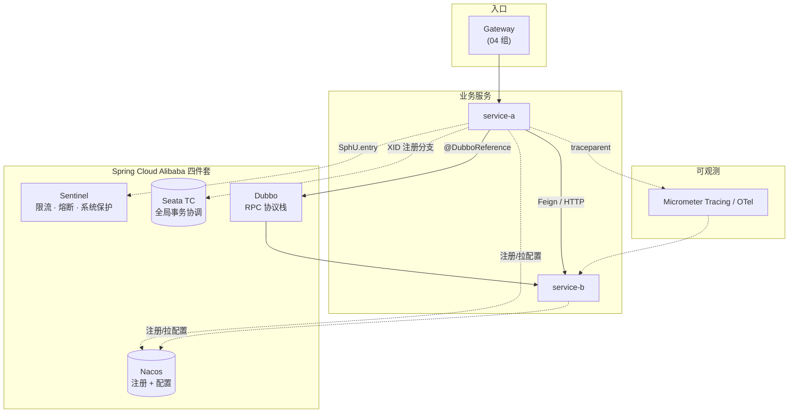

# 08 · Alibaba 生态详解

> 一句话：**Spring Cloud Alibaba 不是"另一套微服务框架"，而是把 Nacos / Sentinel / Seata / Dubbo 这四块"阿里系组件"接到 Spring Cloud 的接口上**。这一组两篇：第一篇讲最容易被误判的 **Dubbo 与 Spring Cloud 的定位差异与共存**（很多人把它当"替代关系"，结果踩了端口、注册模型、横切设施三道坑）；第二篇是全套教程的**收口**——一页纸的线上排障手册，把 05/06/07 的知识变成"值班时能照着敲"的步骤。
>
> 预计阅读：**1~1.5 小时**（01 约 45 分钟含 Dubbo 源码精读，02 约 30 分钟可直接当工具书查阅）。

---

## 学完你能

1. 说清 **interface-level（Dubbo）** 与 **application-level（Spring Cloud）** 两种注册模型的差异，并解释"为什么面板上看得见却调不到"。
2. 讲清 `@DubboReference` / `@DubboService` 是**运行期注解**，`interface + version + group` 三元组是服务唯一坐标。
3. 对照讲清 **Dubbo 的 Javassist 代理** 与 **Feign 的 JDK 动态代理**：合同载体、序列化、重试默认值各差在哪。
4. 解释 `JavassistProxyFactory#getInvoker` 里 `indexOf('$')` 那半行判断为什么是"代理套代理"的关键。
5. 说明 `AbstractProxyFactory` 为什么无条件追加 `EchoService` / `Destroyable`。
6. 说明同进程共存时**端口冲突、注册冲突**的根因与四条修法。
7. 拿到一个报错，能按"状态码 → 实例 → 超时 → 熔断 → 配置 → 路由 → 事务 → trace"的顺序**在 5 分钟内**定位到第一现场。
8. 说出超时预算为什么必须"从外到内递减"，以及重试为什么只能有一层。
9. 背出配置刷新的三条链路，并能用 `/actuator/env`、`/actuator/refresh` 分别验证。
10. 用 §3 的 14 项上线清单做一次自查。

---

## 目录

| # | 文章 | 主线 | 源码入库情况 |
|---|---|---|---|
| 1 | [01-dubbo-与springcloud-共存与对比.md](./01-dubbo-与springcloud-共存与对比.md) | interface-level vs application-level → `@DubboReference`/`@DubboService` → `JavassistProxyFactory`/`AbstractProxyFactory` → 与 Feign 代理对照 → 共存三坑 | ✅ `org.apache.dubbo:dubbo:3.3.6` 的 4 个类；注册中心/协议/启动类**未入库** |
| 2 | [02-微服务落地清单与常见故障排查.md](./02-微服务落地清单与常见故障排查.md) | 8 类故障的"排查顺序 + 关键日志 + 源码位置" → 14 项上线清单 → 一次实战演练 | 不新引入源码，全部指向前面的文章 |

延伸阅读（都已在仓库中）：
- 上游总目录：[../README.md](../README.md)
- 配置拉取失败与 `spring.config.import`：[../05-配置中心与Bus/01-config-client-配置拉取原理.md](../05-配置中心与Bus/01-config-client-配置拉取原理.md)
- 配置不刷新的三条链路：[../05-配置中心与Bus/02-配置刷新-refreshscope与bus.md](../05-配置中心与Bus/02-配置刷新-refreshscope与bus.md)
- 熔断误开与重试放大：[../06-熔断限流与容错/01-circuitbreaker-抽象与resilience4j.md](../06-熔断限流与容错/01-circuitbreaker-抽象与resilience4j.md)
- Sentinel 限流降级与 `blockHandler`：[../06-熔断限流与容错/02-sentinel-限流降级原理.md](../06-熔断限流与容错/02-sentinel-限流降级原理.md)
- 事务不回滚（AT 模式）：[../07-分布式事务与链路追踪/01-分布式事务-seata-at模式源码.md](../07-分布式事务与链路追踪/01-分布式事务-seata-at模式源码.md)
- traceId 断链：[../07-分布式事务与链路追踪/02-链路追踪-micrometer-tracing-and-otel.md](../07-分布式事务与链路追踪/02-链路追踪-micrometer-tracing-and-otel.md)

> 说明：注册中心（Nacos）、负载均衡与调用（OpenFeign / LoadBalancer）、网关（Gateway）三块源码由本套教程的另外三组篇目覆盖，本仓库该部分**尚未落地**，因此本文**不提供指向它们的链接**，也**不对它们的类与行号做任何引用**。

---

## 两篇摘要

### 01 · Dubbo 与 Spring Cloud：两条调用路线

一句话：**Dubbo 把"接口"当合同，Spring Cloud 把"应用"当合同。**

```text
@FeignClient("user-service")        → 应用名 → 实例列表 → HTTP GET /user/1
@DubboReference UserService         → 接口全名+v1.0.0+group → Invoker 列表 → Dubbo 协议
```

文章用 5 段源码精读（`@DubboReference`、`@DubboService`、`JavassistProxyFactory`、`AbstractProxyFactory`）讲清代理是怎么"变"出来的，并给出一张 12 行的 **Feign vs Dubbo 对照表**。最后落在共存的三大成本上：**端口、注册模型、横切设施（trace/熔断/鉴权各配两遍）**。

关键结论：
- 同进程共存是**技术上完全可行**的（Tomcat 8080 + Dubbo 20880 互不干扰）；
- 但"两套注册数据互不相交"，所以 Dubbo 服务对 Feign 天然不可见；
- Dubbo **内建没有熔断**，只有 `failover`/`failfast` 等容错策略，生产必须补 Sentinel。

### 02 · 落地清单与排障手册

这一篇是**工具书**，不是读物。结构：

1. **八类故障**：服务调不通 / 503 / 超时 / 熔断误开 / 配置不刷新 / 网关 404 / 事务不回滚 / traceId 断链——每条给"排查顺序（编号）+ 关键日志（可直接 grep 的原文）+ 源码位置（本套文档链接）"。
2. **14 项上线清单**：每项含"不合格的典型症状"与"合格标准"，可直接当 PR 检查表。
3. **一次实战演练**：从"用户反馈下单偶尔失败"到"定位到超时阈值配置错误"，走一遍完整决策过程。

最值得记住的一句话：**排障的第一步永远是看状态码**，它能在一秒内把问题分到五个框里。

---

## 一张总图：Alibaba 四件套在整套架构里的位置



**读图说明**：

1. 中间那四个方块就是"Alibaba 生态"的全部——它们**都不是业务代码**，而是被业务服务通过 SDK 接入的**基础设施**。
2. 注意实线与虚线的区别：**实线是业务请求路径**（Gateway→A、A→B），**虚线是控制面**（注册、拉配置、限流统计、事务注册、上报 trace）。排障时先判断"问题在实线还是虚线"，能砍掉一半排查范围。
3. `Nacos` 是**唯一同时承担两个职责**的组件：服务注册 + 配置中心。这也是它一旦故障影响面最大的原因（见 02 的 §2.5 与 §3 第 9 项）。
4. `Dubbo` 画在中间而不是"业务服务"里，是想强调它是一条**可选的另一条调用路径**：图里 A 既能用 Feign 调 B（实线），也能用 Dubbo 调 B（经 Dubbo 协议栈）。两条路径**并存**，各有各的注册数据。
5. `Sentinel` 与 `Seata` 都是**旁路拦截**：前者在每个资源入口插一条槽链，后者在数据源外包一层代理。它们不改变业务代码结构，但会改变**执行路径**，所以出问题时的栈会变长。
6. 可观测（OTel）在最右，且**跨越所有组件**——它的价值正是"当你不确定问题在哪个方块时，先看 trace"。
7. 图里没有画 MQ、缓存、DB，是因为这四件套与它们的关系不是"接入"而是"经过"；需要时再看 02 的 §1.1 八断点图。

---

## 学习检查点

- [ ] 能在白纸画出"应用名 → 实例列表"和"接口三元组 → Invoker 列表"两条链路，并说明它们为什么互不相交。
- [ ] 能说出 `@DubboReference` 的 `check`、`cluster`、`retries`、`url` 四个属性的作用与误用后果。
- [ ] 能解释 `JavassistProxyFactory#getInvoker` 中 `indexOf('$') < 0 ? proxy.getClass() : type` 的含义。
- [ ] 能说出 `AbstractProxyFactory` 追加 `EchoService`/`Destroyable` 的两个用途。
- [ ] 能列出 Feign 与 Dubbo 在"合同载体 / 序列化 / 重试默认值 / 容错"四方面的差异。
- [ ] 能给出同进程共存时的**端口冲突**与**注册冲突**各两条解决方案。
- [ ] 拿到一个 503，能在 1 分钟内说清"先看什么、再看什么"。
- [ ] 能写出超时预算的递减关系式，并解释违反后的现象。
- [ ] 能背出配置刷新的三条链路，并知道各自用什么端点验证。
- [ ] 能说出 `static` 字段、`@Async` 线程池、`@GlobalTransactional` 自调用这三个"刷新/追踪/事务"共同踩的坑（都是**代理失效**）。
- [ ] 知道本组哪些内容是**未验证**的（Dubbo 注册中心/协议类、Nacos/LoadBalancer/Gateway 实现、Sentinel 命令端口 API、Seata 日志格式）。

---

## 约定与红线

- Dubbo 篇只对 **4 个已入库类**给出逐行核对过的源码与行号；`ReferenceBean`、`ServiceBean`、`DubboBootstrap`、`Directory`、`Cluster`、`LoadBalance`、`DubboProtocol`、`InvokerInvocationHandler`、`JdkProxyFactory`、`Dubbo2CompactUtils` **均未入库，未验证**。
- Dubbo 的默认值（1000ms 超时、`retries=2`、hessian2 序列化）来自官方文档，**未在本仓库源码中验证**。
- 排障手册**不新引入源码摘录**；文中命令输出均为示意，不是真实回显。
- 版本基线：Spring Boot **4.2.0**、Spring Cloud **5.1.0**、Nacos **3.3.0**、Sentinel **1.8.10**、Seata **2.7.0**、Dubbo **3.3.6**。
