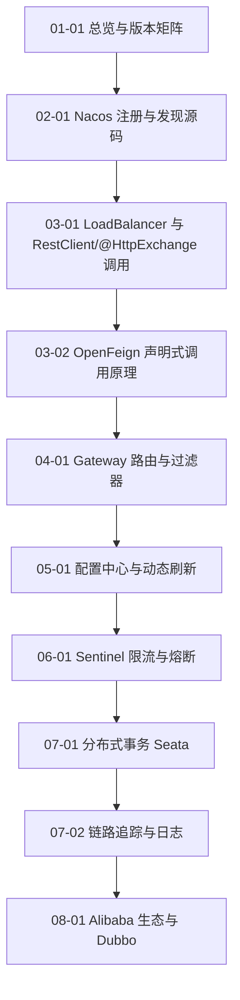

# 04 Spring Cloud（注册 / 调用 / 网关 / 配置 / 容错 / 事务 / 追踪）

> 目标：把"微服务框架"拆成一条条可验证的调用链，而不是记住一堆 starter 名字。
> 版本基线：Spring Cloud 各子项目 `v5.1.0`（release train `2026.0.0`，对应 Spring Boot `4.2.0`），Nacos `3.3.0`、Sentinel `1.8.10`、Seata `2.7.0`、Dubbo `3.3.6`

## 学习目标

- 知道服务注册本质是"`ServiceInstance`（实例元数据：host/port/metadata）写入注册中心 + 本地缓存定期拉取"。
- 能讲清 `@FeignClient` 接口是如何变成一个能发 HTTP 的代理对象的（`FeignClientFactoryBean#getObject`）。
- 能说清 Gateway 的路由匹配与过滤器链（`RoutePredicateHandlerMapping` → `FilteringWebHandler`）。
- 知道配置中心与 `@RefreshScope` 如何联动刷新 Bean。
- 了解熔断、限流、分布式事务、链路追踪各自在调用链的哪一层切入。

## 文章顺序

> 读图说明：`03-01` 的负载均衡是 `03-02` OpenFeign 的底层依赖；`F 配置刷新` 之所以排在网关之后，是因为动态路由刷新依赖配置中心能力。

## 子目录

| 目录 | 内容 | 学完能做到 |
| --- | --- | --- |
| `01-总览与版本` | 组件全景、版本对应关系、Boot 4 兼容点 | 搭一套可运行微服务骨架 |
| `02-注册中心Nacos` | `NamingService`、gRPC 长连接、服务发现与订阅 | 排查"服务列表为空" |
| `03-负载均衡与调用` | `BlockingLoadBalancerClient`、`RoundRobinLoadBalancer`、OpenFeign | 解释"为什么总是打到同一台" |
| `04-网关Gateway` | 路由断言、过滤器链、WebFlux 基础 | 写自定义 GatewayFilter |
| `05-配置中心与Bus` | `ConfigService`、`@RefreshScope`、`RefreshEvent` | 排查"配置改了没生效" |
| `06-熔断限流与容错` | Sentinel `SphU.entry`、SlotChain、`@SentinelResource` | 设计可靠的降级策略 |
| `07-分布式事务与链路追踪` | Seata AT 两阶段、全局锁、OTel 追踪 | 选择适合业务的事务模式 |
| `08-Alibaba生态详解` | Nacos/Sentinel/Seata/Dubbo 与 Spring Cloud 的整合方式 | 看懂 `spring-cloud-alibaba` 的装配 |

## 依赖关系

- 前置：`02-SpringBoot/02-自动配置`（几乎所有 Cloud 能力都靠 starter 自动装配）、`01-Spring框架/02-AOP`（Feign/熔断都靠代理）。
- 后续：无。可作为本套文档的"实战收口"。

## 学习检查点

- [ ] 能画出 Nacos 注册 → 拉取 → 本地缓存的完整时序。
- [ ] 能解释 OpenFeign 的 `@FeignClient` 为什么能注入成接口类型（`FactoryBean`）。
- [ ] 能说清 Gateway 的 `GlobalFilter` 与 `GatewayFilter` 执行顺序规则。
- [ ] 能解释 Seata AT 模式的两个阶段分别做了什么，以及 `undo_log` 的作用。
