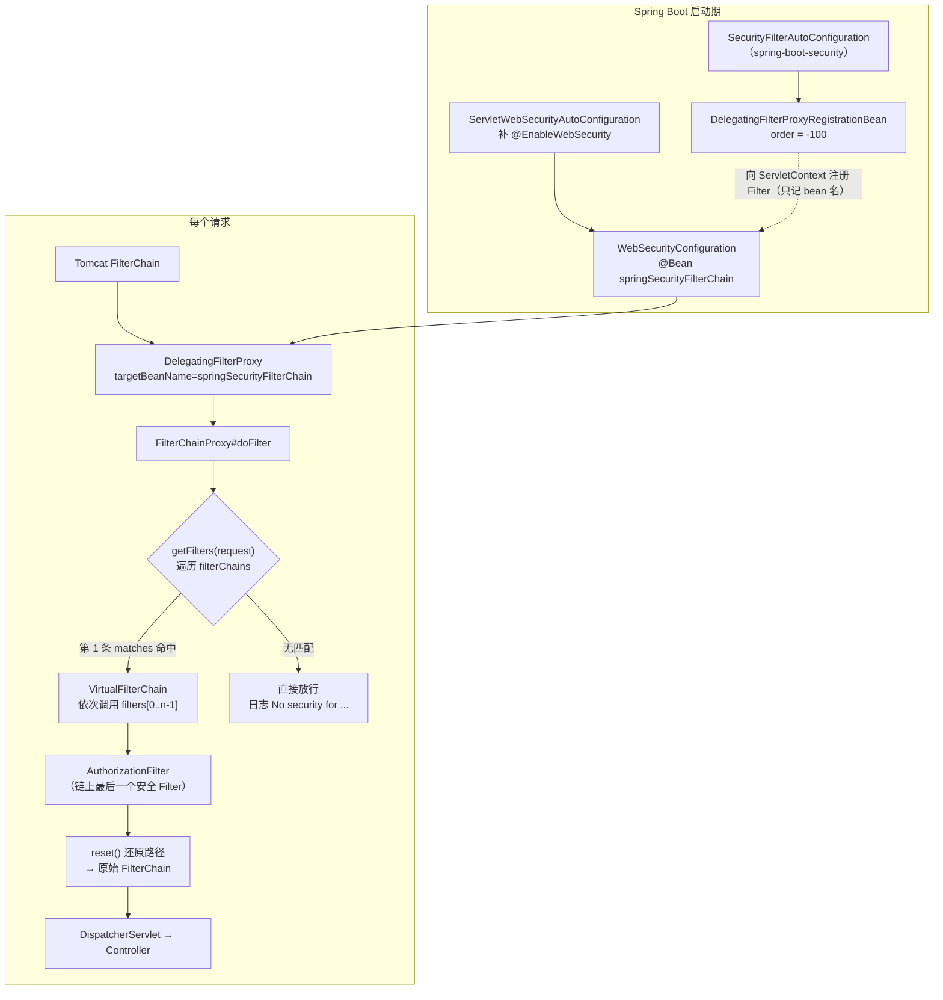
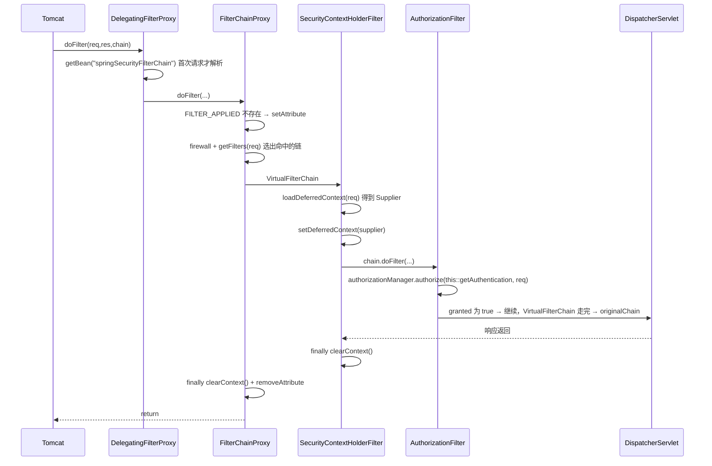

# FilterChainProxy：过滤器链原理（Spring Security 7.2.0）

> 一句话结论：Boot 应用里的 `springSecurityFilterChain` 实际是一个 **`DelegatingFilterProxy`**，它直到**第一次请求**才去容器里找同名的 `FilterChainProxy` bean；`FilterChainProxy` 遍历 `SecurityFilterChain` 列表，**第一个 `matches` 命中的链**决定这一请求走哪些 `Filter`，随后由一个 `VirtualFilterChain` 把这一串 `Filter` 依次调完，最后把请求交回原始 `FilterChain`（也就是通往 `DispatcherServlet` 的那条）。
> 阅读前置：知道 `Filter#doFilter(req,res,chain)` 是"必须调 `chain.doFilter` 才继续"；看过 [本组 README](README.md) 的学习地图。
> 预计阅读 45 分钟 ｜ 源码：`org.springframework.boot:spring-boot-security:4.2.0`、`org.springframework.boot:spring-boot:4.2.0`、`org.springframework.boot:spring-boot-servlet:4.2.0`、`org.springframework.security:spring-security-web:7.2.0`、`org.springframework.security:spring-security-config:7.2.0`

---

## 0. 先看现象

新建一个 Boot 4 + `spring-boot-starter-security` 项目，随便写个 `@RestController` 并启动。把日志级别调到 `DEBUG` 后，会看到两行非常关键的内容：

```text
Will secure any request with filters: DisableEncodeUrlFilter, WebAsyncManagerIntegrationFilter,
SecurityContextHolderFilter, HeaderWriterFilter, CsrfFilter, LogoutFilter, UsernamePasswordAuthenticationFilter,
DefaultLoginPageGeneratingFilter, BasicAuthenticationFilter, RequestCacheAwareFilter,
SecurityContextHolderAwareRequestFilter, AnonymousAuthenticationFilter, ExceptionTranslationFilter,
AuthorizationFilter
```

以及 `FilterChainProxy` 自己的 `toString`：

```text
FilterChainProxy[Filter Chains: [DefaultSecurityFilterChain defined as 'defaultSecurityFilterChain' in [...] matching [AnyRequestMatcher] and having filters [...]]]
```

三个问题立刻冒出来：

1. 这些 `Filter` 是谁塞进 `SecurityFilterChain` 的？
2. 它们在 Tomcat 里挂在什么位置？为什么我自己的 `Filter`（`@Order(1)`）有时排在它前面、有时排在它后面？
3. Controller 里 `SecurityContextHolder.getContext().getAuthentication()` 为什么能拿到用户？`ThreadLocal` 是什么时候被填上、又是什么时候被清掉的？

本文按"容器 → 代理 → 链 → 单个 `Filter`"的顺序拆开。

---

## 1. 一张全景地图



> 读图说明：图里唯一一条**跨阶段**的虚线很重要——启动期注册的 `DelegatingFilterProxyRegistrationBean` 并不持有真正的 `FilterChainProxy`，它只记住一个 bean 名。所以"Security 的 bean 初始化异常"经常要等到**第一个请求**才炸出来。另外注意 `R7 → R8` 用的是实线：`AuthorizationFilter` 放行后**不会**直接调 `DispatcherServlet`，而是继续沿 `VirtualFilterChain` 退出，最后才由原始 `FilterChain` 把请求交给 `DispatcherServlet`。

---

## 2. 关键类一览

| 类 | 所在 jar | 职责（一句话） |
| --- | --- | --- |
| `DelegatingFilterProxyRegistrationBean` | `spring-boot:4.2.0` | 向 Servlet 容器注册一个**延迟初始化**的 `DelegatingFilterProxy` |
| `SecurityFilterProperties` | `spring-boot-security:4.2.0` | `spring.security.filter.*` 属性，`order` 默认 `-100` |
| `SecurityFilterAutoConfiguration` | `spring-boot-security:4.2.0` | 把上面两个接起来 |
| `ServletWebSecurityAutoConfiguration` | `spring-boot-security:4.2.0` | 补 `@EnableWebSecurity`、造默认 `SecurityFilterChain` |
| `WebSecurityConfiguration` | `spring-security-config:7.2.0` | 定义 bean `springSecurityFilterChain` |
| `FilterChainProxy` | `spring-security-web:7.2.0` | 多链"总闸"：选链 + 执行 |
| `DefaultSecurityFilterChain` | `spring-security-web:7.2.0` | 一条链：`RequestMatcher` + `List<Filter>` |
| `SecurityContextHolderFilter` | `spring-security-web:7.2.0` | 从仓库载入上下文到 `ThreadLocal`，结束时清理 |
| `HttpSessionSecurityContextRepository` | `spring-security-web:7.2.0` | 把上下文存进 `HttpSession` |
| `StrictHttpFirewall` | `spring-security-web:7.2.0` | 校验 URL，拒绝可疑请求 |

---

## 3. 源码逐段

### 3.1 启动期：谁把 Filter 注册进容器

Boot 里有一个约定：**安全过滤器的 bean 名固定为 `springSecurityFilterChain`**（常量来自 `AbstractSecurityWebApplicationInitializer.DEFAULT_FILTER_NAME`）。`SecurityFilterAutoConfiguration` 拿着这个名字去注册容器 Filter：

```java (src: SecurityFilterAutoConfiguration.java#L37-L54)
@AutoConfiguration(after = ServletWebSecurityAutoConfiguration.class)
@ConditionalOnWebApplication(type = Type.SERVLET)
@EnableConfigurationProperties(SecurityFilterProperties.class)
@ConditionalOnClass({ AbstractSecurityWebApplicationInitializer.class, SessionCreationPolicy.class })
public final class SecurityFilterAutoConfiguration {

	private static final String DEFAULT_FILTER_NAME = AbstractSecurityWebApplicationInitializer.DEFAULT_FILTER_NAME;

	@Bean
	@ConditionalOnBean(name = DEFAULT_FILTER_NAME)
	DelegatingFilterProxyRegistrationBean securityFilterChainRegistration(
			SecurityFilterProperties securityFilterProperties) {
		DelegatingFilterProxyRegistrationBean registration = new DelegatingFilterProxyRegistrationBean(
				DEFAULT_FILTER_NAME);
		registration.setOrder(securityFilterProperties.getOrder());
		registration.setDispatcherTypes(getDispatcherTypes(securityFilterProperties));
		return registration;
	}
```

**在干什么**：造一个 `DelegatingFilterProxyRegistrationBean`，目标是名为 `springSecurityFilterChain` 的 bean；order 取自 `spring.security.filter.order`，dispatcherTypes 取自属性。

**为什么这么写**：`@ConditionalOnBean(name = ...)` 表示"容器里真有这个 bean 才注册 Filter"，于是你把安全自动配置关掉、或自己定义同名 bean 时，行为都是可控的。

**更关键的一层原因**写在类注释里：

```java (src: SecurityFilterAutoConfiguration.java#L27-L30)
 * {@link EnableAutoConfiguration Auto-configuration} for Spring Security's Filter.
 * Configured separately from {@link ServletWebSecurityAutoConfiguration} to ensure that
 * the filter's order is still configured when a user-provided
 * {@link WebSecurityConfiguration} exists.
```

**如果改成别的会怎样**：把"注册 Filter"和"造 `SecurityFilterChain`"合进同一个自动配置类，用户一旦自己写 `@EnableWebSecurity` 配置类，整个类可能因条件不满足而退出，此时**连注册 Filter 的 bean 也一起消失**——应用完全没有安全过滤，但启动一点错都不报。这是最隐蔽的事故之一。

**常见坑**：`@ConditionalOnBean` 依赖 bean 定义的注册顺序，所以这里必须写 `after = ServletWebSecurityAutoConfiguration.class`。

### 3.2 注册进去的是"代理"，不是真 Filter

```java (src: DelegatingFilterProxyRegistrationBean.java#L42-L84)
public class DelegatingFilterProxyRegistrationBean extends AbstractFilterRegistrationBean<DelegatingFilterProxy>
		implements ApplicationContextAware {
	...
	public DelegatingFilterProxyRegistrationBean(String targetBeanName,
			ServletRegistrationBean<?>... servletRegistrationBeans) {
		super(servletRegistrationBeans);
		Assert.hasLength(targetBeanName, "'targetBeanName' must not be empty");
		this.targetBeanName = targetBeanName;
		setName(targetBeanName);
	}
	...
	@Override
	public DelegatingFilterProxy getFilter() {
		return new DelegatingFilterProxy(this.targetBeanName, getWebApplicationContext()) {

			@Override
			protected void initFilterBean() throws ServletException {
				// Don't initialize filter bean on init()
			}

		};
	}
```

**在干什么**：返回一个 `DelegatingFilterProxy`，并且**把 `initFilterBean()` 覆写成空方法**。

**为什么这么写**：`DelegatingFilterProxy` 默认会在 `init()` 阶段就把目标 bean 取出来。Boot 4 故意不这么做（`// Don't initialize filter bean on init()`），因为 Servlet 容器初始化 Filter 的时机**早于** Spring 容器就绪。延迟到第一次 `doFilter` 才查 bean，把"容器启动"和"Spring 初始化"解耦了。

**如果改成别的会怎样**：删掉这个空方法，某些环境下启动即报 `NoSuchBeanDefinitionException: No bean named 'springSecurityFilterChain' available`。所以它是**有意为之**的空实现，不是漏写。

**常见坑**：`getWebApplicationContext()` 里有 `Assert.state`，要求注入的是 `WebApplicationContext`。纯 `ApplicationContext` 环境（某些单元测试）会直接抛异常。

### 3.3 默认 order = -100，为什么是这个数

```java (src: SecurityFilterProperties.java#L32-L42)
	/**
	 * Default order of Spring Security's Filter in the servlet container (i.e. amongst
	 * other filters registered with the container). There is no connection between this
	 * and the {@code @Order} on a {@code SecurityFilterChain}.
	 */
	public static final int DEFAULT_FILTER_ORDER = OrderedFilter.REQUEST_WRAPPER_FILTER_MAX_ORDER - 100;

	/**
	 * Security filter chain order for Servlet-based web applications.
	 */
	private int order = DEFAULT_FILTER_ORDER;
```

而 `REQUEST_WRAPPER_FILTER_MAX_ORDER` 的定义是：

```java (src: OrderedFilter.java#L17-L24)
public interface OrderedFilter extends Filter, Ordered {

	/**
	 * Filters that wrap the servlet request should be ordered less than or equal to this.
	 */
	int REQUEST_WRAPPER_FILTER_MAX_ORDER = 0;

}
```

**在干什么**：`0 - 100 = -100`，安全过滤器默认 order `-100`。

**为什么这么写**：

1. **数值越小越靠前**。`-100` 远小于绝大多数业务 `Filter`（默认 `Ordered.LOWEST_PRECEDENCE`），所以安全过滤器几乎总在最前面。
2. **小于 0** 恰好落在"包装请求的 Filter"这一档（`REQUEST_WRAPPER_FILTER_MAX_ORDER` 是这一档的上界）。安全框架必须改写 request（`StrictHttpFirewall` 返回 `FirewalledRequest`），放这一档正合适。
3. javadoc 特别声明：**这个 order 与 `SecurityFilterChain` 上的 `@Order` 毫无关系**。前者是"Filter 在 Servlet 容器里的位置"，后者是"多条链之间谁先被匹配"。混用是新手经典错误。

**如果改成别的会怎样**：把 `spring.security.filter.order` 配成 `10`，你自己 `@Order(1)`、`@Order(5)` 的 Filter 就会跑在安全过滤器**之前**，它们读到的 `SecurityContext` 是空的。"我自定义 Filter 里取不到登录用户"多半是这个原因。

**那"为什么必须在 `UsernamePasswordAuthenticationFilter` 之前"是说什么？** 这句讲的是**链内部**顺序，不是容器 order。历史类 `SecurityContextPersistenceFilter` 的 javadoc 说得很直接：

```java (src: SecurityContextPersistenceFilter.java#L46-L49)
 * This filter MUST be executed BEFORE any authentication processing mechanisms.
 * Authentication processing mechanisms (e.g. BASIC, CAS processing filters etc) expect
 * the <code>SecurityContextHolder</code> to contain a valid <code>SecurityContext</code>
 * by the time they execute.
```

因为认证类 Filter 是"读现有上下文 → 写入新结果"。若上下文还没载入就认证，会把 session 里已有的登录态覆盖成只有本次认证结果的新上下文。

### 3.4 `FilterChainProxy#doFilter`：外层包装与异常兜底

```java (src: FilterChainProxy.java#L185-L211)
	@Override
	public void doFilter(ServletRequest request, ServletResponse response, FilterChain chain)
			throws IOException, ServletException {
		boolean clearContext = request.getAttribute(FILTER_APPLIED) == null;
		if (!clearContext) {
			doFilterInternal(request, response, chain);
			return;
		}
		try {
			request.setAttribute(FILTER_APPLIED, Boolean.TRUE);
			doFilterInternal(request, response, chain);
		}
		catch (Exception ex) {
			Throwable[] causeChain = this.throwableAnalyzer.determineCauseChain(ex);
			Throwable requestRejectedException = this.throwableAnalyzer
				.getFirstThrowableOfType(RequestRejectedException.class, causeChain);
			if (!(requestRejectedException instanceof RequestRejectedException)) {
				throw ex;
			}
			this.requestRejectedHandler.handle((HttpServletRequest) request, (HttpServletResponse) response,
					(RequestRejectedException) requestRejectedException);
		}
		finally {
			this.securityContextHolderStrategy.clearContext();
			request.removeAttribute(FILTER_APPLIED);
		}
	}
```

**在干什么**：三层保护。

1. `FILTER_APPLIED` 属性 → 防重复进入（`FORWARD`/`ERROR`/`ASYNC` 派发时不再重跑整条安全链）；
2. `catch` 只挑出 `RequestRejectedException`（被 `HttpFirewall` 拒绝的请求）交给 `requestRejectedHandler`，其他异常原样抛出；
3. `finally` 里**清空 `SecurityContext`**——这是"请求结束 ThreadLocal 必须干净"的最后一道保险。

**为什么这么写**：Tomcat 线程是复用的。不清空，用户 A 的请求结束后线程回池，用户 B 拿到同一线程就会读到 A 的身份——**越权数据泄露**。`FILTER_APPLIED` 的常量定义在：

```java
	private static final String FILTER_APPLIED = FilterChainProxy.class.getName().concat(".APPLIED");
```

(src: FilterChainProxy.java#L150)

**如果改成别的会怎样**：去掉 `clearContext()`，异常路径下就可能出现"串号"。`SecurityContextHolderFilter` 内部也会清，这里是双保险。

**常见坑**：`RequestRejectedException` 默认由 `HttpStatusRequestRejectedHandler` 处理 → 返回 **400**。URL 里带矩阵参数（`/a;x=1/b`）或未规范化路径会被 `StrictHttpFirewall` 拒绝，看起来像"接口 400 但代码没错"。

### 3.5 `StrictHttpFirewall` 到底拒什么

```java (src: StrictHttpFirewall.java#L515-L525)
	@Override
	public FirewalledRequest getFirewalledRequest(HttpServletRequest request) throws RequestRejectedException {
		rejectForbiddenHttpMethod(request);
		rejectedBlocklistedUrls(request);
		rejectedUntrustedHosts(request);
		if (!isNormalized(request)) {
			throw new RequestRejectedException("The request was rejected because the URL was not normalized.");
		}
		rejectNonPrintableAsciiCharactersInFieldName(request.getRequestURI(), "requestURI");
		return new StrictFirewalledRequest(request);
	}
```

**在干什么**：四道关：HTTP 方法白名单、URL 黑名单（编码/解码两种匹配）、Host 白名单、路径是否规范化（`//`、`/./`、`/../`），最后还检查 `requestURI` 是否只含可打印 ASCII。

**为什么这么写**：安全匹配（`/admin/**`）如果用未规范化的路径，攻击者能用 `/admin/..;/admin/x`、`/./admin` 之类绕过匹配。所以**先规范化再匹配**。

**如果改成别的会怎样**：很多团队一遇 400 就想换成宽松的 `DefaultHttpFirewall` 或把黑名单清空——这会直接打开路径穿越的口子。正确做法是修 URL。

### 3.6 `doFilterInternal`：选链 + 执行

```java (src: FilterChainProxy.java#L213-L238)
	private void doFilterInternal(ServletRequest request, ServletResponse response, FilterChain chain)
			throws IOException, ServletException {
		FirewalledRequest firewallRequest = this.firewall.getFirewalledRequest((HttpServletRequest) request);
		HttpServletResponse firewallResponse = this.firewall.getFirewalledResponse((HttpServletResponse) response);
		List<Filter> filters = getFilters(firewallRequest);
		if (filters == null || filters.isEmpty()) {
			if (logger.isTraceEnabled()) {
				logger.trace(LogMessage.of(() -> "No security for " + requestLine(firewallRequest)));
			}
			firewallRequest.reset();
			this.filterChainDecorator.decorate(chain).doFilter(firewallRequest, firewallResponse);
			return;
		}
		if (logger.isDebugEnabled()) {
			logger.debug(LogMessage.of(() -> "Securing " + requestLine(firewallRequest)));
		}
		FilterChain reset = (req, res) -> {
			if (logger.isDebugEnabled()) {
				logger.debug(LogMessage.of(() -> "Secured " + requestLine(firewallRequest)));
			}
			// Deactivate path stripping as we exit the security filter chain
			firewallRequest.reset();
			chain.doFilter(req, res);
		};
		this.filterChainDecorator.decorate(reset, filters).doFilter(firewallRequest, firewallResponse);
	}
```

**在干什么**：

1. 用 `HttpFirewall` 包一层 request/response；
2. `getFilters` 选链；
3. 没选中 → `reset()` 还原路径后**直接放行**；
4. 选中 → 造一个 `reset` 闭包当"链的尽头"，交给 `decorate` 生成 `VirtualFilterChain`。

**为什么这么写**：`FirewalledRequest` 会为了安全匹配而改写 `servletPath`。业务代码不该看到改写后的值，所以退出安全链前先 `reset()`：

```java
	public abstract void reset();
```

(src: FirewalledRequest.java#L49)

**如果改成别的会怎样**：不 reset，Controller 里 `request.getServletPath()` 可能和预期不同，这类 bug 极难定位。

**常见坑**：`reset` 之后调用的 `chain.doFilter(req, res)` 用的是**传进来的参数**，而 `getFirewalledRequest` 包装的对象才是原始请求的包装。两者是同一请求，但 `req` 可能被前面的 Filter 再包一层。

### 3.7 `getFilters`：第一个匹配生效

```java (src: FilterChainProxy.java#L245-L257)
	private @Nullable List<Filter> getFilters(HttpServletRequest request) {
		int count = 0;
		for (SecurityFilterChain chain : this.filterChains) {
			if (logger.isTraceEnabled()) {
				logger.trace(LogMessage.format("Trying to match request against %s (%d/%d)", chain, ++count,
						this.filterChains.size()));
			}
			if (chain.matches(request)) {
				return chain.getFilters();
			}
		}
		return null;
	}
```

**在干什么**：顺序遍历，**第一个 `matches` 命中的链直接返回**，不再继续。

**为什么这么写**：类注释把规则写死了：

```java (src: FilterChainProxy.java#L94-L99)
 * Each possible pattern that the {@code FilterChainProxy} should service must be entered.
 * The first match for a given request will be used to define all of the {@code Filter}s
 * that apply to that request. This means you must put most specific matches at the top of
 * the list, and ensure all {@code Filter}s that should apply for a given matcher are
 * entered against the respective entry. The {@code FilterChainProxy} will not iterate
 * through the remainder of the map entries to locate additional {@code Filter}s.
```

**如果改成别的会怎样**：不存在"多条链叠加"这种用法。想让某些路径同时受两套规则约束，只能把 `Filter` 配进**同一条**链。

**常见坑**：`@Order(1)` 写 `"/api/**"` 链，`@Order(2)` 写 `"/api/admin/**"` 链 → admin 请求走的是第一条。**更具体的路径必须给更小的 order 数值**。

### 3.8 `VirtualFilterChain`：把 `List<Filter>` 变成 `FilterChain`

```java (src: FilterChainProxy.java#L375-L388)
		@Override
		public void doFilter(ServletRequest request, ServletResponse response) throws IOException, ServletException {
			if (this.currentPosition == this.size) {
				this.originalChain.doFilter(request, response);
				return;
			}
			this.currentPosition++;
			Filter nextFilter = this.additionalFilters.get(this.currentPosition - 1);
			if (logger.isTraceEnabled()) {
				String name = nextFilter.getClass().getSimpleName();
				logger.trace(LogMessage.format("Invoking %s (%d/%d)", name, this.currentPosition, this.size));
			}
			nextFilter.doFilter(request, response, this);
		}
```

**在干什么**：实现 `FilterChain`，每次 `doFilter` 取下一个 `Filter`，并把 **this** 当作 `chain` 传进去；走到 `currentPosition == size` 就调真正的 `originalChain.doFilter`。

**为什么这么写**：Servlet 规范里 `Filter` 只能靠 `FilterChain` 串起来，而容器的 `FilterChain` 是**不可修改**的。要动态插入 N 个安全 `Filter`，只能自己实现一个 `FilterChain`。

**如果改成别的会怎样**：`currentPosition` 是**实例字段**，`decorate` 每次 `new` 一个新实例，所以天然线程安全；但也意味着 `ASYNC` 派发会**重新走一遍**，别指望续跑。

**常见坑**：某个 `Filter` 不调 `chain.doFilter` 就直接返回（抛异常或已写完响应），后面的安全 `Filter` 就都不执行——这是**故意**的（"respects normal handling of Filters that elect not to call doFilter"，见 `FilterChainProxy.java#L101-L105`）。

### 3.9 一条链长什么样

```java (src: DefaultSecurityFilterChain.java#L63-L91)
	public DefaultSecurityFilterChain(RequestMatcher requestMatcher, List<Filter> filters) {
		if (filters.isEmpty()) {
			logger.debug(LogMessage.format("Will not secure %s", requestMatcher));
		}
		else {
			List<String> filterNames = new ArrayList<>();
			for (Filter filter : filters) {
				filterNames.add(filter.getClass().getSimpleName());
			}
			String names = StringUtils.collectionToDelimitedString(filterNames, ", ");
			logger.debug(LogMessage.format("Will secure %s with filters: %s", requestMatcher, names));
		}
		this.requestMatcher = requestMatcher;
		this.filters = new ArrayList<>(filters);
	}
	...
	@Override
	public boolean matches(HttpServletRequest request) {
		return this.requestMatcher.matches(request);
	}
```

**在干什么**：一条链就是不可变的"`RequestMatcher` + `List<Filter>`"；`matches` 只委托给 `RequestMatcher`。

**为什么这么写**：构造函数里那两条 DEBUG 日志是排查顺序问题的**第一手证据**：打开 `logging.level.org.springframework.security.web.FilterChainProxy=DEBUG` 就能看到完整清单。

**常见坑**：看到 `Will not secure ...` 说明这条链**没有任何 Filter**——等于"这条路径不做安全处理"。

### 3.10 `toString` 为什么有用

```java (src: DefaultSecurityFilterChain.java#L103-L114)
		String declaration = this.getClass().getSimpleName();
		if (this.beanName != null) {
			declaration += " defined as '" + this.beanName + "'";
			if (this.beanFactory != null) {
				BeanDefinition bd = this.beanFactory.getBeanDefinition(this.beanName);
				String description = bd.getResourceDescription();
				if (description != null) {
					declaration += " in [" + description + "]";
				}
			}
		}
		return declaration + " matching [" + this.requestMatcher + "] and having filters " + filterNames;
```

**在干什么**：打印"这条链是哪个 `@Bean` 方法定义的（含文件位置）+ 匹配什么 + 有哪些 Filter"。

**为什么这么写**：`FilterChainProxy` 遍历每条链时会用 `%s` 打印 `chain`（`FilterChainProxy.java#L249`），于是 `getFilters` 的 TRACE 日志直接可读：`Trying to match request against DefaultSecurityFilterChain defined as 'apiChain' in [class path resource [com/acme/SecurityConfig.class]] matching [.../api/**] and having filters [Csrf, Authorization] (1/2)`。

### 3.11 链是怎么被造出来的

```java (src: WebSecurityConfiguration.java#L113-L132)
	@Bean(name = AbstractSecurityWebApplicationInitializer.DEFAULT_FILTER_NAME)
	public Filter springSecurityFilterChain(ObjectProvider<HttpSecurity> provider) throws Exception {
		boolean hasFilterChain = !this.securityFilterChains.isEmpty();
		if (!hasFilterChain) {
			this.webSecurity.addSecurityFilterChainBuilder(() -> {
				HttpSecurity httpSecurity = provider.getObject();
				httpSecurity.authorizeHttpRequests((authorize) -> authorize.anyRequest().authenticated());
				httpSecurity.formLogin(Customizer.withDefaults());
				httpSecurity.httpBasic(Customizer.withDefaults());
				return httpSecurity.build();
			});
		}
		for (SecurityFilterChain securityFilterChain : this.securityFilterChains) {
			this.webSecurity.addSecurityFilterChainBuilder(() -> securityFilterChain);
		}
		for (WebSecurityCustomizer customizer : this.webSecurityCustomizers) {
			customizer.customize(this.webSecurity);
		}
		return this.webSecurity.build();
	}
```

**在干什么**：bean 名 = `springSecurityFilterChain`；**一个** `SecurityFilterChain` bean 都没有时兜底造一条"全认证 + `formLogin` + `httpBasic`"的默认链；最后 `webSecurity.build()` 得到 `FilterChainProxy`。

**为什么这么写**：这是 Spring Security 自己的最后兜底，与 Boot 的 `ServletWebSecurityAutoConfiguration` 里的 `defaultSecurityFilterChain` 是**两层**保险：

```java (src: ServletWebSecurityAutoConfiguration.java#L69-L76)
		@Bean
		@Order(SecurityFilterProperties.BASIC_AUTH_ORDER)
		SecurityFilterChain defaultSecurityFilterChain(HttpSecurity http) {
			http.authorizeHttpRequests((requests) -> requests.anyRequest().authenticated());
			http.formLogin(withDefaults());
			http.httpBasic(withDefaults());
			return http.build();
		}
```

**如果改成别的会怎样**：删掉兜底，一个"加了依赖但没配链"的应用启动后所有接口全放行 → 大面积裸奔。

**Boot 4 还会再包一层**：

```java (src: WebSecurityConfiguration.java#L238-L247)
				ManagedList<BeanMetadataElement> filters = new ManagedList<>();
				filters.add(pppCacheFilterBldr.getBeanDefinition());
				filters.add(filterChainProxy);
				BeanDefinitionBuilder compositeSpringSecurityFilterChainBldr = BeanDefinitionBuilder
					.rootBeanDefinition(CompositeFilterChainProxy.class)
					.addConstructorArgValue(filters);

				registry.removeBeanDefinition(AbstractSecurityWebApplicationInitializer.DEFAULT_FILTER_NAME);
				registry.registerBeanDefinition(AbstractSecurityWebApplicationInitializer.DEFAULT_FILTER_NAME,
						compositeSpringSecurityFilterChainBldr.getBeanDefinition());
```

**在干什么**：把 `springSecurityFilterChain` 的定义**替换**成 `CompositeFilterChainProxy(ServletRequestPathFilter, 原 FilterChainProxy)`。

**为什么这么写**：javadoc 说 "Used to ensure Spring MVC request matching is cached." —— `ServletRequestPathFilter` 预先解析并缓存 `RequestPath`，安全链里的 `PathPatternRequestMatcher` 可复用同一份解析结果。

**常见坑**：`@Autowired Filter springSecurityFilterChain` 拿到的是 `CompositeFilterChainProxy`，`instanceof FilterChainProxy` 会**失败**。

### 3.12 `SecurityContextHolderFilter`：上下文怎么进 `ThreadLocal`

```java (src: SecurityContextHolderFilter.java#L72-L88)
	private void doFilter(HttpServletRequest request, HttpServletResponse response, FilterChain chain)
			throws ServletException, IOException {
		if (request.getAttribute(FILTER_APPLIED) != null) {
			chain.doFilter(request, response);
			return;
		}
		request.setAttribute(FILTER_APPLIED, Boolean.TRUE);
		Supplier<SecurityContext> deferredContext = this.securityContextRepository.loadDeferredContext(request);
		try {
			this.securityContextHolderStrategy.setDeferredContext(deferredContext);
			chain.doFilter(request, response);
		}
		finally {
			this.securityContextHolderStrategy.clearContext();
			request.removeAttribute(FILTER_APPLIED);
		}
	}
```

**在干什么**：从 `SecurityContextRepository` 取一个 **`Supplier`（延迟加载）**，塞给 `SecurityContextHolderStrategy`；请求结束时清空。

**为什么这么写**：

1. **延迟加载**——只访问静态资源、或 `permitAll` 且不读用户的请求，可以完全不碰 `HttpSession`（省一次反序列化）。
2. **不自动保存**——类注释讲得很清楚：

```java (src: SecurityContextHolderFilter.java#L38-L42)
 * This is similar to {@link SecurityContextPersistenceFilter} except that the
 * {@link SecurityContextRepository#saveContext(SecurityContext, HttpServletRequest, HttpServletResponse)}
 * must be explicitly invoked to save the {@link SecurityContext}. This improves the
 * efficiency and provides better flexibility by allowing different authentication
 * mechanisms to choose individually if authentication should be persisted.
```

**对照已废弃的那个**：

```java (src: SecurityContextPersistenceFilter.java#L105-L126)
		SecurityContext contextBeforeChainExecution = this.repo.loadContext(holder);
		try {
			this.securityContextHolderStrategy.setContext(contextBeforeChainExecution);
			...
			chain.doFilter(holder.getRequest(), holder.getResponse());
		}
		finally {
			SecurityContext contextAfterChainExecution = this.securityContextHolderStrategy.getContext();
			// Crucial removal of SecurityContextHolder contents before anything else.
			this.securityContextHolderStrategy.clearContext();
			this.repo.saveContext(contextAfterChainExecution, holder.getRequest(), holder.getResponse());
			request.removeAttribute(FILTER_APPLIED);
			this.logger.debug("Cleared SecurityContextHolder to complete request");
		}
```

**区别**：`SecurityContextPersistenceFilter` 在 `finally` 里**无条件** `repo.saveContext(...)`；`SecurityContextHolderFilter` 一点不保存。前者已被标注：

```java (src: SecurityContextPersistenceFilter.java#L62-L64)
 * @deprecated Use {@link SecurityContextHolderFilter}
 */
@Deprecated
```

**✅ 7.2 的真实情况（已核实）**：`SecurityContextPersistenceFilter` **仍然存在**，但已 `@Deprecated`；用哪个由 `SecurityContextConfigurer` 决定：

```java (src: SecurityContextConfigurer.java#L70-L119)
	private boolean requireExplicitSave = true;
	...
	public void configure(H http) {
		SecurityContextRepository securityContextRepository = getSecurityContextRepository();
		if (this.requireExplicitSave) {
			SecurityContextHolderFilter securityContextHolderFilter = postProcess(
					new SecurityContextHolderFilter(securityContextRepository));
			securityContextHolderFilter.setSecurityContextHolderStrategy(getSecurityContextHolderStrategy());
			http.addFilter(securityContextHolderFilter);
		}
		else {
			SecurityContextPersistenceFilter securityContextFilter = new SecurityContextPersistenceFilter(
```

也就是**默认 `requireExplicitSave = true` → 用 `SecurityContextHolderFilter`**。此外它默认用的仓库是两个仓库的组合：

```java (src: SecurityContextConfigurer.java#L98-L106)
	SecurityContextRepository getSecurityContextRepository() {
		SecurityContextRepository securityContextRepository = getBuilder()
			.getSharedObject(SecurityContextRepository.class);
		if (securityContextRepository == null) {
			securityContextRepository = new DelegatingSecurityContextRepository(
					new RequestAttributeSecurityContextRepository(), new HttpSessionSecurityContextRepository());
		}
		return securityContextRepository;
	}
```

先查 `RequestAttribute`（同一请求内部转发用），再查 `HttpSession`。

### 3.13 `HttpSessionSecurityContextRepository`：真正落盘的地方

```java
	public static final String SPRING_SECURITY_CONTEXT_KEY = "SPRING_SECURITY_CONTEXT";
```

(src: HttpSessionSecurityContextRepository.java#L92)

保存逻辑：

```java (src: HttpSessionSecurityContextRepository.java#L150-L174)
	@Override
	public void saveContext(SecurityContext context, HttpServletRequest request, HttpServletResponse response) {
		SaveContextOnUpdateOrErrorResponseWrapper responseWrapper = WebUtils.getNativeResponse(response,
				SaveContextOnUpdateOrErrorResponseWrapper.class);
		if (responseWrapper == null) {
			saveContextInHttpSession(context, request);
			return;
		}
		responseWrapper.saveContext(context);
	}

	private void saveContextInHttpSession(SecurityContext context, HttpServletRequest request) {
		if (isTransient(context) || isTransient(context.getAuthentication())) {
			return;
		}
		SecurityContext emptyContext = generateNewContext();
		if (emptyContext.equals(context)) {
			HttpSession session = request.getSession(false);
			removeContextFromSession(context, session);
		}
		else {
			boolean createSession = this.allowSessionCreation;
			HttpSession session = request.getSession(createSession);
			setContextInSession(context, session);
		}
```

**在干什么**：`transient` 上下文（例如匿名）不写；空上下文就**删** session 里的旧值（防止"退出登录后还能读到"）；非空就 `getSession(true)` 后写入。

**常见坑**：因为 `SecurityContextHolderFilter` 不保存，你在 Controller 里手动 `setAuthentication` **不会**进 session。必须显式调 `securityContextRepository.saveContext(...)`，或用会保存的认证 Filter（formLogin、JWT 都保存）。

### 3.14 默认过滤器顺序表

下表是"Boot 4 默认配置（`formLogin` + `httpBasic`）"下链上的顺序：

| # | Filter | 作用 |
| --- | --- | --- |
| 1 | `DisableEncodeUrlFilter` | 禁止 URL 携带 `;jsessionid=` |
| 2 | `WebAsyncManagerIntegrationFilter` | 把上下文传给 `Callable`/`DeferredResult` |
| 3 | `SecurityContextHolderFilter` | 载入 / 清理上下文 |
| 4 | `HeaderWriterFilter` | 写 `X-Frame-Options` 等安全头 |
| 5 | `CsrfFilter` | CSRF 校验 |
| 6 | `LogoutFilter` | 处理 `/logout` |
| 7 | `UsernamePasswordAuthenticationFilter` | 表单登录 |
| 8 | `DefaultLoginPageGeneratingFilter` | 没配登录页时生成默认页 |
| 9 | `BasicAuthenticationFilter` | HTTP Basic |
| 10 | `RequestCacheAwareFilter` | 登录后跳回原请求 |
| 11 | `SecurityContextHolderAwareRequestFilter` | 让 `request.isUserInRole` 等 Servlet API 生效 |
| 12 | `AnonymousAuthenticationFilter` | 没登录时填 `ROLE_ANONYMOUS` |
| 13 | `ExceptionTranslationFilter` | 认证/授权异常 → 401 / 302 / 403 |
| 14 | `AuthorizationFilter` | 授权判断，链上最后一个安全 Filter |

> 你调了 `csrf()`、`logout()`、`oauth2ResourceServer()` 等，对应 Filter 会出现或被移除，顺序以 DEBUG 日志为准。

### 3.15 `HttpSecurity` 怎么给 Filter 排序

```java (src: HttpSecurity.java#L1794-L1802)
	@Override
	protected DefaultSecurityFilterChain performBuild() {
		this.filters.sort(OrderComparator.INSTANCE);
		List<Filter> sortedFilters = new ArrayList<>(this.filters.size());
		for (Filter filter : this.filters) {
			sortedFilters.add(((OrderedFilter) filter).filter);
		}
		return new DefaultSecurityFilterChain(this.requestMatcher, sortedFilters);
	}
```

**在干什么**：每个 `Filter` 都被包成内部 `OrderedFilter`（带 order），构建时按 order 升序排序，再拆出裸 `Filter` 交给 `DefaultSecurityFilterChain`。

**为什么这么写**：`Filter` 自身没有顺序概念，容器顺序也不可控。`HttpSecurity` 自己维护"注册顺序表"（`filterOrders`），用数值表达先后。

**如果改成别的会怎样**：如果不在末尾统一排序，而是"谁先注册谁先跑"，那么 `http.addFilter(...)` 的调用顺序就会悄悄决定安全语义——比如 `AuthorizationFilter` 排到认证之前，请求就会拿着匿名身份被拒。

**常见坑**：`performBuild()` 在 7.2.0 里已经**没有**"`authorizeRequests` 与 `authorizeHttpRequests` 互斥"的断言了（`HttpSecurity` 里连 `authorizeRequests` 这个方法都不再存在，用全文检索 `authorizeRequests` 找不到任何方法声明）——这正是 6.0→7.x 清理旧 API 的结果，详见第 7 节。

### 3.16 `addFilterBefore / After / At` 的 order 怎么算

```java (src: HttpSecurity.java#L1826-L1840)
	public HttpSecurity addFilterBefore(Filter filter, Class<? extends Filter> beforeFilter) {
		return addFilterAtOffsetOf(filter, -1, beforeFilter);
	}
	...
	private HttpSecurity addFilterAtOffsetOf(Filter filter, int offset, Class<? extends Filter> registeredFilter) {
		Integer registeredFilterOrder = this.filterOrders.getOrder(registeredFilter);
		if (registeredFilterOrder == null) {
			throw new IllegalArgumentException(
					"The Filter class " + registeredFilter.getName() + " does not have a registered order");
		}
		int order = registeredFilterOrder + offset;
		this.filters.add(new OrderedFilter(filter, order));
		this.filterOrders.put(filter.getClass(), order);
		return this;
	}
```

**在干什么**：`addFilterBefore(f, X)` → `f` 的 order = `X.order - 1`；`addFilterAfter` → `+1`；`addFilterAt` → `+0`。

**如果改成别的会怎样**：这也解释了为什么 `addFilterAt` **不能覆盖**已存在的 Filter——它只是让两个 Filter 拿到同一个 order；javadoc 明说同 order 的先后**无法保证**。

**常见坑 1**：`X` 必须已在链上注册（`UsernamePasswordAuthenticationFilter` 只有调了 `formLogin()` 才存在），否则抛 `IllegalArgumentException: ... does not have a registered order`。

**常见坑 2**：`addFilter` 对**未知类型**直接抛异常：

```java (src: HttpSecurity.java#L1844-L1848)
		Integer order = this.filterOrders.getOrder(filter.getClass());
		if (order == null) {
			throw new IllegalArgumentException("The Filter class " + filter.getClass().getName()
					+ " does not have a registered order and cannot be added without a specified order. Consider using addFilterBefore or addFilterAfter instead.");
		}
```

### 3.17 最后一个安全 Filter 之后

`AuthorizationFilter` 放行后调 `chain.doFilter`，回到 `VirtualFilterChain`；`currentPosition == size` 时执行那个 `reset` 闭包，最终调用**容器的原始 `FilterChain`**，请求进入 `DispatcherServlet`。

Spring Security 内部把"请求 + 响应 + `FilterChain`"装进 `FilterInvocation`，供方法级安全与 SpEL 使用：

```java
	public String getFullRequestUrl() {
		return UrlUtils.buildFullRequestUrl(this.httpRequest);
	}
```

(src: FilterInvocation.java#L120)

---

## 4. 时序：一个带登录态的请求



> 读图说明：注意两条"往回"的路径。`DS → S` 是**正常返回**，`finally` 由内向外依次执行（先 `SecurityContextHolderFilter`，再 `FilterChainProxy`）。如果 `AuthorizationFilter` 抛 `AuthorizationDeniedException`，它会沿调用栈**反向**冒泡到 `ExceptionTranslationFilter`——后者排在 `AuthorizationFilter` **之前**，因此位于外层。这就是 02 篇要讲的 try/catch 结构能生效的物理原因。

---

## 5. 设计模式

| 模式 | 在哪里 | 为什么用 |
| --- | --- | --- |
| 代理 Proxy | `DelegatingFilterProxy` 代理 `springSecurityFilterChain` bean | 同时满足"容器要 Filter 实例"与"bean 延迟初始化" |
| 责任链 Chain of Responsibility | `VirtualFilterChain` + 一组 `Filter` | 每个 Filter 只管一件事，可任意插拔排序 |
| 组合 Composite | `CompositeFilterChainProxy` 合成 `ServletRequestPathFilter` + `FilterChainProxy` | 对外仍是单个 bean，内部可扩展 |
| 策略 Strategy | `HttpFirewall`、`SecurityContextRepository`、`FilterChainDecorator` | 防火墙、上下文存储、链装饰方式都可替换 |
| 模板方法 | `GenericFilterBean#afterPropertiesSet`、`OncePerRequestFilter#doFilterInternal` | 把"只执行一次"的骨架固化，子类只写内部逻辑 |

---

## 6. 踩坑与调试（12 条）

| # | 坑 | 现象 | 根因 | 解法 |
| --- | --- | --- | --- | --- |
| 1 | `permitAll()` 仍走整条链 | `permitAll` 接口仍触发 CSRF 校验失败 | `permitAll` 只是 `AuthorizationFilter` 的放行结论，前面的 `CsrfFilter`/`AnonymousAuthenticationFilter` 照跑 | 需要"完全不过安全链"用 `WebSecurityCustomizer#ignoring`；只要跳过 CSRF 用 `csrf(c -> c.ignoringRequestMatchers(...))` |
| 2 | `addFilterBefore` 锚点错 | `IllegalArgumentException: ... does not have a registered order` | 被参照的 Filter 不在链上（没开对应特性） | 先开启特性，或改用一定存在的锚点（如 `AuthorizationFilter.class`） |
| 3 | 多链匹配顺序错 | `/api/admin/**` 走了 `/api/**` 那条链 | `getFilters` 第一个 `matches` 即返回 | 更具体的链给**更小的 `@Order` 数值** |
| 4 | `OncePerRequestFilter#shouldNotFilter` 不生效 | 自定义 Filter 在 `ERROR` 派发时也执行 | `shouldNotFilterErrorDispatch()` 默认 `true`（不过滤），覆写后行为反转 | 明确覆写 `shouldNotFilterErrorDispatch()` / `shouldNotFilterAsyncDispatch()` |
| 5 | 静态资源被拦 | `/favicon.ico`、`/css/**` 返回 302 登录页 | 安全链默认匹配 `/**` | `requestMatchers("/css/**","/js/**","/favicon.ico").permitAll()` 或 `WebSecurityCustomizer#ignoring` |
| 6 | 搞不清 `@EnableWebSecurity` 与 Boot 自动配置的关系 | 自己加注解后"默认配置消失" | 自动配置的 `EnableWebSecurityConfiguration` 带 `@ConditionalOnMissingBean(name = BeanIds.SPRING_SECURITY_FILTER_CHAIN)` | 自己写链时把 `authorizeHttpRequests`/`formLogin`/`httpBasic` 写全 |
| 7 | CORS / CSRF 预检被拦 | `OPTIONS` 预检返回 401/403 | 预检不带凭证，却要过整条链 | `http.cors(withDefaults())` + `requestMatchers(HttpMethod.OPTIONS, "/**").permitAll()` |
| 8 | `RequestRejectedException` | 某些 URL 返回 400，日志有 `The request was rejected because...` | `StrictHttpFirewall` 拒绝未规范化路径、黑名单字符串、非白名单方法（`StrictHttpFirewall.java#L516-L525`） | 修 URL；排查看 `FilterChainProxy` 的 TRACE |
| 9 | 启动报 `NoSuchBeanDefinitionException` | 找不到 `springSecurityFilterChain` | 依赖被排除，或自动配置条件不满足 | 确认 `spring-boot-starter-security` 在 classpath |
| 10 | 自定义 Filter 里读不到用户 | `SecurityContextHolder` 是 `null` | 自定义 Filter 的容器 order 小于 `-100`，跑在安全链之前 | 用 `FilterRegistrationBean#setOrder(Ordered.LOWEST_PRECEDENCE)`，或把它做成安全链一环 |
| 11 | 手动 set 的 token 没进 session | 下个请求又变匿名 | `SecurityContextHolderFilter` 不自动保存（`requireExplicitSave=true`） | 显式 `repo.saveContext(...)` 或改用会保存的认证 Filter |
| 12 | `instanceof FilterChainProxy` 失败 | 注入到的 Filter 类型不符 | Boot 4 用 `CompositeFilterChainProxy` 包了一层 | 判断 `CompositeFilterChainProxy`，或取出内部 Filter 遍历 |

### 调试配方

```properties
# 1) 看选中了哪条链、链上都有什么 Filter
logging.level.org.springframework.security.web.FilterChainProxy=DEBUG
# 2) 看每次 Filter 调用（顺序证据：Invoking XxxFilter (3/14)）
logging.level.org.springframework.security=TRACE
# 3) 看 Security 自动配置是否生效
debug=true
```

---

## 7. ⚠️ 版本差异：Spring Security 6 → 7

| 变化 | 依据 | 影响 |
| --- | --- | --- |
| `WebSecurityConfigurerAdapter` 已删除 | `node tools/list-jar.mjs org.springframework.security:spring-security-config:7.2.0 "WebSecurityConfigurerAdapter"` 无结果 | 老教程的 `extends WebSecurityConfigurerAdapter` 全部作废，改 `@Bean SecurityFilterChain` |
| `authorizeRequests()` 不可用 | `HttpSecurity` 只有 `authorizeHttpRequests(Customizer)`；`performBuild` 的 `Assert.state` 明确两者互斥（`HttpSecurity.java#L1795-L1799`） | 改 `authorizeHttpRequests(a -> a.requestMatchers(...).hasRole(...))` |
| `and()` 被移除 | Boot 4 自身代码改为分段调用：`Boot` 的 `defaultSecurityFilterChain` 先 `http.authorizeHttpRequests(...)`，再 `http.formLogin(...)`，再 `http.httpBasic(...)`，最后 `return http.build()`（`ServletWebSecurityAutoConfiguration.java#L72-L75`） | 老写法 `/...and().formLogin()...and().build()` 编译不过 |
| `SecurityContextPersistenceFilter` 废弃 | `SecurityContextPersistenceFilter.java#L62-L64` `@Deprecated`；默认走 `SecurityContextHolderFilter`（`SecurityContextConfigurer.java#L70`） | 需显式保存上下文 |
| `SecurityFilterAutoConfiguration` 迁到 `spring-boot-security` | 文件头 `origin: org.springframework.boot:spring-boot-security:4.2.0` | 找源码别去 `spring-boot-autoconfigure` |
| `spring.security.filter.order` 仍是 -100 | `SecurityFilterProperties.java#L37-L42` | 行为与 Boot 3 一致 |
| `HttpSecurity#authorizeHttpRequests` 返回 `AuthorizedUrl` 支持 `not()` | `AuthorizeHttpRequestsConfigurer` 中的 `not()`（详见 02-授权篇） | 可直接 `.not().hasRole("X")` |

> 表格只列**源码能查到**的条目。其余迁移细节（例如 7.0 完整的破坏性变更清单）以官方迁移指南为准，本文不臆测。

---

## 8. 面试题（12）

1. `DelegatingFilterProxy` 存在的意义？Boot 为何还要覆写 `initFilterBean()`？
2. `FilterChainProxy#getFilters` 是"所有匹配都生效"还是"第一个匹配生效"？怎么用日志证明？
3. `spring.security.filter.order` 默认值多少、由哪个常量算出？它和 `SecurityFilterChain` 的 `@Order` 有何区别？
4. 为什么 `SecurityContext` 必须在认证类 Filter **之前**载入？
5. `SecurityContextHolderFilter` 与 `SecurityContextPersistenceFilter` 的三点区别？
6. `VirtualFilterChain#currentPosition` 为什么不用 `volatile`？
7. `FILTER_APPLIED` 属性解决了什么？（提示：`FORWARD` / `ERROR` / `ASYNC`）
8. `addFilterBefore` 的 order 怎么算？`addFilter` 为什么可能抛异常？
9. `CompositeFilterChainProxy` 的目的是什么？带来什么"注入意外"？
10. 一条匹配 `/**` 的链会拦静态资源吗？最合适的放行方式是什么？
11. `HttpFirewall` 默认实现是什么？它拦哪些请求、返回什么状态码？
12. 一个请求结束时 `SecurityContext` 会被清几次、分别在哪两个类里？

---

## 9. 动手练习

1. **验证"第一个匹配生效"**：写两条链，`@Order(1)` 匹配 `/api/**` 为 `permitAll`，`@Order(2)` 匹配 `/api/secret` 要求 `hasRole('ADMIN')`，访问 `/api/secret`，再把两个 order 互换，比较结果。
2. **打开 TRACE**，把日志里所有 `Invoking xxx (n/m)` 抄下来，与 §3.14 的顺序表逐项对照。
3. **自定义 Filter 两种注册方式**：分别用 `http.addFilterBefore(f, AuthorizationFilter.class)` 与 `FilterRegistrationBean` 注册，观察能否读到 `SecurityContextHolder` 里的用户。
4. **复现会话复用风险**：把 `requireExplicitSave(false)` 打开（切回 `SecurityContextPersistenceFilter`），对比日志里 `Cleared SecurityContextHolder to complete request` 出现的位置差异。
5. **读 `StrictHttpFirewall`** 的 `getFirewalledRequest`（`StrictHttpFirewall.java#L516-L525`），找出 3 类被拒 URL，构造请求验证 400。

---

## 小结

- Spring Security 在 Servlet 应用里就是**一条过滤器链**：`DelegatingFilterProxy`（bean 名 `springSecurityFilterChain`）→ `FilterChainProxy` → 命中的 `SecurityFilterChain` → `VirtualFilterChain` 中的 N 个 `Filter` → 原始 `FilterChain` → `DispatcherServlet`。
- 选链规则是**第一个 `matches` 命中即定**（`FilterChainProxy.java#L245-L257`）；链内顺序由 `HttpSecurity#performBuild` 用 `OrderComparator` 排序决定。
- 容器侧 order 默认 **-100**（`SecurityFilterProperties.java#L37`），保证安全过滤几乎排在所有业务 Filter 之前。
- 上下文载入/清理由 `SecurityContextHolderFilter` 完成，**默认不自动保存**（`requireExplicitSave = true`），持久化交给 `HttpSessionSecurityContextRepository`（key `SPRING_SECURITY_CONTEXT`）。
- `permitAll` 不等于"跳过安全链"，它只是授权环节的放行结论。

---

## 自测题

1. 画出从 Tomcat 到 Controller 的完整调用链，并标出 `FILTER_APPLIED` 被使用的两处位置。
2. `SecurityFilterAutoConfiguration` 为什么单独成一个自动配置类？类注释怎么解释？
3. `DelegatingFilterProxyRegistrationBean#getFilter()` 里那个空的 `initFilterBean()` 删掉会怎样？
4. `DEFAULT_FILTER_ORDER` 为什么写成 `REQUEST_WRAPPER_FILTER_MAX_ORDER - 100` 而不是直接 `-100`？
5. `getFilters` 返回 `null` 时 `doFilterInternal` 做了什么？会打印什么日志？
6. `VirtualFilterChain` 走完最后一个 Filter 之后调用什么？为什么中间要先 `reset()`？
7. `DefaultSecurityFilterChain` 构造器打印的两条 DEBUG 日志分别代表什么状态？
8. `WebSecurityConfiguration#springSecurityFilterChain` 在什么条件下造默认链？默认链包含哪三件套？
9. `CompositeFilterChainProxy` 是干什么的？导致什么"意外"？
10. `SecurityContextHolderFilter` 用的是 `loadDeferredContext` 还是 `loadContext`？好处是什么？
11. `HttpSessionSecurityContextRepository#saveContextInHttpSession` 什么时候会**删除** session 里的上下文？
12. 在 Controller 里 `SecurityContextHolder.getContext().setAuthentication(token)`，下一个请求还能读到吗？为什么？
13. `StrictHttpFirewall` 的四个检查步骤按什么顺序执行？哪一步最容易让"看起来正常"的 URL 返回 400？

> 参考答案索引：第 1~3 题见 §3.4 / §3.1 / §3.2；第 4~7 题见 §3.3 / §3.6 / §3.8 / §3.9；第 8~9 题见 §3.11；第 10~12 题见 §3.12 / §3.13；第 13 题见 §3.5。
