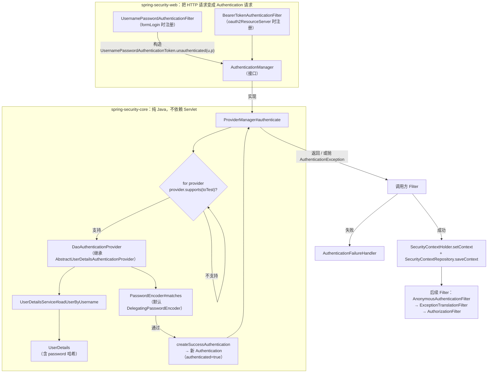
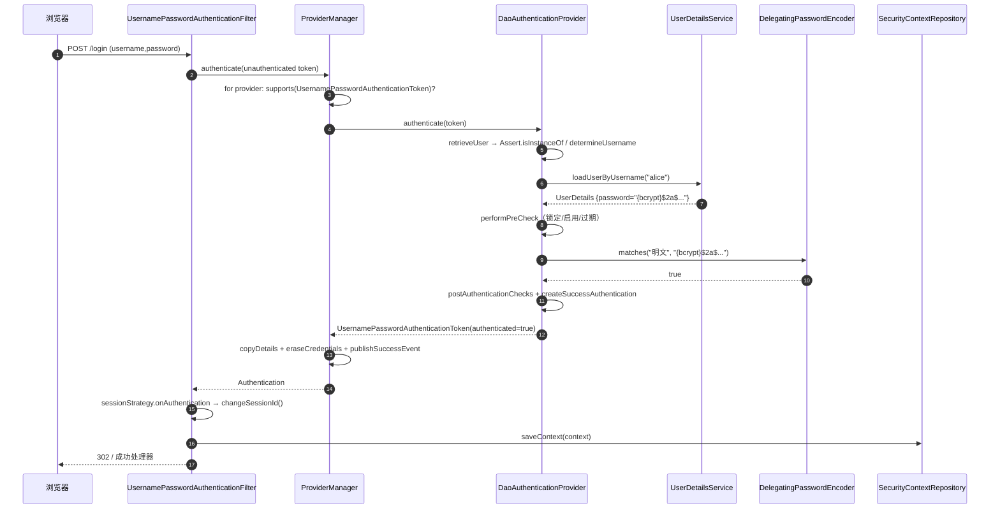

# Authentication：认证流程与 Provider（Spring Security 7.2.0）

> 一句话结论：`AuthenticationManager`（实现几乎总是 `ProviderManager`）遍历一组 `AuthenticationProvider`，逐个问 `supports(认证Token类型)`；命中的 provider 去 `UserDetailsService` 查用户、用 `PasswordEncoder` 比对密码，成功后返回一个 `isAuthenticated()==true` 的新 `Authentication`；`ProviderManager` 把它**回填 details** 后返回给调用方（表单登录场景里就是 `UsernamePasswordAuthenticationFilter`），由后者再写进 `SecurityContext`、再存进 `SecurityContextRepository`。
> 阅读前置：读完 [01-filterchainproxy-过滤器链原理.md](01-filterchainproxy-过滤器链原理.md)（尤其是 `SecurityContextHolderFilter` 与 `ExceptionTranslationFilter` 两节）；知道 `UserDetails` / `GrantedAuthority` 这两个概念的名字即可。
> 预计阅读 50 分钟 ｜ 源码：`org.springframework.security:spring-security-core:7.2.0`、`org.springframework.security:spring-security-web:7.2.0`、`org.springframework.security:spring-security-crypto:7.2.0`、`org.springframework.security:spring-security-config:7.2.0`、`org.springframework.security:spring-security-oauth2-resource-server:7.2.0`

---

## 0. 先看现象

### 0.1 为什么需要"认证"这一层抽象

上一组文章里我们知道了：请求会经过一条过滤器链，链的**最后一个安全 Filter** 是 `AuthorizationFilter`，它负责"你能不能进"。但在问"你能进吗"之前，必须先回答**"你是谁"**。

零基础读者最容易写出的代码是这样的：

```java
// 反例：把认证塞进 Controller
@GetMapping("/api/order")
public List<Order> orders(HttpServletRequest request) {
	String token = request.getHeader("Authorization");
	if (token == null || !token.equals(expected)) {
		throw new RuntimeException("401");
	}
	// ...
}
```

这段代码有四个问题：

1. **每个接口都要写一遍**——漏一个就是漏洞；
2. **认证方式被写死**——明天要加"短信登录"、"OAuth2 登录"、"JWT"，每个 Controller 都得改；
3. **无法组合**——"先查缓存、再查库、再查父系统"这种多来源认证没法表达；
4. **结果无处存放**——就算认证成功，后面 `AuthorizationFilter` 怎么知道你认证过了？

Spring Security 的答案是：把"认证"抽象成**三个接口 + 一条固定的流水线**：

| 抽象 | 职责 | 一句话类比 |
| --- | --- | --- |
| `AuthenticationManager` | 认证入口，只暴露一个 `authenticate(auth)` 方法 | 前台 |
| `AuthenticationProvider` | 真正干活的认证器，`supports()` 声明自己处理哪种 Token | 各个办事窗口 |
| `UserDetailsService` | 按用户名取用户 | 档案室 |

### 0.2 一次成功的表单登录，`DEBUG` 日志长什么样

```text
o.s.s.w.a.UsernamePasswordAuthenticationFilter : Sucessfully Authenticated user [alice]
o.s.s.w.c.HttpSessionSecurityContextRepository  : SecurityContext stored to HttpSession: ...
```

注意第一行里的 `o.s.s.w.a`——认证动作发生在 **web** 包的 `AbstractAuthenticationProcessingFilter` 子类里，而真正比密码的代码在 **core** 包的 `dao` 子包里。这条"web → core"的跨越，就是本篇的主线。

---

## 1. 全景地图：一次认证要经过谁



> 读图说明：请重点看三处"分界线"。
>
> 1. **`WEB` 与 `CORE` 的水平分界**：`ProviderManager`、`DaoAuthenticationProvider`、`UserDetailsService` 全在 core 模块，它们**完全不认识 `HttpServletRequest`**。这就是为什么你可以把它们搬到非 Web 场景（比如定时任务、消息消费者）里复用——也让单元测试非常好写。
> 2. **`D` 这个循环菱形**：`ProviderManager` 是"轮询"，不是"路由"。它会**按注册顺序**把每个 provider 都问一遍 `supports()`，谁支持谁上；第一个返回非 `null` 的结果就 `break`。
> 3. **`L` 与 `M` 分叉**：认证的**结果处置**（写 Session / 跳转登录页 / 返回 401）永远在 web 层，不在 provider 里。provider 只负责"抛异常"或"返回对象"。

---

## 2. 关键类速查表

| 类 | 模块 | 一句话职责 | 源码位置 |
| --- | --- | --- | --- |
| `Authentication` | core | "我是谁"的接口 | `authentication/Authentication.java` |
| `AbstractAuthenticationToken` | core | `Authentication` 的骨架实现，管 authorities / details / authenticated | `authentication/AbstractAuthenticationToken.java` |
| `ProviderManager` | core | 认证入口，轮询 provider + 父管理器回退 | `authentication/ProviderManager.java` |
| `AbstractUserDetailsAuthenticationProvider` | core | "查用户 → 前置检查 → 比密码 → 后置检查 → 造 Token"的模板方法 | `authentication/dao/AbstractUserDetailsAuthenticationProvider.java` |
| `DaoAuthenticationProvider` | core | 上面那个模板的实现，密码用 `PasswordEncoder` 比 | `authentication/dao/DaoAuthenticationProvider.java` |
| `UserDetailsService` | core | 唯一的 `loadUserByUsername` | `authentication/UserDetailsService.java` |
| `DelegatingPasswordEncoder` | crypto | 按 `{bcrypt}` 前缀分派到真正的编码器 | `crypto/password/DelegatingPasswordEncoder.java` |
| `AnonymousAuthenticationFilter` | web | 没有认证信息时塞一个匿名 Token | `web/authentication/AnonymousAuthenticationFilter.java` |
| `ExceptionTranslationFilter` | web | 把链上抛出的认证/授权异常翻译成 HTTP 响应 | `web/access/ExceptionTranslationFilter.java` |
| `BearerTokenAuthenticationFilter` | oauth2-resource-server | 解析 `Authorization: Bearer xxx` | `oauth2/server/resource/web/authentication/BearerTokenAuthenticationFilter.java` |

---

## 3. 源码逐段

### 3.1 `Authentication` 三兄弟的关系

`Authentication` 是接口，`AbstractAuthenticationToken` 是骨架类，`UsernamePasswordAuthenticationToken` 是最常用的具体实现。它们的关系是：

| 层 | 类型 | 提供什么 |
| --- | --- | --- |
| 接口 | `Authentication` | `getPrincipal()` / `getCredentials()` / `getAuthorities()` / `isAuthenticated()` / `getDetails()` |
| 骨架 | `AbstractAuthenticationToken` | authorities 的不可变包装、`getName()` 的多种取值策略、`authenticated` 标志位、`eraseCredentials()` |
| 具体 | `UsernamePasswordAuthenticationToken` / `AnonymousAuthenticationToken` / `BearerTokenAuthenticationToken` … | 各自不同的 principal/credentials 语义，以及 `authenticated(...)` / `unauthenticated(...)` 静态工厂 |

先看骨架类的字段和构造器：

```java (src: AbstractAuthenticationToken.java#L50-L70)
	private final Collection<GrantedAuthority> authorities;

	private @Nullable Object details;

	private boolean authenticated = false;

	/**
	 * Creates a token with the supplied array of authorities.
	 * @param authorities the collection of <tt>GrantedAuthority</tt>s for the principal
	 * represented by this authentication object.
	 */
	public AbstractAuthenticationToken(@Nullable Collection<? extends GrantedAuthority> authorities) {
		if (authorities == null) {
			this.authorities = AuthorityUtils.NO_AUTHORITIES;
			return;
		}
		for (GrantedAuthority a : authorities) {
			Assert.notNull(a, "Authorities collection cannot contain any null elements");
		}
		this.authorities = Collections.unmodifiableList(new ArrayList<>(authorities));
	}
```

**在干什么**：`authorities` 被声明为 `final`，构造器里做了三件事——`null` 换成 `AuthorityUtils.NO_AUTHORITIES`、逐个 `Assert.notNull`、最后包成 `Collections.unmodifiableList(new ArrayList<>(authorities))`。

**为什么这么写**：`Authentication` 会在线程间传递（后面章节讲异步时会遇到），如果 authorities 是可变 `List`，一个线程改了、另一个线程看到的就变了，排错时会非常痛苦。这里"防御性拷贝 + 不可变视图"是并发安全最便宜的做法。

**如果改成别的会怎样**：如果直接 `this.authorities = authorities`，那么 `ProviderManager` 里"合并 authorities"的操作（`BearerTokenAuthenticationFilter` 就干这事）就必须自己负责拷贝，一旦漏掉就会出现"同一个 Token 对象在不同请求间被污染"的诡异 bug。

再看 `getName()`，它是**所有日志与 `Authentication.getName()` 调用**的实际实现：

```java (src: AbstractAuthenticationToken.java#L84-L95)
	public String getName() {
		if (this.getPrincipal() instanceof UserDetails userDetails) {
			return userDetails.getUsername();
		}
		if (this.getPrincipal() instanceof AuthenticatedPrincipal authenticatedPrincipal) {
			return authenticatedPrincipal.getName();
		}
		if (this.getPrincipal() instanceof Principal principal) {
			return principal.getName();
		}
		return (this.getPrincipal() == null) ? "" : this.getPrincipal().toString();
	}
```

**在干什么**：按 `UserDetails` → `AuthenticatedPrincipal` → `Principal` → `toString()` 的优先级依次尝试，取到第一个不为 `null` 的值；`principal` 为 `null` 时返回空串。

**为什么这么写**：同一个 `Authentication` 的 principal 可能是 `UserDetails` 对象、可能是 `String`（`forcePrincipalAsString` 时）、也可能是自定义对象。用 `instanceof` 逐级降级，能保证**任何**实现都能打印出一个人能看懂的名字，而不至于在日志里出现 `com.foo.User@1a2b3c`。

**常见坑**：如果你自定义的 principal 类既没实现 `UserDetails` 也没实现 `Principal`，而 `toString()` 又没重写，那么日志里就全是对象哈希——排查"到底谁登录了"会变得很困难。**给 principal 实现 `AuthenticatedPrincipal` 或重写 `toString()`，是低成本高收益的习惯。**

### 3.2 入口：`ProviderManager#authenticate`

它完全不知道 `HttpServletRequest` 的存在，纯粹是"给我一个 `Authentication` 尝试对象，我还你一个已认证的"。

```java (src: ProviderManager.java#L165-L211)
	@Override
	public Authentication authenticate(Authentication authentication) throws AuthenticationException {
		Class<? extends Authentication> toTest = authentication.getClass();
		AuthenticationException lastException = null;
		AuthenticationException parentException = null;
		Authentication result = null;
		Authentication parentResult = null;
		int currentPosition = 0;
		int size = this.providers.size();
		for (AuthenticationProvider provider : getProviders()) {
			if (!provider.supports(toTest)) {
				continue;
			}
			if (logger.isTraceEnabled()) {
				logger.trace(LogMessage.format("Authenticating request with %s (%d/%d)",
						provider.getClass().getSimpleName(), ++currentPosition, size));
			}
			try {
				result = provider.authenticate(authentication);
				if (result != null) {
					copyDetails(authentication, result);
					break;
				}
			}
			catch (AccountStatusException ex) {
				prepareException(ex, authentication);
				logger.debug(LogMessage.format("Authentication failed for user '%s' since their account status is %s",
						authentication.getName(), ex.getMessage()), ex);
				// SEC-546: Avoid polling additional providers if auth failure is due to
				// invalid account status
				throw ex;
			}
			catch (InternalAuthenticationServiceException ex) {
				prepareException(ex, authentication);
				logger.debug(LogMessage.format("Authentication service failed internally for user '%s'",
						authentication.getName()), ex);
				// SEC-546: Avoid polling additional providers if auth failure is due to
				// invalid account status
				throw ex;
			}
			catch (AuthenticationException ex) {
				ex.setAuthenticationRequest(authentication);
				logger.debug(LogMessage.format("Authentication failed with provider %s since %s",
						provider.getClass().getSimpleName(), ex.getMessage()));
				lastException = ex;
			}
		}
```

**在干什么**：
1. `toTest = authentication.getClass()`——注意，这里用 `getClass()` 而不是 `instanceof` 链，是为了让 `supports()` 判断精确；
2. 对每个 provider，先 `supports(toTest)`，不支持就 `continue`；
3. 支持就 `provider.authenticate(authentication)`；
4. 拿到非 `null` 结果就 `copyDetails` 然后 `break`——**第一个成功的 provider 说了算**；
5. 三类异常分开处理（黄金细节）。

**为什么这么写**：这三类异常的差别是"是否继续问下一个 provider"：

| 异常类型 | 处理 | 原因 |
| --- | --- | --- |
| `AccountStatusException`（含 `LockedException`、`DisabledException`、`AccountExpiredException`、`CredentialsExpiredException`） | `prepareException` 后**立即抛出** | SEC-546：账号已锁定/禁用，说明**这个 provider 认出这个用户了**，轮询其他 provider 只会得到"用户名不存在"这种误导性错误 |
| `InternalAuthenticationServiceException`（数据库连不上、`UserDetailsService` 返回 `null` 等） | **立即抛出** | 这是"系统坏了"，不是"密码错了"。如果继续轮询，会把基础设施故障变成 `BadCredentialsException`，运维就查不到真正的故障 |
| `AuthenticationException` 的其他子类（典型是 `BadCredentialsException`） | `setAuthenticationRequest` + 记到 `lastException`，**继续循环** | 可能下一个 provider 存有同一用户 + 正确密码（多数据源的经典场景） |

**如果改成别的会怎样**：如果所有异常都 `catch (AuthenticationException e) { continue; }`，那么"账号被锁定"的用户会看到"用户名或密码错误"，安全团队想审计"谁在撞库"时会失去线索。Spring Security 之所以给 `AccountStatusException` 单开一个分支，就是**保留信息给审计日志与正确的用户提示**（当然，是否真的展示给前端由 `hideUserNotFoundExceptions` 决定，见 3.5）。

**常见坑**：`supports()` 只判断**类型**，不判断**内容**。两个 `DaoAuthenticationProvider` 都 `supports(UsernamePasswordAuthenticationToken.class)`，如果你注册了两个（比如一个查 MySQL、一个查 LDAP），那么**第一个 provider 抛 `BadCredentialsException` 才会轮到第二个**；如果第一个抛的是 `AccountStatusException`，第二个永远不会被问。

接下来是父管理器回退与结果处理：

```java (src: ProviderManager.java#L212-L266)
		if (result == null && this.parent != null) {
			// Allow the parent to try.
			try {
				parentResult = this.parent.authenticate(authentication);
				result = parentResult;
			}
			catch (ProviderNotFoundException ex) {
				// ignore as we will throw below if no other exception occurred prior to
				// calling parent and the parent
				// may throw ProviderNotFound even though a provider in the child already
				// handled the request
			}
			catch (AuthenticationException ex) {
				parentException = ex;
				lastException = ex;
			}
		}
		if (result != null) {
			if (this.eraseCredentialsAfterAuthentication && (result instanceof CredentialsContainer)) {
				// Authentication is complete. Remove credentials and other secret data
				// from authentication
				((CredentialsContainer) result).eraseCredentials();
			}
			// If the parent AuthenticationManager was attempted and successful then it
			// will publish an AuthenticationSuccessEvent
			// This check prevents a duplicate AuthenticationSuccessEvent if the parent
			// AuthenticationManager already published it
			if (parentResult == null) {
				this.eventPublisher.publishAuthenticationSuccess(result);
			}

			return result;
		}

		// Parent was null, or didn't authenticate (or throw an exception).
		if (lastException == null) {
			lastException = new ProviderNotFoundException(this.messages.getMessage("ProviderManager.providerNotFound",
					new Object[] { toTest.getName() }, "No AuthenticationProvider found for {0}"));
		}
		...
		throw lastException;
	}
```

**在干什么**：
1. 所有 provider 都没结果（`result == null`）且有 `parent` 时，把认证委托给父管理器；
2. 有结果时，如果 result 是 `CredentialsContainer` 且 `eraseCredentialsAfterAuthentication` 为真，就 `eraseCredentials()`——把密码抹掉；
3. `parentResult == null` 时才发 `AuthenticationSuccessEvent`（避免重复发事件）；
4. 全部失败时，构造一个信息量足够的异常。

**为什么这么写**：

- **父管理器**存在的意义是"全局默认 + 局部覆盖"：`HttpSecurity` 里可以通过 `authenticationManager(...)` 给某条 `SecurityFilterChain` 配一个局部管理器，而 `AuthenticationConfiguration` 提供的全局管理器作为 `parent`。局部找不到用户时自动回退到全局。
- **`eraseCredentials`**：`UsernamePasswordAuthenticationToken` 的 `eraseCredentials()` 会把 `credentials` 置 `null`，防止密码哈希（或明文，如果用了 `{noop}`）随着 `SecurityContext` 长期躺在 HttpSession 里。这是"内存中不保留密码"的落地实现。
- **`ProviderNotFoundException` 的文案**完全来自 `messages.getMessage("ProviderManager.providerNotFound", ...)`，默认英文是 `No AuthenticationProvider found for {0}`。看到这个异常 99% 的原因是**你没配 `UserDetailsService` 也没配 `AuthenticationProvider`**。

**如果改成别的会怎样**：如果不在 provider 层抹掉密码，只靠"上层记得抹"，那么一旦有人写了个自定义 Filter 走 `AuthenticationManager` 却没调 `eraseCredentials`，密码就会进 Session。放在 `ProviderManager` 里"统一抹"，是"默认安全"的体现。

**常见坑**：

- 自定义 provider 里`throw new RuntimeException("密码错误")`——`ProviderManager` 只 catch `AuthenticationException`，`RuntimeException` 会一路上抛，`ExceptionTranslationFilter` 只认 `AuthenticationException`/`AccessDeniedException`，最终变成 **500**，而不是 401。
- `parent` 是 `null` 且 provider 列表为空时，`checkState` 会直接报错：

```java (src: ProviderManager.java#L139-L143)
	private void checkState() {
		Assert.isTrue(this.parent != null || !this.providers.isEmpty(),
				"A parent AuthenticationManager or a list of AuthenticationProviders is required");
		Assert.noNullElements(this.providers, "providers list cannot contain null values");
	}
```

这句话值得背下来：**要么给 provider，要么给 parent，不能都给空。**

### 3.3 模板方法：`AbstractUserDetailsAuthenticationProvider#authenticate`

如果说 `ProviderManager` 是"调度"，`AbstractUserDetailsAuthenticationProvider` 就是"认证的标准流程模板"。它是一个**模板方法模式**的教科书案例：

```java (src: AbstractUserDetailsAuthenticationProvider.java#L135-L157)
	public Authentication authenticate(Authentication authentication) throws AuthenticationException {
		Assert.isInstanceOf(UsernamePasswordAuthenticationToken.class, authentication,
				() -> this.messages.getMessage("AbstractUserDetailsAuthenticationProvider.onlySupports",
						"Only UsernamePasswordAuthenticationToken is supported"));
		String username = determineUsername(authentication);
		boolean cacheWasUsed = true;
		UserDetails user = this.userCache.getUserFromCache(username);
		if (user == null) {
			cacheWasUsed = false;
			try {
				user = retrieveUser(username, (UsernamePasswordAuthenticationToken) authentication);
			}
			catch (UsernameNotFoundException ex) {
				this.logger.debug(LogMessage.format("Failed to find user '%s'", username));
				String message = this.messages.getMessage("AbstractUserDetailsAuthenticationProvider.badCredentials",
						"Bad credentials");
				if (!this.hideUserNotFoundExceptions) {
					throw ex;
				}
				throw new BadCredentialsException(message, ex);
			}
			Assert.notNull(user, "retrieveUser returned null - a violation of the interface contract");
		}
```

**在干什么**：
1. `Assert.isInstanceOf(UsernamePasswordAuthenticationToken.class, authentication, ...)`——只接受这一种 Token（其实 `supports()` 已经筛过了，这里是双保险）；
2. `determineUsername`：`principal == null ? "NONE_PROVIDED" : authentication.getName()`。这个 `"NONE_PROVIDED"` 是**故意**的，为了在日志/缓存里区分"用户名为空"与"用户不存在"；
3. 先查缓存 `userCache.getUserFromCache(username)`；
4. 缓存未命中 → `retrieveUser`（**抽象方法**，`DaoAuthenticationProvider` 实现它去调 `UserDetailsService`）；
5. `catch (UsernameNotFoundException)` 里做**信息脱敏**；
6. `Assert.notNull(user, "retrieveUser returned null - a violation of the interface contract")`。

**为什么这么写**：第 5 步是整个框架里最容易被误读的一段。`UsernameNotFoundException` 被**包装成** `BadCredentialsException`，且只有 `hideUserNotFoundExceptions == false` 时才原样抛出。目的是让"用户不存在"和"密码错误"在**外部可观测行为**上完全一致——否则攻击者可以先用"用户名枚举"批量探测哪些账号存在，再做定向撞库。

**如果改成别的会怎样**：把 `hideUserNotFoundExceptions` 设为 `false`（构造函数里可以传），你能在日志里区分两种失败，但**必须自己保证** `AuthenticationEntryPoint` / `AuthenticationFailureHandler` 返回给前端的信息不透露差异。框架默认帮你做了，别轻易关掉。

接着是"前置检查 + 缓存失效重试 + 后置检查"：

```java (src: AbstractUserDetailsAuthenticationProvider.java#L158-L180)
		try {
			performPreCheck(user, (UsernamePasswordAuthenticationToken) authentication);
		}
		catch (AuthenticationException ex) {
			if (!cacheWasUsed) {
				throw ex;
			}
			// There was a problem, so try again after checking
			// we're using latest data (i.e. not from the cache)
			cacheWasUsed = false;
			user = retrieveUser(username, (UsernamePasswordAuthenticationToken) authentication);
			performPreCheck(user, (UsernamePasswordAuthenticationToken) authentication);
		}
		this.postAuthenticationChecks.check(user);
		if (!cacheWasUsed) {
			this.userCache.putUserInCache(user);
		}
		Object principalToReturn = user;
		if (this.forcePrincipalAsString) {
			principalToReturn = user.getUsername();
		}
		return createSuccessAuthentication(principalToReturn, authentication, user);
	}
```

**在干什么**：
1. `performPreCheck(user)`：账号是否锁定/启用/过期；
2. 这一步抛异常时，如果这次用户是**从缓存**来的，就把 `cacheWasUsed = false`，重新 `retrieveUser` 再检查一遍——因为缓存里的用户状态可能已过期（比如管理员刚把你解锁）；
3. `postAuthenticationChecks.check(user)`：凭证是否过期；
4. 只有**没用缓存**时才 `putUserInCache`；
5. `forcePrincipalAsString` 时把 principal 换成 `username` 字符串；
6. `createSuccessAuthentication(...)` 造成功 Token。

**为什么这么写**：第 2 步这种"缓存失效重试"是典型的**缓存必须可失效**思路。没有它，一个刚被禁用的账号在缓存过期前（默认 `NullUserCache`，即不缓存；配了 `CachingUserDetailsService` 才有效）还能登录，这在安全审计里是硬伤。

**常见坑**：`forcePrincipalAsString` 默认 `false`，所以 `authentication.getPrincipal()` 拿到的是 **`UserDetails` 对象**。很多教程里写 `(String) authentication.getPrincipal()` 会 `ClassCastException`——正确写法是：

```java
UserDetails user = (UserDetails) SecurityContextHolder.getContext().getAuthentication().getPrincipal();
// 或者更健壮：
Object principal = SecurityContextHolder.getContext().getAuthentication().getPrincipal();
String username = (principal instanceof UserDetails ud) ? ud.getUsername() : String.valueOf(principal);
```

再看"防时序攻击"的细节，这段很多人不知道它存在：

```java (src: AbstractUserDetailsAuthenticationProvider.java#L182-L199)
	private void performPreCheck(UserDetails user, UsernamePasswordAuthenticationToken authentication) {
		try {
			this.preAuthenticationChecks.check(user);
		}
		catch (AuthenticationException ex) {
			if (!this.alwaysPerformAdditionalChecksOnUser) {
				throw ex;
			}
			try {
				additionalAuthenticationChecks(user, authentication);
			}
			catch (AuthenticationException ignored) {
				// preserve the original failed check
			}
			throw ex;
		}
		additionalAuthenticationChecks(user, authentication);
	}
```

**在干什么**：如果前置检查（比如"账号已锁定"）失败，`alwaysPerformAdditionalChecksOnUser` 为真时**仍然**执行一次密码比对，并且**忽略它的结果**，最后抛出的是**前置检查的异常**。

**为什么这么写**：这是防**时序侧信道**。"用户不存在"会在 `retrieveUser` 阶段就失败（快），"用户存在但密码错"要走完密码哈希（慢，bcrypt 一次 ≈ 几十毫秒）。攻击者测量响应时间就能判断用户名是否存在。这段代码让"账号锁定/禁用"这类早期失败也付出一次哈希的代价，抹平时间差。

**如果改成别的会怎样**：如果你自己实现 `AuthenticationProvider` 时没考虑这一点，用户枚举攻击依然可行，只是从"错误信息"转移到了"响应时间"。

最后是成功 Token 的构造：

```java (src: AbstractUserDetailsAuthenticationProvider.java#L220-L234)
	protected Authentication createSuccessAuthentication(Object principal, Authentication authentication,
			UserDetails user) {
		// Ensure we return the original credentials the user supplied,
		// so subsequent attempts are successful even with encoded passwords.
		// Also ensure we return the original getDetails(), so that future
		// authentication events after cache expiry contain the details
		Collection<GrantedAuthority> authorities = new LinkedHashSet<>(
				this.authoritiesMapper.mapAuthorities(user.getAuthorities()));
		authorities.add(FactorGrantedAuthority.fromAuthority(AUTHORITY));
		UsernamePasswordAuthenticationToken result = UsernamePasswordAuthenticationToken.authenticated(principal,
				authentication.getCredentials(), authorities);
		result.setDetails(authentication.getDetails());
		this.logger.debug("Authenticated user");
		return result;
	}
```

**在干什么**：把 `UserDetails.getAuthorities()` 过一遍 `authoritiesMapper`，塞进 `LinkedHashSet`（保序 + 去重），然后 `authorities.add(FactorGrantedAuthority.fromAuthority(AUTHORITY))`——**在 Spring Security 7 里多了一个"密码因素"的 `GrantedAuthority`**，用于 MFA（多因素认证）判断"本次认证用到了哪些因素"。最后用 `UsernamePasswordAuthenticationToken.authenticated(...)` 造出 `authenticated = true` 的 Token，并把原请求的 `details` 拷过去。

**为什么这么写**：`authenticated(...)` 这个静态工厂是**唯一**推荐的构造方式——它会显式地把 `setAuthenticated(true)` 封装在工厂里。旧写法 `new UsernamePasswordAuthenticationToken(p, c, authorities)` 仍然可用，但语义模糊（到底认证没认证？）。

**如果改成别的会怎样**：如果你手动 `new ...Token(...)` 而不调 `setAuthenticated(true)`，那么 Token 的 `isAuthenticated()` 是 `false`，`SecurityContextHolder` 里存的"已认证"标记就是错的，`AuthorizationFilter` 依赖的 `isAuthenticated()` 会得到否定答案，`hasRole` 直接拒绝——排查这种 bug 往往要花半天。

### 3.4 `DaoAuthenticationProvider`：真正查库与比密码

`Dao` 这个名字来自"D**A**ta **A**ccess **O**bject"的老叫法。它做了两件父类没做的事：`retrieveUser`（去调 `UserDetailsService`）和 `additionalAuthenticationChecks`（比密码）。

```java (src: DaoAuthenticationProvider.java#L102-L123)
	protected final UserDetails retrieveUser(String username, UsernamePasswordAuthenticationToken authentication)
			throws AuthenticationException {
		prepareTimingAttackProtection();
		try {
			UserDetails loadedUser = this.getUserDetailsService().loadUserByUsername(username);
			if (loadedUser == null) {
				throw new InternalAuthenticationServiceException(
						"UserDetailsService returned null, which is an interface contract violation");
			}
			return loadedUser;
		}
		catch (UsernameNotFoundException ex) {
			mitigateAgainstTimingAttack(authentication);
			throw ex;
		}
		catch (InternalAuthenticationServiceException ex) {
			throw ex;
		}
		catch (Exception ex) {
			throw new InternalAuthenticationServiceException(ex.getMessage(), ex);
		}
	}
```

**在干什么**：
1. `prepareTimingAttackProtection()`：如果还没算过 `userNotFoundEncodedPassword`，就用 `passwordEncoder.encode("userNotFoundPassword")` 现算一个；
2. `loadUserByUsername(username)`；
3. 返回 `null` → 抛 `InternalAuthenticationServiceException("UserDetailsService returned null, which is an interface contract violation")`；
4. `catch (UsernameNotFoundException)` → 先 `mitigateAgainstTimingAttack`，再抛；
5. 其他 `Exception` → 包成 `InternalAuthenticationServiceException`。

**为什么这么写**：
- 第 3 步的 `null` 检查是**契约校验**。`loadUserByUsername` 的 javadoc 明确要求"找不到就抛 `UsernameNotFoundException`"，返回 `null` 是调用方的 bug。框架选择"立刻报明确的错"，而不是让你在后面某个地方遇到 `NullPointerException`。
- 第 4/5 步的时间抹平同样是防用户枚举：用户不存在时**也要**调一次 `matches`（拿预置的哈希和用户输入的密码比），这样时间开销和"用户存在但密码错"一致。

**常见坑**：很多自己写的 `UserDetailsService` 长这样：

```java
@Override
public UserDetails loadUserByUsername(String username) {
	return userRepository.findByUsername(username); // 找不到返回 null
}
```

这会让登录接口返回 **500 + `InternalAuthenticationServiceException`**，而不是 401。正确写法：

```java
@Override
public UserDetails loadUserByUsername(String username) throws UsernameNotFoundException {
	return userRepository.findByUsername(username)
			.orElseThrow(() -> new UsernameNotFoundException("User not found: " + username));
}
```

密码比对本身：

```java (src: DaoAuthenticationProvider.java#L81-L94)
	protected void additionalAuthenticationChecks(UserDetails userDetails,
			UsernamePasswordAuthenticationToken authentication) throws AuthenticationException {
		if (authentication.getCredentials() == null) {
			this.logger.debug("Failed to authenticate since no credentials provided");
			throw new BadCredentialsException(this.messages
				.getMessage("AbstractUserDetailsAuthenticationProvider.badCredentials", "Bad credentials"));
		}
		String presentedPassword = authentication.getCredentials().toString();
		if (!this.passwordEncoder.get().matches(presentedPassword, userDetails.getPassword())) {
			this.logger.debug("Failed to authenticate since password does not match stored value");
			throw new BadCredentialsException(this.messages
				.getMessage("AbstractUserDetailsAuthenticationProvider.badCredentials", "Bad credentials"));
		}
	}
```

**在干什么**：`presentedPassword`（用户输入的明文）为 `null` 就抛 `BadCredentialsException("Bad credentials")`；否则 `passwordEncoder.matches(presentedPassword, userDetails.getPassword())`，不匹配就抛 `BadCredentialsException`。

**为什么这么写**：注意 `passwordEncoder` 是个 `SingletonSupplier`：

```java (src: DaoAuthenticationProvider.java#L58-L59)
	private Supplier<PasswordEncoder> passwordEncoder = SingletonSupplier
		.of(PasswordEncoderFactories::createDelegatingPasswordEncoder);
```

也就是说**没显式设置时，默认使用 `PasswordEncoderFactories.createDelegatingPasswordEncoder()`**——这就是 `{bcrypt}` 前缀的由来。这个默认值非常有价值：它让"用明文密码"变成一件需要**主动**做的事（写 `{noop}`），而不是默默发生。

**常见坑**：如果你在库里存的是没有前缀的 bcrypt 哈希（很多老项目的现状），并**没有**配置 `PasswordEncoder` bean，登录会报：

```text
java.lang.IllegalArgumentException: There is no PasswordEncoder mapped for the id "null"
```

或者：

```text
java.lang.IllegalArgumentException: There is no PasswordEncoder mapped for the id "2a"
```

原因是 `DelegatingPasswordEncoder` 认为 `$2a$10$...` 里的 `2a` 是"算法 id"。解决办法二选一：给库里密码加 `{bcrypt}` 前缀，或者显式声明一个 `BCryptPasswordEncoder` bean（此时 Boot 的 `InitializeUserDetailsBeanManagerConfigurer` 会自动把它注入到 `DaoAuthenticationProvider` 里）。

### 3.5 `DelegatingPasswordEncoder`：`{bcrypt}` 前缀到底是什么

```java (src: DelegatingPasswordEncoder.java#L241-L249)
	protected boolean matchesNonNull(String rawPassword, String prefixEncodedPassword) {
		String id = extractId(prefixEncodedPassword);
		PasswordEncoder delegate = this.idToPasswordEncoder.get(id);
		if (delegate == null) {
			return this.defaultPasswordEncoderForMatches.matches(rawPassword, prefixEncodedPassword);
		}
		String encodedPassword = extractEncodedPassword(prefixEncodedPassword);
		return delegate.matches(rawPassword, encodedPassword);
	}
```

**在干什么**：`matches` 时先 `extractId(rawPassword)`——从**用户输入的明文**里找 `{...}` 前缀？不，这里其实是"从**存储的密码**里提取前缀"。传参顺序是 `matches(rawPassword, encodedPassword)`，`extractId` 作用在第二个参数上（见 javadoc 的 `{id}encodedPassword` 存储格式）。拿到 `id` 后去 `idToPasswordEncoder` 这张表里找对应编码器，找不到就退到 `defaultPasswordEncoderForMatches`。

**为什么这么写**：一个"密码列"里同时存着历史上不同算法生成的哈希（bcrypt、pbkdf2、sha256、甚至残留的 md5），是几乎每个老系统都会遇到的情况。如果没有前缀机制，要么"全部重算"（用户必须重置密码），要么"锁定成一个算法"（无法平滑升级）。前缀把"算法选择"从**配置**变成了**数据**，每个用户的密码自带算法标识，可以逐条迁移。

`idForEncode`（写入用哪个算法）与 `idToPasswordEncoder`（能读哪些算法）是**分开**的：

```java (src: DelegatingPasswordEncoder.java#L236-L238)
	protected String encodeNonNullPassword(String rawPassword) {
		return this.idPrefix + this.idForEncode + this.idSuffix + this.passwordEncoderForEncode.encode(rawPassword);
	}
```

**在干什么**：`encode` 时统一写成 `{idForEncode}` + `delegate.encode(raw)`。

**如果改成别的会怎样**：这就是"平滑升级算法"的正确姿势——`idForEncode` 设成 `bcrypt`，同时 `idToPasswordEncoder` 里保留 `md5`/`sha256` 以便读旧数据，再配合 `UserDetailsPasswordService`（`upgradeEncoding` 时自动重写），用户下次登录时密码就被悄悄升级了。

**常见坑**：库里存了 `{noop}123456`，你以为很安全其实等于明文。更隐蔽的是**注册接口**里手写 `"{noop}" + password`，上线才发现。检查方法：直接 `SELECT` 一眼密码列，凡是**不以 `{` 开头**或**以 `{noop}` 开头**的都需要处理。

### 3.6 `UserDetailsService` 从哪来：Boot 自动配置的那一条线

很多人没写过 `UserDetailsService` bean 却能登录，密码还是启动日志里打印的那串 UUID。这背后是 `InitializeUserDetailsBeanManagerConfigurer`：

```java (src: InitializeUserDetailsBeanManagerConfigurer.java#L69-L110)
		public void configure(AuthenticationManagerBuilder auth) {
			String[] beanNames = InitializeUserDetailsBeanManagerConfigurer.this.context
				.getBeanNamesForType(UserDetailsService.class);
			if (auth.isConfigured()) {
				if (beanNames.length > 0) {
					this.logger.warn("Global AuthenticationManager configured with an AuthenticationProvider bean. "
							+ "UserDetailsService beans will not be used by Spring Security for automatically configuring username/password login. "
							+ "Consider removing the AuthenticationProvider bean. "
							+ "Alternatively, consider using the UserDetailsService in a manually instantiated DaoAuthenticationProvider. "
							+ "If the current configuration is intentional, to turn off this warning, "
							+ "increase the logging level of 'org.springframework.security.config.annotation.authentication.configuration.InitializeUserDetailsBeanManagerConfigurer' to ERROR");
				}
				return;
			}

			if (beanNames.length == 0) {
				return;
			}
			else if (beanNames.length > 1) {
				this.logger.warn(LogMessage.format("Found %s UserDetailsService beans, with names %s. "
						+ "Global Authentication Manager will not use a UserDetailsService for username/password login. "
						+ "Consider publishing a single UserDetailsService bean.", beanNames.length,
						Arrays.toString(beanNames)));
				return;
			}
			UserDetailsService userDetailsService = InitializeUserDetailsBeanManagerConfigurer.this.context
				.getBean(beanNames[0], UserDetailsService.class);
			PasswordEncoder passwordEncoder = getBeanOrNull(PasswordEncoder.class);
			UserDetailsPasswordService passwordManager = getBeanOrNull(UserDetailsPasswordService.class);
			CompromisedPasswordChecker passwordChecker = getBeanOrNull(CompromisedPasswordChecker.class);
			DaoAuthenticationProvider provider = new DaoAuthenticationProvider(userDetailsService);
			if (passwordEncoder != null) {
				provider.setPasswordEncoder(passwordEncoder);
			}
			if (passwordManager != null) {
				provider.setUserDetailsPasswordService(passwordManager);
			}
			if (passwordChecker != null) {
				provider.setCompromisedPasswordChecker(passwordChecker);
			}
			provider.afterPropertiesSet();
			auth.authenticationProvider(provider);
```

**在干什么**：这是一个 `GlobalAuthenticationConfigurerAdapter`，在 `AuthenticationManagerBuilder` 构建时运行：

1. 如果已经手工配了 `AuthenticationProvider`（`auth.isConfigured()`），打一条 warn 就退出——**不覆盖你的配置**；
2. 容器里**没有** `UserDetailsService` → 直接返回（交给 Boot 的 `UserDetailsServiceAutoConfiguration` 去造一个内存用户）；
3. 有**多个** `UserDetailsService` → 打 warn 并退出（因为不知道用哪个）；
4. 恰好一个 → 取它，再"顺带"找 `PasswordEncoder` / `UserDetailsPasswordService` / `CompromisedPasswordChecker`，组装成 `DaoAuthenticationProvider` 注册进去。

**为什么这么写**：这是"约定优于配置"的落地——你只写一个 `UserDetailsService` bean，框架就把整条认证链拼好；但一旦你表达了更明确的意图（自己配 provider、或配了多个 UDS），它就**退让**并给出提示，而不是替你猜。

**常见坑**：项目里有两个 `UserDetailsService`（比如一个给后台管理、一个给 App）时，登录会直接失败并打 warn。解决办法是**显式**配一个 `AuthenticationManager`（或 `DaoAuthenticationProvider`）指定用哪个，而不是靠自动配置。

### 3.7 匿名认证：`AnonymousAuthenticationFilter`

认证不是"要么成功要么失败"——还有第三种状态：**根本没带任何凭据**。这时不能留 `null`，否则 `AuthorizationFilter` 会抛 `AuthenticationCredentialsNotFoundException` 而不是优雅地 401。

```java (src: AnonymousAuthenticationFilter.java#L112-L133)
	private SecurityContext defaultWithAnonymous(HttpServletRequest request, SecurityContext currentContext) {
		Authentication currentAuthentication = currentContext.getAuthentication();
		if (currentAuthentication == null) {
			Authentication anonymous = createAuthentication(request);
			if (this.logger.isTraceEnabled()) {
				this.logger.trace(LogMessage.of(() -> "Set SecurityContextHolder to " + anonymous));
			}
			else {
				this.logger.debug("Set SecurityContextHolder to anonymous SecurityContext");
			}
			SecurityContext anonymousContext = this.securityContextHolderStrategy.createEmptyContext();
			anonymousContext.setAuthentication(anonymous);
			return anonymousContext;
		}
		else {
			if (this.logger.isTraceEnabled()) {
				this.logger.trace(LogMessage.of(() -> "Did not set SecurityContextHolder since already authenticated "
						+ currentAuthentication));
			}
		}
		return currentContext;
	}
```

**在干什么**：如果当前 `SecurityContext` 里的 `Authentication` 是 `null`，就造一个 `AnonymousAuthenticationToken`（principal 是字符串 `"anonymousUser"`，authority 是 `ROLE_ANONYMOUS`）并放进一个新 context。

**为什么这么写**：把"匿名"显式建模成一个**认证对象**，带来三个好处：

1. `AuthorizationFilter` 永远能拿到非 `null` 的 `Authentication`，不用到处判空；
2. 可以用 `anonymous()` / `authenticated()` 精确表达授权规则（"只允许未登录用户访问注册页"）；
3. `ExceptionTranslationFilter` 能通过 `AuthenticationTrustResolver.isAnonymous(auth)` 判断"这是匿名用户" → 把"没权限"翻译成"请先登录"（跳登录页 / 401），而不是 403。

**如果改成别的会怎样**：注意 7.x 里这段代码已经改成 `Supplier<SecurityContext>` 的**延迟**求值（`getDeferredContext` / `setDeferredContext`）。如果你在自定义 Filter 里直接 `SecurityContextHolder.getContext().getAuthentication()` 并强行断言"一定有 Authentication"，在匿名 Filter 之前的 Filter 里就会拿到 `null`——顺序很重要。

### 3.8 `ExceptionTranslationFilter`：异常怎么变成 302 / 401 / 403

这是本篇**最重要**的一段。它把"链上抛出的 Java 异常"翻译成"HTTP 响应"，是认证与授权两个世界的中转站。

```java (src: ExceptionTranslationFilter.java#L123-L149)
	private void doFilter(HttpServletRequest request, HttpServletResponse response, FilterChain chain)
			throws IOException, ServletException {
		try {
			chain.doFilter(request, response);
		}
		catch (IOException ex) {
			throw ex;
		}
		catch (Exception ex) {
			// Try to extract a SpringSecurityException from the stacktrace
			Throwable[] causeChain = this.throwableAnalyzer.determineCauseChain(ex);
			RuntimeException securityException = (AuthenticationException) this.throwableAnalyzer
				.getFirstThrowableOfType(AuthenticationException.class, causeChain);
			if (securityException == null) {
				securityException = (AccessDeniedException) this.throwableAnalyzer
					.getFirstThrowableOfType(AccessDeniedException.class, causeChain);
			}
			if (securityException == null) {
				rethrow(ex);
			}
			if (response.isCommitted()) {
				throw new ServletException("Unable to handle the Spring Security Exception "
						+ "because the response is already committed.", ex);
			}
			handleSpringSecurityException(request, response, chain, securityException);
		}
	}
```

**在干什么**：
1. `try { chain.doFilter(...) }`——后续所有 Filter（含 `AuthorizationFilter`）都在这个 try 里；
2. `catch (IOException)` 原样抛（IO 错误不是安全问题）；
3. `catch (Exception ex)`：先用 `ThrowableAnalyzer.determineCauseChain` 把异常链拆开，然后**先找 `AuthenticationException`，再找 `AccessDeniedException`**；
4. 两个都找不到 → `rethrow(ex)`（不是安全异常，不处理）；
5. `response.isCommitted()` → 抛 `ServletException`（响应已经开始写了，没法再改状态码）；
6. 否则交给 `handleSpringSecurityException`。

**为什么这么写**：第 3 步的"先认证后授权"顺序不是随意的。考虑"匿名用户访问需要 `ROLE_ADMIN` 的接口"：`AuthorizationFilter` 抛出的是 `AccessDeniedException`，但**根本原因**是"你没登录"。`ExceptionTranslationFilter` 会在下一步把这种 `AccessDeniedException` 转成 `AuthenticationException`（见下）。而如果异常链里同时出现两者（嵌套包装），"认证异常优先"才能得到正确的语义。

第 5 步的 `isCommitted` 检查也极其重要：**过滤器无法撤销已经写出去的响应**。如果你在 Controller 里已经 `response.getWriter().write("...")` 之后再抛 `AccessDeniedException`，框架只能报这个 `ServletException` 而不是伪造一个 403。

接着看分派：

```java (src: ExceptionTranslationFilter.java#L172-L186)
	private void handleSpringSecurityException(HttpServletRequest request, HttpServletResponse response,
			FilterChain chain, @Nullable RuntimeException exception) throws IOException, ServletException {
		if (exception instanceof AuthenticationException) {
			handleAuthenticationException(request, response, chain, (AuthenticationException) exception);
		}
		else if (exception instanceof AccessDeniedException) {
			handleAccessDeniedException(request, response, chain, (AccessDeniedException) exception);
		}
	}

	private void handleAuthenticationException(HttpServletRequest request, HttpServletResponse response,
			FilterChain chain, AuthenticationException exception) throws ServletException, IOException {
		this.logger.trace("Sending to authentication entry point since authentication failed", exception);
		sendStartAuthentication(request, response, chain, exception);
	}
```

然后是最容易读错的一段——`AccessDeniedException` 的"降级转发"：

```java (src: ExceptionTranslationFilter.java#L188-L212)
	private void handleAccessDeniedException(HttpServletRequest request, HttpServletResponse response,
			FilterChain chain, AccessDeniedException exception) throws ServletException, IOException {
		Authentication authentication = this.securityContextHolderStrategy.getContext().getAuthentication();
		boolean isAnonymous = this.authenticationTrustResolver.isAnonymous(authentication);
		if (isAnonymous || this.authenticationTrustResolver.isRememberMe(authentication)) {
			if (logger.isTraceEnabled()) {
				logger.trace(LogMessage.format("Sending %s to authentication entry point since access is denied",
						authentication), exception);
			}
			AuthenticationException ex = new InsufficientAuthenticationException(
					this.messages.getMessage("ExceptionTranslationFilter.insufficientAuthentication",
							"Full authentication is required to access this resource"),
					exception);
			ex.setAuthenticationRequest(authentication);
			sendStartAuthentication(request, response, chain, ex);
		}
		else {
			if (logger.isTraceEnabled()) {
				logger.trace(
						LogMessage.format("Sending %s to access denied handler since access is denied", authentication),
						exception);
			}
			this.accessDeniedHandler.handle(request, response, exception);
		}
	}
```

**在干什么**：
- 取当前 `Authentication`；
- `isAnonymous`（是匿名 Token）或 `isRememberMe`（是"记住我"生成的 Token）→ 说明**用户其实没真正登录**，于是把 `AccessDeniedException` **包装成** `InsufficientAuthenticationException`（消息 `Full authentication is required to access this resource`），并 `setAuthenticationRequest(authentication)`，然后走 `sendStartAuthentication`；
- 否则（真登录了但权限不够）→ `accessDeniedHandler.handle(...)`，默认实现返回 **403**。

**为什么这么写**：这就是"**认证异常 → entryPoint，授权异常 → accessDeniedHandler**"这条口诀的完整版，再加上一个例外：

| 情况 | 抛出的异常 | 实际走的分支 | 用户体验 |
| --- | --- | --- | --- |
| 没登录，访问受保护资源 | `AccessDeniedException`（来自 AuthorizationFilter） | 被转成 `InsufficientAuthenticationException` → `AuthenticationEntryPoint` | 302 登录页 / 401 |
| 登录了但没权限 | `AccessDeniedException` | `AccessDeniedHandler` | 403 |
| "记住我"但没真正登录，访问敏感资源 | `AccessDeniedException` | 同上，被转成认证异常 | 302 登录页 / 401 |
| 认证过程本身失败（密码错） | `AuthenticationException` | `AuthenticationEntryPoint` | 302 登录页 / 401 |

**如果改成别的会怎样**：如果不做这个"匿名 → 认证异常"的转换，那么未登录用户访问受保护接口会收到 **403 Forbidden**。这既不符合 HTTP 语义（应该是 401），也让前端无法区分"该跳登录了"和"你真的没权限"。

最终的动作：

```java (src: ExceptionTranslationFilter.java#L214-L222)
	protected void sendStartAuthentication(HttpServletRequest request, HttpServletResponse response, FilterChain chain,
			AuthenticationException reason) throws ServletException, IOException {
		// SEC-112: Clear the SecurityContextHolder's Authentication, as the
		// existing Authentication is no longer considered valid
		SecurityContext context = this.securityContextHolderStrategy.createEmptyContext();
		this.securityContextHolderStrategy.setContext(context);
		this.requestCache.saveRequest(request, response);
		this.authenticationEntryPoint.commence(request, response, reason);
	}
```

**在干什么**：先建一个**空**的 `SecurityContext` 并 set 进去，再 `requestCache.saveRequest(...)` 记住用户原本想访问的地址，最后 `authenticationEntryPoint.commence(...)`。

**为什么这么写**：注释里的 `SEC-112` 是个经典漏洞——如果不清空 context 就直接跳登录页，那么"一个权限不足的已登录用户"在跳转过程中仍持有旧身份，登录页渲染、以及后续的重定向都可能基于错误的身份做判断。**先清空，再跳转**。

**常见坑**：

- 自己写 `AuthenticationEntryPoint` 时返回 `302` 但没有处理 `Accept` 头。前后端分离项目里浏览器拿到 302 会跟着跳，Ajax 请求则会得到一段 HTML——这就是 `DelegatingAuthenticationEntryPoint` 存在的原因（按 `RequestMatcher` 分派：请求 HTML 就跳登录页，请求 JSON 就返回 401）。
- `response.isCommitted()` 之后的异常会变成 `ServletException`，日志里出现 `Unable to handle the Spring Security Exception because the response is already committed.`——看到它说明**你的代码在安全异常发生前就写了响应**（常见于 `OncePerRequestFilter` 里包装了 `response` 并提前 flush）。

### 3.9 认证结果如何落进 `SecurityContext`

认证成功后，"写 context"这一步发生在**调用方 Filter** 里。以表单登录的父类 `AbstractAuthenticationProcessingFilter` 为例，它的顺序是：

1. `authResult = attemptAuthentication(request, response)`（内部调 `AuthenticationManager`）；
2. `sessionStrategy.onAuthentication(authResult, request, response)`——**会话固定防护**在这里；
3. `securityContextRepository.saveContext(securityContext, request, response)`；
4. `successfulAuthentication` → `SecurityContextHolderStrategy.setContext(...)` + `SecurityContextRepository.saveContext(...)` + `successHandler.onAuthenticationSuccess(...)`。

注意第 2 步的默认策略是 `ChangeSessionIdAuthenticationStrategy`：

```java (src: ChangeSessionIdAuthenticationStrategy.java#L32-L35)
	HttpSession applySessionFixation(HttpServletRequest request) {
		request.changeSessionId();
		return request.getSession();
	}
```

**在干什么**：调 `request.changeSessionId()`，把当前会话 ID 换成新的，然后返回同一个会话。

**为什么这么写**：这是**会话固定攻击（Session Fixation）**的标准防御。攻击流程是：攻击者先访问站点拿到一个 session id → 想办法让受害者用这个 id 登录（比如把 `JSESSIONID` 塞进 URL）→ 受害者登录后，攻击者手里的 id 就成了"已登录会话"。`changeSessionId()` 在登录成功那一刻换 id，旧 id 立即失效。

**如果改成别的会怎样**：老版本还有 `migrateSession`（新建 session 并搬迁属性）与 `newSession` 两种策略；`changeSessionId` 是 Servlet 3.1+ 的推荐做法（不需要拷贝属性，也不会丢 `HttpSession` 里已有的东西）。如果你手动 `setSessionFixationAuthenticationStrategy(new NullAuthenticatedSessionStrategy())` 关掉它，就必须自己承担上面的攻击面。

至于 `SecurityContext` 的**持久化仓库**，默认是 `DelegatingSecurityContextRepository(RequestAttributeSecurityContextRepository, HttpSessionSecurityContextRepository)`——先看请求属性（同一请求内二次 dispatch 用），再看 Session。

```java (src: HttpSessionSecurityContextRepository.java#L161-L175)
	private void saveContextInHttpSession(SecurityContext context, HttpServletRequest request) {
		if (isTransient(context) || isTransient(context.getAuthentication())) {
			return;
		}
		SecurityContext emptyContext = generateNewContext();
		if (emptyContext.equals(context)) {
			HttpSession session = request.getSession(false);
			removeContextFromSession(context, session);
		}
		else {
			boolean createSession = this.allowSessionCreation;
			HttpSession session = request.getSession(createSession);
			setContextInSession(context, session);
		}
	}
```

**在干什么**：有三个提前返回：`context` 是 transient、`authentication` 是 transient、或者 context 与空 context 相等（即"没有认证信息"）→ 直接不存（后者还会顺手 `removeContextFromSession`）。否则 `request.getSession(allowSessionCreation)` 拿到（或创建）session，然后 `setContextInSession`。

**为什么这么写**：这段代码解决了"匿名用户不要创建 session"这个非常实际的问题——如果每个请求都建 session，爬虫扫一遍就能把内存打满。**只有真的有人登录了（context 与空 context 不等），才创建 session。**

### 3.10 JWT / OAuth2 Resource Server 插在哪

以"后端只验 JWT、不签 JWT"的 Resource Server 场景为例，链上会多一个 `BearerTokenAuthenticationFilter`（由 `http.oauth2ResourceServer(...)` 配置）：

```java (src: BearerTokenAuthenticationFilter.java#L162-L178)
	protected void doFilterInternal(HttpServletRequest request, HttpServletResponse response, FilterChain filterChain)
			throws ServletException, IOException {
		Authentication authenticationRequest;
		try {
			authenticationRequest = this.authenticationConverter.convert(request);
		}
		catch (OAuth2AuthenticationException invalid) {
			this.logger.trace("Sending to authentication entry point since failed to resolve bearer token", invalid);
			this.authenticationEntryPoint.commence(request, response, invalid);
			return;
		}

		if (authenticationRequest == null) {
			this.logger.trace("Did not process request since did not find bearer token");
			filterChain.doFilter(request, response);
			return;
		}
```

真正"验 token"的那几行：

```java (src: BearerTokenAuthenticationFilter.java#L180-L203)
		try {
			AuthenticationManager authenticationManager = this.authenticationManagerResolver.resolve(request);
			Authentication authenticationResult = authenticationManager.authenticate(authenticationRequest);
			if (isDPoPBoundAccessToken(authenticationResult)) {
				// Prevent downgraded usage of DPoP-bound access tokens,
				// by rejecting a DPoP-bound access token received as a bearer token.
				BearerTokenError error = BearerTokenErrors.invalidToken("Invalid bearer token");
				throw new OAuth2AuthenticationException(error);
			}
			Authentication current = this.securityContextHolderStrategy.getContext().getAuthentication();
			if (current != null && current.isAuthenticated() && declaresToBuilder(authenticationResult)) {
				authenticationResult = authenticationResult.toBuilder().authorities((a) -> {
					Set<String> newAuthorities = a.stream()
						.map(GrantedAuthority::getAuthority)
						.collect(Collectors.toUnmodifiableSet());
					for (GrantedAuthority currentAuthority : current.getAuthorities()) {
						if (!newAuthorities.contains(currentAuthority.getAuthority())) {
							a.add(currentAuthority);
						}
					}
				}).build();
			}
			SecurityContext context = this.securityContextHolderStrategy.createEmptyContext();
			context.setAuthentication(authenticationResult);
```

**在干什么**：
1. `resolve`：从请求里取出 Bearer Token。取不到就 `chain.doFilter` 放行（不是所有请求都带 Token）；
2. 取到后 `resolve(request)` 得到 `AuthenticationManager`（注意这里是 `AuthenticationManagerResolver`，支持**多租户**：不同的 issuer 用不同的管理器）；
3. `authenticationManager.authenticate(...)` → `JwtAuthenticationToken`；
4. 把结果合并进现有 authorities，**新建** context、set、`saveContext`，再 `chain.doFilter`；
5. 认证失败 → 清空 context + `authenticationFailureHandler.onAuthenticationFailure`。

**它属于哪个位置**：`BearerTokenAuthenticationFilter` 通过 `http.addFilter(...)` 注册，位置在 `AuthorizationFilter` **之前**、`SecurityContextHolderFilter` **之后**——因为它需要 `SecurityContextRepository` 来保存 context，又必须在授权之前完成认证。也就是说它和 `UsernamePasswordAuthenticationFilter` **在同一层语义位置**：都是"凭据 → Authentication"。

**如果改成别的会怎样**：很多人把 JWT 校验写成 `OncePerRequestFilter` 自己塞 `SecurityContextHolder`，然后抱怨"`@PreAuthorize` 拿不到用户"。根因就是：`SecurityContextHolderFilter` 在请求开始时已经 `loadDeferredContext`，你的 Filter 如果排在它**之后**却只调 `SecurityContextHolder.setContext` 而不 `saveContext`，那么同一请求内能看到、但**下一次请求**就丢了。正确做法是**两者都做**（参考上面第 4 步）。

> ⚠️ 说明：`BearerTokenAuthenticationFilter` 所在坐标 `org.springframework.security:spring-security-oauth2-resource-server:7.2.0` **已入库并核对**（见 `assets/source/BearerTokenAuthenticationFilter.java.md` 文件头）。若你的项目没有引入该 starter，本篇此节只需理解"JWT 认证也只是一个 provider + 一个 filter"的概念即可。

---

## 4. 时序图：一次表单登录的完整调用



> 读图说明：这是一条**严格向前的调用链**，没有回调。
>
> - 第 2~5 步都在 **core** 模块里，`UDS` 和 `PE` 是你可以替换的两个扩展点（换成 JPA、换成 LDAP、换成 bcrypt/argon2）。
> - 第 13 步（`changeSessionId`）与第 14 步（`saveContext`）在 **web** 模块，这是"认证结果落地"的唯一位置。
> - 如果 `PE.matches` 返回 `false`，`DAO` 会抛 `BadCredentialsException`，`PM` 记录后**继续问下一个 provider**；全部失败才抛出，最终由 `ExceptionTranslationFilter` → `AuthenticationEntryPoint` 处理（它不在本图里，因为它在**更外层**，是 `chain.doFilter` 的调用者）。

---

## 5. 设计模式盘点

| 模式 | 出现位置 | 作用 |
| --- | --- | --- |
| 策略（Strategy） | `PasswordEncoder`、`SessionAuthenticationStrategy`、`AuthenticationEntryPoint`、`AccessDeniedHandler` | 把"怎么比密码/怎么防固定/怎么响应失败"变成可替换接口 |
| 模板方法（Template Method） | `AbstractUserDetailsAuthenticationProvider#authenticate` | 固定"查用户→前置检查→比密码→后置检查→造 Token"骨架，`retrieveUser`/`additionalAuthenticationChecks` 留给子类 |
| 责任链（Chain of Responsibility） | `ProviderManager` 轮询 provider | 多个认证源可叠加，第一个成功者生效 |
| 组合（Composite） | `ProviderManager` 的 `parent` | 局部管理器 + 全局管理器级联 |
| 装饰/委托（Delegating） | `DelegatingPasswordEncoder` | 用数据（`{id}` 前缀）选择算法，支持平滑迁移 |
| 空对象（Null Object） | `NullUserCache`、`AnonymousAuthenticationToken`、`NullEventPublisher` | 省掉到处判空 |
| 工厂（Factory） | `PasswordEncoderFactories.createDelegatingPasswordEncoder()`、`UsernamePasswordAuthenticationToken.authenticated(...)` | 集中创建逻辑，避免构造参数顺序错误 |

---

## 6. 踩坑清单与调试配方

### 6.1 十条高频坑

| # | 现象 | 根因 | 正解 |
| --- | --- | --- | --- |
| 1 | 登录报 500 + `InternalAuthenticationServiceException: UserDetailsService returned null` | `loadUserByUsername` 返回 `null` 而不是抛 `UsernameNotFoundException` | 用 `orElseThrow(() -> new UsernameNotFoundException(...))` |
| 2 | 报 `There is no PasswordEncoder mapped for the id "null"` | 库里存了无前缀哈希，且 `DelegatingPasswordEncoder` 是默认编码器 | 加 `{bcrypt}` 前缀，或显式声明 `BCryptPasswordEncoder` bean |
| 3 | 密码明明是明文却登录失败 | 用了 `{noop}` 之外的编码器去比明文 | 要么存 `{noop}xxx`（仅测试），要么注册时 `passwordEncoder.encode(raw)` |
| 4 | 自定义 provider 抛 `RuntimeException`，接口 500 | `ProviderManager` 只 catch `AuthenticationException` | 抛 `BadCredentialsException` / `LockedException` 等 `AuthenticationException` 子类 |
| 5 | 配了局部 `AuthenticationManager` 后，某些用户登不进来 | 局部管理器没有 `parent`，找不到用户直接失败 | 用 `ProviderManager(providers, parentGlobalManager)` 组装，保留回退 |
| 6 | 两个 `UserDetailsService` bean，登录直接失败 | `InitializeUserDetailsBeanManagerConfigurer` 遇多 bean 打 warn 后放弃 | 显式配 `DaoAuthenticationProvider` 指定用哪个 |
| 7 | 前端能从错误信息判断"用户名是否存在" | 关掉了 `hideUserNotFoundExceptions`，或自己拼错误信息 | 保持默认 `true`，前端统一提示"用户名或密码错误" |
| 8 | 登录后 `session id` 不变，安全扫描报"会话固定" | 把 `sessionFixation` 设成了 `none` | 保持默认 `changeSessionId`（7.2 默认 `ChangeSessionIdAuthenticationStrategy`） |
| 9 | `(String) authentication.getPrincipal()` 抛 `ClassCastException` | `forcePrincipalAsString` 默认 `false`，principal 是 `UserDetails` | 用 `instanceof UserDetails ud` 或 `authentication.getName()` |
| 10 | 登录成功但下一个请求又变回匿名 | 认证成功后只 `SecurityContextHolder.setContext` 而没 `saveContext` | 两者都做，或直接用 `AbstractAuthenticationProcessingFilter` 的标准流程 |
| 11 | 未登录访问受保护接口得到 403 而不是 401 | 自定义 `AccessDeniedHandler` 把 `InsufficientAuthenticationException` 也当 403 处理 | 让 `ExceptionTranslationFilter` 走它自己的匿名判定（别自己 catch） |
| 12 | `AuthenticatedPrincipal` 日志里是 `com.foo.User@1a2b` | principal 的类型没实现任何 getName 接口且没重写 `toString()` | 实现 `UserDetails` 或 `AuthenticatedPrincipal` |

### 6.2 调试配方

**配方 1：看清"到底是谁认证的"**

```yaml
logging:
  level:
    org.springframework.security: TRACE
```

重点看三行：
- `Attempting to authenticate with ...`（ProviderManager 里每个 provider 的尝试）
- `Authenticated user` / `Failed to authenticate since ...`
- `Set SecurityContextHolder to ...`（谁写的 context）

**配方 2：确认密码编码器选对了**

```java
@Bean
public ApplicationRunner encoderProbe(PasswordEncoder encoder) {   // Boot 只会注入唯一的 PasswordEncoder bean
	return args -> System.out.println(encoder.getClass().getName());
}
```

输出 `DelegatingPasswordEncoder` 说明你在用前缀机制；输出 `BCryptPasswordEncoder` 说明你有显式 bean。

**配方 3：手写一次"不经过 HTTP"的认证**，验证 provider 链路

```java
@Test
void authenticateDirectly() {
	Authentication result = authenticationManager.authenticate(
			UsernamePasswordAuthenticationToken.unauthenticated("alice", "secret"));
	assertThat(result.isAuthenticated()).isTrue();
	assertThat(result.getAuthorities()).extracting(GrantedAuthority::getAuthority)
			.contains("ROLE_USER");
}
```

如果这个测试通过、但 HTTP 登录失败，问题就在 **web 层**（Filter 顺序、CSRF、formLogin 的 `loginProcessingUrl`）；如果这个测试也失败，问题在 **provider/UDS/encoder**。这个测试是定位"问题在 web 还是 core"最快的手段。

---

## 7. ⚠️ 版本差异（6.x → 7.2）

| 话题 | 6.x 及以前 | 7.2（本文基线） | 依据 |
| --- | --- | --- | --- |
| `SecurityContext` 持久化 Filter | `SecurityContextPersistenceFilter` | **`SecurityContextHolderFilter`**，且要求**显式** `saveContext` | `SecurityContextConfigurer.java` 里 `requireExplicitSave = true` 为默认值；`SecurityContextPersistenceFilter` 类上已标 `@Deprecated` |
| 造成功 Token | `new UsernamePasswordAuthenticationToken(p, c, authorities)` | 推荐 `UsernamePasswordAuthenticationToken.authenticated(p, c, authorities)` | `AbstractUserDetailsAuthenticationProvider.java#L229-L230` 即用后者 |
| 密码因素 | 无 | 成功 Token 会自动加一个 `FactorGrantedAuthority` | `AbstractUserDetailsAuthenticationProvider.java#L228` |
| 匿名上下文 | 直接 `getContext()` 并 set | 改为**延迟**的 `Supplier<SecurityContext>`（`getDeferredContext`/`setDeferredContext`） | `AnonymousAuthenticationFilter.java#L96-L102`、`SecurityContextHolderFilter.java#L78-L82` |
| `WebSecurityConfigurerAdapter` | 5.x 起废弃，6.0 删除 | **不存在**（`list-jar` 在 `spring-security-config:7.2.0` 中找不到该类） | `node tools/list-jar.mjs org.springframework.security:spring-security-config:7.2.0 "WebSecurityConfigurerAdapter"` 无结果 |
| `AuthenticationManager` 获取方式 | `WebSecurityConfigurerAdapter#authenticationManagerBean` | 直接暴露 `AuthenticationManager` bean，或从 `AuthenticationConfiguration#getAuthenticationManager()` 取 | `HttpSecurity.java#L1768` 有 `authenticationManager(AuthenticationManager)` |

> 未在本文核实的项：`spring-security-oauth2-resource-server` 7.2 的具体过滤器顺序常量值（`SecurityFilterProperties`/`OAuth2ResourceServerConfigurer` 内部顺序表未入库）。如需要精确顺序，请以 `OAuth2ResourceServerConfigurer#configure` 源码为准（待官方文档核实）。

---

## 8. 面试高频（12 题）

1. `AuthenticationManager`、`AuthenticationProvider`、`UserDetailsService` 三者的职责边界是什么？各在哪一层？
2. `ProviderManager` 遇到 `AccountStatusException` 为什么不继续轮询下一个 provider？
3. `UsernameNotFoundException` 为什么默认要包装成 `BadCredentialsException`？怎么关掉？
4. `{bcrypt}` 前缀是谁解析的？`idForEncode` 与 `idToPasswordEncoder` 为什么分开？
5. `DaoAuthenticationProvider` 没有显式配置 `PasswordEncoder` 时用什么？会有什么后果？
6. `ExceptionTranslationFilter` 里"认证异常 → entryPoint、授权异常 → accessDeniedHandler"这条规则的**例外**是什么？为什么需要例外？
7. `InsufficientAuthenticationException` 是谁抛的？在什么条件下？
8. 会话固定攻击是什么？`changeSessionId()` 怎么防住它？
9. `AnonymousAuthenticationToken` 有什么存在价值？它和"没有 Authentication"有什么区别？
10. `SecurityContextHolderFilter` 与 `SecurityContextPersistenceFilter` 的关键差异是什么？为什么 6.0 要换？
11. 自定义一个 `AuthenticationProvider`，最少要实现哪些方法？`supports()` 里能做什么不能做什么？
12. JWT 场景里，`BearerTokenAuthenticationFilter` 和 `UsernamePasswordAuthenticationFilter` 在链上的位置是同一层吗？为什么？

---

## 9. 动手练习

1. **（入门）** 写一个 `InMemoryUserDetailsManager`，两个用户：`alice/{bcrypt}` 密码、`bob/{noop}` 明文密码。验证两者都能登录，并用第 6.2 节配方 2 打印编码器类型。
2. **（入门）** 故意让 `loadUserByUsername` 返回 `null`，观察异常与状态码；再改成抛 `UsernameNotFoundException`，对比行为。解释差异。
3. **（进阶）** 写一个自定义 `AuthenticationProvider` 实现"手机号 + 验证码"登录，Token 类型用自定义的 `SmsAuthenticationToken`。要求：`supports()` 只认自己的 Token，不干扰表单登录。
4. **（进阶）** 观察"用户不存在"与"密码错误"两种情况的响应时间差（用 `curl -w "%{time_total}"` 各跑 20 次）。然后在你的 `UserDetailsService` 里加时间抹平，再测一次。
5. **（挑战）** 配置 `DaoAuthenticationProvider` + 自定义 `UserDetailsPasswordService`，让库里 `{sha256}` 存储的老用户，在下次登录成功后自动被重写成 `{bcrypt}`。用 SQL 观察变化。

---

## 小结

- 认证在 Spring Security 里是一条**固定流水线**：`Filter`（把 HTTP 变 Token）→ `ProviderManager`（轮询）→ `AuthenticationProvider`（查用户、比密码）→ `UserDetailsService` + `PasswordEncoder`（两个扩展点）→ 返回 `authenticated=true` 的 `Authentication` → 回到 `Filter` 写 `SecurityContext` 并 `saveContext`。
- core 模块不认识 Servlet，这让认证逻辑可复用、可单元测试；web 模块只负责"怎么拿到凭据"和"失败怎么响应"。
- 三个"默认安全"的设计值得记住：`hideUserNotFoundExceptions = true`（防用户枚举）、`eraseCredentials`（不留密码在内存）、`changeSessionId`（防会话固定）。它们都是**默认开启**的，关掉之前请想清楚代价。
- `ExceptionTranslationFilter` 是认证与授权的交汇点：它把 `AccessDeniedException` 在"匿名/记住我"时**降级**成 `InsufficientAuthenticationException`，于是未登录用户得到 401/302 而不是 403。
- JWT（Resource Server）不是新机制，只是把"HTTP → Token"这一步换成 `BearerTokenAuthenticationFilter`，后面的 `ProviderManager`/`JwtAuthenticationProvider` 结构完全一样。

## 自测题

1. `ProviderManager#authenticate` 里 `copyDetails` 的作用是什么？为什么只在结果非 `null` 时做？
2. 如果 `AuthenticationProvider#authenticate` 返回 `null`（不抛异常），`ProviderManager` 会怎么处理？
3. `AbstractUserDetailsAuthenticationProvider#authenticate` 里 `"NONE_PROVIDED"` 这个字符串常量解决什么问题？
4. `performPreCheck` 失败后为什么要"清缓存 + 重新 retrieveUser + 再检查一次"？
5. `alwaysPerformAdditionalChecksOnUser` 默认值是 `true` 还是 `false`？它防的是什么攻击？
6. `DelegatingPasswordEncoder#matches` 遇到完全不带 `{}` 前缀的存储密码会怎么处理？
7. `AnonymousAuthenticationFilter` 在什么条件下会**新建** context？如果已有 `Authentication` 呢？
8. `ExceptionTranslationFilter` 为什么要求 `authenticationTrustResolver.isRememberMe()` 也要走 `sendStartAuthentication`？
9. `sendStartAuthentication` 里"先清空 context"漏掉会发生什么（回想 SEC-112）？
10. `HttpSessionSecurityContextRepository#saveContextInHttpSession` 在什么情况下**不会**创建 session？
11. `BearerTokenAuthenticationFilter` 为什么要把认证结果 `saveContext`，而不只是 `setContext`？
12. 同一个项目里有两个 `PasswordEncoder` bean，会发生什么？（提示：想想 `InitializeUserDetailsBeanManagerConfigurer` 里的 `getBeanOrNull`）

> 参考答案要点散落在第 3、6、7 节，建议先自答再对照源码。第 12 题的答案需要你实际跑一次——这是个很好的"自动配置边界"练习。
