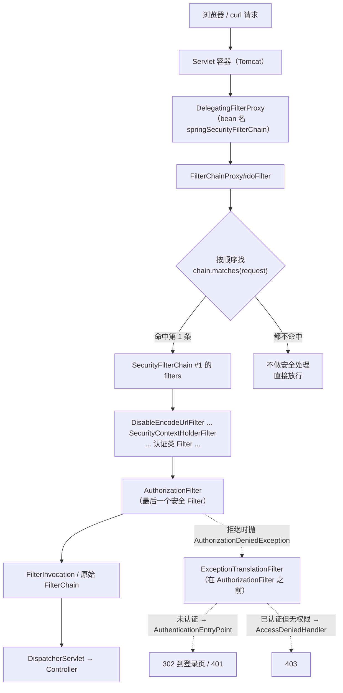

# 01 过滤器链与认证（Spring Security 7.2.0）

> 一句话结论：Spring Security 在 Servlet 应用里**不是**一个"拦截器"，而是一条**被容器调用的过滤器链**——容器先调 `DelegatingFilterProxy`，它把请求交给 `FilterChainProxy`，`FilterChainProxy` 选出**第一个匹配**的 `SecurityFilterChain`，再按**顺序**把一组 `Filter` 走完，最后才把请求交回你的 Controller。
> 阅读前置：会写 `@RestController`；知道 Servlet `Filter` 的 `doFilter(req,res,chain)` 是什么；如果读过 [02-SpringBoot/02-自动配置](../../02-SpringBoot/02-自动配置/README.md)，本篇的"自动配置注册 Filter"部分会非常顺（不强制）。
> 预计阅读：README 8 分钟 + 两篇正文各 40 分钟 ｜ 源码：spring-security-web@7.2.0、spring-security-config@7.2.0、spring-boot@4.2.0

---

## 0. 为什么先学"过滤器链"而不是先学"登录"

零基础读者最常见的误解是：**"我加了 Spring Security，所以我的接口被保护了"**——那到底是谁在保护？

- 不是 `@RestController`，Controller 里没有一行安全检查代码；
- 也不是 Spring MVC 的 `HandlerInterceptor`，因为**未登录请求根本没走到 DispatcherServlet**；
- 真正干活的是 Tomcat（或其他容器）在 `DispatcherServlet` **之前**调用的一串 `Filter`。

所以顺序必须是：**先搞清这条链怎么装配、怎么排序、怎么匹配 → 再谈链里哪个 Filter 负责"你是谁"（认证）。**

```text
Tomcat ──► [Filter 链: DelegatingFilterProxy → FilterChainProxy → SecurityFilter×N] ──► DispatcherServlet ──► Controller
```

> 记住这句话：**认证（Authentication）和授权（Authorization）都发生在这条链上，一个在 `DispatcherServlet` 之前，一个是链的最后一个安全 Filter。**

---

## 1. 本组文章的学习地图



> 读图说明：最关键的两个箭头是 **`FilterChainProxy#doFilter → E（matches 第一个命中）`** 和 **`I → L 的虚线回抛`**。前者决定了"多条 `SecurityFilterChain` 时谁生效"，后者解释了"为什么 `AuthorizationFilter` 抛出的异常会被前面的 `ExceptionTranslationFilter` 捕获"——因为过滤器是**嵌套调用**（`chain.doFilter` 里调下一个），异常沿调用栈反向往回冒泡。

---

## 2. 两篇文章在讲什么

| 序号 | 文章 | 回答的问题 | 核心类 |
| --- | --- | --- | --- |
| 01 | [01-filterchainproxy-过滤器链原理.md](01-filterchainproxy-过滤器链原理.md) | 链是怎么装出来的？顺序谁定？多链怎么选？`SecurityContext` 什么时候写进 `ThreadLocal`？ | `DelegatingFilterProxyRegistrationBean`、`FilterChainProxy`、`DefaultSecurityFilterChain`、`SecurityContextHolderFilter`、`HttpSessionSecurityContextRepository` |
| 02 | [02-authentication-认证流程与provider.md](02-authentication-认证流程与provider.md) | 用户名密码从哪进来？谁去查库？密码怎么比？异常怎么变成 302/401？JWT 插在哪？ | `ProviderManager`、`AbstractUserDetailsAuthenticationProvider`、`DaoAuthenticationProvider`、`DelegatingPasswordEncoder`、`ExceptionTranslationFilter`、`BearerTokenAuthenticationFilter` |

**建议顺序**：01 先读（否则你不知道 02 里的 Filter 在链上第几位），02 后读。两篇都用同一套版本基线，行号都可以在 `assets/source/` 里核对。

---

## 3. 学完你能做到什么（检查点）

- [ ] 能画出「容器 → `DelegatingFilterProxy` → `FilterChainProxy` → 若干 `Filter` → `DispatcherServlet`」的调用链，并说出 `DelegatingFilterProxy` 存在的意义（延迟到容器启动后才查找真正的 bean）。
- [ ] 能说出 `FilterChainProxy` 里 `getFilters` 的匹配规则是"**第一个** `matches` 命中的链生效"，并能引用源码。
- [ ] 能背出至少 8 个默认 `Filter` 的顺序，并解释为什么 `spring.security.filter.order` 默认是 **-100**（要排在 `OrderedFilter.REQUEST_WRAPPER_FILTER_MAX_ORDER = 0` 之前，也就是几乎所有业务 Filter 之前）。
- [ ] 能说清 `addFilterBefore` / `addFilterAfter` / `addFilterAt` 三者在 `HttpSecurity` 里是怎么算出 order 的，以及 `addFilter` 为什么可能直接抛 `IllegalArgumentException`。
- [ ] 能解释 `SecurityContextHolderFilter` 与已废弃的 `SecurityContextPersistenceFilter` 的区别（谁来 `saveContext`）。
- [ ] 能讲清 `ProviderManager#authenticate` 的 provider 轮询、父管理器回退、`AccountStatusException` 为什么不继续轮询。
- [ ] 能讲清 `{bcrypt}` 前缀是 `DelegatingPasswordEncoder` 的"算法标识"，以及不写前缀会报什么错。
- [ ] 能讲清 `ExceptionTranslationFilter` 的 try/catch：认证异常 → `AuthenticationEntryPoint`，授权异常 → `AccessDeniedHandler`，匿名用户被拒会**转成**认证异常。
- [ ] 能说出 `permitAll()` 为什么仍然会经过整条过滤器链（只是 `AuthorizationFilter` 放行）。

---

## 4. 术语小词典（零基础先看这里）

| 术语 | 一句话解释 |
| --- | --- |
| `Filter` | Servlet 规范里的组件，`doFilter(req,res,chain)` 里调 `chain.doFilter` 才会继续往后走 |
| `SecurityFilterChain` | 一组 `Filter` + 一个 `RequestMatcher`，表示"这些请求走这些过滤器" |
| `Authentication` | "你是谁"的对象；未登录时是 `AnonymousAuthenticationToken` |
| `SecurityContext` | 存放当前 `Authentication` 的容器，默认装在 `ThreadLocal` 里 |
| `AuthorizationManager` | 6.0 起替代 `AccessDecisionManager` 的授权判断入口 |
| `GrantedAuthority` | 权限字符串，例如 `ROLE_ADMIN`、`orders:read` |

---

## 5. 版本基线提醒

| 组件 | 本文基线 | 与本组内容相关的点 |
| --- | --- | --- |
| Spring Security | **7.2.0** | `SecurityContextPersistenceFilter` 标注 `@Deprecated`，由 `SecurityContextHolderFilter` 取代；`WebSecurityConfigurerAdapter` 已不存在（`list-jar` 无此类） |
| Spring Boot | **4.2.0** | Security 自动配置在 **`spring-boot-security`** 模块，`SecurityFilterAutoConfiguration` 注册 `DelegatingFilterProxyRegistrationBean` |
| Spring Framework | **7.1.0** | `FilterChainProxy` 继承的 `GenericFilterBean` 来自 `spring-web` |

> 结论都有源码或 `list-jar` 依据，细节写在两篇正文的「⚠️ 版本差异」一节。

---

## 6. 自测（进阶题在正文末尾）

1. 如果 `FilterChainProxy` 的 `filterChains` 里第一条链的 `RequestMatcher` 是 `anyRequest()`，第二条还能生效吗？
2. `spring.security.filter.order` 设成 `10` 会发生什么？
3. 为什么在 `permitAll()` 的接口上，`SecurityContextHolder.getContext().getAuthentication()` 不是 `null`？
