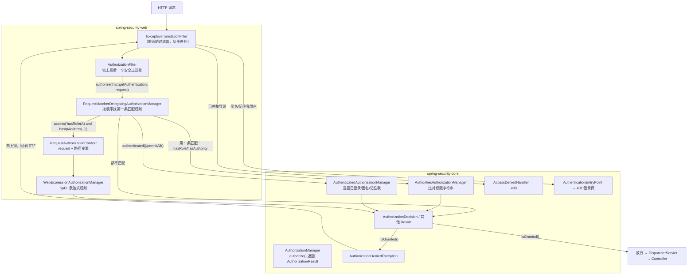
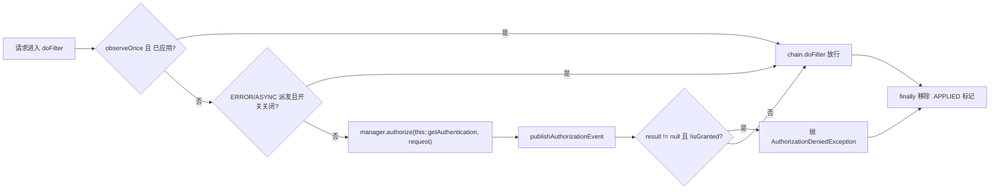
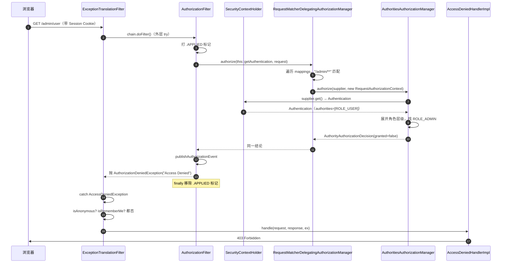

# Authorization：授权决策与 AuthorizationManager（Spring Security 7.2.0）

> 一句话结论：Spring Security 把"能不能进"这件事抽象成一个只有一个方法的接口 `AuthorizationManager.authorize(authentication, object)`，它**不抛异常、只返回一个决定**（`AuthorizationResult`）；链上最后一个安全过滤器 `AuthorizationFilter` 拿着"你是谁"和"你要访问什么"去问它，**拒绝就抛 `AuthorizationDeniedException`**，再由前面的 `ExceptionTranslationFilter` 翻译成"401 去登录"或"403 拒绝"。你在 `authorizeHttpRequests()` 里写下的每一行规则，启动时都会被编译成一条"匹配器 → 管理器"的有序列表。
> 阅读前置：读完 [../01-过滤器链与认证/02-authentication-认证流程与provider.md](../01-过滤器链与认证/02-authentication-认证流程与provider.md)，知道认证成功后 `SecurityContextHolder` 里有一个 `Authentication`，它身上挂着一串 `GrantedAuthority`。
> 预计阅读 55 分钟 ｜ 源码：`org.springframework.security:spring-security-core:7.2.0`、`org.springframework.security:spring-security-web:7.2.0`、`org.springframework.security:spring-security-config:7.2.0`

---

## 0. 先看现象

### 0.1 三行配置，背后发生了什么

几乎每个 Spring Security 项目都有下面这样的配置：

```java
@Bean
SecurityFilterChain chain(HttpSecurity http) throws Exception {
	http.authorizeHttpRequests((authorize) -> authorize
		.requestMatchers("/css/**", "/login").permitAll()
		.requestMatchers("/admin/**").hasRole("ADMIN")
		.anyRequest().authenticated());
	return http.build();
}
```

写的人只描述了**规则**，没写一行"怎么检查"。那么问题来了：

1. 请求 `/admin/user` 时，是谁在比较 `hasRole("ADMIN")` 和当前用户的权限？
2. 为什么规则**顺序**很重要，把 `anyRequest().authenticated()` 挪到最前面，后面的 `hasRole` 就"失效"了？
3. 未登录访问 `/admin/user` 得到 **401**（被重定向到登录页），已登录但不是 ADMIN 得到 **403**——同样是被拒绝，为什么表现不同？
4. 如果想写一条自定义规则，比如"只允许工号为偶数的员工访问"，应该实现哪个接口、注册到哪里？

### 0.2 一个最小实验：自己写一个 AuthorizationManager

先不管框架，我们自己 new 一个"永远拒绝"的管理器塞进去：

```java
@Bean
SecurityFilterChain chain(HttpSecurity http) throws Exception {
	http.authorizeHttpRequests((authorize) -> authorize
		.anyRequest().access((authentication, context) -> new AuthorizationDecision(false)));
	return http.build();
}
```

启动后访问任何地址，日志里会出现一行很显眼的异常：

```text
org.springframework.security.authorization.AuthorizationDeniedException: Access Denied
	at org.springframework.security.web.access.intercept.AuthorizationFilter.doFilter(AuthorizationFilter.java:101)
```

这个栈顶就是本篇的主角：`AuthorizationFilter`。上面那个 lambda 之所以能直接传进去，是因为 `AuthorizationManager` 是 `@FunctionalInterface`——**整个授权体系的核心，小到可以用一个 lambda 表达**。

### 0.3 先把术语说清楚

| 术语 | 英文 | 一句话解释 | 生活比喻 |
|---|---|---|---|
| 认证 | Authentication | 你是谁 | 出示身份证 |
| 授权 | Authorization | 你能干什么 | 检票员看票面等级决定能否进 VIP 区 |
| 权限/角色 | `GrantedAuthority` | 一条字符串形式的许可，如 `ROLE_ADMIN` | 票上印的一个标签 |
| 授权管理器 | `AuthorizationManager` | 做出"准/不准"判断的对象 | 检票员 |
| 授权结果 | `AuthorizationResult` | 判断的结论，只有 `isGranted()` 一个核心方法 | 检票员手里的"放行/拒绝"牌子 |
| 请求匹配器 | `RequestMatcher` | 判断"这个请求是不是这条规则说的那种" | 票面对应的场次 |
| 访问拒绝异常 | `AccessDeniedException` | 拒绝后抛出的异常 | 被拦下后上报的情况 |

> 比喻贯穿全篇：**过滤链是闸机，`AuthorizationManager` 是检票员，`AuthorizationFilter` 是把票递给检票员的那只手。**

---

## 1. 整体地图

### 1.1 一次请求里的授权流程



**读图说明**

- 图分两层：上层 `WEB` 是"和 Servlet 请求绑定的壳"，下层 `CORE` 是"和 HTTP 无关的判定核"。`AuthorizationManager` 接口本身在 core 里，**它根本不知道什么是 HttpServletRequest**，这是它能同时服务 URL 授权和方法级授权的原因。
- `AuthorizationFilter` 只做三件事：取认证对象、调用管理器、根据结果放行或抛异常。真正"比较权限"的逻辑在它背后那一排管理器里。
- `RequestMatcherDelegatingAuthorizationManager` 是一个**分发者**：它拿着启动时编译好的规则列表，**从头到尾找第一条匹配的**，找到就把活儿交给那条规则对应的管理器，找不到直接拒绝。
- 虚线以上的 `AuthorizationDecision` 是"结论"，箭头往左是"拒绝"走异常路线回到 `ExceptionTranslationFilter`，往右是"放行"进 Controller。
- 注意 `ExceptionTranslationFilter` 在 `AuthorizationFilter` **前面**（更靠外层），所以它用 try/catch 就能接住后面抛出来的拒绝异常。

### 1.2 启动时的装配流程

运行时的结构是启动时"编译"出来的，理解这条线才知道配置为什么有那些限制：


**读图说明**

- `requestMatchers("/a/**")` 只是"圈出了一批 URL"，此时规则**还没完成**（源码里叫 `unmappedMatchers`），必须紧跟 `.hasRole(...)` / `.permitAll()` 之类的方法才算一条完整规则。
- 每条规则最终都落到 `Builder.add(matcher, manager)`，变成列表里的一个 `RequestMatcherEntry`，**配置顺序 = 列表顺序 = 运行时匹配顺序**。
- 所有规则写完后 `build()` 出一个管理器，再被包进 `AuthorizationFilter` 加入过滤器链。

---

## 2. 关键类速查表

| 类 | 所在模块 | 一句话职责 | 记住它的哪一点 |
|---|---|---|---|
| [[源码:AuthorizationManager.java#L33-L59]] | core | 授权的**唯一核心接口**，一个方法 `authorize` | 返回结果而不抛异常；`@FunctionalInterface` |
| [[源码:AuthorizationResult.java#L27-L33]] | core | 授权结论，`isGranted()` | 允许返回 `null` 表示"弃权" |
| [[源码:AuthorizationDecision.java#L27-L48]] | core | 最简单的结论：一个布尔值 | 静态常量 `DENY` 就是它 |
| [[源码:AuthorizationDeniedException.java#L30-L57]] | core | 拒绝时抛的异常，同时自己也是 `AuthorizationResult` | 它继承了 `AccessDeniedException` |
| [[源码:AuthorizationFilter.java#L71-L146]] | web | 过滤器链上的授权入口 | 只在 `!isGranted()` 时抛异常 |
| [[源码:RequestMatcherDelegatingAuthorizationManager.java#L52-L90]] | web | 按顺序匹配 URL 规则并分发 | 找不到匹配 = 拒绝 |
| [[源码:AuthorizeHttpRequestsConfigurer.java#L127-L134]] | config | 把 DSL 编译成过滤器 | 至少要有一条规则 |
| [[源码:RequestAuthorizationContext.java#L30-L71]] | web | 交给管理器的"被检查对象" | 带路径变量 |
| [[源码:AuthoritiesAuthorizationManager.java#L38-L87]] | core | 字符串集合比对，`hasRole/hasAuthority` 的真身 | 支持角色层级 |
| [[源码:AuthorityAuthorizationManager.java#L68-L73]] | core | `hasRole/hasAuthority` 的工厂门面 | `hasRole` 会自动补 `ROLE_` |
| [[源码:AuthenticatedAuthorizationManager.java#L115-L119]] | core | `authenticated/fullyAuthenticated/anonymous` | 内部是策略模式 |
| [[源码:WebExpressionAuthorizationManager.java#L87-L93]] | web | 执行 `access("hasRole('A') and ...")` 的 SpEL | 表达式只解析一次 |
| [[源码:SecurityExpressionRoot.java#L133-L145]] | core | 表达式里 `hasRole` 等方法的实现 | 表达式方法最终也走管理器 |
| [[源码:AuthorizationManagers.java#L45-L81]] | core | `anyOf/allOf/not` 组合器 | `anyOf` 默认拒绝 |
| [[源码:ExceptionTranslationFilter.java#L188-L212]] | web | 把拒绝异常翻译成 401 或 403 | 匿名 → 401，其他 → 403 |
| [[源码:AccessDeniedHandlerImpl.java#L53-L74]] | web | 默认写 403 | 没配错误页就 `sendError(403)` |

---

## 3. 源码逐段

> 读法：每一节按"这段做什么 → 为什么这样设计 → 哪里容易踩坑"三层来讲，最后用一张小图收束。所有行号对应 `assets/source/` 里入库的 7.2.0 原文。

### 3.1 授权的心脏：AuthorizationManager

先看接口全貌 [[源码:AuthorizationManager.java#L33-L59]]：

```java (src: AuthorizationManager.java#L33-L59)
@FunctionalInterface
public interface AuthorizationManager<T extends @Nullable Object> {

	/**
	 * Determines if access should be granted for a specific authentication and object.
	 * @param authentication the {@link Supplier} of the {@link Authentication} to check
	 * @param object the {@link T} object to check
	 * @throws AccessDeniedException if access is not granted
	 */
	default void verify(Supplier<? extends @Nullable Authentication> authentication, T object) {
		AuthorizationResult result = authorize(authentication, object);
		if (result != null && !result.isGranted()) {
			throw new AuthorizationDeniedException("Access Denied", result);
		}
	}

	/**
	 * Determines if access is granted for a specific authentication and object.
	 * @param authentication the {@link Supplier} of the {@link Authentication} to
	 * authorize
	 * @param object the {@link T} object to authorize
	 * @return an {@link AuthorizationResult}
	 * @since 6.4
	 */
	@Nullable AuthorizationResult authorize(Supplier<? extends @Nullable Authentication> authentication, T object);

}
```

**这段做什么**：接口里只有一个抽象方法 `authorize`，输入是"认证对象的供应器"和"被检查的对象 T"，输出是一个可空的 `AuthorizationResult`。另一个 `verify` 是默认方法，它调用 `authorize` 后，只要结果非空且未放行就抛 `AuthorizationDeniedException`。

**为什么这样设计**：泛型 `T` 是点睛之笔。URL 授权时 T 是 `HttpServletRequest`，方法级授权时 T 是方法调用信息，核心接口完全不用改。把"判断"和"抛异常"拆开，是因为很多场景只想要一个布尔结论，不想被异常打断控制流——比如组合器 `anyOf` 需要挨个问过所有子管理器再下结论。入参用 `Supplier<Authentication>` 而不是直接传 `Authentication`，是为了**延迟取值**：如果某条规则根本不看用户（如 `permitAll`），就不必去碰 `SecurityContextHolder`。

**哪里容易踩坑**：`authorize` 的返回值可以是 `null`，意思是"我弃权，不表态"。自己实现时如果把"拒绝"误写成 `return null`，在组合器里会被当成"没意见"而不是"反对"。另外 `verify` 的判断是 `result != null && !result.isGranted()`——`null` 在 `verify` 里被当成放行，这和 `anyOf` 里"全部弃权则看默认值"的语义不同，写自定义管理器时要想清楚每个分支返回什么。

#### 结论对象：AuthorizationResult 与 AuthorizationDecision

[[源码:AuthorizationResult.java#L27-L33]]：

```java (src: AuthorizationResult.java#L27-L35)
public interface AuthorizationResult extends Serializable {

	/**
	 * Returns whether the access has been granted.
	 * @return whether the access has been granted
	 */
	boolean isGranted();

}
```

**这段做什么**：一个只含 `isGranted()` 的接口，继承了 `Serializable`。

**为什么这样设计**：接口故意极简，是为了让"结论"可以携带额外信息。例如 `AuthorityAuthorizationDecision` 会带上"我检查了哪些权限"，`ExpressionAuthorizationDecision` 会带上"我执行了哪个表达式"，便于日志、审计和事件发布。

**哪里容易踩坑**：它是 `Serializable` 的，所以如果你自定义结论并放进额外字段，那些字段也要可序列化，否则在 Session 持久化或远程调试时可能出问题。

[[源码:AuthorizationDecision.java#L27-L48]]：

```java (src: AuthorizationDecision.java#L27-L48)
public class AuthorizationDecision implements AuthorizationResult {

	@Serial
	private static final long serialVersionUID = -3226018324649244416L;

	private final boolean granted;

	public AuthorizationDecision(boolean granted) {
		this.granted = granted;
	}

	@Override
	public boolean isGranted() {
		return this.granted;
	}

	@Override
	public String toString() {
		return getClass().getSimpleName() + " [granted=" + this.granted + "]";
	}

}
```

**这段做什么**：把一个 `boolean` 包成对象，`toString` 打印成 `AuthorizationDecision [granted=false]` 这种形式。

**为什么这样设计**：不可变对象（字段 `final`），可以安全地被当成常量共享——你在后面会看到 `RequestMatcherDelegatingAuthorizationManager` 里的 `DENY` 就是一个共享的静态实例。

**哪里容易踩坑**：排查问题时在日志里搜 `[granted=false]`，能快速定位是哪一种 `Decision` 子类做的拒绝；类名会出现在 `getClass().getSimpleName()` 里。

#### 拒绝的载体：AuthorizationDeniedException

[[源码:AuthorizationDeniedException.java#L30-L57]]：

```java (src: AuthorizationDeniedException.java#L30-L57)
public class AuthorizationDeniedException extends AccessDeniedException implements AuthorizationResult {

	@Serial
	private static final long serialVersionUID = 3227305845919610459L;

	private final AuthorizationResult result;

	public AuthorizationDeniedException(String msg, AuthorizationResult authorizationResult) {
		super(msg);
		Assert.notNull(authorizationResult, "authorizationResult cannot be null");
		Assert.isTrue(!authorizationResult.isGranted(), "Granted authorization results are not supported");
		this.result = authorizationResult;
	}

	public AuthorizationDeniedException(String msg) {
		this(msg, new AuthorizationDecision(false));
	}

	public AuthorizationResult getAuthorizationResult() {
		return this.result;
	}

	@Override
	public boolean isGranted() {
		return false;
	}

}
```

**这段做什么**：一个"身兼两职"的类——既是异常（继承 `AccessDeniedException`），又是结论（实现 `AuthorizationResult`）。构造时强制要求传入的结论必须是"拒绝"，否则直接断言失败。

**为什么这样设计**：过滤器拿到"拒绝"结论后需要用异常中断调用链，但又不希望丢掉结论里的附加信息（比如是哪个表达式拒绝了）。把结论塞进异常里，上层处理器（如 `@HandleAuthorizationDenied`，见下一篇）就可以按需读取。单参构造是给"没有具体结论、只想拒绝"的旧代码准备的。

**哪里容易踩坑**：想用 `new AuthorizationDeniedException("x", new AuthorizationDecision(true))` 这种写法制造"放行异常"是行不通的，启动或运行时会抛 `IllegalArgumentException`。另外由于它是 `RuntimeException` 子类，`@Transactional` 默认会对它回滚。

### 3.2 链上的入口：AuthorizationFilter

[[源码:AuthorizationFilter.java#L71-L146]]：

```java (src: AuthorizationFilter.java#L71-L91)
	public AuthorizationFilter(AuthorizationManager<HttpServletRequest> authorizationManager) {
		Assert.notNull(authorizationManager, "authorizationManager cannot be null");
		this.authorizationManager = authorizationManager;
	}

	@Override
	public void doFilter(ServletRequest servletRequest, ServletResponse servletResponse, FilterChain chain)
			throws ServletException, IOException {

		HttpServletRequest request = (HttpServletRequest) servletRequest;
		HttpServletResponse response = (HttpServletResponse) servletResponse;

		if (this.observeOncePerRequest && isApplied(request)) {
			chain.doFilter(request, response);
			return;
		}

		if (skipDispatch(request)) {
			chain.doFilter(request, response);
			return;
		}
```

**这段做什么**：构造器只保存一个管理器。`doFilter` 开头有两条"免检通道"：如果 `observeOncePerRequest` 开着且本请求已经检查过（request 上有 `已应用` 标记），或者这是一次 ERROR/ASYNC 派发且对应开关关着，就直接放行。

**为什么这样设计**：一个请求可能被派发多次（forward、error、async）。默认 `observeOncePerRequest=false`、`filterErrorDispatch=true`、`filterAsyncDispatch=true`，也就是**默认每次派发都重新授权**，更安全。

**哪里容易踩坑**：默认值下，ERROR 派发也会走授权。如果你的错误页 `/error` 没有放行，一个 403 会引发"访问 /error 又被拒绝"的二次 403，页面和日志可能变得很怪。新版默认放行了 `/error`，但自定义错误页时要记得加规则。

```java (src: AuthorizationFilter.java#L93-L106)
		String alreadyFilteredAttributeName = getAlreadyFilteredAttributeName();
		request.setAttribute(alreadyFilteredAttributeName, Boolean.TRUE);
		try {
			AuthorizationResult result = this.authorizationManager.authorize(this::getAuthentication, request);
			this.eventPublisher.publishAuthorizationEvent(this::getAuthentication, request, result);
			if (result != null && !result.isGranted()) {
				throw new AuthorizationDeniedException("Access Denied", result);
			}
			chain.doFilter(request, response);
		}
		finally {
			request.removeAttribute(alreadyFilteredAttributeName);
		}
	}
```

**这段做什么**：这是整个过滤器的核心十来行。先在 request 上打一个"已过滤"标记；然后调用管理器，传入 `this::getAuthentication`（方法引用，即一个延迟取认证对象的 Supplier）和 request；发布授权事件；如果结果非空且未放行就抛 `AuthorizationDeniedException("Access Denied")`；否则继续调用链。`finally` 里移除标记。

**为什么这样设计**：注意过滤器**没有调用 `verify`**，而是自己重复了一遍 `verify` 的逻辑。这样它能在抛异常之前先 `publishAuthorizationEvent`，让监听器（如审计）在异常打断前拿到结论。`this::getAuthentication` 写两次，是刻意不在一开始就取出认证对象——如果管理器不需要它，就完全不触发 `SecurityContextHolder` 的查找。

**哪里容易踩坑**：`result == null` 被当成放行。所以如果 `authorizeHttpRequests` 里的某个自定义管理器返回 `null`，请求会被放过去。异常消息固定是 `"Access Denied"`，真正的原因在 `getAuthorizationResult()` 里，日志里不要只看消息。

```java (src: AuthorizationFilter.java#L108-L126)
	private boolean skipDispatch(HttpServletRequest request) {
		if (DispatcherType.ERROR.equals(request.getDispatcherType()) && !this.filterErrorDispatch) {
			return true;
		}

		return DispatcherType.ASYNC.equals(request.getDispatcherType()) && !this.filterAsyncDispatch;
	}

	private boolean isApplied(HttpServletRequest request) {
		return request.getAttribute(getAlreadyFilteredAttributeName()) != null;
	}

	private String getAlreadyFilteredAttributeName() {
		String name = getFilterName();
		if (name == null) {
			name = getClass().getName();
		}
		return name + ".APPLIED";
	}
```

**这段做什么**：`skipDispatch` 判断是否跳过 ERROR/ASYNC 派发；`isApplied` 看 request 属性里有没有标记；标记名是"过滤器名或类名 + `.APPLIED`"。

**为什么这样设计**：用 request 属性做"只执行一次"的标记，是 Spring 泛型过滤器（`OncePerRequestFilter` 一族）的惯用法，简单且线程安全（属性挂在当前请求上）。

**哪里容易踩坑**：调试时在 request 属性里看到 `___<数字>.APPLIED` 这种 key 就是它。如果你自定义了同类的过滤器并手动放进了链，两个过滤器可能共享同一个名字而互相"认为已过滤"。

```java (src: AuthorizationFilter.java#L139-L146)
	private Authentication getAuthentication() {
		Authentication authentication = this.securityContextHolderStrategy.getContext().getAuthentication();
		if (authentication == null) {
			throw new AuthenticationCredentialsNotFoundException(
					"An Authentication object was not found in the SecurityContext");
		}
		return authentication;
	}
```

**这段做什么**：从 `SecurityContextHolderStrategy` 取 `Authentication`，取不到就抛 `AuthenticationCredentialsNotFoundException`。

**为什么这样设计**：正常情况下，链前面的 `AnonymousAuthenticationFilter` 会给未登录用户填一个匿名 `Authentication`，所以这里几乎不会为 null。保留这个检查是为了防止有人把 `AuthorizationFilter` 单独拿出来用在一条"没有匿名过滤器"的链上。

**哪里容易踩坑**：看到 `An Authentication object was not found in the SecurityContext`，先检查是不是自定义链里漏了 `AnonymousAuthenticationFilter`，或者用了非默认的 `SecurityContextHolderStrategy`（如系统属性模式）却没有同步设置到过滤器上。

小图收束——过滤器内部决策：



**读图说明**：两条免检通道在左侧，任何一条命中都直接放行且**不打标记**；只有真正做了授权的那条路会进入 `try/finally`。事件发布在"抛异常"之前，这是它比直接调用 `verify` 多出来的价值。

### 3.3 规则分发：RequestMatcherDelegatingAuthorizationManager

[[源码:RequestMatcherDelegatingAuthorizationManager.java#L52-L90]]：

```java (src: RequestMatcherDelegatingAuthorizationManager.java#L52-L72)
public final class RequestMatcherDelegatingAuthorizationManager implements AuthorizationManager<HttpServletRequest> {

	private static final AuthorizationDecision DENY = new AuthorizationDecision(false);

	private final Log logger = LogFactory.getLog(getClass());

	private final List<RequestMatcherEntry<AuthorizationManager<? super RequestAuthorizationContext>>> mappings;

	private RequestMatcherDelegatingAuthorizationManager(
			List<RequestMatcherEntry<AuthorizationManager<? super RequestAuthorizationContext>>> mappings) {
		Assert.notEmpty(mappings, "mappings cannot be empty");
		this.mappings = mappings;
	}

	@Override
	public @Nullable AuthorizationResult authorize(Supplier<? extends @Nullable Authentication> authentication,
			HttpServletRequest request) {
		if (this.logger.isTraceEnabled()) {
			this.logger.trace(LogMessage.format("Authorizing %s", requestLine(request)));
		}
		for (RequestMatcherEntry<AuthorizationManager<? super RequestAuthorizationContext>> mapping : this.mappings) {
```

**这段做什么**：类里只有一份有序列表 `mappings`，每项是一个"匹配器 + 管理器"的配对。构造器私有且要求列表非空。`authorize` 先打 trace 日志，然后开始遍历。

**为什么这样设计**：这是一个典型的"规则表"——把 DSL 翻译成数据结构，运行时只剩查表。`Assert.notEmpty` 对应了配置期"至少要有一条规则"的检查，两层保险。

**哪里容易踩坑**：`logger.isTraceEnabled()` 这些日志是排查"为什么被拒绝"的第一手工具，把 `org.springframework.security` 的日志级别开到 `TRACE`，能看到"Authorizing GET /x"和"Checking authorization on ... using ..."两行，直接告诉你命中了哪条规则、用了哪个管理器。

```java (src: RequestMatcherDelegatingAuthorizationManager.java#L72-L90)
		for (RequestMatcherEntry<AuthorizationManager<? super RequestAuthorizationContext>> mapping : this.mappings) {

			RequestMatcher matcher = mapping.getRequestMatcher();
			MatchResult matchResult = matcher.matcher(request);
			if (matchResult.isMatch()) {
				AuthorizationManager<? super RequestAuthorizationContext> manager = mapping.getEntry();
				if (this.logger.isTraceEnabled()) {
					this.logger.trace(
							LogMessage.format("Checking authorization on %s using %s", requestLine(request), manager));
				}
				return manager.authorize(authentication,
						new RequestAuthorizationContext(request, matchResult.getVariables()));
			}
		}
		if (this.logger.isTraceEnabled()) {
			this.logger.trace(LogMessage.of(() -> "Denying request since did not find matching RequestMatcher"));
		}
		return DENY;
	}
```

**这段做什么**：遍历每一条规则，问匹配器"这个请求归你管吗"；第一次得到"是"就**立刻 return** 那条规则的管理器的结论，并把路径变量一起装进 `RequestAuthorizationContext` 传过去。循环走完都没匹配，返回共享常量 `DENY`。

**为什么这样设计**："第一条匹配即生效"让规则语义可预测、性能是 O(n) 且通常很快。把路径变量带过去，是为了支持 `requestMatchers("/user/{id}").access(new ...)` 这类"要看变量值"的自定义规则。

**哪里容易踩坑**：第一条匹配即结束，**后面的规则不会再看**。所以 `anyRequest()` 必须放最后，否则它会吞掉所有请求；"拒绝"也不会"继续找下面有没有更宽松的规则"。找不到匹配 = 拒绝（默认安全），而不是放行。

[[源码:RequestAuthorizationContext.java#L30-L53]]：

```java (src: RequestAuthorizationContext.java#L30-L42)
public final class RequestAuthorizationContext {

	private final HttpServletRequest request;

	private final Map<String, String> variables;

	/**
	 * Creates an instance.
	 * @param request the {@link HttpServletRequest} to use
	 */
	public RequestAuthorizationContext(HttpServletRequest request) {
		this(request, Collections.emptyMap());
	}
```

**这段做什么**：一个不可变的小对象，装着原始 request 和一个变量表。

**为什么这样设计**：管理器拿到的"被检查对象"不是裸 request，而是这个包装，这样 SpEL 表达式里才能写 `#id` 引用路径变量，也能通过 `request` 访问头、参数等。

**哪里容易踩坑**：`AuthorizationFilter` 把 `HttpServletRequest` 交给分发器，分发器再把它包成 `RequestAuthorizationContext` 交给每条规则的管理器——所以你自定义的"单条规则管理器"泛型要写 `RequestAuthorizationContext`，而如果替换整个 `AuthorizationManager<HttpServletRequest>`，泛型才是 request。

#### 规则是怎么添加进去的：Builder

[[源码:RequestMatcherDelegatingAuthorizationManager.java#L119-L125]]：

```java (src: RequestMatcherDelegatingAuthorizationManager.java#L119-L125)
		public Builder add(RequestMatcher matcher, AuthorizationManager<? super RequestAuthorizationContext> manager) {
			Assert.state(!this.anyRequestConfigured, "Can't add mappings after anyRequest");
			Assert.notNull(matcher, "matcher cannot be null");
			Assert.notNull(manager, "manager cannot be null");
			this.mappings.add(new RequestMatcherEntry<>(matcher, manager));
			return this;
		}
```

**这段做什么**：往列表末尾追加一条规则；但如果已经配置过 `anyRequest()`，再添加就抛 `IllegalStateException`。

**为什么这样设计**：这是把"anyRequest 必须在最后"从口头约定变成运行时强制，避免写出永远不生效的死规则。

**哪里容易踩坑**：在 `anyRequest()` 之后调用 `requestMatchers(...)` 会得到 `Can't add mappings after anyRequest`，看到这个消息直接去调整顺序。

```java (src: RequestMatcherDelegatingAuthorizationManager.java#L148-L152)
		public AuthorizedUrl anyRequest() {
			Assert.state(!this.anyRequestConfigured, "Can't configure anyRequest after itself");
			this.anyRequestConfigured = true;
			return new AuthorizedUrl(AnyRequestMatcher.INSTANCE);
		}
```

**这段做什么**：标记"anyRequest 已配置"，并返回一个绑定 `AnyRequestMatcher.INSTANCE` 的待定规则对象。

**为什么这样设计**：`anyRequest()` 自身也不能写两次，否则第二条永远无效。`AnyRequestMatcher` 是单例，因为它不含任何状态。

**哪里容易踩坑**：注意它返回的仍然是"待定规则"（`AuthorizedUrl`），必须再调一个 `.authenticated()` 之类的方法，否则启动时会出现下一节的"An incomplete mapping"断言错误。

```java (src: RequestMatcherDelegatingAuthorizationManager.java#L196-L214)
			public Builder permitAll() {
				return access(SingleResultAuthorizationManager.permitAll());
			}

			/**
			 * Specify that URLs are not allowed by anyone.
			 * @return the {@link Builder} for further customizations
			 */
			public Builder denyAll() {
				return access(SingleResultAuthorizationManager.denyAll());
			}

			/**
			 * Specify that URLs are allowed by any authenticated user.
			 * @return the {@link Builder} for further customizations
			 */
			public Builder authenticated() {
				return access(AuthenticatedAuthorizationManager.authenticated());
			}
```

**这段做什么**：三个最常用的规则方法，每个都是"创建一个管理器 → 交给私有的 `access()` 去添加"。`permitAll/denyAll` 用 `SingleResultAuthorizationManager`（永远返回同一个结论），`authenticated()` 用 `AuthenticatedAuthorizationManager.authenticated()`。

**为什么这样设计**：DSL 方法只是工厂方法的转发，真正逻辑都在 core 模块的管理器里，web 模块只负责"把 URL 和管理器配对"。

**哪里容易踩坑**：`permitAll()` 并不是"跳过这个过滤器"，而是一条会正常执行、永远返回放行的规则。这意味着 TRACE 日志、授权事件照常会有。

```java (src: RequestMatcherDelegatingAuthorizationManager.java#L247-L249)
			public Builder hasRole(String role) {
				return access(AuthorityAuthorizationManager.hasRole(role));
			}
```

**这段做什么**：`hasRole` 规则，内部转给 `AuthorityAuthorizationManager.hasRole(role)`。

**为什么这样设计**：和上面同理，URL 层只做配对。

**哪里容易踩坑**：这里的 `hasRole("ADMIN")` 会由 core 里的工厂自动补 `ROLE_` 前缀；但后面讲的表达式 `access("hasRole('ADMIN')")` 走的是另一条路，两者对前缀的处理细节略有差异（见 3.7）。

```java (src: RequestMatcherDelegatingAuthorizationManager.java#L281-L286)
			private Builder access(AuthorizationManager<RequestAuthorizationContext> manager) {
				for (RequestMatcher matcher : this.matchers) {
					Builder.this.mappings.add(new RequestMatcherEntry<>(matcher, manager));
				}
				return Builder.this;
			}
```

**这段做什么**：对这一条规则圈出的每个匹配器，各添加一条 entry，共用同一个管理器实例。

**为什么这样设计**：`requestMatchers("/a", "/b", "/c")` 一次可以圈多个 URL，展开成多条 entry 让运行时的循环保持简单。

**哪里容易踩坑**：多个 URL 共享同一个管理器实例，所以**不要在自定义管理器里保存"当前请求"的状态**，否则并发下会串数据。

### 3.4 从 DSL 到过滤器：AuthorizeHttpRequestsConfigurer

[[源码:AuthorizeHttpRequestsConfigurer.java#L102-L114]]：
[[源码:AuthorizeHttpRequestsConfigurer.java#L102-L115]]：
`java (src: AuthorizeHttpRequestsConfigurer.java#L102-L115)
		return authorizationManagerFactoryProvider.getIfAvailable(() -> {
			RoleHierarchy roleHierarchy = context.getBeanProvider(RoleHierarchy.class)
				.getIfAvailable(NullRoleHierarchy::new);
			GrantedAuthorityDefaults grantedAuthorityDefaults = context.getBeanProvider(GrantedAuthorityDefaults.class)
				.getIfAvailable();
			String rolePrefix = (grantedAuthorityDefaults != null) ? grantedAuthorityDefaults.getRolePrefix() : "ROLE_";

			DefaultAuthorizationManagerFactory<RequestAuthorizationContext> authorizationManagerFactory = new DefaultAuthorizationManagerFactory<>();
			authorizationManagerFactory.setRoleHierarchy(roleHierarchy);
			authorizationManagerFactory.setRolePrefix(rolePrefix);

			return authorizationManagerFactory;
		});
	}
	}
	}
```

**这段做什么**：创建一个"管理器工厂"，它会从 Spring 容器里找两个可选 bean：`RoleHierarchy`（角色层级，找不到用空的）和 `GrantedAuthorityDefaults`（里面带默认前缀，找不到就用 `"ROLE_"`）。

**为什么这样设计**：把"默认前缀""角色层级"这类全局策略集中到容器 bean 里，改一处即全局生效，而不必在每条规则上手写。

**哪里容易踩坑**：想改前缀，就注册一个 `GrantedAuthorityDefaults` bean（例如前缀为空串），之后 `hasRole("ADMIN")` 就会去找名为 `ADMIN` 的权限。改了前缀却没同步数据库里的权限字符串，是最常见的"明明配了却 403"的原因。

[[源码:AuthorizeHttpRequestsConfigurer.java#L127-L134]]：

```java (src: AuthorizeHttpRequestsConfigurer.java#L127-L134)
	@Override
	public void configure(H http) {
		AuthorizationManager<HttpServletRequest> authorizationManager = this.registry.createAuthorizationManager();
		AuthorizationFilter authorizationFilter = new AuthorizationFilter(authorizationManager);
		authorizationFilter.setAuthorizationEventPublisher(this.publisher);
		authorizationFilter.setSecurityContextHolderStrategy(getSecurityContextHolderStrategy());
		http.addFilter(postProcess(authorizationFilter));
	}
```

**这段做什么**：配置阶段——从注册表 build 出总管理器，new 一个 `AuthorizationFilter`，设置事件发布器和上下文策略，加入 `HttpSecurity`。

**为什么这样设计**：配置器（Configurer）的职责就是把 DSL 翻译成过滤器，它不参与运行时。`postProcess` 让 `ObjectPostProcessor` 有机会再加工过滤器（例如 Spring Boot 自动配置可能替换其依赖）。

**哪里容易踩坑**：`AuthorizationFilter` 是在这里被 new 出来的，**没有暴露为 bean**。想在运行时替换或观察它，需要通过 `HttpSecurity.addFilter` 之前替换，或使用 `addFilterBefore/After` 加自己的过滤器，而不是期待注入它。

[[源码:AuthorizeHttpRequestsConfigurer.java#L183-L198]]：

```java (src: AuthorizeHttpRequestsConfigurer.java#L183-L198)
		private AuthorizationManager<HttpServletRequest> createAuthorizationManager() {
			Assert.state(this.unmappedMatchers == null,
					() -> "An incomplete mapping was found for " + this.unmappedMatchers
							+ ". Try completing it with something like requestUrls().<something>.hasRole('USER')");
			Assert.state(this.mappingCount > 0,
					"At least one mapping is required (for example, authorizeHttpRequests().anyRequest().authenticated())");
			AuthorizationManager<HttpServletRequest> manager = postProcess(
					(AuthorizationManager<HttpServletRequest>) this.managerBuilder.build());
			return AuthorizeHttpRequestsConfigurer.this.postProcessor.postProcess(manager);
		}

		@Override
		protected AuthorizedUrl chainRequestMatchers(List<RequestMatcher> requestMatchers) {
			this.unmappedMatchers = requestMatchers;
			return new AuthorizedUrl(requestMatchers, AuthorizeHttpRequestsConfigurer.this.authorizationManagerFactory);
		}
```

**这段做什么**：build 之前做两个断言——没有"圈了 URL 却没写规则"的半成品；至少有一条规则。`chainRequestMatchers` 是每次调用 `requestMatchers(...)` 时被触发的内部方法，它记下"这批匹配器还没配规则"。

**为什么这样设计**：DSL 的两步写法（先圈 URL 再给规则）天然允许"只写了一半"，这个断言就是用来在启动时就把这种错误拦下来，而不是运行时莫名其妙地放行或拒绝。

**哪里容易踩坑**：看到 `An incomplete mapping was found for [...]` 就去找那个只写了 `requestMatchers(...)` 却忘了后面链式调用的地方；第二个断言则提醒"用了 `authorizeHttpRequests` 却一条规则都没写"。

### 3.5 最常用的判定：AuthoritiesAuthorizationManager

`hasRole` / `hasAuthority` 的工厂在 [[源码:AuthorityAuthorizationManager.java#L68-L73]]：

```java (src: AuthorityAuthorizationManager.java#L68-L73)
	public static <T> AuthorityAuthorizationManager<T> hasRole(String role) {
		Assert.notNull(role, "role cannot be null");
		Assert.isTrue(!role.startsWith(ROLE_PREFIX), () -> role + " should not start with " + ROLE_PREFIX + " since "
				+ ROLE_PREFIX + " is automatically prepended when using hasRole. Consider using hasAuthority instead.");
		return hasAuthority(ROLE_PREFIX + role);
	}
```

**这段做什么**：`hasRole("ADMIN")` 先断言参数不以 `ROLE_` 开头，然后转成 `hasAuthority("ROLE_ADMIN")`。

**为什么这样设计**：强制"role 不带前缀、authority 带全名"的写法规范，避免有人写 `hasRole("ROLE_ADMIN")` 被悄悄补成 `ROLE_ROLE_ADMIN`。

**哪里容易踩坑**：这个断言里的 `ROLE_PREFIX` 是类里的硬编码常量 `"ROLE_"`，即使你通过 `GrantedAuthorityDefaults` 改了前缀，直接调用这个静态方法时写 `hasRole("ROLE_X")` 依然会被拦。真正的前缀处理见 3.7 的 `SecurityExpressionRoot`。

[[源码:AuthorityAuthorizationManager.java#L142-L145]]：

```java (src: AuthorityAuthorizationManager.java#L142-L145)
	@Override
	public AuthorizationResult authorize(Supplier<? extends @Nullable Authentication> authentication, T object) {
		return this.delegate.authorize(authentication, this.authorities);
	}
```

**这段做什么**：门面类的 `authorize` 直接把活儿转交给内部的 `AuthoritiesAuthorizationManager`，被检查对象 `T` 完全没用。

**为什么这样设计**：`AuthorityAuthorizationManager<T>` 是通用门面（任何 T），而比对逻辑只关心"权限字符串集合"，所以拆出一个泛型为 `Collection<String>` 的专用类，职责单一。

**哪里容易踩坑**：`hasRole/hasAuthority` 根本不看请求对象，所以它天然可以复用到方法级授权；反过来说，想按请求参数做判断时，别指望它能拿到 request。

[[源码:AuthoritiesAuthorizationManager.java#L38-L50]]：

```java (src: AuthoritiesAuthorizationManager.java#L38-L50)
public final class AuthoritiesAuthorizationManager implements AuthorizationManager<Collection<String>> {

	private RoleHierarchy roleHierarchy = new NullRoleHierarchy();

	/**
	 * Sets the {@link RoleHierarchy} to be used. Default is {@link NullRoleHierarchy}.
	 * Cannot be null.
	 * @param roleHierarchy the {@link RoleHierarchy} to use
	 */
	public void setRoleHierarchy(RoleHierarchy roleHierarchy) {
		Assert.notNull(roleHierarchy, "roleHierarchy cannot be null");
		this.roleHierarchy = roleHierarchy;
	}
```

**这段做什么**：持有一个 `RoleHierarchy`（角色层级），默认是"无层级"的空实现。

**为什么这样设计**：有了层级，配置"ROLE_ADMIN 包含 ROLE_USER"后，ADMIN 用户也能通过 `hasRole("USER")` 的检查，而不必给用户同时分配两个角色。

**哪里容易踩坑**：只有通过 `authorizeHttpRequests` 自动装配的管理器才会自动拿到容器里的 `RoleHierarchy` bean；自己 `new` 出来的管理器要手动 `setRoleHierarchy`。

[[源码:AuthoritiesAuthorizationManager.java#L59-L85]]：

```java (src: AuthoritiesAuthorizationManager.java#L59-L85)
	@Override
	public AuthorizationResult authorize(Supplier<? extends @Nullable Authentication> authentication,
			Collection<String> authorities) {
		boolean granted = isGranted(authentication.get(), authorities);
		return new AuthorityAuthorizationDecision(granted, AuthorityUtils.createAuthorityList(authorities));
	}

	private boolean isGranted(Authentication authentication, Collection<String> authorities) {
		return authentication != null && isAuthorized(authentication, authorities);
	}

	private boolean isAuthorized(Authentication authentication, Collection<String> authorities) {
		for (GrantedAuthority grantedAuthority : getGrantedAuthorities(authentication)) {
			String authority = grantedAuthority.getAuthority();
			if (authority == null) {
				continue;
			}
			if (authorities.contains(authority)) {
				return true;
			}
		}
		return false;
	}

	private Collection<? extends GrantedAuthority> getGrantedAuthorities(Authentication authentication) {
		return this.roleHierarchy.getReachableGrantedAuthorities(authentication.getAuthorities());
	}
```

**这段做什么**：`authorize` 算出一个布尔值并包装成 `AuthorityAuthorizationDecision`（带上"检查了哪些权限"）。判定逻辑：认证对象非空，并且经过角色层级展开后的用户权限里，**任意一条**的字符串出现在目标集合里即放行。`getAuthority()` 为 null 的权限直接跳过。

**为什么这样设计**：这是一个"集合求交集是否非空"的操作，语义就是 `hasAnyAuthority`。返回带上下文的 Decision 而不是裸布尔，是为了日志和事件能说明"是因为缺少 ROLE_ADMIN 被拒"。

**哪里容易踩坑**：比对是**大小写敏感**的精确字符串匹配，`role_admin` 和 `ROLE_ADMIN` 是两个不同的权限。它也**没有**检查 `authentication.isAuthenticated()`——一个未认证但权限列表非空的理论对象会通过，所以 URL 层通常会先由 `AuthenticatedAuthorizationManager` 之类的规则或 `anyRequest().authenticated()` 兜底。实际上认证成功后框架才会把权限写进去，正常使用无需担心，但自定义认证时要注意。

### 3.6 只看登录状态：AuthenticatedAuthorizationManager

[[源码:AuthenticatedAuthorizationManager.java#L115-L141]]：

```java (src: AuthenticatedAuthorizationManager.java#L115-L141)
	@Override
	public AuthorizationResult authorize(Supplier<? extends @Nullable Authentication> authentication, T object) {
		boolean granted = this.authorizationStrategy.isGranted(authentication.get());
		return new AuthorizationDecision(granted);
	}

	private abstract static class AbstractAuthorizationStrategy {

		AuthenticationTrustResolver trustResolver = new AuthenticationTrustResolverImpl();

		private void setTrustResolver(AuthenticationTrustResolver trustResolver) {
			Assert.notNull(trustResolver, "trustResolver cannot be null");
			this.trustResolver = trustResolver;
		}

		abstract boolean isGranted(Authentication authentication);

	}

	private static class AuthenticatedAuthorizationStrategy extends AbstractAuthorizationStrategy {

		@Override
		boolean isGranted(Authentication authentication) {
			return this.trustResolver.isAuthenticated(authentication);
		}

	}
```

**这段做什么**：`authorize` 把判断完全交给内部的策略对象，返回一个普通的 `AuthorizationDecision`。基类策略持有一个 `AuthenticationTrustResolver`（用来识别匿名、记住我等"不完全可信"的认证），默认实现类是 `AuthenticatedAuthorizationStrategy`，调用 `trustResolver.isAuthenticated`。

**为什么这样设计**：`authenticated()`、`fullyAuthenticated()`、`rememberMe()`、`anonymous()` 四个工厂方法各自 new 一个不同策略（见类上文 L72-L107），管理器本体一行不改。这是教科书式的策略模式。

**哪里容易踩坑**：`isAuthenticated(authentication)` 内部会排除匿名用户；`fullyAuthenticated()` 还会额外排除"记住我"登录。所以"记住我"用户访问 `fullyAuthenticated()` 规则会 403，访问 `authenticated()` 规则则正常。

### 3.7 表达式规则：WebExpressionAuthorizationManager 与 SecurityExpressionRoot

[[源码:WebExpressionAuthorizationManager.java#L87-L93]]：

```java (src: WebExpressionAuthorizationManager.java#L87-L93)
	@Override
	public AuthorizationResult authorize(Supplier<? extends @Nullable Authentication> authentication,
			RequestAuthorizationContext context) {
		EvaluationContext ctx = this.expressionHandler.createEvaluationContext(authentication, context);
		boolean granted = ExpressionUtils.evaluateAsBoolean(this.expression, ctx);
		return new ExpressionAuthorizationDecision(granted, this.expression);
	}
```

**这段做什么**：让表达式处理器创建一个求值上下文，把表达式求值为布尔值，包成 `ExpressionAuthorizationDecision`（带上表达式本身）。

**为什么这样设计**：表达式字符串在构造器里就解析成了 `Expression` 对象（只解析一次），每次请求只是求值，性能可接受。Decision 带上表达式，日志里能直接看到是哪一行规则拒绝的。

**哪里容易踩坑**：表达式写错（方法名拼错、括号不配对）会在**启动时**解析失败，这是好事；但表达式里引用了不存在的权限不会报错，只会在运行时返回 false。

表达式里的 `hasRole`、`isAuthenticated` 等方法，定义在 [[源码:SecurityExpressionRoot.java#L133-L162]]：

```java (src: SecurityExpressionRoot.java#L133-L145)
	@Override
	public final boolean hasRole(String role) {
		if (this.authorizationManagerFactory instanceof DefaultAuthorizationManagerFactory<T>) {
			// To provide passivity for old behavior where hasRole('ROLE_A') is allowed,
			// we strip the role prefix when found.
			// TODO: Remove in favor of fixing inconsistent behavior?
			String rolePrefix = this.defaultRolePrefix;
			if (role.startsWith(rolePrefix)) {
				role = role.substring(rolePrefix.length());
			}
		}
		return isGranted(this.authorizationManagerFactory.hasRole(role));
	}
```

**这段做什么**：表达式里的 `hasRole('ROLE_A')` 是被**宽容**对待的——如果传了带前缀的值，先把前缀剥掉，再交给管理器工厂创建 `hasRole` 管理器并求值。

**为什么这样设计**：源码注释说得很直白："为旧行为提供兼容"。历史上表达式里的 `hasRole('ROLE_A')` 是允许的，7.x 不想破坏现有项目。它通过 `instanceof DefaultAuthorizationManagerFactory` 限定：只有默认工厂才做这种宽容处理。

**哪里容易踩坑**：同一个框架里，DSL 的 `hasRole("ROLE_X")` 会被断言拦下，表达式里的 `hasRole('ROLE_X')` 却被静默修正——两套行为并存。团队规范里最好统一写"不带前缀"，别依赖这种宽容。

```java (src: SecurityExpressionRoot.java#L164-L182)
	public final boolean hasAllRoles(String... roles) {
		AuthorizationManager<T> manager = this.authorizationManagerFactory.hasAllRoles(roles);
		return isGranted(manager);
	}

	@Override
	public final Authentication getAuthentication() {
		return this.authentication.get();
	}

	@Override
	public final boolean permitAll() {
		return isGranted(this.authorizationManagerFactory.permitAll());
	}

	@Override
	public final boolean denyAll() {
		return isGranted(this.authorizationManagerFactory.denyAll());
	}
```

**这段做什么**：表达式根对象的每一个安全方法都长一个样：向工厂要一个管理器，然后调用私有的 `isGranted(manager)` 求值。`hasAllRoles` 要求全部具备，`permitAll` 恒真，`denyAll` 恒假。

**为什么这样设计**：7.0 起，表达式不再是"另一套判定逻辑"，而是**统一委托给 `AuthorizationManager`**。这样 URL 规则、表达式规则、方法级规则共享同一套实现和同一套角色层级/前缀设置。

**哪里容易踩坑**：`isGranted` 的实现是"结论非空且放行"（见下一块），所以管理器返回 `null` 在表达式里等同于 false，和过滤器里"`null` 放行"相反，自己写自定义管理器并混用两种场景时要特别留意。

``**这段做什么**：私有方法，把一个 `AuthorizationResult` 折叠成 boolean。

**为什么这样设计**：表达式只能返回布尔值，`null`（弃权）只能被折叠成 `false`，这是表达式的语义限制。

**哪里容易踩坑**：不要在表达式里使用"可能弃权"的自定义管理器方法，弃权就等于拒绝。

[[源码:WebSecurityExpressionRoot.java#L80-L96]]：

```java (src: WebSecurityExpressionRoot.java#L80-L96)
	public WebSecurityExpressionRoot(Supplier<? extends @Nullable Authentication> authentication,
			RequestAuthorizationContext context) {
		super(authentication, context);
		this.request = context.getRequest();
	}

	/**
	 * Takes a specific IP address or a range using the IP/Netmask (e.g. 192.168.1.0/24 or
	 * 202.24.0.0/14).
	 * @param ipAddress the address or range of addresses from which the request must
	 * come.
	 * @return true if the IP address of the current request is in the required range.
	 */
	public boolean hasIpAddress(String ipAddress) {
		IpAddressMatcher matcher = new IpAddressMatcher(ipAddress);
		return matcher.matches(this.request);
	}
```

**这段做什么**：web 场景的表达式根对象在通用根对象基础上加了 `request` 属性和 `hasIpAddress()` 方法。7.0 新增的构造器接收 `Supplier` 与 `RequestAuthorizationContext`，旧的"直接传 `Authentication`"的构造器已标记废弃。

**为什么这样设计**：把 HTTP 相关的能力（IP 段匹配、直接访问 request）隔离在 web 模块的子类里，core 里的根对象保持与 Servlet 无关。

**哪里容易踩坑**：`hasIpAddress` 依据的是 `request.getRemoteAddr()`。如果应用部署在反向代理之后，这个值是代理的 IP，需要额外配置（如 `ForwardedRequestCustomizer` 或服务器自带的转发头处理），否则规则永远不匹配或全部匹配。

### 3.8 组合器：AuthorizationManagers

[[源码:AuthorizationManagers.java#L44-L81]]：

```java (src: AuthorizationManagers.java#L44-L81)
	@SafeVarargs
	public static <T> AuthorizationManager<T> anyOf(AuthorizationManager<T>... managers) {
		return anyOf(new AuthorizationDecision(false), managers);
	}

	/**
	 * Creates an {@link AuthorizationManager} that grants access if at least one
	 * {@link AuthorizationManager} granted, if <code>managers</code> are empty or
	 * abstained, a default {@link AuthorizationDecision} is returned.
	 * @param <T> the type of object that is being authorized
	 * @param allAbstainDefaultDecision the default decision if all
	 * {@link AuthorizationManager}s abstained
	 * @param managers the {@link AuthorizationManager}s to use
	 * @return the {@link AuthorizationManager} to use
	 * @since 6.3
	 */
	@SafeVarargs
	public static <T> AuthorizationManager<T> anyOf(AuthorizationDecision allAbstainDefaultDecision,
			AuthorizationManager<T>... managers) {
		return (AuthorizationManagerCheckAdapter<T>) (Supplier<? extends @Nullable Authentication> authentication,
				T object) -> {
			List<AuthorizationResult> results = new ArrayList<>();
			for (AuthorizationManager<T> manager : managers) {
				AuthorizationResult result = manager.authorize(authentication, object);
				if (result == null) {
					continue;
				}
				if (result.isGranted()) {
					return result;
				}
				results.add(result);
			}
			if (results.isEmpty()) {
				return allAbstainDefaultDecision;
			}
			return new CompositeAuthorizationDecision(false, results);
		};
	}
```

**这段做什么**：`anyOf` 返回一个 lambda 管理器：依次询问每个子管理器，`null` 跳过，一旦有人放行立刻返回它的结论；全部问完没人放行，如果没有任何人表态就返回默认结论（默认 `false`），否则返回一个汇总所有拒绝的 `CompositeAuthorizationDecision(false, results)`。

**为什么这样设计**："或"关系 + 短路求值。默认拒绝（`new AuthorizationDecision(false)`）体现了安全框架的保守倾向：所有人都不表态，不放行。

**哪里容易踩坑**：如果你的子管理器可能返回 `null`，要显式使用两参重载指定"全弃权时"的结论；另外 `@SafeVarargs` 说明参数是泛型可变参数，传数组时注意类型推断。

[[源码:AuthorizationManagers.java#L107-L128]]：

```java (src: AuthorizationManagers.java#L107-L128)
	@SafeVarargs
	public static <T> AuthorizationManager<T> allOf(AuthorizationDecision allAbstainDefaultDecision,
			AuthorizationManager<T>... managers) {
		return (AuthorizationManagerCheckAdapter<T>) (Supplier<? extends @Nullable Authentication> authentication,
				T object) -> {
			List<AuthorizationResult> results = new ArrayList<>();
			for (AuthorizationManager<T> manager : managers) {
				AuthorizationResult result = manager.authorize(authentication, object);
				if (result == null) {
					continue;
				}
				if (!result.isGranted()) {
					return result;
				}
				results.add(result);
			}
			if (results.isEmpty()) {
				return allAbstainDefaultDecision;
			}
			return new CompositeAuthorizationDecision(true, results);
		};
	}
```

**这段做什么**：`allOf` 是"且"关系：一旦有人拒绝立刻返回；全部放行则汇总为 `CompositeAuthorizationDecision(true, ...)`。

**为什么这样设计**：和 `anyOf` 镜像对称，`allOf` 的无默认重载用的是 `new AuthorizationDecision(true)`——全弃权时放行，因为"没有人反对"。

**哪里容易踩坑**：`anyOf` 全弃权默认拒绝、`allOf` 全弃权默认放行，这两个默认值方向相反，记混了会写出逻辑完全颠倒的规则。

[[源码:AuthorizationManagers.java#L139-L147]]：

```java (src: AuthorizationManagers.java#L139-L147)
	public static <T> AuthorizationManager<T> not(AuthorizationManager<T> manager) {
		return (Supplier<? extends @Nullable Authentication> authentication, T object) -> {
			AuthorizationResult result = manager.authorize(authentication, object);
			if (result == null) {
				return null;
			}
			return new NotAuthorizationDecision(result);
		};
	}
```

**这段做什么**：`not` 把结论取反，`null` 原样透传。

**为什么这样设计**：用装饰器包一层就得到"非"语义，且保留原结论供审计。

**哪里容易踩坑**：`not(null)` 仍然是 `null`（弃权），不是放行。

### 3.9 被拒绝之后：ExceptionTranslationFilter 与 AccessDeniedHandlerImpl

[[源码:ExceptionTranslationFilter.java#L188-L212]]：

```java (src: ExceptionTranslationFilter.java#L188-L212)
	private void handleAccessDeniedException(HttpServletRequest request, HttpServletResponse response,
			FilterChain chain, AccessDeniedException exception) throws ServletException, IOException {
		Authentication authentication = this.securityContextHolderStrategy.getContext().getAuthentication();
		boolean isAnonymous = this.authenticationTrustResolver.isAnonymous(authentication);
		if (isAnonymous || this.authenticationTrustResolver.isRememberMe(authentication)) {
			if (logger.isTraceEnabled()) {
				logger.trace(LogMessage.format("Sending %s to authentication entry point since access is denied",
						authentication), exception);
			}
			AuthenticationException ex = new InsufficientAuthenticationException(
					this.messages.getMessage("ExceptionTranslationFilter.insufficientAuthentication",
							"Full authentication is required to access this resource"),
					exception);
			ex.setAuthenticationRequest(authentication);
			sendStartAuthentication(request, response, chain, ex);
		}
		else {
			if (logger.isTraceEnabled()) {
				logger.trace(
						LogMessage.format("Sending %s to access denied handler since access is denied", authentication),
						exception);
			}
			this.accessDeniedHandler.handle(request, response, exception);
		}
	}
```

**这段做什么**：接住 `AccessDeniedException` 后看当前用户——是匿名用户或"记住我"用户，就包成 `InsufficientAuthenticationException`("Full authentication is required to access this resource")，调用认证入口点让他重新登录；否则交给 `accessDeniedHandler`。

**为什么这样设计**：这是 0.1 节"401 和 403 为什么不同"的答案。对匿名用户来说，"拒绝"的真实原因是"你没登录"，引导去登录比甩一个 403 更友好；对已登录用户，拒绝就是真的没权限。

**哪里容易踩坑**：**"记住我"用户也被送去重新登录**，而不是收到 403。如果希望记住我用户直接得到 403，需要自定义 `ExceptionTranslationFilter` 之后的处理，或在规则里用 `rememberMe()` 区分。

[[源码:AccessDeniedHandlerImpl.java#L53-L74]]：

```java (src: AccessDeniedHandlerImpl.java#L53-L74)
	@Override
	public void handle(HttpServletRequest request, HttpServletResponse response,
			AccessDeniedException accessDeniedException) throws IOException, ServletException {
		if (response.isCommitted()) {
			logger.trace("Did not write to response since already committed");
			return;
		}
		if (this.errorPage == null) {
			logger.debug("Responding with 403 status code");
			response.sendError(HttpStatus.FORBIDDEN.value(), HttpStatus.FORBIDDEN.getReasonPhrase());
			return;
		}
		// Put exception into request scope (perhaps of use to a view)
		request.setAttribute(WebAttributes.ACCESS_DENIED_403, accessDeniedException);
		// Set the 403 status code.
		response.setStatus(HttpStatus.FORBIDDEN.value());
		// forward to error page.
		if (logger.isDebugEnabled()) {
			logger.debug(LogMessage.format("Forwarding to %s with status code 403", this.errorPage));
		}
		request.getRequestDispatcher(this.errorPage).forward(request, response);
	}
```

**这段做什么**：默认的拒绝处理器。响应已提交就什么都不做；没配错误页就 `sendError(403)`；配了错误页就先把异常放进 request 属性 `ACCESS_DENIED_403`、设 403 状态、再 forward 到错误页。

**为什么这样设计**：`sendError` 会触发容器的错误页机制（例如 Spring Boot 的 `/error`），这样 REST 接口能返回统一的 JSON 错误体；forward 模式则服务于传统服务端渲染页面。

**哪里容易踩坑**：forward 到错误页会再次经过过滤器链（`DispatcherType.FORWARD`，默认不被跳过），错误页 URL 必须 `permitAll`，否则又是一次 403，可能形成循环或空白页。

---

## 4. 完整时序：一次被拒绝的请求

以"已登录、角色 USER、访问 `/admin/user`"为例：



**读图说明**

- 第 5～8 步展示了 `Supplier` 的延迟特性：直到真正需要比对权限时（第 8 步）才去 `SecurityContextHolder` 取认证对象。
- 第 10 步的结论是带上下文的 `AuthorityAuthorizationDecision`，它一路原样回到过滤器，再被塞进异常，所以 `@ControllerAdvice` 捕获 `AuthorizationDeniedException` 后调用 `getAuthorizationResult()` 能拿到"缺哪个角色"。
- 第 14 步之后回到外层的 `ExceptionTranslationFilter`，它根据"是不是匿名/记住我"分流，这里是普通登录用户，所以走 403。

放行的情况只是把第 10 步换成 `granted=true`，第 13～16 步换成 `chain.doFilter()` 进入 `DispatcherServlet`。

---

## 5. 设计模式盘点

| 模式 | 在哪里 | 解决了什么问题 |
|---|---|---|
| 策略模式 | `AuthorizationManager` 的各个实现 | "怎么判定"可替换，调用方（过滤器）不关心细节 |
| 责任链 + 短路 | `RequestMatcherDelegatingAuthorizationManager.authorize` 的循环 | 多条规则按序匹配，第一条命中即定案 |
| 建造者模式 | `RequestMatcherDelegatingAuthorizationManager.Builder` | 把 DSL 的多步书写累积成一份不可变列表，并校验约束（anyRequest 在最后） |
| 工厂方法 | `AuthorityAuthorizationManager.hasRole()`、`AuthenticatedAuthorizationManager.authenticated()` | 一行代码得到配置好的管理器 |
| 门面模式 | `AuthorityAuthorizationManager` → `AuthoritiesAuthorizationManager` | 对外提供泛型通用 API，对内收敛到字符串比对 |
| 组合器/装饰器 | `AuthorizationManagers.anyOf/allOf/not` | 用小管理器拼出复杂规则，返回类型仍是 `AuthorizationManager` |
| 模板方法思想 | `SecurityExpressionRoot` 的各方法 → `isGranted(manager)` | 所有表达式方法共享"要管理器 → 求值 → 折叠布尔"的骨架 |
| 值对象 | `AuthorizationDecision`、`RequestAuthorizationContext` | 不可变、可共享（`DENY` 常量） |

> 一句话记忆：**接口是策略，列表是责任链，DSL 是建造者，表达式是门面。**

---

## 6. 踩坑清单与调试配方

### 坑 1：规则顺序写反，后面的规则永远不生效

```java
// 错误：anyRequest 在前，/admin/** 的规则永远匹配不到
authorize.anyRequest().authenticated()
	.requestMatchers("/admin/**").hasRole("ADMIN");
```

**现象**：启动直接报 `Can't add mappings after anyRequest`。**修复**：把 `anyRequest()` 挪到最后。更隐蔽的情况是 `requestMatchers("/**").permitAll()` 写在前面——不会报错，但所有规则都失效。

### 坑 2：`hasRole` 与 `hasAuthority` 的前缀混淆

| 写法 | 实际比对的权限字符串 |
|---|---|
| `hasRole("ADMIN")` | `ROLE_ADMIN` |
| `hasAuthority("ROLE_ADMIN")` | `ROLE_ADMIN` |
| `hasAuthority("ADMIN")` | `ADMIN` |
| 表达式 `hasRole('ROLE_ADMIN')` | `ROLE_ADMIN`（被宽容修正） |

**现象**：日志显示用户权限是 `[ROLE_ADMIN]`，规则却写了 `hasAuthority("ADMIN")`，一直 403。

### 坑 3：只写了 requestMatchers 没写规则

**现象**：启动报 `An incomplete mapping was found for [...]`。**原因**：`requestMatchers(...)` 返回的 `AuthorizedUrl` 没有被后续方法消费。**修复**：补上 `.permitAll()` 等结尾。

### 坑 4：用了 authorizeHttpRequests 但一条规则都没有

**现象**：`At least one mapping is required (for example, authorizeHttpRequests().anyRequest().authenticated())`。**修复**：至少写 `anyRequest().authenticated()`，或者干脆不要调用 `authorizeHttpRequests`。

### 坑 5：ERROR 派发也走授权，错误页被拒绝

**现象**：页面空白或再次 403，日志里能看到对 `/error` 的授权记录。**修复**：`requestMatchers("/error").permitAll()`，或者了解 `filterErrorDispatch` 开关后再决定是否关闭。

### 坑 6：hasIpAddress 在反向代理后面失效

**现象**：内网 IP 段规则永远不命中。**原因**：`getRemoteAddr()` 是代理地址。**修复**：让容器正确解析 `X-Forwarded-For`（如 Spring Boot 的 `server.forward-headers-strategy`），或改用自定义管理器读请求头。

### 坑 7：自定义管理器返回 null 被当成放行

**现象**：某个接口"意外地能访问"。**原因**：`AuthorizationFilter` 把 `null` 当放行。**修复**：自定义管理器所有分支都要返回明确结论；用 `AuthorizationManagers.allOf/anyOf` 时显式指定"全弃权默认值"。

### 坑 8：记住我用户被要求重新登录

**现象**：勾了"记住我"的用户访问需要权限的页面被跳到登录页而不是 403。**原因**：`ExceptionTranslationFilter` 对记住我用户也调用认证入口点。**修复**：这是设计行为，给记住我用户单独配置更宽松的规则，或在业务上接受它。

### 调试配方

1. **开 TRACE 日志**：`logging.level.org.springframework.security=TRACE`，看 `Authorizing GET /x`、`Checking authorization on ... using ...`、`Denying request since did not find matching RequestMatcher` 三类日志。
2. **看异常的结论**：在 `@RestControllerAdvice` 里捕获 `AuthorizationDeniedException`，打印 `getAuthorizationResult()`。
3. **打印用户权限**：在 Controller 里临时输出 `SecurityContextHolder.getContext().getAuthentication().getAuthorities()`。
4. **确认过滤器顺序**：启动时开启 `SecurityFilterChain` 打印（Spring Boot 的 `logging.level.org.springframework.security.web=TRACE`），确认 `AuthorizationFilter` 是最后一个安全过滤器。
5. **最小复现**：用 0.2 节的 lambda 管理器替换整张规则表，先证明"链路通"，再逐条加回规则。

---

## 7. ⚠️ 版本差异（5.x / 6.x → 7.2）

| 变化点 | 旧写法 | 新写法（7.2） | 说明 |
|---|---|---|---|
| 配置方式 | 继承 `WebSecurityConfigurerAdapter` | 注册 `SecurityFilterChain` bean | `WebSecurityConfigurerAdapter` 在 7.2 的 config jar 中已不存在（list-jar 确认），升级时必须改写 |
| URL 规则 DSL | `authorizeRequests()` + `antMatchers()` | `authorizeHttpRequests()` + `requestMatchers()` | 旧 DSL 内部走 `AccessDecisionManager`/`FilterSecurityInterceptor`；新 DSL 走 `AuthorizationManager`/`AuthorizationFilter`（本篇） |
| 授权接口 | `AccessDecisionManager.decide()` 抛异常 | `AuthorizationManager.authorize()` 返回结论 | 新接口不抛异常、可弃权、可组合 |
| 授权返回类型 | `boolean`/`AuthorizationDecision`（5.x～6.3） | `AuthorizationResult`（6.4+） | `authorize` 返回类型自 6.4 起由 `AuthorizationDecision` 改为 `AuthorizationResult`，详见源码 `@since 6.4` 注释；自定义实现改签名即可 |
| 表达式 | 自带一套 `SecurityExpressionRoot` 判定 | 委托 `AuthorizationManagerFactory`（7.0+） | 根对象里大量 `@Deprecated(since = "7.0")` 的旧构造器和旧 setter |
| 组合器 | 无 | `AuthorizationManagers.allOf/anyOf/not`（6.3+） | — |
| 授权事件 | `AuthorizationEventPublisher` 只在方法级 | URL 授权也发布（`AuthorizationFilter.setAuthorizationEventPublisher`） | 过滤器里 `publishAuthorizationEvent` 在抛异常之前执行 |
| 拒绝异常 | `AccessDeniedException` | `AuthorizationDeniedException`（6.3+，继承前者） | 携带结论；`@HandleAuthorizationDenied` 可按结论分流 |
| `observeOncePerRequest` 默认 | — | `false`（每次派发都授权） | 需要旧行为时手动 `setObserveOncePerRequest(true)` |

> 迁移提示：升级到 7.x 后，若编译报错找不到 `WebSecurityConfigurerAdapter`、`authorizeRequests`、`AccessDecisionManager` 相关类，都是这条演进路线上的预期变化；官方迁移指南建议整段改用 `SecurityFilterChain` + `authorizeHttpRequests`。

---

## 8. 面试高频（12 题）

**Q1：Spring Security 的授权核心接口是什么？它和认证的核心接口有什么区别？**

授权是 `AuthorizationManager<T>`，一个方法 `authorize(Supplier<Authentication>, T)` 返回 `AuthorizationResult`；认证是 `AuthenticationManager`，一个方法 `authenticate(Authentication)` 返回 `Authentication`。授权不抛异常、可返回 `null` 弃权；认证失败抛 `AuthenticationException`。两者都是"一个方法 + 多个实现"的策略接口。

**Q2：`AuthorizationFilter` 在过滤器链的什么位置？为什么在那里？**

它是链上**最后一个**安全过滤器（在 `ExceptionTranslationFilter` 之后、`DispatcherServlet` 之前）。放在最后有两个原因：此时认证类过滤器都已执行完，`SecurityContext` 里已是最终的用户身份；它抛出的拒绝异常能被外层 `ExceptionTranslationFilter` 接住并翻译成 401/403。

**Q3：`authorize()` 返回 `null` 意味着什么？过滤器怎么处理？**

意味着"弃权，不表态"，主要用于组合器场景。`AuthorizationFilter` 的判断是 `result != null && !result.isGranted()` 才拒绝，所以 `null` 被视为放行；而 `SecurityExpressionRoot` 把 `null` 折叠成 `false`；`anyOf` 在所有子管理器都弃权时使用默认结论。

**Q4：URL 规则为什么强调顺序？底层怎么实现的？**

底层是 `RequestMatcherDelegatingAuthorizationManager` 里的一个有序 `List<RequestMatcherEntry>`，`authorize` 从头遍历，**第一条匹配即返回**，后续规则不再看。所以 `anyRequest()` 必须最后，Builder 还用 `Can't add mappings after anyRequest` 做了强制。

**Q5：`hasRole` 和 `hasAuthority` 的区别？**

`hasRole("ADMIN")` 会自动加 `ROLE_` 前缀，等价于 `hasAuthority("ROLE_ADMIN")`；`hasAuthority` 比对原始字符串。两者最终都走 `AuthoritiesAuthorizationManager`，比对用户 `Authentication.getAuthorities()` 中各 `GrantedAuthority.getAuthority()` 字符串。前缀可通过 `GrantedAuthorityDefaults` 修改。

**Q6：未登录访问受保护 URL 是 401 还是 403？谁决定的？**

由 `ExceptionTranslationFilter` 决定。授权失败抛 `AccessDeniedException` 后，它检查当前 `Authentication` 是否匿名或记住我：是则调用 `AuthenticationEntryPoint`（表单登录是 302 到登录页，HTTP Basic 是 401），否则交给 `AccessDeniedHandler`（默认 403）。

**Q7：如何写一条"按请求参数决定"的自定义 URL 规则？**

实现 `AuthorizationManager<RequestAuthorizationContext>`，在 `authorize` 里通过第二个参数拿到 `getRequest()` 与 `getVariables()`，然后用 `.requestMatchers("/x/**").access(myManager)` 挂上。若要替换整张规则表，则实现 `AuthorizationManager<HttpServletRequest>` 并传给 `AuthorizationFilter`。

**Q8：`AuthorizationManagers.anyOf/allOf/not` 分别是什么语义？默认值有什么坑？**

`anyOf` 是或（一人放行即放行），`allOf` 是且（一人拒绝即拒绝），`not` 取反且 `null` 透传。坑在默认值：`anyOf` 全弃权默认**拒绝**，`allOf` 全弃权默认**放行**。

**Q9：角色层级（RoleHierarchy）在哪里生效？**

在 `AuthoritiesAuthorizationManager.getGrantedAuthorities` 里调用 `roleHierarchy.getReachableGrantedAuthorities(...)` 展开用户权限。`authorizeHttpRequests` 会自动从容器取 `RoleHierarchy` bean；自己 new 的管理器需手动 `setRoleHierarchy`。

**Q10：`access("hasRole('A') and hasIpAddress('10.0.0.0/8')")` 是怎么被执行的？**

DSL 把字符串交给 `WebExpressionAuthorizationManager`，构造时用 `SpelExpressionParser` 解析成 `Expression`（只一次），每次请求由表达式处理器创建以 `WebSecurityExpressionRoot` 为根对象的上下文并求值；`hasRole` 等方法内部再通过 `AuthorizationManagerFactory` 创建管理器并折叠为布尔。

**Q11：`AuthorizationDeniedException` 和 `AccessDeniedException` 的关系？**

前者继承后者，并额外实现 `AuthorizationResult` 以携带拒绝结论。捕获 `AccessDeniedException` 的旧代码依然有效；需要知道"为什么被拒"时再强转为前者调用 `getAuthorizationResult()`。

**Q12：`AuthorizationFilter` 的 `observeOncePerRequest`、`filterErrorDispatch`、`filterAsyncDispatch` 各是什么默认值？分别意味着什么？**

7.2 源码中字段初始值分别是 `false`、`true`、`true`：不保证每请求只检查一次，ERROR 与 ASYNC 派发也会授权。即一次请求的每次派发都重新授权，更安全，但要求错误页/异步 URL 也在规则里放行。

---

## 9. 动手练习

**练习 1（基础）**：写一个最小 Spring Boot 应用，配置 `requestMatchers("/public/**").permitAll()`、`requestMatchers("/admin/**").hasRole("ADMIN")`、`anyRequest().authenticated()`，分别用匿名、USER、ADMIN 访问 `/public/x`、`/admin/x`、`/other`，记录状态码并解释每一个。

**练习 2（观察日志）**：把 `org.springframework.security` 日志开到 TRACE，重做练习 1，找到 `Authorizing`、`Checking authorization on`、`Denying request since did not find matching RequestMatcher` 三类日志，对照本篇 3.3 的源码行。

**练习 3（顺序实验）**：把 `anyRequest().authenticated()` 挪到最前面，观察启动异常消息；再改成 `requestMatchers("/**").permitAll()` 在前，观察"不报错但规则失效"，解释两者的差别。

**练习 4（自定义管理器）**：实现 `AuthorizationManager<RequestAuthorizationContext>`，只有请求头 `X-Dept` 为 `finance` 时放行，挂到 `/finance/**`；再把它和 `hasRole('FINANCE')` 用 `AuthorizationManagers.allOf` 组合。

**练习 5（路径变量）**：用 `requestMatchers("/orders/{id}").access(...)`，在管理器里读取 `context.getVariables().get("id")`，实现"只能访问自己创建的订单"。

**练习 6（前缀改造）**：注册 `GrantedAuthorityDefaults` bean 把前缀改成空串，验证 `hasRole("ADMIN")` 现在比对的是 `ADMIN`；再把前缀改回，验证表达式里 `hasRole('ROLE_ADMIN')` 被宽容处理而 DSL 里不被允许。

**练习 7（拒绝处理）**：写 `@RestControllerAdvice` 捕获 `AuthorizationDeniedException`，把 `getAuthorizationResult()` 的类型和内容输出到日志；再注册自定义 `AccessDeniedHandler` 返回统一 JSON。

**练习 8（事件）**：实现 `AuthorizationEventPublisher` 并通过 `HttpSecurity` 相关配置把它设置到授权过滤器上（提示：研究 `AuthorizationFilter#setAuthorizationEventPublisher` 的调用时机），记录每次授权的结论。

---

## 小结

- **一个接口管所有授权**：`AuthorizationManager<T>.authorize(Supplier<Authentication>, T)` 返回 `AuthorizationResult`，不抛异常、可返回 `null` 弃权，泛型 T 让它同时服务 URL 和方法。
- **过滤器很薄**：`AuthorizationFilter` 只负责"取身份 → 调管理器 → 发布事件 → 拒绝就抛 `AuthorizationDeniedException`"；真正判定在管理器里。
- **规则是有序表**：`authorizeHttpRequests` 的每一行被编译成 `RequestMatcherEntry`，运行时第一条匹配即定案，`anyRequest()` 必须最后，找不到匹配默认拒绝。
- **三员大将**：`AuthoritiesAuthorizationManager`（比字符串、支持角色层级）、`AuthenticatedAuthorizationManager`（看登录状态，策略模式）、`WebExpressionAuthorizationManager`（跑 SpEL，内部同样委托管理器）。
- **组合即规则**：`AuthorizationManagers.anyOf/allOf/not` 让小管理器拼成复杂规则，注意两者全弃权时的默认值方向相反。
- **拒绝的两种去向**：`ExceptionTranslationFilter` 按匿名/记住我分流到"去登录"或"403"，默认 403 由 `AccessDeniedHandlerImpl.sendError` 写出。

---

## 自测题

<details>
<summary>1. `AuthorizationManager.authorize` 的返回类型是什么？`null` 表示什么？</summary>

返回 `AuthorizationResult`（6.4 起由 `AuthorizationDecision` 改为该接口，见接口上的 `@since 6.4` 注释）。`null` 表示"弃权、不表态"，主要供 `anyOf/allOf` 等组合器识别；`AuthorizationFilter` 把 `null` 视为放行，`SecurityExpressionRoot` 把 `null` 折叠为 `false`。
</details>

<details>
<summary>2. `AuthorizationFilter.doFilter` 在调用 `authorize` 前做了哪两件"可能直接放行"的检查？</summary>

一是 `observeOncePerRequest` 开启且 request 上已有 `.APPLIED` 标记；二是 `skipDispatch`——ERROR 或 ASYNC 派发且对应开关关闭。两者任一成立就 `chain.doFilter` 直接放行。
</details>

<details>
<summary>3. 为什么过滤器用 `this::getAuthentication` 而不是直接传 `Authentication` 对象？</summary>

因为参数类型是 `Supplier<Authentication>`，延迟取值：如果管理器（如 `permitAll`）不需要身份，就不会触发 `SecurityContextHolder` 查找；同时也避免在管理器决定不检查时抛出"找不到认证对象"的异常。
</details>

<details>
<summary>4. `RequestMatcherDelegatingAuthorizationManager` 遍历完所有规则都没匹配时返回什么？</summary>

返回类里共享的静态常量 `DENY`，即 `new AuthorizationDecision(false)`，并打一条 trace 日志 `Denying request since did not find matching RequestMatcher`。找不到匹配等于拒绝（默认安全）。
</details>

<details>
<summary>5. `anyRequest()` 之后还能再调用 `requestMatchers()` 吗？为什么？</summary>

不能。`Builder.add` 里有 `Assert.state(!this.anyRequestConfigured, "Can't add mappings after anyRequest")`，会抛 `IllegalStateException`。因为 `anyRequest()` 匹配一切请求，之后的规则永远不可能被匹配到。
</details>

<details>
<summary>6. `hasRole("ADMIN")` 实际比对哪个字符串？由哪段代码加上前缀？</summary>

`ROLE_ADMIN`。由 `AuthorityAuthorizationManager.hasRole` 里 `return hasAuthority(ROLE_PREFIX + role);` 加上；前缀可通过容器中的 `GrantedAuthorityDefaults`（由 `AuthorizeHttpRequestsConfigurer` 读取，默认 `"ROLE_"`）修改，但该静态方法里的断言仍按类常量 `ROLE_` 检查。
</details>

<details>
<summary>7. `AuthoritiesAuthorizationManager` 判定放行的条件是什么？</summary>

认证对象非 null，且经过 `RoleHierarchy.getReachableGrantedAuthorities` 展开后的权限集合中，**任意一个**非 null 的 `getAuthority()` 字符串出现在目标集合 `authorities` 中。
</details>

<details>
<summary>8. `AuthenticatedAuthorizationManager.fullyAuthenticated()` 与 `authenticated()` 的区别？</summary>

前者使用 `FullyAuthenticatedAuthorizationStrategy`，调用 `trustResolver.isFullyAuthenticated`，会排除匿名和"记住我"用户；后者使用 `AuthenticatedAuthorizationStrategy`，调用 `trustResolver.isAuthenticated`，记住我用户也算通过。
</details>

<details>
<summary>9. 7.x 中表达式里的 `hasRole('ROLE_A')` 会怎样？DSL 里的 `hasRole("ROLE_A")` 又会怎样？</summary>

表达式里会被宽容处理：`SecurityExpressionRoot.hasRole` 发现以 `defaultRolePrefix` 开头就先剥掉前缀再判定（源码注释"To provide passivity for old behavior"）；DSL 里会触发 `AuthorityAuthorizationManager.hasRole` 的断言，抛出"should not start with ROLE_"的 `IllegalArgumentException`。
</details>

<details>
<summary>10. `AuthorizationManagers.anyOf` 在所有子管理器都返回 `null` 时结果是什么？`allOf` 呢？</summary>

都返回各自传入的"全弃权默认结论"。无默认参数的重载里，`anyOf` 用 `new AuthorizationDecision(false)`（拒绝），`allOf` 用 `new AuthorizationDecision(true)`（放行），方向相反。
</details>

<details>
<summary>11. 已登录但无权限的用户，拒绝响应由哪个类、哪行代码写出？</summary>

由 `ExceptionTranslationFilter.handleAccessDeniedException` 判断非匿名、非记住我后调用 `accessDeniedHandler.handle(...)`；默认实现 `AccessDeniedHandlerImpl` 在没有错误页时执行 `response.sendError(HttpStatus.FORBIDDEN.value(), ...)` 写出 403。
</details>

<details>
<summary>12. 启动时报 `An incomplete mapping was found for [...]` 的原因？</summary>

某处调用了 `requestMatchers(...)` 圈了 URL，但没有紧跟 `.permitAll()/.hasRole(...)` 之类的规则方法，导致注册表里的 `unmappedMatchers` 不为 null，`createAuthorizationManager` 的断言失败。
</details>
