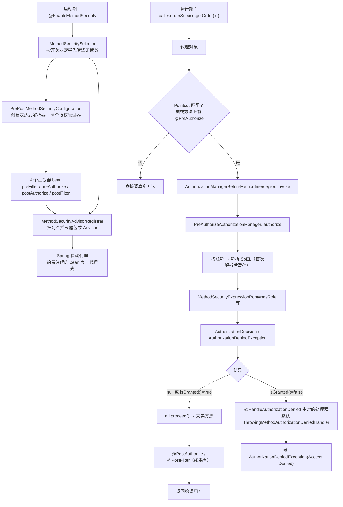
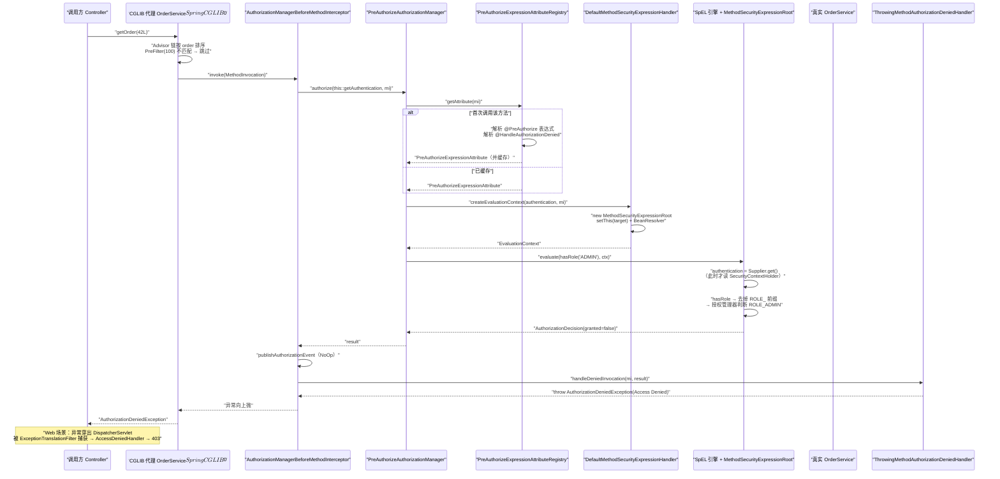

# Method Security：@PreAuthorize 与代理（Spring Security 7.2.0）

> 一句话结论：方法级安全**不是**过滤器，而是 **AOP 代理 + 拦截器**——`@EnableMethodSecurity` 注册四个"拦截器 bean"，Spring 的自动代理机制给带 `@PreAuthorize` 的类包一层代理，调用方法时**先在代理里跑 `AuthorizationManagerBeforeMethodInterceptor`**，把注解里的 SpEL 表达式算成 `AuthorizationResult`，通过才放行到你的真实方法，否则抛 `AuthorizationDeniedException`。
> 阅读前置：读过本目录上一篇 [01-authorization-授权决策与authorizationmanager.md](01-authorization-授权决策与authorizationmanager.md)（知道 `AuthorizationManager`、`AuthorizationResult`、`AuthorizationDeniedException` 是什么）；知道 Spring AOP 的"代理"概念（没读过也行，本篇 §1 会用一个比喻补上）。
> 预计阅读：60 分钟 ｜ 源码：spring-security-core@7.2.0（`org.springframework.security.authorization.method`、`access.expression.method`）、spring-security-config@7.2.0（`config.annotation.method.configuration`）

---

## 0. 先看现象：为什么加了注解却"不生效"

先看一段几乎人人都写过的代码：

```java (src: PreAuthorize.java#L33-L37)
@Target({ ElementType.METHOD, ElementType.TYPE })
@Retention(RetentionPolicy.RUNTIME)
@Inherited
@Documented
public @interface PreAuthorize {
```

它只说明了一件事：这是一个能贴在**方法**或**类**上的运行时注解，里面装一个字符串表达式。它是怎么"生效"的？注解本身不会执行任何代码。

现在做四个实验，观察现象：

| # | 写法 | 现象 | 一句话原因 |
| --- | --- | --- | --- |
| A | 配置类上加了 `@EnableMethodSecurity`，方法上 `@PreAuthorize("hasRole('ADMIN')")` | 普通用户调用 → `403`，控制台 `AuthorizationDeniedException: Access Denied` | 正常路径 |
| B | 去掉 `@EnableMethodSecurity` | 注解被**完全忽略**，谁都能调 | 没有开关就没有拦截器 bean |
| C | 同一个 bean 里，方法 `a()` 内部直接调 `this.b()`，`b` 上有 `@PreAuthorize` | 不检查，直接执行 | **自调用不走代理** |
| D | 方法是 `private` 或 `final`（CGLIB 代理下） | 不检查，或启动/运行时报错 | 代理无法覆盖这个方法 |
| E | 匿名用户（未登录）调一个 `@PreAuthorize` 方法 | 得到的是 `401`/跳登录页，而不是 `403` | 异常类型被归为"认证不全"，由 Web 层的 `ExceptionTranslationFilter` 转换 |

这五个现象背后是同一套机制。本篇要回答的问题就是：

1. `@EnableMethodSecurity` 到底注册了哪些 bean？
2. 代理是怎么套到我的类上的？为什么自调用不生效？
3. 一个 `@PreAuthorize("hasRole('ADMIN')")` 字符串，是谁、在什么时候、怎么变成"允许/拒绝"的？
4. `@PostAuthorize`、`@PreFilter`、`@PostFilter` 和它是什么关系？谁先执行？
5. 被拒绝后除了抛异常，还能怎么办（`@HandleAuthorizationDenied`）？

> **先解释三个术语**（后面反复出现）：
>
> - **AOP（面向切面编程）**：把"权限检查、日志、事务"这类每个方法都想做的动作，从业务代码里抽出来，由框架在调用方法前后自动插入。
> - **代理（Proxy）**：一个"外壳对象"，和你的类有相同的方法签名，但每个方法里先做额外动作，再调用真正的对象。调用方拿到的永远是外壳。
> - **拦截器（Interceptor / Advice）**：外壳里那段"额外动作"的代码。本篇的主角 `AuthorizationManagerBeforeMethodInterceptor` 就是它。
> - **切点（Pointcut）**：一套"哪些方法需要套壳"的规则，这里是"类或方法上有 `@PreAuthorize`"。
> - **SpEL**：Spring 的表达式语言，`hasRole('ADMIN') and #id == authentication.name` 这种字符串就是它。

---

## 1. 整体地图

### 1.1 一张图：从注解到"允许/拒绝"



> 读图说明：图分**上下两段**。上段是**启动期**（只发生一次）：注解 → 选择器 → 配置类 → 拦截器 bean → Advisor → 自动代理。下段是**运行期**（每次调用）：代理 → 切点匹配 → 前置拦截器 → 授权管理器算表达式 → 放行或抛异常。最容易忽略的是 `K1` 节点上的"缓存"：表达式**只在第一次调用该方法时解析**，之后复用解析好的 `Expression` 对象。

### 1.2 一个比喻：小区门禁

把你的 `OrderService` 想成一栋楼，`getOrder` 是楼里的一个房间。

- **代理** = 楼门口的保安亭。访客（调用方）只能先到保安亭，不能直接进房间。
- **Pointcut** = 保安手里的名单："哪些房间需要刷卡"。名单上没有的房间（没贴注解的方法），保安直接挥手放行。
- **Interceptor** = 保安本人。
- **`@PreAuthorize` 表达式** = 房间门上贴的规则，例如"只限 ADMIN"。
- **`AuthorizationManager`** = 保安脑中的判断逻辑："把你的卡（`Authentication`）拿出来，对照规则"。
- **`AuthorizationResult`** = 判断结果：`granted = true/false`。
- **自调用不生效** = 你已经在楼里（真实对象内部），从房间 A 走到房间 B 根本不经过门口的保安亭。
- **`@PostAuthorize`** = 出门时再查一次包里带出来的东西（返回值）。
- **`@PreFilter` / `@PostFilter`** = 进门前筛你手里的清单（集合参数）/ 出门前筛你带走的清单（集合返回值）。

### 1.3 四个注解、四个拦截器、执行顺序

四个注解对应四个拦截器 bean，它们是**同一条调用链上的四层**，顺序由 `AuthorizationInterceptorsOrder` 固定：

```text
调用方
 └─① PreFilterAuthorizationMethodInterceptor   （order 100）  对集合参数做过滤
    └─② AuthorizationManagerBeforeMethodInterceptor (order 200)  @PreAuthorize
       └─③ 真实方法执行  ← 方法体在这里跑
          └─④ AuthorizationManagerAfterMethodInterceptor  (order 500)  @PostAuthorize
             └─⑤ PostFilterAuthorizationMethodInterceptor  (order 600)  对返回值做过滤
                └─ 返回结果
```

> 顺序数字是 Spring 的 `Ordered` 约定：**数字越小越靠外**（越先进入、越晚返回）。所以 `@PreAuthorize` 的检查一定发生在方法体之前，`@PostAuthorize` 一定在方法体之后——这意味着 **`@PostAuthorize` 拒绝时，方法体的副作用（如写库）已经发生了**，这是 §6 的一个重要坑。

---

## 2. 关键类速查

| 类 | 所在 jar | 一句话职责 | 本篇精读 |
| --- | --- | --- | --- |
| `EnableMethodSecurity` | config | 总开关注解，声明三个布尔开关 + 代理模式 | §3.1 |
| `MethodSecuritySelector` | config | 根据开关决定 `@Import` 哪些配置类 | §3.1 |
| `PrePostMethodSecurityConfiguration` | config | 组装表达式处理器、授权管理器，发布 4 个拦截器 bean | §3.2 |
| `DeferringMethodInterceptor` | config | 延迟取真实拦截器的"占位壳" | §3.2 |
| `MethodSecurityAdvisorRegistrar` | config | 把拦截器 bean 包成 Advisor，供自动代理发现 | §3.3 |
| `AuthorizationManagerBeforeMethodInterceptor` | core | `@PreAuthorize` 的前置拦截器 | §3.4 |
| `AuthorizationManagerAfterMethodInterceptor` | core | `@PostAuthorize` 的后置拦截器 | §3.4 |
| `AuthorizationInterceptorsOrder` | core | 四个拦截器的固定顺序 | §3.4 |
| `AuthorizationMethodPointcuts` | core | "类或方法上有某注解"的切点构造工具 | §3.4 |
| `PreAuthorizeAuthorizationManager` | core | 取表达式、建上下文、求值 | §3.5 |
| `PreAuthorizeExpressionAttributeRegistry` | core | 解析注解并**缓存**表达式与拒绝处理器 | §3.5 |
| `PostAuthorizeAuthorizationManager` | core | 同上，但把返回值塞进上下文 | §3.5 |
| `DefaultMethodSecurityExpressionHandler` | core | 建求值上下文（根对象 + 参数 + Bean 引用） | §3.6 |
| `MethodSecurityExpressionRoot` | core | 根对象：`hasRole`、`#param`、`returnObject`、`filterObject` 的来源 | §3.6 |
| `ThrowingMethodAuthorizationDeniedHandler` | core | 默认的拒绝处理：抛异常 | §3.7 |
| `HandleAuthorizationDenied` | core | 注解：为某方法指定自定义拒绝处理器 | §3.7 |

**类之间的关系**（谁持有谁）：

```text
PrePostMethodSecurityConfiguration
 ├─ expressionHandler : DefaultMethodSecurityExpressionHandler  （四份组件共用同一个）
 ├─ preAuthorizeAuthorizationManager  : PreAuthorizeAuthorizationManager
 ├─ postAuthorizeAuthorizationManager : PostAuthorizeAuthorizationManager
 ├─ preAuthorizeMethodInterceptor     : AuthorizationManagerBeforeMethodInterceptor
 │     └─ authorizationManager = preAuthorizeAuthorizationManager
 └─ postAuthorizeMethodInterceptor    : AuthorizationManagerAfterMethodInterceptor
       └─ authorizationManager = postAuthorizeAuthorizationManager

PreAuthorizeAuthorizationManager
 └─ registry : PreAuthorizeExpressionAttributeRegistry
       └─ 缓存 Map<Method, ExpressionAttribute>   （表达式 + 拒绝处理器）
```

---

## 3. 源码逐段精读

每一段按四层讲：**① 这段做了什么 → ② 为什么这么设计 → ③ 和整体的关系 → ④ 易踩的坑**。

### 3.1 开关：`@EnableMethodSecurity` 与 `MethodSecuritySelector`

```java (src: EnableMethodSecurity.java#L42-L52)
@Documented
@Import(MethodSecuritySelector.class)
public @interface EnableMethodSecurity {

	/**
	 * Determines if Spring Security's {@link PreAuthorize}, {@link PostAuthorize},
	 * {@link PreFilter}, and {@link PostFilter} annotations should be enabled. Default is
	 * true.
	 * @return true if pre/post annotations should be enabled false otherwise
	 */
	boolean prePostEnabled() default true;
```

```java (src: EnableMethodSecurity.java#L59-L65)
	boolean securedEnabled() default false;

	/**
	 * Determines if JSR-250 annotations should be enabled. Default is false.
	 * @return true if JSR-250 should be enabled false otherwise
	 */
	boolean jsr250Enabled() default false;
```

```java (src: EnableMethodSecurity.java#L80-L98)
	boolean proxyTargetClass() default false;

	/**
	 * Indicate how security advice should be applied. The default is
	 * {@link AdviceMode#PROXY}.
	 * @see AdviceMode
	 * @return the {@link AdviceMode} to use
	 */
	AdviceMode mode() default AdviceMode.PROXY;

	/**
	 * Indicate additional offset in the ordering of the execution of the security
	 * interceptors when multiple advices are applied at a specific joinpoint. I.e.,
	 * precedence of each security interceptor enabled by this annotation will be
	 * calculated as sum of its default precedence and offset. The default is 0.
	 * @return the offset in the order the security advisor should be applied
	 * @since 6.3
	 */
	int offset() default 0;
```

**① 做了什么**：注解本身只有 6 个属性，没有一行逻辑；真正起作用的是 `@Import(MethodSecuritySelector.class)`。默认值是：`prePostEnabled = true`，`securedEnabled = false`，`jsr250Enabled = false`，`proxyTargetClass = false`，`mode = PROXY`，`offset = 0`。

**② 为什么**：Spring 的惯例是"注解只做声明，`@Import` 进来的类负责装配"。用一个 `ImportSelector`（下面会看到）可以**按开关动态决定**导入哪些配置，而不是一股脑全注册。

**③ 关系**：这是整个方法级安全的唯一入口。没有它，§1 图中上半段一个 bean 都不会出现。

**④ 坑**：
- 老版本迁移过来的人常写 `@EnableGlobalMethodSecurity(prePostEnabled = true)`。在 7.2.0 里该注解还在 jar 中，但**已被标记废弃**（见 §7）。
- 默认 `proxyTargetClass = false`，但 Spring Boot 的 `spring.aop.proxy-target-class=true`（默认）会让全局自动代理创建器使用 CGLIB。到底用哪种代理由**全局的自动代理创建器**决定，不是这个注解单独说了算——这点在 §7 展开，未在本篇逐行核对 `AopAutoConfiguration`，标注为"经验性结论"。

接着看选择器：

```java (src: MethodSecuritySelector.java#L54-L70)
	public String[] selectImports(@NonNull AnnotationMetadata importMetadata) {
		if (!importMetadata.hasAnnotation(EnableMethodSecurity.class.getName())
				&& !importMetadata.hasMetaAnnotation(EnableMethodSecurity.class.getName())) {
			return new String[0];
		}
		EnableMethodSecurity annotation = importMetadata.getAnnotations().get(EnableMethodSecurity.class).synthesize();
		List<String> imports = new ArrayList<>(Arrays.asList(this.autoProxy.selectImports(importMetadata)));
		if (annotation.prePostEnabled()) {
			imports.add(PrePostMethodSecurityConfiguration.class.getName());
		}
		if (annotation.securedEnabled()) {
			imports.add(SecuredMethodSecurityConfiguration.class.getName());
		}
		if (annotation.jsr250Enabled()) {
			imports.add(Jsr250MethodSecurityConfiguration.class.getName());
		}
		imports.add(AuthorizationProxyConfiguration.class.getName());
```

**① 做了什么**：三步。第一，检查导入类上是否真的有 `@EnableMethodSecurity`（或以它为元注解），没有就返回空数组；第二，先把 `this.autoProxy.selectImports(...)` 的结果放进列表（这是注册"自动代理创建器"的那一步）；第三，按三个布尔开关追加 `PrePostMethodSecurityConfiguration`、`SecuredMethodSecurityConfiguration`、`Jsr250MethodSecurityConfiguration`。最后**无条件**追加 `AuthorizationProxyConfiguration`。

**② 为什么**：`ImportSelector` 返回的是**类名字符串数组**，容器会把这些类当配置类处理。这样"开不开某个注解族"就是在装配期做决定，关闭的功能连 bean 定义都不会有，零开销。

**③ 关系**：它把图中的 B 节点连接到 C 节点和 E 节点（`this.autoProxy` 那一项最终会注册 `MethodSecurityAdvisorRegistrar`）。

**④ 坑**：
- 第一个 `if` 说明：如果你写了一个**自定义注解并以 `@EnableMethodSecurity` 为元注解**，也能生效（`hasMetaAnnotation`）。
- `AuthorizationProxyConfiguration` 总是被导入，这是 6.3 之后为了支持 `@AuthorizeReturnObject`（对返回对象内部方法继续鉴权）准备的，本篇不展开。
- `isDataPresent` / `isWebPresent` / `isObservabilityPresent` 是在类路径上探测某些类是否存在，所以**加了依赖后行为可能变化**。

### 3.2 装配：`PrePostMethodSecurityConfiguration`

```java (src: PrePostMethodSecurityConfiguration.java#L64-L76)
@Configuration(value = "_prePostMethodSecurityConfiguration", proxyBeanMethods = false)
@Role(BeanDefinition.ROLE_INFRASTRUCTURE)
final class PrePostMethodSecurityConfiguration implements ImportAware, ApplicationContextAware, AopInfrastructureBean {

	private static final Pointcut preFilterPointcut = new PreFilterAuthorizationMethodInterceptor().getPointcut();

	private static final Pointcut preAuthorizePointcut = AuthorizationManagerBeforeMethodInterceptor.preAuthorize()
		.getPointcut();

	private static final Pointcut postAuthorizePointcut = AuthorizationManagerAfterMethodInterceptor.postAuthorize()
		.getPointcut();

	private static final Pointcut postFilterPointcut = new PostFilterAuthorizationMethodInterceptor().getPointcut();
```

```java (src: PrePostMethodSecurityConfiguration.java#L78-L107)
	private final PreAuthorizeAuthorizationManager preAuthorizeAuthorizationManager = new PreAuthorizeAuthorizationManager();

	private final PostAuthorizeAuthorizationManager postAuthorizeAuthorizationManager = new PostAuthorizeAuthorizationManager();

	private final PreFilterAuthorizationMethodInterceptor preFilterMethodInterceptor = new PreFilterAuthorizationMethodInterceptor();

	private final AuthorizationManagerBeforeMethodInterceptor preAuthorizeMethodInterceptor;

	private final AuthorizationManagerAfterMethodInterceptor postAuthorizeMethodInterceptor;

	private final PostFilterAuthorizationMethodInterceptor postFilterMethodInterceptor = new PostFilterAuthorizationMethodInterceptor();

	private final DefaultMethodSecurityExpressionHandler expressionHandler = new DefaultMethodSecurityExpressionHandler();

	PrePostMethodSecurityConfiguration(
			ObjectProvider<ObjectPostProcessor<AuthorizationManager<MethodInvocation>>> preAuthorizeProcessor,
			ObjectProvider<ObjectPostProcessor<AuthorizationManager<MethodInvocationResult>>> postAuthorizeProcessor) {
		this.preFilterMethodInterceptor.setExpressionHandler(this.expressionHandler);
		this.preAuthorizeAuthorizationManager.setExpressionHandler(this.expressionHandler);
		this.postAuthorizeAuthorizationManager.setExpressionHandler(this.expressionHandler);
		this.postFilterMethodInterceptor.setExpressionHandler(this.expressionHandler);
		AuthorizationManager<MethodInvocation> preAuthorize = preAuthorizeProcessor
			.getIfUnique(ObjectPostProcessor::identity)
			.postProcess(this.preAuthorizeAuthorizationManager);
		this.preAuthorizeMethodInterceptor = AuthorizationManagerBeforeMethodInterceptor.preAuthorize(preAuthorize);
		AuthorizationManager<MethodInvocationResult> postAuthorize = postAuthorizeProcessor
			.getIfUnique(ObjectPostProcessor::identity)
			.postProcess(this.postAuthorizeAuthorizationManager);
		this.postAuthorizeMethodInterceptor = AuthorizationManagerAfterMethodInterceptor.postAuthorize(postAuthorize);
	}
```

**① 做了什么**：
- 类级别：一个名叫 `_prePostMethodSecurityConfiguration` 的配置类，`proxyBeanMethods = false`，角色为 `ROLE_INFRASTRUCTURE`（告诉容器"这是基础设施 bean，别在启动日志/监控里当成业务 bean"）。
- 四个**静态** `Pointcut` 常量，分别对应四个注解。
- 字段里 `new` 了两个授权管理器、两个过滤器拦截器、一个表达式处理器。
- 构造器：把**同一个** `expressionHandler` 设给四处；然后对 `@PreAuthorize`/`@PostAuthorize` 用的两个管理器各过一遍 `ObjectPostProcessor`，最后用它们构造前后两个拦截器。

**② 为什么**：
- **共享一个 `expressionHandler`**：表达式里的 `@bean` 引用、权限评估器、角色前缀等配置只需设一次，四个组件行为一致。
- **`ObjectPostProcessor`**：Spring Security 的扩展惯例——允许你注册一个后处理器，在管理器"出厂前"替换或包装它（比如加审计）。`getIfUnique(... identity)` 表示没有就原样返回。
- **`proxyBeanMethods = false`**：配置类内部不互相调 `@Bean` 方法，关掉代理提升启动速度。

**③ 关系**：这是 C 节点。注意此时拦截器对象是**配置类的字段**，还不是 bean。真正发布成 bean 的是下面这段。

```java (src: PrePostMethodSecurityConfiguration.java#L174-L180)
	@Bean
	@Role(BeanDefinition.ROLE_INFRASTRUCTURE)
	static MethodInterceptor preAuthorizeAuthorizationMethodInterceptor(
			ObjectProvider<PrePostMethodSecurityConfiguration> _prePostMethodSecurityConfiguration) {
		return new DeferringMethodInterceptor<>(preAuthorizePointcut,
				() -> _prePostMethodSecurityConfiguration.getObject().preAuthorizeMethodInterceptor);
	}
```

```java (src: DeferringMethodInterceptor.java#L30-L45)
final class DeferringMethodInterceptor<M extends AuthorizationAdvisor> implements AuthorizationAdvisor {

	private final Pointcut pointcut;

	private final Supplier<M> delegate;

	DeferringMethodInterceptor(Pointcut pointcut, Supplier<M> delegate) {
		this.pointcut = pointcut;
		this.delegate = SingletonSupplier.of(delegate);
	}

	@Nullable
	@Override
	public Object invoke(@NonNull MethodInvocation invocation) throws Throwable {
		return this.delegate.get().invoke(invocation);
	}
```

**① 做了什么**：`@Bean` 方法**不直接返回**拦截器，而是返回 `DeferringMethodInterceptor`，它记住切点和一个 `Supplier`（lambda 里才去 `_prePostMethodSecurityConfiguration.getObject().preAuthorizeMethodInterceptor`）。`invoke` 时第一次才通过 `SingletonSupplier.of` 取出真实拦截器并委托。

**② 为什么**：这是典型的**延迟初始化 / 占位符**。拦截器 bean 必须很早被自动代理创建器发现（Advisor 需要在 bean 生命周期的早期就定位），但配置类本身要等它的依赖（`RoleHierarchy`、`GrantedAuthorityDefaults`、`PermissionEvaluator` 等，通过 `@Autowired` 方法注入）全部就绪才能算出最终形态。如果 `@Bean` 直接 `getObject()`，会引发循环依赖或过早实例化。壳先注册、真身后到。

**③ 关系**：D 节点（4 个拦截器 bean）实际上是 4 个"延迟壳"。

**④ 坑**：壳的 `getOrder()` 也会触发 `delegate.get()`。一般无感，但如果你的测试只检查 bean 类型，会发现它不是 `AuthorizationManagerBeforeMethodInterceptor`——调试时别被类型吓到。

### 3.3 让自动代理看见：`MethodSecurityAdvisorRegistrar`

```java (src: MethodSecurityAdvisorRegistrar.java#L40-L71)
	@Override
	public void registerBeanDefinitions(AnnotationMetadata importingClassMetadata, BeanDefinitionRegistry registry) {
		registerAsAdvisor("preFilterAuthorization", registry);
		registerAsAdvisor("preAuthorizeAuthorization", registry);
		registerAsAdvisor("postFilterAuthorization", registry);
		registerAsAdvisor("postAuthorizeAuthorization", registry);
		registerAsAdvisor("securedAuthorization", registry);
		registerAsAdvisor("jsr250Authorization", registry);
		registerAsAdvisor("authorizeReturnObject", registry);
	}

	private void registerAsAdvisor(String prefix, BeanDefinitionRegistry registry) {
		String advisorName = prefix + "Advisor";
		if (registry.containsBeanDefinition(advisorName)) {
			return;
		}
		String interceptorName = prefix + "MethodInterceptor";
		if (!registry.containsBeanDefinition(interceptorName)) {
			return;
		}
		BeanDefinition definition = registry.getBeanDefinition(interceptorName);
		if (!(definition instanceof RootBeanDefinition)) {
			return;
		}
		BeanDefinitionBuilder builder = BeanDefinitionBuilder.rootBeanDefinition(AdvisorWrapper.class);
		builder.setFactoryMethod("of");
		builder.setRole(BeanDefinition.ROLE_INFRASTRUCTURE);
		builder.addConstructorArgReference(interceptorName);
		RootBeanDefinition advisor = (RootBeanDefinition) builder.getBeanDefinition();
		advisor.setTargetType(Advisor.class);
		registry.registerBeanDefinition(advisorName, advisor);
	}
```

**① 做了什么**：对 7 个前缀各调一次 `registerAsAdvisor`。后者按约定拼名字：拦截器 bean 名是 `前缀 + "MethodInterceptor"`，Advisor bean 名是 `前缀 + "Advisor"`。只有当拦截器 bean 定义存在**且类型是 `RootBeanDefinition`** 时，才注册一个 `AdvisorWrapper.of(interceptor)`，角色同样是基础设施。

**② 为什么**：Spring AOP 的自动代理创建器（`AbstractAutoProxyCreator` 一族）扫描的是 **`Advisor` 类型的 bean**，不是 `Interceptor`。所以拦截器必须被包装成"切点 + 通知"的组合（`PointcutAdvisor`）。这个类是一个 `ImportBeanDefinitionRegistrar`，以**编程方式**注册 bean 定义，因为 advisor 的数量取决于启用了哪些开关——写成固定 `@Bean` 做不到。

**③ 关系**：E 节点。它把 D 的 4 个壳变成 4 个 Advisor，然后 `AnnotationAwareAspectJAutoProxyCreator` 在每个 bean 初始化后问一句"有没有 Advisor 匹配这个类"，有就创建代理。Advisor 的类型是 `AopInfrastructureBean`，这个标记接口让创建器**跳过给 advisor 本身再套代理**，避免无限递归。

**④ 坑**：
- 用**函数式**方式注册的拦截器 bean（`beanDefinitions.registerBeanDefinition` 出来的是 `GenericBeanDefinition`，不是 `RootBeanDefinition`）**不会被这里包装**——这是源码里 `instanceof RootBeanDefinition` 判断的直接后果。要自定义拦截器，最稳妥是直接声明一个 `Advisor` bean 或覆盖同名 `@Bean`。
- 名字约定很硬：想替换默认的 pre 拦截器，`@Bean` 方法名必须叫 `preAuthorizeAuthorizationMethodInterceptor`。

### 3.4 主角：前置拦截器与顺序

先看工厂方法：

```java (src: AuthorizationManagerBeforeMethodInterceptor.java#L87-L102)
	public static AuthorizationManagerBeforeMethodInterceptor preAuthorize() {
		return preAuthorize(new PreAuthorizeAuthorizationManager());
	}

	/**
	 * Creates an interceptor for the {@link PreAuthorize} annotation.
	 * @param authorizationManager the {@link PreAuthorizeAuthorizationManager} to use
	 * @return the interceptor
	 */
	public static AuthorizationManagerBeforeMethodInterceptor preAuthorize(
			PreAuthorizeAuthorizationManager authorizationManager) {
		AuthorizationManagerBeforeMethodInterceptor interceptor = new AuthorizationManagerBeforeMethodInterceptor(
				AuthorizationMethodPointcuts.forAnnotations(PreAuthorize.class), authorizationManager);
		interceptor.setOrder(AuthorizationInterceptorsOrder.PRE_AUTHORIZE.getOrder());
		return interceptor;
	}
```

```java (src: AuthorizationMethodPointcuts.java#L44-L64)
	static Pointcut forAnnotations(Class<? extends Annotation>... annotations) {
		ComposablePointcut pointcut = null;
		for (Class<? extends Annotation> annotation : annotations) {
			if (pointcut == null) {
				pointcut = new ComposablePointcut(classOrMethod(annotation));
			}
			else {
				pointcut.union(classOrMethod(annotation));
			}
		}
		if (pointcut == null) {
			throw new IllegalStateException(
					"Unable to find a pointcut for annotations " + Arrays.toString(annotations));
		}
		return pointcut;
	}

	private static Pointcut classOrMethod(Class<? extends Annotation> annotation) {
		return Pointcuts.union(new AnnotationMatchingPointcut(null, annotation, true),
				new AnnotationMatchingPointcut(annotation, true));
	}
```

**① 做了什么**：`preAuthorize()` 创建拦截器，切点 = `forAnnotations(PreAuthorize.class)`，顺序 = `PRE_AUTHORIZE` 的值。`forAnnotations` 对每个注解造一个"类上**或**方法上有该注解"的切点，多个注解用 `union` 合并。`classOrMethod` 里：`new AnnotationMatchingPointcut(null, annotation, true)` 表示只看类级别注解，`new AnnotationMatchingPointcut(annotation, true)` 表示看方法级别注解，`true` 是检查元注解（组合注解）。

**② 为什么**：切点在**创建拦截器时就固定下来**，是一个静态常量，所有 bean 共用。这样自动代理创建器判断"要不要代理这个类"时只需要一次 `Pointcut` 匹配，成本很低；而真正判断**这次调用**要不要鉴权，由运行期的 Advisor 匹配完成。

**③ 关系**：切点决定了图里的 I 菱形。

**④ 坑**：`@PreAuthorize` 标在**类上**时，该类所有 public 方法都会被检查——包括你只是想给外部用的 getter。组合注解（自己定义一个 `@AdminOnly` 并以 `@PreAuthorize` 标注它）也能被识别，因为 `checkInherited = true`。

```java (src: AuthorizationInterceptorsOrder.java#L33-L63)
	FIRST(Integer.MIN_VALUE),

	/**
	 * The order for the {@link PreFilterAuthorizationMethodInterceptor}.
	 */
	PRE_FILTER,

	PRE_AUTHORIZE,

	SECURED,

	JSR250,

	SECURE_RESULT(450),

	POST_AUTHORIZE(500),

	/**
	 * The order for the {@link PostFilterAuthorizationMethodInterceptor}.
	 */
	POST_FILTER(600),

	LAST(Integer.MAX_VALUE);

	private static final int INTERVAL = 100;

	private final int order;

	AuthorizationInterceptorsOrder() {
		this.order = ordinal() * INTERVAL;
	}
```

**① 做了什么**：一个枚举，手工指定了 `FIRST`、`SECURE_RESULT`、`POST_AUTHORIZE`、`POST_FILTER`、`LAST` 的值；其余枚举项的值 = `ordinal() * 100`。所以 `PRE_FILTER = 100`、`PRE_AUTHORIZE = 200`、`SECURED = 300`、`JSR250 = 400`。

**② 为什么**：间隔 100 给用户留出"插队"空间。`@Transactional` 默认顺序是 `Ordered.LOWEST_PRECEDENCE`，事务拦截器会在最外层，于是**鉴权在事务开启之后、业务方法之前**执行。`@EnableMethodSecurity(offset = n)` 把所有安全拦截器整体平移 n。

**③ 关系**：这就是 §1.3 那张顺序图的出处。

**④ 坑**：`@PreAuthorize` 里抛异常发生在事务内时，事务会回滚（因为异常穿过了事务拦截器）；但 `@PostAuthorize` 抛异常时业务 SQL 已执行，**是否回滚取决于异常类型是否是 `RuntimeException`**——`AuthorizationDeniedException` 是 `RuntimeException`，所以通常也会回滚。但这不能当作设计依据，见 §6。

现在看拦截器的心脏：

```java (src: AuthorizationManagerBeforeMethodInterceptor.java#L195-L198)
	@Override
	public @Nullable Object invoke(MethodInvocation mi) throws Throwable {
		return attemptAuthorization(mi);
	}
```

```java (src: AuthorizationManagerBeforeMethodInterceptor.java#L248-L279)
	private @Nullable Object attemptAuthorization(MethodInvocation mi) throws Throwable {
		this.logger.debug(LogMessage.of(() -> "Authorizing method invocation " + mi));
		AuthorizationResult result;
		try {
			result = this.authorizationManager.authorize(this::getAuthentication, mi);
		}
		catch (AuthorizationDeniedException denied) {
			return handle(mi, denied);
		}
		if (result != null) {
			this.eventPublisher.publishAuthorizationEvent(this::getAuthentication, mi, result);
		}
		if (result != null && !result.isGranted()) {
			this.logger.debug(LogMessage.of(() -> "Failed to authorize " + mi + " with authorization manager "
					+ this.authorizationManager + " and result " + result));
			return handle(mi, result);
		}
		this.logger.debug(LogMessage.of(() -> "Authorized method invocation " + mi));
		return proceed(mi);
	}

	private @Nullable Object proceed(MethodInvocation mi) throws Throwable {
		try {
			return mi.proceed();
		}
		catch (AuthorizationDeniedException ex) {
			if (this.authorizationManager instanceof MethodAuthorizationDeniedHandler handler) {
				return handler.handleDeniedInvocation(mi, ex);
			}
			return this.defaultHandler.handleDeniedInvocation(mi, ex);
		}
	}
```

```java (src: AuthorizationManagerBeforeMethodInterceptor.java#L281-L302)
	private @Nullable Object handle(MethodInvocation mi, AuthorizationDeniedException denied) {
		if (this.authorizationManager instanceof MethodAuthorizationDeniedHandler handler) {
			return handler.handleDeniedInvocation(mi, denied);
		}
		return this.defaultHandler.handleDeniedInvocation(mi, denied);
	}

	private @Nullable Object handle(MethodInvocation mi, AuthorizationResult result) {
		if (this.authorizationManager instanceof MethodAuthorizationDeniedHandler handler) {
			return handler.handleDeniedInvocation(mi, result);
		}
		return this.defaultHandler.handleDeniedInvocation(mi, result);
	}

	private Authentication getAuthentication() {
		Authentication authentication = this.securityContextHolderStrategy.get().getContext().getAuthentication();
		if (authentication == null) {
			throw new AuthenticationCredentialsNotFoundException(
					"An Authentication object was not found in the SecurityContext");
		}
		return authentication;
	}
```

**① 做了什么**（`attemptAuthorization` 的四步）：
1. **调用管理器**：`this.authorizationManager.authorize(this::getAuthentication, mi)`。注意第一个参数是**方法引用** `this::getAuthentication`，不是 `Authentication` 对象——传的是"取认证对象的办法"，管理器需要时才去 `SecurityContextHolder` 拿。
2. **捕获拒绝异常**：如果管理器直接抛了 `AuthorizationDeniedException`，交给 `handle(mi, denied)`。
3. **发布事件**：结果非 null 时，`publishAuthorizationEvent`（默认是 NoOp，发布器可替换）。
4. **判定**：结果非 null 且 `!isGranted()` → 打 debug 日志 + `handle(mi, result)`；否则 `proceed(mi)`。

`proceed` 里调用 `mi.proceed()`（进入下一个拦截器或真实方法），并**捕获方法体内抛出的 `AuthorizationDeniedException`**，同样交给处理器。两个 `handle` 重载逻辑一致：如果 `authorizationManager` 自己实现了 `MethodAuthorizationDeniedHandler`，就用它；否则用字段里的 `defaultHandler`。

`getAuthentication`：从 `SecurityContextHolderStrategy` 取上下文里的 `Authentication`，为 null 抛 `AuthenticationCredentialsNotFoundException("An Authentication object was not found in the SecurityContext")`。

**② 为什么**：
- **结果为 null 表示" abstain（弃权）"**：上一篇讲过 `AuthorizationManager` 契约——返回 null 意味着"这个对象不归我管"。这里对 null 的处理是**直接放行**，因为切点已经保证有注解，管理器返回 null 只在"注解找不到"的边界情况下出现。
- **`instanceof` 模式匹配分流处理器**：让管理器有机会针对每个方法（通过 `@HandleAuthorizationDenied`）决定拒绝后怎么办，而不是一刀切。
- **捕获方法体里的 `AuthorizationDeniedException`**：为了支持方法体内部（例如调用了另一个受保护的服务）抛出的拒绝也能走同一个处理器，让"拒绝后返回兜底值"这个需求能一致地实现。

**③ 关系**：这就是图中 J → K → L → M/N 的全部代码。`@PreAuthorize` 的全部"魔法"只在这 50 行里。

**④ 坑**：
- 如果你的 `SecurityContextHolderStrategy` 被换成了自定义的（多线程上下文），需要同时给拦截器 `setSecurityContextHolderStrategy`，否则它仍用 `SecurityContextHolder` 的默认策略。`PrePostMethodSecurityConfiguration` 里有一个 `@Autowired` 方法会做这件事，但仅针对容器里**存在**该类型 bean 的情况。
- `getAuthentication` 抛的 `AuthenticationCredentialsNotFoundException` 是 `AuthenticationException` 的子类，所以未登录调用会得到 401 而不是 403（现象 E 的根源）。

后置拦截器的结构几乎一样，只差"包了一层返回值"：

```java (src: AuthorizationManagerAfterMethodInterceptor.java#L183-L197)
	private @Nullable Object attemptAuthorization(MethodInvocation mi, @Nullable Object result) {
		this.logger.debug(LogMessage.of(() -> "Authorizing method invocation " + mi));
		MethodInvocationResult object = new MethodInvocationResult(mi, result);
		AuthorizationResult authorizationResult = this.authorizationManager.authorize(this::getAuthentication, object);
		if (authorizationResult != null) {
			this.eventPublisher.publishAuthorizationEvent(this::getAuthentication, object, authorizationResult);
		}
		if (authorizationResult != null && !authorizationResult.isGranted()) {
			this.logger.debug(LogMessage.of(() -> "Failed to authorize " + mi + " with authorization manager "
					+ this.authorizationManager + " and authorizationResult " + authorizationResult));
			return handlePostInvocationDenied(object, authorizationResult);
		}
		this.logger.debug(LogMessage.of(() -> "Authorized method invocation " + mi));
		return result;
	}
```

**① 做了什么**：把 `mi` 和已经拿到的 `result` 包成 `MethodInvocationResult`，交给管理器；拒绝时走 `handlePostInvocationDenied`；否则**原样返回 result**。

**② 为什么**：`AuthorizationManager<T>` 的泛型参数 T 对 pre 是 `MethodInvocation`，对 post 是 `MethodInvocationResult`——用不同类型让编译器帮你区分"这是前置还是后置的检查"，`ExpressionUtils.evaluate` 也能据此选择重载。

**③ 关系**：图中 P 节点。

**④ 坑**：这里**没有** try-catch 管理器的调用——`@PostAuthorize` 的管理器不会抛拒绝异常，只返回结果。

### 3.5 算表达式：`PreAuthorizeAuthorizationManager` 与属性注册表

```java (src: PreAuthorizeAuthorizationManager.java#L80-L97)
	@Override
	public @Nullable AuthorizationResult authorize(Supplier<? extends @Nullable Authentication> authentication,
			MethodInvocation mi) {
		ExpressionAttribute attribute = this.registry.getAttribute(mi);
		if (attribute == null) {
			return null;
		}
		EvaluationContext ctx = this.registry.getExpressionHandler().createEvaluationContext(authentication, mi);
		return ExpressionUtils.evaluate(attribute.getExpression(), ctx, authentication, mi);
	}

	@Override
	public @Nullable Object handleDeniedInvocation(MethodInvocation methodInvocation,
			AuthorizationResult authorizationResult) {
		ExpressionAttribute attribute = this.registry.getAttribute(methodInvocation);
		PreAuthorizeExpressionAttribute preAuthorizeAttribute = (PreAuthorizeExpressionAttribute) attribute;
		return preAuthorizeAttribute.getHandler().handleDeniedInvocation(methodInvocation, authorizationResult);
	}
```

**① 做了什么**：`authorize` 三步：从 `registry` 取 `attribute`；为 null 返回 null；否则创建求值上下文，`ExpressionUtils.evaluate(expression, ctx, authentication, mi)`。`handleDeniedInvocation` 则把活转给 `attribute.getHandler()`。

**② 为什么**：管理器自己**不懂**注解和缓存，这些都在 `registry` 里。职责单一：取表达式 → 建上下文 → 求值。

**③ 关系**：图中 K 节点。

**④ 坑**：`ExpressionUtils.evaluate(..., authentication, mi)` 这条重载会在表达式求值**抛出 `AuthorizationDeniedException`** 时原样向上抛，这就是 §3.4 里 try-catch 存在的原因（该工具类未在本篇入库精读，结论来自拦截器侧的 catch 分支）。

```java (src: PreAuthorizeExpressionAttributeRegistry.java#L57-L75)
	@Override
	@Nullable ExpressionAttribute resolveAttribute(Method method, @Nullable Class<?> targetClass) {
		PreAuthorize preAuthorize = findPreAuthorizeAnnotation(method, targetClass);
		if (preAuthorize == null) {
			return null;
		}
		Expression expression = getExpressionHandler().getExpressionParser().parseExpression(preAuthorize.value());
		MethodAuthorizationDeniedHandler handler = resolveHandler(method, targetClass);
		return new PreAuthorizeExpressionAttribute(expression, handler);
	}

	private MethodAuthorizationDeniedHandler resolveHandler(Method method, @Nullable Class<?> targetClass) {
		Class<?> targetClassToUse = targetClass(method, targetClass);
		HandleAuthorizationDenied deniedHandler = this.handleAuthorizationDeniedScanner.scan(method, targetClassToUse);
		if (deniedHandler != null) {
			return this.handlerResolver.apply(deniedHandler.handlerClass());
		}
		return this.defaultHandler;
	}
```

**① 做了什么**：`resolveAttribute` 找注解，没有返回 null；有则**解析表达式**并把 `resolveHandler` 的结果一起打包成 `PreAuthorizeExpressionAttribute`。`resolveHandler` 用一个扫描器找 `@HandleAuthorizationDenied`，找到就按 `handlerClass` 从容器解析一个处理器实例，找不到用默认处理器。

**② 为什么**：这个方法名带 `resolve` 而不是 `get`，因为它只在**缓存未命中**时被父类调用一次（父类 `AbstractExpressionAttributeRegistry` 维护缓存，未在本篇精读）。解析 SpEL 是相对昂贵的操作（词法 + 语法分析），缓存后每次调用只剩"求值"。把**拒绝处理器和表达式绑在一起缓存**，是因为两者都只取决于注解内容，与方法参数无关。

**③ 关系**：图中 K1 节点。

**④ 坑**：
- `handlerClass` 指定的类必须是容器里的 bean，且**只能有一个**。找不到抛 `Could not find a bean of type ...`，找到多个抛 `Expected to find a single bean of type ...`。
- 缓存 key 与方法和目标类有关，所以**同一个接口方法被两个类实现、注解不同**时不会串。

`@PostAuthorize` 的差别只有一行：

```java (src: PostAuthorizeAuthorizationManager.java#L88-L99)
	@Override
	public @Nullable AuthorizationResult authorize(Supplier<? extends @Nullable Authentication> authentication,
			MethodInvocationResult mi) {
		ExpressionAttribute attribute = this.registry.getAttribute(mi.getMethodInvocation());
		if (attribute == null) {
			return null;
		}
		MethodSecurityExpressionHandler expressionHandler = this.registry.getExpressionHandler();
		EvaluationContext ctx = expressionHandler.createEvaluationContext(authentication, mi.getMethodInvocation());
		expressionHandler.setReturnObject(mi.getResult(), ctx);
		return ExpressionUtils.evaluate(attribute.getExpression(), ctx, authentication, mi);
	}
```

**① 做了什么**：多了一步 `expressionHandler.setReturnObject(mi.getResult(), ctx)`，把返回值放进上下文，这样表达式里的 `returnObject` 才有值。

**② 为什么**：`returnObject` 是 `@PostAuthorize` 专属的根对象属性，必须在求值前设置。

**③ 关系**：对应 `MethodSecurityExpressionRoot.returnObject` 字段。

**④ 坑**：`@PostAuthorize` 无法阻止方法执行，只能阻止结果**被返回**。

### 3.6 求值环境：表达式处理器与根对象

```java (src: DefaultMethodSecurityExpressionHandler.java#L90-L98)
	@Override
	public EvaluationContext createEvaluationContext(Supplier<? extends @Nullable Authentication> authentication,
			MethodInvocation mi) {
		MethodSecurityExpressionOperations root = createSecurityExpressionRoot(authentication, mi);
		MethodSecurityEvaluationContext ctx = new MethodSecurityEvaluationContext(root, mi,
				getParameterNameDiscoverer());
		ctx.setBeanResolver(getBeanResolver());
		return ctx;
	}
```

```java (src: DefaultMethodSecurityExpressionHandler.java#L109-L120)
	private MethodSecurityExpressionOperations createSecurityExpressionRoot(
			Supplier<? extends @Nullable Authentication> authentication, MethodInvocation invocation) {
		MethodSecurityExpressionRoot root = new MethodSecurityExpressionRoot(authentication, invocation);
		root.setThis(invocation.getThis());
		root.setAuthorizationManagerFactory(getAuthorizationManagerFactory());
		root.setPermissionEvaluator(getPermissionEvaluator());
		if (!DEFAULT_ROLE_PREFIX.equals(this.defaultRolePrefix)) {
			// Ensure SecurityExpressionRoot can strip the custom role prefix
			root.setDefaultRolePrefix(getDefaultRolePrefix());
		}
		return root;
	}
```

**① 做了什么**：`createEvaluationContext` 先造根对象，再用根对象 + 方法调用 + 参数名发现器造 `MethodSecurityEvaluationContext`，最后设置 `BeanResolver`。`createSecurityExpressionRoot` 构造 `MethodSecurityExpressionRoot`，把 `this` 设为被代理的真实目标对象，复制管理器工厂和权限评估器，如果角色前缀被改过就同步给根对象。

**② 为什么**：
- **根对象**决定了表达式里"不加前缀直接调用"的方法（`hasRole(...)`、`isAuthenticated()`、`permitAll`）以及**属性**（`authentication`、`principal`）。
- **`MethodSecurityEvaluationContext`** 负责把方法参数暴露成 `#参数名`。它需要一个 `ParameterNameDiscoverer` 来知道参数叫什么。
- **`BeanResolver`** 让表达式里可以写 `@myBean.check(#id)`，`@` 前缀就是它的语法。

**③ 关系**：这两个方法分别对应图里 K2 节点所需的"环境"。

**④ 坑**：`#参数名` 依赖编译时保留参数名。Spring Boot 的 Maven/Gradle 插件默认开启 `-parameters`，但纯 Spring 项目或某些 IDE 增量编译可能不带，此时只能用 `#p0`、`#a0` 这类位置变量（经验性结论，`MethodSecurityEvaluationContext` 的变量命名规则未在本篇精读）。

根对象本身很薄：

```java (src: MethodSecurityExpressionRoot.java#L35-L47)
class MethodSecurityExpressionRoot extends SecurityExpressionRoot<MethodInvocation>
		implements MethodSecurityExpressionOperations {

	private @Nullable Object filterObject;

	private @Nullable Object returnObject;

	private @Nullable Object target;

	MethodSecurityExpressionRoot(Supplier<? extends @Nullable Authentication> authentication,
			MethodInvocation methodInvocation) {
		super(authentication, methodInvocation);
	}
```

```java (src: MethodSecurityExpressionRoot.java#L54-L82)
	@Override
	public @Nullable Object getFilterObject() {
		return this.filterObject;
	}

	@Override
	public void setReturnObject(@Nullable Object returnObject) {
		this.returnObject = returnObject;
	}

	@Override
	public @Nullable Object getReturnObject() {
		return this.returnObject;
	}

	/**
	 * Sets the "this" property for use in expressions. Typically this will be the "this"
	 * property of the {@code JoinPoint} representing the method invocation which is being
	 * protected.
	 * @param target the target object on which the method in is being invoked.
	 */
	void setThis(@Nullable Object target) {
		this.target = target;
	}

	@Override
	public @Nullable Object getThis() {
		return this.target;
	}
```

**① 做了什么**：继承 `SecurityExpressionRoot<MethodInvocation>`，额外只有三个字段：`filterObject`（`@PreFilter`/`@PostFilter` 正在处理的元素）、`returnObject`（返回值）、`target`（`this`）。构造器把 `Supplier<Authentication>` 和 `MethodInvocation` 交给父类。

**② 为什么**：方法级安全比 URL 级多出来的能力，恰好就是这三个：能看参数（由上下文提供）、能看返回值、能看当前对象。剩下的 `hasRole`、`hasAuthority`、`isAnonymous`、`hasPermission` 全部复用父类——这与 URL 级的 `WebSecurityExpressionRoot` 是同一套，只是那边多了一个 `request` 字段。

**③ 关系**：`hasRole('ADMIN')` 的实际判断逻辑在父类 `SecurityExpressionRoot` 中（上一篇 §3 已精读），本篇不重复。

**④ 坑**：`this` 在表达式中是**目标对象**（被代理前的真实对象），不是代理。所以表达式里 `@PreAuthorize("this.isOwner(#id)")` 调用的 `isOwner` **不会再经过任何拦截器**。

### 3.7 拒绝之后：默认处理器与 `@HandleAuthorizationDenied`

```java (src: ThrowingMethodAuthorizationDeniedHandler.java#L31-L39)
public final class ThrowingMethodAuthorizationDeniedHandler implements MethodAuthorizationDeniedHandler {

	@Override
	public Object handleDeniedInvocation(MethodInvocation methodInvocation, AuthorizationResult authorizationResult) {
		if (authorizationResult instanceof AuthorizationDeniedException denied) {
			throw denied;
		}
		throw new AuthorizationDeniedException("Access Denied", authorizationResult);
	}
```

```java (src: HandleAuthorizationDenied.java#L37-L48)
@Target({ ElementType.METHOD, ElementType.TYPE })
@Retention(RetentionPolicy.RUNTIME)
@Inherited
@Documented
public @interface HandleAuthorizationDenied {

	/**
	 * The {@link MethodAuthorizationDeniedHandler} used to handle denied authorization
	 * results.
	 * @return
	 */
	Class<? extends MethodAuthorizationDeniedHandler> handlerClass() default ThrowingMethodAuthorizationDeniedHandler.class;
```

**① 做了什么**：默认处理器两个方法都是"如果结果本身就是 `AuthorizationDeniedException` 就原样抛，否则 `new AuthorizationDeniedException("Access Denied", result)`"。`@HandleAuthorizationDenied` 只有一个属性 `handlerClass`，默认就是这个抛异常的实现。

**② 为什么**：把"拒绝"与"拒绝后怎么办"解耦。有的业务希望越权时返回空列表而不是 500/403，这时可以实现 `MethodAuthorizationDeniedHandler` 返回兜底值，再用注解逐方法指定。异常消息 "Access Denied" 与 URL 级 `AuthorizationFilter` 完全一致，方便统一日志检索。

**③ 关系**：图中 N → O 节点。

**④ 坑**：
- 自定义处理器的方法返回值会成为**方法的返回值**，类型不匹配会在运行时抛 `ClassCastException`。
- 处理器实例来自 Spring 容器（`handlerResolver.apply`），所以可以是 `@Component` 并注入别的 bean。

---

## 4. 完整时序：一次 `@PreAuthorize("hasRole('ADMIN')")` 调用

以 `orderService.getOrder(42L)` 为例，方法上标 `@PreAuthorize("hasRole('ADMIN')")`，当前用户只有 `ROLE_USER`。



> 读图说明：三个要点。**第一**，真实对象 `T` 全程没被调用——这就是"前置"的含义。**第二**，`alt` 块是缓存的关键：只有第一次调用才解析表达式。**第三**，`authentication = Supplier.get()` 发生在表达式求值内部，而不是拦截器入口——如果你在 `SecurityContextHolder` 被清空之后才手动调用管理器，会在这里才报错。

对比：如果用户是 `ROLE_ADMIN`，则 E 返回 `granted=true`，I 调 `proceed(mi)` → 若有 `@PostAuthorize`/`@PostFilter` 则继续经过它们 → `T.getOrder(42L)` → 结果沿原路返回。

---

## 5. 设计模式盘点

| 模式 | 在哪里 | 解决的问题 |
| --- | --- | --- |
| **代理模式** | `CglibAopProxy` / `JdkDynamicAopProxy` 生成的外壳对象 | 不改业务代码就能在方法前后插入逻辑 |
| **拦截器链 / 责任链** | `MethodInvocation.proceed()` 逐层推进 | 多个切面（事务、缓存、鉴权）按 `Ordered` 嵌套 |
| **策略模式** | `AuthorizationManager` 接口 + pre/post 不同泛型实现 | 拦截器不关心"怎么判"，只负责"何时判、判完怎么办" |
| **模板方法 + 注册表** | `AbstractExpressionAttributeRegistry` 缓存 + 子类 `resolveAttribute` | 解析一次、求值多次 |
| **解释器模式** | SpEL：`Expression` 对象树 + `EvaluationContext` | 规则用字符串表达，运行期解释 |
| **占位 / 延迟初始化** | `DeferringMethodInterceptor` + `SingletonSupplier` | bean 必须早注册，依赖却晚就绪 |
| **工厂方法** | `AuthorizationManagerBeforeMethodInterceptor.preAuthorize(...)` 等 | 一个类服务多种注解，切点与顺序在工厂里绑定 |
| **适配器 / 包装** | `MethodSecurityAdvisorRegistrar.AdvisorWrapper` | 把 `AuthorizationAdvisor` 暴露成自动代理能识别的形态 |
| **策略 + 默认值** | `MethodAuthorizationDeniedHandler`，`instanceof` 判断是否自定义 | 拒绝行为可按方法覆盖，不覆盖走默认 |

特别说一下**责任链的嵌套顺序**。假设同时有 `@PreAuthorize` 和 `@Transactional`，调用栈是：

```text
事务拦截器（最外层，order 最大）
  └─ AuthorizationManagerBeforeMethodInterceptor（200）
       └─ 真实方法
```

也就是"先开事务，再鉴权，再执行"。如果希望"鉴权失败就别开事务"，可以把顺序调到事务之外，但默认顺序是 Spring 团队刻意选的，一般不建议改。

---

## 6. 踩坑与调试

### 坑 1：自调用不生效（最常见）

```java
@Service
public class OrderService {
    public OrderDto preview(long id) {
        return this.detail(id);   // this 是真实对象，不经过代理
    }
    @PreAuthorize("hasRole('ADMIN')")
    public OrderDto detail(long id) { ... }
}
```

**原因**：代理只拦截"从外部进入"的调用。`this.detail(...)` 是在目标对象内部直接跳转。
**排查**：在方法里打印 `AopUtils.isAopProxy(this)`，自调用时是 `false`（因为 `this` 是目标对象）。
**解法**（任选）：把 `detail` 拆到另一个 bean；注入自身代理（`@Autowired OrderService self` 或 `ObjectProvider`，注意循环依赖）；用 `AopContext.currentProxy()`（需开启 `exposeProxy`）。

### 坑 2：`@EnableMethodSecurity` 忘了加，或加在了不被扫描的包

**现象**：注解完全不生效，没有任何报错。
**排查**：启动后查 bean：`applicationContext.containsBean("preAuthorizeAuthorizationMethodInterceptor")` 应为 `true`；`getBeanNamesForType(Advisor.class)` 里应有 `preAuthorizeAuthorizationAdvisor`。

### 坑 3：`private` / `final` 方法

CGLIB 通过**生成子类并覆写**方法实现代理，`private` 和 `final` 方法无法覆写，注解被静默忽略。`@Transactional` 等基于同一机制，也会一起失效。
**排查**：开 `DEBUG` 日志 `org.springframework.security.authorization.method`，命中时会有 `Authorizing method invocation ...` 一行；没有就是没进拦截器。

### 坑 4：403 与 401 混淆

| 场景 | 异常 | Web 层表现 |
| --- | --- | --- |
| 未登录，方法受保护 | `AuthenticationCredentialsNotFoundException`（`AuthenticationException` 子类） | `ExceptionTranslationFilter` → `AuthenticationEntryPoint` → 401/302 |
| 匿名用户（`anonymous()`），方法要求 `authenticated()` | 表达式返回 `granted=false` → `AuthorizationDeniedException` | `ExceptionTranslationFilter` 判定是匿名 → 转成 `InsufficientAuthenticationException` → 401/302 |
| 已登录，角色不足 | `AuthorizationDeniedException` | `AccessDeniedHandler` → 403 |

第二行就是现象 E 的解释，`ExceptionTranslationFilter#handleAccessDeniedException` 在上一篇 §3 已精读。

### 坑 5：`@PostAuthorize` 不能阻止副作用

`@PostAuthorize("returnObject.owner == authentication.name")` 看起来很美：只返回自己的数据。但方法体已经执行，如果方法里有写操作，写已经发生。**只把它用于读操作的"二次过滤"，写操作用 `@PreAuthorize` 在参数上判断。**

### 坑 6：表达式里的 `hasRole` 与 `hasAuthority`

`hasRole('ADMIN')` 会自动加 `ROLE_` 前缀，所以要求权限字符串是 `ROLE_ADMIN`；`hasAuthority('ROLE_ADMIN')` 不加前缀，原样比较。混用是"明明有权限却 403"的头号原因。`hasRole('ROLE_ADMIN')` 在旧版本被容忍，7.x 父类里有一段兼容逻辑但属于过渡行为（见上一篇 §3 对 `SecurityExpressionRoot#hasRole` 的精读）。

### 坑 7：方法级与 URL 级规则不一致

常见错误是 URL 放行 `anyRequest().authenticated()`，然后用 `@PreAuthorize` 控制细节——这是**正确**的做法。反过来，URL 上 `hasRole('ADMIN')`，方法上 `permitAll`，则方法注解不会"放宽"URL 规则：两道门是**串联**的，任何一道拒绝都拒绝。

### 坑 8：异步 / 自建线程里鉴权

`SecurityContextHolder` 默认基于 `ThreadLocal`。方法在 `@Async` 或线程池里执行时，新线程没有 `Authentication`，`getAuthentication` 会抛 `AuthenticationCredentialsNotFoundException`。需要 `DelegatingSecurityContextAsyncTaskExecutor` 或 `SecurityContextHolder.setStrategyName(MODE_INHERITABLETHREADLOCAL)`（后者有线程池复用泄漏风险）。

### 坑 9：调试时想看"表达式到底算成了什么"

把 `org.springframework.security.authorization.method` 日志级别调到 `DEBUG`，会看到三行：`Authorizing method invocation ...`、`Failed to authorize ... with authorization manager ... and result ...`、`Authorized method invocation ...`。第二行会打印出管理器和结果对象，是定位"为什么拒绝"的第一手材料。

---

## 7. ⚠️ 版本差异

| 项目 | 旧写法 | 7.2.0 现状 | 影响 |
| --- | --- | --- | --- |
| 开关注解 | `@EnableGlobalMethodSecurity(prePostEnabled = true)` | `@EnableMethodSecurity`（6.0 起） | 旧注解**仍在 jar 中但已 `@Deprecated`**，见下方源码；新注解默认 `prePostEnabled = true` |
| 开关默认值 | prePost 默认 **false**，需手动开 | 默认 **true** | 从旧注解迁移时如果原来没开 prePost，换注解后会"突然开始鉴权" |
| 旧拦截器体系 | `MethodSecurityInterceptor` + `AccessDecisionManager` + `AccessDecisionVoter`（投票） | `AuthorizationManagerBeforeMethodInterceptor` + `AuthorizationManager` | `AccessDecisionManager` 体系已废弃；自定义 `AccessDecisionVoter` 的代码需要改写成 `AuthorizationManager` |
| 拒绝后处理 | 只能抛异常 | `@HandleAuthorizationDenied` + `MethodAuthorizationDeniedHandler`（6.3 起） | 可逐方法返回兜底值 |
| 顺序偏移 | 无 | `@EnableMethodSecurity(offset = n)`（6.3 起） | 可整体调顺序，便于与事务切面排位 |
| 表达式求值 | 直接拿 `Authentication` | 传 `Supplier<Authentication>`（6.4 起 `authorize` 签名变更） | 自定义 `AuthorizationManager` 时需实现新签名，`verify` 已不推荐 |
| URL 级配置 | `WebSecurityConfigurerAdapter` + `authorizeRequests()` | `SecurityFilterChain` bean + `authorizeHttpRequests()` | `WebSecurityConfigurerAdapter` 在 7.x 的 config jar 中**已不存在**；`authorizeRequests()` 已移除 |
| `@EnableMethodSecurity` 内部 | — | 6.3 起无条件导入 `AuthorizationProxyConfiguration` | 支持 `@AuthorizeReturnObject`；多了几个基础设施 bean |

旧注解的废弃声明（本次已入库核对）：

```java (src: EnableGlobalMethodSecurity.java#L43-L53)
 * @author Rob Winch
 * @since 3.2
 * @deprecated Use {@link EnableMethodSecurity} instead
 */
@Deprecated
@Retention(RetentionPolicy.RUNTIME)
@Target(ElementType.TYPE)
@Documented
@Import({ GlobalMethodSecuritySelector.class })
@EnableGlobalAuthentication
public @interface EnableGlobalMethodSecurity {
```

**① 做了什么**：`@Deprecated` + Javadoc 明确写着 "Use {@link EnableMethodSecurity} instead"，并且它自带 `@EnableGlobalAuthentication`。

**② 为什么**：新体系统一到 `AuthorizationManager`，与 URL 级授权共用同一套抽象；旧体系基于投票，概念多、难调试。

**③ 关系**：这是 §7 表格第一行的证据。

**④ 坑**：`@Deprecated` **没有** `forRemoval` 属性，所以 7.2.0 编译时只是警告；但 Spring Security 8 很可能移除，迁移宜早不宜迟（是否移除属于预测，标注为未验证）。

> 补充说明：`@EnableMethodSecurity` 在 **Spring Boot 4 / Spring Security 7** 下是否默认开启——Spring Boot 的 `SecurityAutoConfiguration` 会引入 `SpringBootWebSecurityConfiguration`，其中对 `SecurityFilterChain` 做了默认配置，但方法级安全**不会自动开启**，仍需显式标注（经验性结论，`SpringBootWebSecurityConfiguration` 未在本篇入库精读）。

---

## 8. 面试常见问题

**Q1：`@PreAuthorize` 是怎么生效的？**
A：`@EnableMethodSecurity` 通过 `@Import(MethodSecuritySelector)` 导入 `PrePostMethodSecurityConfiguration`，后者发布 `preAuthorizeAuthorizationMethodInterceptor` 等 bean；`MethodSecurityAdvisorRegistrar` 把它们包成 Advisor；Spring 自动代理创建器据此为带注解的 bean 创建代理；调用时拦截器调用 `PreAuthorizeAuthorizationManager` 求值 SpEL。

**Q2：为什么同一个类内部调用带 `@PreAuthorize` 的方法不生效？**
A：代理只拦截外部进入的调用。内部 `this.method()` 中的 `this` 是目标对象而非代理，不经过拦截器链。

**Q3：`@PreAuthorize` 和 `@PostAuthorize` 的本质区别？**
A：执行时机。前者在方法前，用 `MethodInvocation` 作上下文，可阻止执行；后者在方法后，用 `MethodInvocationResult`，上下文多一个 `returnObject`，无法阻止副作用。顺序分别是 200 和 500。

**Q4：`AuthorizationManager.authorize` 返回 `null` 是什么意思？**
A：弃权。表示"当前对象不归我管"。拦截器把 null 视为放行，因为切点已保证注解存在。

**Q5：表达式是每次调用都解析吗？**
A：不是。`PreAuthorizeExpressionAttributeRegistry` 首次 `resolveAttribute` 解析后缓存为 `PreAuthorizeExpressionAttribute`，之后每次只做求值。

**Q6：四个方法安全拦截器的顺序？为什么 `@PreFilter` 在 `@PreAuthorize` 之前？**
A：`PreFilter(100)` → `PreAuthorize(200)` → 方法 → `PostAuthorize(500)` → `PostFilter(600)`。`@PreFilter` 在前的设计考虑是：先缩小集合参数范围，再对"过滤后的调用"做授权（这是 Spring 的既定顺序；若业务要求先鉴权再过滤，可自定义顺序）。间隔 100 便于插入其他切面。

**Q7：鉴权失败除了抛异常还能怎么做？**
A：实现 `MethodAuthorizationDeniedHandler` 并注册为 bean，在方法上 `@HandleAuthorizationDenied(handlerClass = MyHandler.class)`。处理器的返回值会成为方法返回值。

**Q8：`hasRole('ADMIN')` 和 `hasAuthority('ROLE_ADMIN')` 的区别？**
A：等价。`hasRole` 自动补 `ROLE_` 前缀（前缀可通过 `GrantedAuthorityDefaults` 修改）；`hasAuthority` 不补。

**Q9：`@PreAuthorize` 与 `@Transactional` 谁先执行？**
A：默认事务在外层（order 为 `LOWEST_PRECEDENCE`），鉴权在内层。即先开事务再鉴权。可用 `@EnableMethodSecurity(offset = ...)` 或 `@Transactional` 的 order 属性调整。

**Q10：为什么拦截器 bean 是 `DeferringMethodInterceptor` 而不是真实拦截器？**
A：Advisor 需要在 bean 生命周期早期被自动代理创建器发现，而配置类要等 `RoleHierarchy`、`PermissionEvaluator` 等依赖注入完成。用占位壳延迟到第一次调用才取真实对象，避免循环依赖和过早初始化。

**Q11：方法级安全和 URL 级安全的关系？**
A：串联的两道门。URL 级在过滤器链末尾的 `AuthorizationFilter`，只看得到 URL 和请求参数；方法级看得到方法参数、返回值和目标对象。推荐 URL 级做粗粒度（如 `authenticated()`），方法级做细粒度。

**Q12：未登录用户调用 `@PreAuthorize` 方法为什么是 401 而不是 403？**
A：`getAuthentication` 在 `SecurityContext` 为空时抛 `AuthenticationCredentialsNotFoundException`（`AuthenticationException` 子类）；Web 场景下 `ExceptionTranslationFilter` 对这类异常调用 `AuthenticationEntryPoint`，于是 401/302。匿名用户被表达式拒绝时，也会因为 `isAnonymous` 判定被转成 `InsufficientAuthenticationException`。

---

## 9. 动手练习

> 以下练习在一个最小 Spring Boot Web 工程里完成：依赖 `spring-boot-starter-web`、`spring-boot-starter-security`。

**练习 1：看见代理**
1. 写 `OrderService`，一个方法标 `@PreAuthorize("hasRole('ADMIN')")`，配置类加 `@EnableMethodSecurity`。
2. 在另一个 bean 里注入 `OrderService`，启动后打印 `AopUtils.isAopProxy(orderService)`、`orderService.getClass()`。
3. 预期：`true`，类名形如 `OrderService$$SpringCGLIB$$0`。
4. 去掉 `@EnableMethodSecurity` 重启，预期 `false`。

**练习 2：复现自调用**
1. 在 `OrderService` 加 `public String viaThis()`，内部 `return this.adminOnly();`。
2. 以 `ROLE_USER` 登录，分别调 `/order/admin-only` 和 `/order/via-this`。
3. 预期：前者 403，后者 200。解释原因。

**练习 3：观察顺序**
1. 同一方法同时标 `@PreAuthorize("hasRole('ADMIN')")`、`@PostAuthorize("returnObject.length() > 0")`、`@Transactional`。
2. 开 `DEBUG` 日志：`org.springframework.security.authorization.method`、`org.springframework.transaction`。
3. 对照日志时间顺序，画出事务开始 → 鉴权 → 方法 → 后置鉴权 → 事务提交 的序列。
4. 把 `@Transactional` 的 `order` 改小（比 200 还小），再观察。

**练习 4：自定义拒绝处理**
1. 实现 `MethodAuthorizationDeniedHandler`：pre 场景返回 `Collections.emptyList()`，post 场景返回 `Collections.emptyList()`；注册为 `@Component`。
2. 方法返回 `List<String>`，标 `@PreAuthorize("hasRole('ADMIN')")` + `@HandleAuthorizationDenied(handlerClass = ...)`.
3. 以 `ROLE_USER` 调用，预期 200 + 空数组。
4. 思考：如果方法返回类型是 `String`，会发生什么？

**练习 5：表达式缓存**
1. 在 `@PreAuthorize` 里故意写一个语法错误的表达式（如 `hasRole(`）。
2. 预期：**启动不报错**，第一次调用时抛解析异常。
3. 解释：为什么错误延迟到运行期？这提示上线前该做什么？

**练习 6：读源码定位行号**
打开 [[源码:AuthorizationManagerBeforeMethodInterceptor.java#L248-L267]]，对照本篇 §3.4，找到 `result != null && !result.isGranted()` 那一行，思考如果改成 `result == null || !result.isGranted()` 会发生什么。

---

## 小结

- 方法级安全 = **AOP 代理** + **4 个拦截器** + **`AuthorizationManager`** + **SpEL**。它不在过滤器链上，与 URL 级授权是串联的两道门。
- 启动期：`@EnableMethodSecurity` → `MethodSecuritySelector` → `PrePostMethodSecurityConfiguration`（4 个 `DeferringMethodInterceptor` bean）→ `MethodSecurityAdvisorRegistrar`（包成 Advisor）→ 自动代理。
- 运行期：代理 → `AuthorizationManagerBeforeMethodInterceptor#attemptAuthorization` → `PreAuthorizeAuthorizationManager#authorize` → 注册表取/解析表达式 → `DefaultMethodSecurityExpressionHandler` 建上下文 → `MethodSecurityExpressionRoot` 提供 `hasRole`/`#param`/`this` → `AuthorizationResult`。
- 拒绝时：`instanceof MethodAuthorizationDeniedHandler` 分流 → 默认 `ThrowingMethodAuthorizationDeniedHandler` 抛 `AuthorizationDeniedException("Access Denied")`；可用 `@HandleAuthorizationDenied` 逐方法替换。
- 顺序固定：`PreFilter(100)` → `PreAuthorize(200)` → 方法 → `PostAuthorize(500)` → `PostFilter(600)`。
- 三个必须记住的坑：**自调用不走代理**、**`private`/`final` 无法代理**、**`@PostAuthorize` 不阻止副作用**。

下一篇建议：回到 [01-authorization-授权决策与authorizationmanager.md](01-authorization-授权决策与authorizationmanager.md) 复习 `AuthorizationManager` 契约，然后阅读 Spring AOP 的 `CglibAopProxy` 源码，理解代理是如何生成的。

---

## 自测题

<details>
<summary>1. `@EnableMethodSecurity` 默认启用了哪组注解？哪两组默认关闭？</summary>

默认启用 `@PreAuthorize`/`@PostAuthorize`/`@PreFilter`/`@PostFilter`（`prePostEnabled = true`）。`@Secured`（`securedEnabled`）与 JSR-250（`jsr250Enabled`）默认关闭。依据：[[源码:EnableMethodSecurity.java#L52-L65]]。
</details>

<details>
<summary>2. 拦截器 bean 的名字叫什么？Advisor 的名字叫什么？谁把它们连起来？</summary>

拦截器：`preAuthorizeAuthorizationMethodInterceptor` 等（前缀 + `MethodInterceptor`）；Advisor：`preAuthorizeAuthorizationAdvisor`（前缀 + `Advisor`）。由 `MethodSecurityAdvisorRegistrar#registerAsAdvisor` 按名字约定连接，见 [[源码:MethodSecurityAdvisorRegistrar.java#L51-L71]]。
</details>

<details>
<summary>3. `@Bean` 方法返回的为什么不是 `AuthorizationManagerBeforeMethodInterceptor` 本身？</summary>

返回的是 `DeferringMethodInterceptor`，它只持有切点和一个 `Supplier<AuthorizationAdvisor>`。原因是 Advisor 必须早注册供自动代理发现，而真实拦截器的配置依赖尚未就绪。首次 `invoke` 时才通过 `SingletonSupplier` 取出真实对象，见 [[源码:DeferringMethodInterceptor.java#L36-L45]]。
</details>

<details>
<summary>4. `@PreAuthorize` 拦截器的 order 是多少？怎么算出来的？</summary>

200。`AuthorizationInterceptorsOrder.PRE_AUTHORIZE` 是无参枚举项，order = `ordinal() * INTERVAL` = 2 × 100；`preAuthorize()` 工厂里 `setOrder(PRE_AUTHORIZE.getOrder())`。见 [[源码:AuthorizationInterceptorsOrder.java#L57-L63]]。
</details>

<details>
<summary>5. `attemptAuthorization` 中管理器返回 `null` 会怎样？返回 `granted=false` 会怎样？</summary>

返回 `null`：不发布事件、不进入拒绝分支，直接 `proceed`。返回 `granted=false`：先 `publishAuthorizationEvent`，再打 debug 日志，再 `handle(mi, result)` 交给处理器（默认抛 `AuthorizationDeniedException`）。见 [[源码:AuthorizationManagerBeforeMethodInterceptor.java#L257-L266]]。
</details>

<details>
<summary>6. `proceed(MethodInvocation)` 里的 try-catch 捕获什么异常？为什么要捕获？</summary>

捕获 `AuthorizationDeniedException`——即方法体内部抛出的拒绝异常。捕获后同样走 `MethodAuthorizationDeniedHandler`，使"方法体内被拒绝"与"进入方法前被拒绝"能统一处理（例如统一返回兜底值）。见 [[源码:AuthorizationManagerBeforeMethodInterceptor.java#L269-L279]]。
</details>

<details>
<summary>7. 表达式在什么时候被解析？缓存在哪个对象里？</summary>

第一次调用该方法、注册表缓存未命中时，由 `PreAuthorizeExpressionAttributeRegistry#resolveAttribute` 调 `parseExpression(preAuthorize.value())`，结果与拒绝处理器一起封装成 `PreAuthorizeExpressionAttribute` 缓存。见 [[源码:PreAuthorizeExpressionAttributeRegistry.java#L57-L66]]。
</details>

<details>
<summary>8. `@PostAuthorize` 的管理器比 `@PreAuthorize` 多做了什么？</summary>

多调用一次 `expressionHandler.setReturnObject(mi.getResult(), ctx)`，把返回值放进上下文，使表达式中的 `returnObject` 可用。授权对象类型是 `MethodInvocationResult` 而非 `MethodInvocation`。见 [[源码:PostAuthorizeAuthorizationManager.java#L89-L98]]。
</details>

<details>
<summary>9. 表达式中的 `#param` 和 `@bean` 分别由谁提供？</summary>

`#param`：`MethodSecurityEvaluationContext`（由 `DefaultMethodSecurityExpressionHandler#createEvaluationContext` 用根对象 + `MethodInvocation` + `ParameterNameDiscoverer` 创建）。`@bean`：上下文上的 `BeanResolver`（`ctx.setBeanResolver(getBeanResolver())`）。见 [[源码:DefaultMethodSecurityExpressionHandler.java#L93-L97]]。
</details>

<details>
<summary>10. 自定义 `@HandleAuthorizationDenied` 的处理器必须满足什么条件？</summary>

`handlerClass` 指定的类必须是 Spring 容器中**唯一**的该类型 bean；返回值类型必须与方法返回类型兼容，否则运行时 `ClassCastException`。处理器与表达式一起被缓存。见 [[源码:PreAuthorizeExpressionAttributeRegistry.java#L68-L75]]。
</details>

<details>
<summary>11. `this::getAuthentication` 为什么传方法引用而不直接传 `Authentication`？</summary>

延迟取值。拦截器入口时 `SecurityContext` 可能尚未填充（或表达式根本不需要 `Authentication`，如常量 `true`），传 `Supplier` 让管理器在真正需要时才读 `SecurityContextHolder`。同时与 6.4 起 `AuthorizationManager#authorize(Supplier, T)` 的新签名对齐。见 [[源码:AuthorizationManagerBeforeMethodInterceptor.java#L252-L252]]。
</details>

<details>
<summary>12. `@EnableGlobalMethodSecurity` 在 7.2.0 中的状态？迁移时最容易踩的坑是什么？</summary>

仍在 jar 中但已 `@Deprecated`。最大的坑是默认值反转：旧注解 `prePostEnabled` 默认 `false`，新注解默认 `true`，迁移后原本"没开"的项目会突然对所有 `@PreAuthorize` 方法鉴权。见 [[源码:EnableGlobalMethodSecurity.java#L45-L47]] 与 [[源码:EnableMethodSecurity.java#L52-L52]]。
</details>
