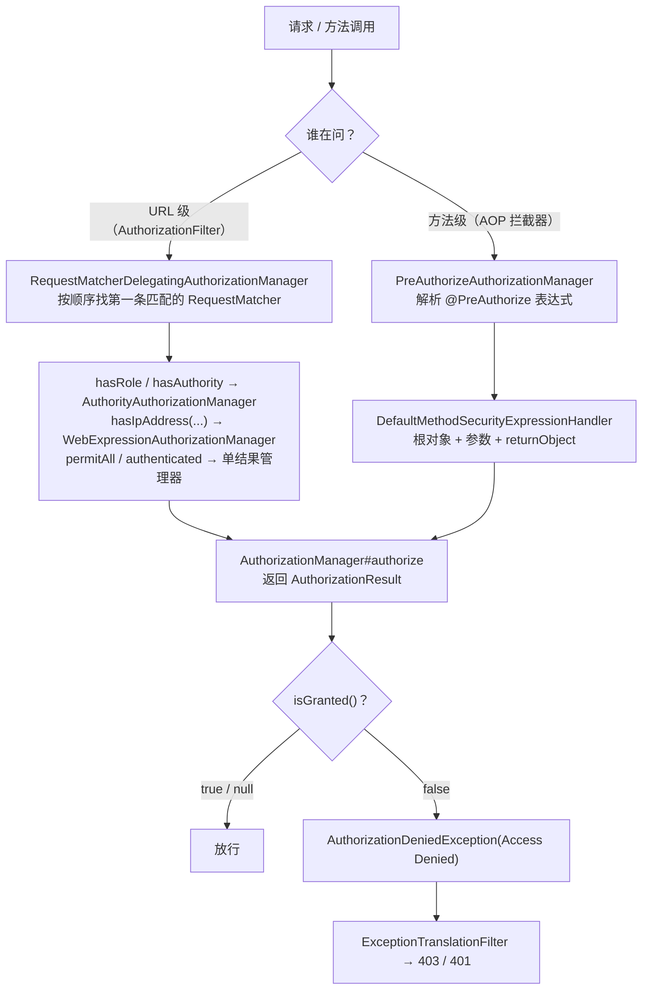

# 02 授权与方法级安全（Spring Security 7.2.0）

> 一句话结论：Spring Security 的"授权"有**两道串联的门**——URL 级的 `AuthorizationFilter` 在过滤器链末尾按"第一个匹配的规则"做决定；方法级的 `@PreAuthorize` 则是 **AOP 代理 + 拦截器**，在方法执行前把 SpEL 表达式算成 `AuthorizationResult`。两道门共用同一个抽象 `AuthorizationManager`，任何一道拒绝，请求就被拒绝。
> 阅读前置：读完 [01-过滤器链与认证](../01-过滤器链与认证/README.md)（知道 `FilterChainProxy`、`SecurityContextHolder`、`Authentication` 是什么）；方法级那一篇还需要知道 Spring AOP "代理"的概念（文中会补）。
> 预计阅读：README 8 分钟 + 两篇正文各 50 分钟 ｜ 源码：spring-security-core@7.2.0、spring-security-web@7.2.0、spring-security-config@7.2.0

---

## 0. 为什么先学"URL 级"再学"方法级"

零基础读者最常见的两个误解：

- **"加了 `@PreAuthorize` 就安全了"**——可它连注解都不会自己执行，背后是一整套 AOP 装配，一个 `private` 或一次自调用就能让它失效。
- **"URL 规则写好了就不需要方法注解"**——URL 级只看得到路径和请求参数；`/orders/{id}` 是不是**本人**的订单，只有到了方法层、拿到参数和返回值才能判断。

所以顺序是：**先搞清"一个 `AuthorizationManager` 怎么做决定、URL 级怎么把规则表委托给它" → 再看"同一个 `AuthorizationManager` 怎么被搬到 AOP 拦截器里、在方法前后生效"。**

```text
请求 ──► 过滤器链 ──► AuthorizationFilter ──► DispatcherServlet ──► Controller ──► Service 代理
              │                                                                 │
              └─ URL 级：RequestMatcherDelegatingAuthorizationManager                 └─ 方法级：AuthorizationManagerBeforeMethodInterceptor
                        （第一条匹配的规则）                                                    （@PreAuthorize 表达式）
```

> 记住这句话：**认证回答"你是谁"，授权回答"你能做什么"。本组两篇都在回答后者，只是一个站在过滤器上，一个站在代理上。**

---

## 1. 本组文章的学习地图



> 读图说明：图的重点在 **`G` 节点**——两条完全不同的路径（URL 规则表、方法表达式）最终都汇到 `AuthorizationManager#authorize`，产出同一种 `AuthorizationResult`。这就是为什么 Spring Security 6 之后能把两套体系统一起来。`H` 节点的 `null` 分支值得注意：管理器返回 `null` 表示"弃权"，而不是拒绝。

---

## 2. 两篇文章在讲什么

| 序号 | 文章 | 回答的问题 | 核心类 |
| --- | --- | --- | --- |
| 01 | [01-authorization-授权决策与authorizationmanager.md](01-authorization-授权决策与authorizationmanager.md) | `AuthorizationManager` 契约是什么？`authorizeHttpRequests()` 的规则表怎么变成 `AuthorizationFilter`？`hasRole` 怎么加前缀？为什么第一个匹配就停？拒绝后 401 与 403 怎么分？ | `AuthorizationManager`、`AuthorizationResult`、`AuthorizationDecision`、`AuthorizationFilter`、`RequestMatcherDelegatingAuthorizationManager`、`AuthorityAuthorizationManager`、`AuthorizationManagers`、`SecurityExpressionRoot` |
| 02 | [02-methodsecurity-prepostauthorize-与-代理.md](02-methodsecurity-prepostauthorize-与-代理.md) | `@EnableMethodSecurity` 注册了什么？代理怎么套上去的？`@PreAuthorize` 字符串怎么变成允许/拒绝？自调用为什么不生效？四个拦截器顺序谁定？ | `EnableMethodSecurity`、`PrePostMethodSecurityConfiguration`、`AuthorizationManagerBeforeMethodInterceptor`、`PreAuthorizeAuthorizationManager`、`DefaultMethodSecurityExpressionHandler`、`MethodSecurityExpressionRoot`、`AuthorizationInterceptorsOrder` |

**建议顺序**：01 先读（02 篇默认你已认识 `AuthorizationManager`、`AuthorizationResult`、`AuthorizationDeniedException` 和 `SecurityExpressionRoot#hasRole`），02 后读。

**与其它目录的关系**：
- 依赖 [01-过滤器链与认证](../01-过滤器链与认证/README.md)：`ExceptionTranslationFilter` 把 `AccessDeniedException` 翻译成 401/403，`SecurityContextHolder` 提供 `Authentication`。
- 依赖 [../](../README.md) 之外 Spring AOP 的 `CglibAopProxy` / `ProxyFactory`（02 篇只讲"代理怎么被用"，不讲"代理怎么生成"）。

---

## 3. 学完能做到什么

- 看到一段 `authorizeHttpRequests()` 配置，能画出它对应的 `RequestMatcher` 列表，并指出某条请求会命中哪一行、为什么后面的规则不生效。
- 知道 `hasRole('ADMIN')`、`hasAuthority('ADMIN')`、`hasAuthority('ROLE_ADMIN')` 三者在 7.2.0 里的精确差异，以及 `ROLE_` 前缀从哪里来、怎么改。
- 能用 `AuthorizationManagers.allOf / anyOf / not` 组合出"满足 A 且（B 或 C）"这类规则，并解释返回 `null` 的含义。
- 能解释"为什么我加了 `@PreAuthorize` 却不生效"的五种原因（没开开关、自调用、`private`/`final`、bean 不是 Spring 管理的、表达式里角色前缀写错）。
- 能写出 `@HandleAuthorizationDenied` + 自定义处理器，让越权时返回空集合而不是 500。
- 能回答"`@PreAuthorize` 与 `@Transactional` 谁先执行"，并知道怎么调。
- 能把 `WebSecurityConfigurerAdapter` / `authorizeRequests` / `@EnableGlobalMethodSecurity` 三类旧写法迁移到 7.2.0 的等价写法。

---

## 4. 版本基线与源码核对方式

- 基线：`spring-security-core/web/config:7.2.0`（Spring Boot 4.x 对应行）。
- 所有 ```java (src: 文件#L起-L止)``` 代码块均来自 `assets/source/*.java.md`，可用 `node tools/check-doc.mjs` 逐字符核对。
- 两篇都单列 ⚠️版本差异一节；凡本次未入库验证的点（如 `ExpressionUtils`、`AbstractExpressionAttributeRegistry`、`AopAutoConfiguration` 的内部行为）均在正文中标注"未验证"或"经验性结论"。
