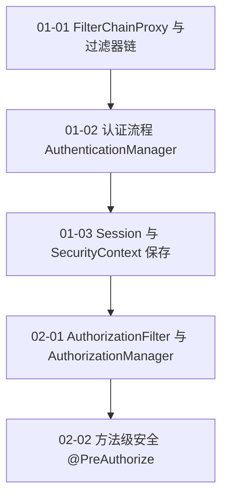

# 05 Spring Security（过滤器链 / 认证 / 授权）

> 目标：把 `@PreAuthorize("hasRole('ADMIN')")` 这类"一行注解"拆到具体的过滤器与方法拦截器。
> 版本基线：`spring-security@7.2.0`

## 学习目标

- 知道安全能力本质是 **一条 Servlet Filter 链**（`springSecurityFilterChain`）。
- 能讲清 `AuthenticationManager` → `ProviderManager` → `AuthenticationProvider` 的认证流程。
- 能说清 `AuthorizationFilter` 与 `@PreAuthorize`（方法级）分别在什么时候执行、谁先谁后。
- 知道 6/7 的 `SecurityFilterChain` 多链匹配（`securityMatcher`）与 5.x 的 `WebSecurityConfigurerAdapter` 的差别。

## 文章顺序

> 读图说明：`A → B` 是"进门先认证"，`C → D` 是"有身份再谈权限"；`D → E` 只在方法被调用时才触发，所以能看到"接口能进但方法报 403"的现象。

## 子目录

| 目录 | 内容 | 学完能做到 |
| --- | --- | --- |
| `01-过滤器链与认证` | `DelegatingFilterProxy`、`FilterChainProxy`、`ProviderManager`、`UserDetailsService` | 排查"为什么一直 302 到登录页" |
| `02-授权与方法级安全` | `AuthorizationManager`、`@EnableMethodSecurity`、`AuthorizationAdvisor` | 设计 RBAC 与数据权限 |

## 依赖关系

- 前置：`01-Spring框架/04-SpringMVC`（Servlet 过滤链）、`01-Spring框架/02-AOP`（方法级安全靠 AOP）。
- 后续：`06-SpringAI` 的工具调用确认也复用"授权"思路。

## 学习检查点

- [ ] 能列出默认过滤器链里至少 8 个过滤器的顺序与作用。
- [ ] 能解释 `SecurityContextHolder` 的三种策略（`MODE_THREADLOCAL` / `INHERITABLETHREADLOCAL` / `MODE_GLOBAL`）。
- [ ] 能说清 `AuthenticationManager` 的 `ProviderManager` 如何按 `supports()` 选 Provider。
- [ ] 能解释为什么 `@PreAuthorize` 在同类自调用时失效。
