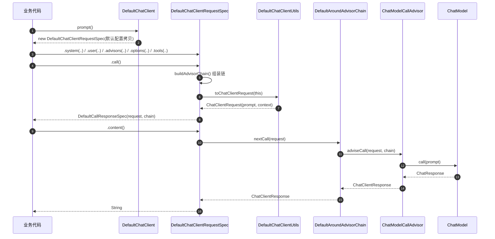

# ChatClient 链式 API 源码解析：从 `prompt()` 到 `ChatModel#call`

> 一句话结论：`ChatClient` 只是"把链式调用固化成 `ChatClientRequest` + 组装一条 Advisor 链"的门面，真正发请求的是链尾的 `ChatModelCallAdvisor` → `ChatModel#call(Prompt)`。
> 阅读前置：`01-Spring框架/02-AOP`（拦截器链/`Ordered`）、`02-SpringBoot/02-自动配置`（`Builder` 与 prototype bean）；本文会解释 tool call、embedding 等 AI 概念。
> 预计阅读: 45 分钟 ｜ 源码: `spring-ai-client-chat:2.1.0`、`spring-ai-model:2.1.0`

## 0. 先看现象

一段最普通的调用：

```java
String answer = chatClient.prompt()
    .system("你是资产中心的运维助手")
    .user("帮我总结今天的告警")
    .call()
    .content();
```

几个反直觉的点，先抛出来：

1. `prompt()` 之后跟了一长串方法，但**一个网络请求都没发**；直到 `.content()`（终结操作）才真正执行。
2. `.call()` 里其实**已经**做了两件重活：把 spec 转成 `ChatClientRequest`、把 Advisor 链建好。
3. `.user("A").user("B")` 只会保留 `"B"` —— 这里是**覆盖**语义，不是追加。
4. `ChatClient` 本身线程安全，但 `prompt()` 之后拿到的那串链**不**线程安全，而且**只能用一次**（链里的 `Deque` 会被 `pop()` 空）。

本文就沿着这条链把源码走一遍，最后回答"为什么".">.

**AI 概念速览（零基础先看这段）**

- **大模型（LLM）**：输入一段文本（prompt），输出一段文本（completion）。
- **token**：模型计量文本的单位，约等于"词/字片段"。计费、上下文长度都按 token 算。
- **tool call（工具调用）**：模型不直接答，而是回一个"我想调用 `getWeather(city=…)`"的结构化请求；框架替它执行本地方法，再把结果喂回去。
- **embedding（向量化）**：把文本变成一串 `float`（如 1536 维），语义相近的文本向量距离近。RAG 的基础。
- **结构化输出**：要求模型只返回 JSON，并把它反序列化成 Java 对象。

## 1. 整体地图



**读图说明**

- 上半段（1–7）是"**组装期**"：纯内存操作，不碰网络。`prompt()` 每次都会用默认配置做一次拷贝构造，所以不同的请求之间互不干扰。
- 第 8 步 `buildAdvisorChain()` 会**自动补两个链尾 Advisor**：`ChatModelCallAdvisor`、`ChatModelStreamAdvisor`。这就是"链的终点一定是模型调用"的落点。
- 第 9 步 `toChatClientRequest(this)` 把散落在一堆字段里的 system/user/messages/options/tools 拼成一个 `ChatClientRequest`。**消息顺序、options 合并顺序**全在这一个方法里，是踩坑最密集的地方。
- 下半段（12–17）是"**执行期**"：`nextCall` 是一次性的，Advisor 从 `Deque` 里逐个 `pop()` 出来，最后一个 `ChatModelCallAdvisor` 才是真正调 `ChatModel#call(Prompt)` 的那一环。

## 2. 关键类逐个拆

| 类 | 职责 | 关键点 |
| --- | --- | --- |
| `ChatClient`（interface） | 门面接口：`create/builder/prompt/mutate` | `create(...)` 内部就是 `builder(...).build()`；`prompt()` 返回可变 spec |
| `DefaultChatClient` | 唯一实现，持有 `defaultChatClientRequest` | `prompt()` 用拷贝构造派生独立 spec，所以**客户端线程安全** |
| `DefaultChatClientBuilder` | 默认配置（默认 system/user/advisor/tools） | 构造时若没给 `ToolCallingAdvisor.Builder` 会**自动建一个** |
| `DefaultChatClientRequestSpec` | 链式调用的载体，一堆可变字段 | `call()/stream()` 是分界点：之后不可再改 |
| `DefaultChatClientUtils` | 包私有工具，spec → `ChatClientRequest` | 消息顺序：system → messages → user；options：模型默认 + 请求覆盖 |
| `ChatClientRequest` | `record(Prompt prompt, Map context)` | `context` 是 `ConcurrentHashMap`，Advisor 之间靠它传参 |
| `ChatModel` | 模型抽象：`call(Prompt) → ChatResponse` | 同时继承 `StreamingChatModel`，流式是同一接口 |
| `ChatResponse` | `List<Generation>` + `ChatResponseMetadata` | finish reason 在 `Generation` 上，token 用量在 metadata 上 |
| `BeanOutputConverter` | JSON → Java 对象 | `getFormat()` 生成"只许返回 JSON"的指令，`convert()` 负责清洗+反序列化 |

## 3. 源码逐段精读

### 3.1 入口：`ChatClient.create(...)` 与 `builder(...)`

```java (src: ChatClient.java#L61-L89)
public interface ChatClient {

	static ChatClient create(ChatModel chatModel) {
		return create(chatModel, ObservationRegistry.NOOP);
	}

	static ChatClient create(ChatModel chatModel, ObservationRegistry observationRegistry) {
		return create(chatModel, observationRegistry, null, null);
	}

	static ChatClient create(ChatModel chatModel, ObservationRegistry observationRegistry,
			@Nullable ChatClientObservationConvention chatClientObservationConvention,
			@Nullable AdvisorObservationConvention advisorObservationConvention) {
		Assert.notNull(chatModel, "chatModel cannot be null");
		Assert.notNull(observationRegistry, "observationRegistry cannot be null");
		return builder(chatModel, observationRegistry, chatClientObservationConvention, advisorObservationConvention)
			.build();
	}

	static Builder builder(ChatModel chatModel) {
		return builder(chatModel, ObservationRegistry.NOOP, null, null);
	}

	static Builder builder(ChatModel chatModel, ObservationRegistry observationRegistry,
			@Nullable ChatClientObservationConvention chatClientObservationConvention,
			@Nullable AdvisorObservationConvention advisorObservationConvention) {
		return builder(chatModel, observationRegistry, chatClientObservationConvention, advisorObservationConvention,
				null);
	}
```

- **在干什么**：`create` 是 `builder(...).build()` 的语法糖；4 参数 `builder` 再转发给 5 参数版本，最后一位 `ToolCallingAdvisor.Builder` 传 `null`。
- **为什么这么写**：`null` 不是"没有工具能力"，而是"交给 `DefaultChatClientBuilder` 用默认值补"。默认值里包含一个用同一个 `ObservationRegistry` 构造的 `ToolCallingManager`，这样观测数据能串起来。
- **如果改成别的会怎样**：如果 `create` 里直接 `new DefaultChatClient(...)`，你就失去了"先配置默认值再 build"的能力，`ChatClient.builder()` 那条路也得复制一遍逻辑。
- **常见坑**：`ObservationRegistry.NOOP` 是默认值 —— **默认没有可观测性**。Spring Boot 自动配置会注入真实 registry，但你手写 `ChatClient.create(model)` 时链路追踪是空的。

```java (src: ChatClient.java#L117-L132)
	static Builder builder(ChatModel chatModel, ObservationRegistry observationRegistry,
			@Nullable ChatClientObservationConvention chatClientObservationConvention,
			@Nullable AdvisorObservationConvention advisorObservationConvention,
			ToolCallingAdvisor.@Nullable Builder<?> toolCallingAdvisorBuilder) {
		Assert.notNull(chatModel, "chatModel cannot be null");
		Assert.notNull(observationRegistry, "observationRegistry cannot be null");

		return new DefaultChatClientBuilder(chatModel, observationRegistry, chatClientObservationConvention,
				advisorObservationConvention, toolCallingAdvisorBuilder);
	}

	ChatClientRequestSpec prompt();

	ChatClientRequestSpec prompt(String content);

	ChatClientRequestSpec prompt(Prompt prompt);
```

- **在干什么**：5 参数版本是唯一的"真入口"，直接 `new DefaultChatClientBuilder(...)`。
- **为什么这么写**：把 `ToolCallingAdvisor.Builder` 暴露出来，是为了让调用方能定制工具调用的**顺序、上限、是否保留历史**，而不只是"开关工具"。
- **常见坑**：注意签名里是 `ToolCallingAdvisor.@Nullable Builder<?>` —— 注解修饰的是**类型参数位置**而不是整个参数，这是 JSpecify 的写法；抄代码时不要写成 `@Nullable ToolCallingAdvisor.Builder<?>`（语义不同，某些静态分析会报错）。

### 3.2 `DefaultChatClientBuilder`：默认配置的容器

```java (src: DefaultChatClientBuilder.java#L98-L120)
	public DefaultChatClientBuilder(ChatModel chatModel, ObservationRegistry observationRegistry,
			@Nullable ChatClientObservationConvention chatClientObservationConvention,
			@Nullable AdvisorObservationConvention advisorObservationConvention,
			ToolCallingAdvisor.@Nullable Builder<?> toolCallingAdvisorBuilder) {
		Assert.notNull(chatModel, "the " + ChatModel.class.getName() + " must be non-null");
		Assert.notNull(observationRegistry, "the " + ObservationRegistry.class.getName() + " must be non-null");

		toolCallingAdvisorBuilder = Objects.requireNonNullElse(toolCallingAdvisorBuilder, ToolCallingAdvisor.builder()
			.toolCallingManager(ToolCallingManager.builder().observationRegistry(observationRegistry).build()));

		this.defaultRequest = new DefaultChatClientRequestSpec(chatModel, null, Map.of(), Map.of(), null, Map.of(),
				Map.of(), List.of(), List.of(), List.of(), List.of(), null, List.of(), Map.of(), observationRegistry,
				chatClientObservationConvention, Map.of(), null, advisorObservationConvention,
				toolCallingAdvisorBuilder);
	}

	public ChatClient build() {
		return new DefaultChatClient(this.defaultRequest);
	}

	public Builder clone() {
		return this.defaultRequest.mutate();
	}
```

- **在干什么**：构造一个装满默认值的 `DefaultChatClientRequestSpec`，`build()` 拿它 new 出 `DefaultChatClient`；`clone()` 从当前默认值派生一个新 Builder。
- **为什么这么写**：Builder 不自己存一堆字段，而是**直接复用 spec 作为默认值容器**（`defaultRequest`）。这样"默认值"和"请求值"用同一套字段、同一套拷贝逻辑，少一份状态就少一类 bug。
- **如果改成别的会怎样**：如果 Builder 自己存 `defaultSystem/defaultUser/...`，那 `mutate()` 就得把 spec 拆回 Builder 字段，代码量翻倍且容易漏字段。
- **常见坑**：`defaultRequest` 是 `protected` 且**被直接引用**（不是拷贝）传给 `DefaultChatClient`。所以 `Builder.build()` 出来的 `ChatClient` 与 Builder **共享**同一个默认 spec；好在 `prompt()` 会拷贝，所以后续改 Builder（`builder.defaultUser("x")`）会影响已经 build 出来的 `ChatClient` 的**后续请求**。这就是"`ChatClient.Builder` 是 prototype bean、且不该在运行期继续改"的原因。

### 3.3 `prompt()`：拷贝构造出的可变 spec

```java (src: DefaultChatClient.java#L111-L120)
	@Override
	public ChatClientRequestSpec prompt() {
		return new DefaultChatClientRequestSpec(this.defaultChatClientRequest);
	}

	@Override
	public ChatClientRequestSpec prompt(String content) {
		Assert.hasText(content, "content cannot be null or empty");
		return prompt(new Prompt(content));
	}
```

- **在干什么**：`prompt()` 拿默认配置做**拷贝构造**，返回一个新的 `DefaultChatClientRequestSpec`；`prompt(String)` 先把字符串包成 `Prompt`，再走 `prompt(Prompt)`。
- **为什么这么写**：`DefaultChatClientRequestSpec` 内部是一堆可变字段，如果不拷贝，两次 `prompt()` 会共用同一个实例，第二个请求会带上第一个请求的 user 消息。
- **如果改成别的会怎样**：改成共享单例会立刻出现"消息串话"，而且在高并发下是数据竞争。
- **常见坑**：正因为是拷贝，**`ChatClient` 本身线程安全**，但你在 `prompt()` 之后拿到的那个 `ChatClientRequestSpec` 是**有状态的、非线程安全的**，不要跨线程复用。

### 3.4 `.system(...)` / `.user(...)`：覆盖而非追加

```java (src: DefaultChatClient.java#L1143-L1187)
		@Override
		public ChatClientRequestSpec system(String text) {
			Assert.hasText(text, "text cannot be null or empty");
			this.systemText = text;
			return this;
		}
		...
		@Override
		public ChatClientRequestSpec user(String text) {
			Assert.hasText(text, "text cannot be null or empty");
			this.userText = text;
			return this;
		}
```

- **在干什么**：两者都只是给 spec 的**单个字段**赋值（`systemText` / `userText`），返回 `this` 继续链式。
- **为什么这么写**：注意字段是**单值**而不是 `List`。所以重复调用 `.user("A").user("B")` 最终只有 `"B"`。这与 `DefaultChatClientBuilder#defaultUser(...)` 配合工作时很直观：默认值会被请求值覆盖。
- **如果改成别的会怎样**：如果改成 `List` 追加，`defaultUser` 与 `.user(...)` 的合并语义就变得含糊（到底拼还是替），而且很容易把 system 与 user 混在一起。
- **常见坑**：**多个 user 消息要用 `.messages(...)`**，不是链式 `.user()`。`DefaultChatClientUtils` 里的顺序是"system → messages → user"，所以 `.messages(userMsg).user(extra)` 会得到两个 user 消息，顺序是 `messages` 在前、`.user()` 在后。

```java (src: DefaultChatClient.java#L1209-L1220)
		@Override
		public ChatClientRequestSpec user(Consumer<PromptUserSpec> consumer) {
			Assert.notNull(consumer, "consumer cannot be null");

			var us = new DefaultPromptUserSpec();
			consumer.accept(us);
			this.userText = StringUtils.hasText(us.text()) ? us.text() : this.userText;
			this.userParams.putAll(us.params());
			this.media.addAll(us.media());
			this.userMetadata.putAll(us.metadata());
			return this;
		}
```

- **在干什么**：`user(Consumer)` 版本支持模板变量（`params`）、多模态（`media`）与元数据（`metadata`）。文本仍然是"有则覆盖、无则保留"。
- **为什么这么写**：`params`/`media`/`metadata` 用 `putAll`/`addAll` 累加，只有 `text` 用覆盖 —— 因为文本是"主体"，而参数/媒体是"附件"。
- **常见坑**：`params()` 是模板变量，只有配合 `{}` 占位符（`StTemplateRenderer` 语法）才生效。**注意 `StTemplateRenderer` 在独立的 `spring-ai-template-st` 模块里，本仓库未入库**，因此 `{}` 的确切语法细节请以官方文档为准；`DefaultChatClient` 默认用的正是 `StTemplateRenderer.builder().build()`。

### 3.5 `.call()`：分界点

```java (src: DefaultChatClient.java#L1229-L1256)
		@Override
		public CallResponseSpec call() {
			BaseAdvisorChain advisorChain = buildAdvisorChain();
			return new DefaultCallResponseSpec(DefaultChatClientUtils.toChatClientRequest(this), advisorChain,
					this.observationRegistry, this.chatClientObservationConvention);
		}

		@Override
		public StreamResponseSpec stream() {
			BaseAdvisorChain advisorChain = buildAdvisorChain();
			return new DefaultStreamResponseSpec(DefaultChatClientUtils.toChatClientRequest(this), advisorChain,
					this.observationRegistry, this.chatClientObservationConvention);
		}

		private BaseAdvisorChain buildAdvisorChain() {
			autoRegisterToolCallingAdvisor();
			validateSingleToolAdvisor();

			// At the stack bottom add the model call advisors.
			// They play the role of the last advisors in the advisor chain.
			List<Advisor> chain = new ArrayList<>(this.advisors);
			chain.add(ChatModelCallAdvisor.builder().chatModel(this.chatModel).build());
			chain.add(ChatModelStreamAdvisor.builder().chatModel(this.chatModel).build());

			return DefaultAroundAdvisorChain.builder(this.observationRegistry)
				.observationConvention(this.advisorObservationConvention)
				.pushAll(chain)
				.build();
```

- **在干什么**：先调 `autoRegisterToolCallingAdvisor()`（若无 `ToolAdvisor` 则自动加一个 `ToolCallingAdvisor`）、再校验"最多一个 ToolAdvisor"，然后把用户 Advisor 复制一份、**在末尾追加两个模型调用 Advisor**，交给 `DefaultAroundAdvisorChain.builder(...).pushAll(...)`。
- **为什么这么写**：把 `toChatClientRequest(this)` 放在 `call()` 里（而不是 `content()` 里）意味着**输入在 `call()` 时刻冻结**。这样 `.content()` / `.entity(X.class)` 无论调哪个、调几次，看到的都是同一份输入。
- **如果改成别的会怎样**：如果把 `toChatClientRequest` 推迟到终结操作，那么 `call()` 之后偷偷改 spec 也会生效，行为不可预测；同时 `buildAdvisorChain()` 也只建一次，避免重复注册。
- **常见坑（很重要）**：`DefaultAroundAdvisorChain` 用的是**可变 `Deque`**，`nextCall` 里 `pop()` 消费。所以**一个 `CallResponseSpec` 只能终结一次**；第二次终结会抛 `IllegalStateException("No CallAdvisors available to execute")`。要多次拿结果，就重新 `prompt()`。

### 3.6 `DefaultChatClientUtils#toChatClientRequest`：消息顺序与 options 合并

```java (src: DefaultChatClientUtils.java#L57-L97)
		List<Message> processedMessages = new ArrayList<>();

		// System Text => First in the list
		String processedSystemText = inputRequest.getSystemText();
		if (StringUtils.hasText(processedSystemText)) {
			if (!CollectionUtils.isEmpty(inputRequest.getSystemParams())) {
				processedSystemText = PromptTemplate.builder()
					.template(processedSystemText)
					.variables(inputRequest.getSystemParams())
					.renderer(inputRequest.getTemplateRenderer())
					.build()
					.render();
			}
			processedMessages.add(SystemMessage.builder()
				.text(processedSystemText)
				.metadata(inputRequest.getSystemMetadata())
				.build());
		}

		// Messages => In the middle of the list
		if (!CollectionUtils.isEmpty(inputRequest.getMessages())) {
			processedMessages.addAll(inputRequest.getMessages());
		}

		// User Text => Last in the list
		String processedUserText = inputRequest.getUserText();
		if (StringUtils.hasText(processedUserText)) {
			if (!CollectionUtils.isEmpty(inputRequest.getUserParams())) {
				processedUserText = PromptTemplate.builder()
					.template(processedUserText)
					.variables(inputRequest.getUserParams())
					.renderer(inputRequest.getTemplateRenderer())
					.build()
					.render();
			}
			processedMessages.add(UserMessage.builder()
				.text(processedUserText)
				.media(inputRequest.getMedia())
				.metadata(inputRequest.getUserMetadata())
				.build());
		}
```

- **在干什么**：把三类输入按固定顺序拼成 `List<Message>`：**先 system、再 messages、最后 user**。有 `params` 时先用 `PromptTemplate` 渲染，再包成 `SystemMessage` / `UserMessage`。
- **为什么这么写**：绝大多数厂商模型要求 system 在**最前**、最新 user 在**最后**。把这个顺序固化在一个私有工具方法里，所有入口（`prompt(String)`、`prompt(Prompt)`、默认配置）都自动一致。
- **如果改成别的会怎样**：如果让调用方自己决定插入位置，会出现"system 夹在两条 user 之间"的请求 —— 多数模型能接受但效果明显变差，有的厂商直接报错。
- **常见坑**：`messages(...)` 里的消息**原样插入中间**，不会被重新排序。所以如果你 `messages(systemMsg)` 又 `.system(...)`，会得到**两个 system 消息**（一个中间一个最前），部分模型会拒收。

```java (src: DefaultChatClientUtils.java#L103-L126)
		ChatOptions.Builder<?> builder = inputRequest.getChatModel().getOptions().mutate();
		if (inputRequest.getOptionsCustomizer() != null) {
			builder = builder.combineWith(inputRequest.getOptionsCustomizer());
		}

		if (builder instanceof ToolCallingChatOptions.Builder<?> tbuilder) {

			List<ToolCallback> toolCallbacks = new ArrayList<>(inputRequest.getToolCallbacks());
			for (var provider : inputRequest.getToolCallbackProviders()) {
				toolCallbacks.addAll(java.util.List.of(provider.getToolCallbacks()));
			}

			if (!toolCallbacks.isEmpty()) {
				ToolCallingChatOptions.validateToolCallbacks(toolCallbacks);
				tbuilder.toolCallbacks(toolCallbacks);
			}

			if (!inputRequest.getToolContext().isEmpty()) {
				tbuilder.toolContext(inputRequest.getToolContext());
			}

		}

		ChatOptions processedChatOptions = builder.build();
```

- **在干什么**：**先取模型自带的默认 options（`getChatModel().getOptions().mutate()`），再用请求里的 customizer 覆盖（`combineWith`）**；随后如果是 `ToolCallingChatOptions.Builder`，把工具回调（含 `ToolCallbackProvider` 展开的）合并、校验重名、设置 `toolContext`。
- **为什么这么写**：`combineWith` 的语义是"用 other 的**非 null** 值覆盖自己"。所以优先级是 **请求级 options > 模型默认 options**；模型默认值不会被请求里没提到的字段清空。
- **如果改成别的会怎样**：如果反过来（请求先、默认后覆盖），你在 `.options(o -> o.temperature(0))` 设的值会被模型默认值盖掉 —— 这是最隐蔽的坑之一。
- **常见坑**：①只有 `builder instanceof ToolCallingChatOptions.Builder` 才会挂工具，若自定义了别的 `ChatOptions` 实现，工具会被**静默丢弃**；②`validateToolCallbacks` 会因为**工具重名**抛 `IllegalStateException`，多个 `@Tool` bean 里同方法名很常见。

### 3.7 `ChatModel` / `StreamingChatModel` / `EmbeddingModel` / `ImageModel` 的契约

```java (src: ChatModel.java#L30-L54)
public interface ChatModel extends Model<Prompt, ChatResponse>, StreamingChatModel {

	default @Nullable String call(String message) {
		Prompt prompt = new Prompt(new UserMessage(message));
		Generation generation = call(prompt).getResult();
		return (generation != null) ? generation.getOutput().getText() : "";
	}

	default @Nullable String call(Message... messages) {
		Prompt prompt = new Prompt(Arrays.asList(messages));
		Generation generation = call(prompt).getResult();
		return (generation != null) ? generation.getOutput().getText() : "";
	}

	@Override
	ChatResponse call(Prompt prompt);

	/**
	 * Gets the chat options for this model.
	 * @return the chat options
	 * @since 2.0.0
	 */
	default ChatOptions getOptions() {
		return ChatOptions.builder().build();
	}
```

- **在干什么**：`ChatModel` 的核心只有一个抽象方法 `call(Prompt) → ChatResponse`；另外两个 `call(String)` / `call(Message...)` 是便利方法（把字符串包成 `UserMessage`，取第一个 `Generation` 的文本，null 时返回 `""`）。`getOptions()` 是 2.0 新增的"模型默认 options"。
- **为什么这么写**：`ChatModel` **同时继承 `StreamingChatModel`**，意味着"一次问答"和"逐字返回"是同一个模型对象（默认 `stream` 抛 `UnsupportedOperationException`）。这让 `ChatClient` 可以在同一个 provider bean 上同时提供 `.call()` 与 `.stream()`。
- **如果改成别的会怎样**：如果把流式拆成独立接口，Spring Boot 自动配置就得注册两个 bean，`ChatClient` 也得判断"这个模型支持流式吗"，调用方要多写分支。
- **常见坑**：`call(String)` 会**丢掉 metadata 和 tool call**，只取文本。想拿 token 用量、finish reason、工具调用，必须用 `call(Prompt)` + `ChatResponse`。

`StreamingChatModel` 的契约（同样在 `ChatModel.java` 同包，本仓库已入库 `StreamingChatModel.java`）：

```java
@FunctionalInterface
public interface StreamingChatModel extends StreamingModel<Prompt, ChatResponse> {
	default Flux<String> stream(String message) { ... }
	Flux<ChatResponse> stream(Prompt prompt);   // 真实契约
}
```

（以上为**结构示意**，非逐行摘录；逐行原文见 `assets/source/StreamingChatModel.java.md`，本文不重复摘录。）

`EmbeddingModel` 的常用入口：

```java (src: EmbeddingModel.java#L83-L90)
	default List<float[]> embed(List<String> texts) {
		Assert.notNull(texts, "Texts must not be null");
		return this.call(new EmbeddingRequest(texts, EmbeddingOptions.builder().build()))
			.getResults()
			.stream()
			.map(Embedding::getOutput)
			.toList();
	}
```

- **在干什么**：批量文本 → 批量向量。返回 `List<float[]>`，每个 `float[]` 就是一个 embedding（比如 1536 维）。
- **常见坑**：`dimensions()` 的默认实现是 `embed("Test String").length` —— **会真的发一次远程请求**。生产环境请在自己的实现里覆写它。

`ImageModel` 更简单：`@FunctionalInterface interface ImageModel extends Model<ImagePrompt, ImageResponse>`，只有一个 `call(ImagePrompt)`。

### 3.8 `Prompt` 与 `ChatResponse`：一次问答的两端

```java (src: Prompt.java#L84-L100)
	public String getContents() {
		StringBuilder sb = new StringBuilder();
		for (Message message : getInstructions()) {
			sb.append(message.getText());
		}
		return sb.toString();
	}

	@Override
	public @Nullable ChatOptions getOptions() {
		return this.chatOptions;
	}

	@Override
	public List<Message> getInstructions() {
		return this.messages;
	}
```

- **在干什么**：`Prompt` = **`List<Message>`（`getInstructions()`）+ `ChatOptions`（`getOptions()`）**。`getContents()` 只是把所有消息文本拼起来给人看。
- **为什么这么写**：`getInstructions()` 直接返回内部引用（不拷贝），因为下游（工具循环、RAG、记忆）每轮都要"在原有消息基础上追加"，拷贝开销大；**不可变性靠约定 + `mutate()` 生成新对象**。
- **常见坑**：①`getOptions()` **可能为 null**（所以 `DefaultChatClientUtils` 用的是模型侧的 `getChatModel().getOptions()`）；②`getInstructions()` 返回的是可变引用，别在业务代码里 `add`。

```java (src: ChatResponse.java#L86-L118)
	@Override
	public List<Generation> getResults() {
		return this.generations;
	}

	/**
	 * @return Returns the first {@link Generation} in the generations list.
	 */
	public @Nullable Generation getResult() {
		if (CollectionUtils.isEmpty(this.generations)) {
			return null;
		}
		return this.generations.get(0);
	}

	/**
	 * @return Returns {@link ChatResponseMetadata} containing information about the use
	 * of the AI provider's API.
	 */
	@Override
	public ChatResponseMetadata getMetadata() {
		return this.chatResponseMetadata;
	}

	/**
	 * Whether the model has requested the execution of a tool.
	 */
	public boolean hasToolCalls() {
		if (CollectionUtils.isEmpty(this.generations)) {
			return false;
		}
		return this.generations.stream().anyMatch(generation -> generation.getOutput().hasToolCalls());
	}
```

- **在干什么**：`ChatResponse` = **`List<Generation>`**（一次请求可能有多个候选答案）+ **`ChatResponseMetadata`**（id/model/usage/rateLimit）。
- **关键分工（务必记牢）**：
  - **finish reason** 在 **`Generation#getMetadata()`**（`ChatGenerationMetadata#getFinishReason()`，原生字符串如 `stop` / `end_turn`）上，2.1 起还提供 `getFinishReasonCategory()` 归一化枚举；
  - **token 用量** 在 **`ChatResponseMetadata#getUsage()`** 上；
  - **是否要调工具** 用 `ChatResponse#hasToolCalls()`。
- **常见坑**：`getResult()` 可能返回 `null`（空 candidates），直接 `.getOutput()` 会 NPE。`getMetadata()` 里的 `usage` 默认是 `EmptyUsage`（全 0），**全 0 不等于免费**，可能只是厂商没回。

```java (src: ChatResponseMetadata.java#L80-L91)
	public RateLimit getRateLimit() {
		return this.rateLimit;
	}

	/**
	 * Returns AI provider specific metadata on API usage.
	 * @return AI provider specific metadata on API usage.
	 * @see Usage
	 */
	public Usage getUsage() {
		return this.usage;
	}
```

### 3.9 `call().entity(Class)`：让大模型返回 JSON 的关键

先看结构化输出的**格式指令**是怎么生成的：

```java (src: BeanOutputConverter.java#L213-L224)
	@Override
	public String getFormat() {
		String template = """
				Your response should be in JSON format.
				Do not include any explanations, only provide a RFC8259 compliant JSON response following this format without deviation.
				Do not include markdown code blocks in your response.
				Remove the ```json markdown from the output.
				Here is the JSON Schema instance your output must adhere to:
				```%s```
				""";
		return String.format(template, this.jsonSchema);
	}
```

- **在干什么**：生成一段"提示词"，其中 `%s` 被替换成由 `JsonSchemaGenerator.generateForType(type)` 生成、再被清理过的 JSON Schema。
- **为什么这么写**：把 Java 类型（record/POJO）转成 JSON Schema 塞进 prompt，模型就有了"明确的输出约束"；再配合"不要解释、不要 markdown"，能把 JSON 的命中率拉到很高。
- **常见坑**：这段指令是**拼在最后一条 user 消息末尾**的（见 3.10 的 `ChatModelCallAdvisor`），所以如果你自己在 user 里也写了"输出 JSON"，两套指令会打架。

```java (src: BeanOutputConverter.java#L163-L195)
	private static ResponseTextCleaner createDefaultTextCleaner() {
		return CompositeResponseTextCleaner.builder()
			.addCleaner(new WhitespaceCleaner())
			.addCleaner(new ThinkingTagCleaner())
			.addCleaner(new MarkdownCodeBlockCleaner())
			.addCleaner(new WhitespaceCleaner()) // Final trim after all cleanups
			.build();
	}
	...
	public T convert(String text) {
		// Clean the text using the configured text cleaner
		text = this.textCleaner.clean(text);

		return (T) this.jsonMapper.readValue(text, this.jsonMapper.constructType(this.type));
	}
```

- **在干什么**：`convert()` 先**清洗**（去空白 → 去思考标签（如 Qwen/Nova 的 thinking）→ 去 ```` ```json ```` 代码块 → 再去空白），再用 Jackson 反序列化。
- **为什么这么写**：即使有指令，模型也经常包一层 markdown 或加解释。清洗链把"最常见的不合规"兜住，而不是靠 `readValue` 直接炸。
- **如果改成别的会怎样**：不清洗直接解析，你会在 5%–20% 的请求上收到 `JsonParseException`，而且看起来像随机故障。
- **常见坑**：`getJsonMapper()` 关闭了 `FAIL_ON_UNKNOWN_PROPERTIES` —— 模型多返回字段**不会**报错。反过来说，"字段拼错"也会被静默当成缺失（变 null）。

完整链路（`entity(Class)` 到真正调用）在 `DefaultChatClient` 里：

```java (src: DefaultChatClient.java#L619-L632)
			if (StringUtils.hasText(outputConverter.getFormat())) {
				// Used for default structured output format support, based on prompt
				// instructions.
				this.request.context().put(ChatClientAttributes.OUTPUT_FORMAT.getKey(), outputConverter.getFormat());
			}

			if (Boolean.TRUE
				.equals(this.request.context().get(ChatClientAttributes.STRUCTURED_OUTPUT_NATIVE.getKey()))) {
				// Used for native structured output support, e.g. AI model API should
				// provide structured output support.
				this.request.context()
					.put(ChatClientAttributes.STRUCTURED_OUTPUT_SCHEMA.getKey(), outputConverter.getJsonSchema());

			}
```

再往下一层，由 `ChatModelCallAdvisor` 决定"原生 schema 还是拼文字"：

```java (src: ChatModelCallAdvisor.java#L65-L91)
	private static ChatClientRequest augmentWithFormatInstructions(ChatClientRequest chatClientRequest) {

		String outputFormat = (String) chatClientRequest.context().get(ChatClientAttributes.OUTPUT_FORMAT.getKey());

		String outputSchema = (String) chatClientRequest.context()
			.get(ChatClientAttributes.STRUCTURED_OUTPUT_SCHEMA.getKey());

		if (!StringUtils.hasText(outputFormat) && !StringUtils.hasText(outputSchema)) {
			return chatClientRequest;
		}

		boolean usesNativeStructuredOutput = chatClientRequest.context()
			.containsKey(ChatClientAttributes.STRUCTURED_OUTPUT_NATIVE.getKey());

		if (usesNativeStructuredOutput && StringUtils.hasText(outputSchema) && chatClientRequest.prompt()
			.getOptions() instanceof StructuredOutputChatOptions structuredOutputChatOptions) {

			var augmentedOptions = structuredOutputChatOptions.mutate().outputSchema(outputSchema).build();
			Prompt augmentedPrompt = chatClientRequest.prompt().mutate().chatOptions(augmentedOptions).build();

			return ChatClientRequest.builder().prompt(augmentedPrompt).context(chatClientRequest.context()).build();
		}

		Prompt augmentedPrompt = chatClientRequest.prompt()
			.augmentUserMessage(userMessage -> userMessage.mutate()
				.text(userMessage.getText() + System.lineSeparator() + outputFormat)
				.build());
```

- **在干什么**：如果 context 里同时有"原生结构化输出"标记、schema，以及 options 是 `StructuredOutputChatOptions` → 把 schema 写进 `ChatOptions.outputSchema(...)`；否则把 `outputFormat` 文字拼到最后一条 user 消息末尾。
- **为什么这么写**：原生结构化输出更稳、更省 token，但不是所有厂商支持；做成"能力探测 + 降级"，业务代码无需关心。
- **常见坑**：`useProviderStructuredOutput()` 需要**厂商实现 `StructuredOutputChatOptions`**；否则即使你开了标记，也走文字降级路径。

### 3.10 `.stream()`：`Flux<String>` 的背压与取消

```java (src: DefaultChatClient.java#L753-L788)
		private Flux<ChatClientResponse> doGetObservableFluxChatResponse(ChatClientRequest chatClientRequest) {
			return Flux.deferContextual(contextView -> {

				ChatClientObservationContext observationContext = ChatClientObservationContext.builder()
					.request(chatClientRequest)
					.advisors(this.advisorChain.getStreamAdvisors())
					.stream(true)
					.build();

				Observation observation = ChatClientObservationDocumentation.AI_CHAT_CLIENT.observation(
						this.observationConvention, DEFAULT_CHAT_CLIENT_OBSERVATION_CONVENTION,
						() -> observationContext, this.observationRegistry);

				Observation parentObservation = contextView.getOrDefault(ObservationThreadLocalAccessor.KEY, null);
				observation.parentObservation(parentObservation);
				// Briefly make the parent observation current while starting this one, so
				// Micrometer tracing derives the span's parent from the parent
				// observation rather than from whatever scope happens to be open on the
				// current thread (e.g. the servlet HTTP span). This keeps span parenting
				// correct without relying on automatic context propagation.
				try (Observation.Scope ignored = parentObservation != null ? parentObservation.openScope()
						: Observation.Scope.NOOP) {
					observation.start();
				}

				// @formatter:off
				// Apply the advisor chain that terminates with the ChatModelStreamAdvisor.
				Flux<ChatClientResponse> chatClientResponse = this.advisorChain.nextStream(chatClientRequest)
						.doOnError(observation::error)
						.doFinally(s -> observation.stop())
						.contextWrite(ctx -> ctx.put(ObservationThreadLocalAccessor.KEY, observation));
				// @formatter:on
				return CHAT_CLIENT_MESSAGE_AGGREGATOR.aggregateChatClientResponse(chatClientResponse,
						observationContext::setResponse);
			});
		}
```

- **在干什么**：整个流包在 `Flux.deferContextual` 里（**订阅时才建 observation**），随后交给 `advisorChain.nextStream(...)`，最后挂聚合器。
- **为什么这么写**：`Flux` 是冷的，多次订阅会执行多次。把 observation 的 start/stop 绑在 `doFinally` 上，才能覆盖"完成/取消/错误"三种结局；`deferContextual` 保证**每个订阅者拿到自己的 span**。
- **如果改成别的会怎样**：如果不用 `defer`，那么"建了 Flux 但没订阅"也会留下一个永不结束的 span。
- **常见坑**：`aggregateChatClientResponse` 需要**聚合整个流**（用于 `after()` 与观测），长回答时内存占用与延迟都会上升。

```java (src: DefaultChatClient.java#L801-L811)
		@Override
		public Flux<String> content() {
			// @formatter:off
			return chatResponse()
					.map(r -> Optional.ofNullable(r.getResult())
							.map(Generation::getOutput)
							.map(AbstractMessage::getText)
							.orElse(""))
					.filter(StringUtils::hasLength);
			// @formatter:on
		}
```

- **在干什么**：把每个 `ChatResponse` 的文本取出来（null→`""`），再**丢掉空 chunk**，对外只暴露 `Flux<String>`。
- **为什么这么写**：流式响应中会出现"只有 metadata / 只有工具调用片段"的 chunk，文本是空串；不过滤会让前端收到一堆无意义空事件。
- **常见坑**：**空 chunk 被过滤**意味着你无法通过 `content()` 感知"模型刚开始回但还没出字"。要元信息（含 finish reason、usage 汇总）请用 `.stream().chatResponse()`。

**背压与取消**：`Flux` 天然支持背压 —— 消费端 `request(n)` 才拉 `n` 个 chunk；`.take(3)` 或 WebFlux 客户端断开都会触发 `cancel`，进而关闭底层 HTTP 流（前提是厂商的 `StreamingChatModel` 实现正确释放连接）。`doFinally(s -> observation.stop())` 就是在 `cancel` 时也能收尾。

## 4. 一次完整执行时序

以 `chatClient.prompt().system("S").user("U").options(o -> o.temperature(0.2)).call().content()` 为例：

| # | 位置 | 发生了什么 |
| --- | --- | --- |
| 1 | `DefaultChatClient#prompt()` | 拷贝默认 spec，得到独立可变对象 |
| 2 | `DefaultChatClientRequestSpec#system/user` | 写 `systemText` / `userText`（覆盖语义） |
| 3 | `#options(...)` | 存 `optionsCustomizer` |
| 4 | `#call()` | `buildAdvisorChain()` → 可能自动加 `ToolCallingAdvisor`，末尾追加 `ChatModelCallAdvisor`/`ChatModelStreamAdvisor`，`OrderComparator` 排序后压入 `Deque` |
| 5 | `DefaultChatClientUtils#toChatClientRequest` | 组装消息（system → messages → user）+ options（模型默认 → 请求覆盖）+ toolCallbacks/toolContext → `ChatClientRequest`（context 用 `ConcurrentHashMap` 包 `advisorParams`） |
| 6 | `DefaultCallResponseSpec#content()` | 调 `doGetObservableChatClientResponse(...)` |
| 7 | `DefaultAroundAdvisorChain#nextCall` | 逐个 `pop()` Advisor；空则抛 `IllegalStateException` |
| 8 | （各 Advisor） | 记忆/日志/RAG/工具循环等，最终到链尾 |
| 9 | `ChatModelCallAdvisor#adviseCall` | `augmentWithFormatInstructions` → `chatModel.call(prompt)` |
| 10 | `ChatModel#call(Prompt)` | 厂商实现：HTTP 请求 → `ChatResponse` |
| 11 | 返回链上 | `ChatClientResponse(chatResponse, context)` 逐层 `after()` 装饰 |
| 12 | `DefaultCallResponseSpec#content()` | 从 `ChatResponse` 取文本，`null` → `""` |

## 5. 设计模式与设计取舍

| 模式/取舍 | 体现 | 为什么要这样 |
| --- | --- | --- |
| 建造者（Builder） | `ChatClient.builder(...).defaultSystem(...).build()` | 默认配置与请求配置分离；Builder 可复用（prototype bean） |
| 原型（Prototype）+ 拷贝构造 | `prompt()` → `new DefaultChatClientRequestSpec(default)` | 客户端线程安全、请求之间不串味 |
| 责任链 | `DefaultAroundAdvisorChain#nextCall` 逐个 `pop()` | 与 Spring AOP 的拦截器链同构，顺序可控、可插拔 |
| 模板方法 | `BaseAdvisor#adviseCall` = `before` → `next` → `after` | 自定义 Advisor 只需实现 `before/after` |
| 惰性求值 | `call()` 只建请求，终结操作才执行 | 支持 `.entity()` / `.content()` / `.responseEntity()` 多形态输出 |
| 上下文传参（Context Map） | `ChatClientRequest#context()` | Advisor 之间传 `conversationId`、`OUTPUT_FORMAT` 等，不改 `Prompt` 结构 |
| 能力探测 + 降级 | 原生 `outputSchema` vs 拼文字 | 同一套 API 适配不同厂商能力 |
| Reactive 优先 | `stream()` 返回 `Flux` | 背压、取消、与 WebFlux 天然契合 |

## 6. 踩坑与调试手法

| # | 坑 | 现象 | 原因与解法 |
| --- | --- | --- | --- |
| 1 | `ChatClient` 线程安全吗？ | 多线程共享后偶发消息错乱 | **客户端安全、spec 不安全**。共享 `ChatClient`，每次 `prompt()` 新建 spec；别把 spec 存字段 |
| 2 | `ChatOptions` 覆盖顺序 | `.options(o -> o.temperature(0))` 不生效 | 顺序是 `模型默认 mutate → combineWith(请求)`；若厂商实现忽略该字段（或用模型端默认），请查厂商文档 |
| 3 | `system` 与 `user` 混写 | 出现两个 system / system 不在最前 | `.messages(...)` 原样插中间；不要既 `messages(systemMsg)` 又 `.system(...)` |
| 4 | `.user()` 重复调用 | 前面的 user 文本消失 | `userText` 是单值覆盖；多条用 `.messages(...)` |
| 5 | token 超限 | `400` / `context length exceeded` | 自己算：`usage.getTotalTokens()` + 历史；用记忆裁剪（会话记忆的窗口/压缩）或 `LastMaxTokenSizeContentPurger` |
| 6 | `entity()` 解析失败 | `JsonParseException` / 字段全 null | 检查 ①模型是否真返回 JSON ②是否被 markdown 包裹（`MarkdownCodeBlockCleaner` 已兜底但非万能）③是否 `FAIL_ON_UNKNOWN_PROPERTIES` 掩盖了字段名拼错 |
| 7 | 流式下 Advisor 行为不同 | `after()` 只在最后一帧触发 | `BaseAdvisor#adviseStream` 里 `after` 只在 **finish reason 帧** 执行；流式下需要"每帧处理"的逻辑请写在 `map` 里 |
| 8 | `ChatClient.Builder` 是 prototype | 注入 Builder 后改默认值，影响别人 | Builder 每次注入都是新实例（prototype）；但**同一个 Builder 被复用**时 `defaultRequest` 是共享的，别在运行期改 |
| 9 | 多个 `ChatModel` bean | 启动报 `NoUniqueBeanDefinitionException` | 用 `@Primary` 指定默认，或按名字注入 + `ChatClient.create(thatModel)` |
| 10 | 链只能跑一次 | 第二次终结抛 `IllegalStateException` | `Deque` 被 `pop()` 空；每次终结都重新 `prompt()` |
| 11 | 忘了 observation | 链路追踪里没有 AI span | 默认 `ObservationRegistry.NOOP`；用 Boot 自动配置或显式传 registry |
| 12 | `Prompt#getOptions()` 为 null | NPE | 用 `getChatModel().getOptions()`（模型侧永远非 null） |

**调试手法**

1. 打开 `SimpleLoggerAdvisor`（`ChatClient.builder(m).defaultAdvisors(new SimpleLoggerAdvisor())`）看请求/响应 JSON。
2. 想确认最终 prompt，可在自定义 Advisor 的 `before` 里 `log.info("{}", request.prompt().getInstructions())`。
3. 结构化输出失败时，先看**原始文本**：用 `.call().content()` 打印，再决定是调 prompt 还是加校验 Advisor。

## 7. ⚠️ 版本差异

| 项目 | 1.0.x | 2.x（本文基线 2.1.0） | 说明 |
| --- | --- | --- | --- |
| 模型默认 options | 无统一入口（各厂商 `*Options` 自带默认） | **`ChatModel#getOptions()`（2.0 新增）** | 合并顺序因此明确为"模型默认 → 请求覆盖" |
| 工具注册 | `.tools(...)` / `toolCallbacks(...)` 并存 | `.tools(Object...)` **统一入口**，`toolCallbacks(...)` 已 `@Deprecated(forRemoval)` | 2.x 会按 `ToolCallback` / `ToolCallbackProvider` / POJO 自动分派 |
| 工具调用循环 | `ToolCallAdvisor` | **`ToolCallingAdvisor`**；`ToolCallAdvisor` 变为 `@Deprecated(since="2.0.0", forRemoval=true)` 的别名 | 名字变化，行为增强（上限、确认、历史开关） |
| 结构化输出 | `BeanOutputConverter` + 拼提示词 | 新增**原生结构化输出**（`useProviderStructuredOutput()`）与**校验重试**（`validateSchema()`） | 走原生需要厂商实现 `StructuredOutputChatOptions` |
| finish reason 归一化 | 只有原生字符串 | 新增 `FinishReasonCategory`（`ChatGenerationMetadata#getFinishReasonCategory()`，2.1） | 跨厂商判断"是否被内容过滤"更方便 |
| 对话记忆 | `ChatMemory` + `MessageChatMemoryAdvisor` | `ChatMemory` 与 `MessageChatMemoryAdvisor` **均标记 `@Deprecated(since="2.1.0", forRemoval=true)`**，迁向 `SessionService`/会话 Advisor（见下一篇） | 迁移路径见 `02-advisor-链与对话记忆.md` |
| `ChatModel` 接口 | `getDefaultOptions()` | `getOptions()`（2.0），`getDefaultOptions()` 变 `@Deprecated(forRemoval)` 并委托 | 只改名，不改语义 |

> 上表未列出的细节（如 observation 约定新增重载、`StreamingModel` 泛型变化）以 2.1.0 源码为准；本仓库未验证的 1.0 行为不作断言。

## 8. 面试高频问与答

1. **`ChatClient` 和 `ChatModel` 是什么关系？** `ChatModel` 是"一次调用"的底层抽象；`ChatClient` 是门面，负责拼消息/选项/工具、编排 Advisor 链，最后仍是调 `ChatModel#call`。
2. **`call()` 之后为什么还要 `.content()`？** `call()` 只固化请求+建链；`.content()/.chatResponse()/.entity()` 才是终结操作，决定拿什么形态的结果。
3. **`ChatClient` 线程安全吗？** 安全。`prompt()` 每次拷贝默认 spec；但 spec 与 `CallResponseSpec` 不是线程安全的，且链只能用一次。
4. **消息顺序在哪定？** `DefaultChatClientUtils#toChatClientRequest`：system → messages → user。
5. **options 谁覆盖谁？** `模型默认.mutate()` 先，然后 `combineWith(请求 customizer)`，**请求优先**。
6. **finish reason 在哪？** `Generation#getMetadata()`（`ChatGenerationMetadata`），不在 `ChatResponseMetadata` 上。
7. **token 用量在哪？** `ChatResponseMetadata#getUsage()`，注意 `EmptyUsage` 全 0 不等于免费。
8. **`entity(Class)` 的原理？** 生成 JSON Schema → 拼成格式指令（或走原生 schema）→ 模型返回 JSON → 清洗 → Jackson 反序列化。
9. **原生结构化输出需要什么条件？** context 有 `STRUCTURED_OUTPUT_NATIVE` + 有 schema + options 是 `StructuredOutputChatOptions`。
10. **为什么流式下 `after()` 只触发一次？** `BaseAdvisor#adviseStream` 只在 finish reason 帧调用 `after`，避免每帧重复处理。
11. **`ToolCallingAdvisor` 是自动加的吗？** 是，`buildAdvisorChain()` 里 `autoRegisterToolCallingAdvisor()`，但已有任何 `ToolAdvisor` 时不会加（且最多一个）。
12. **`Adapter` 多模型 bean 怎么办？** `@Primary` 或按名注入；`ChatClient.Builder` 由 Boot 基于首选 `ChatModel` 构建。

## 9. 动手练习

1. **验证消息顺序**：写单测，`prompt().messages(new UserMessage("mid")).system("S").user("U")`，用自定义 Advisor 打印 `getInstructions()`，确认是 `[System(S), User(mid), User(U)]`。
2. **验证覆盖语义**：`.user("A").user("B")`，确认最终只有 `"B"`。
3. **验证 options 优先级**：模型 bean 默认 `temperature=0.9`，请求设 `0.1`，打印最终 `Prompt#getOptions().getTemperature()`。
4. **验证链一次性**：对同一个 `CallResponseSpec` 连续调用 `.content()` 两次，观察第二次的 `IllegalStateException`。
5. **验证流式过滤**：`.stream().content().take(3)` 并在 `doOnCancel` 打印日志，确认取消后连接释放。

**验收标准**：5 个练习都能用日志/断言说清"源码里哪一行导致了该现象"，并能在本文第 3 节找到对应摘录。

## 小结

- `ChatClient` 是门面：`prompt()` 拷贝默认配置得到 spec，`call()`/`stream()` 把 spec 固化成 `ChatClientRequest` 并组装 Advisor 链，链尾 `ChatModelCallAdvisor` 调 `ChatModel#call(Prompt)`。
- 消息顺序、options 合并这两件"最容易踩坑"的事，全部集中在 `DefaultChatClientUtils#toChatClientRequest` 一个方法里。
- `ChatResponse` 的结构是 `Generation`（含 finish reason）+ `ChatResponseMetadata`（含 token 用量），字段都有非 null 默认值。
- 结构化输出的本质是"schema 指令 + 文本清洗 + Jackson"，原生 schema 与 `validateSchema()` 是 2.x 的增强。
- `.stream()` 返回冷 `Flux`，背压逐块生效，取消会释放连接；但流式下 `entity()` 不适用。

## 自测题

1. `chatClient.prompt().user("A").user("B").call().content()` 最终发给模型的 user 消息文本是什么？
2. `buildAdvisorChain()` 无条件往链尾追加了哪两个 Advisor？它们的 order 是多少？
3. `ChatClient` 为什么可以被多线程共享？哪个对象不可以？
4. `Prompt#getInstructions()` 返回的是拷贝还是内部引用？有什么风险？
5. finish reason 在 `ChatResponse` 的哪个字段上？如何一行判断"模型想调工具"？
6. `BeanOutputConverter#getFormat()` 生成指令里，有哪两条明确的"禁止"？
7. 原生结构化输出路径需要哪两个条件同时成立？
8. 为什么 `.call()` 里就要执行 `toChatClientRequest`？
9. `.stream().content()` 为什么要 `filter(StringUtils::hasLength)`？
10. 同一个 `CallResponseSpec` 调用两次 `.content()` 会怎样？为什么？
11. `ChatModel#call(String)` 这个便利方法丢掉了哪些信息？
12. 出现多个 `ChatModel` bean 时，有哪两种常见解法？

<details><summary>参考答案</summary>

1. `"B"`。`user(String)` 是**覆盖**写 `userText`，不是追加。
2. `ChatModelCallAdvisor` 与 `ChatModelStreamAdvisor`，order 都是 `Ordered.LOWEST_PRECEDENCE`。
3. 因为 `prompt()` 用拷贝构造派生独立 spec，客户端自身无可变状态；**`ChatClientRequestSpec` / `CallResponseSpec` 不可共享**，且链只能用一次。
4. 内部引用（不拷贝）。下游若 `add/remove` 会污染同一 `Prompt` 的其它使用者；只能通过 `mutate()`/`augmentUserMessage(...)` 生成新对象。
5. 在 `Generation#getMetadata()`（`ChatGenerationMetadata#getFinishReason()`，2.1 还有 `getFinishReasonCategory()`）；判断工具调用用 `chatResponse.hasToolCalls()`。
6. 禁止输出解释（`Do not include any explanations`）；禁止使用 markdown 代码块（`Do not include markdown code blocks`）。
7. context 中存在 `STRUCTURED_OUTPUT_NATIVE` 标记 + 有 `STRUCTURED_OUTPUT_SCHEMA`，且 `prompt().getOptions()` 是 `StructuredOutputChatOptions` 的实例（三个条件，前两个在代码里先判）。
8. 让一次请求的输入在 `call()` 时刻冻结，后续无论 `.content()` 还是 `.entity()` 都基于同一份 `ChatClientRequest`；同时链条只构建一次。
9. 流式响应里存在只含 metadata / 工具片段的空文本 chunk，过滤后前端不会收到无意义空事件。
10. 第二次抛 `IllegalStateException("No CallAdvisors available to execute")`，因为 `DefaultAroundAdvisorChain` 用 `Deque.pop()` 消费 Advisor，链是一次性的。
11. 丢掉 `ChatResponseMetadata`（token 用量/rateLimit/id/model）、`Generation` 的 finish reason，以及任何 tool call —— 只留第一候选的文本。
12. 用 `@Primary` 标记默认 bean；或按 `@Qualifier`/构造参数名注入指定模型后 `ChatClient.create(model)`（`ChatClient.Builder` 会跟随首选 `ChatModel`）。

</details>
